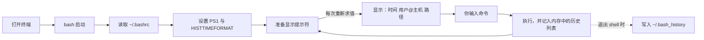
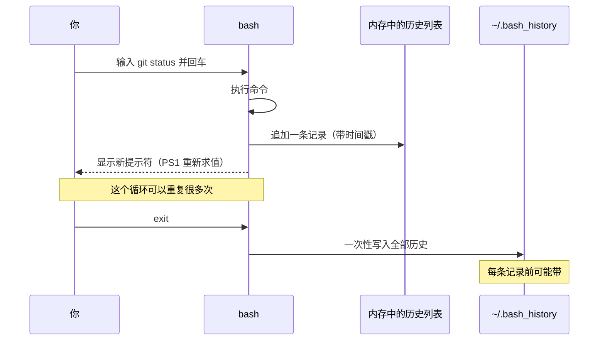

终端默认只记「做了什么」，不记「什么时候做的」。排查问题时最常见的疑问恰恰是时间：「这条命令是十分钟前跑的，还是昨天跑的？」——靠翻 shell 记录、翻截图，都很费劲。

两条配置就能把它补上：提示符前显示当前时间，历史命令前显示执行时间。这篇文章讲清楚**怎么配、为什么会生效**，以及几个容易踩的坑。

## 〇、先看整体流程



这张图有两个关键点，后面会分别展开：

1. **提示符不是印死的**。每次要显示提示符，bash 都会把 `PS1` 里的转义序列重新替换一遍，所以时间能跟着走。
2. **历史命令不是实时落盘的**。执行时先进内存，退出时才写进 `~/.bash_history`。

## 一、提示符里的时间是怎么来的

`PS1` 的全称是 Primary Prompt String，也就是你每次敲命令前看到的那串字符。它里面可以写普通文字，也可以写以反斜杠开头的**转义序列**——bash 在显示提示符前会把它们替换成实际值。

| 转义 | 含义 | 例子 |
| --- | --- | --- |
| `\u` | 当前用户名 | `jiangyu` |
| `\h` | 主机名（到第一个点为止） | `server` |
| `\w` | 当前完整路径，家目录显示为 `~` | `~/project` |
| `\W` | 只显示当前目录名 | `project` |
| `\$` | 普通用户显示 `$`，root 显示 `#` | `$` |
| `\D{格式}` | 当前时间，格式交给 strftime | `2026-08-30 10:30:00` |

`\D{...}` 就是这次的主角。花括号里的内容和 C 语言的 `strftime` 一致：`%Y` 年、`%m` 月、`%d` 日、`%H` 时、`%M` 分、`%S` 秒。**花括号是必须的**，写成 `\D%Y` 不会被识别。

打个比方：默认的提示符像一张印好的名片，上面永远只有名字和地址；加了 `\D` 之后，它变成了一张每次递出去之前才现写的便签——所以你看到的时间永远是「现在」。

也正因为是「每次重新写」，它不需要额外启动任何程序，开销可以忽略。

## 二、历史命令的时间：HISTTIMEFORMAT

`history` 命令默认只列出行号和命令本身：

```text
  128  git status
  129  git commit -m "update shell config"
```

设置 `HISTTIMEFORMAT` 之后，每条记录前面会多一个时间：

```text
  128  [2026-08-30 10:18:42] git status
  129  [2026-08-30 10:19:05] git commit -m "update shell config"
```

这个变量的值就是一个 strftime 模板。**末尾那个空格很关键**——不写空格，时间会和命令粘在一起，变成 `[2026-08-30 10:18:42]git status`，难看而且不好复制。

### 它不只是「显示」这么简单

很多人以为 `HISTTIMEFORMAT` 只影响 `history` 的输出。实际上，一旦设置了它，bash 在写历史文件时会**额外写入时间戳行**，这样时间才能跨会话保留。整个流程是这样的：



写进文件的时间戳长这样——一个 `#` 加 Unix 时间戳（从 1970 年起的秒数）：

```text
#1693361922
git status
#1693361945
git commit -m "update shell config"
```

这就是第三个坑的来源：**如果你用脚本解析 `~/.bash_history`，必须跳过以 `#` 开头的行**，否则会得到一堆看不懂的数字。

## 三、动手配置

把下面几行追加到 `~/.bashrc`。这是完整可用的版本，包含「文件不存在时先创建」的情况：


```shell
# 1. 确保配置文件存在；-a 表示不存在就创建，避免 >> 报错
touch ~/.bashrc

# 2. 追加两条配置（>> 是追加写，不会覆盖你已有的内容）
cat >> ~/.bashrc <<'EOF'
# 提示符：[时间] 用户@主机:路径$
# \D{%Y-%m-%d %H:%M:%S} 会在每次显示提示符时求值
export PS1='[\D{%Y-%m-%d %H:%M:%S}] \u@\h:\w\$ '
# 历史命令：每条前面加时间，末尾留一个空格
export HISTTIMEFORMAT='[%Y-%m-%d %H:%M:%S] '
EOF

# 3. 让当前终端立即生效（新开的终端会自动读取）
source ~/.bashrc
```



这里用了 `<<'EOF'` 这种写法，有两个好处：单引号包住 `EOF` 表示「里面一个字都别解释」，所以 `\D`、`$` 这些符号会原样写进文件，不会被当前 shell 提前吃掉。

配置完成后，提示符会变成这样：

```text
[2026-08-30 10:30:00] jiangyu@server:~/project$
```

历史命令也会带上时间：

```text
  128  [2026-08-30 10:18:42] git status
  129  [2026-08-30 10:19:05] git commit -m "update shell config"
```

## 四、为什么不把时间写进 PROMPT_COMMAND

想做「提示符里显示时间」，另一条路是在 `PROMPT_COMMAND` 里赋值 `PS1`——它会在每次显示提示符前执行一段命令：

```shell
# 不推荐：每次显示提示符都要启动一个 date 进程
PROMPT_COMMAND='PS1="[$(date +"%Y-%m-%d %H:%M:%S")] \u@\h:\w\$ "'
```

两种方式的差别如下：

| 方式 | 每次显示提示符的开销 | 适合的场景 | 局限 |
| --- | --- | --- | --- |
| `PS1` 里用 `\D{...}` | 没有，bash 内部求值 | 只需要显示时间 | 做不了条件判断 |
| `PROMPT_COMMAND` 里赋值 | 启动子进程（`date`） | 需要逻辑：分支名、上条命令退出码、耗时 | 命令多或终端慢时有可感知延迟 |
| `PS1` 里写 `$(date)` | 同上，每次都 fork | 临时调试 | 与上面同罪，但更容易写错 |

结论很简单：**只要「显示当前时间」这一件事，就用 `\D`**。只有在需要判断、需要外部命令结果时（比如显示 git 分支），才值得付出子进程的代价。

## 五、五个容易踩的坑

**1. 双引号会把时间算死。** 写 `export PS1="[$(date)] \w\$ "` 是在赋值那一刻就算好，之后永远是同一秒。要动态求值，要么用单引号让 bash 每次重新展开，要么直接上 `\D`——后者更省。

**2. 历史文件里混进 `#1698…` 行。** 这是 bash 保存时间戳的方式，不是乱码。写解析脚本时要过滤掉。

**3. 多个终端同时开，历史会互相覆盖。** 默认行为是退出时整体覆盖写入，最后退出的那个终端说了算。加上下面这行改成追加模式会好很多：

```shell
# 退出时把历史追加到文件，而不是覆盖
shopt -s histappend
```

**4. 只对交互式 shell 生效。** 脚本执行时不会读 `~/.bashrc` 里的这些变量，提示符和历史都不参与。

**5. 换 shell 要换写法。** 上面的配置只对 Bash 有效。Zsh 的提示符变量叫 `PROMPT`，时间格式串用 `%D{...}`；历史时间要先开一个选项，否则 `history -i` 也没东西可显示：


```shell
# Zsh：提示符前显示时间（%n 用户名、%m 主机名、%~ 当前路径）
PROMPT='%D{%Y-%m-%d %H:%M:%S} %n@%m %~ %# '
# Zsh：让历史记录保存时间戳，查看时用 history -i
setopt EXTENDED_HISTORY
```



Fish 没有等价的转义序列，需要在 `fish_prompt` 函数里调用 `date` 自己拼。

## 六、小结

- **提示符**：`PS1` 里的 `\D{...}` 在每次显示提示符时求值，零成本。
- **历史**：`HISTTIMEFORMAT` 既控制 `history` 的显示，也决定时间戳是否写进历史文件。
- **选择**：只显示时间用转义序列；需要逻辑再用 `PROMPT_COMMAND`。

改动前建议先备份一份配置，改坏了还能回来：

```shell
# 备份原配置，文件名带上日期便于回溯
cp ~/.bashrc ~/.bashrc.backup
```

这两项设置不改变命令本身的行为，却能让「什么时候做过什么」这件事随时可查——排查问题、回顾操作、写故障报告时，都会省下不少翻找的时间。
