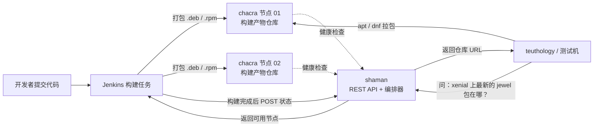
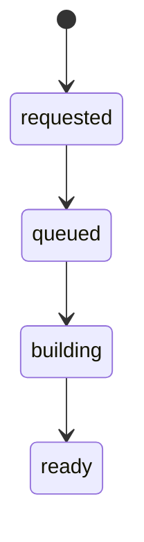
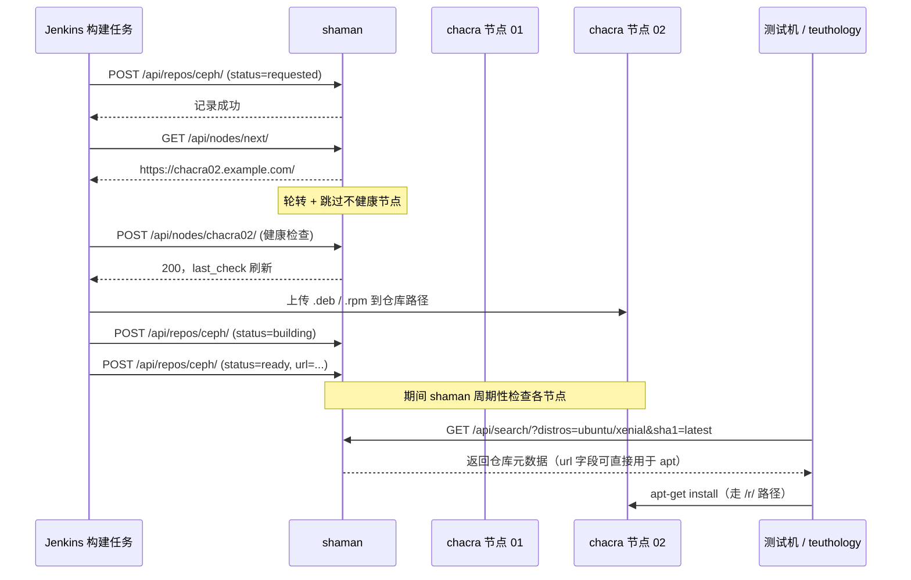

Ceph 有几十个分支、十几种发行版、多种 CPU 架构，每天还有上百次提交。这么多"分支 × 发行版 × 架构"的组合，如果每次都要开发者自己找"我这个提交在 Ubuntu 20.04 上的包在哪"，团队早就瘫了。

Ceph 社区为此搭了一套自己的构建基础设施，其中两个核心组件就是 **chacra** 和 **shaman**。这篇文章回答三个问题：**它们各自是什么、怎么用、内部是怎么配合的**。

> 本文是在阅读上游仓库 [ceph/shaman](https://github.com/ceph/shaman) 的 README 与接口定义后整理的笔记，接口字段、状态取值都以该文档为准，核对日期：2026 年 10 月 24 日。这套系统属于 Ceph 社区的历史基础设施，代码仍停留在 Python 2 时代（README 里用的是 `pip2`），理解它的设计比照着它搭新系统更有价值。

## 〇、先看一张全景图



一句话概括分工：**chacra 负责"东西放在哪"，shaman 负责"东西是什么状态、现在该找谁要"**。

## 一、为什么需要独立的一套

用一个生活化的比喻：Ceph 的构建就像一家每天出几百款新口味的中央厨房。

- **每款口味** = 一个「提交 SHA1 + 发行版 + 架构 + 编译选项」的组合；
- **仓库** = 放着成品的货架；
- **问题** = 前台要一份"上周三那款、给 Ubuntu 20.04 的、低内存版本"，得有人能立刻说出货架编号。

如果靠人记、靠目录乱翻，就会出三类事故：拿错版本（测试结论作废）、重复构建（浪费机器）、机器坏了没人知道（任务排到死节点上）。

所以这套系统必须解决三件事：**产物有稳定地址**、**状态可查询**、**节点可调度**。前两件 chacra 做了一部分，第三件归 shaman。

## 二、chacra：构建产物的仓库节点

chacra 是真正"放包"的机器。每台 chacra 节点上都跑着一个 Web 服务，对外暴露两类路径，这个区分很容易搞混，值得单独记住：

| 路径形式 | 用途 |
| --- | --- |
| `/r/<project>/<ref>/<sha1>/<distro>/<codename>/` | **给包管理器用**的仓库根地址，可以直接写进 `sources.list` 或 `.repo` 文件 |
| `/repos/<project>/<ref>/<sha1>/<distro>/<codename>/` | **给 shaman 用**的标识地址，只用来唯一标记"这一个仓库"，不作为下载源 |

也就是说，同一份包有两个地址：一个是给 `apt` 吃的，一个是给系统内部记账用的。shaman 里字段名 `url` 和 `chacra_url` 的差别，就来自这里——`chacra_url` 是主键，`url` 是给用户下载的。

## 三、shaman：状态源 + 编排器

shaman 本身不存包，它是一个 Pecan 框架写的 REST 服务，做两件事：

1. **状态源（source of truth）**：记录每个仓库当前处于什么状态；
2. **编排器（orchestrator）**：管理一组 chacra 节点，做健康检查和轮转，从而支持水平扩容。

### 3.1 三个顶层端点

父路径统一是 `/api/`：

| 端点 | 作用 |
| --- | --- |
| `/api/repos/` | 查看、新增、更新仓库信息 |
| `/api/search/` | 按条件检索仓库元数据 |
| `/api/nodes/` | 列出 chacra 节点、取下一个可用节点 |

### 3.2 一次 POST 长什么样

新增一个仓库时，构建任务往 `/api/repos/<project>/` POST 一段 JSON：

```json
{
  "distro": "Ubuntu",
  "distro_version": "Trusty",
  "ref": "jewel",
  "sha1": "45107e21c568dd033c2f0a3107dec8f0b0e58374",
  "url": "https://chacra.example.com/r/ceph/jewel/45107e21.../ubuntu/trusty/",
  "chacra_url": "https://chacra.example.com/repos/ceph/jewel/45107e21.../ubuntu/trusty/",
  "status": "requested"
}
```

注意两个细节：**`chacra_url` 是唯一标识**，更新时靠它定位，而不是靠 id；**`status` 和 `url` 是允许更新的字段**，其余字段视为不可变。这个设计很关键——构建是一个过程，状态会变，但"这是哪个仓库"不该变。

### 3.3 状态机与"口味"

`status` 只有四个取值，构成一条单向流水线：



`flavor` 表示编译变体，文档里给出三种：`default`、`notcmalloc`、`blkin`。前者是常规构建，后两者是为特定性能分析或内存调试场景准备的变体——这也是为什么"最新版本"这个词在 Ceph 语境里必须加上"哪种口味"才准确。

### 3.4 检索才是日常用得最多的地方

`GET /api/search/` 支持 `project`、`distros`、`ref`、`sha1`、`flavor`、`status` 六个过滤条件，返回结果**按构建时间倒序**。其中 `sha1=latest` 是个特殊值：

```text
?project=ceph&distros=ubuntu/xenial,centos/7&ref=jewel&sha1=latest
```

含义是"找 jewel 分支下，在 xenial 和 centos/7 两个发行版上**都构建成功**的、最新的那个共同提交"。当多个发行版同时出现在 `distros` 里时，`latest` 取的是它们的交集，而不是各自的最新——如果没有共同提交，就返回空。这个语义很实用（测试需要同一份代码在多平台上都有包），但也很容易被误解成"各自最新"。

### 3.5 谁能写

`POST` 和 `DELETE` 默认走 HTTP Basic 认证，凭据写在配置文件里：

```ini
api_user = username
api_key = secret
```

读接口（GET）不要求认证，因为包的元数据本身不是秘密，而写接口一旦被乱写，整个测试体系就会拿到错的包。

## 四、一次"我要最新包"的完整时序

把上面几块拼起来，就是下面这张图。注意 `nodes/next` 和健康检查这两处，是 shaman 作为编排器存在的理由。



有一点容易被忽略：**上传包和更新状态是两个独立动作**。数据传到 chacra 上，shaman 并不知情；必须由构建任务显式 POST 状态，状态才会变 `ready`。这意味着如果构建任务中途崩了，仓库会永远停在 `building`——排查"为什么搜不到包"时，第一个要看的就是这个字段。

## 五、把它在本地跑起来

依赖是 Python 2 和 RabbitMQ。下面是按 README 整理的完整流程，包含"配置目录不存在就创建"这种容易被省略的步骤：

```bash
# 1. 准备依赖：这套代码是 Python 2 时代的，必须用 python2 / pip2
python2 --version

# 2. 启动消息队列（shaman 用它做异步任务）
sudo systemctl enable --now rabbitmq-server
sudo systemctl status rabbitmq-server --no-pager

# 3. 取代码
git clone https://github.com/ceph/shaman.git
cd shaman

# 4. 装依赖（-r 表示从 requirements.txt 读取）
pip2 install -r requirements.txt

# 5. 安装项目本身（把 shaman 包注册进 Python 环境）
python2 setup.py install

# 6. 初始化数据库：读取 config/dev.py 里的配置（SQLite 时即建库建表）
pecan populate config/dev.py

# 7. 启动 API 服务，默认监听 127.0.0.1:8080
pecan serve config/dev.py

# 8. 另开一个终端验证：应该返回 JSON 列表（初始为空）
curl -s http://127.0.0.1:8080/api/repos/ | head
```

再写一个最小的 Python 2 脚本，模拟"构建任务上报一个仓库"，把上文的字段用一遍：

```python
#!/usr/bin/env python2
# -*- coding: utf-8 -*-
# 说明：仅用于本地验证接口，需先启动 shaman 服务
import json                      # 构造和解析 JSON
import urllib2                   # Python 2 的 HTTP 客户端

BASE = "http://127.0.0.1:8080"   # shaman 本地地址
SHA1 = "45107e21c568dd033c2f0a3107dec8f0b0e58374"      # 伪造一个提交号
REPO = "https://chacra.example.com/repos/ceph/jewel/%s/ubuntu/trusty/" % SHA1  # 唯一标识
URL  = "https://chacra.example.com/r/ceph/jewel/%s/ubuntu/trusty/" % SHA1      # 下载地址

payload = {                      # 上报体：字段名必须与上游文档一致
    "distro": "Ubuntu",
    "distro_version": "Trusty",
    "ref": "jewel",
    "sha1": SHA1,
    "url": URL,
    "chacra_url": REPO,
    "status": "requested",
}

req = urllib2.Request(                                   # 构造 POST 请求
    BASE + "/api/repos/ceph/",                           # 目标是 ceph 项目
    data=json.dumps(payload),                             # 序列化为 JSON 字符串
    headers={"Content-Type": "application/json"},         # 声明内容类型
)
try:
    resp = urllib2.urlopen(req, timeout=10)               # 发请求，10 秒超时
    print("状态码:", resp.getcode())                       # 200/201 表示成功
    print("返回:", resp.read())                            # 打印服务端返回
except urllib2.HTTPError as e:                            # 4xx/5xx 会走这里
    print("失败:", e.code, e.read())                       # 常见原因是缺少认证或字段缺失
```

## 六、这套设计里值得抄走的三点

1. **给同一份数据两个地址**：一个面向机器消费（下载源），一个面向系统记账（主键）。混用会让"改个域名"变成一次数据迁移。
2. **状态与标识分离**：`chacra_url` 不可变、`status` 可变，任何"过程型"系统都该这么切。
3. **编排器不碰数据面**：shaman 只告诉自己"该去哪个节点"，从不代理包下载。带宽和状态彻底解耦，扩容才不会互相拖累。

## 七、参考

- 上游仓库与接口文档：[ceph/shaman](https://github.com/ceph/shaman)
- 构建节点侧的实现：[ceph/chacra](https://github.com/ceph/chacra)

如果你只是想知道"Ceph 官方包在哪下载"，那不需要这套系统——直接用 [download.ceph.com](https://download.ceph.com/)。chacra 与 shaman 服务的是**开发与测试流程**：让每天上千次提交都能被自动化地变成可安装的包，并且能被测试框架稳定地找到。
