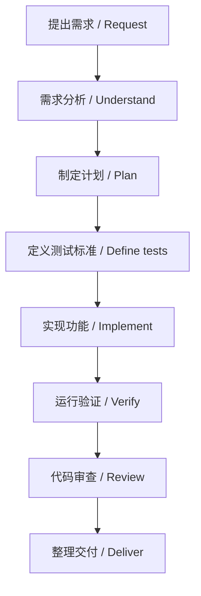

AI 编程工具已经能创建文件、修改代码、运行测试，甚至实现完整功能。但“能写出代码”和“能稳定地完成软件开发”之间，仍然隔着需求理解、方案选择、测试验证和安全交付这些关键环节。

`Superpowers` 可以理解为一套给 AI 编程助手使用的软件开发工作流技能。它不是新的编程语言，也不是另一个代码生成模型；它的重点是让 AI 在不同任务里按合适的顺序思考、行动和验证。

## 为什么 AI 写代码仍然会失控？

简单任务通常很顺利。但随着项目变大，AI 可能在没有充分理解需求时就开始修改；触碰了无关文件；只修复表象而没有定位根因；或者在没有验证的情况下宣布“已完成”。多个任务并行时，代码之间还可能互相干扰。

普通的交互往往像这样：

> 用户提出需求，AI 立刻修改代码。

Superpowers 希望把它变成一条更可靠的链路：

> 理解需求 → 讨论方案 → 制定计划 → 建立测试标准 → 实现功能 → 执行验证 → 审查与交付

它的目标不是让 AI “写得更多”，而是让复杂任务更可控、可追踪，也更容易证明结果是否真的正确。

## 核心技能

### 1. Brainstorming：先把需求想清楚

`brainstorming` 用于开发前的需求分析和方案设计。它会先帮助梳理用户目标、功能边界、技术限制、潜在风险和可选方案，而不是急着开始编码。

例如，“给网站增加用户登录”看似简单，但需要先明确：使用密码、手机号还是第三方登录？用户信息存在哪里？是否需要验证码、角色权限、登录状态和失败次数限制？没有这些答案就直接实现，很容易得到“能运行但不符合实际需求”的功能。

### 2. Writing Plans：把复杂任务拆开

当需求涉及多个模块时，`writing-plans` 会将它拆成可执行、可检查的步骤，并列出涉及的文件、依赖关系、风险点和验证方式。

比如“为博客增加搜索、标签、评论、用户中心和后台管理”并不是一个功能，而是一组相互关联的子系统。先拆分数据结构、搜索、标签筛选、评论、身份认证和后台页面，问题出现时才更容易定位，也更容易控制改动范围。

### 3. Test-Driven Development：先定义正确是什么

`test-driven-development` 的核心是先定义功能必须满足的行为，再实现代码。以限流为例，测试可以先规定：第一次请求成功、超过配额后失败、等待窗口结束后恢复、不同用户彼此隔离，并发时没有竞态问题。

这能避免 AI 只写出“看起来合理”的实现，却遗漏边界条件。它尤其适合接口、数据处理、权限、存储和其他核心逻辑。

### 4. Systematic Debugging：先确认事实，再动代码

面对 Bug，最危险的方式是让 AI 不断猜测并修改。`systematic-debugging` 要求先复现问题、收集完整错误信息、定位发生位置、分析调用链、验证假设，再做最小修复并重新测试。

例如数据库连接失败时，不能只把超时时间调大。还要检查服务是否启动、端口是否监听、网络和 DNS 是否可达、凭据和数据库名称是否正确、SSL 配置是否匹配，以及连接池是否耗尽。

### 5. Verification Before Completion：没有证据，就不说完成

代码写完不等于功能完成。`verification-before-completion` 要求交付前运行与任务相匹配的验证：单元或集成测试、构建、格式与静态检查、关键页面实际访问，以及 Git diff 检查。

它强调一个简单却重要的原则：没有新鲜的验证结果，就不能声称任务已经完成。这个原则在生产环境和影响范围较大的修改中尤其重要。

### 6. Code Review、Worktree 与并行代理

较大功能完成后，`requesting-code-review` 可以检查需求覆盖、逻辑错误、安全隐患、性能、错误处理和测试缺口。`using-git-worktrees` 则为不同任务提供隔离目录与分支，减少多个改动混在一起的风险。

如果任务边界清晰、改动文件不重叠，`dispatching-parallel-agents` 能让不同代理并行处理独立部分，例如前端检查、后端分析、测试补充和文档整理。但并行不是越多越好：共享同一文件或存在明显依赖的工作应该按顺序进行。

## 一条完整的工作流

在实际工作中，并非每个任务都要走完整流程。改一个拼写、替换一段文字或调整明确的配置项，可以快速处理并检查结果。涉及核心逻辑、数据结构、权限、网络、存储、重构或上线的任务，则值得投入更多分析、计划和验证。

## Superpowers 和普通提示词的差别

你当然可以临时对 AI 说：“先分析需求，再写代码，完成后运行测试。”这在简单任务中很有用。区别在于，Superpowers 把这类要求沉淀成了可复用的流程，并针对创建功能、排查 Bug、实现逻辑、并行任务和收尾交付匹配不同方法。

可以把它理解为：普通提示词是一次性的提醒；Superpowers 是一套可以持续使用的开发制度。

## 它适合谁？

它适合独立开发者、频繁使用 AI 创建网站和工具的人、维护复杂工程的开发者，以及希望理解完整开发过程的初学者。对 Ceph、数据库、网络、分布式存储等风险较高的系统而言，“先分析、再计划、后验证”尤其有价值。

当然，它不会自动让模型获得更多知识，也无法保证没有 Bug。代码质量仍然取决于模型能力、项目上下文、需求质量和验证覆盖面。它改善的是思考顺序、流程纪律与风险控制。

## 结语

更成熟的 AI 编程，不应该只是“让 AI 自动写代码”，而应当是让 AI 按可靠的软件工程方式，与人一起完成开发。Superpowers 提供的正是这样一种实践：开发前理解问题，实现前制定计划，修改后验证结果，交付前检查质量。
