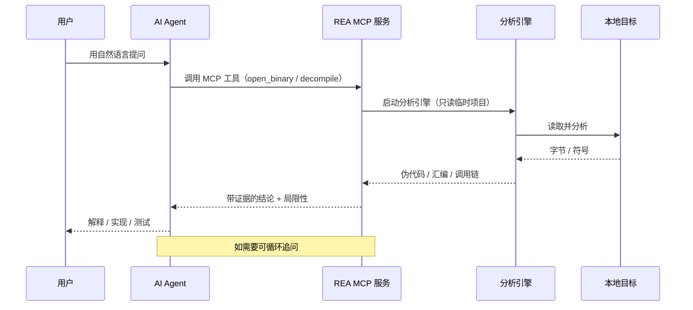

本文介绍 **REA（Reverse Engineer Anything，[morluto/rea](https://github.com/morluto/rea)）**：它是什么、运行原理、如何在 **CentOS Stream 9** 上安装，以及如何用命令行和 AI Agent 两种方式使用。每一步都会解释命令和配置的含义。

> REA 是一个面向"AI Agent 逆向工程"的 MCP 服务与工作流套件。它本身不替代 Ghidra/Hopper 等工具，而是把 Agent 和这些工具连接起来。本文核对日期：2026 年 10 月 14 日，npm 包 `rea-agents` 当时版本约 6.4.0，具体以 [npm 页面](https://www.npmjs.com/package/rea-agents) 为准。

## 一、REA 是什么

REA 的全称是 Reverse Engineer Anything，一句话概括：**让 AI Agent（Claude Code、Codex、Cursor、Gemini CLI 等）能对本地程序做逆向工程分析**。

典型场景：你在某个 App 里看到一个想要的功能，但没有它的源代码。你可以让 Agent"研究这个 App 的搜索是怎么实现的，给出证据，再帮我做一个类似的"。Agent 通过 REA 去检查二进制、反汇编、追踪相关代码，把带证据的结论拿回来，再据此解释原理、写代码或做测试。

REA 支持的分析对象很多，包括：原生二进制（需要 Hopper/Ghidra/IDA）、JavaScript 与 Electron 应用、.NET 程序集、Go/Rust 二进制（内置静态解析）、WASM、EVM 字节码、SQLite 数据库、Android APK（JADX）、固件、网络抓包（HAR/PCAP）、网站页面等。其中 JavaScript/Electron 和 .NET 的静态分析**不需要**任何第三方反汇编引擎。

## 二、运行原理：REA 是如何工作的

REA 的核心是一个 **MCP（Model Context Protocol）服务**，外加一套给 Agent 用的工作流指令（skill）。它自己不"理解"二进制，而是负责调度各种分析引擎，并把结果整理成"带证据的结论"返回给 Agent。

一次典型的工作流程是：

1. 你在 Agent 里用自然语言提问，例如"分析这个 App 的搜索功能"。
2. Agent 通过 MCP 调用 REA 的工具（打开目标、反汇编、跟踪调用、提取字符串/符号等）。
3. REA 在**本地**启动对应的分析引擎：原生二进制交给 Hopper/Ghidra/IDA，JavaScript/Electron 用内置静态分析器，.NET 用静态解析，依此类推。
4. REA 把结果（伪代码、汇编、模块关系、调用链等）连同**证据**和**局限性**一起返回。
5. Agent 基于这些结果继续追问、解释行为，或据此编写和测试实现。命令行 `rea` 走的是同一套工作流。

几个关键点：

- **分析在本地进行**：目标程序不会被上传到 REA；REA 只把工具结果交给你的 Agent，Agent 所属的模型服务商有其自己的数据政策。
- **证据驱动**：REA 返回的每个结论都尽量附带证据（地址、指令、引用等）和局限性说明，方便核对。
- **原生分析要引擎**：深度分析原生二进制需要一个反汇编引擎；纯 JavaScript/.NET 静态分析则不需要。

工具之间的调用关系如下：



## 三、安装前的准备（CentOS Stream 9）

### 3.1 安装 Node.js

REA 是 TypeScript 编写的 Node 工具，运行时要求是 **Node.js 22.x（≥22.19）、24.x（≥24.11）或 26+**，并且需要 npm。注意 **23、25 以及预发布版不受支持**。

```bash
node -v
npm -v
```

确认已装且在支持范围内；没装的话参考本博客《CentOS Stream 9 安装 Node.js 环境》一文（nvm 或官方二进制包都行，注意选 22/24/26 而不是 23/25）。

### 3.2 安装 procps（Linux 前置）

在 Linux 上，REA 的进程管理器在启动子进程前要校验进程归属，需要一个 procps 兼容的 `ps` 命令。Ghidra、JADX、固件工具以及 JavaScript/Electron 静态分析都会用到这个检查。

```bash
ps --version
sudo dnf install -y procps-ng
```

CentOS Stream 9 一般默认就装了 `procps-ng`，`ps --version` 能输出版本就说明满足；缺失时用上面的 `dnf install` 补装，否则相关工作流会以 `capability_unavailable` / `provider_unavailable` 之类错误拒绝启动。

### 3.3 检查 Java 和 Ghidra（仅原生分析需要）

如果只做 JavaScript/Electron、.NET 这类静态分析，这一步可以跳过。要分析原生二进制，REA 需要 Hopper、Ghidra 或 IDA 其中之一。Linux 上最常用的免费选择是 **Ghidra 12.1.x + JDK 21**（Ghidra 由 Java 驱动）。

```bash
java -version
javac -version
```

没有 Java 环境时，用 Temurin 等发行版装一个 JDK 21，并把 `JAVA_HOME` 指向它。Ghidra 的安装方式（下载官方压缩包解压）在下一节配置步骤里一起说明。

## 四、安装 REA

REA 通过 npm 发布，包名是 `rea-agents`。有两种主要安装形态：给 Agent 用的 MCP 注册，以及全局命令行工具。

### 4.1 给 Agent 集成（推荐）

```bash
npx rea-agents@latest setup
```

`npx rea-agents@latest setup` 用 npx 临时拉取最新版并运行交互式安装向导。`@latest` 表示始终用最新发布版。向导会做几件事：

- 列出它检测到的受支持 Agent（Claude Code、Codex、Cursor、Gemini CLI、Grok Build 等），让你勾选要配置哪些；已装过 REA 的默认选中，新检测到的不默认勾选。
- 预览它要写入的配置路径和改动，**需要你确认后才会真正写文件**，并在写入前自动备份现有配置。
- 为选中的 Agent 注册 REA 的 MCP 服务，并安装配套的工作流指令（skill）。
- 可选：检测到你本机已有 Ghidra 时保存其路径，或（在你明确同意后）帮你安装 Hopper。Ghidra、Java、Python 则不会被自动安装。

向导跑完后，按提示**重启对应 Agent**，MCP 注册才生效。

如果想在脚本里非交互地指定 Agent，可以用 `--client` 参数，例如只配 Codex：

```bash
rea setup --client codex
```

也可以先做只读演练，看计划而不真正改动：

```bash
rea setup --client codex --dry-run
```

如果你用的客户端支持手动配置 MCP，也可以不用向导，直接写入这段 JSON（把 `6.4.0` 换成当前最新版本号）：

```json
{
  "mcpServers": {
    "rea": {
      "command": "npx",
      "args": ["-y", "rea-agents@6.4.0", "mcp"]
    }
  }
}
```

`command` 是启动器，`args` 里的 `mcp` 表示以 stdio 方式启动 REA 的 MCP 服务。正式使用建议固定具体版本号（不要只写 `@latest`），保证行为可复现；`setup` 向导会自动帮你固定为当前运行的版本。

### 4.2 全局命令行工具

想在终端里直接敲 `rea` 命令，就全局安装：

```bash
npm install --global rea-agents
rea --help
```

`npm install --global` 把包装到全局并加入 `PATH`；`rea --help` 列出可用命令，能输出帮助说明安装成功。注意：不带 `--global` 的 `npm install rea-agents` 只装到当前项目的 `node_modules/.bin` 里，不会让 `rea` 在 shell 里全局可用。

### 4.3 一键安装脚本（可选）

```bash
curl -fsSL https://raw.githubusercontent.com/morluto/rea/main/install.sh | bash
```

这个 curl 包装脚本只做一件事：全局安装 `rea-agents` npm 包，打印版本、运行时和安装位置，有终端时会接着启动 `rea setup`。不想立即进入向导可以加 `--no-setup`：`bash -s -- --no-setup`。

### 4.4 验证安装与就绪状态

```bash
rea doctor --json
```

`rea doctor` 是**只读**的健康检查，会审计 Node 运行时、已注册的 Agent、已安装的 skill 和可用的分析引擎，并给出每项的通过/失败和修复建议。它是排查"为什么用不了"最直接的入口。只查某一部分可以用参数缩小范围，例如 `rea doctor --provider ghidra --json`（检查 Ghidra 引擎）、`rea doctor --client codex --json`（检查 Codex 注册）、`rea doctor --skill --json`（检查工作流指令）。

## 五、配置原生分析引擎（可选：Ghidra）

要分析原生二进制，在 CentOS Stream 9 上推荐免费的 Ghidra。准备好 JDK 21 和 Ghidra 12.1.x 后，用环境变量告诉 REA 它们的位置：

```bash
export GHIDRA_INSTALL_DIR=/opt/ghidra_12.1.4_PUBLIC
export JAVA_HOME=/opt/jdk-21
rea doctor --json
rea setup
```

`GHIDRA_INSTALL_DIR` 指向解压后的 Ghidra 目录（REA 会校验 12.1.x 版本、`support/analyzeHeadless` 启动器、Java 版本和 64 位 JDK）；`JAVA_HOME` 指向 JDK 21，如果 `java`/`javac` 已经在 `PATH` 里也可以不设。`rea doctor --json` 验证配置是否通过，`rea setup` 会把验证过的路径写进 Agent 的 MCP 环境。

REA 使用 Ghidra 时会为每次分析创建**临时的只读项目**（`-readOnly`、用完 `-deleteProject`），不会打开或改动你已有的 Ghidra 工程。大二进制首次分析可能较慢，默认启动等待 330 秒，不够可以设 `REA_GHIDRA_STARTUP_TIMEOUT_MS`（毫秒）；内存受限的小机器可用 `GHIDRA_HEADLESS_MAXMEM=512M` 这类环境变量控制 JVM 堆。

> 提醒：IDA Pro、Hopper、JEB 等商业工具必须由你自己合法购买并取得授权，REA 不提供任何商业工具的授权、密钥或激活。

## 六、如何使用

### 6.1 方式一：通过 AI Agent 使用

安装并重启 Agent 后，直接用自然语言提需求。以 Codex 或 Claude Code 为例：

```text
理解一下 Notes 应用里的搜索功能是怎么实现的，把证据展示出来，然后为我的项目做一个类似的功能。
```

把 `Notes` 换成你的目标程序、把"搜索功能"换成你想研究的功能。Agent 会自动通过 REA 打开目标、反汇编/静态分析、追踪相关代码，然后把带证据的结论、代码引用和未知点返回给你，你可以继续追问或让它动手实现。

### 6.2 方式二：使用命令行

命令行适合脚本化和快速验证。例如分析一个已解包的 JavaScript/Electron 应用目录：

```bash
rea analyze-javascript-application /绝对路径/到/应用目录 --json
```

`analyze-javascript-application` 对传入目录做静态分析，返回模块、导入关系、Electron 边界（IPC、preload、原生扩展）及其证据，`--json` 让结果以结构化 JSON 输出，便于后续处理。Windows 上路径类似 `"D:/apps/example"`。

用 `npx` 免安装跑一次性命令则写成：

```bash
npx -y rea-agents@latest analyze-javascript-application /绝对路径/到/应用目录 --json
```

原生二进制的分析通常更依赖 Agent 交互（通过 `open_binary`、`decompile` 等 MCP 工具逐步深入），命令行也有对应入口，用 `rea --help` 查看完整命令列表，或参考官方 [CLI 与 Evidence 指南](https://github.com/morluto/rea/blob/main/docs/cli.md)。

### 6.3 看懂返回结果

无论走 Agent 还是 CLI，REA 返回的结果都强调"可核对"：它会给出具体代码、地址、引用等**证据**，并注明当前分析的**局限性**（哪些调用无法确定、哪些符号缺失等）。做二次开发前，应结合这些证据人工确认关键结论，而不是直接采信。

## 七、更新与卸载

REA 更新很快，新版本常带 bug 修复，建议保持更新。

全局安装的 CLI 用：

```bash
rea update
```

`rea update` 只更新拥有当前 CLI 的那个 npm/Bun 全局安装，更新前会先检查新版本可执行文件是否正常。通过 npx 集成的 Agent 则重新跑一次向导：

```bash
npx rea-agents@latest setup
```

按提示确认改动后重启 Agent。

卸载用：

```bash
rea uninstall
rea uninstall --purge-data
```

`rea uninstall` 只移除 REA 拥有的 Agent 注册和 skill 文件；`--purge-data` 额外删除 `~/.rea` 下的缓存和状态。Hopper、Node.js、Evidence 文件、抓包结果、其他 skill 和 MCP 服务都会保留。

## 八、合法与安全使用

REA 只应被用于**合法研究、教育、互操作性、软件保存**，以及分析你**自己拥有或已获授权**的软件。官方明确：不得用于非法或未授权的分析；IDA Pro/Hex-Rays、Hopper、JEB 等商业工具必须按各自授权合法取得和使用，破解、盗用密钥、绕过授权都不被支持。

分析对象在本地处理，不会被 REA 上传；但你使用的 AI Agent 会把工具结果发送给其模型服务商，处理敏感目标时要注意这一点。

## 九、常见问题

### 报 Node.js 版本不支持

REA 只支持 Node.js 22.x（≥22.19）、24.x（≥24.11）和 26+，23、25 及预发布版不支持。用 `node -v` 确认版本，必要时用 nvm 切换到支持的大版本。

### 启动子进程被拒，提示 capability_unavailable / provider_unavailable

Linux 上多半是缺少 procps 兼容的 `ps`。用 `ps --version` 确认，缺失则 `sudo dnf install -y procps-ng`。

### `rea doctor` 显示不健康但我的功能其实能用

`doctor` 会审计所有检测到的注册、skill 和可选引擎，某个可选部分失败不一定影响你的具体工作流。用 `--client`、`--provider`、`--skill` 缩小范围定位真正影响你的那一项。

### Ghidra 分析大二进制一直超时

提高启动等待时间：在 MCP 服务的环境里设 `REA_GHIDRA_STARTUP_TIMEOUT_MS`（毫秒，整数）。同时确认 `GHIDRA_INSTALL_DIR` 指向的是 Ghidra 12.1.x 且 JDK 是 64 位、`javac` 可用。

### 忘了 REA 装在哪、怎么升级

全局装用 `rea update`；npx 集成用 `npx rea-agents@latest setup` 重新注册。查看当前版本和健康状态用 `rea doctor --json`。

## 官方资源

- [项目仓库 morluto/rea](https://github.com/morluto/rea)
- [官网 rea.tools](https://rea.tools/)
- [npm 包 rea-agents](https://www.npmjs.com/package/rea-agents)
- [安装与配置文档](https://github.com/morluto/rea/blob/main/docs/installation.md)
- [CLI 与 Evidence 指南](https://github.com/morluto/rea/blob/main/docs/cli.md)

*内容依据 morluto/rea 官方 README 与安装文档整理，核对日期：2026 年 10 月 14 日。REA 迭代较快，命令、支持的 Node 版本和包版本可能变化，请以上述官方文档为准。*
