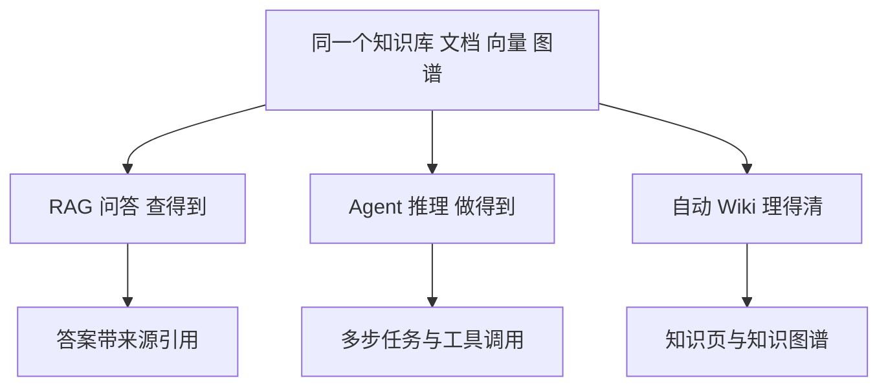

上一篇《CentOS Stream 9 部署 WeKnora》讲了它是什么、怎么装。这一篇换一个角度：**假设你已经把 WeKnora 跑起来了，它到底能帮你做什么、每一项功能怎么用、适合什么场景**。本文基于 WeKnora v0.8.3（2026 年 10 月 14 日发布）的功能整理，尽量覆盖全面，并用真实场景举例。

## 一、先建立整体印象

WeKnora 的所有能力，都围绕"把文档变成可用的知识"这条主线展开。对使用者来说，最直观的是三种工作方式，它们共用同一套知识库：

- **RAG 问答**解决"查得到"：用自然语言问，从文档里找答案，并告诉你出处。
- **Agent 推理**解决"做得到"：不只回答，还能规划多步、调用工具、产出文件。
- **自动 Wiki**解决"理得清"：把散乱文档自动整理成结构化的、带知识图谱的 Wiki。

## 二、三种工作模式详解

### 2.1 RAG 问答：有出处的答案

把文档上传到知识库后，你可以直接提问。WeKnora 会先做"关键词 + 向量"的混合检索，再交给大模型生成答案，并且**每条关键结论都带来源引用**——点击引用能跳回原文对应段落。

适用场景：

- 公司制度、产品手册、技术文档的"查一下"；
- 客服一线人员快速查口径；
- 新员工遇到问题先问知识库，而不是去群里问人。

### 2.2 Agent 推理：多步骤的"助手"

在"智能推理"模式下，WeKnora 会像助手一样规划步骤：先检索知识、需要时读整篇文档、调用网络搜索或外部 MCP 工具、在沙箱里跑技能，逐步推进，直到完成任务。整个过程会在对话里展示每一步在做什么。

适用场景：

- "整理这周知识库里的 X，汇总成一份报告"；
- "对比知识库里 A 和 B 两个方案，给我结论"；
- "查知识库 + 联网搜索，核实某个说法是否过时"。

### 2.3 自动 Wiki：知识自动结构化

开启 Wiki 后，Agent 会把知识库文档里的**人物、产品、概念**抽出来，自动生成互相链接的 Wiki 页面，并画出知识图谱。页面可直接编辑，每次修改都有版本、可回滚。

适用场景：

- 团队文档沉淀成可浏览的知识网站；
- 新成员 onboarding 的"项目全景图"；
- 制度/流程的长期维护。

## 三、知识库管理

### 3.1 三种库型

- **文档库**：上传文件后解析、切块、向量化，适合大段资料。
- **FAQ 库**：一问一答的结构化知识，适合客服口径、常见问题。
- **Wiki 库**：以 Wiki 页面的形式组织，配合自动 Wiki 使用。

### 3.2 支持的文档格式

PDF、Word、PPT、Excel、CSV、TXT、Markdown、HTML、EPUB、MHTML、JSON、XMind 以及图片。Office 文件由内置的 anydoc 在进程内解析，无需额外服务。

### 3.3 精细的管理能力

- **目录树**：文件夹上传保留原有层级结构；
- **切块可编辑**：检索用的"文本块"可以手动修改、查看 diff、回滚；
- **批量打标**：给文档打多个标签，便于分类检索；
- **上传时单独配置**：每个文件可单独选择解析方式、切块策略、是否启用多模态；
- **自动打标**（v0.8.0 起）：系统可自动给文档打标签。

### 3.4 数据源自动同步

不只是上传文件，还能连接外部数据源，定期自动同步：

| 数据源 | 说明 |
| --- | --- |
| 飞书、飞书云文档、Lark | 企业常用协作平台 |
| Confluence | 技术文档 |
| GitLab | 代码仓库里的文档 |
| Notion、语雀 | 个人/团队知识库 |
| 钉钉文档 | 钉钉生态 |
| Seafile | 私有网盘 |
| RSS | 订阅源 |

适用场景：团队已经在用飞书/Confluence 存文档，接上数据源后 WeKnora 自动持续同步，无需手工搬运。

## 四、问答与检索体验

- **混合检索**：关键词（BM25 类）+ 向量语义检索同时召回，兼顾"精确匹配"和"意思相近"。
- **重排（Rerank）**：对召回结果二次精排，把最相关的片段排前面。
- **父级切块**：保留上下文，避免答案断章取义。
- **GraphRAG**：可选接 Neo4j，用知识图谱补充多跳关系（"A 依赖 B，B 属于 C"）。
- **引用溯源**：答案里的引用可跳回原文段落。
- **流式输出**：答案逐字生成，体验顺滑。
- **多轮对话**：可追问、可基于上下文继续聊。

## 五、Agent 与工具

### 5.1 技能（Skills）与沙箱

- 技能可从 ClawHub / SkillHub / Git / ZIP 安装；
- 技能运行在**沙箱**里：支持 Docker / E2B / Cube 后端，同一会话共享一个工作区，生成的文件可预览、下载；
- 聊天旁有**交互式终端**和**图形桌面**，你能实时看到 Agent 在跑什么、随时接管。

适用场景：让 Agent 写脚本、处理数据、生成文档，全程可见、可干预。

### 5.2 本地浏览器（BrowserSkill）

通过开源 BrowserSkill 扩展，Agent 能操作你**自己电脑上的 Chrome/Edge**：打开页面、填表单、点按钮，遇到登录或验证码时交还给你手动完成，再继续。

适用场景：需要登录内网系统才能查到的信息；带登录态的自动化流程。

### 5.3 MCP 工具与工具箱

WeKnora 能连接外部 **MCP 服务**，并在工具箱里**逐个工具**选择启用、是否需人工审批，支持 OAuth 认证。

适用场景：把公司内部的 API、数据库查询、其他系统能力以 MCP 工具形式接进来，让 Agent 编排调用。

### 5.4 会话控制

- **重定向**：在运行中的回合追加新要求；
- **分叉**：从任意历史问题重新出发，不丢上下文；
- **回退**：配合沙箱检查点，回到之前的状态；
- **推理强度**：每个会话可选模型推理强度；
- **产物库**：生成的文件统一收集管理。

### 5.5 长期记忆

跨会话的长期记忆：**画像、偏好、事实、任务、兴趣**五类，由 Agent 自动提取、经你确认后保存。下次它会记得"你是谁、你偏好什么、上次做到哪"。

## 六、自动 Wiki 与知识图谱

- 自动生成**互联的 Wiki 页面**，按目录组织，带来源引用；
- **知识图谱**可视化页面间的关系（v0.8.3 改进了分组与主题标签）；
- 页面可**在线编辑**，支持 diff 和回滚；
- 适合把"散乱文档"沉淀成"长期维护的结构化知识"。

## 七、模型与后端：用户视角的配置

使用者不需要写代码，在界面里即可完成：

- **模型**：29 家内置厂商（OpenAI、DeepSeek、通义、智谱、混元、Gemini、Ollama 等），也能自定义 OpenAI 兼容接口；
- **Embedding**：Ollama、BGE、GTE、智谱、OpenAI 兼容；v0.8.3 新增多模态 Embedding（如 Qwen3-VL-Embedding、腾讯 WeMM-Embedding），文本和图片能进同一个向量空间；
- **重排**：内置多款，v0.8.3 新增 TEI / Pinecone / Cohere 重排；
- **向量库**：pgvector（默认）、Milvus、Qdrant、Elasticsearch、OpenSearch、Weaviate、Doris、腾讯 VectorDB；
- **对象存储**：本地盘、MinIO、S3、腾讯 COS、阿里 OSS 等；一个工作区可配置**多个存储实例**；
- **离线**：全走本机 Ollama + Milvus + MinIO，数据完全不出内网。

这套"后端全可换"意味着：小团队用默认配置开箱即用，企业按合规要求换自建/私有后端。

## 八、渠道接入

WeKnora 不是只能打开网页用，它可以把问答能力铺到团队已经在用的地方：

| 渠道 | 形式 |
| --- | --- |
| IM | 企业微信、飞书、Lark、QQBot、Slack、Telegram、钉钉、Mattermost、微信、云之家 |
| 网页嵌入 | 嵌到外部网站，提供问答窗口 |
| 内置 MCP Server | 把知识库发布给 Cursor、Claude 等 AI 工具（每个工作区独立 endpoint + token + 限流） |
| CLI | `weknora` 命令行，面向终端和 AI Agent |
| Chrome 插件 | 网页选中文字/图片一键存为知识 |
| 微信小程序 | 移动端轻量问答 |
| Go SDK / API | 程序化接入（约 360 个 API） |

适用场景：客服在飞书群里直接 @ 机器人问答；开发者把知识库接到 Cursor 里辅助写代码。

## 九、权限与安全

- **多工作区 + 四角色 RBAC**：Owner / Admin / Contributor / Viewer，按资源设所有权；
- **审计日志**：每个工作区都有操作记录；
- **API Key 分级**：可限定作用域（知识库、工具组）和主模型；
- **OIDC**：对接企业统一登录；
- **凭据加密**：API Key、模型密钥等用 AES-256-GCM 加密落库；
- **SSRF 防护**：对外部地址做校验，可白名单模式；
- **注册策略**：可邀请制（v0.8.3 新增 invitation-only）。

## 十、可观测与运维

- **Langfuse 追踪**：看每个 Agent 步骤、token 用量、流水线耗时；
- **文档解析时间线**：解析过程分阶段可视化，慢在哪一目了然；
- **任务队列看板**：查看排队/失败任务，管理工作线程池。

## 十一、典型使用场景

1. **企业内部知识库问答**：把制度、手册、SOP 全部入库，员工用自然语言提问，答案带出处，减少反复群聊提问。
2. **客服与支持**：FAQ 库 + 飞书/企业微信渠道，一线客服直接 @ 机器人查口径，回复一致。
3. **研发团队**：接 GitLab、Confluence 数据源，自动同步设计文档、接口文档，开发者提问即可定位。
4. **新人 onboarding**：自动 Wiki 把项目文档整理成带知识图谱的"项目全景"，新成员按图学习。
5. **个人第二大脑**：Chrome 插件随手收藏网页，长期记忆记住你的偏好，随时问答。
6. **离线私有化 RAG**：Ollama 本地模型 + Milvus + MinIO，敏感数据不出内网。
7. **AI 工具互联**：通过内置 MCP Server，把企业知识库接进 Cursor/Claude，编码时边写边查内部文档。
8. **研究报告与数据整理**：Agent 检索 + 网络搜索 + 技能沙箱，自动汇总成带引用的报告。

## 十二、总结

从使用者角度看，WeKnora 的价值可以浓缩成三句话：

- **查得到**：混合检索 + 重排 + 引用溯源，答案可信、可核对；
- **做得到**：Agent + 工具 + 沙箱 + 浏览器，把"问答"升级成"干活"；
- **理得清**：自动 Wiki + 知识图谱，让知识长期有序。

再叠加"后端全可换、渠道全覆盖、权限够细"这三点企业特性，它适合从个人第二大脑到企业级知识中台的各种规模。

## 官方资源

- [项目仓库 Tencent/WeKnora](https://github.com/Tencent/WeKnora)
- [官网与文档](https://weknora.weixin.qq.com/docs/)
- [产品功能一览](https://weknora.weixin.qq.com/docs/03-features/01-tenant-auth)
- [v0.8.3 发布说明](https://weknora.weixin.qq.com/docs/07-releases/v0.8.3)

*内容依据 WeKnora v0.8.3 官方 README 与发布说明整理，核对日期：2026 年 10 月 19 日。功能随版本演进，请以官方文档为准。*
