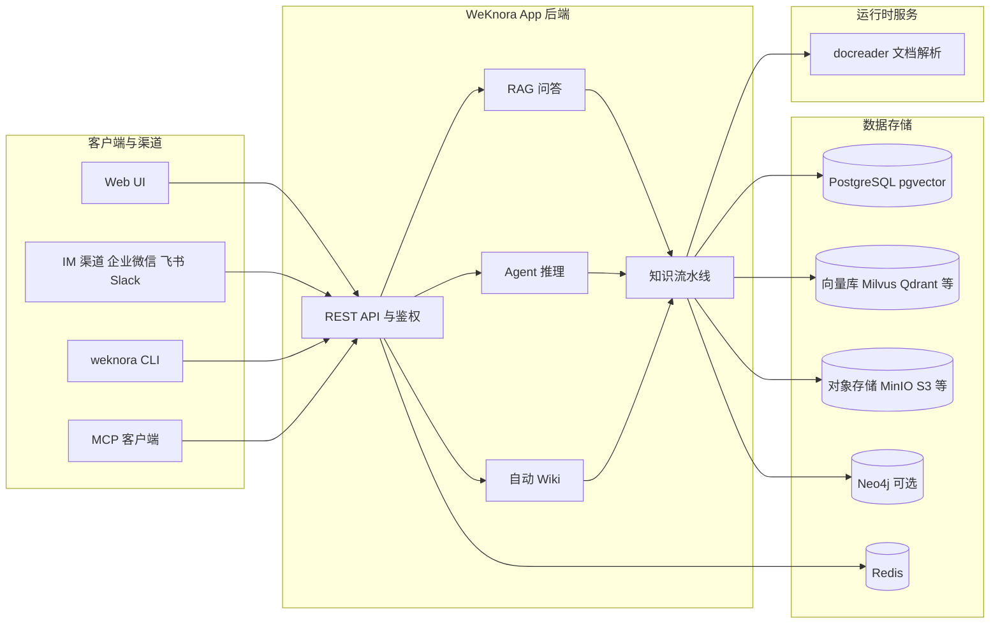
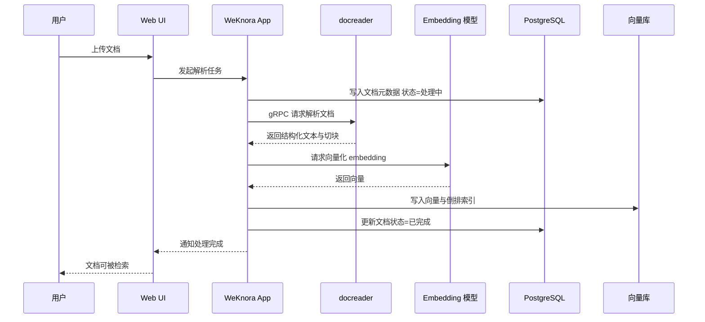
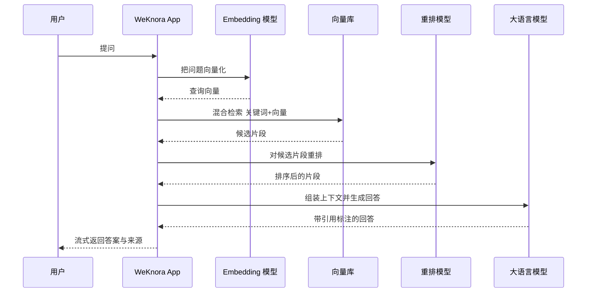
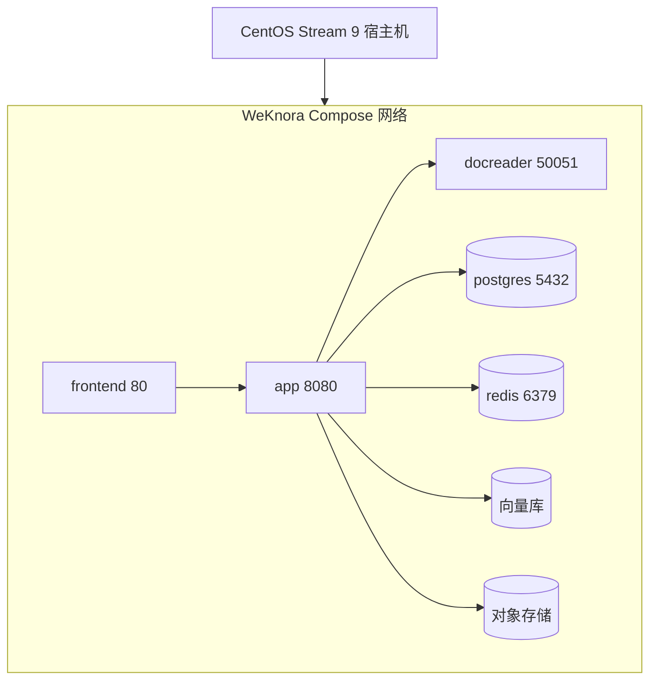
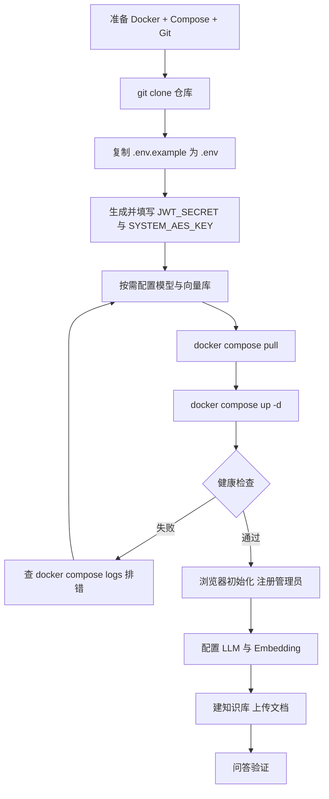

本文用**产品经理 + 架构师**的双重视角，完整拆解腾讯开源的 **WeKnora**（[Tencent/WeKnora](https://github.com/Tencent/WeKnora)）：它是什么、解决什么问题、有哪些功能、系统架构长什么样、文档从入库到被问答的完整数据流是怎么跑的，以及如何在 **CentOS Stream 9** 上从零部署并接入本地大模型。文中配了架构图、流程图和多张时序图，每一步都有解释。

> 核对版本：v0.8.3（2026 年 10 月 14 日发布），MIT 协议。WeKnora 迭代很快，具体配置和默认端口请以 [官方文档](https://weknora.weixin.qq.com/docs/) 为准。

## 一、产品定位：WeKnora 解决什么问题

### 1.1 一句话定位

WeKnora 是一个**开源的、基于大模型的企业级知识平台**：把团队散落的文档变成"可以被提问、被推理、被自动整理"的知识资产。它的官方定位是"把原始文档变成可查询的 RAG、自主推理的 Agent，以及自我维护的 Wiki"。

### 1.2 它解决的真实痛点

企业里知识往往以 PDF、Word、网页、飞书文档、Confluence 等形式散落在各处，员工要靠关键词搜索或人肉翻找。WeKnora 把这一过程产品化为三步闭环：

1. **把文档"喂"进去**——自动解析、切块、向量化；
2. **用自然语言"问"出来**——检索增强生成，答案带来源引用；
3. **让知识"活"起来**——Agent 多步推理、自动 Wiki、跨会话记忆。

### 1.3 三种核心使用方式

| 模式 | 干什么 | 典型场景 |
| --- | --- | --- |
| RAG 问答 | 基于知识库检索并生成带引用的回答 | 内部文档问答、客服辅助 |
| Agent 推理 | 多步规划，调用知识库、网络搜索、MCP 工具、技能 | 研究报告、数据整理、自动化任务 |
| 自动 Wiki | 把文档自动整理成互联的知识页与知识图谱 | 制度沉淀、新人 onboarding |

### 1.4 它和周边产品的定位差异

- 对比**纯向量库**（Milvus/Qdrant）：那些是"存储与检索引擎"，WeKnora 是在其之上的一整套"解析 → 检索 → 生成 → 权限 → 渠道"应用。
- 对比**纯 LLM 框架**（LangChain/LlamaIndex）：那些是"开发脚手架"，WeKnora 是开箱即用的产品，同时保留可替换的扩展点。
- 对比**知识管理工具**（Notion/Confluence）：那些侧重"人写人看"，WeKnora 侧重"机器读、机器答、机器整理"。

一句话：**WeKnora 是面向"文档 → 知识 → 答案"的企业 RAG 平台，而非某个单点组件。**

## 二、功能全景

| 领域 | 能力 |
| --- | --- |
| 问答与 Agent | 快速问答（带引用）、ReAct 智能体、多轮追问、对话可"重定向/分叉/回退"、跨会话长期记忆 |
| 知识库 | FAQ / 文档 / Wiki 三种库型；目录树；切块可编辑并带修订历史；批量打标 |
| 检索 | 关键词 + 向量混合检索、重排（rerank）、父级切块、GraphRAG（Neo4j） |
| 文档解析 | PDF、Word、PPT、Excel、CSV、Markdown、HTML、EPUB、XMind、图片等十多种格式 |
| 数据源同步 | 飞书、Confluence、GitLab、Notion、语雀、钉钉文档、Seafile、RSS 等 |
| 技能与沙箱 | 技能可从 ClawHub/SkillHub/Git/ZIP 安装；Docker/E2B/Cube 沙箱，会话级持久化 |
| 渠道 | 企业微信、飞书、Slack、Telegram、钉钉等 IM；网页嵌入；内置 MCP Server；Chrome 插件；CLI |
| 权限与安全 | 多工作区 RBAC（四角色）、审计日志、OIDC、API Key 分级、AES-256-GCM 凭据加密、SSRF 防护 |
| 可观测 | Langfuse 追踪（步骤/token/流水线）、文档解析时间线、任务队列看板 |

## 三、系统架构（架构师视角）

WeKnora 是一条**模块化流水线**，从文档解析、向量化、检索到 LLM 推理，每一环都能替换或扩展：



组件职责与替换关系：

| 组件 | 职责 | 可替换为 |
| --- | --- | --- |
| 前端（Nginx + UI） | 界面与反向代理，默认 80 端口 | 无需替换 |
| 后端 app（Go） | 业务逻辑、RAG 流水线、API，默认 8080 | 无需替换 |
| docreader | 文档解析（gRPC 50051） | 内建解析器，可选 MinerU / PaddleOCR-VL 等 |
| PostgreSQL | 元数据（用户/知识库/文档/会话） | 默认也是 pgvector 向量库 |
| Redis | 异步任务队列与缓存（asynq） | 可配 Redis TLS / 独立实例 |
| 向量库 | 语义检索 | pgvector（默认）、Milvus、Qdrant、Elasticsearch、OpenSearch、Weaviate、Doris、腾讯 VectorDB |
| 对象存储 | 文档文件与附件 | 本地盘（默认）、MinIO、S3、腾讯 COS、阿里 OSS、火山 TOS、华为 OBS、金山 KS3 |
| Neo4j（可选） | 知识图谱 GraphRAG | 关闭或替换 |
| Langfuse（可选） | 调用链追踪与 token 统计 | 云端 Langfuse 或自建 |

设计上几个关键点：

- **异步任务**：文档解析、向量化等耗时操作走 Redis 队列（asynq），前端不阻塞，支持失败重试与死信。
- **多租户**：工作区（workspace）隔离 + 四角色 RBAC + 审计日志，适合团队共用一套实例。
- **SSRF 防护**：对外部模型/连接器/向量库的请求做地址校验，支持白名单模式，降低内网被探测风险。

## 四、核心流程（时序图）

### 4.1 文档入库流程



解释：上传后先记录元数据，再交给 docreader 做格式解析和切块；切好的文本块交给 Embedding 模型变成向量；向量写入向量库，同时关键词进入倒排索引，为后续混合检索做准备。整个链路异步执行，失败会进入重试/死信队列。

### 4.2 RAG 问答流程



解释：问题先向量化，再到向量库做"关键词 + 向量"混合召回；召回结果经重排模型精排后，把最相关的片段作为上下文交给 LLM 生成答案；最终答案携带来源引用，用户可以点回原文核对。这也是 RAG 相比"直接问 LLM"能减少幻觉的关键——答案被约束在真实文档里。

### 4.3 Agent 推理流程（简述）

Agent 模式在 RAG 基础上叠加"多步规划 + 工具调用"：模型先规划步骤，按需调用 `search_knowledge`（检索）、`read_document`（读原文）、网络搜索、MCP 工具、技能沙箱等，每步结果再进入下一轮决策，直到给出最终答案。对话可中途"分叉、回退、追加要求"，并保留跨会话长期记忆。

## 五、可集成的数据库与外围软件（集成矩阵）

WeKnora 的核心设计原则是"**所有后端都可替换**"，v0.8.3 的完整集成矩阵：

| 类别 | 支持项 |
| --- | --- |
| LLM 大模型 | OpenAI、Azure OpenAI、Anthropic、DeepSeek、通义千问、智谱、混元、豆包、Gemini、MiniMax、NVIDIA、SiliconFlow、OpenRouter、LiteLLM、Ollama 等 29 家 |
| Embedding | Ollama、BGE、GTE、智谱、OpenAI 兼容接口 |
| 向量数据库 | PostgreSQL(pgvector)、Elasticsearch、OpenSearch、Milvus、Weaviate、Qdrant、Apache Doris、腾讯 VectorDB |
| 对象存储 | 本地盘、腾讯 COS、MinIO、AWS S3、火山 TOS、阿里 OSS、金山 KS3、华为 OBS |
| 数据源 | 飞书、飞书云文档、Confluence、GitLab、Notion、语雀、钉钉文档、Seafile、RSS |
| IM 渠道 | 企业微信、飞书、QQBot、Slack、Telegram、钉钉、Mattermost、微信、云之家 |
| 网络搜索 | DuckDuckGo、Bing、Google、Tavily、百度、SearXNG、Exa、Metaso 等 |
| 可观测 | Langfuse |

选择建议：**起步全默认**（PostgreSQL + pgvector + 本地盘 + 任意一家 LLM API）；**离线私有化**则把 LLM/Embedding 换成本机 Ollama，向量库可换 Milvus，对象存储可换 MinIO——这些正好能复用本博客之前的 Docker、Ollama、Milvus 系列文章。

## 六、部署拓扑与容量规划

| 形态 | 适用场景 |
| --- | --- |
| Docker Compose（标准） | 单机全功能，多服务编排，本文主线 |
| Kubernetes（Helm） | 生产集群、高可用 |
| Lite 单二进制 | 低资源环境，内置 SQLite + 内存队列，无外部依赖 |
| 桌面 App | Lite 运行时 + GUI |

标准 Compose 单机拓扑：



容量建议：内存 8 GB 起步（前端 + 后端 + docreader + PostgreSQL + Redis + 向量库），磁盘预留 20 GB 以上；大模型走外部 API 或本机 Ollama，不占容器内存。生产环境建议内网部署、数据目录挂载到数据盘、定期备份数据库和对象存储。

## 七、CentOS Stream 9 部署实施

### 7.1 部署流程图



### 7.2 环境准备

```bash
sudo docker --version
sudo docker compose version
sudo dnf install -y git
free -h
df -h
```

`docker compose` 必须是 v2 写法；Docker 安装见本博客《CentOS Stream 9 安装 Docker》。`free -h`、`df -h` 确认内存和磁盘满足第六节的容量要求。

### 7.3 获取代码与配置

```bash
git clone https://github.com/Tencent/WeKnora.git
cd WeKnora
cp .env.example .env
```

`.env` 是全项目的环境变量中心：模型、数据库、向量库、对象存储、密钥等都在这里配置。绝大多数有默认值，可直接用。

### 7.4 生成并填写密钥

```bash
openssl rand -hex 32   # JWT_SECRET
openssl rand -hex 16   # SYSTEM_AES_KEY
```

把结果写进 `.env` 的 `JWT_SECRET` 和 `SYSTEM_AES_KEY`。前者签名登录 Token；后者是 AES-256 主密钥，加密数据库里的 API Key、模型密钥等敏感字段（必须 32 字节）。**丢失后已加密字段无法恢复，升级时也必须沿用旧值。**

### 7.5 核心配置项速览

| 变量 | 默认 | 说明 |
| --- | --- | --- |
| `FRONTEND_PORT` | 80 | Web UI 端口 |
| `APP_PORT` | 8080 | 后端 API 端口 |
| `DB_DRIVER` / `DB_HOST` | postgres | 元数据数据库 |
| `RETRIEVE_DRIVER` | postgres | 向量检索引擎 |
| `STORAGE_TYPE` | local | 文件存储后端 |
| `OLLAMA_BASE_URL` | http://host.docker.internal:11434 | 本机 Ollama 地址 |
| `WEKNORA_VERSION` | latest | 镜像版本 |
| `DISABLE_REGISTRATION` | false | 是否禁止注册 |

### 7.6 拉取镜像并启动

```bash
docker compose pull
docker compose up -d
docker compose ps
curl http://127.0.0.1:8080/health
```

`pull` 拉取前端、后端、docreader、PostgreSQL、Redis 等镜像；`up -d` 后台启动；`ps` 看容器健康状态；`curl /health` 验证后端就绪。之后浏览器打开 `http://服务器IP` 进入初始化。

## 八、接入本地 Ollama（离线模型）

离线私有化场景，把 LLM 和 Embedding 换成本机 Ollama（见《CentOS Stream 9 安装 Ollama》）。注意 **Linux 上 `host.docker.internal` 默认不解析**，需要两步：

1. 让 Ollama 监听局域网：`OLLAMA_HOST=0.0.0.0:11434` 后重启 ollama。
2. 把 `.env` 的 `OLLAMA_BASE_URL` 改成容器能访问的宿主机地址，如 `http://172.17.0.1:11434`（Docker 默认网桥网关）或宿主机内网 IP。

然后 `docker compose up -d` 重建，在模型配置里把对话模型和 Embedding 模型都选 Ollama 并填写模型名即可。

## 九、可选组件与 profile

```bash
docker compose --profile neo4j --profile minio --profile langfuse up -d
```

| Profile | 组件 |
| --- | --- |
| （默认） | 核心服务 |
| `full` | 全部功能 |
| `neo4j` | Neo4j 知识图谱 |
| `minio` | MinIO 对象存储 |
| `langfuse` | Langfuse 追踪（3000 端口） |

启用 Neo4j 后还需在 `.env` 设 `NEO4J_ENABLE=true` 及连接信息；启用 MinIO 则把 `STORAGE_TYPE=minio` 并填 `MINIO_*`。

## 十、首次使用引导

1. 打开 `http://服务器IP`，注册管理员账号并登录。
2. 配置模型：填 LLM 与 Embedding 的厂商、模型名、API 地址与密钥（Ollama 无需密钥）。
3. 新建知识库，上传文档，等待解析与向量化完成。
4. 对话提问，核对答案与来源引用。

## 十一、运维：升级、备份与监控

升级：

```bash
docker compose pull
docker compose up -d
```

先在 `.env` 设置目标 `WEKNORA_VERSION`，升级前阅读对应版本的升级说明，数据库迁移通常自动完成。

备份：重点备份三类数据——PostgreSQL 数据卷（元数据）、向量库数据、对象存储文件（`data-files` 卷或 MinIO bucket）。定期 `pg_dump` 元数据库，并把文件目录同步到异地。

监控：启用 Langfuse 看 token 与调用链；`docker compose ps` + `/health` 做健康巡检；`docker compose logs -f app` 看运行日志。

## 十二、安全

- 部署在**内网**，不要直接暴露公网；
- 配置防火墙，只放行必要端口；
- 生产务必设置 `JWT_SECRET`、`SYSTEM_AES_KEY` 并妥善保管；
- 需要时 `DISABLE_REGISTRATION=true`、启用复杂密码策略；
- 启用 SSRF 白名单，限制对外部地址的访问；
- 及时升级，跟进安全补丁。

## 十三、常见问题

| 问题 | 处理 |
| --- | --- |
| 拉镜像慢 | 配置 Docker 国内镜像加速 |
| 后端连不上 | `docker compose ps` + `curl /health` + `docker compose logs app` |
| 80/8080 被占用 | 改 `FRONTEND_PORT` / `APP_PORT` |
| 文档解析慢/失败 | 确认 docreader 健康，调大 `WEKNORA_DOCUMENT_PROCESS_TIMEOUT` 等 |
| Ollama 连不上 | 改 `OLLAMA_BASE_URL` 为宿主机 IP，Ollama 监听 0.0.0.0 |
| 换 Milvus 向量库 | `RETRIEVE_DRIVER=milvus` + `MILVUS_*` 配置 |

## 官方资源

- [项目仓库 Tencent/WeKnora](https://github.com/Tencent/WeKnora)
- [官网与文档](https://weknora.weixin.qq.com/docs/)
- [架构概览](https://weknora.weixin.qq.com/docs/02-architecture/01-overview)
- [RAG 流水线](https://weknora.weixin.qq.com/docs/02-architecture/04-rag-pipeline)
- [安装指南](https://weknora.weixin.qq.com/docs/01-getting-started/02-installation)
- [v0.8.3 发布说明](https://weknora.weixin.qq.com/docs/07-releases/v0.8.3)

*内容依据 WeKnora 官方 README、docker-compose.yml 与 .env.example 整理，核对日期：2026 年 10 月 19 日。架构图与时序图基于官方文档描述的流水线绘制，细节以官方文档为准。*
