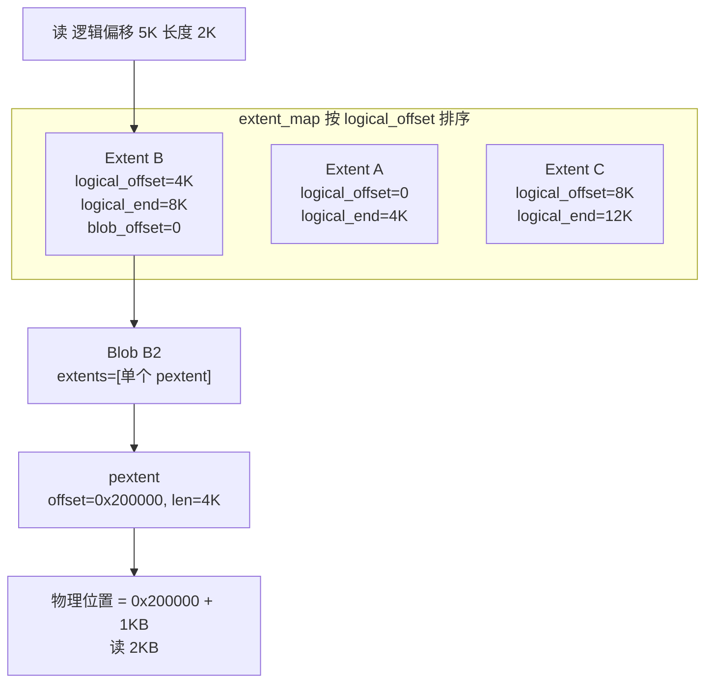
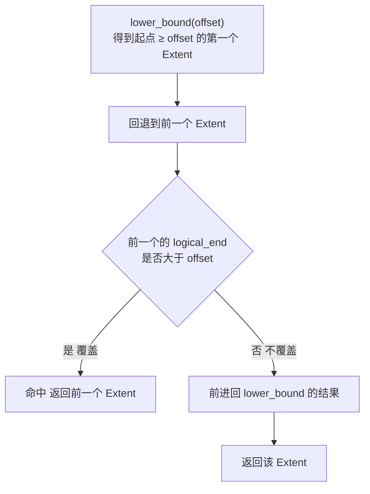
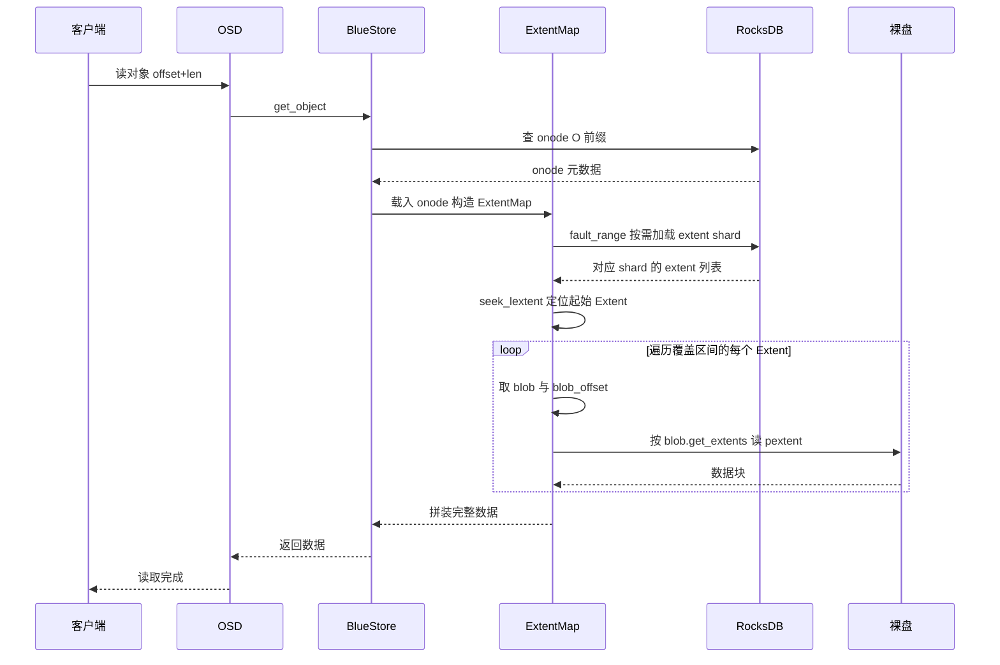
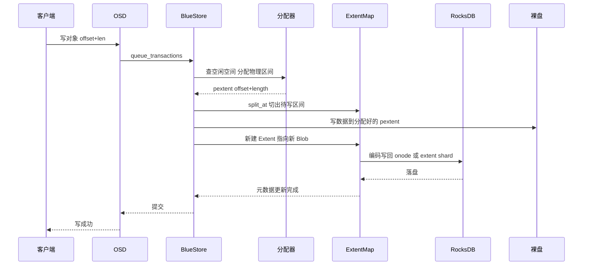

上一篇讲了 onode 和 OMap 是什么。这一篇钻到最底层：**BlueStore 到底怎么记住"对象的每一段数据分别落在盘的哪个偏移、多长"，以及读的时候怎么顺着这条链把数据找回来**。答案就是 **extent map（扩展位图）**。本文基于 **Ceph v21.1.2 源码**，配数据结构图、时序图和具体例子。

## 一、问题：数据直写裸盘后，怎么定位

BlueStore 把对象数据直接写到裸盘，绕开了 RocksDB。但对象不是一个连续大块——它可能被多次覆盖写、压缩、去重，实际在盘上是一段一段的。所以必须有一张"地图"记录：

```text
对象逻辑偏移  →  盘上的物理偏移 + 长度
```

这张地图就是 **extent map**，它挂在 onode 里、存在 RocksDB 的 `O` 前缀下（见前文 onode 篇）。

## 二、三层数据结构

extent map 不是一张扁平的"逻辑→物理"表，而是分成三层，一层比一层靠近磁盘：


### 2.1 Extent：逻辑区间

内存里的 `Extent` 定义在 `src/os/bluestore/BlueStore.h`：

```cpp
struct Extent : public ExtentBase {
    uint32_t logical_offset = 0;   // 这段数据在对象里的逻辑起始偏移
    uint32_t blob_offset = 0;      // 这段数据在 blob 内部的偏移
    uint32_t length = 0;           // 长度
    BlobRef  blob;                 // 数据真正所在的 blob
};
typedef boost::intrusive::set<Extent> extent_map_t;  // 按 logical_offset 排序
```

一个 Extent 回答的是"**对象 [logical_offset, +length) 这段逻辑数据，存在哪个 blob 的哪个位置**"。

### 2.2 Blob：一段盘上数据

`bluestore_blob_t` 定义在 `src/os/bluestore/bluestore_types.h`（约 507 行）：

```cpp
struct bluestore_blob_t {
  PExtentVector extents;          // 物理盘上的位置列表
  uint32_t logical_length;        // 逻辑长度（未压缩时的长度）
  uint32_t compressed_length;     // 压缩后的长度
  uint32_t flags;                 // COMPRESSED / CSUM / SHARED 等
  uint8_t  csum_type;             // 校验类型
  buffer::ptr csum_data;          // 校验数据
};
```

Blob 是一段真正写在盘上的数据单元，它知道自己的物理位置（`extents`）、是否压缩、是否带校验。**多个 Extent 可以指向同一个 Blob**——例如覆盖写或去重时，不同逻辑区间的数据共享同一段物理数据。

### 2.3 pextent：物理区间

`bluestore_pextent_t`（约 114 行）继承自 `bluestore_interval_t<uint64_t, uint32_t>`，就是一对：

```text
offset  +  length   （物理磁盘偏移 + 长度）
```

一个 Blob 的 `extents` 可能包含多个 pextent（数据跨了不连续盘区）。

### 2.4 一张图串起来

用一个具体例子（对象 12KB，分三段，各 4KB）：

| 对象逻辑区间 | Extent 字段 | 指向 Blob | Blob 的 pextent |
| --- | --- | --- | --- |
| [0, 4K) | logical_offset=0, blob_offset=0, len=4K | B1 | offset=0x100000, len=4K |
| [4K, 8K) | logical_offset=4K, blob_offset=0, len=4K | B2 | offset=0x200000, len=4K |
| [8K, 12K) | logical_offset=8K, blob_offset=0, len=4K | B3 | offset=0x300000, len=4K |

读"逻辑 5KB 开始的 2KB"的推导过程：

1. 找到覆盖 5KB 的 Extent：`[4K, 8K)`，其 `blob_offset=0`；
2. blob 内偏移 = `(5K - 4K) + blob_offset` = 1KB；
3. 该 Extent 的 blob = B2，B2 的 pextent = `offset=0x200000`；
4. 最终物理位置 = `0x200000 + 1KB`，读 2KB。

整条定位链画出来是这样（高亮的是"读 5K"命中的路径）：



## 三、内存里怎么组织与查找

`extent_map_t` 是一个按 `logical_offset` 排序的 intrusive set。查找"哪个 Extent 覆盖逻辑偏移 offset"的核心函数是 `seek_lextent`（`src/os/bluestore/BlueStore.cc` 约 4439 行）：

```cpp
iterator ExtentMap::seek_lextent(uint64_t offset) {
  Extent dummy(offset);
  auto fp = extent_map.lower_bound(dummy);   // 第一个 logical_offset >= offset 的 Extent
  if (fp != extent_map.begin()) {
    --fp;                                    // 回退到前一个
    if (fp->logical_end() <= offset) {
      ++fp;                                  // 前一个不覆盖 offset，再前进
    }
  }
  return fp;
}
```

逻辑很清晰：`lower_bound` 找到"起点 ≥ offset 的第一个"，然后回退一个，检查它是否真的覆盖了 offset；不覆盖就前进回来。O(log N) 完成定位。

用图看这次查找（假设 extent_map 里有 A、B、C 三个 Extent）：

```text
extent_map（按 logical_offset 有序）：

   ExtA        ExtB        ExtC
  [0,4K)      [4K,8K)     [8K,12K)
    │           │            │

查找覆盖 5K 的 Extent：

  1. lower_bound(5K)  → ExtB    // 第一个 logical_offset ≥ 5K 的
  2. 回退一步         → ExtA    // 但 ExtA.logical_end()=4K ≤ 5K，不覆盖
  3. 前进回来         → ExtB    ✅ 命中，返回 ExtB
```

换成流程图，`seek_lextent` 的决策逻辑就是：



覆盖写时还会用 `split_at`（约 4467 行）把一个 Extent 从中间劈开成两个，共享同一个 blob、各自调整 `blob_offset`，这样写中间一段不会影响两边的已有数据。

## 四、extent map 如何持久化：内联与分片

extent map 是 onode 的一部分。小对象：直接编码进 onode 值里。**大对象**（extent 特别多、单条 onode 太大）会**分片（shard）**：

- onode 里的 `extent_map_shards` 记录每个 shard 的偏移和大小；
- 每个 shard 单独存一条 RocksDB key，规则是（`BlueStore.cc` 约 515 行）：

```text
extent shard key = onode_key + u32(offset) + 'x'
```

内存侧对应 `ExtentMap::Shard`（`BlueStore.h` 约 970 行），带 `loaded` / `dirty` 状态；跨 shard 的 blob 记在 `spanning_blob_map` 里。读取时如果目标范围所在的 shard 还没加载，`fault_range`（`BlueStore.cc` 约 4332 行）会从 RocksDB 按需把那几个 shard 读进来——也就是**大对象的 extent map 不是一次全载入，而是用到哪段加载哪段**。

## 五、读路径时序图：如何把数据找回来



关键代码对应：读循环里 `for (auto p : blob.get_extents())`（`BlueStore.cc` 约 2470 行）就是把一个 Blob 拆成若干 pextent 逐个从裸盘读。

## 六、写路径时序图：如何生成与更新 extent



写的时候：先问分配器要一块空闲物理区间（`PREFIX_B` / `PREFIX_ALLOC`，即 RocksDB 里的空闲空间表），数据写进去，再在 extent map 里插入一个新 Extent 指向新 Blob（必要时 `split_at` 处理边界），最后把 onode / extent shard 编码回 RocksDB。

## 七、压缩、校验、去重如何体现在这张图里

- **压缩**：Blob 里 `compressed_length < logical_length`，且 `FLAG_COMPRESSED` 置位；读的时候按逻辑区间读，解压后再返回。
- **校验和**：`FLAG_CSUM` + `csum_data`，按 `csum_chunk_order` 分块校验，读时逐块验。
- **去重/共享**：`FLAG_SHARED` 的 blob 挂在 `SharedBlob` 下，多个对象的 Extent 指向同一份物理数据，用引用计数管理（`bluestore_extent_ref_map_t`）。

这三种能力都不改变"Extent → Blob → pextent"的定位链，只是让 Blob 层多了"怎么解释这段物理数据"的元信息。

## 八、总结

一句话：**extent map 是一棵从"对象逻辑偏移"到"裸盘物理偏移"的映射链**：

```text
逻辑偏移 → Extent(logical_offset, blob_offset, length) → Blob(extents[]) → pextent(offset, length)
```

- 内存里按 `logical_offset` 排序，`seek_lextent` 用二分在 O(log N) 内定位；
- 落盘时随 onode 一起存 RocksDB，大对象拆成 `onode_key + u32 + 'x'` 的分片按需加载；
- 读：`seek_lextent` 定位 → 逐 Extent 取 blob → 遍历 pextent 读盘；
- 写：分配器给区间 → 写数据 → 插 Extent → 回写 onode/shard。

搞懂这条链，BlueStore 的压缩、去重、覆盖写、PG 重建扫描、以及"为什么大对象 extent map 会分片"就都通了。

## 参考

- 源码：`src/os/bluestore/BlueStore.h`（Extent / ExtentMap）、`src/os/bluestore/BlueStore.cc`（seek_lextent / split_at / fault_range / 读写路径）、`src/os/bluestore/bluestore_types.h`（bluestore_blob_t / bluestore_pextent_t）
- [Ceph 官方文档：BlueStore](https://docs.ceph.com/en/latest/rados/configuration/bluestore-config-ref/)

*内容依据 Ceph v21.1.2 源码（commit b6f98ed07f4）阅读整理，核对日期：2026 年 10 月 20 日。代码结构可能随版本演进，具体以对应版本源码为准。*
