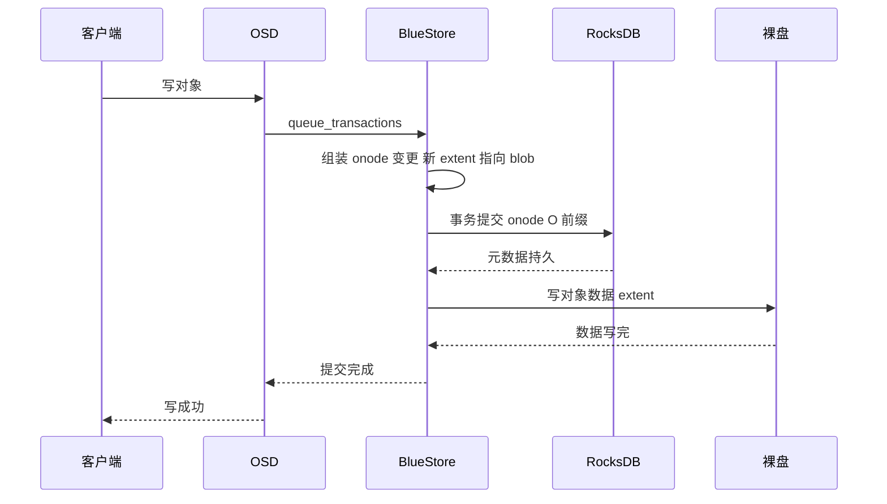
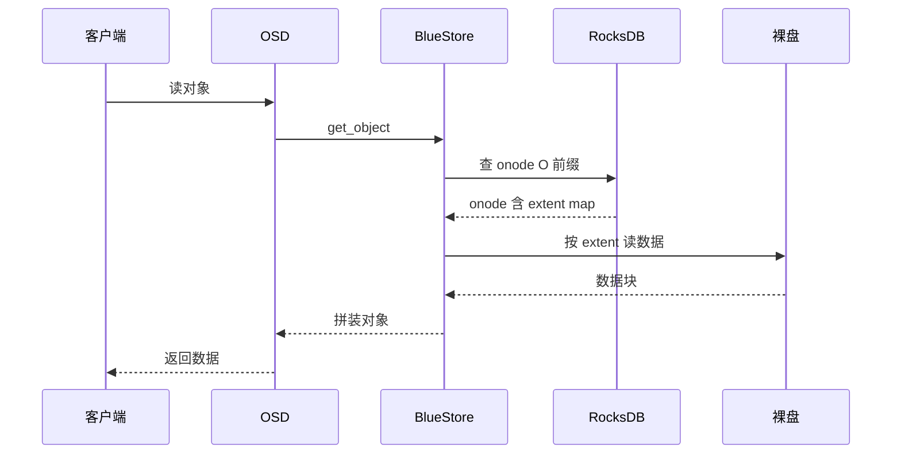
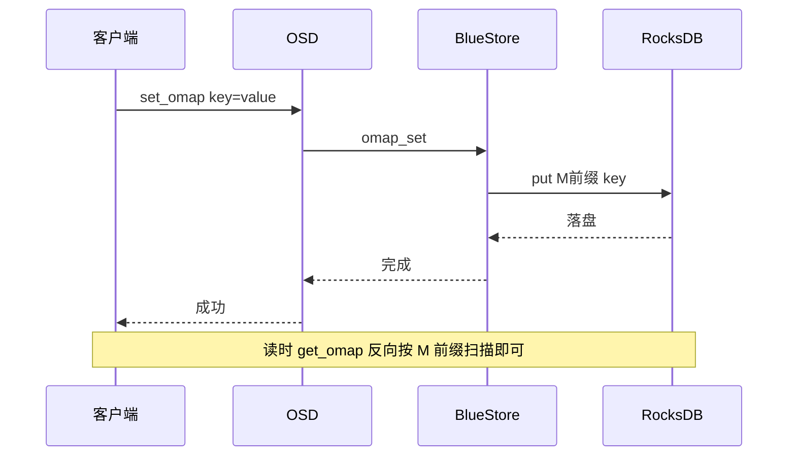
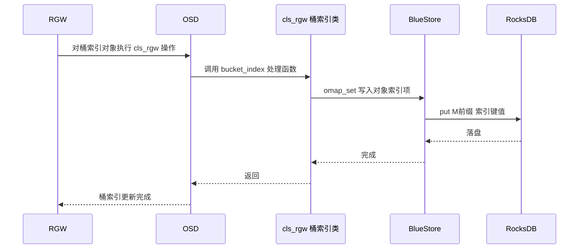

上一篇《Ceph 如何使用 RocksDB》讲了 RocksDB 在 Ceph 里的整体位置。这一篇顺着往下，专门讲两个核心概念：**onode** 和 **OMap**。它们是理解 BlueStore 存储模型、以及 RGW/桶索引/CephFS 性能的关键。本文基于 **Ceph v21.1.2 源码**，指出代码位置，并配时序图。

## 一、先回答"为什么会有 onode"

一个 RADOS 对象包含三样东西：

1. **数据**（data）：对象内容本体，可能很大；
2. **属性**（xattr）：少量元数据；
3. **OMap**：挂在对象名下的一堆小键值。

BlueStore 把"数据本体"直接写到裸盘（绕开 RocksDB），但这就带来一个问题：**写完之后，得记住"这个对象的每一段数据分别落在盘的哪个偏移、多长"，否则下次就读不回来**。这个"索引"就是 onode 的核心内容——extent map（扩展位图）。

所以 onode 的诞生原因可以概括成一句话：**数据很大、要落盘，但"数据在哪"的索引很小，值得单独放在 RocksDB 里**。这正是 BlueStore"元数据与数据分离"的设计原点。

## 二、onode 是什么

onode 是"object node"的缩写，是 BlueStore 里描述一个对象的元数据结构。它的核心类型是 `bluestore_onode_t`，定义在 `src/os/bluestore/bluestore_types.h`（约 1160 行）：

| 字段 | 含义 |
| --- | --- |
| `nid` | onode 在本地唯一的数字 id |
| `size` | 对象大小 |
| `attrs` | 对象的 xattr 键值对 |
| `extent_map_shards` | 扩展位图分片信息（大对象会把 extent map 拆成多个 shard） |
| `expected_object_size` / `expected_write_size` | 写入提示，用于分配策略 |
| `alloc_hint_flags` | 分配提示标志 |
| `flags` | 是否含 OMap、以及 OMap 的存储前缀标志 |
| `zone_offset_refs` | 多 zone 下对该 onode 的引用 |

其中最核心的是 **extent map**：把对象的逻辑偏移映射到物理存储。它内部是三层结构：

```text
对象逻辑偏移
   └─ Extent（逻辑偏移区间）
        └─ Blob（一段磁盘上的数据，可能压缩/带校验/共享）
             └─ pextent（真正的裸盘偏移 offset + length）
```

对应类型：`bluestore_extent_t`（逻辑区间 → blob 内偏移）、`bluestore_blob_t`（`extents` 物理位置 + `FLAG_COMPRESSED` / `FLAG_CSUM` / `FLAG_SHARED` 等标志）、`bluestore_pextent_t`（offset + length）。这套结构让 BlueStore 支持压缩、校验和、数据去重（共享 blob）。

### 2.1 onode 存在 RocksDB 哪里

onode 存在 RocksDB 的 **`O` 前缀**下。key 的编码（`src/os/bluestore/BlueStore.cc` 约 370 行）把 **pool id、shard、snap、generation** 编码进 key：

```text
O + shard_id + (pool + 0x8000000000000000) + snap + generation  →  onode
```

这样同一个 PG / 池的对象在 RocksDB 里按键序相邻，扫描、按 PG 重建时局部性更好。

### 2.2 大对象的 extent map 会分片

对象如果非常大、extent 特别多，onode 单条记录会太大。BlueStore 会把 extent map **拆成多个 shard**，每个 shard 单独存一条 RocksDB key。`src/os/bluestore/BlueStore.cc` 约 515 行注释写得很清楚：

```text
extent shard keys are the onode key, plus a u32, plus 'x'
```

即：`onode_key + u32(offset) + 'x'`。是否分片、分多大由 `bluestore_extent_map_shard_max_size` 控制，onode 里的 `extent_map_shards` 记录每个 shard 的偏移和大小。

## 三、OMap 是什么

OMap（object map）是 RADOS 对象语义里的一部分：**一个对象名下的通用小键值集合**。对应接口是 `set_omap` / `get_omap` / `list_omap`，还有一个独立的 **omap header**（对象头部的小字节块）。

### 3.1 为什么需要 OMap

一句话：**很多场景需要"大量小键值"，但用对象数据块去存太浪费**。

例如 RGW 的桶索引：一个桶里可能有几百万个对象，每个对象要记一条"名字 → 位置/etag"的索引。如果把每条都当成一个 RADOS 对象，代价太高；如果塞进一个大文件里，又没法高效地按名字查/改。OMap 就是为这种"海量小 KV"准备的：它们整体挂在某个对象下，但底层用 RocksDB 的 KV 能力来存和查，随机读写都很快。

### 3.2 OMap 存在 RocksDB 哪里

BlueStore 用单字节前缀区分 OMap 的类型（`src/os/bluestore/BlueStore.cc` 134–145 行），由 onode 的 `flags` 决定走哪个前缀：

| 前缀 | 含义 |
| --- | --- |
| `M` | 常规用户 OMap |
| `P` | PG meta 的 OMap |
| `m` | per-pool OMap（按池隔离） |
| `p` | per-PG OMap（按 PG 隔离） |

key 构成为 `前缀 + onode nid + 用户 key`。omap header 单独编码，存在对应前缀的 header key 下。新部署默认走 per-pool / per-pg 前缀（`FLAG_PERPOOL_OMAP | FLAG_PERPG_OMAP`），目的是让不同池/PG 的 OMap 在 RocksDB 里分开，减少相互干扰、便于按 PG 回收。

### 3.3 OMap 和 onode 的关系

OMap 是"对象名下的键值"，onode 是"对象本身的元数据"。一个对象可以**没有 OMap**（纯数据对象），也可以**只有 OMap 几乎没数据**（RGW 桶索引对象就是典型——数据极小，OMap 巨大）。这也是为什么 RGW 大量对象的场景下，BlueStore 的 RocksDB 体积和 compaction 压力主要来自 OMap。

## 四、谁在使用 OMap

| 使用方 | 代码位置 | 用途 |
| --- | --- | --- |
| RGW 桶索引 | `src/cls/rgw/cls_rgw.cc` | 桶的对象索引、日志索引、版本索引等全用 OMap 实现 |
| CephFS 目录项 | `src/mds/CDir.cc` | 目录分片（dirfrag）的目录项存在对象 OMap 里 |
| OSD 快照映射 | `src/osd/SnapMapper.cc` | 记录快照 → 对象的映射 |
| EC 事务 | `src/osd/ECTransaction.cc` 等 | EC 对象的 OMap 日志与事务 |

以 RGW 桶索引为例（`src/cls/rgw/cls_rgw.cc` 的 `bucket_index_prefixes`）：桶索引对象里用不同前缀区分"对象列表索引""日志索引""实例索引""OLH 数据索引""reshard 日志索引"等，全部是 OMap 键值。

## 五、时序图

### 5.1 写对象：数据落盘 + onode 更新



### 5.2 读对象：先查 onode，再读数据



### 5.3 set_omap / get_omap



### 5.4 RGW 桶索引：一次 PUT 如何写 OMap



解释：RGW 上传对象后，除了写数据对象，还要更新桶索引对象——这一步通过 RADOS 类 `cls_rgw` 在 OSD 上执行，最终变成对桶索引对象 OMap 的写，落到 BlueStore 的 RocksDB `M` 前缀。

## 六、总结

| 概念 | 是什么 | 为什么存在 | 存哪 | 谁用 |
| --- | --- | --- | --- | --- |
| onode | 对象的元数据（含 extent map） | 数据落盘后需要索引定位 | RocksDB `O` 前缀 | BlueStore 自己 |
| OMap | 对象名下的键值集合 | 海量小 KV 需要高效随机读写 | RocksDB `M`/`P`/`m`/`p` 前缀 | RGW、CephFS、OSD 等 |

一句话：**onode 回答"我的数据在盘上哪里"，OMap 回答"我名下还有哪些小键值"**。两者都不大，所以适合放进 RocksDB；对象数据本身大，所以直接写裸盘。理解了这层分工，再去读 RGW 桶索引膨胀、BlueStore 的 RocksDB 调优、PG 重建扫描这些话题，就都有抓手了。

## 参考

- 源码：`src/os/bluestore/bluestore_types.h`、`src/os/bluestore/BlueStore.cc`、`src/os/bluestore/BlueStore.h`、`src/cls/rgw/cls_rgw.cc`、`src/mds/CDir.cc`、`src/osd/SnapMapper.cc`
- [Ceph 官方文档：BlueStore](https://docs.ceph.com/en/latest/rados/configuration/bluestore-config-ref/)

*内容依据 Ceph v21.1.2 源码（commit b6f98ed07f4）阅读整理，核对日期：2026 年 10 月 20 日。代码结构可能随版本演进，具体以对应版本源码为准。*
