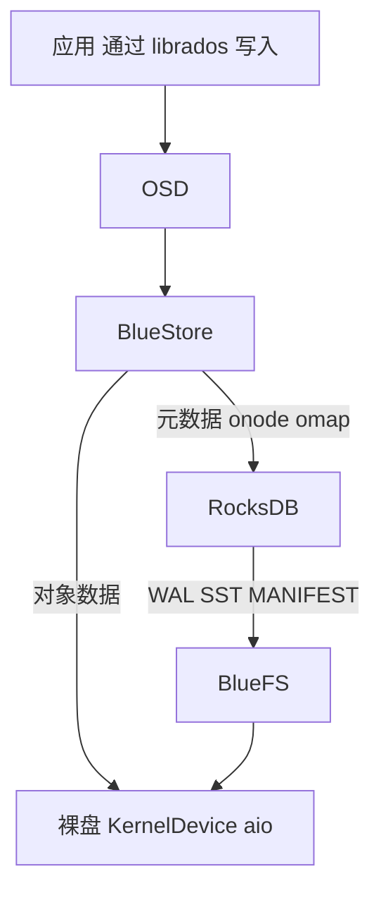
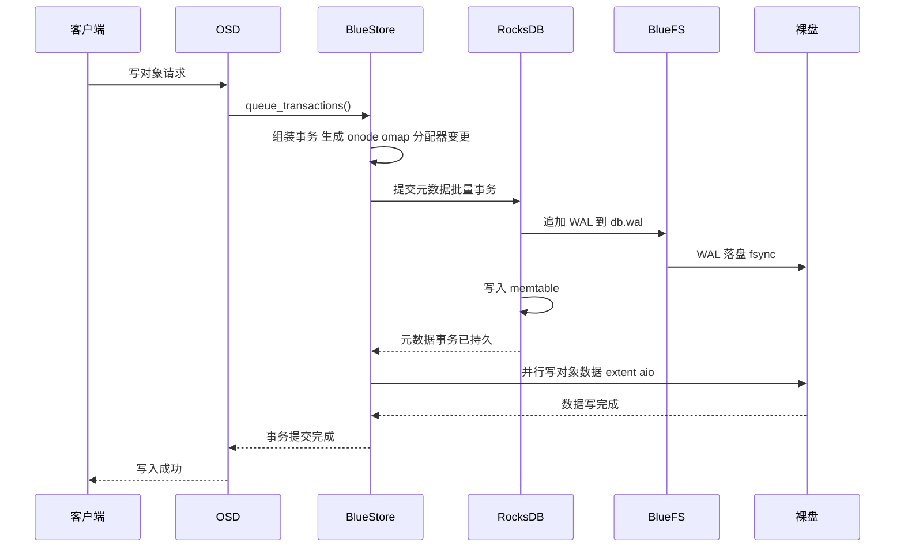
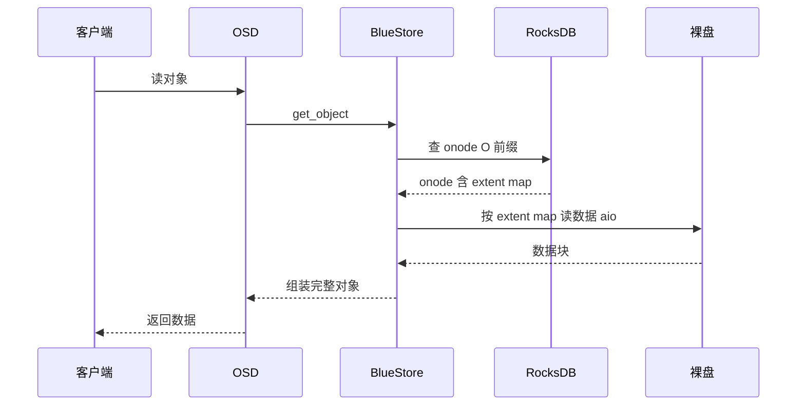
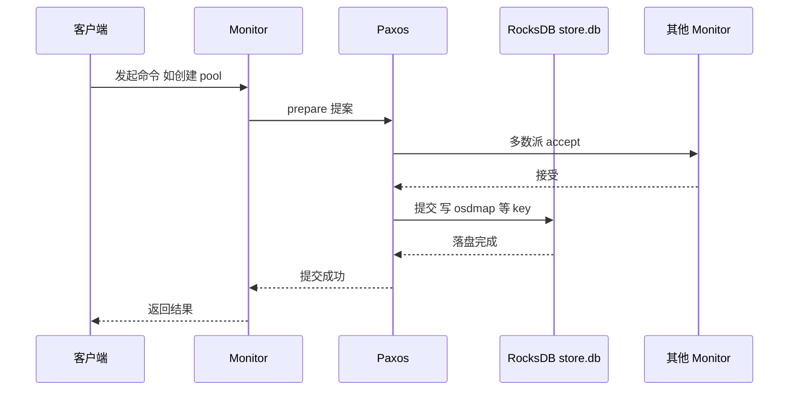

本文基于 **Ceph v21.1.2（Squid）源码**，讲清楚 Ceph 是如何使用 RocksDB 的：它把 RocksDB 当作一块**嵌入式 KV 存储**来存"元数据"，而不是对象数据本体。全文会指出代码位置、列出 RocksDB 里实际存了哪些 key，并画出写路径、读路径和 Monitor 提交的时序图。

> 关键结论先放前面：**对象数据本体不经过 RocksDB**，直接写裸盘；RocksDB 存的是对象元数据（onode）、用户 OMap、分配器空闲空间，以及 Monitor 的集群状态（osdmap/pgmap 等）。RocksDB 自己的文件（WAL、SST）也不是直接写盘，而是经由 BlueFS 这个小文件系统落盘。

## 一、Ceph 里谁在用 RocksDB

在 v21.1.2 源码中，RocksDB 有两个主要使用者：

| 使用者 | 代码位置 | 作用 |
| --- | --- | --- |
| BlueStore | `src/os/bluestore/BlueStore.cc` | OSD 的默认 objectstore，用 RocksDB 存对象/集合元数据与 OMap |
| Monitor | `src/mon/MonitorDBStore.h` | mon 的持久化存储，存集群状态（osdmap、pgmap、monmap 等） |

两者的共同抽象是 `src/kv/KeyValueDB.h`，它的 RocksDB 后端实现是 `src/kv/RocksDBStore.h/.cc`。BlueStore 里通过 `kv_backend == "rocksdb"` 选择后端（`src/os/bluestore/BlueStore.cc` 约 8333 行）；Monitor 的 `MonitorDBStore` 内部也是持有一个 `KeyValueDB` 指针。

此外还有 `ceph-kvstore-tool`、`bluestore-tool` 等工具用于离线查看/修复这些 RocksDB。

## 二、BlueStore 用 RocksDB 存什么

先记住一个大原则：

- **对象数据（object data）**：直接写裸盘（`KernelDevice` 的 aio），**不进 RocksDB**；
- **对象元数据（onode、集合、分配器）**：在 RocksDB；
- **用户 OMap（object map）**：完全在 RocksDB，是"小 key-value 挂在对象名下"的通用机制，RGW 的 bucket index、CephFS 的部分元数据等都用它。

BlueStore 在 RocksDB 里用**单字节前缀**区分不同类型的数据，定义在 `src/os/bluestore/BlueStore.cc` 第 134–145 行：

| 前缀 | 含义 | key 构成 |
| --- | --- | --- |
| `S` | 超级块 superblock | 字段名 → 值 |
| `T` | 集合统计信息 | 字段名 → int64 数组 |
| `C` | 集合（collection/PG） | collection 名 → cnode_t |
| `O` | 对象 onode | collection + object（+shard）→ onode_t |
| `M` | 用户 OMap | onode id + keyname → value |
| `P` | PG meta 的 OMap | onode id + keyname → value |
| `m` | per-pool OMap | pool + onode id + keyname → value |
| `p` | per-PG OMap | pool + hash + id + keyname → value |
| `L` | 延迟写事务 | id → deferred_transaction_t |
| `B` | 空闲空间 freelist | offset → length |
| `b` | 空闲空间位图 | BitmapFreelistManager 使用 |
| `X` | 共享 blob | blob id → shared_blob_t（去重） |

逐个解释最关键的几个：

- `O`（onode）：一个对象对应一条记录，里面编码了对象的 extent map——即"对象的每一段数据分别落在裸盘的哪个偏移、多长"，这是定位对象数据的索引。
- `M`（OMap）：用户通过 `setomap` 挂到对象上的任意 key-value，例如 RGW 用它存桶索引条目。OMap 数据量可能很大，所以是 BlueStore 里 RocksDB 体积的主要来源之一。
- `B`/`b`（分配器）：记录裸盘上哪些区间已用、哪些空闲，BlueStore 分配新数据块时先查这里。
- `L`（延迟写）：开启 deferred write 时，小数据先写进 BlueFS 的 WAL，事务记录挂在 `L` 前缀下，之后再回放合并。
- `X`（共享 blob）：开启数据去重（compression/dedup）时，多个对象共享同一份 blob 的元数据。

## 三、RocksDB 自己的文件放在哪：BlueFS

RocksDB 本身也需要"文件系统"来放 WAL、SST、MANIFEST。BlueStore 没有让 RocksDB 直接写裸盘，而是引入了 **BlueFS**（一个极简的用户态文件系统），并把 RocksDB 的 `Env` 替换成 `src/os/bluestore/BlueRocksEnv.h/.cc`：

```text
RocksDB → BlueRocksEnv（RocksDB Env 封装）→ BlueFS → 裸盘 / 分区
```

BlueFS 按用途划分设备（`src/os/bluestore/BlueFS.h` 约 637 行）：

- `db.wal/`：放 RocksDB 的 WAL，通常指向高速 NVMe；
- `db/`：放 RocksDB 的 SST 和 MANIFEST；
- `db.slow/`：当 `db/` 空间不足时的溢出盘（通常是大容量慢盘）。

于是 BlueStore 的整体存储分工是这样的：



## 四、写路径时序图

一次对象写入（简化，默认日志模式）大致是这样：



解释：

1. 客户端请求经 `queue_transactions()` 进入 BlueStore；
2. BlueStore 把这次写涉及的对象元数据（onode 的 extent 变化）、OMap、分配器空闲空间变化打包成一个事务；
3. 该事务作为一个 batch 提交给 RocksDB，RocksDB 先写 WAL（落到 BlueFS 的 `db.wal`，并 fsync）再写 memtable——WAL 落盘后元数据才认为持久；
4. 与此同时，对象数据本体异步写到裸盘；
5. 元数据持久 + 数据写完，事务才向客户端返回成功。

> 若开启 deferred write（`bluestore_bluefs_deferred` 等），小数据会先写进 BlueFS 的 WAL 并在 `L` 前缀下记录延迟事务，之后再合并回裸盘，避免"一次小写两次落盘"。

## 五、读路径时序图



解释：读一个对象，先在 RocksDB 里查 `O` 前缀拿到 onode 及其 extent map（对象数据在裸盘的位置），再按 extent 从裸盘读回并拼装。如果是 OMap 读取（`getomap`），则完全在 RocksDB 里按 `M` 前缀扫描，不碰裸盘。

## 六、Monitor 用 RocksDB 存什么

Monitor 的持久化存储是 `MonitorDBStore`，数据目录通常叫 `store.db`，内部同样走 RocksDB。它存的是**整个集群的状态**，按 Paxos 服务分前缀（`src/mon/Monitor.cc` 第 291–299 行注册）：

| 前缀 | 内容 |
| --- | --- |
| `monmap` | mon 成员与地址 |
| `osdmap` | OSD 拓扑、pool、crush 规则 |
| `pgmap` | PG 数量、状态、用量汇总 |
| `mdsmap` / `fsmap` | CephFS 元数据服务与文件系统 |
| `logm` | 集群日志 |
| `auth` | 认证密钥与权限 |
| `mgr` | mgr 服务状态 |
| `health` | 集群健康状态 |
| `config` | 集中式配置项 |

此外还有 Paxos 自身的状态（`first_committed`、`last_committed` 等）以及初始化时的 `mkfs` 前缀。Monitor 的提交路径如下：



解释：mon 的任何状态变更都要先走 Paxos 达成多数派一致，再把结果写进 RocksDB 持久化。这也是为什么 mon 的 RocksDB 一旦损坏，整个集群的"大脑"就出问题——通常需要用 `ceph-monstore-tool` 等工具离线修复。

## 七、相关配置与调优（简述）

- `bluestore_rocksdb_options`：直接透传给 RocksDB 的选项（compaction、write buffer 等）。
- `bluestore_rocksdb_cf` / `bluestore_rocksdb_cfs`：是否/如何把 BlueStore 的数据拆到多个 column family 做分片。
- 硬件分层：把 `db.wal` 放到 NVMe、`db` 放 SSD、`db.slow` 和对象数据放 HDD，是 BlueStore 的标准玩法。
- 压紧：`compact` 相关接口和 `bluestore_async_db_compaction` 控制后台 compaction。

## 八、总结

| 数据 | 放在哪 |
| --- | --- |
| 对象数据本体 | 裸盘（不经过 RocksDB） |
| 对象元数据（onode） | BlueStore 的 RocksDB，`O` 前缀 |
| 用户 OMap | BlueStore 的 RocksDB，`M` 等前缀 |
| 空闲空间分配 | BlueStore 的 RocksDB，`B`/`b` 前缀 |
| RocksDB 的 WAL/SST | BlueFS 管理的 `db.wal` / `db` / `db.slow` |
| 集群状态（osdmap/pgmap 等） | Monitor 的 RocksDB（store.db） |

一句话：**RocksDB 在 Ceph 里是"元数据与状态的中心"，对象数据则绕开它直写磁盘；而 RocksDB 自己的文件又垫了一层 BlueFS。** 理解了这三层关系，BlueStore 的性能调优、WAL/DB 分区规划、以及"为什么 mon 和 OSD 都要爱护好各自的 RocksDB"就都顺理成章了。

## 参考

- 源码：`src/kv/RocksDBStore.*`、`src/os/bluestore/BlueStore.cc`、`src/os/bluestore/BlueFS.h`、`src/os/bluestore/BlueRocksEnv.*`、`src/mon/MonitorDBStore.h`、`src/mon/Monitor.cc`
- [Ceph 官方文档：BlueStore](https://docs.ceph.com/en/latest/rados/configuration/bluestore-config-ref/)
- [Ceph 官方文档：Monitor Config Reference](https://docs.ceph.com/en/latest/rados/configuration/mon-config-ref/)

*内容依据 Ceph v21.1.2 源码（commit b6f98ed07f4）阅读整理，核对日期：2026 年 10 月 20 日。代码结构可能随版本演进，具体以对应版本源码为准。*
