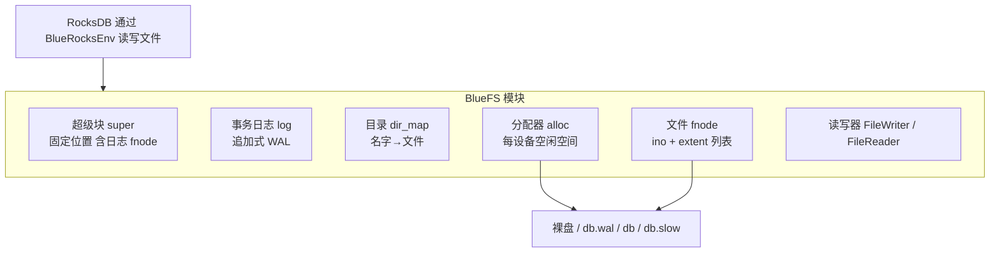
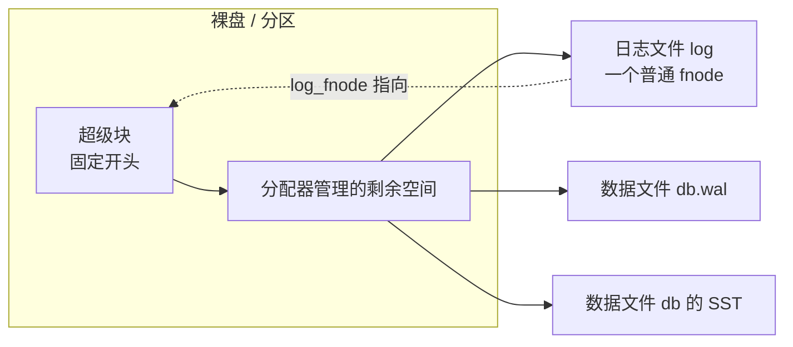
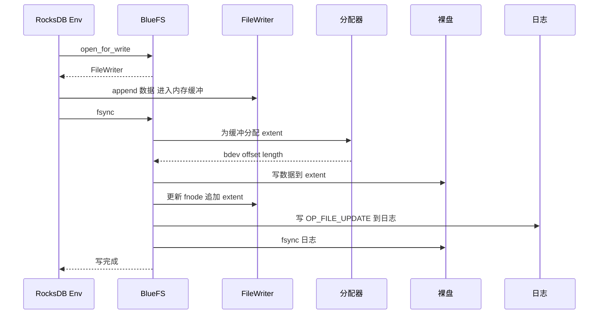
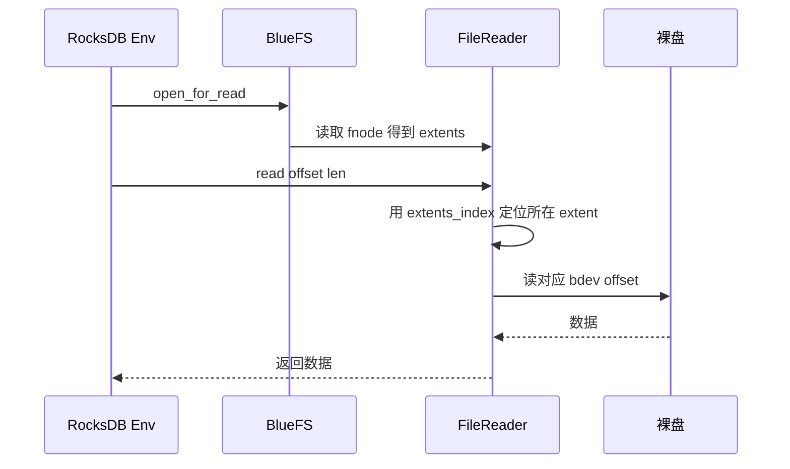
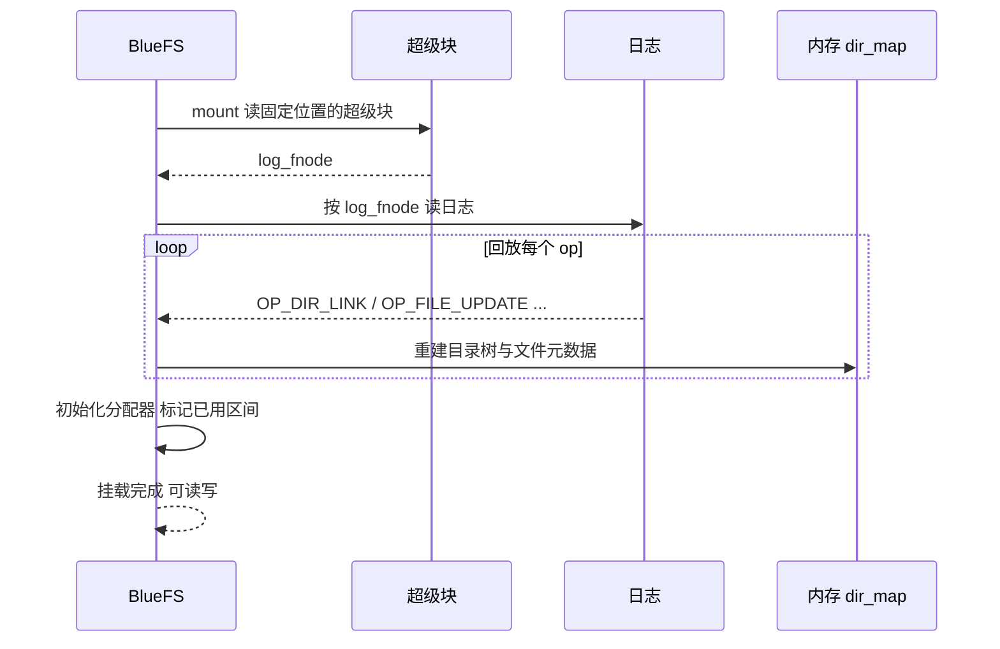
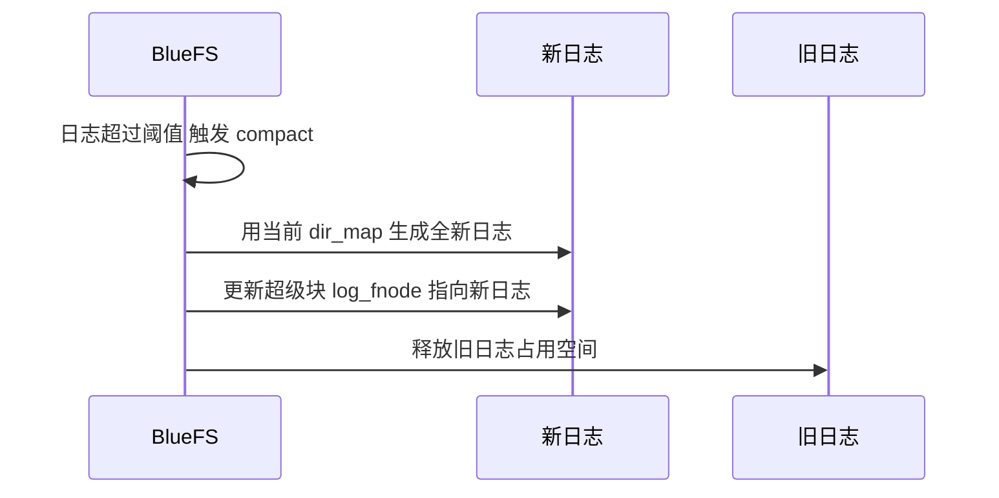

上一篇讲 extent map 时提到，BlueStore 里 RocksDB 的文件（WAL、SST、MANIFEST）不是直接写裸盘，而是垫了一层 **BlueFS**。BlueFS 是一个**专为 BlueStore 写的、极简的、日志结构（log-structured）文件系统**。它麻雀虽小五脏俱全，是理解"一个真正的文件系统是怎么做出来的"的绝佳范本。本文基于 **Ceph v21.1.2 源码**，把它的模块、作用和流程完整讲清，最后给出"照着 BlueFS 自己写一个 FS"的套路。

> 为什么 BlueStore 需要自己造一个 FS？因为 RocksDB 需要一个文件系统来放 WAL/SST，而通用文件系统（XFS 等）在这个场景下开销大、还隔了一层缓存；BlueFS 直接建在裸盘/分区上，只为 RocksDB 服务，能做大量定制（WAL 单独放 NVMe、和 BlueStore 共享分配器等）。

## 一、整体架构：一句话和一张图

BlueFS 的核心思想可以浓缩成三句话：

1. **文件 = 一串 extent**（`offset + length + 设备`），没有传统 inode 的间接块那一套；
2. **元数据 = 事务日志（WAL）**，所有目录/文件元数据变更先追加进日志，崩溃后回放即可恢复；
3. **挂载 = 回放日志**，从超级块找到日志文件，把日志从头重放一遍，在内存里重建目录树和文件元数据。



## 二、模块拆解：每个模块为什么存在

### 2.1 超级块 `bluefs_super_t`

定义在 `src/os/bluestore/bluefs_types.h`：

```cpp
struct bluefs_super_t {
  uint8_t _version;
  uuid_d uuid;         // 这个 BlueFS 实例的标识
  uuid_d osd_uuid;     // 所属 OSD
  uint64_t seq;        // 日志序号
  uint32_t block_size; // 块大小
  bluefs_fnode_t log_fnode;  // 日志文件自己的 fnode！
};
```

**为什么存在**：文件系统启动时需要一个"入口"，告诉你日志在哪。超级块放在设备开头的固定位置，里面最关键的字段是 `log_fnode`——日志文件本身的 fnode。挂载时先读超级块 → 拿到 log_fnode → 才能回放日志。`seq` 是日志序号，用来判断日志是否被压缩重写。

### 2.2 文件节点 `bluefs_fnode_t`

```cpp
struct bluefs_fnode_t {
  uint64_t ino;          // 文件编号（相当于 inode number）
  uint64_t size;         // 文件大小
  utime_t mtime;
  vector<bluefs_extent_t> extents;        // 数据落在哪些盘区
  vector<uint64_t> extents_index;         // 每个 extent 的逻辑起始偏移，便于二分
  uint64_t allocated;                     // 已分配总大小
};

struct bluefs_extent_t {
  uint64_t offset;   // 盘上物理偏移
  uint32_t length;
  uint8_t  bdev;     // 在哪个设备（db / wal / slow）
};
```

**为什么存在**：BlueFS 的"inode"就是这份结构——一个文件不过是一串 `(bdev, offset, length)` 的 extent。`extents_index` 预计算每个 extent 的逻辑起始偏移，读文件时用 `upper_bound` 快速定位"文件偏移 X 落在第几个 extent"。没有间接块、没有 ext4 那套 extent tree，极简。

### 2.3 目录 `Dir`

```cpp
struct Dir : public RefCountedObject {
  mempool::bluefs::map<std::string, FileRef, std::less<>> file_map;  // 名字 → 文件
};
```

BlueFS 里还有 `dir_map`（`dirname → Dir`）。**为什么存在**：目录就是一个"名字 → 文件"的映射，支持 `mkdir/rmdir/readdir/rename/unlink`。注意目录结构本身不单独持久化，而是**由日志里的 `OP_DIR_LINK/OP_DIR_UNLINK` 等操作在回放时重建**。

### 2.4 事务日志 `bluefs_transaction_t`

```cpp
struct bluefs_transaction_t {
  enum op_t {
    OP_INIT, OP_ALLOC_ADD, OP_ALLOC_RM,        // 分配/释放（已废弃）
    OP_DIR_LINK, OP_DIR_UNLINK,                 // 目录项增删
    OP_DIR_CREATE, OP_DIR_REMOVE,               // 目录增删
    OP_FILE_UPDATE, OP_FILE_REMOVE,             // 文件元数据更新/删除
    OP_JUMP, OP_JUMP_SEQ,                        // 跳序号
    OP_FILE_UPDATE_INC,                          // 增量更新文件元数据
  };
  uint64_t seq;           // 序号
  buffer::list op_bl;     // 编码后的一串 op
};
```

**为什么存在**：这是 BlueFS 的"WAL"。任何元数据变更（建目录、删文件、更新 fnode）都被编码成一个个 op，追加到日志文件尾部，落盘（fsync）后才认为提交。崩溃恢复时，从 `log_fnode` 从头回放这些 op，就能把内存里的 `dir_map` 和文件元数据重建出来——这正是日志结构文件系统的灵魂。

### 2.5 设备与分配器

```cpp
std::vector<Allocator*> alloc;      // 每块设备一个分配器
std::vector<uint64_t> alloc_size;   // 每块设备的分配粒度
bluefs_shared_alloc_context_t* shared_alloc;  // 与 BlueStore 共享分配器
```

**为什么存在**：BlueFS 把空间按用途分成 `db.wal`（WAL 日志）、`db`（数据）、`db.slow`（溢出）多块设备，每块设备一个分配器管理空闲区间。在"单共享设备"布局下，BlueFS 可以和 BlueStore **共用同一个分配器**（`shared_alloc`），避免两个组件各自记账打架。

### 2.6 读写器 FileWriter / FileReader

- `FileWriter`：append-only 写者，带内存缓冲，`append` 攒数据，`flush/fsync` 时才真正分配 extent、写盘、更新 fnode 并写日志。
- `FileReader` + `FileReaderBuffer`：读者，带预读缓冲，按 fnode 的 extent 逐段读盘。

**为什么存在**：这是性能关键。RocksDB 的 WAL 是高频小写，BlueFS 用缓冲把多次 append 合并成一次连续落盘；读侧用预读缓冲减少随机读。注意 BlueFS **只支持追加写**（文件要么从头写，要么 truncate），没有原地覆盖写——这极大简化了实现。

### 2.7 日志压缩 compact_log

日志一直追加会越来越大，回放也越来越慢。当超过阈值，BlueFS 会**压缩日志**：以当前内存里的最终状态为基准，写一份全新的、只包含"当前最新 fnode 和目录项"的日志，然后切到新日志，旧日志占用的空间回收。这就是 log-structured 文件系统的"垃圾回收/checkpoint"。

### 2.8 主类 `BlueFS` 的对外接口

`src/os/bluestore/BlueFS.h` 里可以看到它就是一个标准文件系统的接口：`mkfs`、`mount`、`umount`、`open_for_write`、`open_for_read`、`rename`、`unlink`、`mkdir`、`rmdir`、`readdir`、`fsync`、`truncate`、`compact_log`。上层（RocksDB 的 `BlueRocksEnv`）就是把这些接口翻译成 RocksDB 的 `Env` 调用。

## 三、磁盘布局



要点：超级块固定在设备开头；日志文件本身也是一个 fnode（由超级块记录）；其余空间由分配器按需切给日志和数据文件。

## 四、关键流程时序图

### 4.1 写文件（append + flush/fsync）



### 4.2 读文件



### 4.3 挂载与日志回放



### 4.4 日志压缩



## 五、给小白：照着 BlueFS 实现一个 FS 的套路

读完 BlueFS，你其实已经能写出一个最小可用文件系统了。核心套路就七步：

1. **固定位置放超级块**：至少存 `uuid + seq + 日志文件的位置`；
2. **文件用 extent 列表表示**：`struct fnode { ino; size; extent[]; }`，`extent = {bdev, offset, length}`；
3. **目录用名字到文件编号的映射**：`map<string, ino>`，不单独落盘；
4. **所有元数据变更先写日志**：`op(dir_link / file_update / file_remove ...)` 追加到日志尾部并 fsync，再改内存；
5. **挂载 = 回放日志**：读超级块 → 找到日志 → 从头重放 op 重建内存结构；
6. **写文件**：分配 extent → 写数据 → 更新 fnode → 写 `file_update` 日志 → fsync；
7. **日志膨胀就压缩**：用当前内存状态写新日志，切过去，回收旧空间。

再补一个极简骨架（伪代码，别直接用）：

```c
struct super { uint64_t seq; uint64_t log_ino; };
struct extent { uint64_t off; uint32_t len; uint8_t dev; };
struct fnode { uint64_t ino; uint64_t size; struct extent *exts; int n; };
struct op { uint8_t type; /* DIR_LINK / FILE_UPDATE / ... */ uint8_t data[]; };

void mount(disk *d) {
  struct super s = read_super(d);        // 读固定位置
  struct fnode log = read_fnode(d, s.log_ino);
  replay_log(d, log);                     // 逐个 op 重建 dir_map / file_map
}

void write_file(struct fnode *f, disk *d, off_t off, void *buf, size_t len) {
  struct extent e = alloc(d, len);        // 分配器给一块
  write_extent(d, e, buf);                // 写数据
  f->exts[f->n++] = e; f->size += len;
  append_log(d, FILE_UPDATE, f);          // 元数据写日志
  fsync(d);
}
```

把上面七步和这段骨架看懂，你就掌握了日志结构文件系统的 80% 精髓——BlueFS 剩下的 20%，是缓冲写、读预读、跨设备分配策略、信封编码（envelope）和与 BlueStore 的分配器共享这些工程优化。

## 六、总结

| 模块 | 作用 | 一句话为什么存在 |
| --- | --- | --- |
| 超级块 | 固定位置，存日志位置 | 启动入口 |
| fnode | 文件 = extent 列表 | 极简 inode |
| Dir | 名字 → 文件映射 | 目录 |
| 事务日志 | 追加式 WAL，记录元数据 op | 崩溃恢复 |
| 分配器 | 管理每设备空闲空间 | 空间分配 |
| FileWriter/Reader | 缓冲写 / 预读读 | 性能 |
| compact_log | 日志重写与回收 | 控制日志体积 |

BlueFS 最值得学的不是某个 API，而是**"日志即元数据"**这一设计：把"复杂的、易损坏的元数据"变成"一条追加日志 + 一次回放"，用简单换可靠。这也是为什么它能撑起 BlueStore 里 RocksDB 的 WAL 和 SST。

## 参考

- 源码：`src/os/bluestore/bluefs_types.h`、`src/os/bluestore/BlueFS.h`、`src/os/bluestore/BlueFS.cc`、`src/os/bluestore/BlueRocksEnv.h/.cc`
- [Ceph 官方文档：BlueStore](https://docs.ceph.com/en/latest/rados/configuration/bluestore-config-ref/)

*内容依据 Ceph v21.1.2 源码（commit b6f98ed07f4）阅读整理，核对日期：2026 年 10 月 21 日。代码结构可能随版本演进，具体以对应版本源码为准。*
