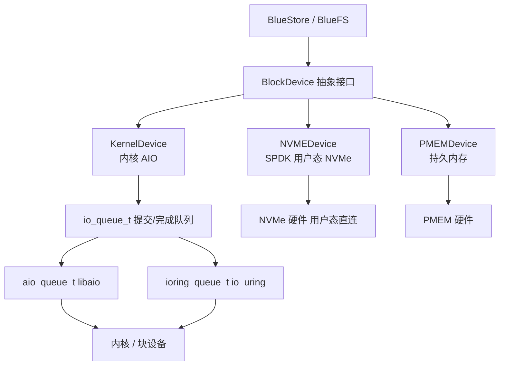
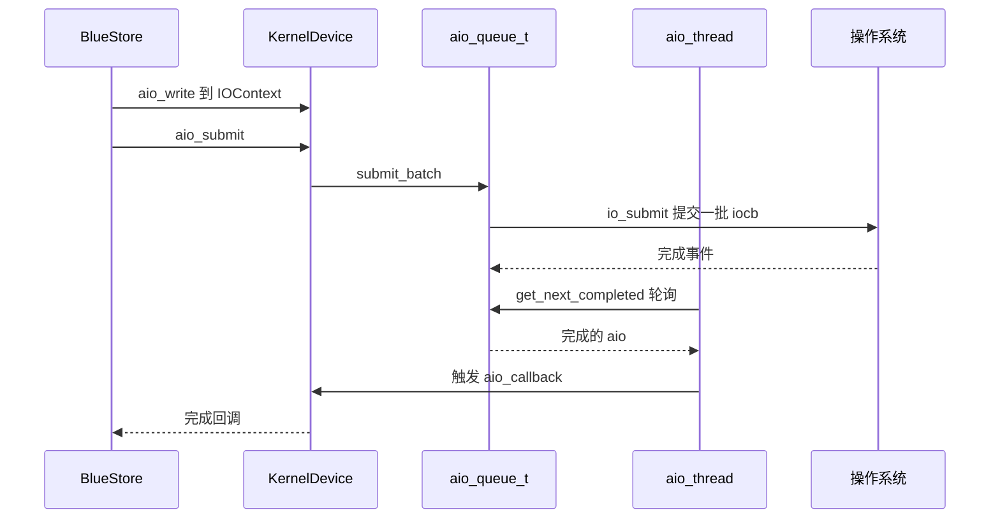
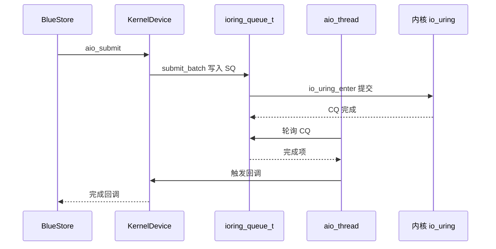
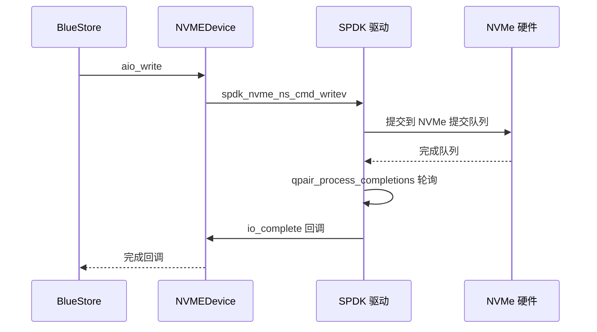

这是 Ceph 存储栈最底层的部分。BlueStore 写对象数据、BlueFS 写 RocksDB 的 WAL/SST，最终都要落到"块设备"上，而这一层在 Ceph 里叫 **bdev**。本文基于 **Ceph v21.1.2 源码**，讲清楚 bdev 的抽象与三个后端（内核 AIO、SPDK、PMEM），重点回答两个问题：**aio / io_uring / SPDK 是怎么对接的？能不能在线互相切换？**

## 一、bdev 抽象层：BlockDevice

所有后端都实现同一个抽象类 `BlockDevice`（`src/blk/BlockDevice.h`）。核心是异步 I/O 接口：

```cpp
class BlockDevice {
  virtual void aio_submit(IOContext *ioc) = 0;   // 批量提交一组 aio
  virtual int aio_read(uint64_t off, uint64_t len, bufferlist *bl, IOContext *ioc);
  virtual int aio_write(uint64_t off, bufferlist& bl, IOContext *ioc, bool buffered);
  virtual int read(uint64_t off, uint64_t len, bufferlist *bl, IOContext *ioc);
  virtual int write(uint64_t off, bufferlist& bl, bool buffered, int write_hint);
  virtual int flush() = 0;
  virtual int invalidate_cache(uint64_t off, uint64_t len) = 0;
  virtual int open(const std::string& path) = 0;
  virtual void close() = 0;
};
```

**为什么要有这层抽象**：BlueStore 只跟 `BlockDevice` 打交道，不关心底下是普通盘、NVMe 还是持久内存。`IOContext` 把多个 `aio_t` 攒成一批，`aio_submit` 一次下发，完成时统一回调 `aio_callback`——这是后面所有后端共同遵守的契约。

## 二、后端怎么选

`BlockDevice::create`（`src/blk/BlockDevice.cc` 约 166 行）是入口：

```text
bdev_type 配置是否显式设置？
  ├─ 是：按名字选（"aio" → KernelDevice，"spdk" → NVMEDevice，"pmem" → PMEMDevice）
  └─ 否：detect_device_type(path) 自动探测
           ├─ 路径是 SPDK 地址 → spdk
           ├─ 路径是 PMEM 设备 → pmem
           └─ 其它 → aio（KernelDevice）
```

每个后端都受编译开关控制：`HAVE_LIBAIO` / `HAVE_SPDK` / `HAVE_BLUESTORE_PMEM`。没编译 SPDK 的包，自然没有 spdk 后端。



## 三、KernelDevice：libaio 与 io_uring

`KernelDevice`（`src/blk/kernel/KernelDevice.cc`）是默认后端，负责普通块设备。它内部用统一的提交/完成队列抽象 `io_queue_t`，有两个实现：

- `aio_queue_t`（`src/blk/aio/aio.h`）：封装 **libaio**——`io_setup(max_iodepth, &ctx)` 建上下文，`io_submit` 提交，`io_getevents` 收完成。
- `ioring_queue_t`（`src/blk/kernel/io_uring.h`）：封装 **io_uring**——`io_uring_setup` 建 ring。

选哪个在**构造时**就定了（KernelDevice.cc 约 88 行）：

```cpp
bool use_ioring = cct->_conf.get_val<bool>("bdev_ioring");
if (use_ioring && ioring_queue_t::supported()) {
  io_queue = std::make_unique<ioring_queue_t>(iodepth, use_ioring_hipri, use_ioring_sqthread_poll);
} else {
  io_queue = std::make_unique<aio_queue_t>(iodepth);   // 内核不支持就回退 libaio
}
```

相关配置（`src/common/options/global.yaml.in`）：

| 配置 | 默认 | 含义 |
| --- | --- | --- |
| `bdev_ioring` | false | 用 io_uring 代替 libaio |
| `bdev_ioring_hipri` | false | io_uring 用 polled 完成 |
| `bdev_ioring_sqthread_poll` | false | 提交队列线程轮询 |
| `bdev_aio_max_queue_depth` | 1024 | 队列深度 |
| `bdev_aio_poll_ms` | 250 | aio 线程轮询完成的间隔 |

KernelDevice 里有一个 `aio_thread`：循环里 `io_queue->get_next_completed(...)` 收完成事件、触发回调；提交侧 `aio_submit` 调 `io_queue->submit_batch(...)`。所以 libaio 和 io_uring 只是"提交/完成"这一层换了实现，上面的逻辑完全不变。

## 四、NVMEDevice：SPDK

`NVMEDevice`（`src/blk/spdk/NVMEDevice.cc`）走 **SPDK**：用户态 NVMe 驱动，绕过内核块层，直接把 I/O 提交到 NVMe 硬件的队列。

关键流程：

- 初始化：`spdk_env_opts_init` + `spdk_nvme_probe` 探测并绑定 NVMe 控制器；
- 读写：`spdk_nvme_ns_cmd_readv` / `spdk_nvme_ns_cmd_writev` 提交；
- 完成：`spdk_nvme_qpair_process_completions(qpair, max_io_completion)` 轮询完成，`io_complete` 回调；
- 队列深度：`max_queue_depth = opts.io_queue_size - 1`。

相关配置：

| 配置 | 含义 |
| --- | --- |
| `bluestore_spdk_mem` | 分配给 DPDK 的大页内存（默认 512MB） |
| `bluestore_spdk_coremask` | SPDK 轮询线程绑定的 CPU |
| `bluestore_spdk_max_io_completion` | 每轮最多处理的完成数 |
| `bluestore_spdk_io_sleep` | 轮询空闲时的休眠 |

SPDK 的目标是低延迟高吞吐：去掉内核 syscall、内存拷贝和中断，代价是独占 CPU 轮询、要配置大页内存。

## 五、PMEMDevice（简述）

`PMEMDevice`（`src/blk/pmem/PMEMDevice.cc`）面向持久内存（Intel Optane PMEM），基于 libpmem 直接把持久内存映射进地址空间，省去块设备层。

## 六、I/O 时序图

### 6.1 KernelDevice（libaio）写



### 6.2 KernelDevice（io_uring）写



### 6.3 SPDK 写



## 七、能不能在线互相切换？

**不能。** 三层都固定在启动时：

1. **后端类型**：`BlockDevice::create` 在 OSD 启动、打开设备时用 `bdev_type` 或自动探测选一次，之后不再变；
2. **libaio ↔ io_uring**：在 `KernelDevice` 构造函数里按 `bdev_ioring` 决定一次，`io_queue` 建好就不换；
3. **运行时配置回调**：`KernelDevice::handle_conf_change`（约 1648 行）只处理 discard 线程相关的改动（`bdev_async_discard*`、`bdev_enable_discard`），**不涉及 io_queue 切换**。

所以要切换后端，只能：停 OSD → 改 `bdev_type` / `bdev_ioring` / 设备路径 → 重启。SPDK 还有个前提：Ceph 编译时得带 `HAVE_SPDK`，否则连 spdk 后端都不存在。另外 `bdev_ioring=true` 时若内核不支持 io_uring，会自动回退 libaio 并打一条 warning——这是唯一"动态"发生的事，但也只是"降级"，不是"切换"。

## 八、总结

| 后端 | 技术 | 适用 | 怎么选 |
| --- | --- | --- | --- |
| KernelDevice + libaio | 内核异步 I/O | 通用块设备，默认 | 默认 |
| KernelDevice + io_uring | io_uring | 追求更低 syscall 开销 | `bdev_ioring=true` |
| NVMEDevice | SPDK 用户态 NVMe | 极致低延迟，独占 CPU | `bdev_type=spdk` 或 SPDK 地址 |
| PMEMDevice | libpmem 持久内存 | Optane PMEM | `bdev_type=pmem` 或 PMEM 路径 |

一句话：**bdev 用统一接口把 BlueStore 和多种块设备解耦，libaio/io_uring/SPDK 只是三个可插拔后端；它们都在 OSD 启动时选定，不能在线切换。**

## 参考

- 源码：`src/blk/BlockDevice.h/.cc`、`src/blk/kernel/KernelDevice.cc`、`src/blk/aio/aio.h/.cc`、`src/blk/kernel/io_uring.h`、`src/blk/spdk/NVMEDevice.cc`、`src/blk/pmem/PMEMDevice.cc`、`src/common/options/global.yaml.in`
- [Ceph 官方文档：BlueStore Config Reference](https://docs.ceph.com/en/latest/rados/configuration/bluestore-config-ref/)

*内容依据 Ceph v21.1.2 源码（commit b6f98ed07f4）阅读整理，核对日期：2026 年 10 月 22 日。代码结构可能随版本演进，具体以对应版本源码为准。*
