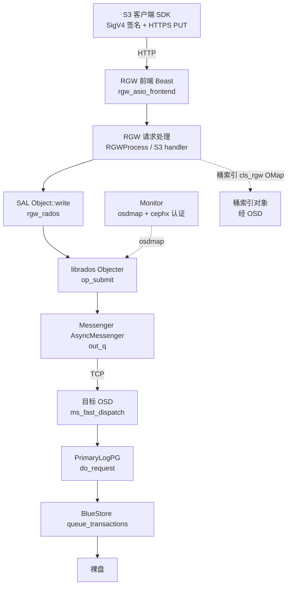
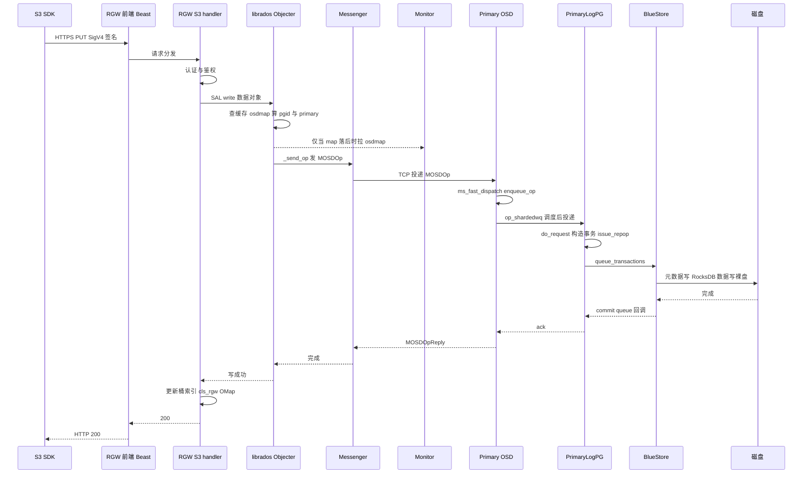

这篇文章追踪**一个 S3 用户在客户端上传一个对象，直到数据真正落到 OSD 磁盘**的完整过程。它会横跨七个层次：S3 SDK、RGW 前端、RGW 请求处理与桶索引、librados(Objecter)、Messenger、OSD、BlueStore。重点是**每一层都有哪些队列、谁在生产、谁在消费**，以及 **mon 在中间扮演什么角色**。基于 **Ceph v21.1.2 源码**。

## 〇、先看一张全景图



一句话：客户端只跟 RGW 说话，RGW 通过 librados 跟整个 RADOS 集群说话；对象数据写一个 RADOS 对象，元数据（桶索引）写另一个 RADOS 对象。

## 一、第一站：S3 SDK 做了什么

SDK（boto3 / AWS SDK 等）本身不在 Ceph 代码库里，但这一步是整个旅程的起点。它做两件事：

1. **把对象封装成 HTTPS PUT 请求**：URL 是 `https://<rgw-host>/<bucket>/<key>`，Header 里带 `Content-Length`、`Content-MD5`、`x-amz-*` 元数据。
2. **SigV4 签名**：用 access key / secret key 对"方法 + 路径 + 关键 Header + 时间戳"算一个 `Authorization` 签名，服务端凭它验证身份和防篡改。

然后数据以流式方式（可能分块、可能 TLS 加密）发往 RGW。SDK 内部有自己的连接池和重试，但这不是 Ceph 的范畴，不展开。

## 二、第二站：RGW 前端与请求处理

### 2.1 HTTP 前端

RGW 的 HTTP 服务默认用 **Beast**（`src/rgw/rgw_asio_frontend.cc`，入口在 `rgw_main.cc`）。每个连接上的请求被解析成一个 `RGWRequest`，交给请求处理线程池。

```text
生产者：客户端 TCP 连接（Beast acceptor 接收）
消费者：RGW 工作线程（线程数由 rgw_thread_pool_size 控制）
```

### 2.2 请求分发与认证

请求进入 `RGWRados::handle_request`（`src/rgw/rgw_process.cc` / `rgw_rest.cc`）：

1. 根据 URL 路由到 S3 处理器：PUT Object 对应 `RGWPutObj_ObjStore_S3`（`src/rgw/rgw_rest_s3.cc`）；
2. 认证：`rgw_auth_s3` 校验 SigV4 签名，把请求关联到租户/用户；
3. 鉴权：检查该用户对这个桶的写权限。

### 2.3 对象写与桶索引

`RGWPutObj_ObjStore::write_data`（实现于 `src/rgw/driver/rados/rgw_rados.cc`）通过 **SAL（Storage Abstraction Layer）** 把数据写入一个 RADOS 对象。与此同时，RGW 维护**桶索引（bucket index）**：`RGWRados::Bucket::UpdateIndex`（`index_op`）以 `CLS_RGW_OP_ADD` 把"对象名 → 位置"写进索引对象（`cls/rgw/cls_rgw.cc`，上一篇文章讲过它底层是 OMap）。

也就是说：一次 S3 PUT，在 RADOS 层面会产生**两类写**——数据对象写 + 桶索引对象写。前者是这次的主干，后者通常异步合并。

## 三、第三站：librados Objecter

RGW 通过 **librados** 与集群通信，核心是 `Objecter`（`src/osdc/Objecter.cc`）。它相当于"RADOS 客户端"：

1. `op_submit`：把一次对象写包装成一个 `Op`；
2. `_op_submit` → `_calc_target`：**用 osdmap 计算目标**——
   - 对象名 + pool → 哈希 → `pgid`；
   - 由 pgid 查 `osdmap` 得到该 PG 的 **primary OSD**；
3. `_send_op`：构造 `MOSDOp` 消息，交给目标 OSD 的连接。

这里的关键是 **osdmap**：它是"数据往哪个 OSD 走"的唯一依据。Objecter 缓存一份 osdmap，只有缺 map、epoch 落后或 pool 变化时，才通过 `MonClient` 向 **mon** 要最新版（`monc->get_version("osdmap", ...)`）。

```text
生产者：RGW 线程（调用 Objecter::op_submit）
消费者：无（Objecter 不排队，直接算目标后塞进 messenger）
```

## 四、第四站：Messenger

`MOSDOp` 消息进入 **AsyncMessenger**（`src/msg/async/AsyncMessenger.cc`）。它基于事件循环（EventCenter）+ 工作线程：

```text
生产者：Objecter::_send_op → Connection::send_message → 连接上的 out_q（发送队列）
消费者：async worker 线程，把 out_q 里的字节写到 socket
```

对端 OSD 的 messenger 收到字节后，反序列化出 `MOSDOp`，`ms_deliver_*` 把它投递给已注册的 dispatcher——也就是 OSD 自己。

```text
生产者：对端连接的收包线程
消费者：OSD dispatcher（OSD::ms_dispatch / ms_fast_dispatch）
```

## 五、第五站：OSD 的入队与调度

`MOSDOp` 到达 OSD 后（`src/osd/OSD.cc`）：

1. `OSD::ms_fast_dispatch`：对普通 client op 走"快速分发"路径，绕过完整 dispatch；
2. `OSD::enqueue_op(spg_t pg, OpRequestRef&& op, epoch_t epoch)`（约 9920 行）：把 op 按 PG 塞进 **`op_shardedwq`（ShardedOpWQ）**；
3. `ShardedOpWQ` 是按 PG 分片的线程池工作队列，内部用调度器排序：`osd_op_queue` 可选 **mclock_scheduler**（默认）或 **wpq**（加权优先队列），每个 op 有 `OpSchedulerItem::OpQueueable` 和代价 cost；
4. `ShardedOpWQ::_process`（约 11114 行）由 op 工作线程执行，按调度顺序取出 op，投给对应 PG。

```text
生产者：OSD 收包 dispatcher（enqueue_op）
队列：op_shardedwq（按 PG 分片，mClock/WPQ 调度）
消费者：OSD op 工作线程（osd_op_num_shards × osd_op_num_threads_per_shard）
```

## 六、第六站：PG 复制与提交

op 进入 PG 后（`src/osd/PrimaryLogPG.cc`）：

1. `PrimaryLogPG::do_request`（1824 行）→ `do_op`（2588 行）：构造 `OpContext`，把写变成对象事务；
2. `issue_repop`（11702 行）：生成 `RepGather` 追踪这次提交，并**把事务复制到副本 OSD**（ReplicatedBackend）；
3. `ReplicatedBackend::submit_transaction`（`src/osd/ReplicatedBackend.cc` 591 行）→ `parent->queue_transactions`（675 行）：调用 `ObjectStore::queue_transactions` 把事务交给本地 objectstore；
4. 副本各自 `queue_transactions` 落盘后回 ack，主 PG 等"自己 + 多数派副本"都提交后，才向客户端返回成功。

```text
生产者：PrimaryLogPG（issue_repop）
队列：副本之间走 messenger 的 repop 复制；本地走 ObjectStore 的提交队列
消费者：副本 OSD 的 PG / 本地 BlueStore
```

## 七、第七站：BlueStore 落盘

`BlueStore::queue_transactions` 之后就是前面系列文章讲过的过程（这里只点到为止）：

1. 事务进入 `kv_sync_thread`：对象元数据（onode/extent map）批量写 RocksDB，RocksDB 先写 WAL（BlueFS 的 `db.wal`）再写 memtable，WAL fsync 后元数据持久；
2. 对象数据本体通过 `BlockDevice` 的 aio 写裸盘；
3. 元数据 + 数据都完成后，事务提交，通过 PG 的 **commit queue**（`store->set_collection_commit_queue` 设置的 `context_queue`）回调完成。

```text
生产者：ReplicatedBackend / PG（queue_transactions）
队列：BlueStore kv_sync 队列 + 每 PG 的 context_queue
消费者：BlueStore 的 kv_sync_thread、aio 线程；以及 PG 的 commit 线程
```

## 八、回程：ack 一路返回

落盘完成后，ack 沿原路返回：

```text
BlueStore 完成 → PG commit queue → PrimaryLogPG → OSD → messenger
  → Objecter::handle_osd_op_reply → librados 完成回调 → RGW
```

RGW 收到对象写成功后再完成桶索引更新（如果之前是异步合并），最后向客户端回 **HTTP 200**。

## 九、mon 在整条链路里的角色

mon 不参与数据面，但它是"地图"和"门卫"：

- **osdmap**：Objecter / OSD 都用它做 pgid → primary OSD 的映射；有变化才向 mon 拉取；
- **cephx 认证**：客户端/RGW 和集群之间建立会话时的密钥与票据；
- **集群状态**：monmap、pgmap 等（本文不展开）。

所以一次普通 PUT 通常**不直接打 mon**——Objecter 用缓存 osdmap 直接算目标 OSD；只有 map 落后、pool 不存在或认证票据过期时，才会出现 mon 相关的往返。

## 十、队列全景表：谁在生产，谁在消费

| 位置 | 队列/结构 | 生产者 | 消费者 |
| --- | --- | --- | --- |
| RGW 前端 | Beast 连接 + 请求线程池 | 客户端 TCP / acceptor | RGW 工作线程 |
| Objecter | （无排队，直接投递） | RGW 线程 | —— |
| Messenger 发送侧 | Connection::out_q | Objecter `_send_op` | async worker 写 socket |
| Messenger 接收侧 | 事件循环投递 | 对端连接收包 | OSD dispatcher |
| OSD 入队 | op_shardedwq（mClock/WPQ） | OSD `enqueue_op` | OSD op 工作线程 |
| PG 提交 | repop 复制 + ObjectStore 队列 | PrimaryLogPG `issue_repop` | 副本 PG / BlueStore |
| BlueStore | kv_sync 队列 + aio | ReplicatedBackend | kv_sync_thread / aio 线程 |
| PG 完成 | context_queue | BlueStore 完成回调 | PG commit 处理 |

## 十一、完整时序图



## 十二、总结

一次 S3 PUT 的本质是：**SDK 用 HTTP 把数据交给 RGW，RGW 用 librados 把"数据对象 + 桶索引对象"两份写发给 RADOS，Objecter 靠 osdmap 定位目标 OSD，OSD 用 mClock 队列调度、PG 复制到副本、BlueStore 把元数据写 RocksDB、数据写裸盘，最后 ack 原路返回。** mon 只在"要地图/要票据"时登场，不在数据面上。

理解了这条链路，再去看 RGW 的桶索引瓶颈、Objecter 的 map 抖动、OSD 的 mClock 调优、BlueStore 的 WAL/DB 分层，就都有了坐标系。

## 参考

- 源码：`src/rgw/rgw_asio_frontend.cc`、`src/rgw/rgw_rest_s3.cc`、`src/rgw/driver/rados/rgw_rados.cc`、`src/cls/rgw/cls_rgw.cc`、`src/osdc/Objecter.cc`、`src/msg/async/AsyncMessenger.cc`、`src/osd/OSD.cc`、`src/osd/PrimaryLogPG.cc`、`src/osd/ReplicatedBackend.cc`
- [Ceph 官方文档：RGW](https://docs.ceph.com/en/latest/radosgw/)
- [Ceph 官方文档：OSD 调度 mClock](https://docs.ceph.com/en/latest/rados/configuration/mclock-config-ref/)

*内容依据 Ceph v21.1.2 源码（commit b6f98ed07f4）阅读整理，核对日期：2026 年 10 月 23 日。代码结构可能随版本演进，具体以对应版本源码为准。*
