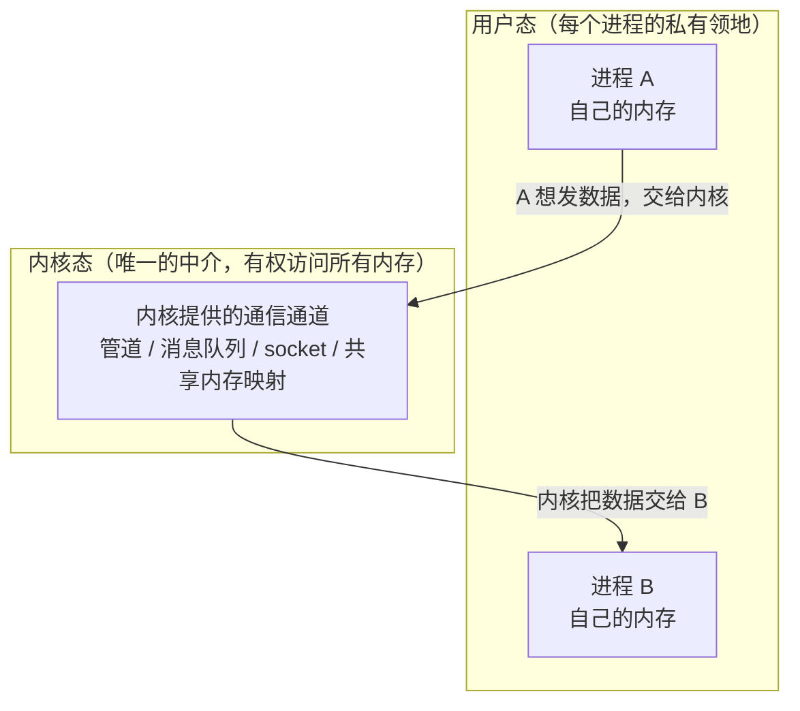
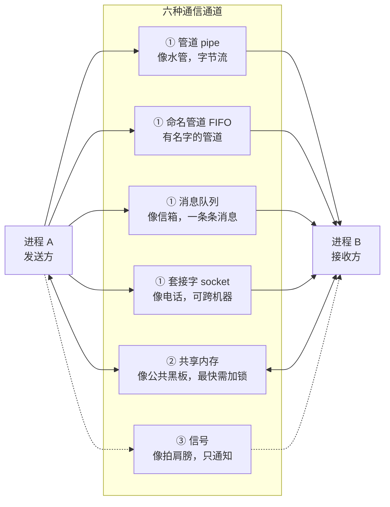
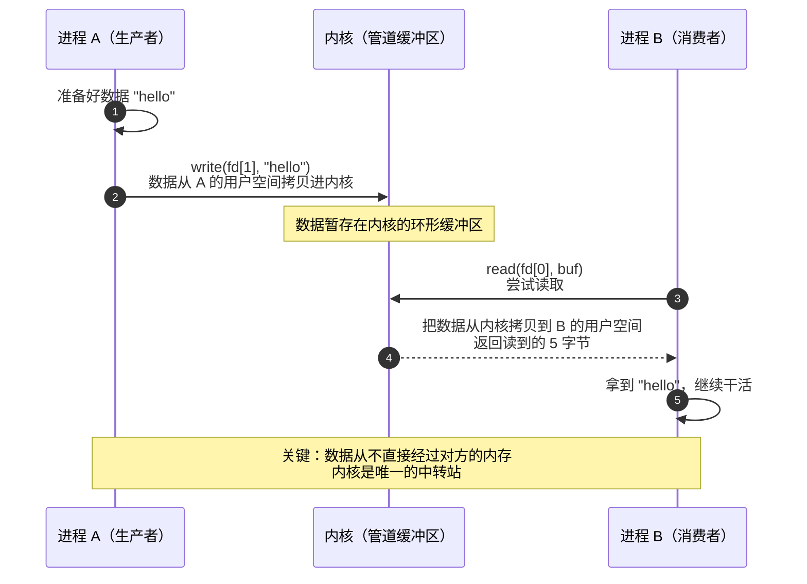
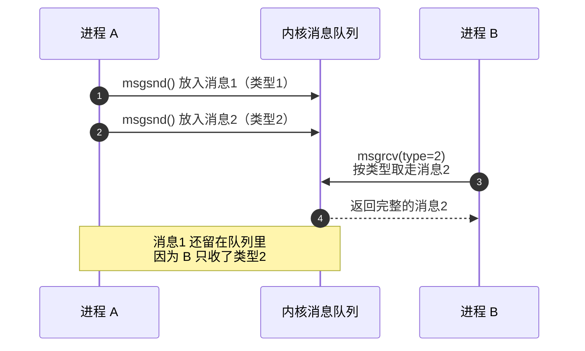

想象一下：两个进程就像两个被关在**各自独立小房间**里的人，彼此看不到、摸不着对方的房间，墙上也没有门。他们想交换信息，唯一的办法就是请**楼管（操作系统内核）**帮忙传话，或者共用一个**放在走廊里的公共信箱**。

这篇文章要讲的就是这件事——**进程间通信（IPC，Inter-Process Communication）**。我会回答三个问题：**它是什么、怎么用、底层是怎么实现的**，全程用最朴素的比喻，配架构图和时序图，争取让没有任何操作系统基础的人也能一次看懂。

## 〇、先用一句话和一栋楼理解 IPC

**IPC 就是"让两个互相隔离的进程，通过内核提供的机制交换数据或同步动作"的一套方法。**

一个进程自己是没法直接去读另一个进程的内存的，原因我们下一节讲。于是操作系统出面，在中间搭了各种"通道"：有的像水管（管道），有的像信箱（消息队列），有的像一块公共黑板（共享内存），有的像拍肩膀（信号），还有的像能打到别的城市的电话（套接字）。

## 一、为什么进程之间"说不上话"？

要理解 IPC，先得理解一个问题：**为什么进程不能直接去读对方的变量？**

现代操作系统会给每个进程一个**独立的虚拟地址空间**。在进程 A 眼里，地址 `0x1234` 可能是它自己的一个变量；但在进程 B 眼里，`0x1234` 是它自己的另一个变量。**同样的地址，指向的是两块完全不同的物理内存。** 这就是"地址空间隔离"。

这个隔离是**故意的、也是必要的**：它保证一个进程崩溃或越界乱写，不会把别的进程搞挂；你的浏览器崩了，不会把正在写的文档也一起带走。

代价就是：**两个进程之间没有天然的信息通道**。于是只能求助第三方——内核。内核有最高权限，能看到所有进程的内存，也愿意做这个"中间人"。

下面这张分层图能让你一眼看懂"内核在中间"这件事：



一句话：**用户态的进程之间隔着墙，所有正经的通信都要绕道内核；只有"共享内存"是个例外，它把同一块物理内存同时映射给两个进程，之后读写就不经过内核了**（后面会细讲）。

## 二、IPC 全家福：一张图看懂所有方式

常见的 IPC 方式有下面这些。先有个全景印象，后面逐个拆开讲：



图中 **①** 表示数据要**经过内核中转**（有拷贝开销），**②** 表示**不经过内核**（最快，但需自己加锁），**③** 表示**只通知、不带数据**。

各方式一句话对比：

| 方式 | 一句话理解 | 方向 | 数据形态 | 有没有消息边界 | 能否跨机器 | 相对速度 |
| --- | --- | --- | --- | --- | --- | --- |
| 匿名管道 pipe | 一条水管，倒进去的字节按顺序流出来 | 单向（写端 → 读端） | 字节流 | 无 | 否 | 快 |
| 命名管道 FIFO | 给水管起个名字，没血缘关系的进程也能找到 | 单向（要双向就建两条） | 字节流 | 无 | 否 | 快 |
| 消息队列 | 一个信箱，按"整条消息"收发 | 多对多，可双向 | 一条条消息 | 有 | 否 | 中 |
| 共享内存 | 一块公共黑板，大家直接读写真内存 | 双向（双方都能读写） | 内存区域 | 无（需自己定协议） | 否 | 最快 |
| 信号 | 拍一下肩膀，告诉他"有事了" | 单向（发方 → 收方） | 一个编号 | — | 否 | — |
| 套接字 socket | 打电话，本机能打，跨城市也能打 | 双向（全双工） | 字节流或报文 | 因协议而异 | 能 | 中 |

**"消息边界"**是指：接收方能不能分清"一条消息"从哪里开始、到哪里结束。打个比方：管道是"往水管里倒水"，你连续倒两杯水，流出来时已经混在一起，分不清哪杯是哪杯——这就是**无边界**的字节流；消息队列是"寄包裹"，每个包裹都是独立整体，收件人每次签收的都是完整的一个包裹——这就是**有边界**。举个具体例子：发送方连续发 "hello" 和 "world" 两条消息，用**管道**读，`read()` 可能一次读到 "helloworld" 十个字节，也可能这次只读到 "hel"、剩下的下次再读，接收方不知道边界在哪；用**消息队列**收，第一次 `msgrcv` 一定得到完整的 "hello"、第二次得到完整的 "world"，边界被原样保留。所以当你的数据本身就是"一条一条"的记录时，无边界的方式就得自己约定分隔符（比如换行 `\n`）或长度前缀，否则就会发生"黏包"。

**方向**是另一个重要维度，新手常会忽略：**管道、命名管道、信号是单向的**——数据只朝一个方向走，要双向就得再建一条（或改用套接字）；**套接字是双向（全双工）的**——两端能同时收发；**消息队列和共享内存是多对多的**——谁都能发、谁都能收。上面那张图里，**单向箭头**表示只能朝一个方向走，**双箭头（`<-->`）**表示两边都能读写。

> 严格说，**信号量（semaphore）**也常被归到 IPC 里，但它不是用来传数据的，而是用来**协调"谁先谁后、谁能用共享资源"**的，所以我们把它当作共享内存的"配套工具"来理解，会在共享内存一节一起说。

下面逐个讲清楚：**是什么 → 怎么用 → 原理是什么**。

## 三、管道 pipe：最古老的字节流

### 是什么

管道是一段存在于**内核里的缓冲区**，一端写、一端读。它像一根水管：你从这头倒水，水从另一头流出来，**先倒进去的先流出来**（先进先出，FIFO）。它传输的是**没有边界的字节流**——你写 5 字节再写 8 字节，读的人拿到的是一连串 13 字节，分不清哪 5 字节是"第一句"。方向上它是**单向**的：写端只管写、读端只管读，想双向通信就得建两条管道（或改用套接字）。

### 怎么用

你其实天天在用管道，只是没意识到。在 Linux/Unix 的 Shell 里，`|` 就是管道：

```bash
cat file.txt | grep "hello" | wc -l
```

这里 `cat` 的输出顺着管道流给 `grep`，`grep` 的输出又流给 `wc`。三个进程串成一条流水线。

用 C 语言最直白的写法是这样：

```c
#include <stdio.h>
#include <string.h>
#include <unistd.h>
#include <sys/wait.h>

int main(void) {
    int fd[2];
    pipe(fd);                       // 创建管道：fd[0] 读端，fd[1] 写端

    if (fork() == 0) {
        /* 子进程：只读 */
        close(fd[1]);
        char buf[64] = {0};
        read(fd[0], buf, sizeof(buf));   // 从管道读
        printf("子进程收到：%s\n", buf);
        close(fd[0]);
    } else {
        /* 父进程：只写 */
        close(fd[0]);
        const char *msg = "hello from parent";
        write(fd[1], msg, strlen(msg));  // 写进管道
        close(fd[1]);
        wait(NULL);
    }
    return 0;
}
```

编译运行：`gcc pipe.c -o pipe && ./pipe`，你会看到子进程打印出父进程写进来的那句话。

### 实现原理

调用 `pipe()` 时，内核做了这么几件事：

1. 创建一个 **inode**，里面挂着一个**环形缓冲区**（Linux 上默认约 64KB，即 16 个 4KB 页）；
2. 返回两个文件描述符：`fd[0]` 指向读端、`fd[1]` 指向写端；
3. 之后 `write()` 把数据从**用户空间拷贝进内核缓冲区**，`read()` 再把数据从**内核缓冲区拷贝回用户空间**。

这里有两个关键点：

- **数据要经过内核两次拷贝**（用户 → 内核 → 用户），所以比共享内存慢；
- **管道是"同步阻塞"的**：缓冲区满了，`write` 会阻塞等读；缓冲区空了，`read` 会阻塞等写。这天然形成了一种**生产者-消费者**的节奏控制。

## 四、命名管道 FIFO：给管道起个名字

### 是什么

匿名管道有个缺点：它只存在于有"亲缘关系"的进程之间（比如 `fork` 出来的父子进程），因为只有它们手里有那两个文件描述符。**两个毫不相干的进程**想通信，匿名管道就抓瞎了。

**命名管道（FIFO）**解决的就是这个：它在文件系统里**有一个名字**（一个文件路径），任何进程只要知道这个名字，就能打开它来读写。它本质还是那根"水管"，只是多了块"门牌号"。方向上和匿名管道一样是**单向**的字节流，要双向就建两条。

### 怎么用

用 `mkfifo` 创建一个命名管道：

```bash
mkfifo /tmp/myfifo
```

然后两个终端，一边写一边读：

```bash
# 终端 1：往管道里写
echo "hello fifo" > /tmp/myfifo
```

```bash
# 终端 2：从管道里读
cat /tmp/myfifo
```

你会看到终端 1 的命令在等终端 2 打开管道的那一刻，数据才真正流过去——这正是管道"同步阻塞"的体现。

### 实现原理

和匿名管道几乎一样，区别只在开头：`mkfifo` 会在文件系统里创建一个**特殊类型的文件节点**（文件类型是 FIFO），它本身不存数据，只是一个"入口"。谁 `open` 它，谁就和内核里那段缓冲区接上了。数据还是存在内核缓冲区里，读写规则和匿名管道完全相同。

## 五、消息队列：一条条有边界的"包裹"

### 是什么

管道是"倒水"，消息队列是"寄包裹"。每条消息是一个**完整的、有边界的单元**，还自带一个**类型号**。接收方可以按类型挑着收，收到的永远是"一整条"消息，不会和别的消息糊在一起。方向上是**多对多、可双向**的：任何一个进程都能往同一个队列里发消息，也能从里面取消息。

### 怎么用

用 System V 接口写一个最简例子（发送和接收在同一个进程里演示）：

```c
#include <stdio.h>
#include <string.h>
#include <sys/ipc.h>
#include <sys/msg.h>

struct msgbuf {
    long mtype;        /* 消息类型，必须是正数 */
    char mtext[128];   /* 消息内容 */
};

int main(void) {
    /* 创建（或打开）一个消息队列 */
    int msqid = msgget(IPC_PRIVATE, 0666 | IPC_CREAT);

    /* 发送一条类型为 1 的消息 */
    struct msgbuf send;
    send.mtype = 1;
    strcpy(send.mtext, "你好，消息队列");
    msgsnd(msqid, &send, strlen(send.mtext), 0);

    /* 接收一条类型为 1 的消息 */
    struct msgbuf recv;
    ssize_t n = msgrcv(msqid, &recv, sizeof(recv.mtext), 1, 0);
    printf("收到 %zd 字节：%s\n", n, recv.mtext);

    /* 删除队列 */
    msgctl(msqid, IPC_RMID, NULL);
    return 0;
}
```

注意 `msgrcv` 的第四个参数 `1` 表示"只要类型为 1 的消息"。这就是它比管道强的地方：**带类型、可挑选**。

### 实现原理

内核为每个消息队列维护一个**消息链表**，每个节点是一条消息（对应内核里的 `struct msg_msg`，存着类型和内容）。

- `msgsnd`：在内核里分配一个消息节点，把数据从用户空间拷进去，挂到链表尾部；
- `msgrcv`：在链表里找到第一条**类型匹配**的消息，把它取出来，数据拷回用户空间，节点释放。

因为它把"一条消息"当成一个整体来管理，所以**边界是天然保留的**——这就是它和管道最本质的区别。

## 六、共享内存：最快的通信方式（但要自己加锁）

### 是什么

前面所有方式，数据都要"用户 → 内核 → 用户"地来回拷贝。共享内存干脆**跳过中转**：让两个进程的**页表**都指向**同一块物理内存**。于是进程 A 写进去的值，进程 B 直接就能读到，**零拷贝、几乎零延迟**。方向上它是**双向**的：所有映射它的进程都能读、都能写。

代价是：因为太"直接"了，内核**不再帮你做任何同步**。如果两个进程同时读写，数据会乱。所以共享内存通常要搭配**信号量**或**互斥锁**一起用，自己约定"谁先写、谁后读"。

### 怎么用

用 POSIX 接口写个最简例子：

```c
#include <stdio.h>
#include <string.h>
#include <fcntl.h>
#include <unistd.h>
#include <sys/mman.h>

int main(void) {
    /* 创建（或打开）一块命名共享内存 */
    int fd = shm_open("/myshm", O_CREAT | O_RDWR, 0666);
    ftruncate(fd, 4096);                 /* 把大小设为 4KB */

    /* 把这块共享内存映射进本进程的地址空间 */
    char *p = mmap(NULL, 4096, PROT_READ | PROT_WRITE, MAP_SHARED, fd, 0);

    strcpy(p, "hello shared memory");    /* 直接像普通内存一样读写 */
    printf("写进共享内存：%s\n", p);

    munmap(p, 4096);                     /* 解除映射 */
    shm_unlink("/myshm");                /* 删除共享内存对象 */
    return 0;
}
```

真实项目里，通常是**一个进程写、另一个进程读**，中间用信号量互相同步。这里为了直观，只演示了"映射 + 直接读写"这一步。

### 实现原理

关键就在 `mmap` 和**页表**：

1. `shm_open` 让内核创建一块共享内存对象（底层是个文件，存在 tmpfs 上）；
2. `mmap` 把这块内存映射进进程 A 的地址空间，同时把 A 页表里的对应项指向这块物理内存；
3. 进程 B 用同样的名字 `shm_open` + `mmap`，它的页表也指向**同一块物理内存**；
4. 之后两边读写，就是直接操作同一块物理内存，**内核完全不参与数据的搬运**。

这正是它最快的原因，也是它需要你自己做同步的原因——内核连"数据传没传"都不管了，更不会管"会不会同时读写冲突"。

## 七、信号 signal：最轻量的"拍肩膀"

### 是什么

信号不是一个"通道"，更像一个**通知**：内核或另一个进程，往目标进程的"待办"里塞一个**编号**，意思是"有件事发生了"。它几乎不携带数据（只有编号，最多再带一点点上下文）。方向上是**单向**的：从一个进程（或内核）指向另一个进程或进程组，被通知的一方不会回传数据。

常见的信号你一定见过：`Ctrl+C` 就是向前台进程发 `SIGINT`；`kill <pid>` 默认发 `SIGTERM`；程序崩溃报的 "Segmentation fault" 背后是 `SIGSEGV`。

### 怎么用

最简单的用法：给某个进程发信号。

```bash
kill -TERM 12345   # 让 PID 为 12345 的进程"优雅退出"
kill -KILL 12345   # 直接强杀（进程无法捕获或忽略这个信号）
```

在进程里，你可以**注册一个处理函数**，收到信号时做点事（`SIGKILL` 和 `SIGSTOP` 除外，它们无法被捕获）：

```c
#include <stdio.h>
#include <signal.h>
#include <unistd.h>

void on_sigint(int sig) {
    printf("收到信号 %d，我要优雅收尾了\n", sig);
}

int main(void) {
    signal(SIGINT, on_sigint);   /* 注册：收到 Ctrl+C 时执行 on_sigint */
    while (1) sleep(1);          /* 原地等待，直到被信号打断 */
    return 0;
}
```

### 实现原理

每个进程在内核里有一个 `task_struct`（进程的"档案"），里面有一组**挂起信号位图**。别人发信号，就是在这张位图里把对应的位置成 1。内核在合适的时机（比如进程从内核态返回用户态时）检查这张位图，发现有信号，就调用你注册的处理函数，或执行默认动作（忽略 / 终止 / 转储核心）。

## 八、套接字 socket：本机能用，跨机器也能用

### 是什么

套接字是"通信端点"的抽象。它最出名的地方是**网络编程**——TCP/IP 套接字让不同机器上的进程通信。但套接字也有**本机版**：Unix 域套接字（Unix domain socket），性能和管道一个量级，但接口更通用。方向上是**双向（全双工）**的：两端可以同时收发数据，这也是它比管道更灵活的地方。

### 怎么用

用 Python 写一个最小的"本机套接字对"演示：

```python
import socket

# socketpair 一次创建一对已经连好的套接字（本机通信）
a, b = socket.socketpair()

a.sendall(b"hello from A")
print("B 收到：", b.recv(100).decode())
```

跨机器的经典 TCP 服务端长这样（极简版，服务端只接收一条消息就退出）：

```python
import socket

# 服务端
srv = socket.socket()
srv.bind(("0.0.0.0", 9000))
srv.listen(1)
conn, addr = srv.accept()
print("收到：", conn.recv(1024).decode())
conn.close()
```

```python
import socket

# 客户端
cli = socket.socket()
cli.connect(("127.0.0.1", 9000))
cli.sendall(b"hello over TCP")
cli.close()
```

### 实现原理

套接字本质上是一套"挂在文件描述符上的网络协议栈入口"。`send`/`recv` 的数据会经过内核的 **TCP/IP 协议栈**（分片、封包、加校验、排队、流量控制……），再从网卡发出去；本机的 Unix 域套接字则跳过网络部分，直接在两个进程间搬运数据。这也是它比管道"重"、但通用性最强的原因——**一套接口，本机和跨机器都能用**。

## 九、一张时序图看懂"写 → 读"全过程

前面讲的是"是什么"，现在用一张时序图，把**管道**的完整交互串起来。看懂这一张，其他方式就是"把中间那个盒子换一换"：



再看消息队列的收发，注意它**一条一条**的节奏（有边界）：



## 十、怎么选：一张决策表

没有"最好"的 IPC，只有"最合适"的。按场景选：

| 你的场景 | 推荐方式 | 原因 |
| --- | --- | --- |
| 父子 / 亲缘进程，传简单字节流 | 匿名管道 pipe | 最省事，`fork` 后直接继承 |
| 两个不相干的本机进程 | 命名管道 FIFO / Unix 套接字 / 消息队列 | 有名字或地址，可被对方找到 |
| 要传海量数据、追求极限速度 | 共享内存 + 信号量 | 零拷贝，最快 |
| 要"一条一条"带类型地收发 | 消息队列 | 天然有消息边界 |
| 只通知"某件事发生了"，不带数据 | 信号 | 最轻量 |
| 要跨机器（不同主机） | TCP/UDP 套接字 | 走网络协议栈 |
| 要双向、且希望接口统一好扩展 | 套接字 | 本机跨机一套接口 |

## 十一、总结

把整篇文章收成几句话：

1. 进程因为**地址空间隔离**而无法直接通信，所以需要**内核**这个中介——这就是 IPC 存在的根本原因；
2. 按"数据是否经过内核"可以把方式分成两类：**管道 / 命名管道 / 消息队列 / 套接字**要经过内核中转（有拷贝开销），**共享内存**建好后直接读写真内存（最快但需自己同步），**信号**则只传通知不传数据；
3. 选型记住几个关键词：**要速度选共享内存，要"一条条"选消息队列，要简单选管道，要跨机器选套接字，只通知选信号**；
4. 所有方式在"怎么用"上其实都很像：**一方发、一方收**，区别只在于"中间那个盒子"是水管、信箱、黑板还是电话线。

理解了这套框架，再去读 Linux 里 `pipe`、`msgget`、`shm_open`、`socket` 的源码或文档，就会觉得豁然开朗——它们不过是在"中间那个盒子"上做了不同实现而已。
