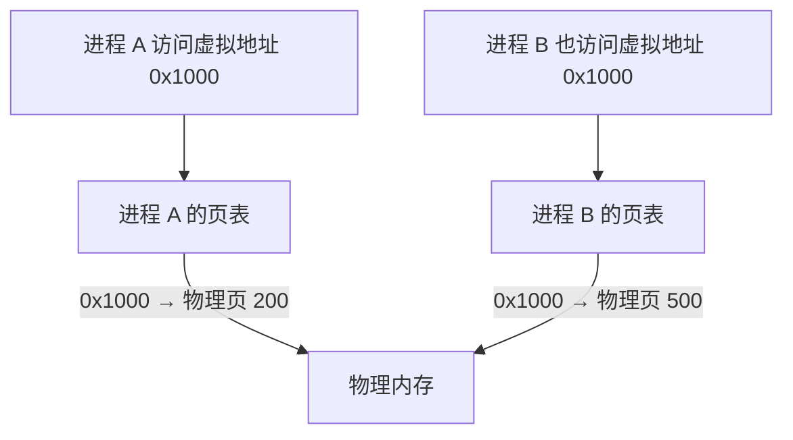
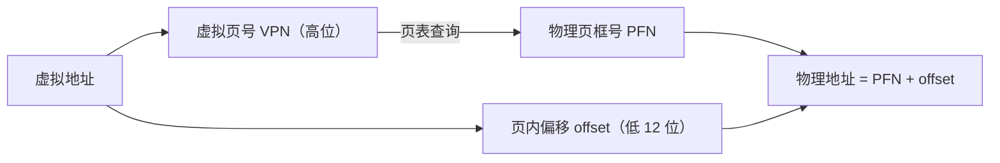
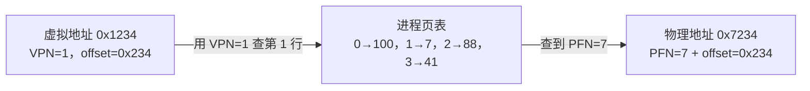
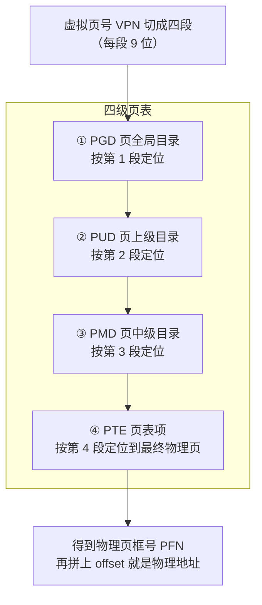
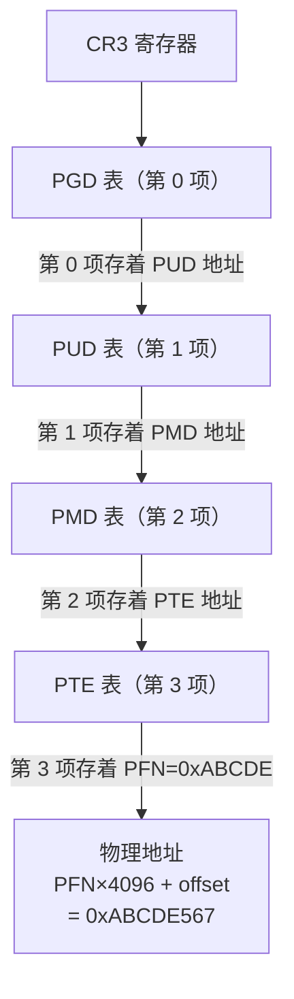
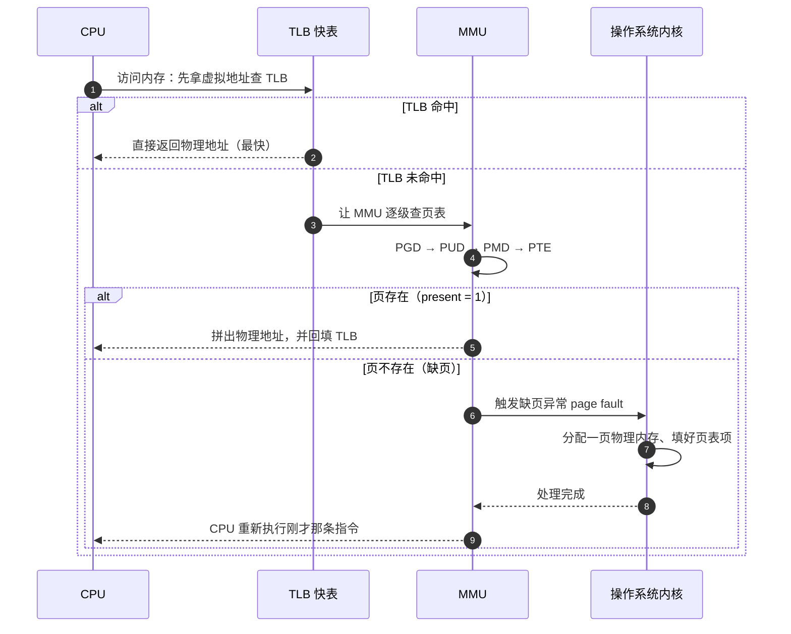
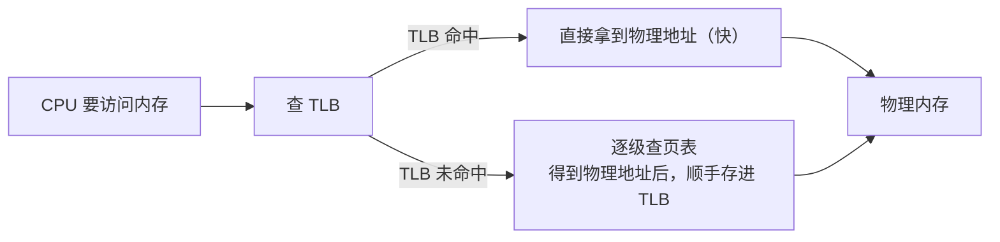
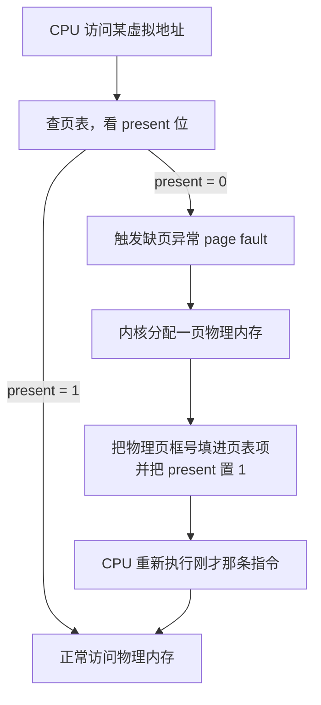
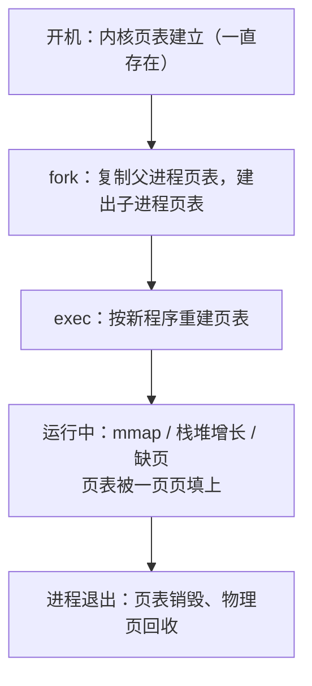

想象一下：小区里每个住户都收到一个**统一的虚拟门牌号**（比如"3 栋 2 单元 501"），但真正去敲门时，物业得靠一张**住户登记表**，把"3-2-501"翻译成"北区第 5 排第 3 块地"这个真实位置。

这篇文章讲的就是这张"登记表"——**内存页表（Page Table）**。它负责把进程眼里的**虚拟地址**翻译成真实的**物理地址**。我会讲清**它是什么、怎么用、底层怎么实现**，配架构图和时序图，最后带你动手看一眼自己的页表。

## 〇、一句话和一张全景图

**页表是操作系统维护的一张"对照表"，把进程的虚拟地址翻译成真实的物理地址。每个进程各有一份，所以大家能共享同一块物理内存、却互不干扰。**


## 一、为什么需要页表：从"内存碎片"和"隔离"说起

最早期，程序是**直接写死物理地址**的：代码里说"把数据放到物理地址 0x1000"，就真的写到 0x1000。这样有三个大问题：

1. **容易撞车**：两个程序都想用 0x1000，谁先谁后、会不会互相踩，完全没保障；
2. **不隔离**：一个程序写坏了自己的内存，可能顺带把别的程序也搞崩；
3. **有碎片**：内存用一段空一段，程序又要求"必须占一段连续的物理内存"，很快就被切得七零八落。

解决办法就是**虚拟内存 + 页表**：给每个进程一个**假地址空间**，这个空间看起来又大又连续、而且只属于它自己；真正访问时，再由硬件和操作系统一起，通过**页表**把假地址翻译成真地址。

这一下同时解决了上面三个问题：**隔离**（每个进程的假空间互不相通）、**不浪费**（物理内存可以按页分配、拼起来就行，不要求连续）、**按需分配**（用到哪页才给哪页，后面会细讲）。



看这张图：**两个进程都用虚拟地址 `0x1000`，但各自的页表把它翻译到了不同的物理页**（A 到 200，B 到 500），所以互不干扰——这就是"隔离"的由来，也是"页表负责查找虚拟页号 → 物理页号"最直观的样子。

## 二、页表长什么样：虚拟页号 → 物理页号

### 先认识"页"

操作系统把物理内存切成一块块**固定大小**的小块，每块叫一个**页（page）**，Linux 上通常是 **4KB（4096 字节）**。分配内存就按"页"为单位给。

### 地址被分成两段

一个虚拟地址可以拆成两段：

- **高位是"虚拟页号 VPN"**：说明"我要访问第几页"；
- **低位是"页内偏移 offset"**：说明"在这一页里的第几个字节"。

因为是 4KB = 2¹² 字节，所以 offset 占最低 **12 位**，剩下的高位全是页号。页表要做的事，就是把"虚拟页号"翻译成"物理页号"（也叫物理页框号 PFN）；**offset 保持不变**，最后拼起来就是物理地址。



### 举一个具体例子：查一次"虚拟页号 → 物理页号"

（先说明：为了先让你看清本质，这里用一张"平表"举例；真实进程用的是下一节的多级页表，但查找思路完全一样。）

整个过程用四条公式就能算清楚：

1. **页内偏移**：`offset = 虚拟地址 mod 页大小`（即取低 12 位）
2. **虚拟页号**：`VPN = 虚拟地址 ÷ 页大小`（整数除法，即高位）
3. **查页表**：`PFN = 页表[VPN]`（用 VPN 当"行号"，去表里找物理页框号）
4. **拼出物理地址**：`物理地址 = PFN × 页大小 + offset`

假设某个进程的页表长这样（每一行就是一个"虚拟页号 → 物理页号"的对应关系）：

| 虚拟页号 VPN | 物理页框号 PFN | 存在位 present |
| --- | --- | --- |
| 0 | 100 | 1 |
| 1 | 7 | 1 |
| 2 | 88 | 1 |
| 3 | 41 | 0 |

表里三列分别是什么、有什么用：

- **虚拟页号 VPN**：是"查表的入口"，也就是虚拟地址高位那一截。把它当成**行号**——程序要访问某个虚拟页，就拿着这个 VPN 去表里找对应的那一行。
- **物理页框号 PFN**：是"查表的结果"，表示这个虚拟页被放在**物理内存的第几页（第几框）**。查到它之后，拼上低 12 位的 offset，就得到真正的物理地址。
- **存在位 present**：是一个**开关**。1 表示这一页**真的在物理内存里**，可以直接访问；0 表示这一页**还没分配**（或被换出到磁盘了），一旦去访问它，就会触发后面"缺页异常"那一节讲的事情。

所以这张表的读法是：**拿着 VPN 当行号 → 找到对应的 PFN → 再看 present 是不是 1**。上面的例子里，`VPN=3` 那行 `present=0`，意味着第 3 个虚拟页目前还不能访问（访问就会缺页）。

现在程序要访问虚拟地址 `0x1234`（十进制 4660）：

- 先拆：`VPN = 4660 ÷ 4096 = 1`，`offset = 4660 mod 4096 = 564`（即 `0x234`）；
- 拿着 `VPN = 1` 去页表查第 1 行，得到 `PFN = 7`；
- 最后拼起来：`物理地址 = 7 × 4096 + 564 = 29236`，即 `0x7234`。

注意结果：`0x1234` → `0x7234`，**低 12 位的 `0x234` 原封不动，只有高位的"页号"从 1 换成了 7**——这就是"offset 不变、只换页号"。



一句话：**页表本质就是一张"虚拟页号 → 物理页号"的映射表**，像字典一样查。

## 三、为什么是多级页表：一张大表根本放不下

能不能只做"一张大表"，一个页号对应一行？理论上行，但太浪费了。

假设虚拟地址有 48 位、每页 4KB，那一共可能有 2³⁶（约 680 亿）个页。如果每行条目 8 字节，这张表得有 500GB，而且**每个进程都要建一份**，大部分行还根本没用到。这显然不现实。

于是用**多级页表**：像一本大字典分"卷 → 章 → 节"，只把真正用到的部分建出来，没用的部分整块省略。以 x86-64 常见的四级页表为例，地址里的页号被切成四段，从上往下逐级查：



**再举一个真实的多级查找例子**。48 位虚拟地址被切成五段，假设每段取值如下：

```text
虚拟地址（48 位）：
[ PGD 索引 9 位 | PUD 索引 9 位 | PMD 索引 9 位 | PTE 索引 9 位 | offset 12 位 ]
[      0       |      1       |      2       |      3       |    0x567     ]
```

CPU 里的 **CR3 寄存器**存着 PGD 表的物理地址，一切从它开始，一级一级往下跳：

1. 读 CR3 找到 **PGD 表**，用 `PGD 索引 = 0` 取出第 0 个条目，里面存着 **PUD 表**的物理地址；
2. 到 PUD 表，用 `PUD 索引 = 1` 取出第 1 个条目，里面存着 **PMD 表**的物理地址；
3. 到 PMD 表，用 `PMD 索引 = 2` 取出第 2 个条目，里面存着 **PTE 表**的物理地址；
4. 到 PTE 表，用 `PTE 索引 = 3` 取出第 3 个条目，里面存着最终**物理页框号 PFN**（假设 = `0xABCDE`）；
5. 拼出物理地址：`物理地址 = PFN × 4096 + offset = 0xABCDE × 4096 + 0x567 = 0xABCDE567`。



每一级都只做"取一个下标、跳到下一张表"，直到最后一级才真正拿到物理页号——这就是真实进程页表查一次地址的完整过程。

好处很明显：**没被用到的中间目录整棵不建**，每个进程的页表小得多；缺的只是"多查几级"的时间成本，而这点成本被下一节的 TLB 大幅抵消。

## 四、一次地址翻译的完整过程（时序图）

CPU 每次访问内存，都要经历下面这个过程。注意主角是 **MMU（内存管理单元）**——页表查询由它这个硬件来做，操作系统只在"缺页"时介入：



## 五、TLB：翻译过程的"加速缓存"

从上图能看出，一次完整的页表查询要连查四级、每级都是一次内存访问，太慢了。于是 CPU 里放了一个**高速小缓存，叫 TLB（Translation Lookaside Buffer，快表）**，专门记住"最近用过的虚拟页 → 物理页"的翻译结果。

大部分内存访问都会先命中 TLB，不用真的去走四级页表。这就像查字典前先看手边的"生词小本本"：查过的词都记在小本本上，下次直接翻小本本，快得多。



一句话：**先查 TLB，命中就直接用；没命中才去查多级页表，查完再回填 TLB**，下次访问同样的地址就快了。

## 六、缺页异常与按需分配：为什么"碰一下"才真正给内存

页表里的每一项（PTE）都带几个标志位，最关键的是 **present（存在位）**：1 表示这一页已经在物理内存里，0 表示"还没分配"或"被换出到磁盘了"。

当 CPU 访问到一个 present=0 的页，就触发**缺页异常（page fault）**。内核被叫进来，现场分配一页物理内存、把页表项填好、再让 CPU 重新执行刚才的指令——这次就能访问了。整个过程对程序是**透明**的，程序根本不知道自己"等了一下"。



这张图就是一次缺页的完整闭环：**查页表发现 present=0 → 缺页异常 → 内核分配物理页、填页表 → CPU 重新执行**，这次就成功了。

这就是**按需分配（demand paging）**：`mmap` 申请一大块内存时，操作系统常常只是"登记"了这段虚拟地址，**一个物理页都没真给**；等你第一次读/写某个页，才通过缺页异常真正分配。好处是**不用的页不占内存**。

## 七、页表什么时候创建？谁在维护它？

先纠正一个常见误解：页表**不是"操作系统一直只有一张"**，也**不是"程序启动时一次性建好一整张"**。准确说是两类：

- **内核自己的页表**：**开机（内核启动）时**就建立，映射内核代码、数据和全部物理内存，**系统运行期间一直存在**；
- **每个进程的页表**：在**进程创建时**由内核新建，之后随运行**动态增补**，进程退出时销毁。

具体到时间点，进程的页表是这样来的：

1. **`fork()` 创建进程时**：内核给子进程建一张新页表，先**复制父进程的页表**（很多页用"写时复制 copy-on-write"先共享，真正被写时才各自复制一份）；
2. **`exec()` 换成新程序时**：内核给这个进程**换一张新页表**，按 ELF 可执行文件重新映射代码段、数据段、栈、堆等；
3. **运行过程中**：`mmap` 申请内存、栈/堆增长、发生缺页时，页表被**一页一页地填上**——这正是上一节"按需分配"，所以页表从创建起就一直在变，不是一次建好的；
4. **进程退出时**：这张页表被销毁，属于它的物理页被回收。

一句话记忆：**"内核的页表开机就有；每个进程的页表 fork/exec 时建、运行中动态填、退出时销毁。"**



## 八、怎么用 / 怎么观察：亲手看一眼页表在起作用

页表是操作系统内部自动维护的，程序员一般不直接"操作"它，但可以**观察**它。先看两个现成命令：

```bash
getconf PAGE_SIZE              # 查看系统页大小（Linux 上通常是 4096 字节 = 4KB）
cat /proc/self/maps | head -n 5 # 查看当前进程自己的虚拟内存映射表
```

`/proc/self/maps` 每一行是一条映射，例如 `00400000-00452000 r-xp ... /usr/bin/cat`：最左边是**虚拟地址范围**，第二位是**权限**（r=读、w=写、x=执行、p=私有）。这些"看起来连续"的区间，背后正是靠页表映射到物理内存的。

再写一个 C 程序，直接看到"按需分配"的效果——`mmap` 只预留虚拟地址，真正碰某页才触发缺页、分配物理内存：

```c
#include <stdio.h>         // printf、perror
#include <sys/mman.h>      // mmap、munmap、MAP_ANONYMOUS、MAP_FAILED
#include <unistd.h>        // sysconf、_SC_PAGESIZE
#include <sys/resource.h>  // getrusage、struct rusage

int main(void) {
    long pagesize = sysconf(_SC_PAGESIZE);    // 取系统页大小（通常 4096 字节）
    size_t total = (size_t)pagesize * 4;      // 一共映射 4 个页的大小

    // 匿名映射 4 页：这一步只是"预留"虚拟地址，还没真正分配物理内存
    // MAP_ANONYMOUS 表示不关联文件；MAP_PRIVATE 表示私有；fd 用 -1
    char *p = mmap(NULL, total, PROT_READ | PROT_WRITE,
                   MAP_PRIVATE | MAP_ANONYMOUS, -1, 0);
    if (p == MAP_FAILED) { perror("mmap"); return 1; }  // 映射失败就报错退出

    printf("页大小=%ld，映射了 %zu 字节\n", pagesize, total);
    printf("虚拟地址起始=%p\n", (void *)p);              // 打印这段内存的虚拟地址

    // 记录动手前后的缺页次数（minor 缺页 + major 缺页）
    struct rusage before, after;
    getrusage(RUSAGE_SELF, &before);

    p[0] = 'a';                        // 第一次碰第 1 页 → 触发一次缺页，内核才分配物理页
    p[pagesize] = 'b';                 // 第一次碰第 2 页 → 再触发一次缺页
    p[pagesize * 3] = 'd';             // 碰第 4 页 → 触发缺页；第 3 页没碰过，不分配

    getrusage(RUSAGE_SELF, &after);
    long faults = (after.ru_minflt - before.ru_minflt)
                + (after.ru_majflt - before.ru_majflt);
    printf("刚才触发缺页次数约=%ld 次\n", faults);  // 大约等于 3（碰了几个不同的页就缺几次）

    munmap(p, total);                  // 解除映射，释放这段虚拟地址
    return 0;                          // 程序正常结束
}
```

编译运行：`gcc pagefault.c -o pagefault && ./pagefault`。你会看到缺页次数大约等于 **3**——正是我们碰过的 3 个不同的页；第 3 页（下标 `pagesize*2`）从头到尾没碰过，所以一次缺页都没为它发生。这就是"用到哪页、才给哪页"。

## 九、总结

把整篇文章收成几句话：

1. **虚拟内存**给每个进程一个独立、连续的假地址空间，**页表**负责把假地址翻译成真地址；
2. 页表本质是"**虚拟页号 → 物理页号**"的映射，地址 = 页号（高位）+ 页内偏移（低 12 位）；
3. 因为全量页表太大，所以用**多级页表**（x86-64 是 PGD/PUD/PMD/PTE 四级），只建用到的部分；
4. 翻译时先查 **TLB 快表**，未命中再逐级查页表；查不到就触发**缺页异常**，内核按需分配物理页；
5. 这套机制一石三鸟：**隔离、不浪费、按需分配**。

理解了这套框架，再去看 `mmap`、`/proc/pid/maps`、或者 Linux 内核里 `vm_area_struct` 和四级页表的结构，就会觉得豁然开朗——它们不过是在把这套"翻译字典"做得更高效、更精细而已。
