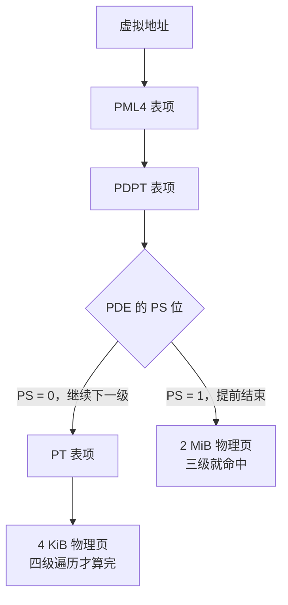
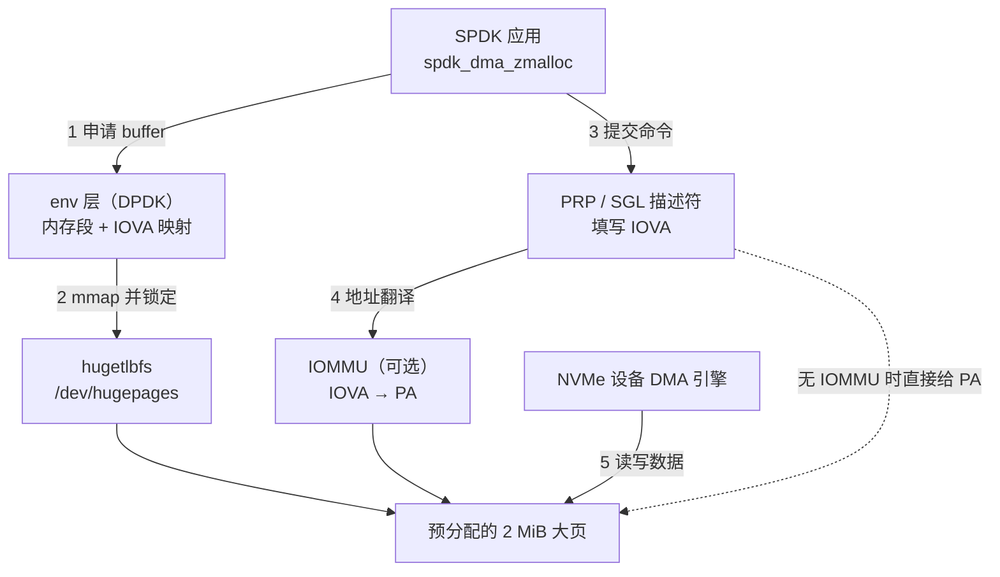
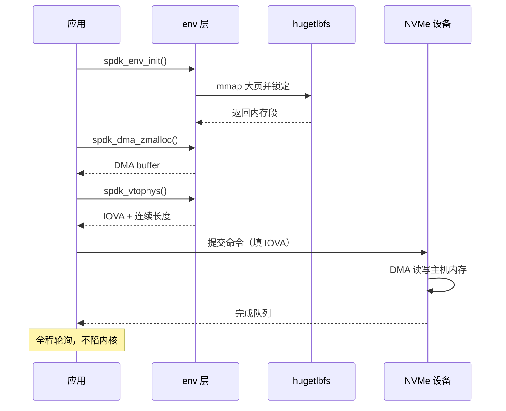

一句话：SPDK 把 I/O 路径搬进了用户态、改成了轮询，省掉了中断和系统调用，代价是**每一次内存访问的地址翻译、每一次缺页，都要自己承担**。大页内存就是把这个代价压到接近零的手段。

这篇文章回答三个问题：**大页到底省掉了什么、SPDK 为什么非要它、以及怎么配、怎么写代码**。

## 〇、先建立一个整体印象

普通 4 KiB 页与 2 MiB 大页的区别，本质不是"内存更多"，而是**页表少走一层、一个 TLB 条目覆盖 512 倍的范围**。



记住两件事，后面的所有结论都从这里推出来：

1. **翻译步骤更少**：4 KiB 页要四级全部命中，2 MiB 页三级就结束，1 GiB 页两级就结束。
2. **单位缓存覆盖更大**：TLB 是按"条目"存的，一条 2 MiB 的条目顶 512 条 4 KiB 的条目。

## 一、大页内存是什么

### 1.1 先算一笔 4 KiB 页的账

x86-64 的四级页表、CR3、TLB 这些机制，在[《内存页表》](/posts/memory-page-table/){: target="_blank" rel="noopener noreferrer"}那篇里已经拆开讲过，这里只看与性能直接相关的部分：**CPU 每访问一个没被 TLB 缓存的页，就要额外做一次页表遍历**。

一次 4 KiB 页的遍历最多要访存 4 次（PML4 → PDPT → PD → PT），实际因为有页表缓存（page-walk cache）会少一些，但 TLB miss 的开销普遍在**几十到上百个周期**。对普通进程来说这可以忽略——命中率通常在 99% 以上。可一旦工作集大到 TLB 装不下，miss 就会变成常态。

### 1.2 大页怎么省掉这一层

x86 的页表项里有一个 **PS 位（Page Size）**：页目录项（PDE）里把它置 1，这个"目录项"就不再指向下一级页表，而是**直接描述一个 2 MiB 的物理页**。同理，PDPT 项里置位就是 1 GiB 页。

于是：

| 页大小 | 遍历级数 | 一条 TLB 条目覆盖 | 需要 4 KiB 的多少条 |
| --- | --- | --- | --- |
| 4 KiB | 4（PML4 → PDPT → PD → PT） | 4 KiB | 1 |
| 2 MiB | 3（PML4 → PDPT → PD） | 2 MiB | 512 |
| 1 GiB | 2（PML4 → PDPT） | 1 GiB | 262 144 |

顺带说一个容易忽略的细节：**2 MiB 页的虚拟地址低 21 位不做翻译**，直接作为页内偏移拼到物理地址上。所以它要求虚拟地址和物理地址在 2 MiB 边界上对齐——这也是后面 `spdk_dma_zmalloc` 对齐参数存在的原因。

### 1.3 TLB 覆盖范围才是关键指标

以 Skylake 一代的典型参数为例（不同微架构有出入，量级一致）：

| 缓存 | 4 KiB 条目 | 2 MiB 条目 |
| --- | --- | --- |
| L1 dTLB | 64 | 32 |
| L2 STLB | 1536 | 1024 |

把条目数乘以页大小，得到**TLB reach（能覆盖的内存范围）**：

- 只用 4 KiB 页：`1536 × 4 KiB = 6 MiB`。也就是说一个进程的工作集只要超过 6 MiB，TLB 就开始漏。
- 用 2 MiB 页：`1024 × 2 MiB = 2 GiB`。

这个差距的实战意义很直接：一个 SPDK 实例的 buffer 池、队列、元数据加起来动辄几百 MiB 到几 GiB，随机访问模式下 4 KiB 页的 TLB 命中率会掉到个位数，而 2 MiB 页基本可以做到全命中。

### 1.4 大页不是"更大的 malloc"

这点必须先说清楚，否则后面的配置会看不懂。大页内存有两个硬约束：

- **必须提前预留**。物理内存得在系统运行早期就切出来，之后不再参与伙伴系统的分配。等到内存碎片化以后再要 2 MiB 连续物理内存，经常要不到。
- **不是按需分配**。`mmap` 到 hugetlbfs 时，页就已经真实存在了，不会有缺页异常去"临时找内存"。

也就是说：大页是**开机时圈好的一块地**，而不是"调用时变大的 malloc"。SPDK 依赖的正是这种确定性。

## 二、SPDK 为什么非要大页

### 2.1 轮询模式不能容忍缺页

SPDK 的 NVMe 驱动跑在用户态，靠一个死循环不断检查提交/完成队列，没有中断、没有系统调用、没有线程切换。这套模型对延迟极其友好，但对内存提出了一个苛刻要求：

**I/O 路径上不能发生缺页**。

一旦发生缺页，CPU 会陷入内核、分配页、更新页表，一次就是几微秒——比你想要优化的那点开销大两个数量级。SPDK 的做法是把所有 buffer 在启动阶段就分配好、锁定好，让运行期彻底没有缺页。大页天然满足这一点：页在 `mmap` 的那一刻就已经在了。

### 2.2 TLB miss 在高 IOPS 下会被放大

一次 4 KiB 的 NVMe 读，DMA 要写 4 KiB 数据，但驱动侧还要碰命令队列、完成队列、请求结构体、PRP 列表。假设一次 I/O 触发几十次内存访问，其中相当一部分落在不同的 4 KiB 页上：

- 4 KiB 页：每秒百万级 I/O 时，TLB miss 数以千万计；
- 2 MiB 页：同样的访问模式，覆盖同样的内存只需要 1/512 的条目。

在 IOPS 已经做到几十万、上百万的场景里，这部分开销不再是可以忽略的"背景噪音"，而是实打实的 CPU 占用——它会直接压低每核能撑起的 IOPS。

### 2.3 DMA 才是更硬的理由

前两条讲的是"更快"，这一条讲的是"能不能"。

设备做 DMA 时用的是它自己能理解的地址：有 IOMMU 时是 **IOVA**，没有 IOMMU 时就是**物理地址**。这两条路都受页大小影响，而且影响很大：

**（1）IOMMU 的页表也是按页建的。** IOTLB 和 CPU 的 TLB 一样会 miss，页表项数量和页大小成反比。一块 1 GiB 的 buffer，用 4 KiB 页要建 26 万个映射项，用 2 MiB 页只要 512 个。IOTLB 的容量比 CPU TLB 小得多，这个差别会直接体现在 DMA 延迟上。

**（2）没有 IOMMU 时，物理连续长度就是 DMA 段长度。** 这时一段内存能连续多长，完全取决于它由几个物理页拼成。2 MiB 大页意味着**一段连续可达 2 MiB**，而 4 KiB 页最多只有 4 KiB。

这就引出了 SPDK 里最值得记住的一个 API 语义：

```c
uint64_t spdk_vtophys(void *buf, uint64_t *size);
```

它把虚拟地址翻译成设备用的地址，同时**把 `size` 改写成"从这个地址开始、物理连续的那一段有多长"**。如果你传入一个 4 MiB 的 buffer：

- 底层是 4 KiB 页：`size` 很可能被改写成 4096，你得循环 1024 次才能把整块翻译完；
- 底层是 2 MiB 页：`size` 最多被改写成 2097152，两次就完事。

这个差别会一路传导到 NVMe 的 PRP/SGL 描述符数量、IOMMU 映射项数量，以及硬件 DMA 引擎的散列/聚集开销。

### 2.4 为什么不直接用透明大页（THP）

很多人第一反应是：内核不是有 THP 吗，`echo always` 不就行了？对 SPDK 不成立，原因有四个：

| 维度 | THP | hugetlbfs 静态大页 |
| --- | --- | --- |
| 何时分配 | 缺页时才尝试合并/分配 | 启动时预留，`mmap` 时就在 |
| 能否失败退化成 4 KiB | 会，内存紧张时静默退化 | 不会，要不到就 `mmap` 失败，错误可见 |
| 能否被迁移/回收 | 可以被 khugepaged、内存整理迁移 | 不会被迁移、不会换出 |
| 物理连续性保证 | 单页内连续，但不保证多页连续 | 每个页都是独立的 2 MiB 连续块 |

对轮询驱动来说，"静默退化成 4 KiB"是最坏的情况：性能悄悄掉了，日志里什么也没有。SPDK 要的是**要么给我，要么明确报错**。

### 2.5 把这条链路串起来



这张图里有两个"地址"在流动：**CPU 侧看到的是虚拟地址，设备侧看到的是 IOVA/物理地址**。大页同时降低了这两侧的翻译成本，这是它在 SPDK 里不可替代的原因。

## 三、怎么配置

### 3.1 预留大页：两种时机

**开机参数（推荐，能保证拿到连续物理内存）**：

```shell
# 编辑 GRUB 配置，在 GRUB_CMDLINE_LINUX 里追加
# 预留 1024 个 2 MiB 页 = 2 GiB
sudo sed -i 's/^GRUB_CMDLINE_LINUX="/GRUB_CMDLINE_LINUX="hugepages=1024 /' /etc/default/grub
sudo update-grub      # Debian/Ubuntu；RHEL 系用 grub2-mkconfig -o /boot/grub2/grub.cfg
sudo reboot
```

**运行时调整（方便，但可能失败）**：

```shell
# 2 MiB 规格：写入期望的页数，内核尽力而为
echo 1024 | sudo tee /proc/sys/vm/nr_hugepages

# 1 GiB 规格：注意路径里带尺寸，且 CPU 需要 pdpe1gb 标志
echo 4 | sudo tee /sys/kernel/mm/hugepages/hugepages-1048576kB/nr_hugepages
```

运行时写入经常只能部分成功——内存已经碎片化时，内核找不到足够的 2 MiB 连续块。所以生产环境一律走开机参数。

### 3.2 挂载 hugetlbfs

大页要有一个"文件系统"才能被 `mmap` 出来，这就是 hugetlbfs：

```shell
# 创建挂载点
sudo mkdir -p /dev/hugepages

# 挂载；pagesize 要和预留的规格一致，2M 页就写 2M
sudo mount -t hugetlbfs nodev /dev/hugepages -o pagesize=2M

# 写进 /etc/fstab 让重启后依旧有效
echo 'nodev /dev/hugepages hugetlbfs pagesize=2M 0 0' | sudo tee -a /etc/fstab
```

这里有个常见误解：**hugetlbfs 不是磁盘上的文件系统**。你在 `/dev/hugepages` 里创建的文件只占内存，不会落盘，重启即消失。

### 3.3 验证有没有配好

```shell
# 看总量与剩余：HugePages_Free 是关键，它才是能被 mmap 的数量
grep -i huge /proc/meminfo

# 单独看某个规格的页数
cat /sys/kernel/mm/hugepages/hugepages-2048kB/nr_hugepages

# 确认挂载参数
mount | grep hugepages
```

`/proc/meminfo` 里几个字段的含义：

| 字段 | 含义 |
| --- | --- |
| `HugePages_Total` | 预留的总页数 |
| `HugePages_Free` | 还没被任何进程映射的页数 |
| `HugePages_Rsvd` | 已被预留但尚未实际映射的页数 |
| `Hugepagesize` | 默认规格（通常是 2048 kB） |

### 3.4 SPDK 自己的入口：setup.sh

SPDK 自带脚本把上面几件事一次性做完（预留、挂载、改权限、绑定设备驱动）：

```shell
# HUGEMEM 的单位是 MiB；这里预留 4 GiB
sudo HUGEMEM=4096 ./scripts/setup.sh

# 查看当前绑定了哪些设备
sudo ./scripts/setup.sh status
```

跑 SPDK 应用时，再把内存大小和 core 显式指定给它：

```shell
# -s：从大页里划多少 MiB 给这个进程
# -m：使用的 CPU core 掩码（这里是 0 号和 1 号核）
# --huge-dir：hugetlbfs 挂载点
sudo ./build/examples/hello_world -m 0x3 -s 2048 --huge-dir /dev/hugepages
```

调试时可以用 `--no-huge` 退回普通页运行，但那条路径的性能没有参考价值——它存在的意义只是让程序能跑起来。

## 四、代码：从直接 mmap 到 SPDK

### 4.1 先不用 SPDK，看清大页本身

第一段代码绕开 SPDK，直接用 `mmap` 拿一块 2 MiB 大页，并让内核告诉我们"这一页到底多大"。这样能把"大页"这件事和 SPDK 解耦开看。

```c
/* hugepage_mmap.c —— 直接从 hugetlbfs 映射一块大页并验证页大小
 * 编译：gcc -O2 -Wall hugepage_mmap.c -o hugepage_mmap
 * 运行：sudo ./hugepage_mmap      （需要 /dev/hugepages 已挂载并有大页可用）
 */
#define _GNU_SOURCE
#include <fcntl.h>        /* open */
#include <stdio.h>        /* printf, perror */
#include <string.h>       /* memset */
#include <sys/mman.h>     /* mmap, munmap */
#include <unistd.h>       /* ftruncate, close, sleep */

#define HPAGE_SIZE (2UL * 1024 * 1024)   /* 2 MiB，必须与挂载时的 pagesize 一致 */

int main(void)
{
    const char *path = "/dev/hugepages/hp_demo";
    int  fd;
    void *addr;

    /* 1. 在 hugetlbfs 里创建一个文件；它只在内存中存在，不会落盘 */
    fd = open(path, O_CREAT | O_RDWR, 0600);
    if (fd < 0) {
        perror("open /dev/hugepages/hp_demo");
        return 1;
    }

    /* 2. 把文件大小设成 2 MiB —— hugetlbfs 要求长度对齐到页大小 */
    if (ftruncate(fd, HPAGE_SIZE) != 0) {
        perror("ftruncate");
        close(fd);
        return 1;
    }

    /* 3. 映射：这一步实际是从预留的大页池里取走一页 */
    addr = mmap(NULL, HPAGE_SIZE, PROT_READ | PROT_WRITE, MAP_SHARED, fd, 0);
    if (addr == MAP_FAILED) {
        perror("mmap (大页不够？先看 /proc/meminfo 的 HugePages_Free)");
        close(fd);
        return 1;
    }
    printf("映射成功：addr=%p size=%lu\n", addr, HPAGE_SIZE);

    /* 4. 写一遍再读一遍，确认内存真的可用 */
    memset(addr, 0xA5, HPAGE_SIZE);
    printf("首字节=0x%02x 末字节=0x%02x\n",
           ((unsigned char *)addr)[0],
           ((unsigned char *)addr)[HPAGE_SIZE - 1]);

    /* 5. 停留 30 秒，方便在另一个终端里查看 /proc/<pid>/smaps */
    printf("sleep 30s，可在另一个终端执行：\n");
    printf("  sudo grep -A6 hp_demo /proc/%d/smaps | grep -E 'KernelPageSize|MMUPageSize'\n",
           (int)getpid());
    sleep(30);

    /* 6. 释放：munmap 归还虚拟地址，大页回到池中 */
    munmap(addr, HPAGE_SIZE);
    close(fd);
    unlink(path);         /* 删除 hugetlbfs 里的文件（只是内存条目） */
    return 0;
}
```

运行起来以后，在另一个终端里执行它打印的那条 `grep`，你应该看到：

```text
KernelPageSize:     2048 kB
MMUPageSize:        2048 kB
```

**这就是最硬的证据**——内核承认这一块映射的页大小是 2048 kB，而不是 4 kB。如果显示 4 kB，说明 `mmap` 没有真正走大页路径（通常是挂载参数或预留数量不对）。

### 4.2 换 SPDK：DMA buffer 与地址翻译

第二段代码才是 SPDK 的用法。它做三件事：初始化 env 层（这一步会去 hugetlbfs 取大页）、申请一块 DMA 可用的内存、然后逐段做虚拟地址到 IOVA 的翻译，把"能连续多长"打出来。

```c
/* spdk_hugepage_demo.c —— 用 SPDK env 层申请 DMA 内存并观察物理连续性
 * 编译见 4.3 节；运行需要事先跑过 scripts/setup.sh
 */
#include <inttypes.h>     /* PRIx64 / PRIu64 格式化宏 */
#include <stdint.h>
#include <stdio.h>

#include <spdk/env.h>     /* spdk_env_opts_init / spdk_env_init / spdk_dma_zmalloc */

#define BUF_SIZE  (4UL * 1024 * 1024)     /* 4 MiB，正好跨两个 2 MiB 大页 */
#define BUF_ALIGN (2UL * 1024 * 1024)     /* 按 2 MiB 对齐，便于观察分段 */

int main(void)
{
    struct spdk_env_opts opts;     /* env 层的初始化参数 */
    char    *buf;                  /* DMA buffer 的虚拟地址 */
    uint64_t offset;               /* 已处理到的偏移 */
    uint64_t contiguous;           /* 本次翻译覆盖的连续长度 */

    /* 1. 初始化 env 层：会按 mem_size 从 hugetlbfs 取内存并锁定 */
    spdk_env_opts_init(&opts);
    opts.name     = "hugepage_demo";
    opts.mem_size = 512;           /* 512 MiB；要小于 HUGEMEM 预留量 */
    if (spdk_env_init(&opts) < 0) {
        fprintf(stderr, "spdk_env_init 失败：检查大页是否预留、权限是否足够\n");
        return 1;
    }

    /* 2. 申请 DMA 可用内存：来自大页，已清零，按 2 MiB 对齐 */
    buf = spdk_dma_zmalloc(BUF_SIZE, BUF_ALIGN, NULL);
    if (buf == NULL) {
        fprintf(stderr, "spdk_dma_zmalloc 失败：大页可能不够\n");
        spdk_env_fini();
        return 1;
    }
    printf("buffer 虚拟地址：%p（%lu 字节）\n", buf, BUF_SIZE);

    /* 3. 逐段翻译，看每一段物理连续长度能到多大 */
    printf("\n%-12s %-20s %s\n", "offset", "iova", "contiguous");
    offset = 0;
    while (offset < BUF_SIZE) {
        contiguous = BUF_SIZE - offset;              /* 入参：想翻译多长 */
        uint64_t iova = spdk_vtophys(buf + offset, &contiguous);
        printf("0x%08" PRIx64 "   0x%016" PRIx64 "   %" PRIu64 "\n",
               offset, iova, contiguous);
        if (contiguous == 0) {                        /* 防御：避免死循环 */
            break;
        }
        offset += contiguous;                         /* 跳过已连续的这一段 */
    }

    /* 4. 收尾：先释放 buffer，再关闭 env 层 */
    spdk_dma_free(buf);
    spdk_env_fini();
    return 0;
}
```

这段代码的输出很能说明问题。**在 `iova-mode=pa`（无 IOMMU）下**，4 MiB 的 buffer 会打印成两段：

```text
offset       iova                 contiguous
0x00000000   0x000000013f800000   2097152
0x00200000   0x000000013fa00000   2097152
```

每段正好是一个 2 MiB 大页——这就是设备眼里"能一次 DMA 走多远"的上限。**换成 4 KiB 页的话，这里会变成 1024 行**。

而在 `iova-mode=va`（有 IOMMU）下，设备看到的是虚拟地址，整段都可用：

```text
0x00000000   0x00007f8c40000000   4194304
```

### 4.3 编译与运行

SPDK 安装后会提供 pkg-config 文件，最省事的编译方式是：

```shell
# 指向你本地的 SPDK 目录
export SPDK_ROOT=/opt/spdk          # 换成自己的路径

gcc -O2 -Wall spdk_hugepage_demo.c -o spdk_hugepage_demo \
    $(PKG_CONFIG_PATH=$SPDK_ROOT/build/lib/pkgconfig pkg-config --cflags --libs spdk_env_dpdk)

# 需要 root（或具备 vfio/uio 权限）来访问大页与设备
sudo ./spdk_hugepage_demo
```

如果你的 SPDK 是用源码树直接编译的，也可以把程序放进 `examples/` 下用官方 Makefile 构建，这样不用手动处理依赖：

```makefile
# Makefile —— 放在 $SPDK_ROOT/examples/hugepage_demo/ 下
SPDK_ROOT_DIR := $(abspath $(CURDIR)/../..)
include $(SPDK_ROOT_DIR)/mk/spdk.common.mk

APP        = spdk_hugepage_demo
C_SRCS     = spdk_hugepage_demo.c
SPDK_LIB_LIST = env_dpdk

include $(SPDK_ROOT_DIR)/mk/spdk.app.mk
```

### 4.4 完整流程

把启动、分配、翻译、DMA 串起来，就是下面这条时序：



注意最后那条 Note：**整条路径上没有任何一次系统调用**。这是 SPDK 能压到微秒级延迟的根本原因，也是它必须在大页上运行的根本原因。

## 五、常见坑

| 现象 | 原因 | 处理 |
| --- | --- | --- |
| 写 `nr_hugepages` 后数量上不去 | 内存碎片化，找不到连续 2 MiB 块 | 改用开机参数；或重启后立刻预留 |
| `mmap` 返回 `ENOMEM`，但 `HugePages_Free` 还有值 | 挂载时 `pagesize` 与实际规格不符 | `mount` 参数改成 `pagesize=2M` |
| `mmap` 报 `EINVAL` | 长度没对齐到页大小 | `ftruncate` 与 `mmap` 长度都取 2 MiB 的整数倍 |
| `spdk_dma_zmalloc` 返回 NULL | `-s` 指定的内存超过预留量 | 调大 `HUGEMEM`，或调小 `-s` |
| 非 root 跑不起来 | 无 `/dev/hugepages` 写权限、无 vfio 权限 | 加用户到 `vfio` 组并配置 udev 规则，或继续用 root |
| 容器里大页数为 0 | 宿主机没把大页透传给容器 | 启动容器时挂载 `/dev/hugepages` 并设置 `--hugepages` 限制 |
| 加了 `--no-huge` 才跑得起来，但性能很差 | 退回普通页，TLB 与 DMA 都失去优势 | 这是调试开关，不要用于压测 |
| `/proc/meminfo` 里 `HugePages_Free` 一直不减少 | 页被其他进程占着，或程序已退出但没 munmap | 检查残留进程；`fuser -m /dev/hugepages` |

## 六、小结

- **大页省的是翻译成本**：2 MiB 页少走一级页表，一条 TLB 条目顶 512 条，把 TLB reach 从 6 MiB 拉到 2 GiB。
- **SPDK 需要它有三个层次的理由**：轮询模式不能缺页（可用性）、高 IOPS 下 TLB miss 被放大（性能）、DMA 与 IOMMU 的映射粒度决定了设备能连续访问多远（正确性与效率）。
- **配置的关键是"确定性"**：开机预留、hugetlbfs 挂载、`HugePages_Free` 验证，三步缺一不可。
- **代码里最值得记住的一条语义**：`spdk_vtophys` 返回的不只是地址，还有"从这里起物理连续多长"——这个长度就是大页在 DMA 上的价值量化。

如果你只想记一句话：**大页不是为了"内存更大"，而是为了让地址翻译和设备 DMA 都变得更便宜、更可预测。** 对把 I/O 路径完全接管过来的 SPDK 来说，这不是优化项，而是前提条件。
