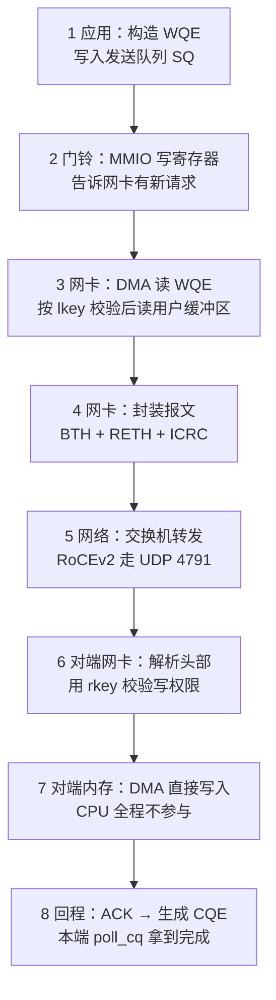
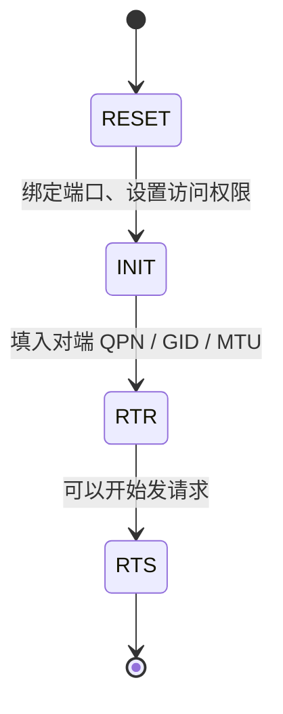
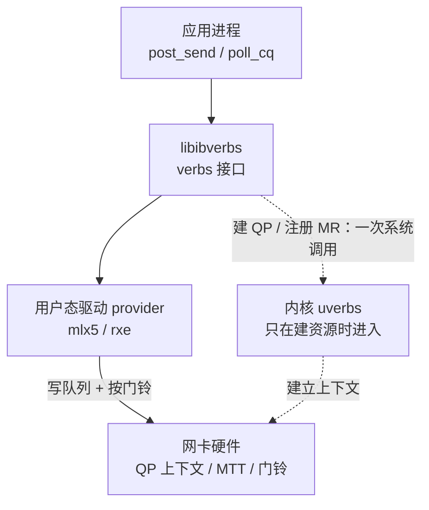
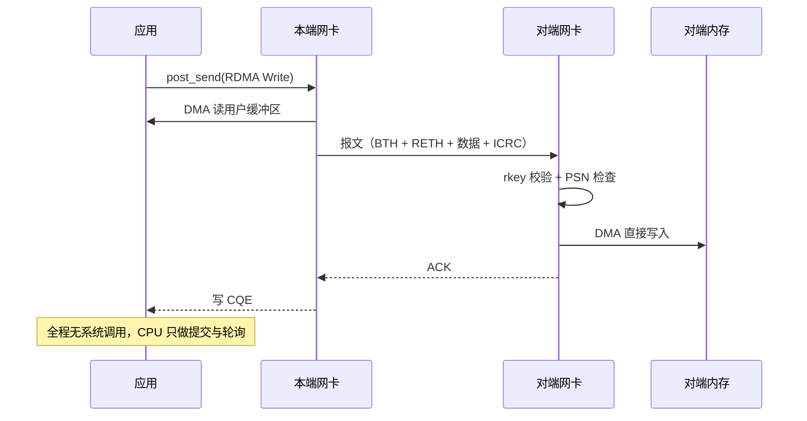

一句话：TCP 是「应用把数据交给内核，内核再交给网卡」；RDMA 是「应用把门铃按响，网卡自己去内存里取」。省掉的不是一层协议，而是**整条路径上的拷贝、系统调用和中断**。

这篇文章不讲抽象概念，而是跟着一次 `RDMA Write` 走完 8 个环节，看数据到底经过了谁的手、在哪一步被省掉。

## 〇、先看全景



这 8 步里，**第 3 步到第 7 步全程没有 CPU 参与**——这就是 RDMA 的全部秘密。传统 TCP 在同样的区间里要走一遍协议栈，还要做两次内存拷贝。

## 一、核心概念：先把名词对齐

### 1.1 QP、SQ、RQ、CQ

RDMA 的通信单元叫 **QP（Queue Pair）**，顾名思义，它是一对队列：

- **SQ（Send Queue）**：你往里放"我要发什么"；
- **RQ（Receive Queue）**：你往里放"准备好接收什么"；
- **CQ（Completion Queue）**：硬件把"这件事做完了"的通知放这里。

**为什么要成对**？因为 RDMA 是双向的：即使你只用 Write 单向发送，对端也可能随时给你发东西，所以每个 QP 天生带一个接收队列。

QP 不是软件队列，而是**由网卡维护、在内存里环形排布、通过门铃寄存器通知**的结构。你"入队"的本质是往内存里写一个 WQE（Work Queue Element），然后告诉网卡"我写到第 N 个了"。

### 1.2 MR、lkey 与 rkey：为什么内存要"注册"

网卡做 DMA 时用的是**物理地址**，而应用手里只有虚拟地址。页表在内核里，网卡不可能每次访问都去查一遍——所以有了 **MR（Memory Region）**：

1. 应用调用 `ibv_reg_mr()`，内核把这段内存**锁定**（不再换出）、翻译成物理地址；
2. 驱动把这些映射写进网卡的 **MTT（Memory Translation Table）**；
3. 返回两个钥匙：**lkey**（本地钥匙，自己用）和 **rkey**（远端钥匙，发给对端用）。

之后网卡拿到一个虚拟地址 + lkey，自己查 MTT 就能找到物理页，完全不经过内核。

这也解释了 RDMA 的两个"副作用"：

- **内存必须提前注册**，注册是重量级操作（锁页 + 建表），不能每次收发都做；
- **注册的内存不能随便释放**，否则网卡会 DMA 到已经还给系统的页上。

### 1.3 PD：资源的分组

**PD（Protection Domain）** 像一个命名空间：QP、MR 都属于某个 PD，只有同一 PD 内的 QP 才能用这个 MR。用途是隔离——防止一个 QP 误用另一个进程的内存。

### 1.4 三种操作，两种语义

| 操作 | 谁发起 | 对端要准备什么 | 典型用途 |
| --- | --- | --- | --- |
| **Send / Recv** | 双方 | 对端必须提前 `post_recv` | 控制消息、小包 |
| **RDMA Write** | 单方 | 只要拿到 rkey 和地址，不需要 CPU 参与 | 大批量数据落盘、共享缓冲 |
| **RDMA Read** | 单方 | 同上 | 拉取远端数据 |

前两种是**双边**（对端要配合），后两种是**单边**（对端完全不知道）。单边操作是 RDMA 真正区别于普通网络的地方。

### 1.5 QP 的状态机

QP 不能一创建就发数据，必须走完三个状态：



- **INIT**：告诉本地 QP"你从哪个端口出去、允许对方做什么操作"；
- **RTR（Ready To Receive）**：告诉它"对端是谁"，包括对端 QPN、路径 MTU、对端的 GID；
- **RTS（Ready To Send）**：可以发包了。

状态没走对就 `post_send`，你会得到一个 `IBV_WC_LOC_QP_OP_ERR`——这是新手最常见的错误，后文代码里会逐项标注。

### 1.6 三种传输方式

| 类型 | 连接 | 可靠性 | 用途 |
| --- | --- | --- | --- |
| **RC**（Reliable Connected） | 一对一 | 可靠、保序 | 绝大多数场景，本文用它 |
| **UC**（Unreliable Connected） | 一对一 | 不可靠 | 罕见 |
| **UD**（Unreliable Datagram） | 一对多 | 不可靠、有 MTU 限制 | 组播、连接建立前的寻址 |

## 二、数据在网络里的完整链路

在逐段走之前，先看清参与的角色分别住在哪一层。这张图解释了一个常见误解：**内核并没有从 RDMA 路径里消失，它只是退到了"建资源"这一步**。



数据搬运只发生在**用户态 ↔ 网卡**之间；内核只在 `ibv_open_device`、`ibv_reg_mr`、`ibv_create_qp` 这些"一次性"动作里出现。

### 2.1 第 1 步：应用构造 WQE

调用 `ibv_post_send()` 时，verbs 库在你的**用户态内存**里填一个 WQE：

```text
WQE = { opcode: RDMA_WRITE, 远端地址, rkey, 本地 sge 列表(lkey + 地址 + 长度) }
```

这一步没有任何系统调用，就是一次内存写入。填完之后，verbs 把 WQE 挂到 SQ 的尾部。

### 2.2 第 2 步：按门铃

真正让网卡"看见"这个请求的动作，是向网卡的 **doorbell 寄存器**写一次值：

```text
*(mmio_addr) = 新的 SQ 尾部指针;
```

这是一次 MMIO 写。**这是整个发送路径上唯一"碰硬件"的动作**，也是为什么 RDMA 的发送开销可以低到几十纳秒——相比 TCP 的 `send()` 要陷入内核、加锁、拷贝，这里只是一次写寄存器。

### 2.3 第 3 步：网卡取 WQE 并读数据

网卡看到门铃变化，用 DMA 把 SQ 里的 WQE 读到自己的片上缓存，然后：

1. 检查 `lkey` 是否属于当前 QP 的 PD（防止越权）；
2. 按 sge 里的地址与长度，**直接从用户缓冲区 DMA 读数据**。

注意这里没有"拷贝到内核缓冲区"这一步——数据从应用内存直接进网卡，这就是**零拷贝**。

### 2.4 第 4 步：封装报文

网卡硬件拼出报文，关键头部有三个：

| 头部 | 作用 |
| --- | --- |
| **BTH**（Base Transport Header） | 目标 QPN、操作码、包序列号 PSN |
| **RETH**（RDMA Extended Transport Header） | 远端虚拟地址、rkey、长度 |
| **ICRC** | 端到端校验，由硬件计算 |

**这些头部都是网卡硬件生成的**，不是软件填的。所以"协议处理"这件事被卸载到了网卡上——这是 RDMA 快的第三个来源。

### 2.5 第 5 步：经交换机转发

- **InfiniBand**：链路层用 LID（16 位本地标识）转发，交换机组网；
- **RoCEv1**：走以太网，EtherType `0x8915`，**不能跨 IP 路由**；
- **RoCEv2**：封在 **UDP 4791** 里，可以跨 IP 路由——这也是现在的主流。

RoCEv2 的报文长这样：

```text
[ Ethernet | IP | UDP(4791) | BTH | RETH | 数据 | ICRC ]
```

注意 ICRC 是**端到端**校验（覆盖从 BTH 开始的全部内容），不只是链路校验。这带来一个重要副作用：**路径上任何设备改写 IP 头（比如 NAT）都会破坏 ICRC，导致丢包**。这是 RoCEv2 部署时最常见的坑之一。

### 2.6 第 6 步：对端网卡解析并校验权限

对端网卡收到报文，用 BTH 里的 QPN 找到对应的 QP 上下文（这个上下文常驻网卡缓存），然后：

1. 用 RETH 里的 **rkey** 校验"你是否有权写这块内存"；
2. 检查地址范围是否落在注册的 MR 内；
3. 检查 PSN 是否连续（RC 的保序要求）。

**这一整套检查都在网卡里完成**，对端 CPU 完全不知情。

### 2.7 第 7 步：直接写进对端内存

校验通过后，网卡用 RETH 里的远端地址查 MTT，得到物理地址，**直接把数据 DMA 写进去**。

到这一步，数据已经躺在对端应用能读到的内存里了。整个过程对端操作系统没有产生任何事件——没有中断、没有软中断、没有唤醒任何进程。

### 2.8 第 8 步：ACK 与完成通知

RC 是可靠传输，对端网卡会回 ACK。本端网卡收到 ACK 后：

1. 把这条 WR 标记完成；
2. 往 CQ 里写一个 **CQE**（Completion Queue Entry）；
3. 应用通过 `ibv_poll_cq()` 轮询拿到它。

对端如果用的是 `RDMA_WRITE_WITH_IMM`，还会在自己的 CQ 里生成一个带 immediate data 的完成事件——这是"被动接收方"唯一能感知到数据到达的方式（普通的 RDMA Write 对接收方是完全静默的）。

### 2.9 每一段的开销对照

| 环节 | 谁在工作 | 主要开销 |
| --- | --- | --- |
| 1 构造 WQE | CPU | 几十条指令，写内存 |
| 2 门铃 | CPU → 网卡 | 一次 MMIO 写 |
| 3 取 WQE + 读数据 | 网卡 DMA | 内存带宽 |
| 4 封装 | 网卡 | 无 CPU 开销 |
| 5 转发 | 交换机 | 网络延迟 |
| 6 校验 | 对端网卡 | 无 CPU 开销 |
| 7 落数 | 对端网卡 DMA | 内存带宽 |
| 8 ACK + CQE | 双方网卡 | 一次 CQ 写 |

**整张表里，CPU 只出现在第 1、2、8 步**（而且第 8 步是轮询读内存）。

## 三、为什么快：把省掉的东西数清楚

### 3.1 与传统 TCP/IP 的逐项对比

| 维度 | TCP/IP（socket） | RDMA |
| --- | --- | --- |
| 内存拷贝 | 发送方 1 次（用户→内核），接收方 1 次（内核→用户） | **0 次** |
| 系统调用 | 每个 `send/recv` 至少 1 次 | 建连时才有，数据路径 0 次 |
| 中断 | 每个包/每批包一次硬中断 + 软中断 | 默认**无中断**，靠轮询 |
| 协议处理 | CPU 走 TCP 状态机、校验和、分片 | 网卡硬件完成 |
| 对端 CPU | 必须参与（收包、拷贝、唤醒） | **不参与** |
| 典型单跳延迟 | 几十微秒 | 一到几微秒 |

### 3.2 四个来源

**（1）零拷贝。** 省掉两次内存拷贝。在 100 Gbps 下，一次拷贝就要吃掉可观的 CPU 和内存带宽——省掉它等于把这条链路上最贵的一环直接砍掉。

**（2）内核旁路。** 数据路径上没有 `read/write`，应用直接操作网卡队列。省掉的不只是系统调用的几百纳秒，还有随之而来的上下文切换、锁竞争、调度抖动。

**（3）协议栈卸载。** 可靠性、保序、重传、校验全在网卡里做。CPU 从"协议处理器"退回成"业务处理器"。

**（4）轮询代替中断。** 中断的问题不是慢，而是**不可预测**：中断到达的时间取决于调度器。轮询把这个抖动抹平了，代价是要占住一个核。

### 3.3 但要付的代价

天下没有白拿的性能，RDMA 的账单在这几处：

- **网卡贵**：支持 RDMA 的网卡比普通网卡贵一个量级；
- **网络要无损**：RoCEv2 依赖 PFC/ECN，配置错了就是随机丢包 + 性能雪崩；
- **内存要注册**：大页面、锁定内存，和 `mmap` 式的小块分配天然不合；
- **要占 CPU 轮询**：省下的中断开销变成了一个不能复用的核；
- **编程复杂**：QP 状态机、rkey 管理、连接建立都得自己写。

**结论**：RDMA 适合"延迟敏感 + 吞吐大 + 连接数不多"的场景（存储、HPC、AI 训练），不适合"连接数极多、消息很小、对成本敏感"的场景。

## 四、CentOS Stream 9 上的安装与配置

### 4.1 先确认硬件与协议

```shell
# 看有没有 RDMA 设备（列出设备名，没有输出说明硬件或驱动没到位）
ibv_devices

# 看设备详情：固件版本、端口状态、支持的链路层（InfiniBand / Ethernet）
ibv_devinfo -v | head -30
```

三种协议的选择：

| 协议 | 链路层 | 能否跨路由 | 说明 |
| --- | --- | --- | --- |
| InfiniBand | IB | 交换机内 | 原生方案，性能最好，成本最高 |
| RoCEv2 | Ethernet | 能 | 主流选择，需要无损网络 |
| iWARP | TCP | 能 | 兼容性最好，性能一般 |

### 4.2 装包

```shell
# rdma-core 提供库与基础工具；后面三个是常用诊断与压测工具
sudo dnf install -y rdma-core libibverbs-utils librdmacm-utils infiniband-diags perftest

# 编译本文示例需要头文件
sudo dnf install -y libibverbs-devel librdmacm-devel
```

### 4.3 加载模块并启动服务

```shell
# 网卡驱动（Mellanox 是 mlx5；Intel 是 irdma；软 RDMA 是 rdma_rxe）
sudo modprobe mlx5_ib

# rdma 服务按 /etc/rdma/rdma.conf 里的开关加载上层协议（如 iSER、SRP）
sudo systemctl enable --now rdma

# 确认设备已经被识别
rdma link show
```

`/etc/rdma/rdma.conf` 控制的是"要不要自动加载某个上层协议模块"，不是网卡驱动本身。如果你只用 verbs 编程，把不需要的项设成 `no` 可以减少无关模块。

### 4.4 没有硬件也能练：Soft-RoCE

这是最容易被忽略的一步。没有 RDMA 网卡时，可以用内核的 `rdma_rxe` 在一张普通以太网上模拟 RoCE——**功能完全一致，性能没有参考价值**，但足够把代码调通。

```shell
# 加载软件 RoCE 模块
sudo modprobe rdma_rxe

# 在 eth0 上挂一个名为 rxe0 的软 RDMA 设备
sudo rdma link add rxe0 type rxe netdev eth0

# 验证：应该能看到 rxe0，状态 ACTIVE
rdma link show
ibv_devinfo
```

下面代码里的 `GID_INDEX` 在 Soft-RoCE 上通常也是 1；如果建连失败，用 `ibv_devinfo -v` 打印 GID 表逐个试。

### 4.5 RoCEv2 必须配的三件事

**（1）开启 RoCEv2 模式**（部分驱动默认是 v1）：

```shell
# -m 2 表示 RoCEv2；只在支持的网卡上有效，Soft-RoCE 默认就是 v2
sudo cma_roce_mode -d mlx5_0 -p 1 -m 2
```

**（2）打开无损队列（PFC）**。RoCEv2 的可靠传输是 ACK + 回退重传，一旦拥塞丢包就会成片重传。生产环境必须让承载 RDMA 的优先级队列"不丢包"：

```shell
# 用 dcb 工具在网卡上为优先级 3 打开 PFC（具体优先级值要和交换机对齐）
sudo dcb pfc set dev eth0 prio-pfc 3:on
sudo dcb pfc show dev eth0
```

Mellanox 网卡通常用 `mlnx_qos -i eth0 --pfc 0,0,0,1,0,0,0,0`（需要安装 MFT）。**两端和中间交换机必须配置一致**，否则会出现"一边流控、一边丢包"的诡异现象。

**（3）放行防火墙**：

```shell
# RoCEv2 的 UDP 端口
sudo firewall-cmd --add-port=4791/udp --permanent
sudo firewall-cmd --reload
```

另外别忘了锁内存上限——MR 注册用的是锁定内存，`ulimit -l` 太小会直接注册失败：

```shell
# 临时生效；永久生效要写 /etc/security/limits.conf
ulimit -l unlimited
```

### 4.6 自检清单

```shell
# 1. 设备与端口状态
ibv_devinfo | grep -E "hca_id|state|link_layer"

# 2. 两端能不能通（IB 用 ibping；RoCE 用 rping）
rping -s -a 0.0.0.0 -v          # 一端
rping -c -a <对端IP> -v         # 另一端

# 3. 裸带宽与延迟基线（最常用的两个压测）
ib_write_bw -d mlx5_0                    # 服务端：不带地址，默认监听
ib_write_bw -d mlx5_0 192.168.1.20       # 客户端：位置参数就是对端 IP
ib_write_lat -d mlx5_0 192.168.1.20      # 测延迟，用法同上
```

`ib_write_bw` 跑出来的数字如果只有几百 MB/s，八成是退化到了 Soft-RoCE 或者 MTU 没调对；正常的 100G RoCE 应该能到 90 Gbps 以上。

## 五、代码：一次 RDMA Write 的最小实现

### 5.1 为什么要"带外握手"

RDMA 本身不负责"找到对方"。你得先通过别的通道（TCP、配置文件、甚至人工抄）交换四样东西：

| 要交换的 | 用途 |
| --- | --- |
| QPN | 对端网卡靠它找到 QP |
| GID | 寻址（RoCE 下就是 IP 的另一种写法） |
| rkey | 写对端内存的钥匙 |
| 远端地址 | 写到哪 |

代码里用一个 TCP 连接做这件事，交换完再切到 RDMA。

### 5.2 完整代码

单文件，`server` / `client` 两种模式。服务端准备好之后发一个字节 `G` 作为"可以开始了"的信号——这是为了避免客户端在服务端 `post_recv` 之前就发数据。

```c
/* rdma_write_demo.c —— 两端 RDMA Write 的最小完整示例
 * 编译：gcc -O2 -Wall rdma_write_demo.c -o rdma_write_demo -libverbs
 * 服务端：./rdma_write_demo server 0.0.0.0 18515
 * 客户端：./rdma_write_demo client <服务端IP> 18515
 */
#define _GNU_SOURCE
#include <arpa/inet.h>        /* inet_addr, htons */
#include <netinet/in.h>       /* sockaddr_in */
#include <stdint.h>
#include <stdio.h>
#include <stdlib.h>
#include <string.h>
#include <sys/socket.h>       /* socket, bind, listen, accept, connect */
#include <unistd.h>           /* read, write, close */

#include <infiniband/verbs.h> /* verbs API */

#define BUF_SIZE   4096       /* 缓冲区大小，必须是页的整数倍才好注册 */
#define PORT_NUM   1          /* IB 端口号，物理口一般是 1 */
#define GID_INDEX  1          /* RoCEv2 常用 GID 索引；Soft-RoCE 也是 1 */
#define TCP_PORT   18515      /* 带外握手的 TCP 端口 */
#define IMM_MAGIC  0x52444d41 /* immediate data 里的魔数，用于校验 */

/* 握手要交换的四样东西；字段顺序保证 4+4+8+16=32 字节，无填充 */
struct handshake {
    uint32_t qpn;             /* 对端 QP 号 */
    uint32_t rkey;            /* 写对端内存的钥匙 */
    uint64_t addr;            /* 对端缓冲区虚拟地址 */
    uint8_t  gid[16];         /* 对端 GID */
};

/* 把所有 RDMA 资源打成一个结构，方便传参 */
struct endpoint {
    struct ibv_context *ctx;  /* 设备上下文 */
    struct ibv_pd      *pd;   /* 保护域 */
    struct ibv_mr      *mr;   /* 注册过的内存区域 */
    struct ibv_cq      *cq;   /* 完成队列 */
    struct ibv_qp      *qp;   /* 队列对 */
    char               *buf;  /* 用户缓冲区 */
    union ibv_gid       gid;  /* 本端 GID */
    uint32_t            qpn;
    uint32_t            rkey;
    uint64_t            addr;
};

/* ---------- 小工具：TCP 的完整读写（处理短读短写） ---------- */

static int tcp_read(int fd, void *p, size_t n)
{
    size_t got = 0;
    while (got < n) {                               /* 循环直到读满 */
        ssize_t r = read(fd, (char *)p + got, n - got);
        if (r <= 0) return -1;                      /* 0=对端关闭，<0=出错 */
        got += (size_t)r;
    }
    return 0;
}

static int tcp_write(int fd, const void *p, size_t n)
{
    size_t sent = 0;
    while (sent < n) {
        ssize_t r = write(fd, (const char *)p + sent, n - sent);
        if (r <= 0) return -1;
        sent += (size_t)r;
    }
    return 0;
}

/* ---------- 第一步：打开设备并创建所有资源 ---------- */

static int ep_open(struct endpoint *ep)
{
    struct ibv_device **list;
    struct ibv_qp_init_attr qp_attr;
    int num = 0;

    memset(ep, 0, sizeof(*ep));

    /* 1. 取设备列表，用第一个（多网卡时可按名字挑） */
    list = ibv_get_device_list(&num);
    if (!list || num == 0) {
        fprintf(stderr, "没有找到 RDMA 设备：先确认驱动或 Soft-RoCE 是否加载\n");
        return -1;
    }
    ep->ctx = ibv_open_device(list[0]);
    ibv_free_device_list(list);
    if (!ep->ctx) {
        fprintf(stderr, "ibv_open_device 失败\n");
        return -1;
    }
    printf("使用设备：%s\n", ibv_get_device_name(ep->ctx->device));

    /* 2. 分配保护域：QP 与 MR 都要挂到它下面 */
    ep->pd = ibv_alloc_pd(ep->ctx);
    if (!ep->pd) { fprintf(stderr, "ibv_alloc_pd 失败\n"); return -1; }

    /* 3. 准备缓冲区并注册：本地可写 + 允许对端读/写 */
    ep->buf = calloc(1, BUF_SIZE);
    if (!ep->buf) { fprintf(stderr, "calloc 失败\n"); return -1; }
    ep->mr = ibv_reg_mr(ep->pd, ep->buf, BUF_SIZE,
                        IBV_ACCESS_LOCAL_WRITE |   /* 本地可写 */
                        IBV_ACCESS_REMOTE_WRITE |  /* 允许对端写 */
                        IBV_ACCESS_REMOTE_READ);   /* 允许对端读 */
    if (!ep->mr) {
        fprintf(stderr, "ibv_reg_mr 失败：多半是 ulimit -l 太小\n");
        return -1;
    }

    /* 4. 建完成队列，深度 16 够这个例子用 */
    ep->cq = ibv_create_cq(ep->ctx, 16, NULL, NULL, 0);
    if (!ep->cq) { fprintf(stderr, "ibv_create_cq 失败\n"); return -1; }

    /* 5. 建 QP：类型 RC，收发都挂同一个 CQ */
    memset(&qp_attr, 0, sizeof(qp_attr));
    qp_attr.send_cq = ep->cq;
    qp_attr.recv_cq = ep->cq;
    qp_attr.qp_type = IBV_QPT_RC;
    qp_attr.cap.max_send_wr  = 16;   /* 发送队列深度 */
    qp_attr.cap.max_recv_wr  = 16;   /* 接收队列深度 */
    qp_attr.cap.max_send_sge = 1;    /* 每个请求最多 1 个分散/聚集项 */
    qp_attr.cap.max_recv_sge = 1;
    ep->qp = ibv_create_qp(ep->pd, &qp_attr);
    if (!ep->qp) { fprintf(stderr, "ibv_create_qp 失败\n"); return -1; }

    /* 6. 查本端 GID：RoCE 下它就是寻址标识 */
    if (ibv_query_gid(ep->ctx, PORT_NUM, GID_INDEX, &ep->gid) != 0) {
        fprintf(stderr, "ibv_query_gid 失败：索引 %d 可能不存在\n", GID_INDEX);
        return -1;
    }

    /* 7. 记录要告诉对端的信息 */
    ep->qpn  = ep->qp->qp_num;
    ep->rkey = ep->mr->rkey;
    ep->addr = (uint64_t)(uintptr_t)ep->buf;
    printf("QPN=%u rkey=0x%x addr=%p\n", ep->qpn, ep->rkey, (void *)ep->buf);
    return 0;
}

/* ---------- 第二步：按状态机把 QP 推到 RTS ---------- */

static int qp_to_rts(struct endpoint *ep, const struct handshake *peer)
{
    struct ibv_qp_attr attr;
    union ibv_gid peer_gid;

    /* 1. RESET → INIT：绑定端口、声明本端允许的访问权限 */
    memset(&attr, 0, sizeof(attr));
    attr.qp_state        = IBV_QPS_INIT;
    attr.pkey_index      = 0;      /* 默认分区键 */
    attr.port_num        = PORT_NUM;
    attr.qp_access_flags = IBV_ACCESS_REMOTE_WRITE | IBV_ACCESS_REMOTE_READ;
    if (ibv_modify_qp(ep->qp, &attr,
                      IBV_QP_STATE | IBV_QP_PKEY_INDEX | IBV_QP_PORT |
                      IBV_QP_ACCESS_FLAGS) != 0) {
        fprintf(stderr, "modify_qp INIT 失败\n");
        return -1;
    }

    /* 2. INIT → RTR：告诉 QP 对端是谁、路径 MTU 多大 */
    memcpy(peer_gid.raw, peer->gid, 16);
    memset(&attr, 0, sizeof(attr));
    attr.qp_state           = IBV_QPS_RTR;
    attr.path_mtu           = IBV_MTU_1024;   /* RoCE 下受以太网 MTU 限制 */
    attr.dest_qp_num        = peer->qpn;
    attr.rq_psn             = 0;              /* 初始包序列号，两端要一致 */
    attr.max_dest_rd_atomic = 1;
    attr.min_rnr_timer      = 12;
    attr.ah_attr.is_global  = 1;              /* 用 GID 寻址（RoCE 必须） */
    attr.ah_attr.port_num   = PORT_NUM;
    attr.ah_attr.grh.dgid   = peer_gid;       /* 目的 GID */
    attr.ah_attr.grh.sgid_index = GID_INDEX;  /* 源 GID 索引 */
    attr.ah_attr.grh.hop_limit  = 64;
    if (ibv_modify_qp(ep->qp, &attr,
                      IBV_QP_STATE | IBV_QP_AV | IBV_QP_PATH_MTU |
                      IBV_QP_DEST_QPN | IBV_QP_RQ_PSN |
                      IBV_QP_MAX_DEST_RD_ATOMIC | IBV_QP_MIN_RNR_TIMER) != 0) {
        fprintf(stderr, "modify_qp RTR 失败\n");
        return -1;
    }

    /* 3. RTR → RTS：这时才允许发请求 */
    memset(&attr, 0, sizeof(attr));
    attr.qp_state      = IBV_QPS_RTS;
    attr.timeout       = 14;   /* 本地 ACK 超时，约 0.5 秒量级 */
    attr.retry_cnt     = 7;
    attr.rnr_retry     = 7;    /* 对端 RQ 空时无限重试 */
    attr.sq_psn        = 0;
    attr.max_rd_atomic = 1;
    if (ibv_modify_qp(ep->qp, &attr,
                      IBV_QP_STATE | IBV_QP_TIMEOUT | IBV_QP_RETRY_CNT |
                      IBV_QP_RNR_RETRY | IBV_QP_SQ_PSN |
                      IBV_QP_MAX_QP_RD_ATOMIC) != 0) {
        fprintf(stderr, "modify_qp RTS 失败\n");
        return -1;
    }
    return 0;
}

/* ---------- 第三步：轮询完成队列 ---------- */

static int wait_cq(struct endpoint *ep, struct ibv_wc *wc)
{
    int n;
    do {
        n = ibv_poll_cq(ep->cq, 1, wc);   /* 返回 0 表示还没有完成 */
    } while (n == 0);                     /* 生产代码里应该加超时和退出条件 */

    if (n < 0) {
        fprintf(stderr, "ibv_poll_cq 出错\n");
        return -1;
    }
    if (wc->status != IBV_WC_SUCCESS) {
        fprintf(stderr, "完成状态异常：%s\n", ibv_wc_status_str(wc->status));
        return -1;
    }
    return 0;
}

/* ---------- 服务端：等数据被写进来 ---------- */

static void run_server(const char *ip, int port)
{
    struct endpoint ep;
    struct handshake me, peer;
    struct ibv_recv_wr wr, *bad;
    struct ibv_sge sge;
    struct ibv_wc wc;
    struct sockaddr_in addr;
    int lfd = -1, cfd = -1, on = 1;

    if (ep_open(&ep) != 0) goto out;

    /* 1. 起 TCP 监听，等客户端连进来 */
    lfd = socket(AF_INET, SOCK_STREAM, 0);
    setsockopt(lfd, SOL_SOCKET, SO_REUSEADDR, &on, sizeof(on));
    memset(&addr, 0, sizeof(addr));
    addr.sin_family      = AF_INET;
    addr.sin_addr.s_addr = inet_addr(ip);
    addr.sin_port        = htons((uint16_t)port);
    if (bind(lfd, (struct sockaddr *)&addr, sizeof(addr)) != 0) {
        perror("bind"); goto out;
    }
    listen(lfd, 1);
    printf("等待客户端连接 %s:%d ...\n", ip, port);
    cfd = accept(lfd, NULL, NULL);
    if (cfd < 0) { perror("accept"); goto out; }

    /* 2. 交换握手信息 */
    me.qpn  = ep.qpn;
    me.rkey = ep.rkey;
    me.addr = ep.addr;
    memcpy(me.gid, ep.gid.raw, 16);
    if (tcp_write(cfd, &me, sizeof(me)) != 0 ||
        tcp_read(cfd, &peer, sizeof(peer)) != 0) {
        fprintf(stderr, "握手失败\n"); goto out;
    }

    /* 3. 推进 QP 到 RTS */
    if (qp_to_rts(&ep, &peer) != 0) goto out;

    /* 4. 先挂一个接收请求：RDMA_WRITE_WITH_IMM 会消耗它并产生完成事件 */
    memset(&sge, 0, sizeof(sge));
    sge.addr   = (uintptr_t)ep.buf;
    sge.length = BUF_SIZE;
    sge.lkey   = ep.mr->lkey;
    memset(&wr, 0, sizeof(wr));
    wr.wr_id   = 0;
    wr.sg_list = &sge;
    wr.num_sge = 1;
    if (ibv_post_recv(ep.qp, &wr, &bad) != 0) {
        fprintf(stderr, "ibv_post_recv 失败\n"); goto out;
    }

    /* 5. 通知客户端可以发了 */
    if (tcp_write(cfd, "G", 1) != 0) goto out;

    /* 6. 等数据到达 */
    if (wait_cq(&ep, &wc) != 0) goto out;
    printf("收到完成：opcode=%d imm=0x%x 长度=%u\n",
           (int)wc.opcode, ntohl(wc.imm_data), wc.byte_len);
    printf("缓冲区内容：%.*s\n", (int)wc.byte_len, ep.buf);

out:
    if (cfd >= 0) close(cfd);
    if (lfd >= 0) close(lfd);
    /* 这里省略了系统的资源回收；正常程序应逐个 destroy */
}

/* ---------- 客户端：发一次 RDMA Write ---------- */

static void run_client(const char *ip, int port)
{
    struct endpoint ep;
    struct handshake me, peer;
    struct ibv_sge sge;
    struct ibv_send_wr wr, *bad;
    struct ibv_wc wc;
    struct sockaddr_in addr;
    int fd = -1;
    char go = 0;

    const char *msg = "hello from RDMA client";

    if (ep_open(&ep) != 0) goto out;

    /* 1. 连服务端 */
    fd = socket(AF_INET, SOCK_STREAM, 0);
    memset(&addr, 0, sizeof(addr));
    addr.sin_family      = AF_INET;
    addr.sin_addr.s_addr = inet_addr(ip);
    addr.sin_port        = htons((uint16_t)port);
    if (connect(fd, (struct sockaddr *)&addr, sizeof(addr)) != 0) {
        perror("connect"); goto out;
    }

    /* 2. 交换握手信息 */
    me.qpn  = ep.qpn;
    me.rkey = ep.rkey;
    me.addr = ep.addr;
    memcpy(me.gid, ep.gid.raw, 16);
    if (tcp_write(fd, &me, sizeof(me)) != 0 ||
        tcp_read(fd, &peer, sizeof(peer)) != 0) {
        fprintf(stderr, "握手失败\n"); goto out;
    }

    /* 3. 推进 QP 到 RTS */
    if (qp_to_rts(&ep, &peer) != 0) goto out;

    /* 4. 等对端挂好接收请求 */
    if (tcp_read(fd, &go, 1) != 0) goto out;

    /* 5. 把消息拷进本地缓冲区——这之后网卡会直接从这里 DMA 读走 */
    strncpy(ep.buf, msg, BUF_SIZE - 1);

    /* 6. 提交 RDMA Write：地址和 rkey 都来自握手 */
    memset(&sge, 0, sizeof(sge));
    sge.addr   = (uintptr_t)ep.buf;
    sge.length = (uint32_t)strlen(msg) + 1;
    sge.lkey   = ep.mr->lkey;

    memset(&wr, 0, sizeof(wr));
    wr.wr_id      = 1;
    wr.opcode     = IBV_WR_RDMA_WRITE_WITH_IMM;  /* 带立即数，方便对端感知 */
    wr.send_flags = IBV_SEND_SIGNALED;           /* 要求本端也产生完成事件 */
    wr.imm_data   = htonl(IMM_MAGIC);
    wr.sg_list    = &sge;
    wr.num_sge    = 1;
    wr.wr.rdma.remote_addr = peer.addr;          /* 写到对端哪个地址 */
    wr.wr.rdma.rkey        = peer.rkey;          /* 用对端的钥匙 */
    if (ibv_post_send(ep.qp, &wr, &bad) != 0) {
        fprintf(stderr, "ibv_post_send 失败\n"); goto out;
    }

    /* 7. 等本端发送完成（对端是否收到由 ACK 保证） */
    if (wait_cq(&ep, &wc) != 0) goto out;
    printf("发送完成，已写入对端 %lu 字节\n", (unsigned long)sge.length);

out:
    if (fd >= 0) close(fd);
}

int main(int argc, char **argv)
{
    if (argc != 4) {
        fprintf(stderr, "用法：%s {server|client} <IP> <端口>\n", argv[0]);
        return 1;
    }
    if (strcmp(argv[1], "server") == 0) {
        run_server(argv[2], atoi(argv[3]));
    } else {
        run_client(argv[2], atoi(argv[3]));
    }
    return 0;
}
```

### 5.3 编译与运行

```shell
# 编译：只需要 libibverbs
gcc -O2 -Wall rdma_write_demo.c -o rdma_write_demo -libverbs

# 终端一：服务端
./rdma_write_demo server 0.0.0.0 18515

# 终端二：客户端
./rdma_write_demo client 192.168.1.20 18515
```

服务端应该打印出 `缓冲区内容：hello from RDMA client`。如果卡住不动，按这个顺序排查：

1. `ibv_devinfo` 里端口状态是不是 `PORT_ACTIVE`；
2. 两端的 `GID_INDEX` 是否指向同一个协议版本（v1 和 v2 的 GID 不是同一个）；
3. `ulimit -l` 是否够大（注册失败会在 `ep_open` 就报错，不会卡住）；
4. 防火墙有没有放行 UDP 4791。

### 5.4 一次调用的完整时序



## 六、常见问题

| 现象 | 原因 | 处理 |
| --- | --- | --- |
| `ibv_devices` 没有任何设备 | 驱动没加载 / 网卡不支持 | `modprobe mlx5_ib`；无硬件就用 `rdma_rxe` |
| `ibv_reg_mr` 返回 NULL | `ulimit -l` 太小 | `ulimit -l unlimited`，或减小注册区 |
| `modify_qp` RTR 失败 | GID 索引不存在或对端 QPN 填错 | `ibv_devinfo -v` 看 GID 表，核对 QPN |
| `post_send` 后一直拿不到完成 | QP 没到 RTS / 对端 RQ 空 / 网络不通 | 先看 `wc.status`，再看交换机与 PFC |
| 完成状态 `IBV_WC_RNR_RETRY_EXC_ERR` | 对端没及时 `post_recv` | 增加接收队列深度，或先发后收的顺序要保证 |
| 完成状态 `IBV_WC_REM_ACCESS_ERR` | rkey 不对，或对端 MR 没有 `REMOTE_WRITE` | 检查注册权限与 rkey 是否来自同一个 MR |
| 大包吞吐很低 | MTU 不一致 | 两端 `path_mtu` 与交换机 MTU 对齐，RoCE 常见 1024/4096 |
| 偶发丢包、重传风暴 | RoCEv2 网络不是无损 | 两端与交换机同时配 PFC；或用 ECN + DCQCN |
| 跨网段不通 | RoCEv1 不能路由 | 改用 RoCEv2，并确认 ICRC 不被 NAT 改写 |

## 七、小结

- **RDMA 的本质是把数据通路从"内核代理"改成"网卡直连"**：8 个环节里，CPU 只在提交和收完成时出现。
- **零拷贝 + 内核旁路 + 协议卸载 + 轮询**，这四条共同构成了性能优势，缺一条都会打折扣。
- **代价同样明确**：贵网卡、无损网络、内存注册、占核轮询、编程复杂。所以它属于"延迟敏感 + 大吞吐 + 少连接"的场景。
- **上手路径**：先用 Soft-RoCE 把代码跑通，再上真硬件；先跑 `ib_write_bw` 建立性能基线，再谈优化。

一句话记住这条链路：**应用只负责"把请求写进队列、按一下门铃"，剩下的取数、封装、校验、落数、回 ACK，全部由两端的网卡自己完成。** 这就是 RDMA 让 CPU 从网络里解放出来的全部原因。
