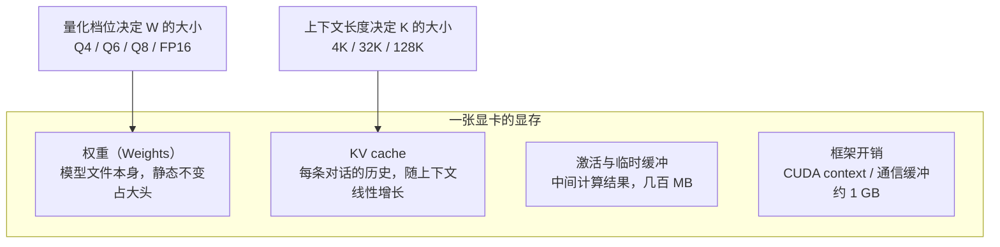
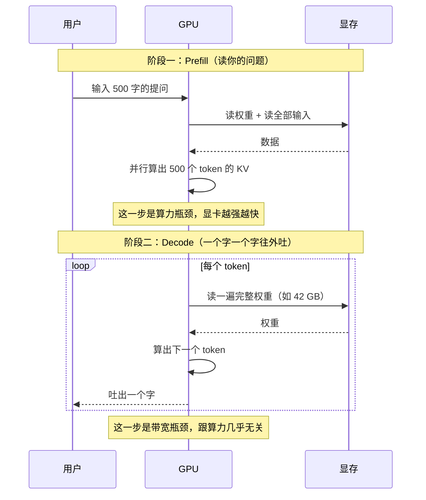

一句话：选卡只看两个数——**显存**决定"能不能装下"，**带宽**决定"每秒吐几个字"。参数、核心数、Tensor 算力都是次要的，因为本地推理的瓶颈根本不在算力上。

这篇文章把这两件事算成具体数字，再对上 2026 年 10 月的真实报价，最后按模型给结论。

> 价格说明：以下为 2026 年 10 月中下旬的京东、闲鱼与渠道参考价，受 GDDR7 显存短缺影响，**新卡价格处于历史高位且一天一变**，下单前务必自行比价。

## 〇、两条公式，先建立直觉

```text
显存需求 ≈ 权重 + KV cache + 临时开销
         ≈ 参数量 × 每参字节数 + 上下文 × 每 token 字节数 + 1~2 GB

生成速度 ≈ 显存带宽 ÷ 每 token 需要读的字节数
```

第一条决定"买多大的卡"，第二条决定"买了之后爽不爽"。

### 显存里到底装了什么



四块里，**权重是死的、KV cache 是活的**。很多人算显存只算权重，结果一开长上下文就爆——问题就出在第二块。

## 一、算显存：模型要占多少

### 1.1 权重：参数量 × 每参字节数

量化就是用更少的位数存每个参数。常用的换算系数：

| 量化档 | 每参比特 | 每 10 亿参数占多少显存 | 质量感受 |
| --- | --- | --- | --- |
| Q4_K_M | ≈ 4.8 bit | **0.6 GB** | 绝大多数场景的默认选择 |
| Q5_K_M | ≈ 5.7 bit | 0.71 GB | 略好，代价 18% 显存 |
| Q6_K | ≈ 6.6 bit | 0.82 GB | 接近无损，适合小模型 |
| Q8_0 | ≈ 8.5 bit | 1.06 GB | 大模型上几乎是浪费 |
| FP16 | 16 bit | 2.0 GB | 本地基本不考虑 |

验算一下：70B 的 Q4 = 70 × 0.6 = **42 GB**，和实测的 42.5 GB 基本吻合；27B 的 Q4 = 16.2 GB，实测约 17 GB。公式够用。

> **MoE 模型要特别注意**：总参数和激活参数是两回事。Qwen3.6 35B-A3B 有 350 亿参数，但每个 token 只激活 30 亿。**显存按总量算（35B），速度按激活量算（3B）**——这是 2026 年最划算的一类模型。

### 1.2 KV cache：随上下文线性涨

```text
KV cache 字节 = 2 × 层数 × KV 头数 × 头维度 × 上下文长度 × 每元素字节
```

其中 `2` 是 Key 和 Value 两份，`每元素字节` 在 FP16 下是 2。

拿三个典型模型算一下（8K 上下文、FP16 缓存）：

| 模型 | 层数 | KV 头 | 8K 上下文 KV cache |
| --- | --- | --- | --- |
| 8B 级（如 Qwen3 8B） | 32 | 8 | ≈ 1.0 GB |
| 32B 级 | 64 | 8 | ≈ 2.0 GB |
| 70B 级 | 80 | 8 | ≈ 2.5 GB |

**注意这是 8K 的量。** 上下文开到 128K，这行数字要乘 16——70B 会从 2.5 GB 涨到 40 GB，比权重还大。所以长上下文不是免费的。

省法有两个：把 KV cache 量化成 Q8（省一半），或者用滑动窗口/注意力稀疏（模型本身支持才行）。

### 1.3 一张表看完全部主流模型

按 Q4 量化、8K 上下文、留 2 GB 余量估算：

| 模型 | 参数（激活） | Q4 权重 | 实际最低显存 | 常见用途 |
| --- | --- | --- | --- | --- |
| Qwen3 8B | 8B | 4.8 GB | **6 GB** | 全能入门、快 |
| Qwen3-VL 8B | 8B | 5 GB | **7 GB** | 看图、截屏问答 |
| Gemma 4 12B | 12B | 7.2 GB | **9 GB** | 多模态、长上下文 |
| gpt-oss 20B | 21B（3.6B） | 13 GB | **16 GB** | 推理 + Agent，16G 卡首选 |
| Qwen3.6 27B | 27.8B | 16.7 GB | **19 GB** | 单卡全能的甜点位 |
| Qwen3-Coder 30B | 30B（3B） | 18 GB | **20 GB** | 写代码、Agent |
| DeepSeek R1 32B | 32B | 19.2 GB | **22 GB** | 推理、数学 |
| Qwen3.6 35B-A3B | 35B（3B） | 21 GB | **24 GB** | 新一代 MoE，速度极快 |
| Llama 3.3 70B | 70B | 42 GB | **48 GB** | 通用质量天花板（这个尺寸） |
| gpt-oss 120B | 117B（5.1B） | 63 GB | **70 GB** | 开源里最强的一档 |
| Qwen3.5 122B-A10B | 122B（10B） | 73 GB | **80 GB** | 视觉 + 262K 上下文 |
| DeepSeek V4-Flash | 284B（13B） | 160 GB | **170 GB** | 1M 上下文，Agent 级 |

看到**分水岭**了吗——**24 GB 能覆盖到 35B 级，48 GB 才能碰 70B**。这条线比任何参数表都重要。

## 二、算速度：带宽决定你能多快

### 2.1 为什么是带宽而不是算力

大模型生成文字的过程，是**每吐一个字，就要把整个模型权重从显存里读一遍**。算力再强，显存喂不饱，GPU 就在原地等数据。



所以：

- **短对话、单轮问答**：decode 主导，看带宽；
- **长文档、代码库分析**：prefill 主导，看算力（Tensor Core）。

这也解释了为什么 RTX PRO 6000（96 GB）和 RTX 5090（32 GB）的带宽完全一样（都是 1.79 TB/s）——**同一个模型装得下时，两者速度几乎没差别**，你多花的钱只买到"容量"。

### 2.2 一张表看各卡的理论速度

`理论 tok/s = 带宽 ÷ 权重大小`，实测一般打 6–8 折：

| 显卡 | 显存 | 带宽 | 27B Q4（17 GB） | 70B Q4（42 GB） |
| --- | --- | --- | --- | --- |
| RTX 3060 12G | 12 GB | 360 GB/s | 装不下 | 装不下 |
| RTX 4060 Ti 16G | 16 GB | 288 GB/s | 装不下 | 装不下 |
| RTX 5060 Ti 16G | 16 GB | 448 GB/s | 装不下 | 装不下 |
| RTX 5070 Ti 16G | 16 GB | 896 GB/s | 装不下 | 装不下 |
| RX 9070 XT | 16 GB | 645 GB/s | 装不下 | 装不下 |
| **RTX 3090（二手）** | 24 GB | 936 GB/s | **≈55**（实测 54.9） | 装不下 |
| RX 7900 XTX | 24 GB | 960 GB/s | ≈56 | 装不下 |
| RTX 4090 | 24 GB | 1008 GB/s | ≈59 | 装不下 |
| **RTX 5090** | 32 GB | **1792 GB/s** | **≈105**（实测约 70） | 装不下 |
| RTX PRO 6000 | 96 GB | 1792 GB/s | ≈105 | **≈42**（实测 193*） |
| Strix Halo（统一内存） | 128 GB | ≈256 GB/s | ≈15 | ≈6（实测 4.97） |
| Mac Studio M4 Max | 128 GB | 546 GB/s | ≈32 | ≈13 |
| Mac Studio M3 Ultra | 512 GB | 819 GB/s | ≈48 | ≈19（实测 14） |

\* PRO 6000 跑 120B MoE 时是 193 tok/s，因为 MoE 每 token 只读激活的那部分权重，不能拿 42 GB 算。

**这张表里最有信息量的一行是 3090**：8 千块的二手卡，跑 27B 能到 55 tok/s，比两万多的 5090 只慢 20%——因为它的带宽（936 GB/s）本来就和 5090 的一半差不多，而 27B 模型在 5090 上根本吃不满带宽。

## 三、2026 年 10 月的行情：内存短缺把账算乱了

### 3.1 新卡：溢价严重，不建议现在买

| 型号 | 显存 | 参考价（2026-10） | 备注 |
| --- | --- | --- | --- |
| RTX 5060 8G | 8 GB | ¥3,200–3,600 | 显存太小，不推荐跑模型 |
| RTX 5060 Ti 16G | 16 GB | **¥5,500–5,700** | 16G 里最便宜，但价格翻倍了 |
| RTX 5070 12G | 12 GB | ¥7,200–7,800 | 12G 跑不了 27B，尴尬 |
| RTX 5070 Ti 16G | 16 GB | ¥8,700–10,700 | 带宽不错但显存卡在 16G |
| RTX 5080 16G | 16 GB | ¥12,000–16,000 | 最不划算的一档 |
| RTX 5090 32G | 32 GB | **¥21,900**（京东）/ 闲鱼 ¥44,000 | 渠道失控，价格已失真 |

2026 年这轮涨价的根子是 **GDDR7 显存短缺**——原厂把先进产能优先给 AI 数据中心，桌面卡被挤到后面。5090 相比首发涨了两倍以上，这时候进场是接盘。

### 3.2 二手：老卡成了硬通货

| 型号 | 显存 | 闲鱼参考价 | 性价比评价 |
| --- | --- | --- | --- |
| RTX 3060 12G | 12 GB | ¥1,600–2,200 | 最便宜的"能跑"方案 |
| RX 7900 XTX | 24 GB | ¥5,300–5,900 | 带宽高，但 ROCm 生态要折腾 |
| **RTX 3090** | 24 GB | **¥8,100–8,800** | **本轮的性价比之王** |
| RTX 4090 | 24 GB | ¥22,000–24,000 | 比 3090 贵三倍，快 8% |

**每 GB 显存的成本**，这才是该比的数：

| 方案 | 总显存 | 价格 | 每 GB 成本 |
| --- | --- | --- | --- |
| RTX 5060 Ti 16G | 16 GB | ¥5,600 | ¥350 |
| RTX 5090 | 32 GB | ¥21,900 | ¥684 |
| **RTX 3090 ×2** | **48 GB** | **¥16,600** | **¥346** |
| RTX 3090 ×4 | 96 GB | ¥33,200 | ¥346 |
| RTX PRO 6000 | 96 GB | ¥132,000 | **¥1,375** |

结论很清楚：**要容量就堆 3090，要省事、要单卡、要安静，才考虑专业卡。**

### 3.3 统一内存整机：容量便宜，速度贵

| 方案 | 统一内存 | 带宽 | 整机参考价 | 特点 |
| --- | --- | --- | --- | --- |
| Strix Halo 迷你主机 | 128 GB | ≈256 GB/s | ¥15,000–20,000 | 容量便宜，但吐字慢（70B 只有 5 tok/s） |
| Mac Studio M4 Max | 128 GB | 546 GB/s | ¥25,000 起 | 静音、省电、生态成熟 |
| Mac Studio M3 Ultra | 512 GB | 819 GB/s | ¥70,000 起 | 能塞下 200B 级 MoE |
| DGX Spark（GB10） | 128 GB | 273 GB/s | ¥35,000 左右 | CUDA 生态，prefill 快 |

它们的共同点：**能装下大模型，但吐字速度被内存带宽锁死**。适合"我就要在本地跑 70B/120B，慢一点没关系"，不适合追求响应速度。

## 四、按模型选卡（核心决策表）

先想清楚你**最常跑哪个模型**，再对号入座：

| 目标模型 | 最低显存 | 推荐方案 | 预算 | 说明 |
| --- | --- | --- | --- | --- |
| 8B 级（Qwen3 8B） | 6 GB | 随便什么 8G 卡 | ¥2,000 | 核显都能跑，别专门买卡 |
| 12–14B 级 | 10 GB | RTX 3060 12G 二手 | ¥2,500 | 入门够用 |
| **20B MoE（gpt-oss 20B）** | 16 GB | RTX 5060 Ti 16G | ¥6,000 | 16G 卡里体验最好的一档 |
| **27B 密集（Qwen3.6 27B）** | 19 GB | **RTX 3090 24G 二手** | **¥8,500** | 单卡甜点位，55 tok/s |
| 35B MoE（Qwen3.6 35B-A3B） | 24 GB | RTX 3090 24G | ¥8,500 | MoE 让 24G 卡有 70B 的体感 |
| 32B 密集 + 长上下文 | 26 GB | RTX 5090 32G | ¥22,000 | 显存与带宽都够，但贵 |
| **70B（Llama 3.3 70B）** | 48 GB | **2× RTX 3090** | **¥17,000** | 想跑 70B 的最低门槛 |
| 120B MoE（gpt-oss 120B） | 70 GB | 3× 3090 或 RTX PRO 6000 | ¥25,000 / ¥132,000 | PRO 6000 单卡能到 193 tok/s |
| 235B 级 / 671B | 140 GB+ | 4–8 卡服务器 / M3 Ultra 512G | ¥60,000 起 | 家用基本劝退 |

### 一句话版本

- **预算 8 千以内**：二手 3060 12G，跑 14B；
- **预算 1 万左右**：二手 3090 24G，跑 27B–35B，这是 2026 年最甜的选择；
- **预算 2 万**：2×3090 = 48G，能碰 70B；
- **预算 3 万以上**：先想清楚是不是真需要 70B——大部分人的活儿，35B MoE 已经够用且快得多。

## 五、四套整机方案（含配置）

价格取 2026 年 10 月参考值，**DDR5 现在处于历史高位（32G 套条三千多），所以这些方案一律用 DDR4 平台**，能省两千块。

### 方案 A：¥6,000 入门（跑 8–14B）

| 配件 | 型号 | 参考价 |
| --- | --- | --- |
| 显卡 | RTX 3060 12G（二手） | ¥1,800 |
| CPU | i5-12600KF 散片 | ¥880 |
| 主板 | B760M DDR4 | ¥600 |
| 内存 | DDR4 3200 16G×2（二手） | ¥900 |
| 硬盘 | 1TB NVMe | ¥500 |
| 电源 | 550W 金牌 | ¥350 |
| 散热 + 机箱 | 风冷 + 中塔 | ¥250 |
| **合计** | | **≈¥5,300** |

能跑：Qwen3 8B（飞快）、Gemma 4 12B、DeepSeek R1 14B（Q4）。

### 方案 B：¥13,000 甜点（跑 27–35B）

| 配件 | 型号 | 参考价 |
| --- | --- | --- |
| 显卡 | **RTX 3090 24G（二手）** | ¥8,400 |
| CPU | i5-14600KF 散片 | ¥1,280 |
| 主板 | B760M DDR4 | ¥800 |
| 内存 | DDR4 3200 32G | ¥900 |
| 硬盘 | 1TB NVMe | ¥500 |
| 电源 | 850W 金牌 | ¥550 |
| 散热 + 机箱 | 双塔风冷 + 中塔 | ¥400 |
| **合计** | | **≈¥12,800** |

能跑：Qwen3.6 27B（55 tok/s）、Qwen3.6 35B-A3B（130+ tok/s）、DeepSeek R1 32B。**这套是本文最推荐的一档**——同样的钱买新卡只能买到 16G。

### 方案 C：¥23,000 进阶（跑 70B）

| 配件 | 型号 | 参考价 |
| --- | --- | --- |
| 显卡 | **2× RTX 3090 24G（二手）** | ¥16,800 |
| CPU | i5-14600KF | ¥1,280 |
| 主板 | Z790（双 PCIe x8 拆分） | ¥1,800 |
| 内存 | DDR4 3200 32G | ¥900 |
| 硬盘 | 2TB NVMe | ¥1,000 |
| 电源 | 1200W 金牌 | ¥900 |
| 机箱 + 散热 | 全塔 + 风扇 | ¥600 |
| **合计** | | **≈¥23,300** |

能跑：Llama 3.3 70B Q4（约 20 tok/s）、Qwen3.5 122B（勉强）。

### 方案 D：¥40,000+ 高容量（跑 120B）

4×3090（96G）是这一档的主流：显卡 ¥33,600 + 平台 ¥6,000 + 1600W 电源 ¥1,500 ≈ **¥41,000**。

但要提前知道三个坑：消费级主板**没有 4 条 x8 通道**（需要 HEDT 或服务器平台），四张卡 **1400W 起步**，机箱散热要工业级。真要走到这一步，RTX PRO 6000（¥132,000）反而省心——单卡、300W Max-Q 版本还安静。

## 六、多卡与 offload 的坑

**（1）显存不会自动叠加。** 两张 3090 是 48 GB，但 Ollama 需要模型本身能切分；70B 切成两半分别放在两张卡上没问题，但**层间通信走 PCIe**，比单卡慢 10–20%。

**（2）PCIe 通道比显卡更重要。** 双卡至少要有 x8+x8 拆分。插在 x4 的槽上，70B 的速度会掉三成。

**（3）装不下就 offload，速度断崖。** 32G 卡跑 70B（42 GB）会把一部分层放到内存，速度从 40 tok/s 掉到 **5–8 tok/s**——比 CPU 快不了多少。**宁可降量化档，也不要 offload**：70B 用 Q3 全放显存，比 Q4 一半在内存里快得多。

**（4）NVLink 只对特定场景有用。** 3090 有 NVLink（112 GB/s），4090/5090 没有。多卡跑大模型时，NVLink 能减少层间同步开销，但收益远不如"多一张卡的显存"来得实在。

## 七、Ollama 参数怎么调

卡买回来只是开始，默认参数会让好卡跑出坏成绩。

```shell
# 让模型全部放进显存（层数给 999 表示"能放多少放多少"）
OLLAMA_NUM_GPU=999 ollama serve

# 把 KV cache 量化成 Q8，长上下文时省一半显存
OLLAMA_FLASH_ATTENTION=1 OLLAMA_KV_CACHE_TYPE=q8_0 ollama serve

# 默认上下文往往只有 4K，跑长文档要自己调大
ollama run qwen3.6:27b
>>> /set parameter num_ctx 32768

# 看模型到底有没有全在 GPU 上（PROCESSOR 应该是 100% GPU）
ollama ps
```

`ollama ps` 里如果显示 `30%/70% CPU/GPU`，说明显存不够在 offload——这时候该降量化或换卡，而不是调参数。

## 八、避坑清单

| 坑 | 现象 | 怎么避 |
| --- | --- | --- |
| 只看参数不看显存 | 买了 16G 卡发现跑不了 27B | 先按第一节的表格算，27B 至少 19G |
| 二手 3090 是矿卡 | 花屏、掉驱动、烤机过热 | 用 GPU-Z 核对 Device ID，现场烤机 30 分钟 |
| 电源不够 | 双卡满载重启 | 3090 单卡按 400W 算，双卡 1200W 起 |
| DDR5 高位接盘 | 内存比显卡还贵 | 2026 年 10 月用 DDR4 平台，省两千 |
| 追新卡 | 5090 涨了两倍还在缺货 | 现在不是买新卡的时机，二手老卡才是性价比 |
| 迷信 Tensor 算力 | 单轮对话速度没变 | 短对话看带宽，长文档才看算力 |
| 忽略散热 | 双卡降频到 60% | 全塔 + 前进后出，卡间距留一格 |

## 九、小结

- **显存决定装不装得下**：24 GB 覆盖到 35B，48 GB 才能碰 70B，这是两条硬线。
- **带宽决定快不快**：`tok/s ≈ 带宽 ÷ 权重大小`，8 千块的 3090 跑 27B 只比 2 万的 5090 慢 20%。
- **2026 年 10 月的特殊行情**：GDDR7 短缺让新卡溢价严重（5090 涨两倍），**二手 3090 是当下每 GB 显存最便宜的选择（¥346/GB）**。
- **最推荐的一档是 1.3 万的单卡 3090 方案**：能跑 27B 密集、35B MoE，速度 50–130 tok/s，覆盖 90% 的个人需求。
- **70B 是个坎**：跨过去要 48 GB 起步，跨之前先问问自己，35B MoE 是不是已经够了。

最后一句：**先定模型，再定显存，最后看带宽和价格**。反过来先挑卡的人，最后往往买了一张跑不动自己想要模型的卡。
