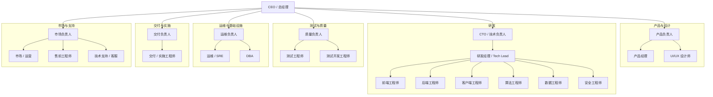
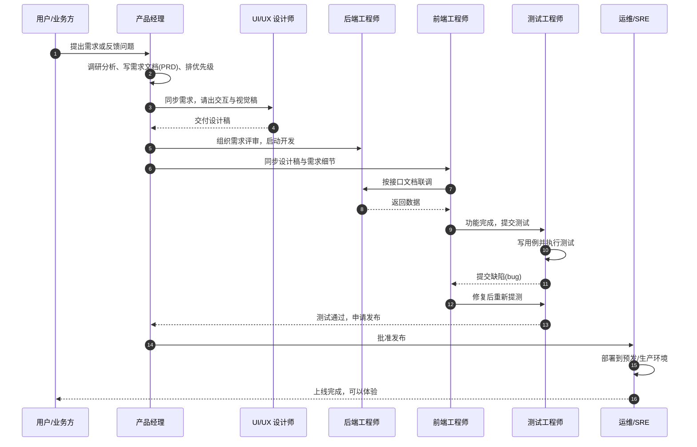
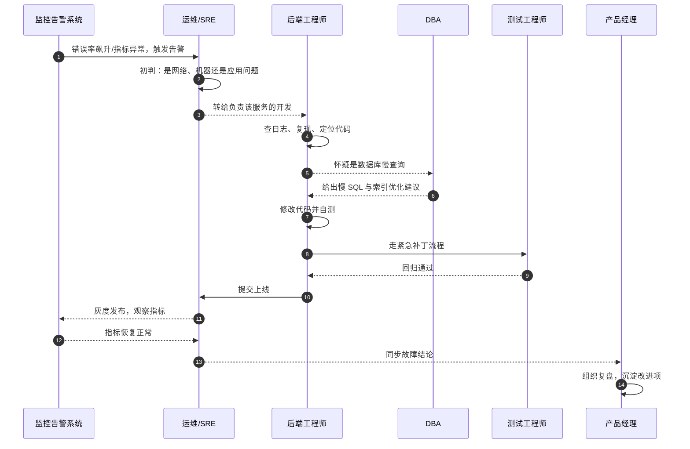

把一家软件公司想象成一支**盖楼的施工队**：产品经理是拿着业主需求画图纸的人，设计师负责把图纸变得好看又好用，开发工程师是砌墙、走水电的工人，测试工程师是拿尺子验收的质检员，运维工程师是交房之后常年驻场的物业。大家工种不同，但目标只有一个——**把用户想要的东西，稳稳当当地做出来、交付出去、一直能用**。

这篇文章就是把软件行业的常见岗位拉成一张全景图：每个岗位**负责什么、要具备什么能力、在项目里怎么和别人配合**。看完你就能明白，那些招聘网站上的"前端""后端""SRE""PM"到底在招什么样的人。

## 〇、一句话和一张组织架构图

**软件行业的岗位，本质上是围绕"把需求变成能稳定运行的产品"这件事，分工出来的不同角色。** 一个人可以同时兼任多个角色，岗位拆得多细，取决于公司有多大。

先看一张简化的组织架构图。注意：这只是常见形态，小公司可能一个人身兼产品、开发、测试、运维数职；大公司才会把下面每个格子都拆成独立团队。

把这张图读作六条生产线：**产品与设计**决定"做什么、长什么样"；**研发**把想法"做出来"；**测试与质量**保证"做得对"；**运维与基础设施**保证"一直能用"；**交付与实施**负责"把软件装进客户现场、让项目通过验收"；**市场与支持**让产品"有人用、用得好、还能赚钱"。下面逐一展开。

## 一、先把岗位分个族

按"在项目里发挥什么作用"，可以把常见岗位分成七大族。先给一张总览，后面每一节再逐个讲。

| 岗位族 | 核心问题 | 典型岗位 |
| --- | --- | --- |
| 产品与设计 | 做什么、给谁用、长什么样 | 产品经理、UI/UX 设计师 |
| 研发 | 怎么做出来 | 前端、后端、客户端、算法、数据、架构师、安全 |
| 测试与质量 | 做得对不对 | 测试工程师、测试开发工程师 |
| 运维与基础设施 | 能不能一直稳定跑 | 运维/SRE、DevOps、DBA |
| 项目与流程 | 大家步调是否一致 | 项目经理、敏捷教练 |
| 交付与实施 | 怎么落地到客户现场、让项目通过验收 | 交付/实施工程师 |
| 市场与支持 | 有没有人用、好不好卖 | 市场/运营、售前、技术支持 |

一个岗位的"职责"和"任职要求"是一体两面：职责告诉你**入职后每天要产出什么**，任职要求告诉你**凭什么能拿到这份工作**。下面每个岗位都按这个结构讲。

## 二、产品与设计族

### 产品经理（PM）

**一句话：替用户做主、替公司算账的"需求翻译官"。** 公司里最常和所有人打交道的就是他——产品经理。

**职责：**

- 调研用户和市场，搞清楚"用户到底想要什么、为什么想要"；
- 把模糊的想法写成**需求文档（PRD）**：这个功能解决什么问题、长什么样、哪些情况不做；
- 给需求排优先级，和研发、设计一起定排期，对"先做什么、后做什么"负责；
- 产品上线后看数据、听反馈，决定下一步迭代什么。

**任职要求：**

- 硬技能：会写 PRD、画原型图（Axure、Figma 等）、看懂基础数据指标；
- 软技能：沟通协调、需求判断、抗压能力，能同时推进多件事；
- 加分项：懂一点技术原理，能和开发高效对话，不被"技术上做不了"轻易唬住。

> 说明：**项目经理（PM）和产品经理（Product Manager）缩写经常撞车**，但一个是管"做什么"，一个是管"怎么按时做完"，文章第六节会单独讲项目经理。

### UI/UX 设计师

**一句话：让产品"好看"又"好用"的人。** UI 关注**界面长什么样**（颜色、按钮、布局），UX 关注**用起来顺不顺**（点几下能完成、会不会迷路）。小公司常把两者合并成一个设计师岗位。

**职责：**

- 根据需求出交互原型和视觉稿，定义按钮、配色、字体、间距等规范；
- 和产品经理确认功能逻辑，和前端工程师确认"设计稿能不能按预期实现"；
- 走查上线效果，保证实现和设计稿一致。

**任职要求：**

- 硬技能：熟练使用 Figma、Sketch、Photoshop 等设计工具，懂配色、排版、组件化设计；
- 软技能：审美、同理心（站在用户角度想）、沟通表达能力；
- 加分项：懂前端基础（HTML/CSS）会更吃香，能减少和开发的沟通成本。

## 三、研发族

研发族是公司里人数通常最多的群体。按"写哪一层代码"，可以细分成下面几类。

### 前端工程师

**一句话：做用户"看得见、点得动"的那部分。** 打开一个网页，你看到的所有按钮、列表、弹窗，基本都是前端写的。

**职责：**

- 把设计稿还原成网页或小程序界面，并负责各种交互效果；
- 调用后端提供的**接口（API）**拿数据、展示数据；
- 处理不同屏幕尺寸、不同浏览器下的显示兼容问题；
- 配合测试工程师修复界面相关的 bug。

**任职要求：**

- 硬技能：HTML、CSS、JavaScript 三大件，至少熟悉一种主流框架（Vue、React 等）；
- 加分项：了解打包工具、TypeScript、移动端适配、性能优化；
- 软技能：细心（界面差 1 像素都很明显）、和设计、后端沟通顺畅。

### 后端工程师

**一句话：写"藏在服务器后面"的那部分逻辑。** 用户点一下"登录"，前端把请求发给后端，后端去查数据库、核对密码、返回结果——这串"看不见的逻辑"就是后端写的。

**职责：**

- 设计和实现接口（API），处理业务逻辑、数据存取和权限校验；
- 维护数据库结构，保证数据存得对、取得快；
- 关注系统性能、并发和稳定性，处理高流量场景；
- 配合运维部署服务，排查线上问题。

**任职要求：**

- 硬技能：至少精通一门后端语言（Java、Go、Python、Node.js、C++ 等），熟悉数据库（MySQL、PostgreSQL 等）和缓存（Redis）；
- 加分项：懂微服务、消息队列、Linux 常用操作、性能调优；
- 软技能：逻辑严谨、能结构化地拆解问题。

### 客户端工程师

**一句话：专门写手机 App 或电脑桌面软件的人。** 可以看作"前端"在手机或桌面上的兄弟岗位。

**职责：**

- 开发 iOS、Android 应用，或 Windows、macOS 桌面软件；
- 处理不同机型和系统版本的兼容问题，配合应用商店审核和发布；
- 和产品、设计、后端协作，负责端上的功能实现与优化。

**任职要求：**

- 硬技能：iOS 方向熟悉 Swift/Objective-C，Android 方向熟悉 Kotlin/Java，桌面方向熟悉 Electron、Qt、C# 等；
- 加分项：懂网络请求、性能与耗电优化、跨平台框架（Flutter、React Native）；
- 软技能：重视细节，愿意跟进各类机型问题。

### 算法工程师

**一句话：让机器"更聪明"的那批人。** 推荐系统、搜索排序、人脸识别、大模型背后的数学与模型，都靠算法工程师。

**职责：**

- 针对业务问题选模型、调模型、训练和评估模型；
- 把模型效果转成可衡量的指标（准确率、召回率等），持续迭代；
- 和工程团队配合，把训练好的模型部署到线上，保证它能稳定、快速地跑。

**任职要求：**

- 硬技能：扎实的数学（线性代数、概率统计）和编程（Python 为主），熟悉主流机器学习/深度学习框架（PyTorch、TensorFlow 等）；
- 加分项：有数据清洗、特征工程、模型调优的实战经验，读得懂论文；
- 软技能：逻辑推导能力强，能把业务问题抽象成数学问题。

### 数据工程师

**一句话：把散落各处的数据"收拾干净、摆上货架"的人。** 数据分析师和算法工程师要用数据，但数据得先有人采集、清洗、建好仓库，这就是数据工程师的活。

**职责：**

- 搭建和维护**数据仓库（集中存放、统一口径的数据大仓库）**；
- 写数据管道，把业务数据抽取、清洗、转换后存进仓库（俗称 **ETL**）；
- 保证数据准时、准确、可追溯，为报表和算法提供"干净的数据"。

**任职要求：**

- 硬技能：SQL 扎实，熟悉 Hadoop、Spark、Flink 等大数据组件，至少一门编程语言；
- 加分项：懂数据建模、调度系统、云上数仓（如 BigQuery、MaxCompute）；
- 软技能：细心、对数据质量有洁癖。

### 架构师

**一句话：给系统"搭骨架、定规矩"的技术老手。** 开发工程师关注一个个功能怎么写，架构师关注**整个系统怎么搭才不容易塌**。

**职责：**

- 设计系统的整体结构：哪些服务拆开、哪些合并，数据怎么流动；
- 制定技术选型和编码规范，解决性能瓶颈、扩展性和安全性问题；
- 在重大项目里做技术决策，带团队做技术评审。

**任职要求：**

- 硬技能：通常由资深工程师成长而来，熟悉多种技术栈、分布式系统、数据库与中间件；
- 加分项：有大型系统从 0 到 1 或高并发场景的实战经验；
- 软技能：视野广、能权衡取舍（没有银弹，只有合适的选择）、能说服团队。

### 技术负责人 / 研发经理（Tech Lead）

**一句话：既是团队里最能打的工程师，也是团队的"带班班长"。** 架构师偏"技术方向"，Tech Lead 偏"带人出活"。

**职责：**

- 拆解需求、分配任务，把控团队的技术方案和代码质量；
- 带教新人、组织代码评审，为团队的交付结果负责；
- 和产品、项目经理对齐进度，向上汇报。

**任职要求：**

- 硬技能：技术能力在团队中处于上游，懂系统设计；
- 软技能：管理能力、沟通协调、人才培养，能平衡"技术理想"和"业务交付"。

### 安全工程师

**一句话：给系统"防盗、查漏洞"的人。** 别人想办法让系统跑起来，安全工程师想办法攻击它、再堵上漏洞。

**职责：**

- 做安全测试（渗透测试、漏洞扫描），发现并推动修复隐患；
- 建立安全规范和应急响应机制，处理入侵、数据泄露等事件；
- 做安全培训，把安全意识种进每个工程师脑子里。

**任职要求：**

- 硬技能：熟悉常见漏洞原理（注入、越权、XSS 等）、网络协议、渗透测试工具；
- 加分项：懂代码审计、云安全、合规（等保、隐私保护）；
- 软技能：好奇心强、有攻防思维，底线意识强。

## 四、测试与质量族

### 测试工程师（QA）

**一句话：拿"尺子"验收产品的质检员。** 开发说自己写完了不算数，得测试说"没问题"才能上线。

**职责：**

- 根据需求写**测试用例**（列出每种正常/异常情况该怎么点、该出现什么结果）；
- 手工或借助工具执行测试，把发现的问题提交成 **bug 单**，并跟踪到修复；
- 上线前做回归测试，确认修了一个问题没有引入新问题；
- 参与需求评审，提前发现需求里没说清楚的地方。

**任职要求：**

- 硬技能：懂测试理论和用例设计方法，会写基本的 SQL 和接口测试工具（Postman、JMeter 等）；
- 加分项：会一门脚本语言（Python 等）做自动化；
- 软技能：细心、较真、逆向思维（专门想"用户会怎么把它弄坏"）。

### 测试开发工程师（SDET）

**一句话：给测试"造工具、写自动化"的工程师。** 当功能越来越多，手工点点点测不过来，就需要测试开发把重复劳动自动化。

**职责：**

- 搭建自动化测试框架，把稳定功能的回归测试写成脚本自动跑；
- 开发测试工具和平台，提升团队整体测试效率；
- 和开发一起设计"可测试"的代码结构。

**任职要求：**

- 硬技能：既懂开发（一门语言 + 框架）又懂测试，熟悉自动化框架（Selenium、pytest、Appium 等）；
- 加分项：懂持续集成（CI）流水线；
- 软技能：工程化思维，追求效率。

## 五、运维与基础设施族

### 运维工程师 / SRE

**一句话：交房之后，常年守在楼里的物业。** 代码上线只是开始，之后服务器崩不崩、快不快，靠运维兜底。**SRE**（Site Reliability Engineering，站点可靠性工程）可以理解为"用工程化手段做运维"的进阶版：不只靠人盯，更靠监控、自动化和稳定性指标来管理。

**职责：**

- 部署、维护线上服务器和集群，处理发布、扩容、迁移；
- 搭监控和告警，第一时间发现异常并处理故障；
- 保障系统稳定性和性能，做容量规划和成本控制；
- 推动自动化，减少手工操作带来的风险。

**任职要求：**

- 硬技能：Linux 熟练，懂网络、Shell 脚本，熟悉容器（Docker/K8s）、监控和常用中间件；
- 加分项：会一门编程语言做自动化，懂云平台；
- 软技能：抗压、责任心强（线上故障不分节假日），遇事冷静。

### DevOps 工程师

**一句话：把"开发"和"运维"之间的墙拆掉的人。** 传统模式下，开发写完丢给运维部署，两边经常扯皮；DevOps 用流水线和工具，让"代码提交到自动上线"这件事顺畅起来。

**职责：**

- 搭建和维护 **CI/CD 流水线**（持续集成/持续交付：代码一提交，自动构建、测试、部署）；
- 统一开发、测试、生产环境，减少"在我机器上明明能跑"的坑；
- 建设发布系统和基础设施即代码（用配置文件管理服务器，而不是手工敲命令）。

**任职要求：**

- 硬技能：熟悉 CI/CD 工具（Jenkins、GitLab CI、GitHub Actions 等）、容器和云平台；
- 加分项：懂配置管理工具（Ansible、Terraform）；
- 软技能：协作意识强，愿意把经验沉淀成工具和文档。

### DBA（数据库管理员）

**一句话：专门照看"数据仓库"的人。** 数据库是绝大多数系统的命根子，DBA 负责让它不丢数据、跑得够快。

**职责：**

- 安装、配置、升级数据库，做备份和恢复演练；
- 优化慢查询、设计索引和表结构，监控数据库性能；
- 制定数据安全与容灾方案，处理数据故障。

**任职要求：**

- 硬技能：精通一种或多种数据库（MySQL、PostgreSQL、Oracle、Redis 等），懂 SQL 优化和复制、主从等高可用架构；
- 加分项：懂分布式数据库、云数据库；
- 软技能：极度细心、敬畏数据，风险意识强。

## 六、项目、交付、市场与支持族

### 项目经理（PM）

**一句话：盯着"人、事、时间、范围"的总调度。** 产品经理决定做什么，项目经理保证它**按时、按量、按质量**做完。

**职责：**

- 制定项目计划，拆解任务、排期、分派资源；
- 跟进进度，识别风险，协调跨团队的问题和阻塞；
- 组织会议、同步进展，对项目交付结果负责。

**任职要求：**

- 硬技能：懂项目管理方法（瀑布、敏捷、Scrum、看板等），会用项目管理工具；
- 加分项：有技术背景更好，能听懂开发在说什么；
- 软技能：沟通协调、时间管理、风险管理，能把混乱的局面捋顺。

### 敏捷教练（Scrum Master）

**一句话：帮团队"按敏捷的节奏开会、持续改进"的教练。** 敏捷是一套"小步快跑、频繁交付、快速反馈"的开发理念，Scrum 是其中一种常见框架。

**职责：**

- 主持站会、迭代评审、回顾会等敏捷仪式，保证会议高效；
- 帮团队清除障碍，维护团队节奏和规则；
- 引导团队持续复盘、改进协作方式。

**任职要求：**

- 硬技能：熟悉 Scrum、Kanban 等敏捷框架，有相关认证（CSM 等）更佳；
- 软技能：引导能力、同理心、观察力，是"教练"而不是"发号施令的人"。

### 售前工程师

**一句话：帮销售"讲技术、做方案、赢下客户"的人。** 销售负责商务关系，售前负责证明"我们的产品技术上也行"。

**职责：**

- 配合销售拜访客户，做产品演示和技术答疑；
- 根据客户需求写解决方案，做技术评估和报价支持；
- 把客户的需求反馈回产品团队。

**任职要求：**

- 硬技能：对自家产品技术细节熟悉，能做演示、写方案；
- 软技能：表达能力强、懂客户心理，能出差、能扛商务压力。

### 交付 / 实施工程师

**一句话：把"买回来的软件"真正装进客户现场、跑起来、并顺利通过验收的人。** 如果说售前在签约前负责"把饼画出来"，交付/实施就在签约后负责"把饼烙熟"——这是企业软件、政企项目、SaaS 私有化部署里非常关键的一环。

**职责：**

- 到客户现场或通过远程，完成系统的部署、安装、配置和初始化；
- 做数据迁移：把客户旧系统里的数据整理、清洗后导入新系统；
- 结合客户的业务流程做配置和定制，必要时把二次开发需求反馈给研发；
- 培训客户的使用人员，编写操作手册和上线方案；
- 配合客户做验收测试（UAT），推动项目通过验收、平稳上线，并在上线初期驻场支持。

**任职要求：**

- 硬技能：熟悉自家产品的安装部署与配置，懂 Linux、数据库基础，能看日志排查问题；
- 加分项：懂客户所在行业的业务流程（如政府、金融、制造），有项目管理意识；
- 软技能：经常出差、现场抗压能力强，沟通耐心，既懂技术又能和业务人员对话。

> 一句话区分三个容易混的岗位：**售前**在签约前证明"我们能行"；**交付/实施**在签约后负责"装好、配好、让客户验收"；**技术支持**在之后长期"兜底答疑"。它们分别站在成交的前、中、后三个阶段。

### 技术支持 / 客服

**一句话：用户遇到问题时的"第一接警人"。** 他们负责接住用户的求助，能自己解决就解决，解决不了就整理清楚转给研发。

**职责：**

- 通过工单、电话、在线聊天响应用户问题，记录并跟踪到解决；
- 沉淀常见问题（FAQ）和知识库，减少重复答疑；
- 把高频问题反馈给产品和研发，推动产品改进。

**任职要求：**

- 硬技能：熟悉产品功能，能看懂日志、复现问题；
- 软技能：耐心、沟通能力、情绪稳定，能把技术语言翻译成用户听得懂的话。

### 市场 / 运营 / 数据分析师

**一句话：让产品"被看见、有人用、能赚钱"的人。** 市场负责推广获客，运营负责提升活跃和留存，数据分析师负责用数据告诉团队"哪做得好、哪该改"。

**职责：**

- 市场/运营：策划活动、写文案、投放广告、维护社群，关注增长指标；
- 数据分析师：搭报表、看数据，分析用户行为和业务指标，输出结论支持决策。

**任职要求：**

- 市场/运营：懂内容、懂渠道、有网感，能看数据；
- 数据分析师：SQL 熟练，会用分析工具，能把数据讲成"人话"给出建议。

## 七、一个需求从提出到上线，大家怎么配合

前面是"一个个岗位长什么样"，这一节把它们**串起来**，看一个需求在项目里是怎么流转的。软件项目的常见阶段大致是：**需求 → 设计 → 开发 → 测试 → 上线 → 运维**。

下面这张时序图，展示一个功能从用户提出到上线的完整协作链。读法：箭头从发出方指向接收方，虚线箭头是"回复/交付"。

对应到不同阶段，各岗位的分工如下：

| 阶段 | 谁在忙 | 关键动作与产出 |
| --- | --- | --- |
| 需求 | 产品经理、用户 | 调研、写 PRD、排优先级 |
| 设计 | UI/UX 设计师 | 出交互原型和视觉稿 |
| 开发 | 前端、后端、客户端 | 写代码、联调接口、自测 |
| 测试 | 测试工程师 | 写用例、找 bug、回归 |
| 上线 | 运维/SRE、DevOps | 部署、灰度、监控 |
| 运维 | 运维、DBA、技术支持 | 监控告警、故障处理、答疑 |

可以看到，**一个需求从头到尾，没有哪个岗位是孤岛**：产品把需求说清楚，设计把样子定下来，开发把功能做出来，测试把质量守住，运维把系统稳住，最终才交到用户手里。

## 八、线上出问题，谁先上、谁配合

软件上线后还会出问题。这一节用一张"故障排查时序图"，看运维、开发、DBA、测试是怎么接力把一个线上 bug 定位并修好的。

这张图说明一件事：**出问题时，是"告警先发现、运维先隔离、开发深挖、DBA 支援、测试把关、最后复盘"的接力赛**。分工越清晰，故障恢复得越快。

## 九、一张表对比所有岗位

把全文的岗位压缩成一张速查表，方便你横向比较。

| 岗位 | 核心职责（一句话） | 主要产出物 | 入门门槛 / 适合谁 |
| --- | --- | --- | --- |
| 产品经理 | 决定做什么、排优先级 | PRD、原型、路线图 | 沟通强、有产品感觉的人 |
| UI/UX 设计师 | 决定产品长什么样、好不好用 | 设计稿、设计规范 | 有审美、有同理心的人 |
| 前端工程师 | 做用户看得见、点得动的界面 | 网页、小程序、App 界面 | 喜欢"立刻能看到效果"的人 |
| 后端工程师 | 写看不见的业务逻辑和接口 | 接口、服务、数据库结构 | 逻辑严谨、喜欢拆问题的人 |
| 客户端工程师 | 写手机 App 或桌面软件 | 可安装的应用 | 想专注做端上体验的人 |
| 算法工程师 | 让机器更聪明 | 模型、特征、实验报告 | 数学好、爱研究的人 |
| 数据工程师 | 把数据收拾干净、建好仓库 | 数据管道、数仓、报表 | 细心、对数据质量有洁癖的人 |
| 架构师 | 给系统搭骨架、定规矩 | 架构设计、技术规范 | 资深工程师的进阶方向 |
| 安全工程师 | 查漏洞、防攻击 | 安全报告、规范、应急方案 | 好奇心强、有攻防思维的人 |
| 测试工程师 | 拿尺子验收产品 | 用例、bug 单、测试报告 | 细心较真、有逆向思维的人 |
| 测试开发 | 给测试造工具、写自动化 | 自动化框架、测试平台 | 既爱开发又爱质量的人 |
| 运维/SRE | 让系统一直稳定地跑 | 部署、监控、告警体系 | 抗压、责任心强的人 |
| DevOps | 打通开发与运维的流水线 | CI/CD 流水线、发布系统 | 爱自动化、爱工具的人 |
| DBA | 照看数据库 | 备份、索引、性能报告 | 敬畏数据、极细心的人 |
| 项目经理 | 保证项目按时按质交付 | 项目计划、进度报告 | 善于协调、爱捋顺流程的人 |
| 敏捷教练 | 带团队按敏捷节奏持续改进 | 会议引导、改进项 | 会引导、有同理心的人 |
| 售前工程师 | 用技术方案帮销售赢单 | 解决方案、演示、报价 | 懂技术又善表达的人 |
| 交付/实施工程师 | 把软件装进客户现场、让项目通过验收 | 部署方案、配置、操作手册、验收报告 | 能出差、既懂技术又懂业务的人 |
| 技术支持 | 接住用户的求助并解决 | 工单、FAQ、知识库 | 耐心、沟通好的人 |
| 市场/运营/数据分析 | 让产品有人用、能赚钱 | 活动、内容、数据报告 | 有网感、爱看数据的人 |

## 十、给想入行的人几条建议

**第一，别被岗位名称吓住，先选"族"再选"岗"。** 如果你喜欢和人打交道、想影响产品方向，往产品与设计族走；如果喜欢动手写代码、享受解决问题，往研发族走；如果细致较真、眼里容不得 bug，测试族很合适；如果喜欢稳定和全局视角，运维族是不错的选择。

**第二，入门岗位往往不是终点。** 很多架构师是从后端工程师成长起来的，很多产品经理是从测试、开发转过去的。第一份工作最重要的是**把一件事做扎实**，而不是一步到位。

**第三，软技能和硬技能同样重要。** 招聘要求里的"沟通协调""抗压""责任心"不是套话——软件是团队协作出来的，能把话说清楚、把事跟到底的人，走到哪都受欢迎。

**第四，看一家公司的岗位，不如看它的阶段。** 初创公司要求一人多岗、快速试错；成熟大公司岗位细分、流程规范。选公司时，把"岗位职责"和"公司规模"放在一起看，才不容易踩坑。

## 十一、总结

软件行业的岗位看着五花八门，其实都围绕一条主线：**把用户的需求，变成能稳定运行、持续创造价值的产品**。产品定义"做什么"，设计定义"长什么样"，研发负责"做出来"，测试保证"做得对"，运维保证"一直能用"，项目让所有人"步调一致"，交付/实施把产品落地到客户现场并通过验收，市场和运营让产品"被看见、能赚钱"。

理解了这条主线，再看任何招聘信息，你都能快速判断：**这个岗位在链条的哪一环，产出什么，要和谁配合，需要什么能力**。这就是本文想帮你建立的整体印象。
