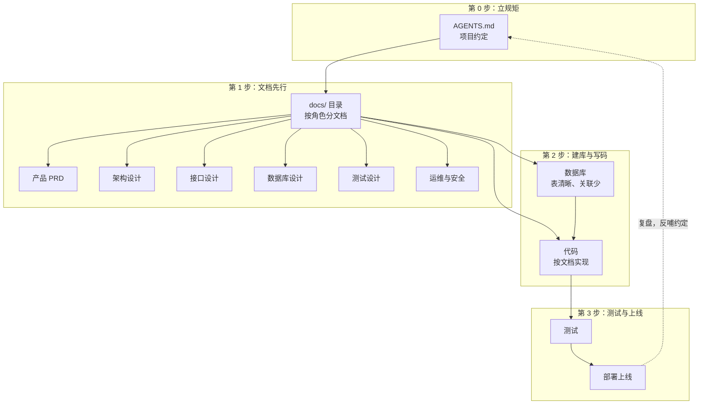
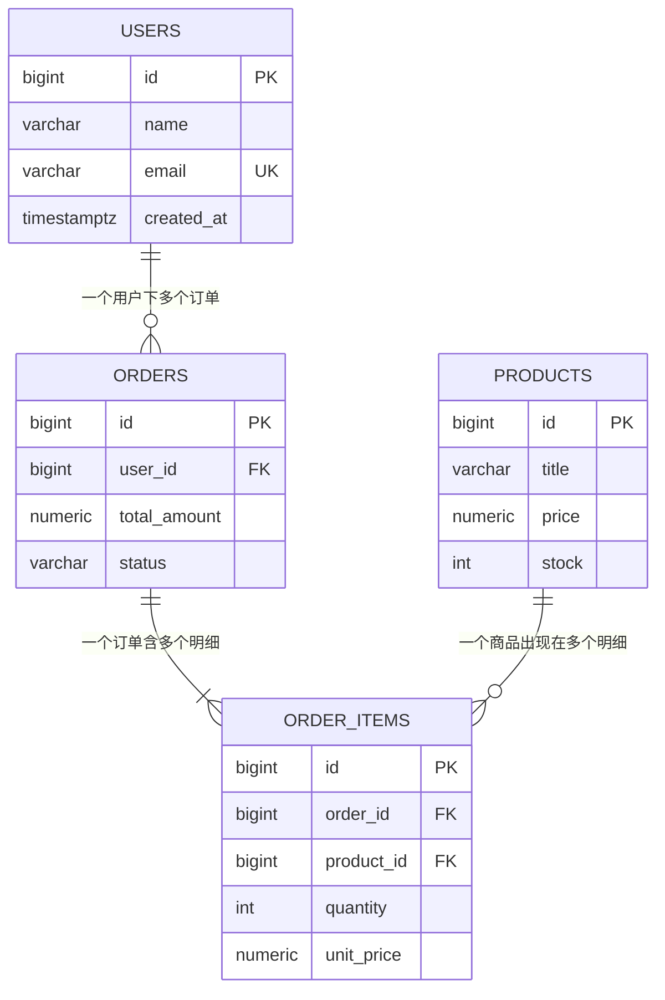
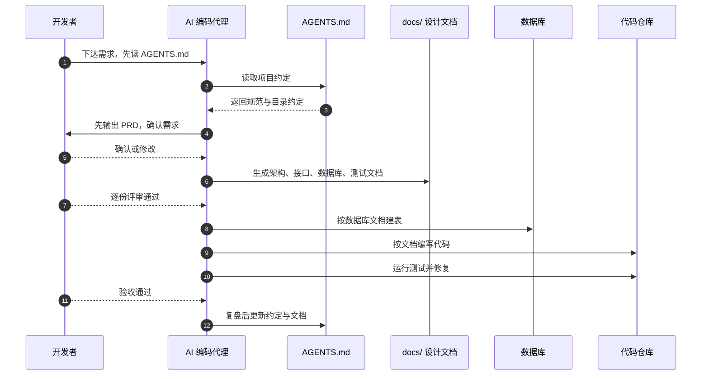
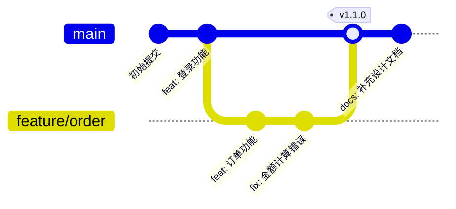
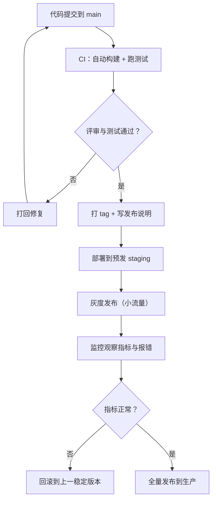

让 AI 帮你写代码，最怕的不是它"不会写"，而是它**每次写出来的风格都不一样、经常偏离你的本意、改着改着就把项目搞乱**。问题的根源，往往不是 AI 能力不够，而是**你没把规矩和图纸先给它**。

这篇文章给出一个可以落地的 AI 开发规范，核心只有三步：

1. **先写 AGENTS.md**——给 AI 立一份"项目宪法"；
2. **再建 docs 目录**——按产品、架构、后端、前端、测试、运维等角色，把设计文档先写下来；
3. **最后把数据库定清楚**——表要少、关联要少、结构要清晰，因为它直接决定上层服务的逻辑。

> 说明：下文说的"AI 编码代理（AI Coding Agent）"，指的是能自己读代码、改代码、跑命令的 AI 编程助手，比如 Codex、Claude Code 这类工具。它们都认 AGENTS.md 这种项目级约定文件。

## 〇、一句话和一张全景图

**用 AI 开发的正确姿势，不是"给一句话就让它闷头写代码"，而是"先立规矩、先出图纸、先定数据，最后才动手实现"。**

整个流程可以画成下面这张全景图：



这张图的要点是：**规矩在最上面，文档在中间，代码在最下面**。AI 每写一行代码，都能在文档里找到依据；项目做完一轮，再把经验反哺回 AGENTS.md，形成闭环。另外，**版本控制**和**发布流程**是贯穿全程的两条"基建"——一条保证随时能回退，一条保证上线不翻车，后面会各用一节专门讲。

## 一、第一步：先写 AGENTS.md，给 AI 立一份"项目宪法"

### 它是什么

**AGENTS.md 是放在项目根目录下的一个约定文件**，写的是"这个项目该怎么写代码、文件放哪、用什么技术、做完要做什么"。AI 编码代理每次开工前会先读它，照着里面写的规则办事。

打个比方：你要请一队施工队装修，开工前一定会先发一份《施工守则》——"水管走顶、电线走地、墙面先找平再刷漆"。没有这份守则，每个师傅都会按自己的习惯来，装出来就乱了。**AGENTS.md 就是给 AI 施工队的那份守则。**

### 它的目的：四个字——一致、不跑偏

1. **保持风格一致**：把代码规范写死，AI 就不会这次用这种写法、下次换另一种；
2. **少返工**：把技术栈、目录结构、命名规则提前讲清，AI 就不会自己"发挥"出一套新的；
3. **防止越界**：明确告诉 AI"哪些能做、哪些不能做、做完要干什么"，避免它擅自 push、乱删文件；
4. **可传承**：项目换了 AI、换了人来维护，约定都在文件里，不用靠口头交代。

### 放哪些内容

一份最小可用的 AGENTS.md，通常包含五块：**项目是什么、目录结构、编码规范、开发流程、交付规则**。下面是一个可以直接抄的示例：

```markdown
# AGENTS.md
# 这份文件是给 AI 编码代理看的"项目约定"。AI 每次开工前都应该先读它。

## 1. 项目是什么
# 一句话让 AI 快速进入语境，而不是让它瞎猜。
这是一个博客系统：前端 Nuxt 3，后端 Go + Gin，数据库 PostgreSQL。

## 2. 目录结构（固定约定）
# 写死目录，AI 就不会到处乱建文件。
web/     # 前端代码
server/  # 后端代码
docs/    # 设计文档，所有需求都先落到这里，再动手写代码

## 3. 编码规范
# 把团队标准写死，AI 生成的代码才能保持统一风格。
- 后端接口一律返回 {code, message, data} 三段结构；
- 所有数据库表必须有 id 主键和 created_at 字段；
- 错误统一走 errors 包，禁止在业务代码里直接 panic。

## 4. 开发流程
# 告诉 AI 先做什么、后做什么，避免一上来就闷头写代码。
1. 先读 docs/ 下对应的设计文档，没有文档就先补文档；
2. 按文档实现功能；
3. 写完运行测试，全部通过后再提交。

## 5. 交付规则
# 明确"完成"的标准，防止 AI 半途而废或越权操作。
- 改完必须 git add + commit，提交说明用中文简述改动；
- 未经确认，不要 push 到生产分支。
```

> 注意：AGENTS.md 里写的是"项目约定"，不是"一次性指令"。它要足够通用，让 AI 在整个项目生命周期里都能复用；临时性的"帮我做个登录页"这种话，直接写在对话里就行，不用塞进 AGENTS.md。

## 二、第二步：建 docs 目录，把每个角色的设计文档先写下来

### 为什么"文档先行"

常规软件开发流程里，产品、设计、架构、后端、前端、测试、运维每个角色，在动手前都要产出自己的"图纸"。**用 AI 开发也一样：让 AI 先把各角色的文档写出来，人审完再写代码。** 这能解决两个老大难：

1. **人和 AI 对需求的理解对齐**：文档说清楚了"到底做什么"，代码才不会跑偏；
2. **文档就是后续代码的依据**：AI 写代码时，直接引用文档里的接口、字段和用例，前后不会打架。

### docs 目录长什么样

按"角色"来组织，一个角色一个子目录，每个子目录一份核心文档：

```text
docs/
├── 00-需求/
│   └── PRD.md              # 产品经理：要做什么、为什么做、边界在哪
├── 01-架构/
│   └── architecture.md     # 架构师：系统怎么分层、服务怎么拆、数据怎么流
├── 02-接口/
│   └── api.md              # 后端：每个接口的路径、入参、出参、错误码
├── 03-前端/
│   └── ui.md               # 前端/设计：页面结构、交互、状态怎么管理
├── 04-数据库/
│   └── database.md         # 数据：有哪些表、字段、关系，为什么这样设计
├── 05-测试/
│   └── test-plan.md        # 测试：用例、验收标准、自动化怎么跑
├── 06-运维/
│   └── deploy.md           # 运维：部署方式、环境、监控、回滚
└── 07-安全/
    └── security.md         # 安全：权限、数据脱敏、风险点
```

### 每个角色写什么

一张表对应清楚"哪个角色、产出哪份文档、文档里必须写清什么"：

| 角色 | 文档 | 必须写清的内容 |
| --- | --- | --- |
| 产品经理 | docs/00-需求/PRD.md | 用户故事、功能清单、优先级、不做的事 |
| 架构师 | docs/01-架构/architecture.md | 分层、模块、服务边界、技术选型 |
| 后端工程师 | docs/02-接口/api.md | 每个接口的方法、路径、参数、返回、错误码 |
| 前端/设计师 | docs/03-前端/ui.md | 页面、交互、组件、状态管理 |
| 数据/后端 | docs/04-数据库/database.md | 表结构、字段、关系、索引 |
| 测试工程师 | docs/05-测试/test-plan.md | 用例、验收标准、自动化策略 |
| 运维/SRE | docs/06-运维/deploy.md | 部署、环境、监控、回滚 |
| 安全工程师 | docs/07-安全/security.md | 权限、脱敏、漏洞风险 |

顺序也很重要：**先需求，再架构，再接口，再数据库，最后测试和运维**。前面的是后面的依据，反着来就会来回返工。

## 三、第三步：先定数据库——表越少、关联越少，上层逻辑越简单

### 为什么数据库决定上层逻辑

数据库是整个系统的"地基和管线图"。地基打歪了，上面的房子再怎么装修都别扭。具体到开发里：**上层服务（后端接口）几乎每个功能都要读写数据库**，如果表之间的关系又乱又多，服务里就会充满复杂的联表查询和"补丁式"的判断；反之，表结构清晰、关联少，服务逻辑自然就短、就直。

### 先认识"关系"

表之间的关系，本质上只有三种，用生活中的例子记：

| 关系 | 含义 | 例子 |
| --- | --- | --- |
| 一对一 1:1 | 一个 A 对应一个 B | 一个用户对应一份实名资料 |
| 一对多 1:N | 一个 A 对应多个 B | 一个用户下多个订单 |
| 多对多 N:M | 多个 A 对应多个 B | 一个订单买多件商品，一件商品出现在多个订单 |

**多对多关系不能直接用外键表达，必须拆成一张"中间表"**，把它变成两个"一对多"。这是让关联变清晰的关键动作，下面例子里的 `order_items` 就是这种中间表。

### 三个设计原则

1. **一张表只描述一种东西**：用户表只存用户，订单表只存订单，不要互相塞字段；
2. **关联越少越好**：能用一张表，就不用两张；能不加外键关联，就不加；
3. **价格等历史值要"快照"**：订单里记下单时的单价，而不是每次都去商品表现查——这样以后商品涨价，历史订单也不会变。

### 一个具体例子：极简订单系统

只做"用户下单买东西"这一件事，四张表就够了。先看它们之间的关系（ER 图，读法：`||` 这边是"一"，`o{` 这边是"多"）：



对应到建表 SQL（PostgreSQL），每句都有注释，可以直接跑：

```sql
-- ============ 用户表 ============
-- 只保存"用户自己"的信息。一个用户可以有多个订单，
-- 所以本表不保存任何订单字段，避免用户和订单纠缠在一起。
CREATE TABLE users (
    id          BIGSERIAL PRIMARY KEY,                -- 主键：自增，唯一标识一个用户
    name        VARCHAR(64)  NOT NULL,                -- 昵称
    email       VARCHAR(128) NOT NULL UNIQUE,         -- 登录邮箱，唯一约束防止重复注册
    created_at  TIMESTAMPTZ  NOT NULL DEFAULT now()   -- 注册时间
);

-- ============ 商品表 ============
-- 商品被哪些订单购买，交给 order_items 记录，本表不直接关联订单。
CREATE TABLE products (
    id          BIGSERIAL PRIMARY KEY,                -- 主键
    title       VARCHAR(128) NOT NULL,                -- 商品名
    price       NUMERIC(10,2) NOT NULL,               -- 售价，用 NUMERIC 存金额避免浮点误差
    stock       INT          NOT NULL DEFAULT 0,      -- 库存数量
    created_at  TIMESTAMPTZ  NOT NULL DEFAULT now()   -- 上架时间
);

-- ============ 订单表 ============
-- 一个订单属于一个用户（多对一），通过 user_id 关联；
-- 订单里具体买了什么、各买几件，放到 order_items，本表只存订单汇总。
CREATE TABLE orders (
    id           BIGSERIAL PRIMARY KEY,                 -- 主键
    user_id      BIGINT NOT NULL REFERENCES users(id),  -- 下单用户，指向 users 表
    total_amount NUMERIC(12,2) NOT NULL DEFAULT 0,      -- 订单总金额
    status       VARCHAR(16) NOT NULL DEFAULT 'created',-- 状态：created/paid/shipped/done
    created_at   TIMESTAMPTZ NOT NULL DEFAULT now()     -- 下单时间
);

-- ============ 订单明细表 ============
-- 连接"订单"和"商品"的中间表：一条记录表示"某订单买了某商品几件"。
-- 用这张表把"多对多"拆成两个"一对多"，是保持关联清晰的关键。
CREATE TABLE order_items (
    id         BIGSERIAL PRIMARY KEY,                   -- 主键
    order_id   BIGINT NOT NULL REFERENCES orders(id),   -- 属于哪个订单
    product_id BIGINT NOT NULL REFERENCES products(id), -- 买的是哪个商品
    quantity   INT NOT NULL DEFAULT 1,                  -- 买了几件
    unit_price NUMERIC(10,2) NOT NULL                   -- 下单时单价（快照，防改价影响历史订单）
);
```

这四张表一共只有三条关系，而且都是"一对多"：用户对订单、订单对明细、商品对明细。上层服务只要"查一个用户的订单 → 查订单的明细 → 拼出买了什么"，逻辑非常直，几乎没有联表陷阱。

> 关于外键：上面为了演示加了 `REFERENCES`（物理外键）。真实项目里，高并发场景很多人会改成"逻辑外键"——只保留 `user_id` 这种字段、不加数据库级约束，由服务层自己保证数据一致。**要不要物理外键是权衡，但"字段关联要少、要清晰"这个原则不变。**

## 四、把三步串成一条完整流程

把上面三步落成一条可执行的流程，一共七个阶段：

| 阶段 | 干什么 | 谁主导 | 产出 |
| --- | --- | --- | --- |
| 0. 立规矩 | 写 AGENTS.md | 开发者 | AGENTS.md |
| 1. 定需求 | 确认要做什么、边界在哪 | 产品经理 | PRD |
| 2. 出设计 | 架构、接口、前端、数据库、测试、运维文档 | 各角色 | docs/ 下文档 |
| 3. 定数据 | 设计表结构、字段、关系 | 数据/后端 | 建表 SQL |
| 4. 写代码 | AI 按文档实现功能 | AI + 后端/前端 | 代码 |
| 5. 测试验收 | 按测试文档跑用例、修问题 | 测试工程师 | 测试报告 |
| 6. 上线复盘 | 部署上线，把经验写回 AGENTS.md 和 docs | 运维 + 全员 | 更新后的约定与文档 |

下面这张时序图，展示了"人"和"AI"在一条流程里各自在什么节点出手：



这张图里最关键的一个细节是：**AI 不直接"写代码"，而是先经过"读规矩 → 出文档 → 人评审 → 建库 → 写码"这条链**。每一环都有据可查，人才是最后的拍板者。

其中"写代码"和"上线"这两个环节，还各自藏着一套硬功夫：**版本控制**和**发布流程**。这两件事没做好，前面写得再规范，出问题时也会手忙脚乱。下面两节单独讲透。

## 五、版本控制：让每一次改动都可追踪、可回退

### 为什么 AI 开发尤其需要它

AI 写代码的特点是**快、改动面大**：一句话下去，它可能同时改了十几个文件。这带来一个致命问题——**一旦改错了，你怎么回到"上一个好的状态"？**

版本控制（最常用的是 **Git**）就是干这件事的：它像游戏的**存档系统**，每完成一小步就存一个档，随时能读档、对比、回退。没有它，AI 的"快"反而会变成"乱"。

### 分支怎么分：主线 + 短命功能分支

一个简单好用的策略是：

- **main 分支**：永远保持"能上线"的稳定状态，是唯一的生产来源；
- **feature 分支**：每做一个功能，从 main 拉一条短命分支，做完、测完、评审通过后再合回 main。

这条规则对 AI 尤其重要：**让 AI 在功能分支上干活，而不是直接在 main 上乱写**，坏了也影响不到主线。下面这张图演示了"主线 + 功能分支 + 打 tag"的完整动作：



### 提交说明怎么写：Conventional Commits

AI 提交时，最容易写出 `update`、`fix bug`、`改了一堆东西` 这种没信息的说明。用 **Conventional Commits（约定式提交）** 把它规范成"类型 + 简述"：

```text
feat: 新增用户登录接口
fix: 修复订单金额四舍五入错误
docs: 更新数据库设计文档
refactor: 重构订单查询逻辑
test: 补充订单回归用例
chore: 升级依赖版本
```

开头的词有固定含义：`feat` 新功能、`fix` 修 bug、`docs` 文档、`refactor` 重构、`test` 测试、`chore` 杂务。**提交说明写清楚，将来"哪个改动引入了这个 bug"一眼就能定位。**

### 版本号怎么定：SemVer

**语义化版本号（SemVer）** 用三段数字 `主版本.次版本.修订版本` 表达一次发布，比如 `1.2.3`：

| 段 | 什么时候加 | 例子 |
| --- | --- | --- |
| 主版本（1.x.x） | 做了不兼容的破坏性改动 | 2.0.0 |
| 次版本（x.1.x） | 加了新功能，向后兼容 | 1.3.0 |
| 修订版本（x.x.1） | 只修 bug，不改功能 | 1.2.4 |

配合 **tag（标签）**：每次发布时给对应提交打一个 tag（如 `v1.2.3`），再顺手维护一份 **CHANGELOG**，记下每个版本改了什么。这样"线上跑的是哪个版本、出问题回到哪个版本"，全都清清楚楚。

### AI 场景下的三条硬规矩

1. **一次提交只做一件事**：禁止 AI 一口气提交几十个不相关文件；
2. **提交说明必须规范**：按上面 `feat/fix/...` 的格式来，不许写"update"；
3. **每个可发布的版本都打 tag**：没有 tag，回退就成了"大海捞针"。

## 六、发布流程：从代码到上线的"标准生产线"

### 三个环境，先把话说清

正式项目里，代码不是写完就直接上生产，而是依次经过三个环境：

| 环境 | 作用 | 谁在用 |
| --- | --- | --- |
| dev（开发） | 日常开发、联调 | 开发、AI 编码代理 |
| staging（预发） | 上线前最后一次验收，尽量和生产一致 | 测试、产品 |
| prod（生产） | 真实用户在用 | 最终用户 |

**AI 可以随意折腾 dev，但绝不能直接碰 prod。** 这条边界要写进 AGENTS.md，用环境和权限把它卡死。

### 发布前必过的三道关

1. **代码评审**：AI 写的代码必须有人看过，确认没跑偏、没埋雷；
2. **自动化测试**：CI 流水线自动跑测试，不通过就拦下来；
3. **构建产物校验**：构建出的包要完整、可安装、版本号正确。

### 发布要"灰度先行"

最稳的发布方式不是"一下全量"，而是**灰度发布**：先把新版本放给一小部分用户，观察没问题，再逐步扩大到全量。新版本相当于"先让少数人试吃，再全场供应"。

下面这张图是一条完整的发布流水线：



### 回滚：出问题时的"后悔药"

**发布前就一定要想好怎么回滚。** 最常见的做法是：保留上一个版本的构建产物和 tag，一旦灰度或全量后发现异常，一键切回上一版本，而不是现场翻代码改。

### 发布后：监控 + 复盘

上线不是终点。发布后要盯**监控指标**（错误率、响应时间、业务量），有异常立即告警；问题处理完还要**复盘**，把原因和预防措施写回 AGENTS.md 和 docs，让下一次发布更稳。

### AI 场景下的三条硬规矩

1. **AI 生成的代码必须过 CI**：测试没通过，不许进入下一个环境；
2. **"发布"这个动作必须由人确认**：AI 可以准备一切，但最后点"发布"的是人；
3. **每次发布都要能回滚**：先灰度、留好上一版本、随时能退。

## 七、有规范 vs 没规范：一张对比表

| 维度 | 没有规范（直接让它写） | 有规范（AGENTS.md + docs + 数据库先行） |
| --- | --- | --- |
| 代码风格 | 每次都不一样，越改越乱 | 统一，新代码像老代码 |
| 需求对齐 | 经常跑偏，来回返工 | 文档先行，偏差小 |
| 数据库 | 表越建越多、关系纠缠 | 表少、关联少、逻辑直 |
| 可维护性 | 只有 AI 当时"自己知道" | 文档在，换人换 AI 都能接手 |
| 风险控制 | 容易越权、乱删乱改 | 交付规则明确，人可控 |
| 版本控制 | 提交混乱、无法回退 | 每次改动可追踪，按 tag 随时回退 |
| 发布流程 | 直接全量、出事干着急 | 灰度先行、监控到位、随时回滚 |
| 复盘沉淀 | 经验丢了 | 反哺回 AGENTS.md，越用越顺 |

一句话总结这张表：**规范不是在约束 AI，而是在约束"混乱"**。

## 八、几个容易踩的坑

1. **AGENTS.md 写得像说明书而不是约定**：它应该写"规则和边界"，不是把整个项目文档塞进去；
2. **文档写成流水账**：每份文档都要"可执行"，接口文档要能直接照着写代码，不是空话；
3. **数据库过度设计**：一开始就上几十张表、各种多对多，服务还没写就已经很难改了。**先做减法，表能少就少**；
4. **人完全撒手**：AI 出完文档和代码，人必须逐份评审、逐项验收，AI 是"加速器"不是"替身"；
5. **提交混乱**：AI 一次提交改了几十个不相关文件，出问题没法定位、没法回退；
6. **没有回滚预案**：不灰度、不打 tag，直接全量上线，AI 改的代码一旦有问题只能干着急；
7. **做完不复盘**：不把踩过的坑写回 AGENTS.md，下一次同样的坑还会再踩一次。

## 九、总结

用 AI 开发，本质上还是**软件工程的老规矩**：先立约定、再出设计、定好数据、管好版本、走稳发布，最后写代码——只是把"执行"这一步交给 AI，把"决策和验收"留给人。

记住这五件事：**AGENTS.md 立规矩**，让 AI 每次都按同一套规则办事；**docs 文档先行**，让每个角色在动手前都有图纸、有依据；**数据库设计清晰、关联少**，让上层服务逻辑简单、好维护；**版本控制可追踪、可回退**，让每一次改动都有存档；**发布流程灰度先行、随时能回滚**，让上线不再心惊胆战。这套组合拳打下来，AI 就从"偶尔惊艳、经常跑偏"的工具，变成一支**听话、稳定、能沉淀**的开发队伍。
