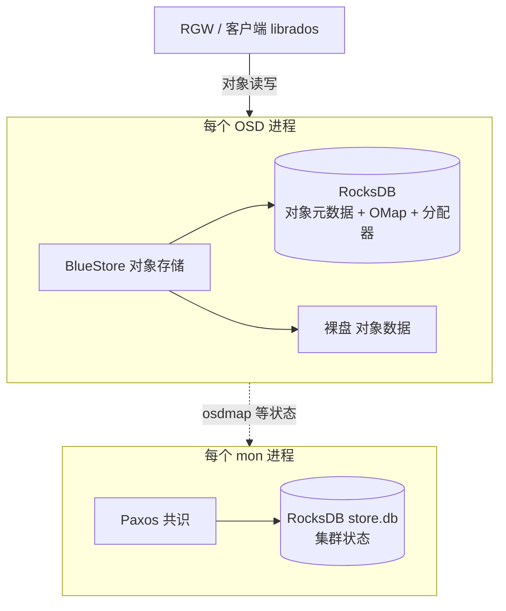
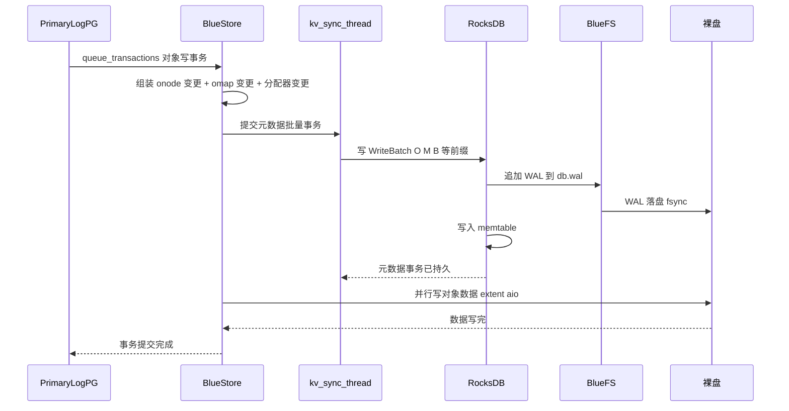
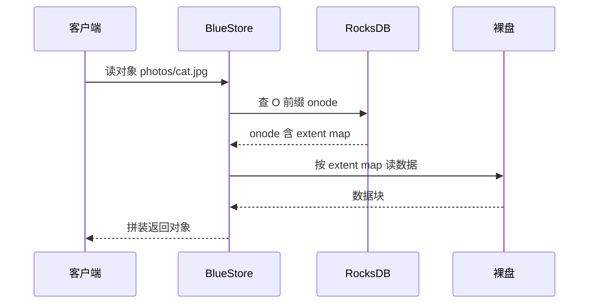
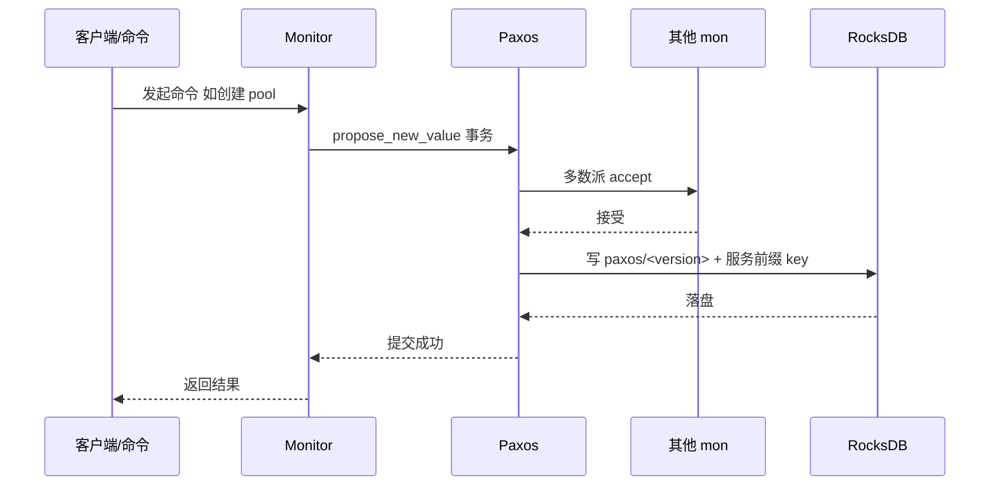
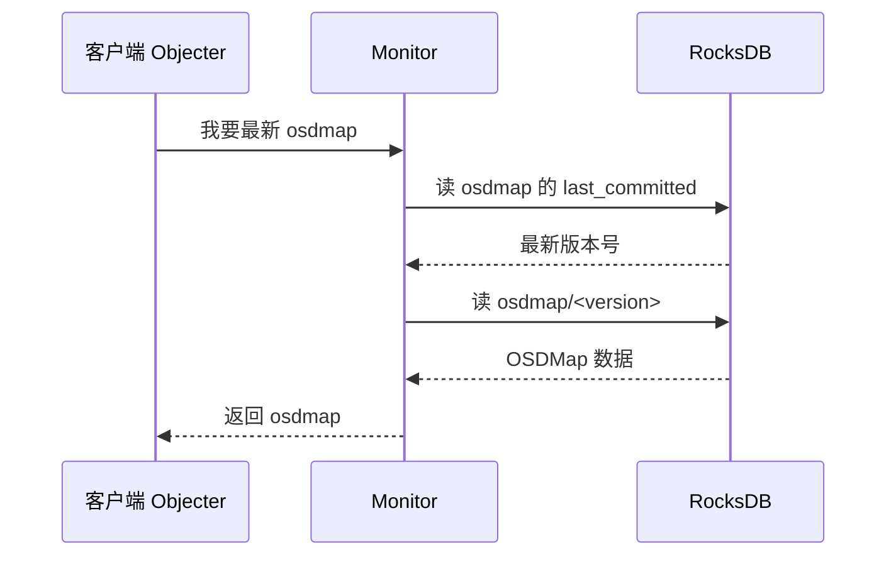

这篇文章把 **Ceph 里 RocksDB 存的所有数据**一次讲清楚：哪些进程在用、每类数据是干什么的、为什么这样设计、有什么优点、被谁读写、写流程和读流程是什么。文中有完整的数据结构、真实数据样例、架构图和每类进程访问的时序图。基于 **Ceph v21.1.2 源码**。

> 面向两类读者：非技术读者看"是什么 / 为什么 / 作用"，技术读者可对照源码文件与行号，文末有参考清单。

## 〇、一句话和一张图

**一句话**：RocksDB 在 Ceph 里是一块"只存小数据（元数据/状态）、不存大对象数据"的嵌入式键值库；它有两个主人——**BlueStore（每个 OSD 一份）** 和 **Monitor（每个 mon 一份）**。



## 一、RocksDB 是什么，Ceph 为什么用它

**RocksDB 是什么**：一个嵌入式（嵌进进程里跑，不单独开服务）的键值数据库。底层是 LSM-Tree：写先落到 WAL（写前日志）和内存 memtable，攒多了再刷成磁盘上的 SST 文件，后台再做 compaction 合并。

**Ceph 为什么用它**：Ceph 的对象数据很大（几 MB 到几 GB），不能塞进键值库；但对象还有一大堆"小元数据"（这个对象在哪、有哪些属性、挂在对象名下的键值、盘上哪些空间空闲……），这些数据量不大、但要**极快地随机读写**、还要**崩溃不丢**。RocksDB 正好擅长这个。于是 Ceph 把大对象数据直写裸盘，把元数据和集群状态交给 RocksDB——这就是"数据/元数据分离"的核心设计。

对比一下，为什么不是别的选择：

| 方案 | 问题 |
| --- | --- |
| 自己写元数据文件 | 要自己处理崩溃一致、随机读写、并发，工程量巨大 |
| 用通用文件系统（XFS 等） | 多一层缓存和开销，且不能按 Ceph 需求精细调优 |
| 用 RocksDB | 现成的持久化 KV，自带 WAL/快照/压缩/列族，可插拔、可调参 |

## 二、RocksDB 数据总分类

先给一张总表，后面每一类再展开：

| 进程 | 前缀 / 区域 | 存什么 | 作用 | 谁写 / 谁读 |
| --- | --- | --- | --- | --- |
| OSD（BlueStore） | `S` | 超级块 superblock | 记录 BlueStore 的全局配置、版本、BlueFS 位置 | BlueStore 写；启动时读 |
| OSD | `T` | 集合统计 | 每个 PG 的对象数/字节数统计 | BlueStore 写；PG 统计时读 |
| OSD | `C` | 集合元数据 cnode | 集合（PG）的元信息 | BlueStore 写/读 |
| OSD | `O` | 对象 onode | 对象的元数据 + extent map（数据在哪） | BlueStore 写/读 |
| OSD | `M` | 用户 OMap | 对象名下的键值（RGW 桶索引等） | BlueStore 写/读 |
| OSD | `P` | PG meta OMap | PG 的元数据键值 | BlueStore 写/读 |
| OSD | `m` | per-pool OMap | 按池隔离的用户 OMap | BlueStore 写/读 |
| OSD | `p` | per-PG OMap | 按 PG 隔离的用户 OMap | BlueStore 写/读 |
| OSD | `L` | 延迟写事务 | deferred write 的待回放事务 | BlueStore 写/读 |
| OSD | `B` / `b` | 分配器空闲空间 | 盘上哪些区间已用/空闲 | BlueStore 写/读 |
| OSD | `X` | 共享 blob | 去重/共享数据的引用 | BlueStore 写/读 |
| mon | `paxos` | Paxos 日志 | 每次共识提交的原始事务 | mon 写；启动回放/追赶读 |
| mon | `osdmap` 等 | 各 Paxos 服务状态 | 集群地图与状态 | mon 写；客户端/OSD/RGW 读 |

两个进程的 RocksDB 是**各自独立**的：OSD 的每个盘一份，mon 的每个 mon 一份，互不共享。

## 三、BlueStore（OSD）的 RocksDB

### 3.1 布局与 column family

BlueStore 的 RocksDB 默认开**列族（column family）分片**：`bluestore_rocksdb_cf` 默认 true，分片定义 `bluestore_rocksdb_cfs` 默认是：

```text
m(3) p(3,0-12) O(3,0-13)=block_cache={type=binned_lru} L=min_write_buffer_number_to_merge=32 P=min_write_buffer_number_to_merge=32
```

逐段解释：`m(3)` 把 per-pool omap 拆成 3 个列族；`p(3,0-12)` 把 per-pg omap 拆成 3 个列族、按 key 哈希 0-12 分；`O(3,0-13)=block_cache={type=binned_lru}` 把 onode 拆成 3 个列族并单独配缓存；`L`、`P` 各自调 RocksDB 参数。**只拆 `m/p/O` 这三个最占空间的**，`S/T/C/M/B` 官方不建议拆（注释里写明 "Sharding of S,T,C,M,B prefixes is inadvisable"）。分片只在 `--mkfs` 时生效，之后从磁盘读取。

**为什么分片**：一个盘上可能有几十万个 PG、上亿个对象，把所有 key 塞进一个 RocksDB 实例，compaction 和缓存会互相干扰。按前缀拆成多个列族，等于把一个大 KV 库切成几个独立小库，各管各的写缓冲和合并，缓存命中率和并发都更好。

### 3.2 十二类 key 逐个详解（含真实结构样例）

定义在 `src/os/bluestore/BlueStore.cc` 第 134–145 行：

```cpp
const string PREFIX_SUPER = "S";       // field -> value
const string PREFIX_STAT = "T";        // field -> value(int64 array)
const string PREFIX_COLL = "C";        // collection name -> cnode_t
const string PREFIX_OBJ = "O";         // object name -> onode_t
const string PREFIX_OMAP = "M";        // u64 + keyname -> value
const string PREFIX_PGMETA_OMAP = "P"; // u64 + keyname -> value(for meta coll)
const string PREFIX_PERPOOL_OMAP = "m";// s64 + u64 + keyname -> value
const string PREFIX_PERPG_OMAP = "p";  // u64(pool) + u32(hash) + u64(id) + keyname -> value
const string PREFIX_DEFERRED = "L";    // id -> deferred_transaction_t
const string PREFIX_ALLOC = "B";       // u64 offset -> u64 length (freelist)
const string PREFIX_ALLOC_BITMAP = "b";// (see BitmapFreelistManager)
const string PREFIX_SHARED_BLOB = "X"; // u64 SB id -> shared_blob_t
```

逐一说明：

#### 3.2.1 `S` 超级块

- 存：BlueStore 的全局字段（版本、蓝盘大小、BlueFS 参数等）。
- 谁用：BlueStore 自己，启动时读，变更时写。
- 样例：key=`S` + 字段名，value=编码后的字段值，例如 `S` + `"bluestore_blobid_max"` → `12345`。

#### 3.2.2 `T` 集合统计

- 存：每个 collection 的对象数、字节数等统计，value 是 int64 数组。
- 谁用：PG 统计（`ceph df`、PG 元数据）时读。

#### 3.2.3 `C` 集合元数据

- 存：`collection 名 → bluestore_cnode_t`，cnode 目前只存 `bits`（PG id 的位数）。
- 谁用：BlueStore 定位集合时读。

#### 3.2.4 `O` 对象 onode（最重要）

onode 是对象的"户口本"。它的 key 编码在 `src/os/bluestore/BlueStore.cc` 的 `get_object_key`（约 440–490 行）：

```text
"O" + shard(1B) + (pool + 0x8000000000000000)(8B大端) + hash(4B大端) + 命名空间 + 对象名 + snap(8B) + generation(8B) + 'o'
```

以对象 `photos/cat.jpg`（pool=2、无 namespace、无 shard、snap=0）为例，key 的组成是：

| 字段 | 示例值 | 说明 |
| --- | --- | --- |
| 前缀 | `O` | 标记这是 onode |
| shard | 1 字节 | 通常是 0 |
| pool | `2 + 0x8000000000000000`（8 字节大端） | 加 2^63 让 key 排序时"池号大排前面" |
| hash | 4 字节大端 | 对象名的 bitwise 哈希，让同一 PG 的对象排在一起 |
| 名字 | `photos/cat.jpg`（转义） | 对象名，特殊字符转义 |
| 分隔 | `=`（或 `<`/`>`） | 表示"无 locator key"等含义 |
| snap | 8 字节 | 快照号，普通对象为 0 |
| generation | 8 字节 | 代次 |
| 后缀 | `o` | 与 extent shard key（`x`）区分 |

value 是编码后的 `bluestore_onode_t`（`src/os/bluestore/bluestore_types.h` 约 1160 行）：`nid`（本地唯一数字 id）、`size`、`attrs`（xattr 键值）、`extent_map_shards`（大对象 extent map 分片信息）、`expected_object_size`、`flags`（是否含 OMap 及 OMap 前缀）等。

**为什么 key 里要放 pool 和 hash**：让 RocksDB 的 key 按"池 + 哈希"排序，同一个 PG 的对象在存储上相邻，扫描、按 PG 重建时局部性最好，也方便按前缀快速范围扫描。

#### 3.2.5 `M` / `P` / `m` / `p` 各类 OMap

OMap 是"挂在对象名下的一堆小键值"（上一系列文章讲过）。四类只是 key 前缀不同：

- `M`：普通 OMap，key = `M` + nid(8B) + 用户 key；
- `P`：PG meta 的 OMap；
- `m`：per-pool OMap，key = `m` + pool + nid + 用户 key，把不同池的 OMap 拆开；
- `p`：per-PG OMap，key = `p` + pool + hash + nid + 用户 key，把不同 PG 的 OMap 拆开。

value 就是用户写入的字节。**谁用**：RGW 的桶索引就是一大坨 OMap；CephFS 目录项、OSD 快照映射也用。

#### 3.2.6 `L` 延迟写事务

deferred write 模式下，小数据先写进 BlueFS 的 WAL，事务记录挂在 `L` 下（`id → deferred_transaction_t`），之后再回放合并。作用是减少"一次小写两次落盘"。

#### 3.2.7 `B` / `b` 分配器空闲空间

存"盘上哪些区间已用、哪些空闲"（freelist）。`B` 是区间表（offset→length），`b` 是位图版。**谁用**：BlueStore 每次要写新数据时先查这里拿空闲空间，写完再更新。这就是"数据写哪"的账本。

#### 3.2.8 `X` 共享 blob

开启去重/共享时，多个对象共享同一份物理数据，`X` 存 `shared blob id → shared_blob_t`（引用计数等）。

### 3.3 onode 真实结构样例

一个 5MB 对象 `photos/cat.jpg` 的 onode（value，解码后）大致是：

```text
bluestore_onode_t {
  nid = 10086
  size = 5242880                       // 5MB
  attrs = { "etag" -> "abc...", "owner" -> "alice" }   // xattr
  flags = FLAG_OMAP | FLAG_PERPG_OMAP  // 带 OMap，且 OMap 按 PG 存
  extent_map_shards = [ {offset=0, bytes=...} ]          // extent map 分片信息
  // extent map（逻辑偏移 -> extent -> blob -> pextent）
}
```

这 5MB 数据的"逻辑偏移 → 磁盘位置"的映射就在 onode 的 extent map 里（详见《Ceph 如何实现 extent map》）。

### 3.4 写流程时序图（OSD / BlueStore）



### 3.5 读流程时序图（OSD / BlueStore）



## 四、Monitor 的 RocksDB

### 4.1 Paxos 存储布局

mon 的 RocksDB（目录 `store.db`）存的不是对象数据，而是**整个集群的状态**。它的布局由 Paxos 决定（`src/mon/Paxos.h` 开头注释写得非常清楚）：

```text
paxos:
  first_committed -> 1
  last_committed  -> 4
  1 -> value_1
  2 -> value_2
  3 -> value_3
  4 -> value_4

osdmap:
  first_committed -> 3
  last_committed  -> 3
  3 -> osdmap_value_3
```

两层含义：

- `paxos` 前缀是 **Paxos 日志本身**：每次共识提交一个版本，就把"原始事务的编码"存成 `paxos/<version>`，并用 `first_committed`/`last_committed` 记录已提交的范围。老版本在裁剪（trim）时删除。
- 每个服务有自己的前缀（`osdmap`、`pgmap`、`monmap`、`mdsmap`、`fsmap`、`logm`、`auth`、`mgr`、`health`、`config`），同样有 `first_committed`/`last_committed` 和 `<version> -> value`，存的是**应用后的最终状态**。

### 4.2 各类服务 key 存什么

| 前缀 | 内容 | 谁读 |
| --- | --- | --- |
| `monmap` | mon 成员与地址 | 所有节点 |
| `osdmap` | OSD 拓扑、pool、CRUSH 规则 | 客户端、RGW、OSD |
| `pgmap` | PG 数量、状态、用量 | ceph status 等 |
| `mdsmap` / `fsmap` | CephFS 元数据服务与文件系统 | MDS |
| `logm` | 集群日志 | ceph -w |
| `auth` | 认证密钥与权限 | 客户端认证 |
| `mgr` | mgr 服务状态 | mgr |
| `health` | 集群健康状态 | 运维 |
| `config` | 集中式配置项 | 所有节点 |
| `mkfs` | 初始化标记（monmap/osdmap 首写） | mon 启动 |

### 4.3 写流程时序图（Paxos 提交）



注意：mon 的一次提交会在 RocksDB 里**同时写两份**——`paxos/<version>`（日志）和 `osdmap/<version>`（状态），并更新 `last_committed`。这正是"日志 + 状态"分离。

### 4.4 读流程时序图（客户端取 osdmap）



## 五、数据被谁使用（消费方总表）

| 数据 | 生产者 | 主要消费者 |
| --- | --- | --- |
| BlueStore onode | BlueStore | BlueStore 自己（读写对象） |
| BlueStore OMap | BlueStore（代表 RGW/CephFS 写） | RGW 桶索引、CephFS 目录、OSD 快照 |
| BlueStore 分配器 | BlueStore | BlueStore 自己（分配空间） |
| mon osdmap | mon | 所有客户端、OSD、RGW、MDS |
| mon pgmap/monmap 等 | mon | 客户端、运维、mgr |

## 六、为什么这样设计 + 优点

1. **数据/元数据分离**：大对象数据直写裸盘，小元数据进 RocksDB。好处是 RocksDB 体积可控、对象读写不经过 KV 的放大，同时元数据随机读写飞快。
2. **列族分片**：把 onode/omap 拆成多个列族，各管各的写缓冲和 compaction，避免互相拖慢，缓存更高效。
3. **WAL 先行**：元数据先写 WAL 再写 memtable，崩溃后能从日志恢复，保证"确认过就是真持久"。
4. **OMap 走 RocksDB**：RGW 桶索引这种"海量小键值"用 RocksDB 的 KV 能力，随机读写快，比"塞进对象数据"高效得多。
5. **mon 用 Paxos 日志 + 状态双层**：日志保证一致性可回放，状态前缀让读取不用回放、直接拿最新值。
6. **key 编码内嵌 pool/hash**：让 RocksDB 里的 key 天然按 PG 聚集，范围扫描和重建快。

## 七、对比表：两个主人的 RocksDB 用法

| 维度 | BlueStore（OSD） | Monitor |
| --- | --- | --- |
| 每个进程 | 每个 OSD 每块盘一份 | 每个 mon 一份 |
| 存什么 | 对象元数据、OMap、分配器 | 集群状态（osdmap 等）、Paxos 日志 |
| 写模式 | 对象写事务，元数据批量提交 | Paxos 共识提交，日志+状态双写 |
| 读模式 | 查 onode/omap | 读服务前缀取最新值 |
| 典型体积 | 数 GB～数 TB（OMap 撑大） | 数百 MB～数 GB |

## 八、总结

RocksDB 在 Ceph 里扮演"**元数据与状态的中心**"：OSD 用它记"对象在哪、对象名下有什么键值、盘上哪里空闲"，mon 用它记"整个集群的地图和共识日志"。对象数据本体则绕开它直写磁盘。理解了这张分类总表和两套写读流程，再去看 OSD 的 RocksDB 调优、RGW 桶索引膨胀、mon 的 store 修复，就都有了抓手。

## 参考

- 源码：`src/os/bluestore/BlueStore.cc`、`src/os/bluestore/bluestore_types.h`、`src/kv/RocksDBStore.*`、`src/mon/Paxos.h/.cc`、`src/mon/MonitorDBStore.h`、`src/common/options/global.yaml.in`
- [Ceph 官方文档：BlueStore](https://docs.ceph.com/en/latest/rados/configuration/bluestore-config-ref/)
- [Ceph 官方文档：Monitor Config Reference](https://docs.ceph.com/en/latest/rados/configuration/mon-config-ref/)

*内容依据 Ceph v21.1.2 源码（commit b6f98ed07f4）阅读整理，核对日期：2026 年 11 月 6 日。代码结构可能随版本演进，具体以对应版本源码为准。*
