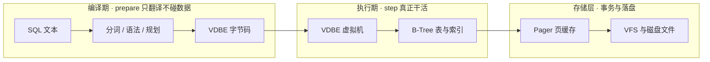
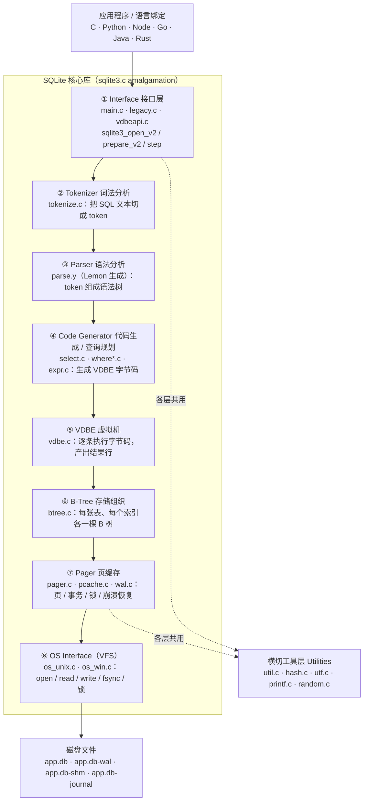
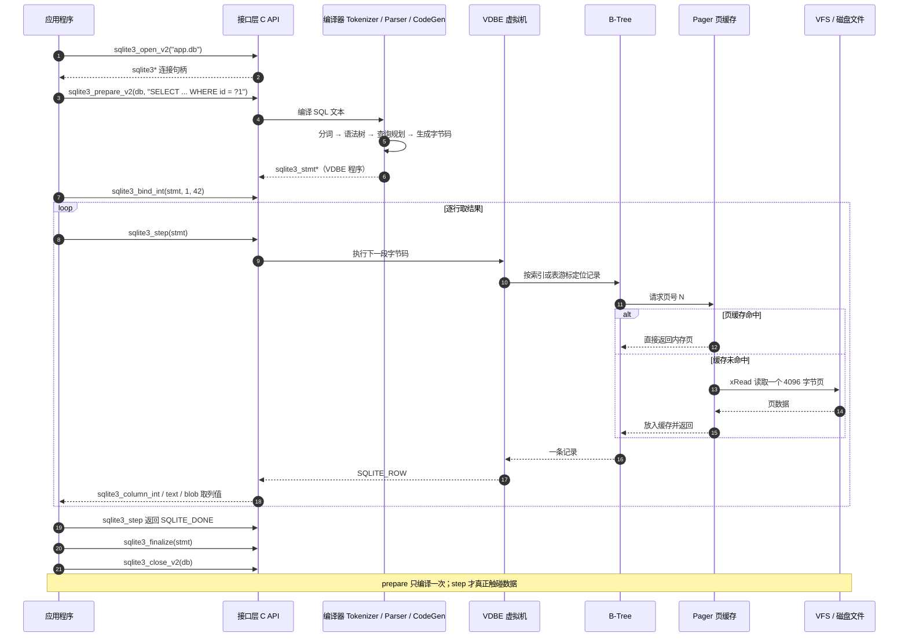
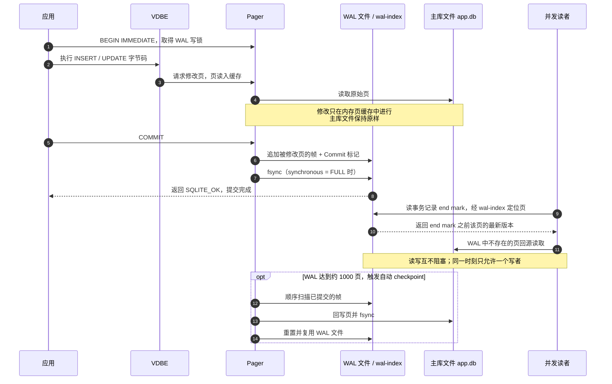

SQLite 大概是这个世界上被使用最多、却最少被"部署"的数据库：没有服务进程、没有端口、没有账号，一个 `.db` 文件就是全部。正因为它太容易上手，很多人用了多年也没弄清楚它内部到底怎么跑、API 边界在哪里、并发瓶颈为什么出现。

本文按技术文档的方式把它讲透：**它做什么 → 架构长什么样 → 一次查询的时序 → 接口有哪些 → 开发者怎么用 → 完整程序 Demo**。

> 本文核对日期：2026 年 11 月 8 日。SQLite 当前稳定版为 **3.54.1（2026-10-16）**，源码为 Public Domain。SQLite 只维护最新版本、没有 LTS 分支，但 C API 与磁盘文件格式都承诺长期向后兼容。文中架构与接口描述以 [官方文档](https://www.sqlite.org/docs.html) 为准。

## 〇、一句话和一张全景图

**一句话**：SQLite 是一个"塞进"应用进程里的 SQL 数据库引擎——没有后台服务、没有端口、没有账号，一个 `.db` 文件就是全部。

可以把它想成一家小工厂：你递进去一张写满 SQL 的纸条，**前半段**有人把纸条翻译成一张"操作清单"（字节码），**中间**有台机器照着清单一条条干活，**最后**由仓库管理员负责把改动安全地写回货架（磁盘文件）。



**先记住这条主线**：SQL 文本 → 编译成字节码 → 虚拟机执行 → B-Tree 找数据 → Pager 管事务和缓存 → VFS 读写磁盘文件。

几个词先用白话过一遍，后面遇到就不会卡住：

| 词 | 白话解释 |
| --- | --- |
| 嵌入式 / 无服务器 | 数据库引擎和你写的代码在同一个进程里，不用另开后台服务、不用连端口 |
| 字节码 | SQL 被翻译成的"小指令清单"，交给虚拟机一条条执行，类似 Java 的 class 字节码 |
| VDBE | SQLite 内部那台执行字节码的虚拟机，`step()` 就是让它往前跑一步 |
| Pager | 管"哪一页在内存、哪一页要写盘、崩溃了怎么回滚"的管家，ACID 主要靠它 |
| WAL | 写前日志：改动先追加到单独的 `-wal` 文件，不直接改主库，所以读写能并发 |
| amalgamation | 官方把全部源码合成一个 `sqlite3.c` 的发行方式，方便直接编译进项目 |
| affinity | 列的"类型偏好"：SQLite 允许往列里放不同类型的值，它只按偏好尽量转换 |

**本文路线**

| 章节 | 回答的问题 |
| --- | --- |
| 〇 | 一句话、全景图和术语速览 |
| 一 | SQLite 是做什么的？什么时候该用、不该用？ |
| 二 | 架构是什么样的？八层各自负责什么？ |
| 三 | 一条 SQL 从 API 到磁盘，时序如何？ |
| 四 | 接口是什么？C API、返回码、扩展点、语言绑定 |
| 五 | 开发者日常怎么接入、怎么避坑？ |
| 六 | 可运行的程序 Demo（CLI / C / Python / Node.js） |
| 七 | 速查表与参考链接 |

---

## 一、SQLite 是做什么的

### 1.1 一句话定义

SQLite 是一个**用 C 写成的关系型数据库引擎库**。它以静态库或动态库的形式被链接进应用程序，直接读写本地磁盘上的普通文件，提供完整的 SQL、事务（ACID）、索引、触发器、视图、外键和全文检索能力。

关键词是**嵌入式（embedded）**和**无服务器（serverless）**：这里的 "serverless" 不是云函数，而是指**没有独立的数据库服务进程**。你的进程调用 `sqlite3_*()` 函数，SQL 就在**同一个进程内**执行完毕，没有网络往返、没有 socket、没有连接池。

官方对自己的定位有一句很精准的话：

> SQLite does not compete with client/server databases. **SQLite competes with `fopen()`.**
> （SQLite 不与客户机/服务器数据库竞争，它与 `fopen()` 竞争。）

也就是说，它首先要替代的是自定义二进制文件、CSV、JSON 配置、ZIP 容器这类"自己写格式 + 自己写解析器 + 自己处理崩溃"的方案，而不是替代 PostgreSQL。

### 1.2 与 MySQL / PostgreSQL 的本质区别

| 维度 | SQLite | 客户机/服务器数据库（MySQL、PostgreSQL） |
| --- | --- | --- |
| 运行形态 | 链接进应用的库，进程内执行 | 独立服务进程，通过网络协议通信 |
| 数据存放 | 单个跨平台磁盘文件（+ WAL/journal 附属文件） | 服务端管理的数据目录、表空间 |
| 部署运维 | 零配置、无账号、无端口、无 DBA | 安装、调优、权限、备份、监控、扩容 |
| 并发模型 | **无限读者 + 同一时刻仅一个写者** | 行级锁 / MVCC，高并发写入 |
| 网络访问 | 不适合跨网络直接共享数据库文件 | 天生为多客户端跨网络访问设计 |
| 数据类型 | 动态类型（值带类型，列只有 affinity） | 严格的列类型系统 |
| 权限控制 | 无用户体系，靠文件系统权限 | 用户、角色、库表级授权 |
| 库体积 | 全功能编译通常 < 600 KiB | 服务端数十 MB 起 |
| 典型上限 | 理论单库 281 TB，实际受单文件与文件系统限制 | 可跨多机、多卷横向扩展 |

### 1.3 典型场景

- **移动端与嵌入式设备**：Android / iOS 系统自带，几乎所有 App 的本地存储、浏览器历史、微信/Chrome 的本地数据都是 SQLite。
- **桌面软件的应用文件格式**：把 `File/Open` 换成 `sqlite3_open()`，`File/Save` 甚至不再需要——每次修改本身就是一个原子事务。
- **本地缓存与离线优先**：作为远端数据库的本地副本，断网时应用仍可工作。
- **数据分析与 ETL**：把 CSV / 日志灌进内存库，用 SQL 做 join、聚合、排序，比手写脚本快得多。
- **中小型网站后端**：官方经验值是日均 10 万次请求以内的站点通常没问题；SQLite 官网自身每天处理约 40–50 万次请求。前提是**写入不密集、单机、有应用服务器做串行化**。
- **测试、教学、原型**：`sqlite3 :memory:` 一行就能起一个完整数据库，CI 里无需拉容器。
- **数据交换与长期归档**：单文件、格式公开、跨平台、向后兼容，被美国国会图书馆推荐为数字保存格式。

### 1.4 什么时候不该用

官方给的决策清单基本可以浓缩成三条：

1. **数据和应用被网络隔开**——尤其多个客户端通过网络文件系统（NFS/SMB）直接共享同一个 `.db` 文件。很多网络文件系统的锁实现有缺陷，轻则 `SQLITE_BUSY`，重则数据库损坏；WAL 模式更是明确要求所有进程在同一台主机（依赖共享内存）。
2. **大量真正并发的写入者且不能排队**——SQLite 任意时刻只有一个写者，其余写事务排队。写事务通常只有毫秒级，读多写少完全没问题，但高并发写入场景应选客户机/服务器数据库。
3. **数据接近 TB 级或需要横向扩展**——整个库挤在一个文件里，无法分片到多机多卷。

注意一个常见误解：**"网站有远程用户"不等于不能用 SQLite**。只要客户端不直接发 SQL，而是请求应用服务器、由服务器在本机操作 SQLite 文件，这仍然是可行的架构（很多 SaaS 用"每租户一个库 + 分库"的方式跑得很好）。

### 1.5 几个容易被忽略的事实

- 事务是 **ACID** 的，即使进程崩溃或断电（靠 journal / WAL 与 `fsync` 保证）。
- 数据库文件格式是**跨平台**的：32/64 位、大小端之间可直接拷贝文件使用。
- **外键默认关闭**，每个连接都要显式 `PRAGMA foreign_keys = ON`。
- 没有 `DATE`、`BOOLEAN` 真正的存储类型，只有 `NULL / INTEGER / REAL / TEXT / BLOB` 五种存储类；较新版本可用 `STRICT` 表强制列类型。
- 没有网络层，也**没有用户认证**——安全边界就是文件权限。

---

## 二、架构是什么样的：一条 SQL 穿过的八层

SQLite 的核心思路很特别：**SQL 不是被"解释执行"的，而是被编译成字节码，交给虚拟机跑**。理解这一点，整个架构就串起来了。

### 2.1 架构图



### 2.2 各层职责一览

| 层 | 主要源码 | 职责 |
| --- | --- | --- |
| ① Interface | `main.c` `legacy.c` `vdbeapi.c` | 对外暴露 `sqlite3_*` C API；管理 `sqlite3` 与 `sqlite3_stmt` 两个对象。所有公开符号以 `sqlite3_` 开头，避免命名冲突。 |
| ② Tokenizer | `tokenize.c` | 把 SQL 字符串切成 token。**有意思的是它调用 Parser，而不是被 Parser 调用**——这样更容易做到线程安全且更快。 |
| ③ Parser | `parse.y`（Lemon 生成） | 用 Lemon 解析器生成器把 token 赋予语义、构建语法树。Lemon 生成的解析器可重入、线程安全，且语法错误时能通过非终结符析构器避免内存泄漏。 |
| ④ Code Generator | `select.c` `where*.c` `expr.c` `insert.c` `update.c` `delete.c` `trigger.c` | 遍历语法树生成 VDBE 字节码；其中 `where*.c` / `select.c` 就是**查询规划器**，负责在成千上万种执行路径中选择索引与连接顺序。 |
| ⑤ VDBE | `vdbe.c` `vdbeaux.c` `vdbeapi.c` `vdbemem.c` | 执行字节码的寄存器式虚拟机。每条 opcode 完成一次打开游标、比较、取列、产出结果行等操作；值用内部 `Mem` 对象表示。内置 SQL 函数也通过回调实现。 |
| ⑥ B-Tree | `btree.c` | 每张表和每个索引各一棵 B 树，全部存放在同一个磁盘文件里；向 Pager 请求"固定大小的页"。文件格式稳定且向后兼容。 |
| ⑦ Pager | `pager.c` `pcache.c` `pcache1.c` `wal.c` | 页缓存 + 事务抽象 + 文件锁 + 原子提交/回滚。默认页大小 4096 字节，可配置为 512–65536 的 2 的幂。**ACID 主要靠这一层实现**。 |
| ⑧ OS Interface / VFS | `os_unix.c` `os_win.c` | 可替换的虚拟文件系统层：`xOpen` / `xRead` / `xWrite` / `xSync` / `xLock` 等。注册自定义 VFS 可以实现加密、内存库、压缩存储、远程存储等。 |
| Utilities | `util.c` `hash.c` `utf.c` `printf.c` `random.c` | 内存分配、符号表哈希、Unicode 转换、自带的 `printf` 实现与伪随机数发生器——不依赖宿主 C 库的这些细节，保证跨平台行为一致。 |

### 2.3 关键设计：SQL 是"被编译的程序"

两个对象撑起整个 API：

- `sqlite3`：数据库连接句柄，由 `sqlite3_open_v2()` 创建，`sqlite3_close_v2()` 销毁。
- `sqlite3_stmt`：预处理语句，**本质就是一段 VDBE 字节码程序的容器**，由 `sqlite3_prepare_v2()` 编译产生，`sqlite3_finalize()` 销毁。

所以 `prepare` = 编译，`step` = 让虚拟机跑到"产出一行结果 / 跑完 / 出错 / 被中断"为止，`column_*` = 从当前结果行取值。这也解释了为什么**复用预处理语句**（`reset` 后重新 `bind`）比反复拼接 SQL 字符串快得多：编译和查询规划的开销只付一次。

### 2.4 存储与事务：B-Tree → Pager → VFS

数据库被切成等长的**页**。`sqlite_schema` 系统表本身也是一棵 B 树，记录每张表的根页号。B-Tree 只跟 Pager 打交道："给我第 N 页"；Pager 决定这页在不在内存缓存、要不要读盘、要不要写日志、要不要加解锁；VFS 才是真正发起系统调用的那一层。

事务有两种实现模式：

| | 回滚日志（rollback journal，默认） | WAL（Write-Ahead Log，3.7.0+） |
| --- | --- | --- |
| 做法 | 把**原始页**写入 `app.db-journal`，然后把新内容直接写进 `app.db` | 原始内容留在 `app.db`，**把修改后的页追加**到 `app.db-wal` |
| COMMIT 的标志 | 删除 journal 文件 | 在 WAL 末尾追加一条 commit 记录 |
| 回滚 | 把 journal 里的原始页回放 | 忽略 WAL 中未提交的帧 |
| 读写并发 | 写者需要 EXCLUSIVE 锁，读写互相阻塞 | **读者不阻塞写者，写者不阻塞读者** |
| 附属文件 | `-journal` | `-wal` + `-shm`（wal-index 共享内存） |
| 额外操作 | 无 | **checkpoint**：默认 WAL 达到约 1000 页时自动把帧回写主库 |
| 限制 | — | 不支持网络文件系统；只读打开需要能写 `-shm`；只读密集场景可能略慢 1–2% |

WAL 的锁状态演进（回滚日志模式）：`UNLOCKED → SHARED（读）→ RESERVED（准备写）→ PENDING（等现有读者退出）→ EXCLUSIVE（写库文件）`。WAL 模式则用 `wal-index` 上的写锁，只保证**同一时刻一个写者**。

---

## 三、时序：从 API 调用到磁盘字节

### 3.1 一次 SELECT 的完整链路



要点：**`prepare` 不读数据**，只做词法、语法、查询规划和字节码生成；真正的 I/O 全部发生在 `step` 里，而且结果行是**流式**产出的——`sqlite3_step()` 每返回一次 `SQLITE_ROW`，VM 就停在那里等你取列值，不必把整个结果集物化到内存。

### 3.2 一次写事务的提交（WAL 模式）



这里有三个容易踩坑的点：

1. **读事务的 end mark**：读者开始时记下 WAL 中最后一个有效 commit 的位置，整个事务期间都只看这个快照，因此天然获得一致性视图。
2. **长事务会卡住 checkpoint**：checkpoint 不能越过任何活跃读者的 end mark，长时间不结束的读事务会让 `-wal` 文件持续膨胀、读性能下降。
3. **持久化折衷**：WAL 模式下 `PRAGMA synchronous = NORMAL` 时提交不 `fsync`（只在 checkpoint 时 sync），速度快，但断电可能丢失最近若干事务；`FULL` 才保证每次提交落盘。

### 3.3 把架构"看"出来

架构不是抽象的，CLI 可以直接把查询规划和字节码打印出来：

```sql
EXPLAIN QUERY PLAN SELECT * FROM users WHERE age >= 26;
-- 典型输出：SEARCH users USING INDEX idx_users_age (age>?)

EXPLAIN SELECT * FROM users WHERE age >= 26;
-- 逐行输出 VDBE 指令：OpenRead / SeekGE / Column / ResultRow / Next / Halt ...
```

`EXPLAIN QUERY PLAN` 看的是第 ④ 层（查询规划器）的决策，`EXPLAIN` 看的是第 ⑤ 层（VDBE）真正要执行的程序。调优时先跑这两条，比凭感觉加索引靠谱得多。

---

## 四、接口是什么

### 4.1 核心：两个对象、八个方法

官方《Introduction To The SQLite C/C++ Interface》把核心接口概括成 **2 个对象 + 8 个方法**。整套库有 225 个以上 API，但绝大多数应用只用到这一小组：

| 对象 / 方法 | 作用 |
| --- | --- |
| `sqlite3` | 数据库连接对象 |
| `sqlite3_stmt` | 预处理语句对象（VDBE 程序容器） |
| `sqlite3_open()` | 打开/创建数据库，`sqlite3` 的构造函数（新代码用 `sqlite3_open_v2()`） |
| `sqlite3_prepare()` | 把 SQL 编译成字节码，`sqlite3_stmt` 的构造函数（新代码**必须**用 `sqlite3_prepare_v2()`） |
| `sqlite3_bind()` | 把应用数据绑定到 SQL 参数 |
| `sqlite3_step()` | 推进到下一行结果或执行完成 |
| `sqlite3_column()` | 读取当前结果行的列值（函数族，见下） |
| `sqlite3_finalize()` | 销毁 `sqlite3_stmt` |
| `sqlite3_close()` | 销毁 `sqlite3`（推荐 `sqlite3_close_v2()`） |
| `sqlite3_exec()` | 便捷包装器，一次完成 prepare/step/column/finalize，适合 DDL 和多语句脚本 |

标准调用顺序：

> `open` → `prepare_v2` → `bind_*` → `step`（循环）→ `column_*` → `reset` / `finalize` → `close`

注意 `sqlite3_bind()` 和 `sqlite3_column()` 都是**概念名**，实际是一族函数：`sqlite3_bind_int/int64/double/text/text16/blob/null/zeroblob`，`sqlite3_column_int/int64/double/text/blob/bytes/type/count/name/...`。

### 4.2 C API 全景（按用途分组）

| 类别 | 主要 API | 说明 |
| --- | --- | --- |
| 连接生命周期 | `sqlite3_open_v2` `sqlite3_close_v2` `sqlite3_errmsg` `sqlite3_errstr` `sqlite3_extended_errcode` `sqlite3_db_config` `sqlite3_config` `sqlite3_initialize` | `open_v2` 可指定 READONLY / CREATE / URI / NOMUTEX 等标志 |
| 编译与执行 | `sqlite3_prepare_v2` `sqlite3_prepare_v3` `sqlite3_step` `sqlite3_reset` `sqlite3_finalize` `sqlite3_exec` `sqlite3_get_table` | `get_table` 已属遗留接口，新代码少用 |
| 参数绑定 | `sqlite3_bind_*` `sqlite3_bind_parameter_count` `sqlite3_bind_parameter_index` `sqlite3_bind_parameter_name` `sqlite3_clear_bindings` | **防 SQL 注入的唯一正确姿势**；支持 `?NNN`、`:name`、`@name`、`$name` |
| 结果读取 | `sqlite3_column_*` `sqlite3_column_count` `sqlite3_data_count` `sqlite3_column_name` `sqlite3_column_decltype` | `sqlite3_column_text` 返回 `const unsigned char*`，生命周期到下次 `step` / `finalize` |
| 状态与元数据 | `sqlite3_changes` `sqlite3_total_changes` `sqlite3_last_insert_rowid` `sqlite3_db_filename` `sqlite3_txn_state` `sqlite3_stmt_readonly` `sqlite3_sql` `sqlite3_expanded_sql` | `expanded_sql` 能看到绑定后的完整 SQL，调试很有用 |
| 并发控制 | `sqlite3_busy_timeout` `sqlite3_busy_handler` `sqlite3_interrupt` `sqlite3_progress_handler` `sqlite3_unlock_notify` | `busy_timeout` 几乎是所有多连接应用的必配项 |
| 扩展能力 | `sqlite3_create_function_v2` `sqlite3_create_window_function` `sqlite3_create_collation` `sqlite3_create_module` `sqlite3_vfs_register` `sqlite3_load_extension` `sqlite3_set_authorizer` | 自定义 SQL 函数/聚合、排序规则、虚拟表（如 FTS5）、VFS、可加载扩展、SQL 授权 |
| 回调与观测 | `sqlite3_trace_v2` `sqlite3_update_hook` `sqlite3_preupdate_hook` `sqlite3_commit_hook` `sqlite3_rollback_hook` `sqlite3_wal_hook` | 做审计、埋点、缓存失效、数据同步（session 扩展）时用 |
| 运维与备份 | `sqlite3_backup_init/step/finish` `sqlite3_serialize` `sqlite3_deserialize` `sqlite3_wal_checkpoint_v2` `sqlite3_wal_autocheckpoint` | 在线备份 API 可在库被写入时安全复制 |
| 工具与版本 | `sqlite3_mprintf` `sqlite3_free` `sqlite3_malloc64` `sqlite3_libversion` `sqlite3_sourceid` `sqlite3_compileoption_used` | 检查编译选项（如是否启用了 FTS5、JSON1） |

### 4.3 返回码：驱动控制流

C API 不用异常，靠整型返回码：

| 常量 | 值 | 含义 |
| --- | --- | --- |
| `SQLITE_OK` | 0 | 成功 |
| `SQLITE_ROW` | 100 | `step` 产出了一行结果 |
| `SQLITE_DONE` | 101 | `step` 执行完毕，没有更多行 |
| `SQLITE_BUSY` | 5 | 数据库文件被其他连接锁住 |
| `SQLITE_LOCKED` | 6 | 同一连接内表/模式被锁 |
| `SQLITE_CONSTRAINT` | 19 | 违反 UNIQUE / NOT NULL / 外键等约束 |
| `SQLITE_IOERR` | 10 | 底层 I/O 错误 |
| `SQLITE_CORRUPT` | 11 | 数据库文件损坏 |
| `SQLITE_ERROR` | 1 | 通用 SQL 错误 |
| `SQLITE_MISUSE` | 21 | API 被错误使用（如对象已 finalize） |

用 `sqlite3_extended_result_codes(db, 1)` 可打开**扩展返回码**（如 `SQLITE_CONSTRAINT_UNIQUE`、`SQLITE_BUSY_SNAPSHOT`），便于精确处理；用 `sqlite3_errstr(rc)` 可以把数字转成文字。

### 4.4 除了 C API，还有哪些"接口"

| 层面 | 接口形态 |
| --- | --- |
| **SQL 本身** | DDL/DML、`PRAGMA`（`journal_mode`、`foreign_keys`、`busy_timeout`、`synchronous`、`page_size`…）、`ATTACH`、虚拟表语法 |
| **CLI** | `sqlite3` 命令行，点命令 `.schema` `.mode` `.backup` `.import` `.eqp` `.recover`；也支持 URI 文件名（`file:app.db?mode=ro&immutable=1`） |
| **C/C++** | `sqlite3.h`（amalgamation `sqlite3.c` 单文件编译是最常见的集成方式） |
| **Python** | 标准库 `sqlite3`（DB-API 2.0 / PEP 249），免安装 |
| **Node.js** | 内置 `node:sqlite`（Node.js 22.5.0+，`DatabaseSync`，目前仍标注为活跃开发中）、`better-sqlite3`（同步）、`sqlite3`（异步） |
| **Go** | `modernc.org/sqlite`（纯 Go、无 CGO）、`mattn/go-sqlite3` + `database/sql` |
| **Java / Rust / C#** | `xerial/sqlite-jdbc`、`rusqlite` / `sqlx`、`Microsoft.Data.Sqlite`（EF Core 默认） |
| **浏览器 / WASM** | SQLite 官方 WASM + OPFS、`sql.js` |
| **扩展机制** | SQL 函数、聚合与窗口函数、排序规则、虚拟表模块、VFS、可加载 `.so/.dll` 扩展 |

所有语言的驱动，本质上都是把上面那"两个对象八个方法"包了一层。理解了 C API，换语言只是换语法。

---

## 五、开发者如何使用：实践清单

### 5.1 接入方式三选一

1. **系统库链接**：Linux 装 `libsqlite3-dev` / `sqlite-devel`，代码 `#include <sqlite3.h>`，链接 `-lsqlite3`。简单，但版本受系统限制。
2. **amalgamation 单文件编译**（推荐给需要固定版本、自定义编译选项的项目）：从官网下载 `sqlite3.c` + `sqlite3.h`，和自己的代码一起编译。想开 FTS5、JSON、加密就在这里加宏。
3. **语言绑定 / ORM**：直接用标准库或驱动，注意驱动内嵌的 SQLite 版本可能较旧。

### 5.2 连接初始化模板

每个连接打开后，通常要跑这几条 **PRAGMA**（PRAGMA 多数是连接级设置，不是全局的）：

```sql
PRAGMA journal_mode = WAL;          -- 读写并发；设置会持久化到数据库文件
PRAGMA synchronous = NORMAL;        -- WAL 下的性能/耐久性折衷，FULL 更保险
PRAGMA foreign_keys = ON;           -- 默认 OFF，必须逐连接开启
PRAGMA busy_timeout = 5000;         -- 遇锁等待 5 秒而不是立刻 SQLITE_BUSY
PRAGMA temp_store = MEMORY;         -- 排序等临时表放内存，减少磁盘 I/O
```

线程方面：SQLite 支持多线程，但**一个 `sqlite3*` 连接不要跨线程同时使用**（除非编译时选了 Serialized 模式）。通用做法是每个线程一个连接，或用一个连接 + 队列串行化。

### 5.3 事务与并发

- **显式事务包住批量写**：不开事务时每条 INSERT 都是一个独立事务（一次 fsync），1 万条插入可能慢几十倍。`BEGIN` … `COMMIT` 之后通常从秒级降到毫秒级。
- **用 `BEGIN IMMEDIATE` 避免升级死锁**：先读后写的事务如果先用 `BEGIN`（DEFERRED），两个连接可能同时持有 SHARED 锁再都试图升级，直接 `SQLITE_BUSY_SNAPSHOT`。
- **配置 `busy_timeout`**，并对 `SQLITE_BUSY` / `SQLITE_BUSY_SNAPSHOT` 做有限次重试。
- **写事务尽量短**：不要在事务里做网络请求、用户交互或大计算。
- **WAL 下注意 checkpoint**：避免长时间不结束的读事务；必要时用 `sqlite3_wal_checkpoint_v2()` 在空闲线程主动 checkpoint。
- **备份用在线备份 API**，不要直接 `cp` 一个正在被写的 `.db` 文件（WAL 模式下 `.db` + `-wal` 必须一起处理）。

### 5.4 性能要点

- 复用 `sqlite3_stmt`：`step` 到 `SQLITE_DONE` 后 `sqlite3_reset()` + 重新 `bind`，避免重复编译。
- 用 `EXPLAIN QUERY PLAN` 确认索引命中；复合索引遵循最左前缀；写密集场景别过度建索引。
- 大批量导入用事务 + 预处理语句 + `PRAGMA synchronous = OFF`（仅在可重建的临时库上）。
- 定期 `ANALYZE` 让查询规划器拿到统计信息；碎片多时 `VACUUM`。
- 结果集很大时利用 `step` 的流式特性，别一次性 `fetchall()` 到内存。

### 5.5 常见坑

| 坑 | 后果 / 修正 |
| --- | --- |
| 字符串拼接 SQL | SQL 注入 + 每次重新编译。一律用 `sqlite3_bind_*` / `?` 占位符 |
| 忘记 `sqlite3_finalize()` | 内存泄漏，且 `sqlite3_close()` 会返回 `SQLITE_BUSY` 而关不掉（用 `close_v2` 可缓解） |
| 忘记开 `foreign_keys` | 外键约束静默失效 |
| 把 `.db` 放 NFS / SMB 共享 | 锁不可靠，可能损坏；WAL 根本不支持 |
| 把 SQLite 当"轻量 MySQL"多机共享 | 并发写瓶颈、无权限体系、无网络层 |
| 混淆 `SQLITE_ROW` / `SQLITE_DONE` | `step` 循环条件写错，导致少读一行或死循环 |
| 使用 `sqlite3_column_text()` 返回的指针超过生命周期 | 下次 `step` / `reset` / `finalize` 后指针失效，需要自己复制字符串 |
| 忽略 `PRAGMA journal_mode=WAL` 的返回值 | 该 PRAGMA 会返回一行结果，某些驱动下需要 fetch 掉 |
| 依赖隐式类型 | 用 `STRICT` 表或在应用层显式校验 |

---

## 六、程序 Demo

以下示例基于同一张 `users` 表，可直接复制运行。

### 6.1 Demo 0：CLI 五分钟上手

```bash
# 安装
# Debian/Ubuntu: sudo apt install sqlite3 libsqlite3-dev
# RHEL/CentOS : sudo dnf install sqlite sqlite-devel
# macOS       : brew install sqlite3
# Windows     : 官网下载 sqlite-tools 压缩包，解压即用
sqlite3 --version

sqlite3 demo.db
```

进入交互式 shell 后：

```sql
-- 显示列名，让结果带表头
.headers on
-- 用对齐的表格形式输出，方便阅读
.mode column
-- 切换到 WAL 模式：读写可以并发，这个设置会写进数据库文件
PRAGMA journal_mode = WAL;
-- 打开外键约束（SQLite 默认关闭，而且是每个连接各自设置）
PRAGMA foreign_keys = ON;

-- 建表：id 是自增主键，name 不能为空，created_at 默认取当前时间
CREATE TABLE users (
  id         INTEGER PRIMARY KEY,
  name       TEXT NOT NULL,
  age        INTEGER,
  created_at TEXT DEFAULT CURRENT_TIMESTAMP
);
-- 给 age 建索引，按年龄范围查询时就不用全表扫描
CREATE INDEX idx_users_age ON users(age);

-- 一次插入三行示例数据
INSERT INTO users(name, age) VALUES ('Alice', 31), ('Bob', 25), ('Carol', 28);

-- 查询：只看 age 不小于 26 的人，按年龄从小到大排
SELECT id, name, age FROM users WHERE age >= 26 ORDER BY age;
-- 看查询规划器打算怎么执行（是否用上索引），并不真正跑这条查询
EXPLAIN QUERY PLAN SELECT * FROM users WHERE age >= 26;

-- 查看 users 表的建表语句
.schema users
-- 在线备份到 backup.db，即使库正在被写也安全
.backup backup.db
-- 退出交互式 shell
.quit
```

### 6.2 Demo 1：C 语言完整程序（原生 API）

这个例子把「打开 → PRAGMA/DDL → 显式事务 → prepare/bind/step 批量插入 → 查询取列 → 状态接口 → 释放」整条链路走了一遍，是理解第二、三、四章最好的方式。

保存为 `demo.c`：

```c
/* demo.c — SQLite C API 完整示例，不依赖任何前置步骤：表不存在会自动创建
 * 编译（链接系统库）: cc -std=c11 -Wall -Wextra -O2 demo.c -lsqlite3 -o demo
 * 编译（amalgamation）: cc -std=c11 -O2 demo.c sqlite3.c -o demo -lpthread -ldl -lm
 * 运行: ./demo
 */
#include <stdio.h>       /* printf / fprintf：打印结果和错误信息 */
#include <sqlite3.h>     /* SQLite 全部公开 API 的声明 */

/* 执行"不返回结果集"的 SQL（DDL、PRAGMA、BEGIN、COMMIT），并统一处理错误 */
static int exec_sql(sqlite3 *db, const char *sql) {
    char *err = NULL;                                       /* 出错时 SQLite 把错误文本放在这里 */
    int rc = sqlite3_exec(db, sql, NULL, NULL, &err);       /* 一次执行一条或多条 SQL，不需要返回行 */
    if (rc != SQLITE_OK) {                                  /* 任何非 OK 都算失败 */
        fprintf(stderr, "SQL failed (%d): %s\n", rc,       /* 打印错误码 */
                err ? err : sqlite3_errmsg(db));            /* 优先用 exec 给的文本，否则取连接错误 */
        sqlite3_free(err);                                  /* 错误文本由 SQLite 分配，必须释放 */
    }
    return rc;                                              /* 把结果码交回调用方决定是否继续 */
}

/* 打印"哪一步失败 + 当前错误信息"，减少重复代码 */
static void fail(sqlite3 *db, const char *what) {
    fprintf(stderr, "%s: %s\n", what, sqlite3_errmsg(db));  /* errmsg 给出人类可读的原因 */
}

int main(void) {
    sqlite3 *db = NULL;          /* 数据库连接句柄，先置空便于出错时安全清理 */
    sqlite3_stmt *ins = NULL;    /* 插入语句（VDBE 字节码程序） */
    sqlite3_stmt *sel = NULL;    /* 查询语句（同上） */
    int rc;                      /* 统一保存每次 API 调用的返回码 */

    /* ① 打开连接：文件不存在就创建，允许读写 */
    rc = sqlite3_open_v2("demo.db", &db,
                         SQLITE_OPEN_READWRITE | SQLITE_OPEN_CREATE, NULL);
    if (rc != SQLITE_OK) {                                  /* 打不开通常是路径或权限问题 */
        fprintf(stderr, "open: %s\n", db ? sqlite3_errmsg(db) : "out of memory");
        sqlite3_close_v2(db);                               /* 即使失败也要释放已分配的句柄 */
        return 1;
    }
    sqlite3_busy_timeout(db, 5000);         /* 遇到锁最多等 5 秒，而不是立刻返回 SQLITE_BUSY */
    sqlite3_extended_result_codes(db, 1);  /* 打开扩展错误码，便于区分具体失败原因 */

    /* ② 建表与 PRAGMA：拼成一条多语句字符串交给 sqlite3_exec */
    const char *ddl =
        "PRAGMA journal_mode=WAL;"                        /* 用 WAL，读写可并发 */
        "PRAGMA foreign_keys=ON;"                         /* 打开外键（默认关闭） */
        "CREATE TABLE IF NOT EXISTS users("               /* IF NOT EXISTS 保证重复运行也不报错 */
        "  id INTEGER PRIMARY KEY,"                       /* 自增主键 */
        "  name TEXT NOT NULL,"                           /* 姓名非空 */
        "  age INTEGER,"                                  /* 年龄 */
        "  created_at TEXT DEFAULT CURRENT_TIMESTAMP);"   /* 默认写入当前时间 */
        "CREATE INDEX IF NOT EXISTS idx_users_age ON users(age);"; /* 建年龄索引 */
    if (exec_sql(db, ddl) != SQLITE_OK) goto out;         /* DDL 失败就没必要继续 */

    /* ③ 显式事务 + 预处理语句 + 参数绑定，复用同一条 stmt 插入多行 */
    if (exec_sql(db, "BEGIN IMMEDIATE;") != SQLITE_OK) goto out; /* 先拿写锁，避免升级死锁 */

    const char *names[] = {"Alice", "Bob", "Carol"};      /* 待插入的姓名 */
    const int   ages[]  = {31, 25, 28};                   /* 与姓名一一对应的年龄 */

    rc = sqlite3_prepare_v2(db,                           /* 把 SQL 编译成 VDBE 字节码 */
             "INSERT INTO users(name, age) VALUES(?1, ?2);", -1, &ins, NULL);
    if (rc != SQLITE_OK) { fail(db, "prepare insert"); goto out; } /* 语法错或表不存在 */

    for (int i = 0; i < 3; i++) {                         /* 三行数据，复用同一条预处理语句 */
        sqlite3_bind_text(ins, 1, names[i], -1, SQLITE_TRANSIENT); /* ?1 绑字符串，TRANSIENT 表示 SQLite 自己拷贝一份 */
        sqlite3_bind_int(ins, 2, ages[i]);                /* ?2 绑整数 */
        rc = sqlite3_step(ins);                           /* 执行这条 INSERT */
        if (rc != SQLITE_DONE) { fail(db, "step insert"); goto out; } /* 非 DONE 说明插入失败 */
        sqlite3_reset(ins);                               /* 复位执行状态，语句可以再用 */
        sqlite3_clear_bindings(ins);                      /* 清空绑定值，避免沿用上一次的数据 */
    }
    sqlite3_finalize(ins);                                /* 插入语句用完，释放 */
    ins = NULL;                                           /* 置空，防止 out 处重复释放 */

    if (exec_sql(db, "COMMIT;") != SQLITE_OK) goto out;   /* 提交：三行一起生效，只写一次 WAL */

    /* ④ 查询：step 到 SQLITE_ROW，再用 column_* 逐列取值 */
    rc = sqlite3_prepare_v2(db,                           /* 编译 SELECT，同样只编译不读数据 */
             "SELECT id, name, age FROM users WHERE age >= ?1 ORDER BY age;",
             -1, &sel, NULL);
    if (rc != SQLITE_OK) { fail(db, "prepare select"); goto out; }
    sqlite3_bind_int(sel, 1, 26);                         /* ?1 绑定查询阈值 26 */

    printf("%-4s %-10s %-4s\n", "id", "name", "age");     /* 打印表头 */
    while ((rc = sqlite3_step(sel)) == SQLITE_ROW) {      /* 每调用一次产出一行，DONE 表示结束 */
        const unsigned char *name = sqlite3_column_text(sel, 1); /* 取第 1 列 name，指针只在本次 step 内有效 */
        printf("%-4d %-10s %-4d\n",
               sqlite3_column_int(sel, 0),                 /* 第 0 列 id，按整数取 */
               name ? (const char *)name : "(null)",       /* TEXT 可能是 NULL，需要兜底 */
               sqlite3_column_int(sel, 2));                /* 第 2 列 age，按整数取 */
    }
    if (rc != SQLITE_DONE) fail(db, "step select");        /* 不是 DONE 说明中途出错 */

    /* ⑤ 状态接口：拿自增 id 与最近一次 DML 的影响行数 */
    printf("last_insert_rowid = %lld, changes = %d\n",
           (long long)sqlite3_last_insert_rowid(db),       /* 最后插入的自增主键 */
           sqlite3_changes(db));                           /* 最近一条 INSERT/UPDATE/DELETE 影响的行数 */

out:
    /* ⑥ 逆序释放：先语句后连接；未提交的事务会在关闭时自动回滚 */
    if (sel) sqlite3_finalize(sel);                       /* 释放查询语句 */
    if (ins) sqlite3_finalize(ins);                       /* 出错跳转时插入语句可能还没释放 */
    if (db)  sqlite3_close_v2(db);                        /* close_v2 允许延迟清理未释放的语句 */
    return 0;                                             /* 结束进程 */
}
```

编译运行：

```bash
cc -std=c11 -Wall -Wextra -O2 demo.c -lsqlite3 -o demo
./demo
```

预期输出（首次运行，按 age 升序）：

```text
id   name       age
3    Carol      28
1    Alice      31
last_insert_rowid = 3, changes = 1
```

> 重复运行会继续插入数据，可先删除 `demo.db`、`demo.db-wal`、`demo.db-shm` 再跑。WAL 模式下这三个文件是数据库的一部分，拷贝时必须一起处理。

**这段代码对应架构图里的哪几层？** `sqlite3_prepare_v2` 走 ①→④ 生成 VDBE 字节码；`sqlite3_step` 走 ⑤→⑥→⑦→⑧ 真正读盘；`sqlite3_bind_*` 与 `sqlite3_column_*` 分别位于虚拟机的输入和输出两端。

### 6.3 Demo 2：Python（DB-API，日常开发最常用）

```python
# demo.py — 只用 Python 标准库，无需 pip install；不依赖前面任何步骤
import sqlite3                       # 标准库里的 SQLite 驱动，遵循 DB-API 2.0
from contextlib import closing      # 离开 with 时自动调用 conn.close()

# 打开（或创建）demo.db；closing 保证最后一定关闭连接
with closing(sqlite3.connect("demo.db")) as conn:
    conn.row_factory = sqlite3.Row  # 让结果行能像字典一样用 row["name"] 取值

    conn.execute("PRAGMA journal_mode=WAL")   # 打开 WAL，读写可并发
    conn.execute("PRAGMA foreign_keys=ON")    # 打开外键（默认关闭）
    conn.execute("PRAGMA busy_timeout=5000")  # 遇锁等待 5 秒再报错

    # 建表：IF NOT EXISTS 保证本示例可以独立、重复运行
    # id 是自增主键，name 非空，created_at 默认取当前时间
    conn.execute("""CREATE TABLE IF NOT EXISTS users (
                        id INTEGER PRIMARY KEY,
                        name TEXT NOT NULL,
                        age INTEGER,
                        created_at TEXT DEFAULT CURRENT_TIMESTAMP
                    )""")
    conn.execute("CREATE INDEX IF NOT EXISTS idx_users_age ON users(age)")  # 建年龄索引
    conn.commit()                                          # 提交建表，避免挂在未结束的事务里

    # with conn 是事务上下文：正常结束自动 COMMIT，抛异常自动 ROLLBACK
    with conn:
        conn.executemany(                                  # 一次插入多行，内部复用预处理语句
            "INSERT INTO users(name, age) VALUES(?, ?)",  # ? 是占位符，值由第二个参数绑定
            [("Dave", 40), ("Eve", 22)],                  # 每行对应一组绑定值
        )

    # 参数化查询：值走绑定，永远不要用 f-string 拼 SQL（防注入，也能复用编译结果）
    rows = conn.execute(
        "SELECT id, name, age FROM users WHERE age >= ? ORDER BY age",
        (26,),                                            # 单元素元组，逗号不能少
    ).fetchall()                                          # 一次性取出全部结果行
    for row in rows:                                      # 逐行打印
        print(row["id"], row["name"], row["age"])         # 用列名取值，不依赖列顺序

    # 扩展接口：注册自定义 SQL 函数，对应 C 的 sqlite3_create_function_v2
    conn.create_function("mask_name", 1,                 # 函数名 mask_name，接受 1 个参数
                         lambda s: (s[0] + "**") if s else "")  # 只留首字符，其余打码
    print(conn.execute("SELECT mask_name(name) FROM users LIMIT 1")  # 在 SQL 里直接调用
          .fetchone()[0])                                # 取第一行第一列
```

运行：`python demo.py`（Python 3 自带 `sqlite3`，不需要装任何东西）。

几个语言层面的注意点：Python 3.12+ 可用 `sqlite3.connect(..., autocommit=...)` 精确控制事务；`with conn:` **不会关闭连接**，所以需要 `contextlib.closing`；`executemany` 内部仍然是 prepare + 循环 step。

### 6.4 Demo 3：Node.js 内置模块（22.5+）

```js
// demo.mjs — Node.js 22.5+ 内置模块，无需 npm install；不依赖前面任何步骤
import { DatabaseSync } from 'node:sqlite';  // 内置同步驱动，必须用 node: 前缀导入

const db = new DatabaseSync('demo.db', { timeout: 5000 }); // 打开/创建库，遇锁最多等 5 秒

db.exec('PRAGMA journal_mode=WAL;');         // 打开 WAL，读写可并发
db.exec('PRAGMA foreign_keys=ON;');          // 打开外键（默认关闭）

// 建表：IF NOT EXISTS 保证本示例可以独立、重复运行
db.exec(`CREATE TABLE IF NOT EXISTS users (
  id INTEGER PRIMARY KEY,
  name TEXT NOT NULL,
  age INTEGER,
  created_at TEXT DEFAULT CURRENT_TIMESTAMP
);`);
db.exec('CREATE INDEX IF NOT EXISTS idx_users_age ON users(age);'); // 建年龄索引

const insert = db.prepare('INSERT INTO users(name, age) VALUES(?, ?)'); // 编译 SQL，得到可复用语句
insert.run('Frank', 33);                    // 绑定两个参数并执行一次 step

const query = db.prepare('SELECT id, name, age FROM users WHERE age >= ?'); // 编译查询语句
console.log(query.all(26));                 // 绑定 26，一次性取出所有结果行

db.close();                                // 关闭连接（对应 sqlite3_close_v2）
```

运行：`node demo.mjs`（Node.js 22.5+；早期 22.x 需要加 `--experimental-sqlite`，该模块目前仍标注为"活跃开发中"）。

`DatabaseSync.exec()` 是对 `sqlite3_exec()` 的包装，`prepare()` 是对 `sqlite3_prepare_v2()` 的包装，`close()` 对应 `sqlite3_close_v2()`——名字换了，模型完全一致。

---

## 七、速查表与小结

**API 速查**

```text
open_v2 → busy_timeout → exec(DDL/PRAGMA)
  → prepare_v2(sql) → bind_* → step
      ├─ SQLITE_ROW  → column_* → 继续 step
      └─ SQLITE_DONE → reset（复用）或 finalize
  → exec(BEGIN IMMEDIATE / COMMIT) 包住批量写
  → finalize 全部 stmt → close_v2
```

**架构速记**

```text
SQL 文本 → [编译期] Tokenizer → Parser(Lemon) → CodeGen/查询规划
        → sqlite3_stmt（VDBE 字节码）
        → [执行期] VDBE → B-Tree → Pager(页缓存/事务/锁) → VFS → 磁盘文件
        → [结果期] SQLITE_ROW → column_* → SQLITE_DONE
```

**一句话总结**：SQLite 把一整套 SQL 数据库引擎压缩成一个进程内的库，靠"SQL 编译成字节码 + 单文件 B-Tree + Pager 事务"这三层设计，换来零部署、ACID 和极小体积；它的代价是**单写者、无网络、无权限体系**。理解 `sqlite3` / `sqlite3_stmt` 两个对象和 `prepare → step → finalize` 这条主线，就掌握了它 90% 的接口与行为。

## 参考链接

- [SQLite 官网](https://www.sqlite.org/) · [当前版本 3.54.1](https://www.sqlite.org/changes.html)
- [Architecture of SQLite](https://www.sqlite.org/arch.html) — 本文第二章依据
- [An Introduction To The SQLite C/C++ Interface](https://www.sqlite.org/cintro.html) — 两对象八方法
- [C/C++ Interface Specification](https://www.sqlite.org/c3ref/intro.html) · [全部函数列表](https://www.sqlite.org/c3ref/funclist.html)
- [SQLite In 5 Minutes Or Less](https://www.sqlite.org/quickstart.html)
- [Write-Ahead Logging](https://www.sqlite.org/wal.html) · [Atomic Commit](https://www.sqlite.org/atomiccommit.html)
- [Appropriate Uses For SQLite](https://www.sqlite.org/whentouse.html) · [VFS](https://www.sqlite.org/vfs.html) · [VDBE Opcodes](https://www.sqlite.org/opcode.html)
- [Command Line Shell](https://www.sqlite.org/cli.html) · [File Format](https://www.sqlite.org/fileformat2.html) · [Query Planner](https://www.sqlite.org/optoverview.html)
