这篇文章只讲一件事：**一个大文件用 S3 分片上传（Multipart Upload）传进 Ceph，从客户端到磁盘，中间到底发生了什么**。

先给一个贯穿全文的比喻，后面每一层都会回到它：

> 你要寄一套 20 册的百科全书给朋友，但快递公司规定「单件不能超过 5 册」。于是你把书装进 4 个箱子，每个箱子贴一个编号（1、2、3、4），让 4 个快递员同时出发。到了中转站，工作人员**不拆箱、不倒书**，只在总台账上写一行：「1 号箱放第 1～5 册，2 号箱放第 6～10 册……」。朋友收到时拿着这张台账，按页码去对应的箱子里取书。
>
> 这里的「台账」就是 Ceph 的 **manifest（清单）**。最反直觉、也最关键的结论是：**Ceph 在 Complete 阶段根本不复制、不搬运任何一个分片的数据，它只写一张台账。**

基于本地 `D:\Codes\GitHub\community\ceph` 的 main 分支源码（commit `241006abdaa`，`git describe` 为 `v22.0.0-595-g241006abdaa`，阅读日期 2026 年 11 月 9 日）。这一版 RGW 已经完成 SAL 化重构，很多老博客里的类名（例如 `RGWMPEntry`、`RGWInitMultipartUpload_ObjStore_S3`）已经不存在，本文全部以当前源码为准，并在关键处标出文件路径和函数名。

## 〇、先看一张全景架构图

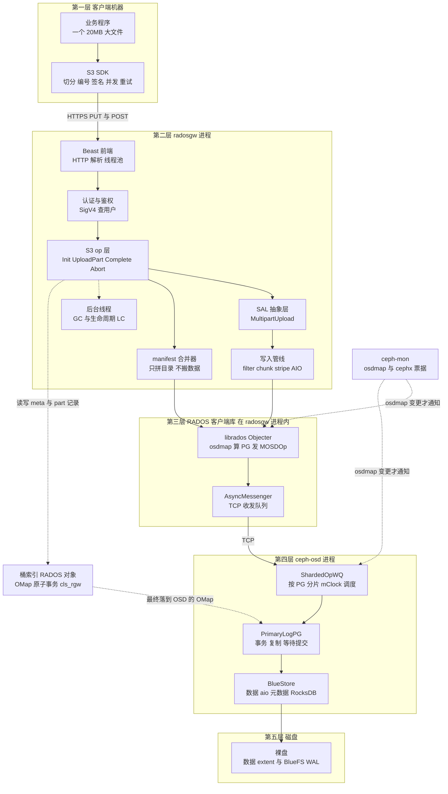

一句话概括：**SDK 负责「拆」，RGW 负责「记账 + 拼台账」，RADOS/Objecter 负责「算数据该去哪」，OSD 负责「排队 + 复制」，BlueStore 负责「把字节真正写进磁盘」；mon 全程不碰数据。**

## 阅读准备：先认识这些名词

面向零基础，先解释后面会反复出现的词。看不懂也没关系，遇到时回来查。

| 名词 | 是什么 | 为什么需要它 |
| --- | --- | --- |
| S3 对象 / key | 对象存储里的「文件」和它的名字，例如 `videos/demo.mp4` | 对象存储没有目录树，key 只是一个字符串 |
| bucket（桶） | 装对象的容器，有唯一 marker 编号 | 权限、配额、索引都以桶为单位 |
| RGW / radosgw | Ceph 的对象网关进程，把 HTTP 的 S3 语言翻译成 RADOS 语言 | 客户端说 S3，集群只懂 RADOS，需要翻译官 |
| RADOS | Ceph 底层那个「对象存储集群」，由 mon + OSD 组成 | 真正存数据、保证副本和一致性的地方 |
| RADOS 对象 | RADOS 里的最小存储单元，名字形如 `<bucket marker>_<key>` | 一个 S3 对象往往会拆成多个 RADOS 对象 |
| pool（池） | 一组 RADOS 对象，可单独设副本数、CRUSH 规则 | 数据池、索引池、元数据池可以放不同介质 |
| PG（Placement Group） | 把海量对象哈希归拢成的「小组」，是复制和调度的基本单位 | 避免为每个对象单独管理副本 |
| CRUSH | 用哈希 + 权重 + 故障域规则算出「这个 PG 该放哪几个 OSD」 | 去中心化，任何节点都能自己算，不用问中央 |
| osdmap | 集群拓扑地图，记录 pool/PG/OSD 的对应关系 | Objecter 靠它决定把写请求发给谁 |
| primary OSD | 一个 PG 里负责接客、协调副本的那个 OSD | 同一份数据的入口唯一，写才不会乱序 |
| librados / Objecter | RGW 链接到进程里的 RADOS 客户端库 | 把「写对象」翻译成「给某 OSD 发 MOSDOp 消息」 |
| BlueStore | OSD 里的存储引擎，直接管裸盘 | 数据写裸盘，元数据写 RocksDB，两者要一致 |
| head 对象 | 一个 S3 对象对应的第一个 RADOS 对象，存元数据 xattr，也可内联少量数据 | 元数据必须能原子写，所以单独一个 head |
| stripe（条带） | 把大 S3 对象切成的固定大小数据段，每段一个 RADOS 对象 | 单个 RADOS 对象不宜过大，也方便并发读写 |
| manifest | 一张「逻辑偏移 → 物理 RADOS 对象」的映射表，存在 head 的 xattr 里 | 读对象时靠它把散落的段拼回来 |
| OMap | 挂在某个 RADOS 对象上的键值对，由 OSD 端的 cls 插件原子读写 | 分片上传的「台账本」就是一个 meta 对象的 OMap |
| xattr | 贴在 RADOS 对象上的扩展属性 | ACL、ETag、manifest 都存在这里 |
| ETag | 对象内容的校验值，普通上传是 MD5 | 客户端用它验证「传的和收到的是否一致」 |
| MD5 / 哈希 | 把任意长度数据压成固定长度「指纹」的函数 | 用定长指纹代替整个文件做比对 |
| SigV4 | AWS S3 的请求签名算法，用密钥对请求算 HMAC | 证明「是你发的」且「内容没被改」，不是加密 |
| namespace（ns） | RADOS 对象名之外的隔离标签，例如 `multipart`、`shadow` | 让临时分片对象和正式对象同名也不冲突 |
| AIO | 异步 I/O，发出写请求后不等完成就继续发下一个 | 把网络往返和磁盘等待叠起来，提高吞吐 |
| mClock | OSD 里的 I/O 调度器，按预留/权重/上限分配资源 | 防止某一类流量把磁盘队列挤满 |
| WAL | 写前日志，先落日志再改元数据 | 崩溃后能重放，保证「已确认的写不会丢」 |
| cls / cls_rgw | 跑在 OSD 端的一小段插件代码，能在一次 RADOS 操作里原子改 OMap | 桶索引、分片记录、锁都靠它保证原子性 |
| GC | RGW 的垃圾回收队列，延迟删除数据对象 | 删除大对象很慢，放进队列后台慢慢删 |
| LC | S3 生命周期规则，比如「7 天后中止未完成的分片上传」 | 清理被客户端遗弃的分片，避免空间泄漏 |
| SAL | Storage Abstraction Layer，RGW 的存储抽象层 | 让同一套 S3 逻辑既能跑 RADOS，也能跑别的后端 |
| uploadId | 一次分片上传任务的身份证，形如 `2~` 加 32 位随机字符 | 所有分片、台账都靠它串起来 |
| part / PartNumber | 一个分片，以及它的编号 1～10000 | 编号决定了最终拼接顺序，和网络到达顺序无关 |

## 贯穿全文的一个实例

后面每一站都用同一组具体数字，方便对照：

- 用户 `alice` 上传一个 **20MB 的视频**，key 是 `videos/demo.mp4`，桶是 `mybucket`，桶 marker 记为 `8f3e2c1d`；
- SDK 按 5MB 切成 **4 个 part**：part 1、2、3、4，**4 个线程同时传**，但网络让 **part 3 最先到达**，part 1 最后到；
- Initiate 返回的 uploadId 记为 `2~X7kP9mQ...`（`2~` + 32 位随机字母数字）；
- 桶的数据池是 `default.rgw.buckets.data`，未完成分片的 meta 对象放在 `data_extra_pool`（默认 `default.rgw.buckets.non-ec`），桶索引在 `default.rgw.buckets.index`；
- 默认配置：`rgw_max_chunk_size = 4M`、`rgw_obj_stripe_size = 4M`、`rgw_multipart_min_part_size = 5M`。

> 为了版面简洁，下文写 RADOS 对象名时常省略前缀 `8f3e2c1d_`，实际名字都带 bucket marker（`doc/radosgw/layout.rst` 第 112～118 行说明命名规则是 `<marker>_<key>`）。

---

## 一、第一站：客户端 SDK 做了什么

### 1.1 为什么非得分片

一次普通 `PUT` 是把整个文件塞进一个 HTTP 请求。文件一大就冒出四个问题：

1. **超时**：传到 90% 断网，前面 90% 全白传，只能从头再来；
2. **慢**：一条 TCP 连接吃不满带宽，空闲的 CPU 和网络都用不上；
3. **受限**：普通 PUT 有大小上限，Ceph 的 `rgw_max_put_size` 默认 5GB（`src/common/options/rgw.yaml.in` 第 161～171 行）；
4. **不可控**：无法暂停、无法跨进程续传、无法只重传坏掉的那一小段。

分片上传把「一个 20MB 的请求」变成「4 个 5MB 的请求 + 一次提交」，四个问题一次解决：失败只重传那一片、多片并发跑满带宽、每片都小于上限、任务状态由服务端的 uploadId 记住所以能续传。

### 1.2 SDK 的两种用法

| 用法 | 典型代码 | SDK 替你做了什么 |
| --- | --- | --- |
| 高层自动分片 | boto3 的 `upload_file`、`upload_fileobj`，Go 的 `s3manager.NewUploader` | 自动判断大小、切片、并发、重试、收集 ETag、提交，全程无感 |
| 低层手动分片 | `create_multipart_upload` → `upload_part` × N → `complete_multipart_upload` | 你自己决定切片大小、并发数、续传策略，能看到每一步 |

Ceph 仓库里两种都有实例：Go 的高层例子在 `examples/rgw/golang/object-upload/object-upload.go`（`s3manager.NewUploader`），Python 的低层例子在 `qa/workunits/rgw/test_rgw_s3_mp_reupload.py`（`create_multipart_upload` / `upload_part` / `complete_multipart_upload`）。boto3 高层默认阈值是 8MB、并发 10，超过阈值才自动转分片（具体默认值随 botocore 版本变化，以所用版本文档为准）。

### 1.3 六个 API 与对应的 HTTP 请求

S3 分片上传不是新协议，只是在普通 URL 后面加了几个查询参数。这也是它容易被忽略的一点：**所有控制信息都在 query string 和 XML 里，没有额外的控制通道。**

| 动作 | HTTP | 关键参数 | RGW 侧处理类 |
| --- | --- | --- | --- |
| 发起 | `POST /mybucket/videos/demo.mp4?uploads` | `uploads` 空参数 | `RGWInitMultipart_ObjStore_S3` |
| 传分片 | `PUT /mybucket/videos/demo.mp4?partNumber=3&uploadId=2~X7k...` | `partNumber` + `uploadId` | **复用 `RGWPutObj_ObjStore_S3`** |
| 列已传分片 | `GET /mybucket/videos/demo.mp4?uploadId=2~X7k...` | `uploadId` + 可选 `max-parts` | `RGWListMultipart_ObjStore_S3` |
| 提交 | `POST /mybucket/videos/demo.mp4?uploadId=2~X7k...` | `uploadId` + XML 正文 | `RGWCompleteMultipart_ObjStore_S3` |
| 放弃 | `DELETE /mybucket/videos/demo.mp4?uploadId=2~X7k...` | `uploadId` | `RGWAbortMultipart_ObjStore_S3` |
| 列未完成上传 | `GET /mybucket?uploads` | `uploads` 空参数 | `RGWListBucketMultiparts_ObjStore_S3` |

路由判断就在 `src/rgw/rgw_rest_s3.cc` 的 `RGWHandler_REST_Obj_S3::op_post()` / `op_delete()` 与 `RGWHandler_REST_Bucket_S3::op_get()` 里，例如（**本文所有 C++ 片段都是源码摘录，行尾用 `//` 添加的中文注释是本文为逐句解说所加，代码本身未改动**）：

```cpp
// 源码出处：src/rgw/rgw_rest_s3.cc，RGWHandler_REST_Obj_S3::op_post()
if (s->info.args.exists("uploadId"))                     // 判断 query string 里有没有 uploadId
  return new RGWCompleteMultipart_ObjStore_S3;           // 有就是「提交分片」请求
if (s->info.args.exists("uploads"))                      // 再判断有没有 uploads 这个空参数
  return new RGWInitMultipart_ObjStore_S3;               // 有就是「发起分片上传」请求
```

**一个特别容易搞错的点**：`op_put()` 里完全不判断 `partNumber`，传分片走的是普通 `RGWPutObj_ObjStore_S3`，直到 `RGWPutObj_ObjStore_S3::get_params()`（`rgw_rest_s3.cc` 第 3087～3103 行）才把 `uploadId` / `partNumber` 解析出来，在 `RGWPutObj::execute()`（`rgw_op.cc` 第 4923、4953～4980 行）里分叉成「分片写入器」。所以**这一版 Ceph 没有独立的 `RGWUploadPart_ObjStore_S3` 类**。

### 1.4 SDK 的职责清单

把 SDK 的活列全，后面讲服务端时就能清楚「哪些事服务端根本不用管」：

1. **切分**：按固定大小读文件，每片给一个 `PartNumber`（1～10000）；
2. **编号**：编号是客户端自己定的，服务端只校验范围，不负责分配；
3. **签名**：每个请求独立算 SigV4；因为 query string 参与签名，`partNumber=2` 和 `partNumber=3` 是两个完全不同的签名；
4. **并发与重试**：线程池 + 失败退避重试，重试必须用**相同的 PartNumber 和相同的数据**；
5. **收 ETag**：每次 `UploadPart` 的响应头 `ETag` 必须记下来，这是后面提交的「凭据」；
6. **组装提交 XML**：把所有 `PartNumber + ETag` 按编号升序列成 `<Part>` 列表；
7. **断点续传**：`ListParts` 问服务端「已经收到哪几片」，只补传缺的；
8. **善后**：异常时 `AbortMultipartUpload`，否则服务端会一直留着这些分片占空间。

SDK **不做**的事：不知道 Ceph 有几个 OSD、不知道分片被切成几个 RADOS 对象、不知道 manifest、不参与数据合并。它只跟 RGW 说 S3。

### 1.5 完整可运行示例一：手动分片 + 并发 + 断点续传

下面这段 Python 是**完整自包含**的：自己生成测试文件、自己建桶、并发上传、支持续传、最后下载回来校验 MD5。逐行都有注释。

```python
#!/usr/bin/env python3
# -*- coding: utf-8 -*-
"""Ceph RGW S3 分片上传演示：并发上传 + 断点续传 + 完整性校验。"""

import hashlib                                        # 计算 MD5，用于校验最终下载内容
import io                                             # 把内存字节包装成类文件对象
import os                                             # 读取环境变量、拼接本地路径
import time                                           # 上传失败后做简单退避
import boto3                                          # S3 官方 Python SDK，指向 Ceph RGW 一样能用
from botocore.config import Config                     # 配置 SDK 自己的重试策略
from botocore.exceptions import ClientError            # 精确捕获 S3 服务端返回的错误
from concurrent.futures import ThreadPoolExecutor      # 用线程池并发上传多个 part
from concurrent.futures import as_completed           # 按完成顺序收集 future 的结果

ENDPOINT = os.environ.get("S3_ENDPOINT", "http://127.0.0.1:7480")   # RGW 地址，可用环境变量覆盖
AK = os.environ.get("AWS_ACCESS_KEY_ID", "testaccesskey")            # access key，公开身份
SK = os.environ.get("AWS_SECRET_ACCESS_KEY", "testsecretkey")        # secret key，务必保密
REGION = os.environ.get("AWS_DEFAULT_REGION", "us-east-1")           # Ceph 常用默认 region
BUCKET = "mybucket"                                                   # 目标桶名
KEY = "videos/demo.mp4"                                               # 目标对象 key
LOCAL_FILE = "demo_20mb.bin"                                          # 本地测试文件，脚本会自己生成
PART_SIZE = 5 * 1024 * 1024                                          # 每片 5MB，等于 Ceph 默认最小 part
TOTAL_PARTS = 4                                                       # 一共 4 片，合计 20MB
MAX_WORKERS = 4                                                       # 4 个线程同时传，模拟乱序到达
RESUME_ID = os.environ.get("MPU_RESUME_ID", "")                      # 给了就续传，没给就新建任务

# 创建 S3 客户端；path 风格寻址对 Ceph RGW 更稳妥，避免 DNS 解析桶名
s3 = boto3.client(
    "s3",                                                             # 服务类型
    endpoint_url=ENDPOINT,                                            # 指向 RGW 而不是 AWS
    aws_access_key_id=AK,                                             # 身份
    aws_secret_access_key=SK,                                        # 密钥
    region_name=REGION,                                               # 签名 scope 里的 region
    config=Config(s3={"addressing_style": "path"}, retries={"max_attempts": 2}),  # 路径寻址 + SDK 层重试
)


def ensure_bucket():
    """确保桶存在；已存在时忽略，保证脚本可重复运行。"""
    try:
        s3.create_bucket(Bucket=BUCKET)                               # 尝试建桶
        print("已创建桶", BUCKET)                                     # 打印进度
    except ClientError as err:                                        # 捕获 S3 错误
        code = err.response.get("Error", {}).get("Code", "")          # 取出错误码
        if code in ("BucketAlreadyExists", "BucketAlreadyOwnedByYou"):# 已存在属于正常情况
            print("桶已存在，继续使用", BUCKET)                        # 打印提示
        else:                                                         # 其它错误不吞掉
            raise                                                     # 原样抛出，便于排查


def ensure_test_file():
    """生成一个 20MB 的确定性测试文件，不依赖任何外部素材。"""
    if os.path.exists(LOCAL_FILE) and os.path.getsize(LOCAL_FILE) == PART_SIZE * TOTAL_PARTS:  # 已存在且大小正确
        return                                                        # 直接复用，支持续传场景
    block = bytes(range(256)) * 4096                                  # 构造 1MB 的可重复字节块
    with open(LOCAL_FILE, "wb") as fh:                                # 以二进制写方式打开
        for _ in range(PART_SIZE * TOTAL_PARTS // len(block)):        # 循环写满 20MB
            fh.write(block)                                           # 每次写 1MB


def file_md5():
    """分块计算整个本地文件的 MD5，避免一次性读进内存。"""
    digest = hashlib.md5()                                            # 创建 MD5 上下文
    with open(LOCAL_FILE, "rb") as fh:                                # 二进制只读打开
        for chunk in iter(lambda: fh.read(1024 * 1024), b""):         # 每次读 1MB，读空为止
            digest.update(chunk)                                      # 增量喂给 MD5
    return digest.hexdigest()                                         # 返回 32 位十六进制指纹


def list_done_parts(upload_id):
    """用 ListParts 分页列出服务端已收到的分片，返回编号到 ETag 的字典。"""
    done = {}                                                         # 结果字典
    marker = 0                                                        # 从第 0 号之后开始列
    while True:                                                       # 循环翻页直到不截断
        resp = s3.list_parts(                                         # 调用 ListParts
            Bucket=BUCKET, Key=KEY, UploadId=upload_id,               # 指定桶、对象、任务
            MaxParts=1000, PartNumberMarker=marker,                   # 每页最多 1000 条，从 marker 之后
        )
        for item in resp.get("Parts", []):                            # 遍历本页条目
            done[int(item["PartNumber"])] = item["ETag"]             # 记下编号和 ETag
        if not resp.get("IsTruncated", False):                       # 没有更多页就结束
            break                                                     # 跳出分页循环
        marker = int(resp.get("NextPartNumberMarker", marker))        # 更新游标继续翻页
    return done                                                       # 返回已上传分片的映射


def upload_one_part(data, number, upload_id):
    """上传单个分片，失败时退避重试；重试必须用相同编号和相同数据。"""
    last_error = None                                                 # 保存最后一次异常
    for attempt in range(5):                                          # 最多尝试 5 次
        try:
            resp = s3.upload_part(                                    # 发起 UploadPart
                Bucket=BUCKET, Key=KEY, UploadId=upload_id,           # 指定任务
                PartNumber=number,                                    # 分片编号，重试时保持不变
                Body=io.BytesIO(data),                                # 本片的字节流
            )
            return {"PartNumber": number, "ETag": resp["ETag"]}       # 返回提交时要用的凭据
        except ClientError as err:                                    # 只重试 SDK 抛出的 S3 错误
            last_error = err                                          # 记录异常
            time.sleep(0.2 * (attempt + 1))                           # 简单线性退避
    raise last_error                                                  # 5 次都失败就抛出


def main():
    """主流程：准备 → 发起或续传 → 并发上传 → 提交 → 下载校验。"""
    ensure_bucket()                                                   # 第一步，保证桶存在
    ensure_test_file()                                                # 第二步，生成 20MB 测试文件
    expected = file_md5()                                             # 第三步，记下期望的 MD5

    if RESUME_ID:                                                     # 给了 uploadId 说明要续传
        upload_id = RESUME_ID                                         # 复用旧任务
        print("续传已有任务", upload_id)                                # 打印提示
    else:
        upload_id = s3.create_multipart_upload(                       # 否则发起新的分片上传
            Bucket=BUCKET, Key=KEY                                   # 指定桶和对象
        )["UploadId"]                                                 # 取出服务端给的身份证
        print("新任务 UploadId =", upload_id)                          # 打印出来，中断后可填进 MPU_RESUME_ID

    done = list_done_parts(upload_id)                                 # 问服务端已收到哪些片
    print("服务端已有分片：", sorted(done))                            # 打印续传起点

    jobs = []                                                         # 待上传的任务列表
    with open(LOCAL_FILE, "rb") as fh:                                # 打开本地文件按片读
        for number in range(1, TOTAL_PARTS + 1):                     # 编号从 1 开始
            data = fh.read(PART_SIZE)                                # 顺序读 5MB
            if not data:                                              # 文件读完就停
                break                                                 # 避免产生空分片
            if number in done:                                        # 服务端已有这一片
                print("跳过已上传的 part", number)                      # 断点续传的关键：不重传
                continue                                              # 处理下一片
            jobs.append((data, number))                               # 收集需要上传的片

    parts_by_number = dict(done)                                      # 先把已有的凭据放进结果
    with ThreadPoolExecutor(max_workers=MAX_WORKERS) as pool:         # 创建 4 线程的并发池
        futures = [                                                   # 提交所有上传任务
            pool.submit(upload_one_part, data, number, upload_id)     # 每个 future 传一片
            for data, number in jobs                                  # 遍历待上传列表
        ]
        for fut in as_completed(futures):                             # 谁先完成就先收谁，天然乱序
            result = fut.result()                                     # 取结果，异常会在这里冒出
            parts_by_number[result["PartNumber"]] = result["ETag"]   # 按编号存 ETag，不按完成顺序
            print("已完成 part", result["PartNumber"], result["ETag"])# 打印进度

    ordered = [                                                       # 提交前必须按编号升序排列
        {"PartNumber": n, "ETag": parts_by_number[n]}                 # 逐项拼出提交条目
        for n in sorted(parts_by_number)                              # sorted 保证严格递增
    ]
    assert len(ordered) == TOTAL_PARTS, "分片数不对，不能提交"          # 自查：少一片就别浪费一次请求

    s3.complete_multipart_upload(                                     # 提交，服务端在这一刻才生成正式对象
        Bucket=BUCKET, Key=KEY, UploadId=upload_id,                   # 指定任务
        MultipartUpload={"Parts": ordered},                           # 带编号和 ETag 的清单
    )
    print("提交完成")                                                  # 打印进度

    body = s3.get_object(Bucket=BUCKET, Key=KEY)["Body"]              # 把正式对象下载回来
    got = hashlib.md5()                                               # 创建 MD5 上下文
    for chunk in iter(lambda: body.read(1024 * 1024), b""):           # 流式读，避免占用大内存
        got.update(chunk)                                             # 增量校验
    print("本地 MD5 =", expected)                                      # 打印期望值
    print("下载 MD5 =", got.hexdigest())                               # 打印实际值
    assert got.hexdigest() == expected, "内容不一致"                    # 不一致就报错
    print("校验通过")                                                  # 全流程成功


if __name__ == "__main__":                                            # 只有直接运行脚本时才执行
    main()                                                            # 调用主流程
```

**运行方式**（Linux / macOS；Windows 把 `export` 换成 `set`，或直接用 PowerShell 的 `$env:`）：

```bash
pip install boto3                                      # 安装唯一的第三方依赖
export S3_ENDPOINT=http://rgw.example.com:7480        # 换成你的 RGW 地址
export AWS_ACCESS_KEY_ID=你的AK                       # 换成你的 access key
export AWS_SECRET_ACCESS_KEY=你的SK                   # 换成你的 secret key
python3 ceph_mpu.py                                   # 正常跑一遍
MPU_RESUME_ID='2~X7kP9mQ...' python3 ceph_mpu.py    # 中途中断后，用打印出的 UploadId 续传
```

注意脚本里 `sorted(parts_by_number)` 那一行：**乱序完成没关系，提交清单必须按编号升序**。这不是 SDK 的怪癖，而是服务端 `RGWMultiCompleteUpload::parts` 用 `std::map<int, std::string>` 存（`src/rgw/rgw_multi.h` 第 18～26 行），天然有序，两边必须对得上。

### 1.6 完整可运行示例二：亲手验算分片对象的 ETag

普通对象的 ETag 就是内容的 MD5，但分片对象的 ETag **不是**整个文件的 MD5，而是「各片 MD5 的二进制拼起来再取 MD5，末尾加 `-N`」。Ceph 的实现在 `src/rgw/driver/rados/rgw_sal_rados.cc` 的 `RadosMultipartUpload::complete()`（第 4664～4762 行）。下面用 4 个短字符串模拟 4 个分片的 MD5，把算法完整跑一遍。

```python
#!/usr/bin/env python3
# -*- coding: utf-8 -*-
"""复现 Ceph RGW 分片上传最终 ETag 的计算过程，只用标准库。"""

import hashlib                                        # 提供 MD5 与十六进制互转

parts = [b"part1", b"part2", b"part3", b"part4"]      # 模拟 4 个分片的内容，真实场景是 5MB 字节

part_etags = []                                       # 存放每个分片返回的 ETag 字符串
for data in parts:                                    # 逐片计算
    part_etags.append(hashlib.md5(data).hexdigest())  # 每片 ETag = 该片内容的 MD5 十六进制

print("各分片 ETag：")                                 # 打印表头
for i, etag in enumerate(part_etags, 1):              # 带编号遍历
    print("  part", i, "=", etag)                     # 打印每一片的 ETag

combined = hashlib.md5()                              # 创建「总 MD5」上下文
for etag in part_etags:                               # 按编号顺序遍历各片 ETag
    combined.update(bytes.fromhex(etag))              # 关键：把 32 位十六进制还原成 16 字节二进制再喂进去

final_etag = combined.hexdigest() + "-" + str(len(part_etags))  # 总 MD5 后追加 "-分片数"
print("最终对象 ETag =", final_etag)                  # 打印结果
assert final_etag == "335ee79a4164036f7483fc3b4e6e4ab8-4"  # 与预期值核对
print("验算通过")                                     # 成功提示
```

**运行方式**：`python3 verify_mpu_etag.py`，不需要安装任何依赖。输出应为：

```text
各分片 ETag：
  part 1 = ffc88b4ca90a355f8ddba6b2c3b2af5c
  part 2 = d067a0fa9dc61a6e7195ca99696b5a89
  part 3 = 49dcd91231f801159e893fb5c6674985
  part 4 = 1292a1f4afecfeb84e1b200389d1c904
最终对象 ETag = 335ee79a4164036f7483fc3b4e6e4ab8-4
验算通过
```

这也解释了为什么**不能靠 ETag 判断「分片对象的内容」是否被改动**：`-4` 这个后缀只是告诉你「它由 4 片组成」，前面的哈希是 4 个 MD5 的哈希，不是 20MB 数据的哈希。

### 1.7 SDK 必须遵守的硬规则

| 规则 | 数值 | 谁在校验 | 违反后果 |
| --- | --- | --- | --- |
| PartNumber 范围 | 1～10000 | `RGWPutObj_ObjStore_S3::get_params()`，硬编码 | 400 `-EINVAL` |
| 单个分片上限 | `rgw_max_put_size`，默认 5GB | RGW | 上传失败 |
| 除最后一片外每片最小 | `rgw_multipart_min_part_size`，默认 5MB | Complete 时 | 400 `EntityTooSmall` |
| 分片总数上限 | `rgw_multipart_part_upload_limit`，默认 10000 | Complete 时 | `-ERANGE` |
| 提交清单必须带 ETag | 每片都要 | Complete 时 | 400 `InvalidPart` |
| 理论上最大对象 | `5G × 10000` | 配置推导 | `rgw.yaml.in` 第 170 行明确写出这个乘积 |

---

## 二、第二站：请求进了 RGW，谁负责什么

### 2.1 一次请求的进门流程

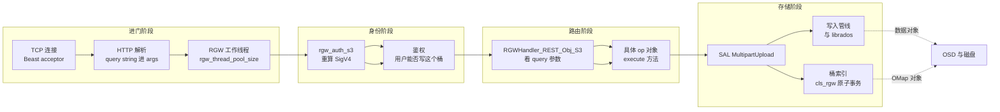

每一步对应：`src/rgw/rgw_asio_frontend.cc`（Beast 前端与 `io_context`）、`src/rgw/rgw_process.h`（`RGWProcess` 与 `m_tp` 线程池，线程数来自 `rgw_thread_pool_size`）、`src/rgw/rgw_auth_s3.cc`（SigV4）、`src/rgw/rgw_rest_s3.cc`（路由）。

### 2.2 Ceph 每个「进程」的职责

这是很多文章讲不清的地方。先把「进程」和「进程里的库/线程」分开：

| 进程 / 模块 | 跑在哪 | 分片上传里做什么 | 明确**不做**什么 |
| --- | --- | --- | --- |
| **业务程序 + S3 SDK** | 客户端机器 | 切分、编号、签名、并发、重试、收集 ETag、提交清单 | 不知道 OSD 存在，不参与合并 |
| **radosgw**（Beast 前端） | 网关节点 | 收 HTTPS、解析 query、把请求交给工作线程 | 不做存储决策 |
| **RGW 工作线程池** | radosgw 进程内 | 每个请求一个线程；执行 op 的 `execute()`；算分片 MD5；拼 manifest | 不同请求之间不共享 uploadId 锁 |
| **RGW 后台线程**（GC、LC） | radosgw 进程内 | 延迟删除残留分片对象；按生命周期规则中止过期上传 | 不参与正在进行的上传 |
| **librados / Objecter** | radosgw 进程内的库 | 用缓存 osdmap 算 PG 和 primary OSD，构造 `MOSDOp`，失败按 tid 顺序重发 | 不是独立进程，不排队，不算 manifest |
| **AsyncMessenger** | radosgw / OSD 进程内的库 | TCP 收发、字节序列化、投递给 dispatcher | 不理解 S3 语义 |
| **ceph-mon** | mon 节点 | 发 osdmap、cephx 票据、维护集群状态 | **不在数据面上**，正常上传一次都不用它 |
| **ceph-osd** | OSD 节点 | 接 `MOSDOp`、按 PG 分片入队（mClock 调度）、执行事务、复制到副本、等提交 | 不知道「分片上传」这个概念，只看见一个个 RADOS 对象写 |
| **cls_rgw 插件** | 在 OSD 进程里执行 | 一次 RADOS 操作内原子改桶索引 OMap、改分片记录、加 cls 锁 | 不是独立进程 |
| **BlueStore 线程** | ceph-osd 进程内 | aio 写数据、kv_sync 线程刷 RocksDB 元数据、deferred 重放 | 不知道对象属于哪个分片 |
| **ceph-mgr** | mgr 节点 | 监控、指标、dashboard | 不参与上传链路 |

一句话：**「分片上传」这个概念只存在于 SDK 和 RGW 里；集群下层看到的，只是一堆名字带点号的普通 RADOS 对象在写。**

### 2.3 三层命名空间：对象都叫什么名字

以 `videos/demo.mp4` + uploadId `2~X7k...` 为例，RADOS 里会出现这些对象（省略 bucket marker 前缀）：

| 对象名 | 命名空间 | 里面装什么 | 什么时候产生 |
| --- | --- | --- | --- |
| `videos/demo.mp4.2~X7k....meta` | `multipart` | 任务的 head：`multipart_upload_info` + ACL/加密 xattr；OMap 里挂每片记录 | Initiate |
| `videos/demo.mp4.2~X7k....3` | `multipart` | part 3 的 head：元属性 + 内联的前 4MB 数据 | UploadPart 3 |
| `videos/demo.mp4.2~X7k....3_1` | `shadow` | part 3 超出 4MB 的那 1MB 数据 | 片大于 stripe 时 |
| `videos/demo.mp4` | 空 | 最终对象的 head：ACL、ETag、**manifest xattr** | Complete |
| `.dir.8f3e2c1d.0` 等 | 索引池 | 桶索引 OMap，`CLS_RGW_OP_ADD` 事务 | Complete |

命名规则来自 `src/rgw/services/svc_tier_rados.h` 第 44～67 行：

```cpp
void init(const std::string& _oid, const std::string& _upload_id,      // 入参：对象 key、uploadId、分片前缀
          const std::string& part_unique_str) {                       // 第三个参数用于重传时换成随机串
  oid = _oid;                                                        // 记下原始 S3 key
  upload_id = _upload_id;                                            // 记下本次任务身份证
  prefix = oid + ".";                                                // 前缀从 "<key>." 开始
  meta = prefix + upload_id + MP_META_SUFFIX;                        // 拼出台账对象名 "<key>.<id>.meta"
  prefix.append(part_unique_str);                                    // 拼出分片对象前缀 "<key>.<id>"
}                                                                    // init 结束
std::string get_part(int num) const {                                // 由分片编号算出分片对象名
  char buf[16];                                                      // 存放编号的小缓冲区
  snprintf(buf, 16, ".%d", num);                                     // 格式化成 ".3"，注意不补零
  std::string s = prefix;                                            // 从公共前缀开始拼
  s.append(buf);                                                     // 追加编号后缀
  return s;                                                          // 得到 "<key>.<id>.3"
}                                                                    // get_part 结束
```

`MP_META_SUFFIX = ".meta"` 定义在 `src/rgw/rgw_multipart_meta_filter.cc` 第 6 行；`RGW_OBJ_NS_MULTIPART = "multipart"`、`RGW_OBJ_NS_SHADOW = "shadow"` 在 `src/rgw/rgw_bucket.h` 第 20～21 行。

---

## 三、第三站：Initiate —— 服务端只开一份「档案」

### 3.1 是什么

客户端发 `POST ...?uploads`，服务端**不写任何文件数据**，只创建一个 meta 对象，相当于在前台登记一本空台账。

### 3.2 怎么用

`RGWInitMultipart::execute()`（`src/rgw/rgw_op.cc` 第 7570 行）依次做：解析请求头里的 tagging / object-lock / checksum → 准备 ACL 和加密属性 → `s->bucket->get_multipart_upload(...)` → `upload->init(...)` → 把 uploadId 填进 `InitiateMultipartUploadResult` 返回 200。

### 3.3 原理：uploadId 怎么来

实现在 `src/rgw/driver/rados/rgw_sal_rados.cc` 的 `RadosMultipartUpload::init()`（第 4419～4478 行）：

```cpp
do {                                                                    // 循环是为了处理随机 id 撞车
  char buf[33];                                                           // 32 个字符加一个结尾符
  gen_rand_alphanumeric(store->ctx(), buf, sizeof(buf) - 1);              // 生成 32 位随机字母数字
  std::string upload_id = MULTIPART_UPLOAD_ID_PREFIX;                     // 加上固定前缀 "2~"
  upload_id.append(buf);                                                  // 拼成完整 uploadId
  mp_obj.init(oid, upload_id);                                            // 算出 meta 与分片对象前缀
  tmp_obj_name = mp_obj.get_meta();                                       // 取出 "<key>.<id>.meta"
  ...                                                                     // 此处省略取 bucket、构造 Object::Write 等准备代码
  obj_op.meta.category = RGWObjCategory::MultiMeta;                       // 标记为「分片元数据」类别，便于统计
  obj_op.meta.flags = PUT_OBJ_CREATE_EXCL;                                // 独占创建，同名则失败，不覆盖
  encode(upload_info, bl);                                                // 把任务信息序列化成字节流
  obj_op.meta.data = &bl;                                                 // 让这段字节成为 meta 对象的 head 数据
  ret = obj_op.write_meta(bl.length(), 0, attrs, rctx, get_trace(), false);// 真正把台账对象写进 RADOS
} while (ret == -EEXIST);                                                 // 名字撞了就换一个 id 重来
```

几个设计点值得琢磨：

- **前缀 `2~`**：`src/rgw/rgw_multi.h` 第 15～16 行注释说它必须包含一个随机字母数字里不会出现的字符。有了它，`is_v2_upload_id()` 就能判断这次上传是否可以用「有序 OMap」优化（后面讲 ListParts 会用到）；老格式前缀是 `2/`。
- **`PUT_OBJ_CREATE_EXCL`**：独占创建。两个客户端同时点「发起」，不会互相覆盖。
- **meta 对象放在 extra data 池**：`set_in_extra_data(true)`。因为这个池必须能存 OMap，而数据池可能是纠删码（EC）池，EC 池不支持对象级 OMap 原子操作。
- **`set_hash_source(oid)`**：让这个 meta 对象按原始 key 计算索引分片，而不是按它自己那个带 uploadId 的长名字，保证同一个 key 的所有分片记录落在同一个索引 shard 上。

### 3.4 meta 对象里到底有什么

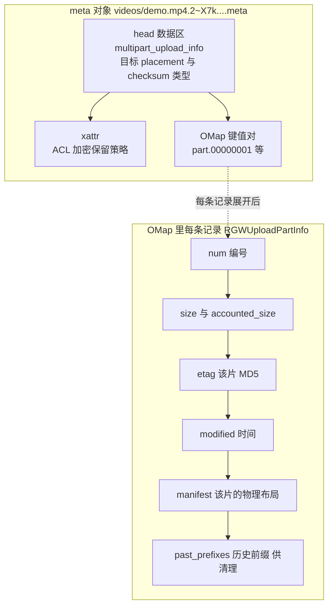

`RGWUploadPartInfo` 的字段定义在 `src/rgw/rgw_basic_types.h` 第 274～320 行：`num`、`size`、`accounted_size`、`etag`、`modified`、`manifest`、`cs_info`（压缩信息）、`cksum`、`crypt_salt`、`past_prefixes`。注意最后那个注释写得很直白：`Previous part obj prefixes. Recorded here for later cleanup.` —— 这是专门为「同一编号重传」留的清理线索。

**为什么用「一个对象 + 一堆 OMap 键」，而不是「一片一个小文件」？** 因为对同一个 meta 对象的 OMap 写入，OSD 端能用一次 RADOS 操作原子完成，还能顺带做版本检查（`cls_version_inc`）和存在性断言（`assert_exists`）。后面讲并发竞态时，这两个小动作是救命的。

### 3.5 发起阶段时序图

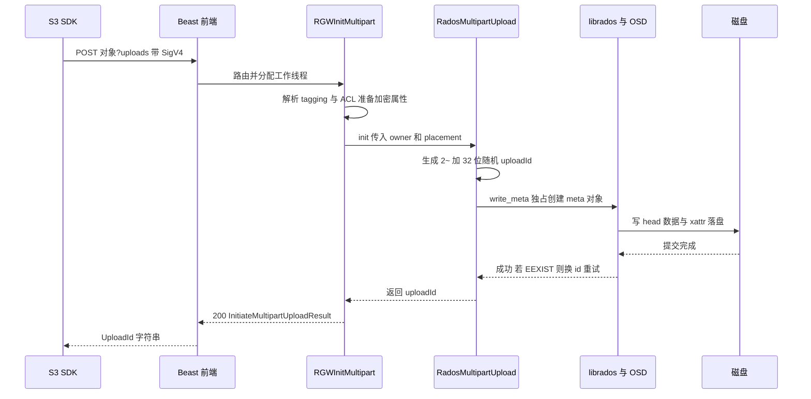

**关键**：到这一步为止，磁盘上只有一个几 KB 的 meta 对象，20MB 视频一个字节都还没传。

---

## 四、第四站：UploadPart —— 一个分片从 HTTP body 到磁盘

这是全文最「有血肉」的一段。part 3 先到，我们跟着它走完整条路。

### 4.1 参数解析与校验

`RGWPutObj_ObjStore_S3::get_params()`（`rgw_rest_s3.cc` 第 3087～3103 行）：

```cpp
multipart_upload_id = s->info.args.get("uploadId");                 // 从 query 里取任务身份证
multipart_part_str  = s->info.args.get("partNumber");              // 从 query 里取分片编号字符串
if (!multipart_part_str.empty()) {                                 // 有编号，说明这是一次 UploadPart
  multipart_part_num = strict_strtol(multipart_part_str.c_str(), 10, &err);  // 严格按十进制转成整数
  if (multipart_part_num < 1 || multipart_part_num > 10000) return -EINVAL;  // 只允许 1 到 10000
} else if (!multipart_upload_id.empty()) {                         // 有 uploadId 却没编号
  return -EINVAL;                                                  // 非法请求，直接拒绝
}                                                                  // 两个都没有就是普通 PUT
```

然后 `RGWPutObj::execute()` 在 `multipart` 分支里调 `upload->get_info(...)` 读 meta 对象确认任务还在（读不到就说明任务已被 Complete/Abort，直接返回），再用 `upload->get_writer(...)` 造一个**分片专用写入器**（`rgw_op.cc` 第 4953～4980 行；`get_writer()` 实现在 `rgw_sal_rados.cc` 第 4922～4938 行，返回 `RadosMultipartWriter`）。

### 4.2 写入管线：字节是被谁切开的

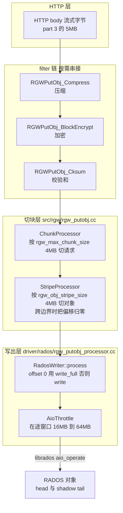

两个「4MB」很容易混，必须分清：

| 概念 | 配置项 | 默认 | 控制什么 |
| --- | --- | --- | --- |
| chunk | `rgw_max_chunk_size` | 4M | **一次 RADOS 请求**最多发多少字节；也决定 head 对象能内联多少数据（`rgw.yaml.in` 第 115～130 行） |
| stripe | `rgw_obj_stripe_size` | 4M | **一个 RADOS 对象**最多装多少字节，超了就换下一个对象（`rgw.yaml.in` 第 2267～2277 行） |

所以本例 5MB 的 part 3，在默认配置下会变成 **2 个 RADOS 对象**：`...3` 放前 4MB，`...3_1` 放后 1MB。`StripeProcessor` 的作用就是「跨对象时把写偏移重新从 0 开始」——第二个 RADOS 对象不认识「4MB 这个偏移」，它自己是从 0 开始的。这就是**单个分片内部字节连续性**的保证方式。

对象名由 `RGWObjManifest::get_implicit_location()`（`src/rgw/rgw_obj_manifest.cc` 第 209～259 行）算出来：

```cpp
if (cur_part_id) {                                                   // 编号非 0，说明这是一个分片对象
  if (cur_stripe == 0) {                                             // 该片的第一个 RADOS 对象
    snprintf(buf, sizeof(buf), ".%d", (int)cur_part_id);              // 拼出 ".3" 这样的后缀
    oid += buf;  ns = RGW_OBJ_NS_MULTIPART;                           // 名字 "<prefix>.3"，命名空间 multipart
  } else {                                                            // 该片后续的条带对象
    snprintf(buf, sizeof(buf), ".%d_%d", (int)cur_part_id, (int)cur_stripe);  // 拼出 ".3_1"
    oid += buf;  ns = RGW_OBJ_NS_SHADOW;                              // 名字 "<prefix>.3_1"，命名空间 shadow
  }                                                                   // 分支结束
}                                                                     // 分片命名逻辑结束
```

### 4.3 并发：RGW 内部同时在跑多少件事

`RadosWriter::process()`（`src/rgw/driver/rados/rgw_putobj_processor.cc` 第 168～187 行）是最终落点：

```cpp
int RadosWriter::process(bufferlist&& bl, uint64_t offset) {         // 处理上层切好的一块数据及其写偏移
  bufferlist data = std::move(bl);                                   // 接管缓冲区所有权，避免拷贝
  const uint64_t cost = data.length();                               // 本块字节数，作为 AIO 窗口的计费值
  if (cost == 0) return 0;                                           // 空块不写，直接返回
  librados::ObjectWriteOperation op;                                 // 构造一次 RADOS 对象写操作
  if (offset == 0) op.write_full(data);                              // 偏移 0 用 write_full 整对象覆写
  else             op.write(offset, data);                           // 非 0 用 write 从指定偏移接着写
  auto c = aio->get(stripe_obj.obj,                                  // 指定要写的 RADOS 对象
                    Aio::librados_op(stripe_obj.ioctx, std::move(op), y, &trace),  // 包装成 AIO 回调任务
                    cost, id);                                       // 异步提交，同时计入在途窗口
  return process_completed(c, &written);                             // 回收已完成请求，把错误在这里报出
}                                                                    // process 结束
```

`AioThrottle`（`src/rgw/rgw_aio_throttle.cc`）是一个「在途字节数」闸门：`get()` 里 `pending_size += cost`，超过 `window` 就等待，`put()` 减回去，`drain()` 等所有在途请求归零。窗口来自 `rgw_put_obj_min_window_size`（16M）到 `rgw_put_obj_max_window_size`（64M），会动态调整。所以**单个 5MB 的 part 通常一次就能发完，但一个几百 MB 的 part 内部会有多个 4MB 的 RADOS 写同时在飞**。

再加上 SDK 的 4 个并发 part、RGW 的多个工作线程，就有了三层并发叠加：

| 层级 | 并发单位 | 靠什么隔离 | 靠什么避免互相踩 |
| --- | --- | --- | --- |
| SDK | 4 个 part 同时传 | 不同 TCP 连接、不同 PartNumber | 服务端按编号各记各的 |
| RGW | 多个工作线程 | 每个请求独立的 `RGWPutObj` 对象和 writer | **没有 uploadId 全局锁** |
| 单 part 内部 | 多个 4MB 的 AIO 写 | 不同 stripe 对象，或同一对象带不同 offset | `AioThrottle` 限窗口，`drain()` 收尾 |
| 跨 part 的数据 | 名字不同的 RADOS 对象 | 对象名带 part 编号，哈希到不同 PG | OSD 按 PG 串行、跨 PG 并行 |
| Complete / Abort | 收尾动作 | meta 对象上的 cls 独占锁 | 与所有收尾动作互斥 |

**这里要特别明确一个结论**：源码里 `RadosMultipartUpload` 类（`src/rgw/driver/rados/rgw_sal_rados.h` 第 882～944 行）**没有任何 mutex**，`RGWPutObj` 的分片路径里也没有 serializer / try_lock。也就是说，**同一个 uploadId 的多个分片没有被串行化**，它们靠「对象名天然不同 + OMap key 天然不同」来避免冲突。唯一的上锁点是 Complete 和 Abort（第五章细讲）。这种「能不加锁就不加锁」的设计，正是分片上传能横向扩展的原因。

### 4.4 落盘：从 AIO 到磁盘

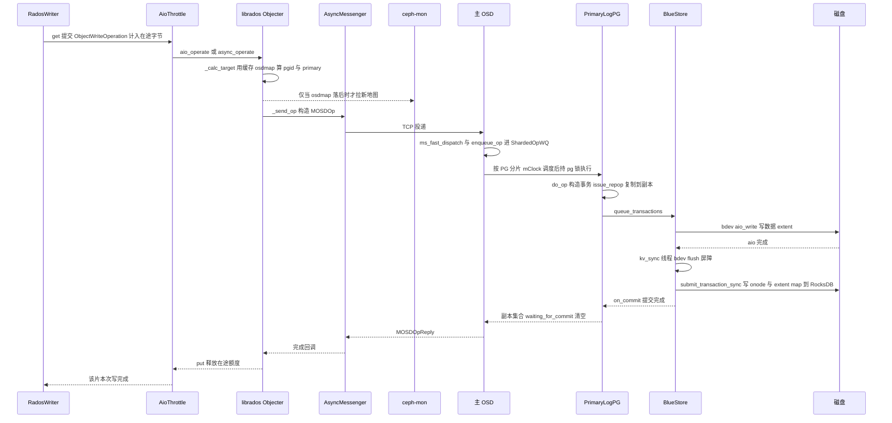

几个容易搞错的点：

- **同一 PG 上的操作是串行的**：`ShardedOpWQ` 按 PG 的哈希固定映射到某个 shard 的 `pg_slot`，worker 执行时持 `pg->lock()`（`src/osd/OSD.h` 第 1722～1725 行注释、`src/osd/OSD.cc` 的 `enqueue_op` / `dequeue_op`）。所以「同一个 RADOS 对象的两次写」严格有序，不会出现后写的覆盖先写的；不同 part 名字不同，通常落到不同 PG，于是真并行。
- **持久化的承诺点是 KV 提交，不是 aio 完成**：`BlueStore::_txc_state_proc` 的状态机是 `STATE_PREPARE → STATE_AIO_WAIT → STATE_IO_DONE → STATE_KV_QUEUED → STATE_KV_SUBMITTED → STATE_KV_DONE → STATE_FINISHING`；`_kv_sync_thread` 里先按需要 `bdev->flush()` 做块设备屏障，再 `db->submit_transaction_sync(synct)` 把 onode、extent map、omap、pg log 一次性原子写进 RocksDB（走 BlueFS WAL）。这一步完成才触发 `on_commit`，ack 才会往回走。
- **副本维度**：`ReplicatedBackend::submit_transaction` 把日志和数据装进同一个 `ObjectStore::Transaction`，发给副本，用 `waiting_for_commit` 集合追踪所有 acting 分片，集合清空才回调。这一版是「收齐所有活跃副本的 commit」，不是简单多数派计数。
- **失败重发有序**：`Objecter::_kick_requests` 按 tid 顺序重发，`Objecter.cc` 里有一段注释专门解释「分配 tid 过早会让后拿 tid 的线程先发出去，而 _kick_requests 是按 tid 重发的」；`handle_osd_op_reply` 还会丢掉旧尝试的重复回复。

### 4.5 分片收尾：算 ETag、写 part 头、记一笔账

`RGWPutObj::execute()` 边读 body 边用 `ceph::crypto::MD5` 累加（`rgw_op.cc` 第 4858、5174、5279、5308～5312 行），最后 `etag = calc_md5`，并检查客户端传的 `Content-MD5` 是否一致。然后 `MultipartObjectProcessor::complete()`（`rgw_putobj_processor.cc` 第 525～655 行）做三件事：

1. `writer.drain()` 等所有 AIO 完成；
2. `obj_op.write_meta(...)` 写 part head 的属性，类别是 `RGWObjCategory::MultiPart`；
3. 往 meta 对象的 OMap 写一条记录：

```cpp
RGWUploadPartInfo info;                                            // 准备一条分片记录
string p = "part.";                                                // OMap 键的固定前缀
bool sorted_omap = is_v2_upload_id(upload_id);                     // 判断是不是 "2~" 新格式 id
if (sorted_omap) {                                                 // 新格式可以假定键有序
  char buf[32];                                                    // 存放补零后的编号
  snprintf(buf, sizeof(buf), "%08d", part_num);                    // 定宽补零，让字典序等于数字序
  p.append(buf);                                                   // 例如 part.00000003
} else {                                                           // 老格式 id
  p.append(part_num_str);                                          // 直接用原字符串，无法假定有序
}                                                                  // 键名构造结束
info.num = part_num;  info.etag = etag;  info.size = actual_size; // 记录编号、MD5、实际字节数
info.modified = real_clock::now();                                 // 记录本片完成时间
info.manifest = manifest;                                          // 关键：记下这一片的物理布局

librados::ObjectWriteOperation op;                                 // 构造一次对 meta 对象的原子操作
op.assert_exists();                                                // 断言 meta 还在，否则说明已被 Abort
cls_rgw_mp_upload_part_info_update(op, p, info);                   // 由 OSD 端 cls 插件原子写这条记录
cls_version_inc(op);                                               // 递增版本号，供 Complete 检测竞态
r = rgw_rados_operate(..., std::move(op), ...);                    // 把整个操作提交给 RADOS
// 老 OSD 不支持新 CLS 时，回退到 op.omap_set(m) 直接覆盖写这条 OMap
```

注意 `part.%08d` 的**补零**：如果直接写 `part.3` 和 `part.10`，字典序会是 `part.10 < part.3`，分页列表就乱了。补成 `part.00000003` 和 `part.00000010` 后，字典序和数字序完全一致，`list_parts()` 就能用 `omap().get_vals()` 从 marker 直接顺序翻页（`rgw_sal_rados.cc` 第 4501～4558 行），不必把全部记录拉回内存排序。这就是「**编号连续性**」在存储层的落实。

---

## 五、第五站：并发、顺序、连续，到底怎么保证

这一章专门回答「乱了怎么办」——这是分片上传最容易被问到的部分。我们把它拆成四种「乱」。

### 5.1 乱序到达：part 3 先到，完全没问题

因为 **顺序不由到达时间决定，由 PartNumber 决定**：

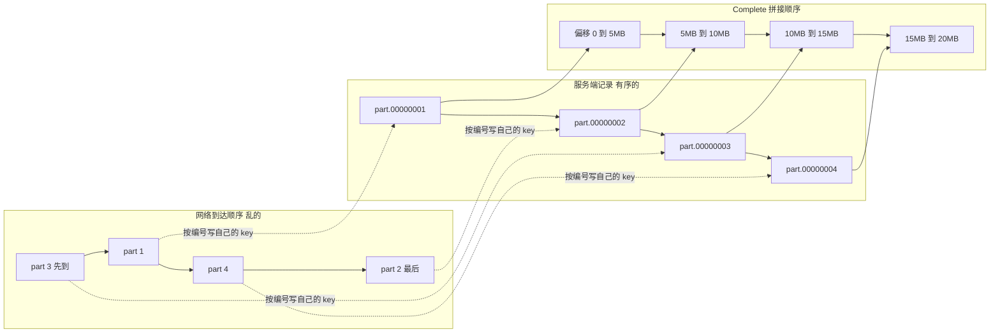

三道保险：

1. **数据对象名带编号**，先到的 part 3 写的是 `...3`，不会和 part 1 抢同一个对象；
2. **OMap key 定宽补零**，`list_parts()` 按编号升序返回；
3. **提交清单用 `std::map`**，客户端 XML 解析后自动排序；服务端 `complete()` 用两个有序迭代器逐项比对（`rgw_sal_rados.cc` 第 4639 行）。

所以网络乱序在 Ceph 里根本不是问题，它只影响「哪个请求先回 200」，不影响数据布局。

### 5.2 字节连续：一个 part 内部怎么接起来

| 场景 | 机制 |
| --- | --- |
| 同一 RADOS 对象内多次写 | `RadosWriter::process()` 用 `op.write(offset, data)`，offset 由 `ChunkProcessor` / `StripeProcessor` 累计，OSD 按 PG 串行执行，字节严格接在后面 |
| 跨 stripe 边界 | `StripeProcessor` 把偏移重置为 `offset - bounds.first`，新对象从自己的 0 开始 |
| 读回来时拼顺序 | 最终 manifest 里每段记录逻辑偏移，`obj_find(ofs)` 按偏移定位到具体 RADOS 对象 |

### 5.3 重复上传同一 PartNumber：不覆盖，而是「换名字重写」

这是对源码最容易误读的一处。直觉上以为「重传就是把同一个对象覆盖一次」，实际上 Ceph 用了更聪明的做法（`rgw_putobj_processor.cc` 第 448～473 行）：

```cpp
int MultipartObjectProcessor::process_first_chunk(bufferlist&& data, DataProcessor **processor) {  // 处理首块数据
  int r = writer.write_exclusive(data);                        // 用 exclusive create 独占创建分片 head
  if (r == -EEXIST) {                                          // 已存在，说明同一编号被并发或重复上传
    std::string oid_rand = gen_rand_alphanumeric(store->ctx(), 32);  // 生成 32 位随机串
    mp.init(target_obj.key.name, upload_id, oid_rand);         // 用随机串替换分片对象前缀
    manifest.set_prefix(target_obj.key.name + "." + oid_rand); // 让 manifest 也指向新前缀
    r = prepare_head();                                        // 按新前缀重新准备 head 与写入管线
    r = writer.write_exclusive(data);                          // 在新的对象名下重写首块
  }                                                            // 竞态处理结束
  ...                                                          // 此处省略把后续数据交给 stripe 管线的代码
}                                                               // process_first_chunk 结束
```

配套逻辑：

- 真正「覆盖」的是 meta 对象 OMap 里 `part.00000001` 这条记录（`omap_set` 或新 CLS 调用写最新的 `RGWUploadPartInfo`）；
- 旧那份数据对象不会立刻删：OSD 端的 cls 方法 `cls_rgw_mp_upload_part_info_update` 在覆盖这条 OMap 记录时，会把旧记录的 manifest 前缀塞进 `RGWUploadPartInfo::past_prefixes`（`src/cls/rgw/cls_rgw.cc` 第 5112～5116 行），留给后续清理；
- Complete 时的 `cleanup_part_history()` 与 `cleanup_orphaned_parts()` 把这些没被选中的前缀交给 GC（`update_gc_chain` + `send_chain_to_gc`），最终回收。

Ceph 自己就有专门测这个的用例：`qa/workunits/rgw/test_rgw_s3_mp_reupload.py` 对 PartNumber 1 **重复上传 11 次**，配套的 `.sh` 用 `radosgw-admin gc process --include-all` 强制 GC 后 diff `rados ls`，确认一个残留 RADOS 对象都不剩。

**为什么不直接覆盖？** 因为「覆盖一个大对象的中间部分」在 RADOS 里不是原子的，中途崩溃会留下半新半旧的混合内容；而「写一个全新名字的对象 + 原子改一条 OMap 记录」是干净的：要么指向旧对象，要么指向新对象，不会指向「写了一半的对象」。

### 5.4 断点续传：靠 uploadId + ListParts + 只在 Complete 提交

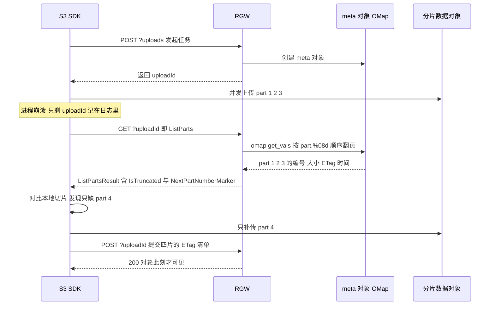

三个支撑点：

- **状态在服务端**：uploadId 和所有已传记录都在 meta 对象里，客户端进程死了也不丢；
- **Complete 前对象不可见**：桶索引里没有正式对象条目，GET 只会看到旧对象或 404（s3tests 的 `test_atomic_multipart_upload_write` 就是验证这一点）；
- **Complete 幂等**：`RGWCompleteMultipart::execute()` 里拿锁返回 `-ENOENT` 时，会调 `check_previously_completed(parts)`（`rgw_op.cc` 第 7859～7871、8059 行开始）用同样的 ETag 算法重算并比对现有对象，若确已完成就直接返回成功。所以「提交请求发出去但响应丢了」时，重试是安全的。

### 5.5 收尾竞态：Complete 与「迟到的 part」赛跑

这是全链路最精妙的一段。设想 part 4 的请求还在网络上，客户端就点了 Complete：

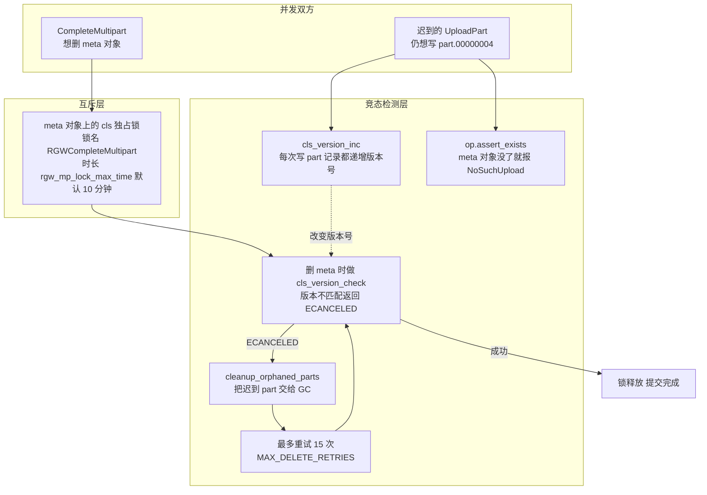

依据（`src/rgw/rgw_op.cc` 第 7847～8046 行）：

- Complete 和 Abort 都先 `meta_obj->get_serializer(this, y, "RGWCompleteMultipart")` 再 `try_lock(dur)`，**两个动作互斥**，配置项 `rgw_mp_lock_max_time` 默认 10 分钟（`rgw.yaml.in` 第 667～675 行，说明里写着「防止同一个 uploadId 的并发完成」）；
- 收尾删 meta 时用 `cls_version_check`，若期间有 part 写完并递增了版本号，删除会返回 `-ECANCELED`；
- 这时走 `cleanup_orphaned_parts()` 把「没被选中」的迟到 part 清掉，再重试删除，最多 15 次；
- 若锁已丢失（`!serializer->is_locked()`），直接 `-ERR_INTERNAL_ERROR`，不提交 head 对象，避免两个 RGW 同时完成同一个任务。

---

## 六、第六站：Complete —— 不搬一个字节的「合并」

### 6.1 客户端发来什么

```xml
<CompleteMultipartUpload>                                        <!-- 根节点：声明这是一次提交请求 -->
  <Part><PartNumber>1</PartNumber><ETag>"ffc88b..."</ETag></Part>  <!-- 第 1 片：编号 + 上传时返回的 ETag -->
  <Part><PartNumber>2</PartNumber><ETag>"d067a0..."</ETag></Part>  <!-- 第 2 片：编号必须严格递增 -->
  <Part><PartNumber>3</PartNumber><ETag>"49dcd9..."</ETag></Part>  <!-- 第 3 片：ETag 带双引号是 S3 的规矩 -->
  <Part><PartNumber>4</PartNumber><ETag>"1292a1..."</ETag></Part>  <!-- 第 4 片：最后一片可以小于 5MB -->
</CompleteMultipartUpload>                                       <!-- 根节点闭合，XML 结束 -->
```

`RGWCompleteMultipart::execute()`（`rgw_op.cc` 第 7770 行）先 `read_all_input` 读正文（上限 `rgw_max_put_param_size`，默认 1MB），`RGWMultiXMLParser` 解析成 `RGWMultiCompleteUpload::parts`（`std::map<int, std::string>`），空正文或解析失败返回 `MalformedXML`；还兼容把根节点写成 `CompletedMultipartUpload` 的老 SDK（源码注释指向 PR #41700）。

### 6.2 五道校验

实现在 `RadosMultipartUpload::complete()`（`rgw_sal_rados.cc` 第 4623～4662 行）：

| # | 校验 | 不满足时的错误 | 客户端看到的 |
| --- | --- | --- | --- |
| 1 | 提交的分片数 == 服务端已上传数 | `-ERR_INVALID_PART` | 400 `InvalidPart` |
| 2 | 按编号顺序逐项与服务端记录一一对应 | `-ERR_INVALID_PART` | 400 `InvalidPart` |
| 3 | 每片 ETag 与服务端记录的 MD5 一致 | `-ERR_INVALID_PART` | 400 `InvalidPart` |
| 4 | 除最后一片外，每片 ≥ 5MB | `-ERR_TOO_SMALL` | 400 `EntityTooSmall` |
| 5 | 分片总数 ≤ `rgw_multipart_part_upload_limit` | `-ERANGE` | 400 |

还有一条隐含校验：每片必须带非空 `manifest`，否则也返回 `InvalidPart`（第 4677～4681 行）。

这里能看出 **ETag 的真实用途**：它不是给用户看的文件指纹，而是客户端和服务端之间的「对暗号」——证明「你要合并的这一片，确实是我当时收到的那一片」。s3tests 里的 `test_multipart_upload_missing_part`、`test_multipart_upload_incorrect_etag`、`test_multipart_upload_size_too_small` 分别覆盖前三条。

### 6.3 零拷贝合并：只看这一行

```cpp
// 源码出处：src/rgw/driver/rados/rgw_sal_rados.cc，RadosMultipartUpload::complete()，第 4683 行
manifest.append(dpp, obj_part.manifest,                        // 把当前分片的布局规则追加到总台账，纯内存操作
                store->svc()->zone->get_zonegroup(),           // 传入 zonegroup，用于解析跨 zone 的对象位置
                store->svc()->zone->get_zone_params());        // 传入 zone 参数，同上
```

`RGWObjManifest::append()`（`src/rgw/driver/rados/rgw_obj_manifest.cc` 第 44～132 行）是**纯内存操作**：

```cpp
int RGWObjManifest::append(...) {                                 // 把另一份 manifest 接到自己后面
  if (rules.empty()) { *this = m; return 0; }                   // 自己还是空的，直接整体拷贝结构
  ...                                                            // 此处省略前缀与规则兼容性的判断
  append_rules(m, miter, ...);                                  // 后续片：把规则按已有总大小平移
  set_obj_size(obj_size + m.obj_size);                          // 只是把总字节数相加，没有搬数据
  return 0;                                                     // 返回成功
}                                                               // append 结束
void RGWObjManifest::append_rules(...) {                         // 逐条搬运并平移规则
  for (; miter != m.rules.end(); ++miter) {                    // 遍历待拼接 manifest 的所有规则
    RGWObjManifestRule rule = miter->second;                   // 拷出这条规则
    rule.start_ofs += obj_size;                                // 逻辑起点往后挪已有总大小
    rules[rule.start_ofs] = rule;                              // 以新偏移为键插入自己的规则表
  }                                                             // 循环结束
}                                                               // append_rules 结束
```

整个 `complete()` 的循环里，**没有任何 RADOS 读、写、copy、clone 调用**，只做四件事：累加总 MD5、拼 manifest、累加偏移 `ofs += obj_part.size`、把各 part 的临时索引条目收进 `remove_objs`。

### 6.4 唯一真正落盘的一次写

```cpp
// 源码出处：rgw_sal_rados.cc 第 4803～4825 行
target_obj->set_atomic(true);                                  // 把目标对象标记为原子写，避免并发覆盖
RGWRados::Object::Write obj_op(&op_target);                    // 构造针对正式 head 对象的写操作
obj_op.meta.manifest = &manifest;                              // 带上刚拼好的总台账
obj_op.meta.remove_objs = &remove_objs;                        // 带上要从索引摘掉的 part 临时条目
obj_op.meta.flags = PUT_OBJ_CREATE;                            // 创建正式对象
obj_op.meta.modify_tail = true;                                // 允许修改 tail 相关元数据
obj_op.meta.completeMultipart = true;                          // 标记来源，配额统计不重复计 part 大小
ret = obj_op.write_meta(ofs, accounted_size, attrs, rctx, get_trace());  // 唯一一次真正落盘的合并动作
```

`write_meta()` 最终做两件事（`src/rgw/driver/rados/rgw_rados.cc` 的 `_do_write_meta`）：

1. 把 manifest 序列化后写进 head 对象的 `RGW_ATTR_MANIFEST` xattr：`op.setxattr(RGW_ATTR_MANIFEST, bl)`；
2. 在同一个 RADOS 事务里执行 `index_op->prepare(CLS_RGW_OP_ADD)` 与 `index_op->complete(..., meta.remove_objs, ...)`：**新增正式对象条目、删除各 part 的临时条目，一次原子完成**。cls 侧用 `op_tag` 与版本号 `ver` 处理重复/乱序的索引请求（`src/cls/rgw/cls_rgw.cc` 里旧 epoch 的请求会被降级为 `CLS_RGW_OP_CANCEL`）。

所以「合并」的全部代价是：**写一个几 KB 的 head 对象 + 改一条桶索引**。20MB 数据一动没动。这也是为什么分片上传 Complete 通常很快，且与对象大小基本无关。

### 6.5 合并前后的对象布局对比

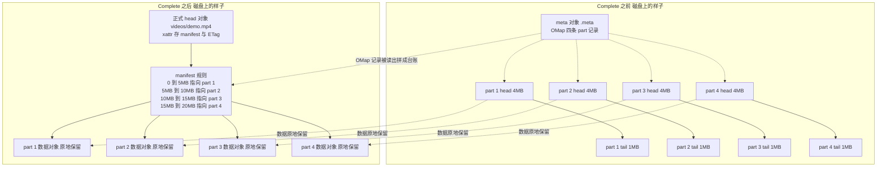

注意「part 数据对象原地保留」：它们不再作为独立可见对象存在（索引条目被 `remove_objs` 摘掉了），但**底层 RADOS 对象没被删**，成了正式对象的数据段。这也是读对象时能把 20MB 拼回来的原因。

### 6.6 读的时候怎么拼回来

`RGWRados::Object::Read::read`（`src/rgw/driver/rados/rgw_rados.cc` 第 8844～8851 行）：

```cpp
if (manifest && manifest->has_tail()) {                                    // 对象有 manifest 且有尾段
  RGWObjManifest::obj_iterator iter = manifest->obj_find(dpp, ofs);         // 用逻辑偏移查到对应的段
  read_obj = iter.get_location().get_raw_obj(store);                        // 把段换算成物理 RADOS 对象
  len = std::min(len, iter.get_stripe_size() - (ofs - stripe_ofs));         // 本次读取不能越过该段边界
  read_ofs = iter.location_ofs() + (ofs - stripe_ofs);                      // 算出在该物理对象内的起始偏移
}                                                                           // 走这条分支就按台账逐段读
```

所以一次 `GET` 或 `Range: bytes=6000000-7000000` 请求，RGW 会按 manifest 找到「第 2 段的后半 + 第 3 段的前半」，去对应的两个/多个 RADOS 对象各读一段再拼成响应流；`iterate_obj()` 还会用 `rgw_get_obj_window_size` 做并发预读。**「连续」是在读取时由 manifest 现场拼出来的，不是写入时物理拼出来的。**

### 6.7 Complete 全流程时序图

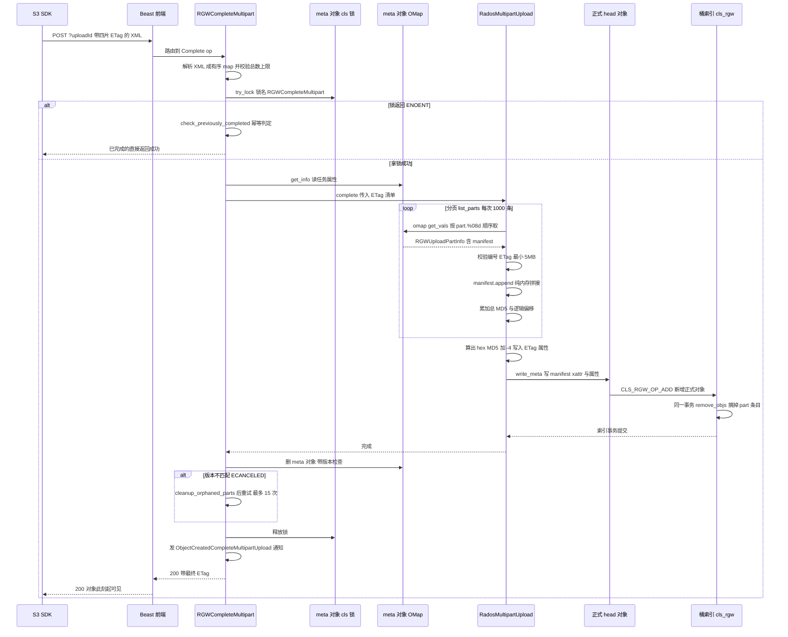

注意最后一个细节：删掉 meta 对象后，它 OMap 里所有 `part.*` 记录自然一起消失；如果删除时发现有 part 竞态写入，就先清孤儿再重试（`rgw_op.cc` 第 8009～8046 行）。

---

## 七、第七站：Abort、列举与「没人收尾」的分片怎么办

### 7.1 Abort 才真的删数据

与 Complete 相反，`RadosMultipartUpload::abort()`（`rgw_sal_rados.cc` 第 4300 行开始）会分页 `list_parts()`，对每个 part 的 manifest 调 `update_gc_chain()` 收集它所有的 RADOS 对象，然后 `send_chain_to_gc(chain, upload_id, y)` 把整条删除链交给 GC，tag 用 uploadId；最后删掉 meta 对象。响应是 **204 No Content**（`RGWAbortMultipart_ObjStore_S3::send_response()`）。

GC 不是立刻删：`src/rgw/driver/rados/rgw_gc.cc` 的 `send_chain()` 用 `cls_rgw_gc_set_entry` 写进 GC 队列（带 `rgw_gc_obj_min_wait` 延迟），`process()` 拿 `gc_index_lock_name` 独占锁后只处理过期条目；注释明确写着「只有所有 shadow 对象都删掉了，才移除 tag」。这样即使中途重启，也不会删一半留下孤儿。

### 7.2 三个「列」接口

| 接口 | 读什么 | 分页字段 |
| --- | --- | --- |
| `ListParts` | meta 对象的 OMap，逐条返回 `PartNumber / ETag / Size / LastModified` | `PartNumberMarker`、`NextPartNumberMarker`、`MaxParts`、`IsTruncated` |
| `ListMultipartUploads` | 桶索引里命名空间为 `multipart` 且名字以 `.meta` 结尾的对象 | `key-marker`、`upload-id-marker`、`max-uploads` |
| `ListObjects` | 只看正式对象条目 | 看不到未完成的 part |

`ListMultipartUploads` 用 `MultipartMetaFilter`（`rgw_multipart_meta_filter.cc`）过滤 `.meta` 后缀，因此普通列对象时那些临时 part 完全不可见。`list_parts()` 里的 `sorted_omap` 判断（`rgw_sal_rados.cc` 第 4496 行）决定走「顺序翻页」还是「全量拉回内存排序」——这也是 `2~` 前缀的实际收益。

### 7.3 客户端跑路了怎么办

分片上传最大的运维坑是「客户端崩了，从不 Complete 也不 Abort」，那些 part 会一直占空间。Ceph 的兜底是 **S3 生命周期规则 `AbortIncompleteMultipartUpload`**：


实现位置：`src/rgw/rgw_lc_s3.cc`（解析 XML 标签）、`src/rgw/rgw_lc.cc` 的 `RGWLC::handle_multipart_expiration()`（设置 `params_base.ns = RGW_OBJ_NS_MULTIPART` + `MultipartMetaFilter`，过期后取锁再 `abort()`）。Initiate 的响应里还会带 `x-amz-abort-date` / `x-amz-abort-rule-id` 告诉客户端「这次任务最晚哪天会被自动中止」。

**两个常见误读，顺手澄清**：

- `src/rgw/rgw_multi_del.cc` 是 **S3 批量删除对象（Multi-Object Delete）** 的 XML 解析器，跟分片清理无关；
- 这一版 `radosgw-admin` **没有** `multipart list` / `multipart abort` 子命令，相关的是 `gc list` / `gc process`、`orphans *`（已标记弃用）、以及 `bucket resync encrypted multipart`。

### 7.4 完整可运行示例三：用 rados 命令亲眼看看分片对象

```bash
#!/usr/bin/env bash
# -*- coding: utf-8 -*-
# 用 rados 命令观察分片上传期间 RADOS 层面真实产生的对象名。
# 需要在能访问集群、且 ceph.conf 与 keyring 已配好的节点上运行。

set -euo pipefail                                  # 遇错即停、未定义变量报错、管道失败可感知

DATA_POOL="${DATA_POOL:-default.rgw.buckets.data}"       # 数据池，可用环境变量覆盖
EXTRA_POOL="${EXTRA_POOL:-default.rgw.buckets.non-ec}"   # meta 对象所在的 extra data 池
KEY="${KEY:-videos/demo.mp4}"                             # 要观察的对象 key
UPLOAD_ID="${UPLOAD_ID:-}"                                # 可选：只看某一次任务的 uploadId

echo "=== 数据池里带 multipart 前缀的候选对象 ==="       # 打印小节标题
rados -p "$DATA_POOL" ls | grep -F "$KEY." || true       # 列出数据池对象并筛出带 key 前缀的
                                                          # grep 没匹配时不因 set -e 中断

echo "=== extra data 池里的 meta 对象 ==="               # 打印小节标题
rados -p "$EXTRA_POOL" ls | grep '\.meta$' || true       # 筛出以 .meta 结尾的任务台账

if [ -n "$UPLOAD_ID" ]; then                             # 若指定了 uploadId
  echo "=== 这次任务的全部对象 ==="                     # 打印小节标题
  rados -p "$DATA_POOL" ls | grep -F "$UPLOAD_ID" || true  # 按 uploadId 过滤 part 与 tail 对象
  echo "=== 这次任务的 meta 对象属性 ==="               # 打印小节标题
  META_NAME="${KEY}.${UPLOAD_ID}.meta"                  # 按命名规则拼出 meta 对象名
  rados -p "$EXTRA_POOL" listxattr "$META_NAME" || true   # 列出 xattr，确认 ACL 等属性
  rados -p "$EXTRA_POOL" listomapkeys "$META_NAME" || true # 列出 OMap 键，应看到 part.00000001 等
fi

echo "=== 提示 ==="                                    # 打印小节标题
echo "Complete 之后 part 对象仍在数据池，只是桶索引条目被摘除"  # 说明零拷贝合并的可观察现象
echo "Abort 或 LC 过期后，要等 GC 处理才真正删除"       # 说明延迟回收
```

**运行方式**：

```bash
chmod +x inspect_mpu.sh                                 # 加执行权限
./inspect_mpu.sh                                        # 用默认池和 key 观察
UPLOAD_ID='2~X7kP9mQ...' ./inspect_mpu.sh              # 指定某次任务，顺带看 OMap 键
radosgw-admin gc process --include-all                 # 需要立刻看到回收效果时强制跑一次 GC
```

---

## 八、全链路总时序图

把前面所有站点串成一张图，从 SDK 到磁盘再回到 SDK：

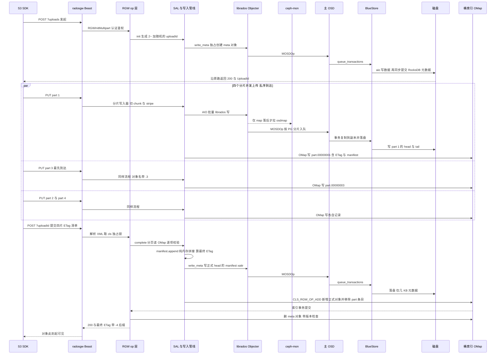

图中 `par` 那一段就是「并发」；四片的 OMap key 各不相同，所以谁先写都不冲突。

---

## 九、队列与并发全景对照表

| 位置 | 队列 / 结构 | 生产者 | 消费者 | 谁保证顺序 |
| --- | --- | --- | --- | --- |
| SDK | 线程池任务队列 | 业务程序切片 | 工作线程发 UploadPart | 提交清单按编号排序 |
| RGW 前端 | Beast `io_context` 与请求线程池 | TCP 连接 | RGW 工作线程 | 无跨请求顺序要求 |
| 单 part 写入 | `AioThrottle` 在途窗口 16M～64M | `RadosWriter::process` | librados 完成回调 | offset 递增 + `drain()` |
| Objecter | `MOSDOp` / tid | RGW 线程 | Messenger | `_kick_requests` 按 tid 重发 |
| Messenger 发送侧 | 连接 `out_q` | `_send_op` | async worker 写 socket | 单连接 FIFO |
| OSD 入队 | `ShardedOpWQ` 按 PG 分片 | `enqueue_op` | OSD op 工作线程 | 同一 PG 固定 shard 且持 pg 锁 |
| PG 提交 | `waiting_for_commit` 副本集合 | `issue_repop` | 各副本 commit 回调 | 集合清空才回 ack |
| BlueStore | aio 队列 + `kv_queue` | `queue_transactions` | aio 线程与 `kv_sync_thread` | 状态机 `STATE_AIO_WAIT → STATE_KV_DONE` |
| 桶索引 | cls_rgw 单次 RADOS 操作 | `write_meta` | OSD 端 cls 插件 | `op_tag` 与版本 `ver` |
| Complete 收尾 | meta 对象 cls 锁 | Complete 或 Abort | 独占持有者 | 锁名 `RGWCompleteMultipart` |
| 残留清理 | GC 队列 | `send_chain_to_gc` | RGW GC 线程 | 带 tag，全删完才移除 |

---

## 十、配置项速查

| 配置项 | 默认值 | 作用 | 出处 |
| --- | --- | --- | --- |
| `rgw_multipart_min_part_size` | `5_M` | 除最后一片外的最小尺寸 | `rgw.yaml.in:2747` |
| `rgw_multipart_part_upload_limit` | `10000` | 分片总数上限 | `rgw.yaml.in:2757` |
| `rgw_mp_lock_max_time` | `10_min` | Complete/Abort 独占锁时长 | `rgw.yaml.in:667` |
| `rgw_max_chunk_size` | `4_M` | 单次 RADOS 请求上限、head 内联上限 | `rgw.yaml.in:115` |
| `rgw_obj_stripe_size` | `4_M` | 单个 RADOS 对象最大尺寸 | `rgw.yaml.in:2267` |
| `rgw_put_obj_min_window_size` | `16_M` | 单对象 AIO 在途窗口下限 | `rgw.yaml.in:133` |
| `rgw_put_obj_max_window_size` | `64_M` | 动态窗口上限 | `rgw.yaml.in:148` |
| `rgw_max_put_size` | `5_G` | 单片上限；最大组合对象 = 它 × 分片上限 | `rgw.yaml.in:161` |
| `rgw_max_put_param_size` | `1_M` | Complete 的 XML 正文上限 | `rgw.yaml.in:175` |
| `rgw_bucket_index_max_aio` | `128` | 桶索引 shard 并发请求 | `rgw.yaml.in:232` |
| `rgw_max_concurrent_requests` | `1024` | Beast 前端 HTTP 并发 | `rgw.yaml.in:4080` |
| `rgw_thread_pool_size` | 依部署 | RGW 工作线程数 | `rgw_frontend.h` / `rgw_process.h` |

调优时最常见的三个动作：加大 `rgw_put_obj_*_window_size` 提升大分片吞吐；调整 `rgw_obj_stripe_size` 控制 RADOS 对象数量（太大影响并发与恢复粒度，太小制造大量小对象）；给桶配 `AbortIncompleteMultipartUpload` 生命周期规则防止空间泄漏。

---

## 十一、常见故障与排查对照

| 现象 | 最可能原因 | 定位方法 |
| --- | --- | --- |
| 400 `InvalidPart` | 提交清单缺片、编号不连续、ETag 写错、或分片 manifest 为空 | 用 `ListParts` 对比本地清单；看 RGW 日志里 `parts num mismatch` / `etag mismatch` |
| 400 `EntityTooSmall` | 非最后一片小于 5MB | 检查切片逻辑，或确认 `rgw_multipart_min_part_size` 是否被改过 |
| 400 `InvalidArgument` | `partNumber` 不在 1～10000，或只有 uploadId 没带 partNumber | 检查 SDK 生成的 query string |
| 404 `NoSuchUpload` | uploadId 写错、任务已 Complete/Abort，或 UploadPart 与 Complete 竞态 | `radosgw-admin` 或 `rados ls` 看 meta 对象是否还在 |
| 400 `MalformedXML` | Complete 正文为空、超 1MB、节点名不对 | 打印 SDK 发出的 XML |
| 空间不释放 | 客户端既不 Complete 也不 Abort，且没配生命周期 | 查 `.meta` 对象，配 `AbortIncompleteMultipartUpload`，必要时 `gc process --include-all` |
| 重复 part 残留对象 | 同一编号重传产生的旧前缀 | 由 `past_prefixes` + `cleanup_part_history` 交给 GC；用 `rados ls` 确认 |
| 上传吞吐上不去 | 客户端并发不足、AIO 窗口太小、OSD mClock 排队、桶索引 shard 热点 | 分别看 SDK 并发数、`rgw_put_obj_*_window_size`、OSD 队列深度、索引池 OSD 负载 |
| Complete 很慢 | 分片数极多导致 `list_parts` 翻页多、索引事务大 | 增大单片尺寸减少分片数，或检查索引 OSD |
| 提交后 GET 内容错乱 | 客户端提交清单顺序错，或重传时用了不同内容但沿用旧 ETag | 校验 `MultipartUpload.Parts` 按编号升序、每片 ETag 与本次上传响应一致 |

---

## 十二、总结

把全文压成六句话：

1. **SDK 的活**：按编号切文件、并发发送、收集 ETag、按升序提交清单、失败只重传缺的片。
2. **Initiate 的活**：生成一个 `2~` 加 32 位随机的 uploadId，独占创建一个 meta 对象，作为这次任务的台账本；此时一个字节的视频数据都没写。
3. **UploadPart 的活**：复用普通 `RGWPutObj`，把 body 按 chunk（4MB 请求）和 stripe（4MB 对象）切开，经 AIO 窗口并发写进名字带 part 编号的独立 RADOS 对象，最后在 meta 对象的 OMap 里写一条 `part.%08d` 记录（含 ETag 和该片的 manifest）。
4. **并发与连续的真相**：同一 uploadId **没有全局锁**，靠「对象名不同 + OMap key 不同」天然隔离；乱序到达由 PartNumber 决定顺序；重复上传靠 exclusive create 换随机前缀重写，旧对象由 `past_prefixes` + GC 回收；断点续传靠持久化的 uploadId 和 `ListParts`。
5. **Complete 的真相**：**零拷贝**。五道校验通过后，只在内存里把各片 manifest 拼成一张总台账，算出 `MD5(...)-N` 形式的 ETag，写进正式 head 对象的 `RGW_ATTR_MANIFEST` xattr，再用一次 `CLS_RGW_OP_ADD` 索引事务让对象变得可见。20MB 数据原封不动留在原地。
6. **落盘的真相**：每一片数据各自走完 Objecter → Messenger → OSD ShardedOpWQ → PG 复制 → BlueStore 的完整链路；BlueStore 先 aio 写数据，再由 `kv_sync_thread` 做块设备屏障并同步提交 RocksDB 元数据，这一步完成才算持久，ack 才沿原路返回 SDK。

理解了「manifest 只是一张台账」，很多现象就都有了坐标系：为什么 Complete 几乎瞬间完成、为什么 GET 要按偏移去多个 RADOS 对象读、为什么 Abort 之后空间不会立刻降下来、为什么分片数太多会拖慢提交、为什么重复上传同一编号不会写坏数据。

## 参考

- 源码主路径：`src/rgw/rgw_rest_s3.cc`（路由）、`src/rgw/rgw_op.cc`（op 编排）、`src/rgw/rgw_multi.h`（XML 与 uploadId 前缀）、`src/rgw/services/svc_tier_rados.h`（`RGWMPObj` 命名）、`src/rgw/driver/rados/rgw_sal_rados.cc`（`init` / `list_parts` / `complete` / `abort`）、`src/rgw/driver/rados/rgw_putobj_processor.cc`（写入管线与 OMap 记账）、`src/rgw/driver/rados/rgw_obj_manifest.cc`（`append` 与偏移定位）、`src/rgw/rgw_aio_throttle.cc`、`src/rgw/rgw_lc.cc`、`src/rgw/driver/rados/rgw_gc.cc`、`src/cls/rgw/cls_rgw.cc`、`src/osdc/Objecter.cc`、`src/osd/OSD.cc`、`src/osd/PrimaryLogPG.cc`、`src/osd/ReplicatedBackend.cc`、`src/os/bluestore/BlueStore.cc`
- 配置：`src/common/options/rgw.yaml.in`
- 文档：`doc/radosgw/layout.rst`（RADOS 对象布局与 head/manifest）、`doc/radosgw/s3/objectops.rst`（分片上传 API）、`doc/radosgw/placement.rst`（`data_extra_pool`）
- 测试：`qa/workunits/rgw/test_rgw_s3_mp_reupload.py`、`qa/workunits/rgw/test_rgw_multipart_category.py`、`src/test/rgw/s3-tests/s3tests/functional/test_s3.py`
- [Ceph 官方文档：RGW](https://docs.ceph.com/en/latest/radosgw/)
- 本站前文：[一次 S3 写入的完整旅程：从 SDK 到 RGW、OSD 再到磁盘落盘](/posts/ceph-s3-put-path/)

*内容依据 Ceph main 分支源码（commit `241006abdaa`，`v22.0.0-595-g241006abdaa`）阅读整理，核对日期：2026 年 11 月 9 日。Ceph 的 RGW 已做 SAL 化重构，老版本博客中的类名与文件路径可能与此不符；具体以对应版本源码为准。*
