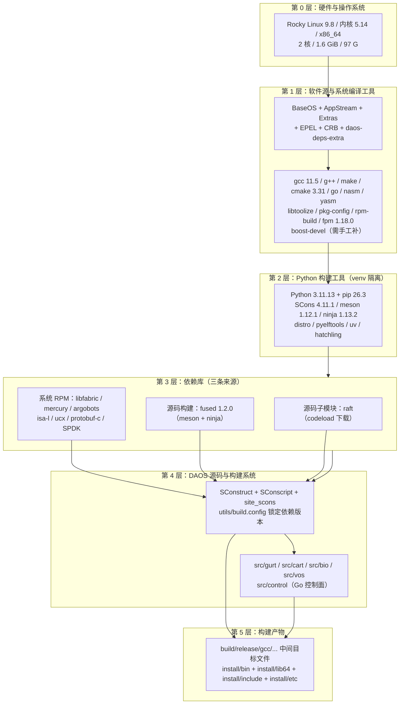
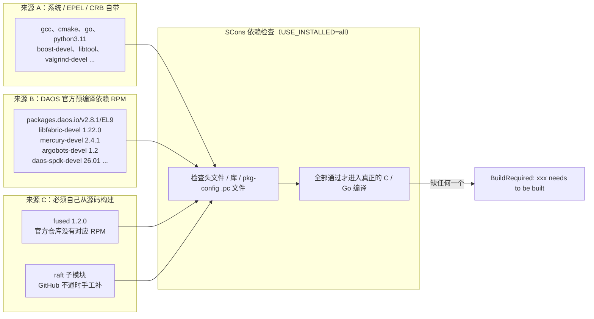
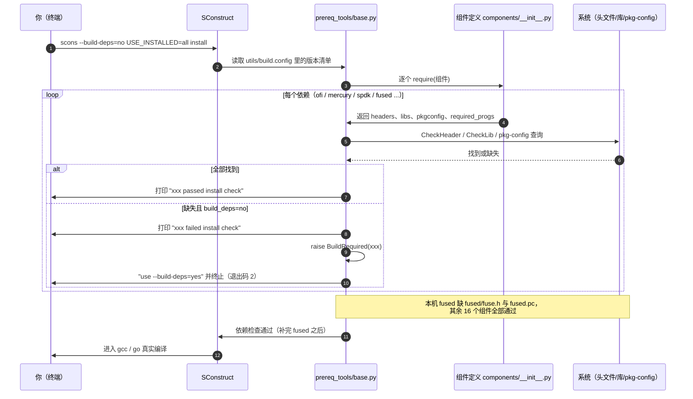
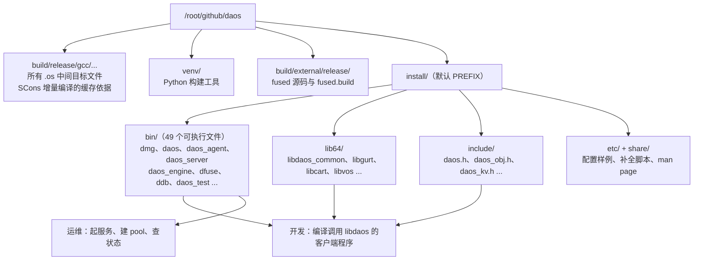
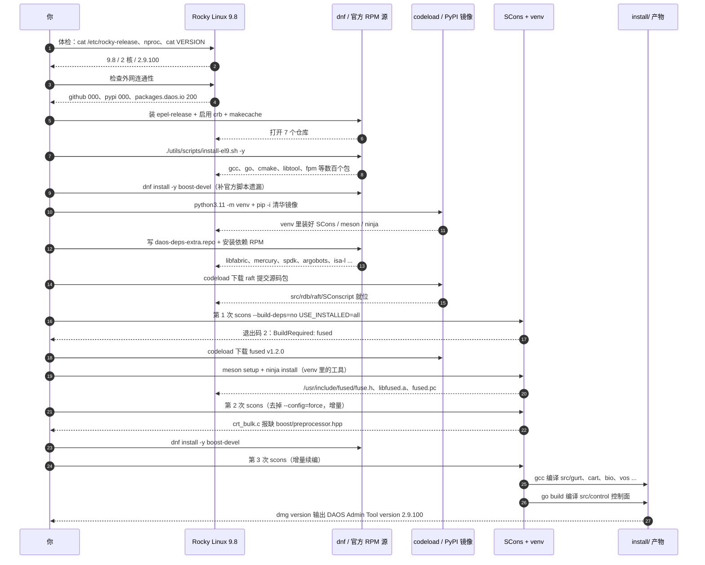

上一篇聊了「选哪个 DAOS 版本、配什么操作系统和硬件」，这一篇解决更具体的问题：**代码已经放在服务器上了，怎么把它编译出来？**

这不是照着官方文档抄一遍命令。下面每一条命令都在这台机器上真实执行过，每一个报错都是真实遇到的，每一个修复都有日志为证。文章按「小白照着复制粘贴就能走通」的标准来写：**每一条命令都说明它在做什么、为什么要做、执行完应该看到什么**。

> **关于本文的机器信息**：实验用的是一台内网服务器，代码目录是 `/root/github/daos`。因为这篇文章会公开发布，**文中不会记录登录口令一类的敏感信息**，涉及连接的地方一律用 `<HOST>` 代替，请替换成你自己的地址。记录的操作系统版本、内核版本、CPU/内存/磁盘、代码版本、工具版本、命令和日志都是真实值。也请顺手把实验机的弱口令换成 SSH 密钥登录。

## 〇、先给结论

**一句话**：在一台 2 核 1.6 GiB 内存的 Rocky Linux 9.8 上，编译 DAOS `2.9.100`（3.0 开发主线）是可行的，但不能只跑官方文档里那条 `scons --build-deps=yes install`。真正的路径是：**系统工具用 `install-el9.sh` 装齐 → Python 构建工具进 venv → 依赖用 DAOS 官方预编译 RPM → 子模块和 `fused` 因为 GitHub 连不上要手工补 → 再补一个官方脚本漏掉的 `boost-devel` → 最后用 `USE_INSTALLED=all` 增量编译**。

### 0.1 实验环境一览表

| 项目 | 实际值 | 怎么查出来的 |
| --- | --- | --- |
| 发行版 | Rocky Linux release 9.8 (Blue Onyx) | `cat /etc/rocky-release` |
| 内核 | `5.14.0-687.10.1.el9_8.0.1.x86_64` | `uname -r` |
| CPU | 2 核 | `nproc` |
| 内存 | 1.6 GiB（可用约 1.0 GiB） | `free -h` |
| 根分区 | 97 G，编译前已用 5.5 G | `df -h /` |
| 代码路径 | `/root/github/daos` | 用户指定 |
| 代码版本 | `VERSION = 2.9.100` | `cat VERSION` |
| 代码标签 | `TAG = 2.9.100-tb` | `cat TAG` |
| Git 提交 | `788f8773b6`，分支 `master` | `git rev-parse --short HEAD` |
| 构建类型 | release（`-DDAOS_BUILD_RELEASE`） | 编译日志中的 gcc 命令行 |
| 安装目录 | `/root/github/daos/install` | SCons 默认 `PREFIX`，见编译日志 `Install file: ... as "install/bin/..."` |

> `2.9.100` 里的 `9` 是奇数，按 DAOS 的语义化版本规则属于**开发版**，这条线通往 3.0。如果你是做生产选型，请回到上一篇选 `v2.8.1`；本文的场景是**读代码、改代码、跟主线**，所以直接编译 `master` 是对的。

### 0.2 先看整张编译地图



**读图要点**：DAOS 的编译不是「`./configure && make`」一条线，而是**五层叠加**。任何一层缺东西，报错都会出现在最上面那层 `scons` 里，但根因往往在最下面。后面排查 `fused` 和 `boost` 就是典型例子。

## 一、为什么编译 DAOS 比普通 C 项目麻烦

[daos.io](https://daos.io/) 官网对它的定位是：

> **D**istributed **A**synchronous **O**bject **S**torage (DAOS) is an open-source software-defined high-performance scalable storage system ... Ultra-high bandwidth/IOPS with fully distributed metadata and a time-to-first-byte below 20μs leveraging RDMA whenever available (via UCX or libfabric).

注意 **RDMA / UCX / libfabric / 用户态 I/O / 持久内存** 这些关键词。DAOS 为了绕过内核，直接和用户态驱动、网卡、SCM 打交道，所以它的依赖不是几个 `-devel` 包能打发的：SPDK、PMDK、Mercury、libfabric、Argobots、isa-l 全都要**精确版本**，这也是为什么仓库里专门有一个 `utils/build.config` 把每个依赖的版本钉死。

### 1.1 三条依赖来源，一张图看懂



**这三条来源正是本文后面所有步骤的划分依据**：第 3～4 节处理来源 A，第 6 节处理来源 B，第 7～9 节处理来源 C。

### 1.2 构建系统的关键文件

| 文件 | 作用 | 本文在哪一步用到 |
| --- | --- | --- |
| `SConstruct` | SCons 总入口，定义 `--build-deps`、`--skip-download` 等选项 | 第 8 节排查依赖检查逻辑 |
| `site_scons/components/__init__.py` | 定义每个外部依赖怎么找、怎么编译（例如 `fused` 的 meson 命令） | 第 9 节照抄官方参数 |
| `site_scons/prereq_tools/base.py` | 实现依赖检查、`BuildRequired` 异常、prefix 计算 | 第 8 节理解报错 |
| `utils/build.config` | 钉死所有依赖的版本号和 GitHub 地址 | 第 6、7、9 节 |
| `requirements-build.txt` | Python 构建工具清单 | 第 5 节 |
| `utils/scripts/install-el9.sh` | 官方 EL9 系统依赖安装脚本 | 第 4 节 |
| `utils/build/install_deps.sh` | 官方预编译依赖 RPM 安装脚本 | 第 6 节（因 root 限制未直接调用） |
| `utils/build/build_daos.sh` | 官方构建封装，默认 `PREFIX=/opt/daos` | 第 10 节解释参数 |
| `docs/QSG/build_from_scratch.md` | 官方「从零构建」指南 | 全流程参照 |

## 二、第 0 步：先给机器做个体检

**目的**：动手之前先搞清楚「我到底有什么」，后面每一步失败时都能回来对照。这一步不改动系统，纯只读。

```bash
# 1. 看发行版和内核：决定能用哪个官方脚本、哪个 RPM 仓库目录
cat /etc/rocky-release
uname -r

# 2. 看算力：决定 scons 用几个并行任务（内存小就别开太大）
nproc
free -h
df -h /

# 3. 进代码目录，确认版本、标签、提交号
cd /root/github/daos
cat VERSION
cat TAG
git rev-parse --short HEAD
git branch --show-current
git status --short

# 4. 看子模块是否齐全（开头是减号说明还没拉取）
git submodule status
```

**每条命令做什么、目的是什么**：

| 命令 | 做什么 | 目的 |
| --- | --- | --- |
| `cat /etc/rocky-release` | 打印发行版名称和版本 | DAOS 的 RPM 仓库按发行版大版本分目录，EL9 要用 `EL9` 路径 |
| `uname -r` | 打印内核版本 | 后续用户态驱动、IOMMU、hugepages 都和内核强相关 |
| `nproc` | 打印 CPU 核数 | 决定 `scons --jobs N`，本机是 2 |
| `free -h` | 打印内存 | 内存只有 1.6 GiB，`--jobs 2` 是上限，别用 `$(nproc)` 之外的高并发 |
| `df -h /` | 打印磁盘 | 全量编译产物会占几个 G，先确认空间 |
| `cat VERSION` / `cat TAG` | 打印 DAOS 版本与标签 | 确认你要编的是 `2.9.100` 而不是稳定版 |
| `git rev-parse --short HEAD` | 打印当前提交 | 文章和日志里的 `788f8773b6` 就是这么来的 |
| `git status --short` | 打印工作区改动 | 编译前确认没有意外改动，避免把别人的 patch 编进去 |
| `git submodule status` | 列出子模块及其提交号 | 本机输出 `-27d0525572026d66177005506a5a22703a8fd8cf src/rdb/raft`，**开头的 `-` 表示未初始化** |

### 2.1 网络体检：这一步能省掉后面两小时的困惑

```bash
for u in https://github.com https://pypi.org https://packages.daos.io https://dl.rockylinux.org; do
    printf "%-35s " "$u"
    curl -sS -o /dev/null -w "%{http_code}\n" \
        --connect-timeout 6 --max-time 12 "$u" 2>&1 | tail -1
done
```

实际输出：

```text
https://github.com                  000
https://pypi.org                    000
https://packages.daos.io            200
https://dl.rockylinux.org           200
```

`000` 表示连不上（`curl` 的详细报错是 `Failed to connect to github.com port 443: Connection refused`）。**这两个 `000` 直接决定了后文两处绕路**：PyPI 要用国内镜像，GitHub 上的源码要用 `codeload.github.com` 下载。而 `packages.daos.io` 是 `200`，说明官方依赖 RPM 仓库可用，这是最省事的一条路。

## 三、第 1 步：打开 EPEL 与 CRB 两个软件源

**目的**：Rocky Linux 默认只开 BaseOS / AppStream / Extras，DAOS 需要的很多开发包在 **EPEL**（Extra Packages for Enterprise Linux）和 **CRB**（CodeReady Builder，旧称 PowerTools）里。不开这两个源，后面 `install-el9.sh` 会报「找不到包」。

```bash
# 1. 安装 dnf 插件（提供 config-manager 命令）和 EPEL 源定义
dnf install -y dnf-plugins-core epel-release

# 2. 启用 CRB 仓库
dnf config-manager --set-enabled crb

# 3. 刷新所有仓库的元数据缓存
dnf makecache

# 4. 确认最终启用了哪些仓库
dnf repolist enabled
```

| 命令 | 做什么 | 目的 |
| --- | --- | --- |
| `dnf install -y dnf-plugins-core epel-release` | 装 dnf 插件管理器和 EPEL 的 repo 定义文件 | `-y` 表示全部自动确认；`dnf-plugins-core` 提供下一步的 `config-manager` |
| `dnf config-manager --set-enabled crb` | 把 `crb` 仓库的 `enabled` 改成 1 | CRB 里有 `libcmocka-devel`、`capstone-devel`、`CUnit-devel` 等构建期依赖 |
| `dnf makecache` | 下载并缓存各仓库的包索引 | 让后面的 `dnf install` 能立刻解析包名，也方便确认源是否真的可用 |
| `dnf repolist enabled` | 列出已启用的仓库 | 验收 |

本机最终启用的仓库是：`appstream`、`baseos`、`crb`、`daos-deps-extra`（第 6 节加）、`epel`、`epel-cisco-openh264`、`extras`。

> **顺带解释 `yum` 和 `dnf` 的关系**：这台机器上 `yum --version` 和 `dnf --version` 都是 `4.14.0`，因为 EL9 里 `/usr/bin/yum` 只是指向 `dnf` 的兼容软链接。老文档写 `yum install`，新文档写 `dnf install`，**在 EL9 上二者等价**。本文统一用 `dnf`。

## 四、第 2 步：一条脚本装齐系统编译工具

**目的**：把编译器、汇编器、构建工具、各种 `-devel` 头文件、打包工具一次性装齐。DAOS 官方提供了 `utils/scripts/install-el9.sh`，别自己一个个猜包名。

```bash
cd /root/github/daos

# -y 会作为 dnf 的参数传进脚本，让所有安装自动确认
./utils/scripts/install-el9.sh -y
```

脚本内部核心就是一条很长的 `dnf --nodocs install -y ...`：

```bash
# 摘自 utils/scripts/install-el9.sh（示意，不需要单独执行）
dnf --nodocs install -y \
    binutils bzip2 capstone-devel cmake cpio compiler-rt createrepo \
    CUnit-devel daxctl-devel diffutils e2fsprogs fdupes flex gcc gcc-c++ \
    git glibc-langpack-en golang help2man hdf5-devel hwloc-devel \
    json-c-devel libaio-devel libcmocka-devel libevent-devel \
    libibverbs-devel libiscsi-devel libnl3-devel libpsm2-devel \
    librdmacm-devel libtool libtool-ltdl-devel libunwind-devel \
    libuuid-devel libyaml-devel lz4-devel Lmod make nasm \
    ndctl-devel numactl-devel openssl-devel pandoc patch patchelf \
    pciutils-devel protobuf-c-devel python3.11-devel python3.11-pip \
    rpm-build sudo ucx-devel valgrind-devel which ncurses-devel yasm
```

### 4.1 这一大堆包按用途分类

| 类别 | 代表包 | 为什么需要 |
| --- | --- | --- |
| C/C++ 编译器 | `gcc`、`gcc-c++`、`binutils`、`make`、`cmake` | 编译 DAOS 的 C 代码和外部依赖 |
| 汇编与优化库 | `nasm`、`yasm`、`isa-l`（后面单独装） | SPDK / isa-l 的 SIMD 优化代码需要汇编器 |
| Go 工具链 | `golang` | `src/control` 控制面（`dmg`、`daos_server`）是 Go 写的 |
| Python | `python3.11-devel`、`python3.11-pip` | 构建脚本、venv、代码生成 |
| 用户态 I/O / 网络 | `libibverbs-devel`、`librdmacm-devel`、`libaio-devel`、`ucx-devel`、`hwloc-devel`、`numactl-devel` | RDMA、NUMA 感知、SPDK 相关 |
| 测试与调试 | `valgrind-devel`、`libcmocka-devel`、`CUnit-devel` | 编译单元测试，`-DD_HAS_VALGRIND` 就是这么来的 |
| 序列化 / 配置 | `protobuf-c-devel`、`json-c-devel`、`libyaml-devel`、`lz4-devel` | 控制面 RPC 与配置文件解析 |
| 打包与工具 | `rpm-build`、`createrepo`、`patchelf`、`libtool`、`pandoc` | 打 RPM、修 RPATH、外部依赖 autotools 构建 |
| Ruby 生态 | `@ruby:3.x`、`rubygems`、`gem install fpm` | `fpm` 用来把编译产物打成 RPM，本机装到 `fpm 1.18.0` |

### 4.2 实际执行结果与两个真实插曲

- **镜像超时**：安装过程中 Rocky 镜像站 `mirrors.qlu.edu.cn` 出现过 `Curl error (28): Timeout was reached`。`dnf` 自动切换到其他镜像重试，脚本最终正常结束（`EXIT 0`），`fpm-1.18.0` 和 11 个 Ruby gems 都装上了。**遇到这种超时先别中断，让它自己换源**。
- **官方脚本漏了 `boost-devel`**：`install-el9.sh` 的完整包清单里没有 `boost-devel`。但 `master` 上的 CaRT 代码包含 `#include <boost/preprocessor.hpp>`，所以第 10 节会真的编译失败。修复命令很简单，也可以现在提前装上：

```bash
# CaRT 的 rpc_gen_macros.h 需要 Boost.Preprocessor 头文件
dnf install -y boost-devel

# 验收：能列出这个头文件就对了
ls -l /usr/include/boost/preprocessor.hpp
```

### 4.3 装完后手里的工具清单（实测版本）

| 工具 | 版本 | 用途 |
| --- | --- | --- |
| `dnf` / `yum` | 4.14.0 | 软件包管理 |
| `rpm` | 4.16.1.3 | 查询已安装包 |
| `gcc` / `g++` | 11.5.0 | C/C++ 编译 |
| `make` | GNU Make 4.3 | 部分子项目构建 |
| `cmake` | 3.31.8 | meson 检测、外部依赖 |
| `go` | 1.26.10 | Go 控制面编译 |
| `python3.11` | 3.11.13 | 构建脚本 |
| `libtoolize` | GNU libtool 2.4.6 | `fused` 的 `required_progs` 之一 |
| `pkg-config` | 1.7.3 | 检查 `fused.pc` 等 |
| `nasm` / `yasm` | 2.15.03 / 1.3.0 | 汇编 |
| `fpm` / `gem` | 1.18.0 / 3.5.22 | 打包 |
| `git` / `curl` / `tar` | 2.52.0 / 7.76.1 / 1.34 | 拉取与解压源码 |

## 五、第 3 步：Python 虚拟环境与构建工具

**目的**：`scons`、`meson`、`ninja` 这些构建工具装进**独立 venv**，不污染系统 Python，换机器时也能照抄。

```bash
cd /root/github/daos

# 1. 创建虚拟环境（目录名 venv，就在代码树里）
python3.11 -m venv venv

# 2. 激活：之后所有 pip / scons / meson / ninja 都优先用 venv 里的
source venv/bin/activate

# 3. 用国内 PyPI 镜像，避开 pypi.org 连不上的问题
MIRROR=https://pypi.tuna.tsinghua.edu.cn/simple

# 4. 升级 pip 到最新
pip install --no-cache-dir -i "$MIRROR" --upgrade pip

# 5. 按官方清单安装构建工具
pip install --no-cache-dir -i "$MIRROR" -r requirements-build.txt

# 6. 验收
pip --version
scons --version
meson --version
ninja --version
```

| 命令 | 做什么 | 目的 |
| --- | --- | --- |
| `python3.11 -m venv venv` | 在 `./venv` 创建隔离的 Python 环境 | 系统 Python 保持干净，`rm -rf venv` 就能重来 |
| `source venv/bin/activate` | 把 `venv/bin` 插到 `PATH` 最前面 | **每开一个新终端都要重新执行一次**，否则会提示 `scons: command not found` |
| `MIRROR=...` | 定义镜像地址变量 | 避免下面两条命令重复写长 URL |
| `pip install -i "$MIRROR" --upgrade pip` | 从清华镜像升级 pip | 默认源在本机连不上，会一直卡住 |
| `pip install -i "$MIRROR" -r requirements-build.txt` | 按清单安装 7 个 Python 包 | 这是 SCons 能跑起来的前提 |
| `scons --version` 等 | 打印版本 | 验收，也方便日后复现 |

`requirements-build.txt` 里每个包的作用：

| 包 | 实测版本 | 作用 |
| --- | --- | --- |
| `scons` | 4.11.1 | **核心构建工具**，替代 make，读取 `SConstruct` / `SConscript` |
| `ninja` | 1.13.2 | `fused` 等 meson 项目的底层并行构建器 |
| `meson` | 1.12.1 | `fused` 的配置工具，生成 `build.ninja` 和 `fused.pc` |
| `distro` | 1.9.0 | 让构建脚本识别当前 Linux 发行版 |
| `pyelftools` | 0.33 | 解析 ELF 文件，用于 RPATH / 符号检查 |
| `uv` | 0.13.7 | 新一代 Python 包安装器，构建链内部使用 |
| `hatchling` | 1.33.0 | PEP 517 构建后端 |
| `pip` | 26.3 | 包管理器本体 |

> **为什么要 `--no-cache-dir`**：实验机磁盘和内存都小，不写 pip 缓存可以省空间，也避免旧缓存导致的版本错乱。正式环境可以去掉。

## 六、第 4 步：安装 DAOS 官方预编译依赖 RPM

**目的**：SPDK、Mercury、libfabric 这些库如果全部从源码编译，在这台 2 核机器上要花很久。DAOS 官方在 `packages.daos.io` 提供了**版本严格对齐的预编译 RPM**，直接用最省事。

### 6.1 配置额外仓库

```bash
cat > /etc/yum.repos.d/daos-deps-extra.repo <<'EOF'
[daos-deps-extra]
name=DAOS dependency RPMs extra repo
baseurl=https://packages.daos.io/v2.8.1/EL9/packages/x86_64/
enabled=1
gpgcheck=0
EOF

# 刷新缓存，让新仓库生效
dnf makecache
```

| 字段 / 命令 | 做什么 | 目的 |
| --- | --- | --- |
| `cat > ... <<'EOF'` | 用 heredoc 写一个 `.repo` 文件 | 告诉 dnf 去哪找 DAOS 的依赖 RPM |
| `baseurl=.../v2.8.1/EL9/packages/x86_64/` | 指定仓库地址 | `v2.8.1` 是当前稳定版依赖集合，`EL9` 对应 Rocky 9，`x86_64` 对应架构 |
| `enabled=1` | 启用 | 不写这行默认也可用，但显式更清楚 |
| `gpgcheck=0` | 关闭签名校验 | 实验环境简化；**生产环境应导入官方 GPG key 并开启校验** |
| `dnf makecache` | 刷新元数据 | 验收时能看到 `daos-deps-extra` 出现在 `dnf repolist enabled` 里 |

> 为什么这里用 `v2.8.1` 而不是 `2.9.100`？因为**预编译依赖仓库按已发布的稳定版组织**，开发主线没有单独的依赖仓库；`utils/build.config` 里钉的版本（`libfabric 1.22.0`、`mercury 2.4.1`、`spdk 26.01` 等）正好和 `v2.8.1` 的依赖集合对得上。这也是第 8 节能通过依赖检查的原因。

### 6.2 为什么没直接用官方 `install_deps.sh`

官方脚本 `utils/build/install_deps.sh` 本来会一步到位，但它开头写死了：

```bash
if [ "$(id -u)" = "0" ]; then
    echo "Should not be run as root"
    exit 1
fi
```

实验机是 `root` 登录，脚本会直接退出（它设计给普通用户 + `sudo` 用）。所以这里**手动执行它内部等价的 `dnf install --allowerasing`**：

```bash
dnf install -y --allowerasing \
    libfabric-devel-1.22.0 \
    mercury-devel-2.4.1 \
    argobots-devel-1.2 \
    daos-spdk-devel-26.01 \
    isa-l-devel isa-l_crypto-devel \
    protobuf-c-devel ucx-devel
```

| 参数 | 做什么 | 目的 |
| --- | --- | --- |
| `-y` | 自动确认 | 无人值守 |
| `--allowerasing` | 允许卸载冲突包 | DAOS 的依赖 RPM 可能和发行版自带的同名包冲突，不加会报依赖错误 |
| 版本号后缀 | 精确锁定版本 | 与 `utils/build.config` 对齐，避免装到不兼容的新版本 |

实际装上的关键包（`rpm -qa | grep -Ei "daos|spdk|libfabric|mercury|argobots|isa-l|ucx|protobuf-c" | sort`）：

```text
argobots-1.2-4.el9.x86_64                  argobots-devel-1.2-4.el9.x86_64
daos-spdk-26.01-3.el9.x86_64              daos-spdk-devel-26.01-3.el9.x86_64
isa-l-2.32.1-1.el9.x86_64                 isa-l-devel-2.32.1-1.el9.x86_64
isa-l_crypto-devel-2.26.1-2.el9.x86_64    libisa-l_crypto-2.26.1-2.el9.x86_64
libfabric-1.22.0-5.el9.x86_64             libfabric-devel-1.22.0-5.el9.x86_64
mercury-2.4.1-5.el9.x86_64                mercury-devel-2.4.1-5.el9.x86_64
mercury-libfabric-2.4.1-5.el9.x86_64      protobuf-c-1.3.3-13.el9.x86_64
protobuf-c-devel-1.3.3-13.el9.x86_64      protobuf-c-compiler-1.3.3-13.el9.x86_64
ucx-1.19.1-2.el9.x86_64                   ucx-devel-1.19.1-2.el9.x86_64
```

### 6.3 `build.config` 与实际 RPM 版本对照

| 依赖 | `utils/build.config` 期望 | 实际 RPM | 用在 DAOS 哪里 |
| --- | --- | --- | --- |
| `argobots` | `v1.2` | 1.2-4.el9 | 用户态线程 / TSE 任务调度 |
| `fused` | `v1.2.0` | **无 RPM，需源码构建** | dfuse 的用户态 FUSE 实现 |
| `isal` | `v2.31.1` | 2.32.1-1.el9 | 纠删码 / 校验和加速 |
| `isal_crypto` | `v2.26.1` | 2.26.1-2.el9 | 加密哈希 |
| `spdk` | `v26.01` | 26.01-3.el9 | NVMe 用户态驱动 |
| `ofi` | `v1.22.0` | 1.22.0-5.el9 | libfabric 网络传输 |
| `mercury` | `v2.4.1` | 2.4.1-5.el9 | CaRT 底层 RPC |
| `ucx` | `v1.20.0` | 1.19.1-2.el9 | 可选 RDMA 后端 |
| `protobufc` | `v1.3.3` | 1.3.3-13.el9 | 控制面 dRPC 序列化 |

> 表里 `fused` 那一行就是第 8 节失败的伏笔。另外 `ucx` 装到的是 1.19.1，与 `build.config` 的 1.20.0 有小差异，`isa-l` 是 2.32.1 对 2.31.1，但本机日志里 `ucx passed install check`、`isal passed install check` 都是通过的。原因在 `site_scons/components/__init__.py`：`ucx` 的检查项是 `libs=['ucs','ucp','uct']`、`headers=['uct/api/uct.h']`、函数 `ucs_debug_disable_signal` 和 `pkgconfig='ucx'`，**并没有写死版本号下限**（只有 `ofi` 额外挂了 `config_cb=ofi_config` 做版本回调）。也就是说，`build.config` 里的版本号主要用于 `--build-deps=yes` 时去拉对应 tag 的源码，而 `USE_INSTALLED=all` 走的是「头文件和库在不在」的检查。**开发主线上的这类小版本漂移很常见，不要看到版本号对不上就慌，以 `passed install check` 为准。**

## 七、第 5 步：补齐 git 子模块 raft

**目的**：`src/rdb/raft` 是 RDB（副本服务用 Raft 一致性协议）依赖的子模块，`SConscript` 会引用它，空目录会让构建直接报错。

标准做法本来是 `git submodule update --init --recursive`，但第 2.1 节已经确认 `github.com:443` 连不上，会卡在 `Cloning into ...`。**绕路办法：用 `codeload.github.com` 下载对应提交的 tar 包**（这个域名在本机可达）。

```bash
cd /root/github/daos

# 1. 拿到子模块对应的精确提交号，并确认 URL
git submodule status
cat .gitmodules
# 输出：-27d0525572026d66177005506a5a22703a8fd8cf src/rdb/raft
#       [submodule "raft"] path = src/rdb/raft
#                          url = https://github.com/daos-stack/raft.git

# 2. 用 codeload 下载这个提交的源码包
curl -fsSL -o /tmp/raft.tar.gz \
    https://codeload.github.com/daos-stack/raft/tar.gz/27d0525572026d66177005506a5a22703a8fd8cf

# 3. 解压到子模块目录，--strip-components=1 去掉最外层的仓库名目录
mkdir -p src/rdb/raft
tar xzf /tmp/raft.tar.gz -C src/rdb/raft --strip-components=1

# 4. 验收：SConscript 存在就够了
ls -l src/rdb/raft/SConscript src/rdb/raft/src/SConscript
```

| 命令 | 做什么 | 目的 |
| --- | --- | --- |
| `git submodule status` | 打印子模块提交号，`-` 前缀表示未初始化 | 拿到要下载的精确 commit SHA，别下错版本 |
| `cat .gitmodules` | 打印子模块的仓库 URL | 从 `daos-stack/raft` 拼出 codeload 地址 |
| `curl -fsSL -o /tmp/raft.tar.gz <url>` | 下载 tarball | `-f` 遇 HTTP 错误直接失败，`-sS` 静默但保留报错，`-L` 跟随重定向 |
| `tar xzf ... -C ... --strip-components=1` | 解压并去掉顶层目录 | 让文件直接落在 `src/rdb/raft/` 下，符合 `SConscript` 的路径假设 |
| `ls -l .../SConscript` | 检查关键构建文件 | 验收 |

本机下载结果：`200`，77331 字节，包含 `SConscript` 和 `src/SConscript`。

## 八、第 6 步：第一次编译，以及 `fused` 报错

现在依赖看起来齐了，按「使用已安装依赖」的方式跑第一次构建：

```bash
cd /root/github/daos
source venv/bin/activate

scons --jobs 2 --config=force --build-deps=no USE_INSTALLED=all install \
    > /root/daos-build.log 2>&1

echo "退出码: $?"
tail -30 /root/daos-build.log
```

| 参数 | 做什么 | 目的 |
| --- | --- | --- |
| `--jobs 2` | 并行编译任务数 | 与 `nproc` 对齐；内存小不要开大 |
| `--config=force` | 强制重新跑一遍配置检查 | 换过依赖之后必须重检；**日常增量编译不要加**，会变慢 |
| `--build-deps=no` | 不让 SCons 下载并编译外部依赖 | 我们用的是预编译 RPM，且 `github.com` 不通 |
| `USE_INSTALLED=all` | 所有依赖都从系统已安装的路径找 | 与 `--build-deps=no` 配套，也是官方 `build_daos.sh` 的默认值 |
| `install` | 构建目标 | 编译并把产物安装到 `PREFIX`（默认 `install/`） |
| `> ... 2>&1` | 重定向全部输出到日志 | 全量编译输出上万行，留日志才好排查 |

结果是 `退出码: 2`，日志尾部：

```text
Checking targets for component 'fused'
Checking for C header file fused/fuse.h... no
fused failed install check
Checking targets for component 'fused'
Checking for C header file fused/fuse.h... no
BuildRequired: fused needs to be built, use --build-deps=yes:
  File "/root/github/daos/SConstruct", line 533:  scons()
  File "/root/github/daos/SConstruct", line 471:  prereqs.run_build(opts)
  ...
  File "/root/github/daos/site_scons/prereq_tools/base.py", line 1573:
    raise BuildRequired(self.name)
```

同一份日志里，其它依赖都通过了：

```text
valgrind_devel passed install check
ofi passed install check
ucx passed install check
hwloc passed install check
mercury passed install check
uuid passed install check
crypto passed install check
protobufc passed install check
lz4 passed install check
isal passed install check
isal_crypto passed install check
argobots passed install check
cmocka passed install check
pmdk passed install check
spdk passed install check
fused failed install check        <-- 唯一失败的
```

> 日志里还有 `Package libfabric was not found in the pkg-config search path` 这样的字样，**它不是致命错误**：紧接着是 `Checking for libfabric >= 1.20... yes`、`rdma/fabric.h yes`、`library fabric yes`、`ofi passed install check`。SCons 会尝试多种检查方式，前一种失败不等于依赖缺失，看 `passed install check` 才是准的。

### 8.1 为什么偏偏缺 `fused`

`fused` 是 DAOS 自己维护的 libfuse 分支，给 `dfuse`（POSIX 挂载）用。三件事凑在一起导致了这个坑：

1. `utils/rpms/daos.spec` 里写着 `BuildRequires: fused-devel`，官方**期望**有 `fused-devel-1.2.0-1.el9` 这个 RPM；
2. `utils/build/install_deps.sh` 里也确实有 `sudo dnf install --allowerasing -y "${fused_pkg}" || echo "${fused_pkg} not available"` —— 注意那个 `|| echo`，**说明官方自己就允许这个包不存在**；
3. 实测 `dnf list available "*fused*"` 在 `v2.8.1/EL9` 仓库里只搜到 `python3-defusedxml` 和一个 Rust 包，**没有 `fused-devel`**。

所以 `USE_INSTALLED=all` 一检查 `fused/fuse.h` 就失败了。而日志建议的 `--build-deps=yes` 在这里也走不通：它会去 `github.com/daos-stack/fused.git` 拉源码，而那台机器连不上 GitHub。

### 8.2 SCons 到底怎么检查依赖（时序图）



## 九、第 7 步：手工编译 `fused`

**目的**：既然没有 RPM，也不能让 SCons 自己下载，就照抄 `site_scons/components/__init__.py` 里官方给 `fused` 定义的构建命令，手工用 `meson + ninja` 编出来，装到系统路径让 SCons 能找到。

先看官方定义（只读，不用改）：

```python
# site_scons/components/__init__.py 里 fused 的定义
reqs.define('fused', libs=['fused'], defines=['FUSE_USE_VERSION=35'],
            retriever=GitRepoRetriever(),
            commands=[['meson', 'setup', '--prefix=$FUSED_PREFIX',
                       '-Ddisable-mtab=True',
                       '-Dudevrulesdir=$FUSED_PREFIX/udev', '-Dutils=False',
                       '-Dexamples=False', '-Dtests=False',
                       '--default-library', 'static', '../fused'],
                      ['meson', 'setup', '--reconfigure', '../fused'],
                      ['ninja', 'install']],
            pkgconfig='fused',
            headers=['fused/fuse.h'],
            required_progs=['libtoolize', 'ninja', 'meson'],
            out_of_src_build=True)
```

**这段定义告诉了我们三件关键事**：① 它检查 `fused/fuse.h` 和 `libfused`；② 它用 `meson setup + ninja install` 构建；③ 它要求系统里有 `libtoolize`、`ninja`、`meson`（第 4、5 步已经装好）。

### 9.1 完整命令

```bash
cd /root/github/daos
source venv/bin/activate

# 1. 下载 fused v1.2.0 源码包（版本号来自 utils/build.config）
curl -fsSL -o /tmp/fused.tar.gz \
    https://codeload.github.com/daos-stack/fused/tar.gz/v1.2.0

# 2. 解压到 SCons 约定的源码目录 build/external/release/fused
mkdir -p build/external/release/fused
tar xzf /tmp/fused.tar.gz -C build/external/release/fused --strip-components=1

# 3. 在同一层建一个独立的 out-of-source 构建目录
cd build/external/release
rm -rf fused.build
mkdir -p fused.build
cd fused.build

# 4. 用与官方完全一致的参数配置（prefix 改为 /usr 让 SCons 直接找到）
meson setup --prefix=/usr --libdir=lib64 \
    -Ddisable-mtab=True \
    -Dudevrulesdir=/usr/udev \
    -Dutils=False \
    -Dexamples=False \
    -Dtests=False \
    --default-library=static \
    ../fused

# 5. 编译并安装
ninja -j2
ninja install

# 6. 验收：版本号、头文件、静态库、.pc 文件
pkg-config --modversion fused
pkg-config --cflags --libs fused
ls -l /usr/include/fused/fuse.h /usr/lib64/libfused.a /usr/lib64/pkgconfig/fused.pc
```

### 9.2 meson 参数逐条解释

| 参数 | 做什么 | 目的 |
| --- | --- | --- |
| `--prefix=/usr` | 安装根目录 | 让头文件落到 `/usr/include`、库落到 `/usr/lib64`，这两个是编译器和 pkg-config 的默认搜索路径，SCons 不用额外配置就能找到 |
| `--libdir=lib64` | 库目录名 | EL9 x86_64 用 `lib64`，不写会装到 `/usr/lib` 导致 `CheckLib` 找不到 |
| `-Ddisable-mtab=True` | 不维护 `/etc/mtab` | DAOS 的 dfuse 不需要，简化依赖 |
| `-Dudevrulesdir=/usr/udev` | udev 规则目录 | 关掉 `utils` 后仍要给个合法路径，否则 meson 报错 |
| `-Dutils=False` / `-Dexamples=False` / `-Dtests=False` | 不编译工具、示例、测试 | 只要库，省时间省依赖 |
| `--default-library=static` | 生成静态库 `libfused.a` | SCons 定义里就是 static，DAOS 链接时直接静态链入 |
| `../fused` | 源码目录（相对当前 `fused.build`） | out-of-source 构建，源码和产物分离 |

### 9.3 实际输出

```text
Found ninja-1.13.2 ... at /root/github/daos/venv/bin/ninja
[17/17] Linking static target lib/libfused.a
Installing lib/libfused.a to /usr/lib64
Installing .../include/fuse.h to /usr/include/fused
Installing .../meson-private/fused.pc to /usr/lib64/pkgconfig

$ pkg-config --modversion fused
1.2.0
$ pkg-config --cflags --libs fused
-I/usr/include/fused -pthread -lfused -lpthread -pthread -ldl -lrt
```

meson 配置阶段还检测到 `numa 2.0.19 YES`、`threads YES`、`liburing NO`（可选，不影响）。**看到 `fused.pc` 生成，这一关就算过了。**

## 十、第 8 步：补 `boost-devel`，跑通全量编译

`fused` 修好后，第二次构建顺利通过了全部依赖检查，开始真正编译，但很快遇到第二个报错：

```text
In file included from src/cart/crt_internal.h:21,
                 from src/cart/crt_bulk.c:13:
src/include/cart/rpc_gen_macros.h:21:10: fatal error: boost/preprocessor.hpp: No such file or directory
   21 | #include <boost/preprocessor.hpp>
      |          ^~~~~~~~~~~~~~~~~~~~~~~~
compilation terminated.
scons: *** [build/release/gcc/src/cart/crt_bulk.os] Error 1
```

**根因**：第 4.2 节说过，`install-el9.sh` 的包清单里没有 `boost-devel`。修复：

```bash
dnf install -y boost-devel
ls -l /usr/include/boost/preprocessor.hpp
```

然后**不要加 `--config=force`**，直接增量续编：

```bash
cd /root/github/daos
source venv/bin/activate

scons --jobs 2 --build-deps=no USE_INSTALLED=all install \
    > /root/daos-build-final2.log 2>&1

echo "退出码: $?"
grep -nE "fatal error|Error [0-9]|scons: \*\*\*" /root/daos-build-final2.log | tail -20
tail -20 /root/daos-build-final2.log
```

**为什么去掉 `--config=force`**：SCons 会把配置结果和文件指纹缓存在 `.sconsign.dblite` / `.build_vars.json` 里。只补了一个头文件，没必要重跑配置；而且之前编译成功的 `.os` 目标文件都还在，SCons 会自动跳过它们，**从失败的 `crt_bulk.c` 继续**。这就是增量编译对开发的意义：改一行代码只重编一个文件。

编译日志里能看到它依次推进：

```text
gcc -o build/release/gcc/src/gurt/debug.os -c ... src/gurt/debug.c
gcc -o build/release/gcc/src/cart/crt_bulk.os -c ... src/cart/crt_bulk.c
gcc -o build/release/gcc/src/bio/bio_context.os -c ... -DDAOS_PMEM_BUILD ...
Install file: "build/release/gcc/src/client/api/tests/agent_tests" as "install/bin/agent_tests"
cd /root/github/daos/src/control; /usr/bin/go build -mod vendor -ldflags \
  "-X .../build.DaosVersion=2.9.100 ..." ...
```

**三个值得留意的细节**：

- `-DAPI_VERSION=\"2.8.0\" -DDAOS_VERSION=\"2.9.100\" -DCART_VERSION=\"4.9.0\"`：编译时把版本号烧进二进制；
- `-DDAOS_PMEM_BUILD`、`-I/usr/include/daos_srv`：说明走的是持久内存 / SCM 构建路径；
- `go build -mod vendor`：控制面二进制（`dmg`、`daos_server`、`daos_agent`）由 Go 工具链编译，依赖已 vendor 在代码树里，**不需要联网拉 Go 模块**——这也是 GitHub 不通时还能继续的原因之一。

### 10.1 最终结果（实测）

```text
=== START Mon Nov  9 11:18:16 PM EST 2026 ===
BUILD_RC=0
=== END   Mon Nov  9 11:25:47 PM EST 2026 ===

$ tail -1 /root/daos-build-final2.log
scons: done building targets.

$ wc -l /root/daos-build-final2.log
2408 /root/daos-build-final2.log

$ grep -c "^gcc " /root/daos-build-final2.log
1006
```

**在这台 2 核 1.6 GiB 的机器上，全量编译 + 安装耗时 7 分 32 秒，日志 2408 行，其中 1006 条 `gcc` 编译/链接命令，退出码 0。** 从第一次失败到最终成功，一共只补了两样东西：`fused` 和 `boost-devel`。

> 顺带说明：中间还有一次 `scons` 尝试（日志 `/root/daos-build-final.log`）是在 `fused` 刚装好、`boost-devel` 还没装时跑的，它完成了全部依赖检查并编译到 `src/cart/crt_bulk.c` 才失败。所以「依赖检查通过」和「编译全过程通过」是两件事，**看到配置阶段全绿不等于构建成功**。

## 十一、第 9 步：验证安装产物

```bash
cd /root/github/daos

# 1. 看安装目录结构
find install -maxdepth 2 -type d | sort

# 2. 看关键二进制（实测：全部在 bin/，这个版本没有生成 sbin/）
ls -lh install/bin

# 3. 打印版本号，确认二进制真的能跑
install/bin/dmg version

# 4. 看帮助，确认 C 库和 Go 控制面都链接正常
install/bin/daos --help | head -20
install/bin/daos_server --help | head -20

# 5. 看动态库解析路径
ldd install/bin/dmg | head -5

# 6. 让当前 shell 能直接用这些命令（写进 ~/.bashrc 可永久生效）
export PATH=/root/github/daos/install/bin:$PATH
export CPATH=/root/github/daos/install/include:$CPATH
```

实测输出：

```text
$ install/bin/dmg version
DAOS Admin Tool version 2.9.100

$ find install -maxdepth 2 -type d | sort
install
install/bin
install/etc
install/etc/bash_completion.d
install/include
install/include/cart
install/include/daos
install/include/gurt
install/lib
install/lib64
install/lib64/daos
install/lib64/daos_srv
install/lib64/python3.11
install/lib/daos
install/share
install/share/daos
install/share/man

$ ldd install/bin/dmg | head -5
        linux-vdso.so.1 ...
        libdaos_common.so => /root/github/daos/install/bin/../lib64/libdaos_common.so ...
        libgurt.so.4 => /root/github/daos/install/bin/../lib64/libgurt.so.4 ...
        libcart.so.4 => /root/github/daos/install/bin/../lib64/libcart.so.4 ...
```

`install/bin` 下共有 **49 个可执行文件**，包括 `dmg`（27 M）、`daos_server`（31 M）、`daos_engine`（8.5 M）、`daos`（21 M）、`daos_agent`（26 M）、`dfuse`、`daos_test`、`ddb` 等；`install/include` 有 24 项，`install/lib64` 有 30 项。

> **两个和老文档不一样的地方**：① 这个版本**没有 `install/sbin`**，`daos_server`、`daos_engine` 都在 `install/bin`，官方文档里写的 `${daospath}/install/sbin` 可以直接不配；② `dmg`/`daos` **不支持 `--version` 标志**，会报 `ERROR: dmg: unknown flag 'version'`，正确写法是子命令 `dmg version`。另外从 `ldd` 输出能看到 `libdaos_common.so => .../install/bin/../lib64/...`，说明 SCons 已经在二进制里烧好了 **RPATH**（编译日志里的 `-Wl,-rpath=/root/github/daos/install/lib64`），所以 **`LD_LIBRARY_PATH` 通常不必设**；只有把 `install/` 整个搬到别处时才需要。

### 11.1 产物结构图



### 11.2 验证命令解释

| 命令 | 做什么 | 目的 |
| --- | --- | --- |
| `find install -maxdepth 2 -type d` | 列出安装目录两级子目录 | 确认 `bin`/`lib64`/`include`/`etc` 都生成了 |
| `ls -lh install/bin` | 列出可执行文件 | 肉眼确认 `dmg`、`daos_server` 等存在 |
| `dmg version` | 打印管理工具版本 | **最能说明问题的验收**：能跑起来说明动态库路径和链接都对了 |
| `daos --help` / `daos_server --help` | 打印命令帮助 | 确认 Go 控制面子命令注册正常 |
| `ldd install/bin/dmg` | 打印动态库解析结果 | 确认 RPATH 指向 `install/lib64`，没落到系统同名库上 |
| `export PATH=...` | 把安装目录加进命令搜索路径 | 以后直接敲 `dmg` 而不用写全路径 |
| `export CPATH=...` | 加头文件搜索路径 | 编译自己的 libdaos 程序时能 `#include <daos.h>` |

> 官方 `docs/QSG/build_from_scratch.md` 的 Environment setup 章节也只要求 `CPATH` 和 `PATH`；如果 `PREFIX` 用的是 `/usr/local` 这类系统标准路径，连这两行都可以省。

## 十二、一键脚本：从头到尾复制粘贴版

下面把前面所有步骤整理成一份**按顺序执行、带注释、可重复运行**的脚本。假设你已经有了 `/root/github/daos` 代码树，并且用 `root` 登录了一台能上网的 EL9 机器。

```bash
#!/usr/bin/env bash
# DAOS 2.9.100 源码构建一键脚本（Rocky Linux / AlmaLinux 9.x）
# 用法：bash build-daos.sh 2>&1 | tee build.log
set -euo pipefail

DAOS_SRC=/root/github/daos
PYPI_MIRROR=https://pypi.tuna.tsinghua.edu.cn/simple
DAOS_DEPS_REPO=https://packages.daos.io/v2.8.1/EL9/packages/x86_64
JOBS=$(nproc)

echo "===== [0/8] 环境体检 ====="
cat /etc/rocky-release
uname -r
nproc
free -h
df -h /
cd "$DAOS_SRC"
cat VERSION
cat TAG
git rev-parse --short HEAD

echo "===== [1/8] 启用 EPEL 与 CRB 软件源 ====="
dnf install -y dnf-plugins-core epel-release
dnf config-manager --set-enabled crb
dnf makecache

echo "===== [2/8] 安装系统编译工具 ====="
cd "$DAOS_SRC"
./utils/scripts/install-el9.sh -y
# 官方脚本没带这个包，CaRT 需要 Boost.Preprocessor
dnf install -y boost-devel

echo "===== [3/8] 创建 Python 虚拟环境并安装构建工具 ====="
python3.11 -m venv venv
source venv/bin/activate
pip install --no-cache-dir -i "$PYPI_MIRROR" --upgrade pip
pip install --no-cache-dir -i "$PYPI_MIRROR" -r requirements-build.txt
scons --version
meson --version
ninja --version

echo "===== [4/8] 配置 DAOS 官方依赖 RPM 仓库并安装 ====="
cat > /etc/yum.repos.d/daos-deps-extra.repo <<EOF
[daos-deps-extra]
name=DAOS dependency RPMs extra repo
baseurl=${DAOS_DEPS_REPO}/
enabled=1
gpgcheck=0
EOF
dnf makecache
dnf install -y --allowerasing \
    libfabric-devel-1.22.0 \
    mercury-devel-2.4.1 \
    argobots-devel-1.2 \
    daos-spdk-devel-26.01 \
    isa-l-devel isa-l_crypto-devel \
    protobuf-c-devel ucx-devel

echo "===== [5/8] 补齐 raft 子模块（GitHub 不通时走 codeload）====="
RAFT_SHA=$(git ls-tree HEAD src/rdb/raft | awk '{print $3}')
mkdir -p src/rdb/raft
curl -fsSL -o /tmp/raft.tar.gz \
    "https://codeload.github.com/daos-stack/raft/tar.gz/${RAFT_SHA}"
tar xzf /tmp/raft.tar.gz -C src/rdb/raft --strip-components=1
test -f src/rdb/raft/SConscript

echo "===== [6/8] 源码构建 fused 1.2.0（官方仓库无 RPM）====="
curl -fsSL -o /tmp/fused.tar.gz \
    https://codeload.github.com/daos-stack/fused/tar.gz/v1.2.0
mkdir -p build/external/release/fused
tar xzf /tmp/fused.tar.gz \
    -C build/external/release/fused --strip-components=1
cd build/external/release
rm -rf fused.build
mkdir -p fused.build
cd fused.build
meson setup --prefix=/usr --libdir=lib64 \
    -Ddisable-mtab=True \
    -Dudevrulesdir=/usr/udev \
    -Dutils=False \
    -Dexamples=False \
    -Dtests=False \
    --default-library=static \
    ../fused
ninja -j"$JOBS"
ninja install
pkg-config --modversion fused

echo "===== [7/8] 编译并安装 DAOS ====="
cd "$DAOS_SRC"
source venv/bin/activate
scons --jobs "$JOBS" --config=force \
    --build-deps=no USE_INSTALLED=all install

echo "===== [8/8] 验收 ====="
find install -maxdepth 2 -type d | sort
ls -lh install/bin
install/bin/dmg version
export PATH="$DAOS_SRC/install/bin:$PATH"
export CPATH="$DAOS_SRC/install/include:$CPATH"
echo "构建完成。新开终端后记得重新 source venv/bin/activate"
```

**脚本里几个容易看漏的点**：

- `set -euo pipefail`：任何一步失败立刻停，避免带着错误状态继续往下跑；
- `RAFT_SHA=$(git ls-tree HEAD src/rdb/raft | awk '{print $3}')`：**自动**从当前提交读子模块 SHA，比手写死的字符串可靠；
- `source venv/bin/activate` 出现两次：中间 `cd` 到别的目录不会取消激活，但保险起见在编译前再执行一次；
- 第一次跑用 `--config=force`，之后日常开发去掉它；
- `gpgcheck=0` 只适合实验环境，生产请导入官方 key。

## 十三、全流程时序图



## 十四、踩坑速查表

| 现象 | 根因 | 解决命令 |
| --- | --- | --- |
| `Failed to connect to github.com port 443: Connection refused` | 内网限制 | 用 `codeload.github.com` 下载 tar 包，不用 `git clone` / `git submodule update` |
| `pip install` 一直卡住不动 | 默认 PyPI 不可达 | `pip install -i https://pypi.tuna.tsinghua.edu.cn/simple ...` |
| `scons: command not found` | 新终端没激活 venv | `source /root/github/daos/venv/bin/activate` |
| `scons -n` 报 `Cannot create configure directory ".sconf_temp" within a dry-run` | SCons 配置阶段与 dry-run 不兼容 | 直接正式构建，输出重定向到日志 |
| `Curl error (28): Timeout was reached`（Rocky 镜像） | 单个镜像站超时 | 不用中断，`dnf` 会自动换镜像重试 |
| `Should not be run as root` | `install_deps.sh` 拒绝 root | 手动执行等价的 `dnf install -y --allowerasing ...`，或改用普通用户 + sudo |
| `BuildRequired: fused needs to be built` | 官方仓库没有 `fused-devel` RPM | 第 9 节：meson + ninja 源码构建安装到 `/usr` |
| `fatal error: boost/preprocessor.hpp: No such file or directory` | `install-el9.sh` 漏了 `boost-devel` | `dnf install -y boost-devel` |
| `Package libfabric was not found in the pkg-config search path` | 只是 SCons 的第一次探测方式失败 | 看后续是否 `ofi passed install check`，是则忽略 |
| `src/rdb/raft` 是空目录 | 子模块未初始化 | 第 7 节用 codeload 补 |
| 编译到一半内存吃紧 | 2 核 1.6 GiB 机器 | `scons --jobs 2`，不要盲目用更大的并行度 |

## 十五、进入开发阶段：日常怎么改代码、怎么重编

编译成功只是起点。下面是**开发时真正天天用的命令**：

```bash
cd /root/github/daos
source venv/bin/activate

# 1. 改完 C 代码后，增量编译并安装（只重编变化的文件）
scons --jobs 2 --build-deps=no USE_INSTALLED=all install

# 2. 只编某一个目标，快速验证语法（路径照抄编译日志里的 -o 参数）
scons --jobs 2 build/release/gcc/src/gurt/debug.os

# 3. 切到 debug 构建，方便 gdb 调试
scons --jobs 2 BUILD_TYPE=debug --build-deps=no USE_INSTALLED=all install

# 4. 换编译器
scons --jobs 2 COMPILER=clang --build-deps=no USE_INSTALLED=all install

# 5. 清理编译产物，但保留配置
scons -c

# 6. 看 SCons 支持哪些参数
scons --help

# 7. 把工具链装到系统目录（而不是代码树里的 install/）
scons --jobs 2 PREFIX=/opt/daos --build-deps=no USE_INSTALLED=all install
```

| 命令 | 做什么 | 什么时候用 |
| --- | --- | --- |
| `scons ... install`（不带 `--config=force`） | 增量编译 + 安装 | 日常改代码，**最高频** |
| `--config=force` | 强制重跑依赖检查 | 换过依赖版本、改过 `.repo`、换过编译器之后 |
| `scons <某个 .os 目标>` | 只编一个文件 | 快速验证某个 `.c` 能不能过编译 |
| `BUILD_TYPE=debug` | 带调试符号、关优化 | 要 gdb 单步跟踪 VOS / DTX 逻辑 |
| `COMPILER=clang` | 换 Clang | 想用不同编译器的静态检查 |
| `scons -c` | 删除构建产物 | 遇到诡异的缓存问题 |
| `PREFIX=/opt/daos` | 改安装位置 | 官方 `build_daos.sh` 的默认值，多版本共存时有用 |
| `scons --help` | 列出全部选项 | 忘记参数名时 |

> **一个源码阅读小技巧**：编译日志里每一条 `gcc -c ...` 都带着 `-Isrc/include`、`-DAPI_VERSION=...` 这些参数。想搞清楚某个 `.c` 到底依赖哪些头文件、开了哪些宏，**直接翻日志比猜快得多**。这也是把日志重定向到文件保存下来的第二个好处。

## 十六、总结

把这次实录压缩成几句话：

1. **先体检再动手**：`cat /etc/rocky-release`、`cat VERSION`、`git submodule status`、外网连通性，十分钟能省两小时。
2. **依赖分三条来源**：系统/EPEL/CRB（第 3～4 步）、DAOS 官方预编译 RPM（第 6 步）、必须源码构建的 `fused` 和子模块 `raft`（第 7、9 步）。搞清楚这个分类，看 SCons 报错就不会慌。
3. **`USE_INSTALLED=all` + `--build-deps=no` 是内网环境的正确组合**，但代价是任何缺失的依赖都要自己补齐；官方 `--build-deps=yes` 依赖 GitHub，在网络受限时不可行。
4. **两个真实缺口**：`fused-devel` 官方没有 RPM（连 `install_deps.sh` 里都写了 `|| echo not available`），`boost-devel` 官方 EL9 脚本漏装。这两处是本文相对官方文档最有价值的补充。
5. **编译成功后进入增量开发**：去掉 `--config=force`，改一行代码只重编一个文件，配合 `BUILD_TYPE=debug` 和编译日志读代码，效率最高。

这台 2 核 1.6 GiB 的小机器也能把 DAOS `2.9.100` 完整编出来，说明**做 DAOS 开发和源码研究的门槛主要是「依赖搞对」，不是硬件堆料**。真正的硬件要求（SCM、NVMe、RDMA）是跑集群、压性能时才需要的，那部分请回到本系列的[版本与硬件选型指南]()。看代码时遇到不认识的缩写，可以配合[英文技术术语图解]()一起看。

### 参考来源

- [DAOS 官网 daos.io](https://daos.io/) 与 [Overview](https://daos.io/?page_id=36)
- 本地仓库 `D:\Codes\github\daos` 与服务器 `/root/github/daos`，`master` @ `788f8773b6`，`VERSION=2.9.100`
- `docs/QSG/build_from_scratch.md`、`utils/scripts/install-el9.sh`、`utils/build/install_deps.sh`、`utils/build/build_daos.sh`
- `SConstruct`、`site_scons/components/__init__.py`、`site_scons/prereq_tools/base.py`、`utils/build.config`、`requirements-build.txt`
- `utils/rpms/daos.spec`、`utils/rpms/package_info.sh`、`utils/rpms/fused.sh`
- 实测日志：`/root/daos-build.log`、`/root/daos-build-final.log`、`/root/daos-build-final2.log`
