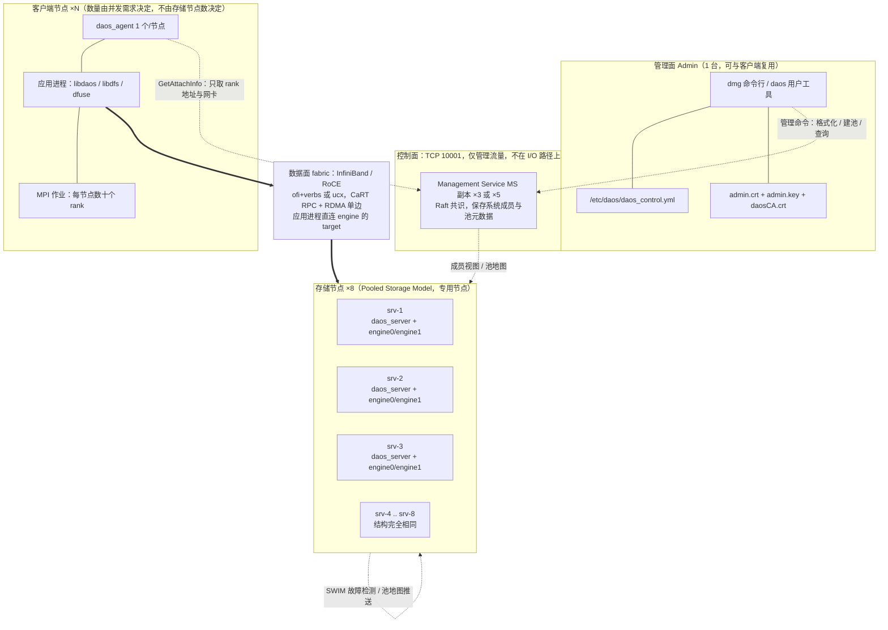
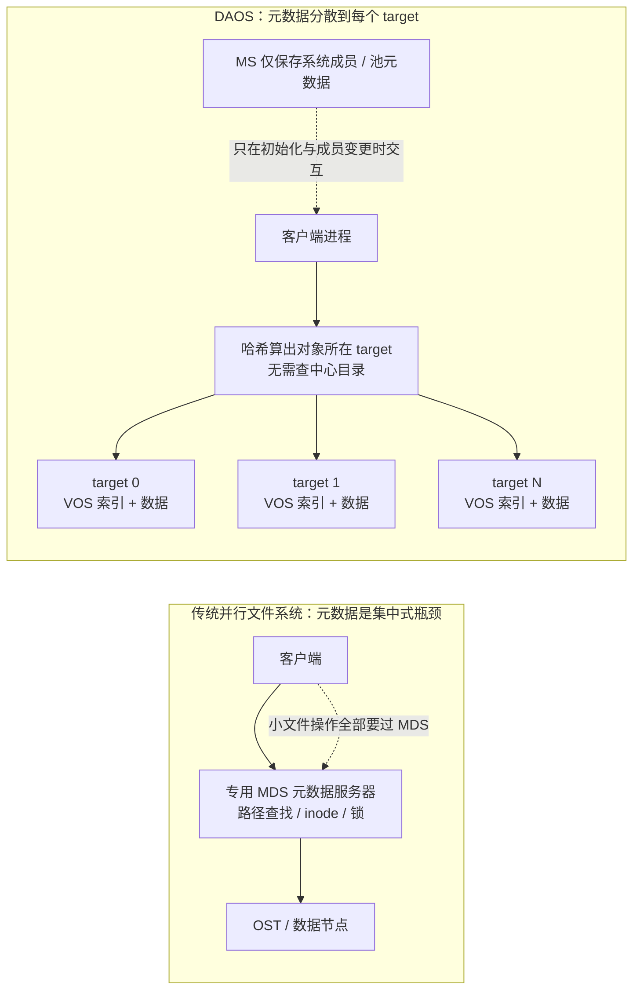
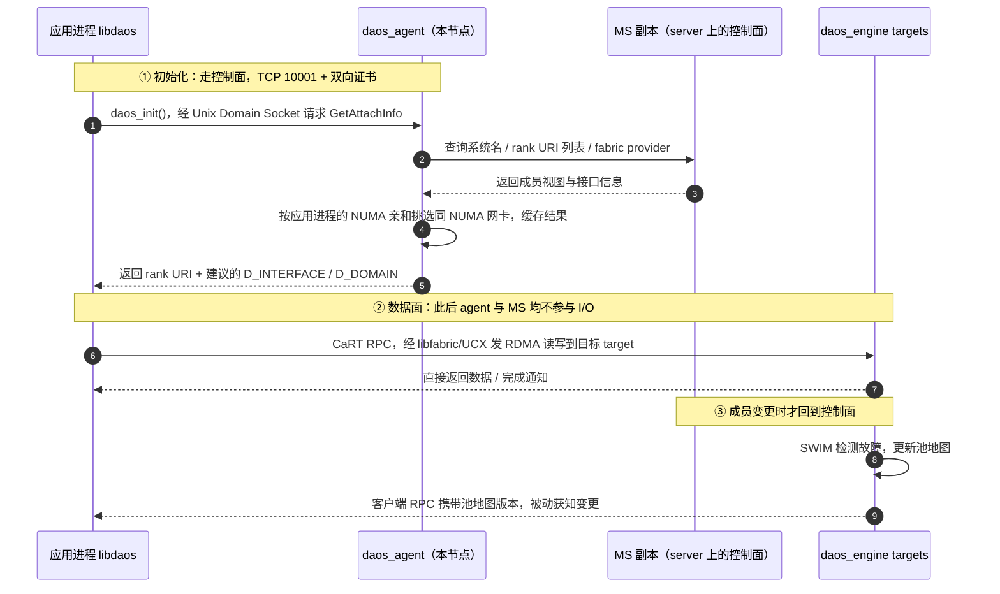
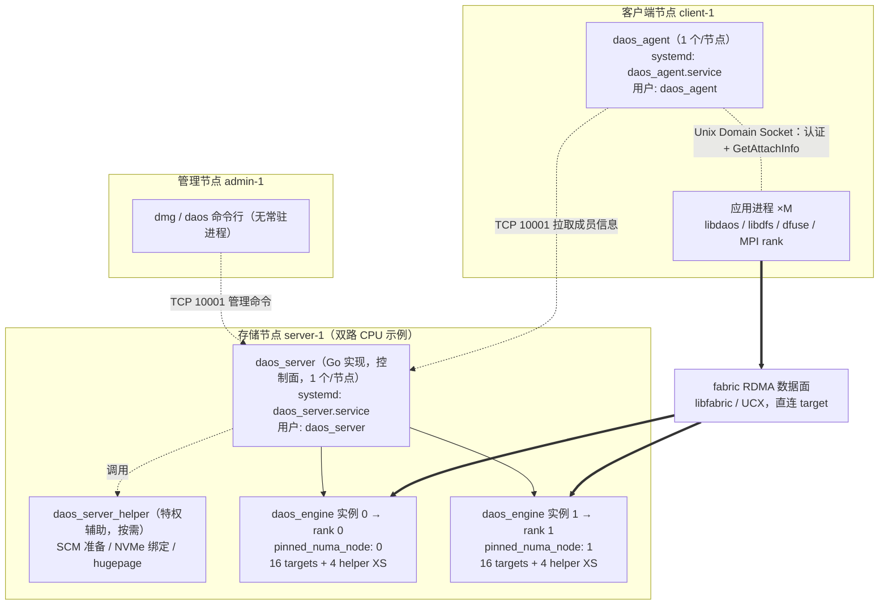
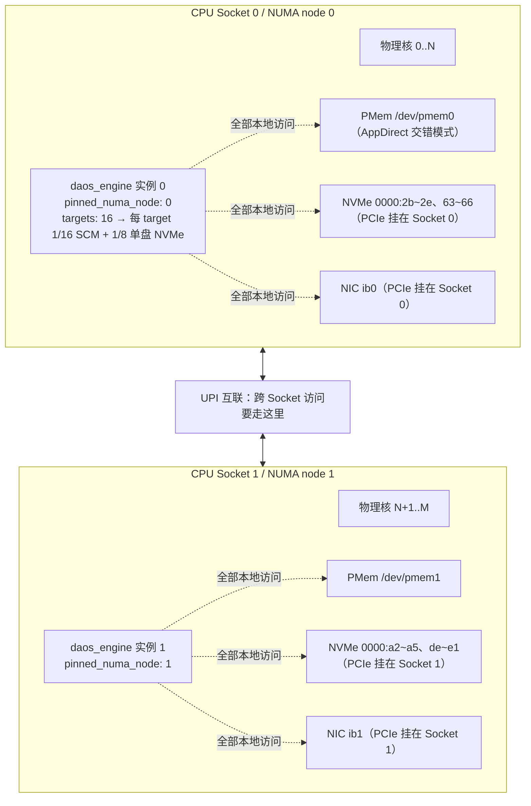
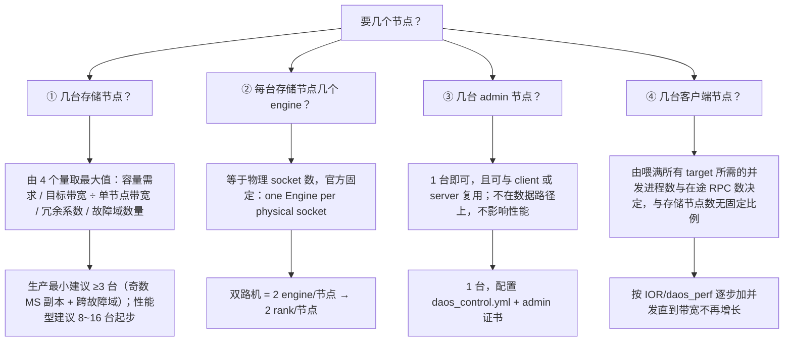
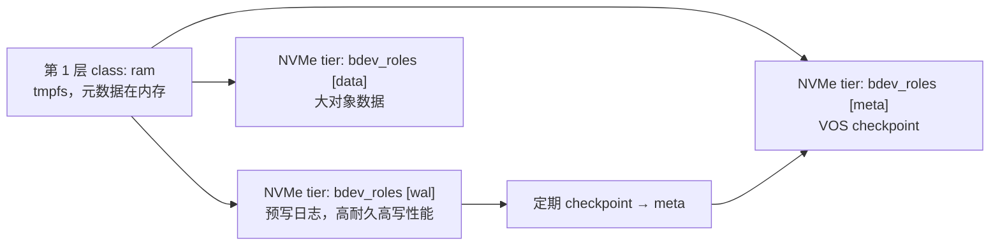
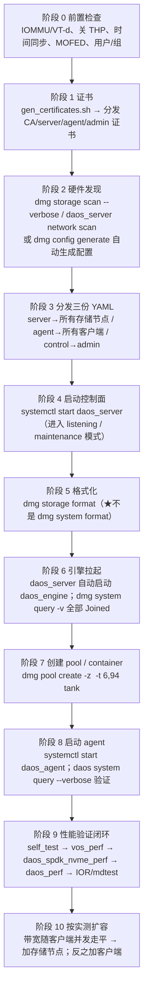
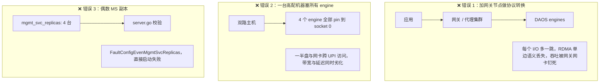

这篇文章回答一个很具体的问题：**如果我要把 DAOS 部署到性能最好，究竟该买几台机器、每台机器跑什么进程、配置文件每个字段为什么填这个值？**

网上流传的 DAOS 部署图里，经常出现"网关节点""元数据节点""客户端节点数必须大于等于服务器节点数""SCM:NVMe 按 1:16 配""`dmg system format`"这类说法。我先把结论摆在前面：**其中相当一部分在当前的 DAOS 官方文档和源码里并不成立**。这篇文章的每一条设计结论都回到官方一手依据——`docs/admin/`、`docs/overview/`、`utils/config/`，以及 `src/control/server/config/server.go` 的实际校验逻辑，并给出文件路径与行号，方便你自己复核。

> **依据版本**：本地 DAOS 源码仓 `D:/Codes/github/daos`，`git rev-parse --short HEAD` = `788f8773b6`（master 分支，DAOS 2.8 世代）。文中所有"官方"均指该仓库内的文档与配置样例，或 [docs.daos.io](https://docs.daos.io/) 对应内容。**配置字段名在 2.8 前后有改名，照抄旧博客会直接启动失败**，文中会逐一标出。

---

## 〇、结论先行：一张图 + 四句话

先看推荐的物理拓扑。这是一套**中等规模、面向吞吐与 IOPS 的生产参考配置**（8 台存储节点 + 1 台管理节点 + 若干客户端），后文会解释每个数字怎么推出来：



**四句话总结**：

1. **DAOS 官方只定义三类节点角色**：`server`（存储节点）、`client`（客户端节点）、`admin`（管理节点），且明确允许一机多角色。**没有 gateway 节点，也没有专用的 metadata 节点**——这两类角色在官方文档里不存在。
2. **"性能最佳"的基本单位不是节点，是 engine**：每个物理 CPU socket 跑一个 `daos_engine` 进程，每个 engine 内再切若干 `target`，每个 target 独享核、独享一份 SCM/NVMe 切分、独享一个网络端点。节点数只是 engine 数的容器。
3. **节点数量由四个独立问题决定**，不该混成一个数：几台存储节点（容量 + 带宽 + 故障域 + 冗余）、每台几个 engine（socket 数）、几台 admin（1 台够，且不在数据路径）、几台客户端（喂满所有 target 所需的并发进程数）。官方文档**没有**"客户端节点数 ≥ 服务器节点数"的规定。
4. **控制面与数据面必须彻底分开**：管理流量走 TCP 10001 和证书认证，I/O 流量走 fabric 上的 RDMA 直接打到 target。**任何放在数据路径中间的代理都会破坏 DAOS 全用户态 OS bypass 的设计前提**——这正是"不要网关节点"的根本原因。

---

## 一、先纠正七个高频误读（都有源码或文档依据）

写部署方案前，先把最常见、也最容易让集群起不来的错误列出来。这一节是全篇的"防坑地基"。

| # | 常见说法 | 实际情况 | 一手依据 |
|---|---|---|---|
| 1 | 格式化用 `dmg system format` | 当前 master 是 **`dmg storage format`**，`dmg system` 下没有 format 子命令 | `docs/admin/deployment.md:14, 562, 1583`；`docs/QSG/setup_rhel.md:417` |
| 2 | server 配置里写 `access_points` | server 侧自 2.8 起**已废弃**，改用 **`mgmt_svc_replicas`**；两者同时写会直接报错 | `src/control/server/config/server.go`：`msgAPsMSReps = "access_points is deprecated; please use mgmt_svc_replicas instead"`；`utils/config/daos_server.yml:28` |
| 3 | `access_points` 全都不能用了 | **agent 侧仍然在用**（`daos_agent.yml` 的字段名没改），server 侧才改名 | `src/control/cmd/daos_agent/config.go`：`AccessPoints []string yaml:"access_points"`；`utils/config/daos_agent.yml:21`；`docs/QSG/setup_rhel.md:365` |
| 4 | 要单独部署 gateway / metadata 节点 | 官方文档**未定义**这两类节点角色；元数据分散在每个 target 的 VOS 里，MS 只存系统/池元数据 | `docs/overview/architecture.md:96-128, 168-192`；`docs/overview/fault.md:23-26` |
| 5 | 客户端节点数必须 ≥ 服务器节点数 | 官方**没有**这个规则；官方 QSG 的示例甚至是 2 台 server + 2 台 client + 1 台 admin | `docs/QSG/setup_rhel.md:16-19, 42-54` |
| 6 | SCM:NVMe 按 1:16 配 | 官方原文是 **minimum 6% ratio**（≈1:16.7），且 pool 默认 `--tier-ratio=6,94`；6% 是**下限**不是推荐最优值 | `docs/admin/hardware.md:81-87`；`docs/admin/pool_operations.md:59, 117` |
| 7 | MS 副本想配几个配几个 | 源码**强制奇数**：偶数直接返回 `FaultConfigEvenMgmtSvcReplicas`；1 个只告警不报错，但明确"无冗余" | `src/control/server/config/server.go` 的 `switch { case len(...)%2 == 0 ... }` |

还有一条容易写错的：不要在文章里把"SPDK 用户态轮询会占满 CPU 核"当成官方原话。官方文档的说法是 **"每 target 需要足够物理核，另需为系统服务预留 2 核"**，以及每 target 需要 1 GiB hugepage 空间，见 `docs/admin/deployment.md:1564-1571` 与 `utils/config/daos_server.yml:212-224`。结论方向对，但表述要回到原文。

> **为什么第 2、3 条最容易踩坑**：`daos_server.yml` 和 `daos_agent.yml` 是两份不同的文件，一次改名只改了 server 侧。很多部署脚本把两个文件用同一份模板生成，结果 server 用了 `mgmt_svc_replicas`、agent 也被改成同一个键，agent 就会静默回落到默认 `localhost`，客户端连不上集群。写配置时务必分开对待。

---

## 二、DAOS 只有三类节点角色，以及为什么没有"元数据节点"

### 2.1 官方的角色划分

`docs/QSG/setup_rhel.md:16-19` 写得很直白：

> "The following steps require two or more hosts which will be divided up into **admin, client, and server roles**. **One node can be used for multiple roles.** For example the admin role can reside on a server, on a client, or on a dedicated admin node."

三类角色的职责边界：

| 角色 | 装的 RPM | 常驻进程 | 是否在数据路径上 | 需要证书 | 典型数量 |
|---|---|---|---|---|---|
| **server**（存储节点） | `daos-server` | `daos_server` ×1/节点 + `daos_engine` ×N/节点 + `daos_server_helper`（特权辅助，按需） | **是**，所有 I/O 终点 | CA + server.crt/key + 全部 agent.crt（放 `client_cert_dir`） | 由容量/带宽/故障域决定 |
| **client**（计算/客户端节点） | `daos-client` | `daos_agent` ×1/节点 + 应用进程（`libdaos`/`libdfs`/`dfuse`） | **是**，但 agent 不在数据路径 | CA + agent.crt/key | 由并发需求决定 |
| **admin**（管理节点） | `daos-admin` | 无常驻进程，只跑 `dmg` / `daos` 命令 | **否** | CA + admin.crt/key | 1 台即可，可复用 |

依据：`docs/QSG/setup_rhel.md:62-95, 103-129`、`docs/admin/deployment.md:725-785`、`docs/admin/predeployment_check.md:112`（"Nodes with the DAOS admin role do not need any specific user/group setup"）。

注意一个反直觉的点：**admin 节点不需要任何 DAOS 专用用户/组，也不跑 DAOS 守护进程**。它只是一个拿着 admin 证书、能连到 TCP 10001 的命令行终端。所以"要不要单独买一台管理机"纯粹是运维隔离考量，与性能无关。

### 2.2 为什么不需要专用元数据节点

这是 DAOS 与传统并行文件系统（Lustre 的 MDS、GPFS 的元数据节点）最本质的结构差异：



`docs/overview/architecture.md:104-128` 定义了层级：一个 DAOS **system** 由一组 storage node 组成，每节点一个 **server** 进程，每物理 socket 一个 **engine** 进程，engine 内部的存储静态切分为多个 **target**；每个 target 有自己的私有存储、自己的服务线程池、自己可直接寻址的网络端点。`docs/overview/architecture.md:151-159` 补了一句关键定性：**target 既是故障单元，也是性能单元**。

`docs/overview/fault.md:23-26` 则说明了元数据冗余的做法：

> "Pool metadata are replicated on several nodes from different high-level fault domains for high availability, whereas object data can be replicated or erasure-coded over a variable number of fault domains depending on the selected object class."

也就是说：**池/容器元数据由 MS 用 Raft 在少数几个节点上复制，对象元数据则跟着数据一起分散在每个 target 的 VOS 里**。两种元数据都不需要一台"元数据服务器"。既然没有这个组件，自然也不该规划"元数据节点"。

### 2.3 为什么不应该有网关节点

`docs/overview/architecture.md:9-14` 定义了 DAOS 的设计前提：

> "DAOS is architected from the ground up to exploit new NVM technologies and is extremely lightweight since it operates **End-to-End (E2E) in user space with full OS bypass**."

`docs/overview/architecture.md:168-192` 进一步说明客户端侧：`libdaos` 实现存储模型，`dmg` 走管理 API；而 `docs/overview/architecture.md:186-192` 说明 agent 的定位：

> "The DAOS agent is a daemon residing on the client nodes that interacts with the DAOS library to **authenticate the application processes**. It is a trusted entity that can sign the DAOS library credentials using certificates. The agent ... uses a **Unix Domain Socket** to communicate with the DAOS library."

**关键推理链**：agent 通过 Unix Domain Socket 给应用做认证和"该连哪个 rank / 用哪张网卡"的指引，**认证完成之后，应用进程的 `libdaos` 直接通过 CaRT/Mercury RPC 经 RDMA 与 engine 的 target 通信，数据流不经过 agent**。这一点在 `docs/admin/performance_tuning.md:579-588` 的 Client Tuning 章节也能对上：agent 只在 `daos_init()` 的 `GetAttachInfo` 阶段返回网络接口信息，用于初始化 CaRT，之后就是客户端与 engine 的直连。

所以如果加一层网关去做协议转换或请求转发，等于把已经 bypass 掉的串行点又加回来了：RDMA 单边语义没了、每次 I/O 多一跳、吞吐上限被单机网卡钉死。**DAOS 的高性能恰恰来自"没有中间层"**。

### 2.4 控制面与数据面：一次连接的完整时序



这张图解释了一个非常实用的部署判断：**管理网可以慢、可以是带外 IPoIB，甚至只在部署和扩容时才用；fabric 才是性能命脉**。`docs/admin/hardware.md:53-58` 也提到，大规模集群里管理面通常还会额外用一张带外网络把 DAOS 服务节点连起来，与数据 fabric 分离。

---

## 三、每台节点到底跑哪些进程、开哪些端口

### 3.1 进程清单



几个容易混淆的层级，务必分清：

- **`daos_server` 是每节点一个**，不是每 engine 一个。它是 Go 写的控制面守护进程，负责解析 YAML、发现硬件、拉起 engine、管理成员、响应 `dmg`。见 `docs/overview/architecture.md:112-122`。
- **`daos_engine` 是每 socket 一个**，是 C 写的数据面进程，真正处理 I/O。官方文档原话："which in turn starts **one DAOS Engine process per physical socket**"（`docs/overview/architecture.md:106-107`）。
- **rank 是给 engine 编号，不是给节点编号**。"Membership of the DAOS servers is recorded into the system map, that assigns a unique integer **rank** to each **Engine** process"（`docs/overview/architecture.md:108-110`）。所以一台双路存储节点会贡献 2 个 rank。QSG 的真实输出也印证了这一点：2 台 server 节点产生 rank 0~3（`docs/QSG/setup_rhel.md:424-430`）。
- **target 是 engine 内部的线程/存储切分单位**，不是进程。tag 0 给元数据服务、tag 1 给 SWIM 监控、tag 2~(N+1) 给 N 个 target、再往后给 helper 线程（`docs/admin/performance_tuning.md:37-52`）。一个 `targets:16, nr_xs_helpers:4` 的 engine 共导出 21 个可寻址端点。

> 这里的 rank 和上一篇文章讲的 IO500/MPI rank 是**两个完全不同的概念**：MPI rank 是客户端并行进程编号，DAOS rank 是服务端 engine 编号。部署时别混。

### 3.2 端口与通信矩阵

| 端口 | 方向 | 协议 | 用途 | 依据 |
|---|---|---|---|---|
| **10001** | admin/agent → 所有 server 控制面 | gRPC over TLS | 管理命令、GetAttachInfo、MS 副本间通信。默认值，可用 `port:` 改 | `utils/config/daos_server.yml:47-53`；`docs/admin/predeployment_check.md:206-209` |
| **31416 / 32416 / 31316 等** | client ↔ engine，engine ↔ engine | libfabric / UCX，RDMA | 数据面 `fabric_iface_port`。**同一节点上若多个 engine 共用同一网卡，端口必须互不相同** | `utils/config/daos_server.yml:418-422`；`utils/config/examples/daos_server_verbs.yml` |
| **9191** | 采集端 → server | HTTP | server telemetry（默认关闭，需 `telemetry_port` 开启） | `utils/config/daos_server.yml:308-312` |
| **9192** | 采集端 → agent | HTTP | 客户端 telemetry（默认关闭） | `utils/config/daos_agent.yml:27-33` |
| Unix Domain Socket | 本节点内 | UDS | 应用 ↔ agent、控制面组件间。默认 `/var/run/daos_agent`、`/var/run/daos_server` | `utils/config/daos_agent.yml:103-110`；`utils/config/daos_server.yml:197-209` |

**防火墙只需要放行 10001**（`docs/admin/predeployment_check.md:204-212` 明确：如果 10001 被拦，`dmg` 和远端 `daos_agent` 都连不上 server）。数据面端口由 fabric provider 管理，不走 Linux 防火墙那套 TCP 规则；但**多网卡时的内核网络参数必须调**，见第九节。

### 3.3 单节点内部：为什么是"一 socket 一 engine"

这是"性能最佳部署"里最硬的一条架构约束：



`docs/admin/hardware.md:108-129` 给出了完整理由，值得逐句引用：

- 双路 Xeon 平台上，PCIe lane 天然亲和某一个 CPU；从远端 socket 访问 NVMe / NIC 会产生不同的性能特征（**更高延迟、更低带宽**）。
- 跨 socket 访问要经过 UPI 链路，**UPI 可能成为拥塞点**。
- 持久内存本身也是 NUMA 的，CPU 亲和必须被遵守才能拿到最好性能。
- 结论原文："This can be achieved by **spawning one instance of the I/O Engine per CPU**, then accessing only the persistent memory and PCI devices local to that CPU from that server instance."

配置层面的对应项：

| 配置项 | 推荐值 | 为什么 |
|---|---|---|
| `pinned_numa_node` | 每个 engine 对应一个 socket，如 0 / 1 | 让 engine 绑定该 NUMA 节点的核与内存，`fabric_iface` 也必须在同一 NUMA 节点（`utils/config/daos_server.yml:388-396`） |
| `fabric_iface` | engine0 → `ib0`，engine1 → `ib1` | 一个 engine 一张网卡；`docs/admin/hardware.md:44-51` |
| `fabric_iface_port` | 每 engine 不同（31416 / 32416） | 共用网卡时端口必须区分（`utils/config/daos_server.yml:418-422`） |
| `scm_list` / `scm_mount` | 每 engine 不同的 pmem 设备与挂载点 | 同一 pmem namespace 不能给两个 engine |
| `bdev_list` | 只填与该 socket 亲和的 NVMe PCI 地址 | "Devices with the same NUMA node/socket should be used in the same per-engine section"（`docs/admin/deployment.md:1046-1047`） |
| `first_core` vs `pinned_numa_node` | **二选一，不能同时设** | `utils/config/daos_server.yml:394, 404` |

`dmg config generate` 默认就把 engine 数设为 NUMA 节点数，并且强制所有硬件组件绑到同一 NUMA 节点（`docs/admin/deployment.md:380-390`）。它还有一个 `--allow-numa-imbalance` 开关，官方明确警告会 "**may result in suboptimal performance** due to cross-NUMA memory access"（`docs/admin/deployment.md:417-430`）——除非盘数实在不均衡，别开。

> **一个很实际的坑**：`dmg config generate` 选 NUMA 节点时**优先按网卡优先级选，盘数只作为平局时的 tie-breaker**（`docs/admin/deployment.md:386-390`）。也就是说，一个盘少但网卡优先级高的 NUMA 节点可能被选中。生成配置后一定要人工扫一眼 `bdev_list` 与 `pinned_numa_node` 是否对得上。

---

## 四、要几个节点？把一个问题拆成四个问题

用户最常问"到底要几个节点"，但这个问题在 DAOS 里没有单一答案。按官方约束拆开后，每一问都有明确的决定因素。

### 4.1 决策树



### 4.2 ① 存储节点数：四个约束取最大值

**约束 A：容量**。所有节点的可用 SCM 与 NVMe 相加，再除以冗余开销。注意 `dmg pool create --size=100%` 用的是**所有 engine 中最小的空闲空间**作为公分母（`docs/admin/pool_operations.md:66-75`），所以硬件必须**同构**——这也是 `dmg config generate` 要求 hostset 内硬件配置一致的原因（`docs/admin/deployment.md:56-58, 437-450`）。

**约束 B：带宽**。`docs/admin/hardware.md:93-104` 给出了官方的平衡关系：

> "Since NVMe SSDs have read faster than they write, a **200Gbps PCIe4 x4 NIC can be balanced for read only workloads by 4 NVMe4 x4 SSDs, but for write workloads by 8 NVMe4 x4 SSDs**."

也就是说，单节点的带宽上限是 `min(NIC 带宽, NVMe 聚合带宽)`，且读写比例会改变最优点。工程估算：

```
存储节点数 N_s ≥ 目标可持续带宽 / (单节点 min(NIC, NVMe 聚合) ÷ 冗余系数)
```

其中 EC `16P1` 的容量开销约 17/16，2 副本约 2×。**注意这是工程估算方法，不是官方公式**；官方给的是"平衡网络与存储带宽"的设计原则，没有给出可直接套用的节点数公式。

**约束 C：冗余与故障域**。`docs/admin/hardware.md:132-145`：

> "DAOS relies on single-ported storage massively distributed across different storage nodes. Each storage node is thus a single point of failure... **For efficient placement and optimal data resilience, more fault domains are better. As a result, it is preferable to distribute storage nodes across as many racks as possible.**"

对象类决定了需要多少个互不重叠的故障域：副本类 `RP_2G1` 至少要 2 个域，纠删码类 `EC_16P1GX` 需要 17 个分片分散到不同域才能发挥设计意图（`docs/overview/fault.md:23-26` 说明"over a variable number of fault domains depending on the selected object class"）。**这直接决定了"最低几台机器"**：想用宽 EC 又要每个分片落在不同机架，就得有对应数量的机架/节点。

**约束 D：MS 副本必须是奇数**。这是源码级硬约束，见 `src/control/server/config/server.go`：

```go
switch {
case len(cfg.MgmtSvcReplicas) < 1:
    return FaultConfigBadMgmtSvcReplicas
case len(cfg.MgmtSvcReplicas)%2 == 0:
    return FaultConfigEvenMgmtSvcReplicas
case len(cfg.MgmtSvcReplicas) == 1:
    log.Noticef("Configuration includes only one MS replica. This provides no redundancy " +
        "in the event of a MS replica failure.")
}
```

- `utils/config/daos_server.yml:18-22` 建议 **"Choose 3-5 hosts to serve as replicas, preferably not co-located within the same fault domains"**，并说明 "DAOS requires a **quorum** of Management Service (MS) replica hosts to be available"。
- `docs/admin/deployment.md:1408-1411` 的措辞是 **"Pick an odd number (3-7) of hosts"**。
- 两处给出的范围略有差异（3-5 vs 3-7），但**"奇数 + quorum"是一致的硬要求**。实践上取 **3 或 5**：3 可容忍 1 台故障，5 可容忍 2 台，再大的副本数只会增加 Raft 提交开销。

> **术语提醒**：MS（Management Service，系统级，配在 `mgmt_svc_replicas`）和 pool service（池级，配在 `dmg pool create` 的 `--nsvc` / `svc_rf`）是两层不同的复制组，别混。`docs/admin/pool_operations.md` 说明 pool 默认就带 pool service 冗余（示例输出 replicas on ranks 1-5），要关掉得显式 `--properties=svc_rf:0` 或 `--nsvc=1`。

### 4.3 四档参考配置（本文给出的工程建议，非官方规定）

| 档位 | 存储节点 | MS 副本 | engine 总数（双路） | admin | 客户端 | 适用场景 | 关键限制 |
|---|---|---|---|---|---|---|---|
| **A. 功能验证** | 1~2 | 1 | 2~4 | 复用 | 复用 | 学命令、跑通 `dmg storage format`、CI | 源码只 warning，但**无任何 MS 冗余**，机器一挂系统元数据就丢；不能验证 HA 与 rebuild |
| **B. 生产最小可用** | **3** | **3** | 6 | 1（可复用） | ≥2 | 小规模生产、功能与故障演练齐全 | 3 个故障域刚好够 `RP_2G1` 类，宽 EC 施展不开；单点容量有限 |
| **C. 性能推荐起点** | **8~16** | 3 或 5 | 16~32 → 256~512 targets | 1 | 从 2~4 台起步按实测扩 | 要跑 IO500 / 训练数据加载 / checkpoint | 需要同构硬件、至少 200Gbps fabric、跨机架故障域 |
| **D. 超大规模参考** | 数百至千级 | 3~5 | 千级 | 独立管理网 | 数千计算节点 | Aurora 级部署 | 需要带外管理网、专门的运维体系 |

档 C 的推导：双路机 × 16 targets/engine × 2 engine/节点 = **32 targets/节点**；8 台即 256 targets，16 台即 512 targets。这个量级才有足够的独立网络端点与存储分片去吸收大规模并发，也才有足够的故障域去放 EC 分片。

**官方真实系统做参照**（数据来自我上一篇文章《DAOS 性能全景》核过的一手资料）：

| 系统 | 存储侧 | 客户端侧 | 说明 |
|---|---|---|---|
| Aurora（IO500 生产榜提交） | **642 台存储服务器 / 1284 个 engine** | 300 个客户端节点 × 208 rank = 62,400 rank | 整套 Aurora DAOS 共 1024 个节点；pool 160 PiB |
| SuperMUC-NG Phase 2（IO500） | **42 台存储节点** | **90 台客户端节点** | 客户端远多于存储节点 |
| 官方 QSG 示例 | **2 台**（`server-1,server-2`） | **2 台**（`client-1,client-2`）+ 1 台 admin | "two or more hosts"，且明确可一机多角色 |

这三组数字放在一起就能看出：**客户端与存储节点的数量比毫无规律**（Aurora 约 1:2、SuperMUC 约 2:1、QSG 1:1）。真正决定客户端数量的是并发能力，不是比例。

### 4.4 ② 每台几个 engine：等于 socket 数，不是可自由调的性能旋钮

官方定义固定：`one DAOS Engine process per physical socket`（`docs/overview/architecture.md:106-107`）。`dmg config generate --num-engines` 的默认值也是检测到的 NUMA 节点数（`docs/admin/deployment.md:380-382`）。

**不要为了"多切几个进程"而人为调高 engine 数**：`docs/admin/deployment.md:446-452` 把 "NUMA node count doesn't meet the num-engines requirement" 列为配置生成失败的原因之一；强行用 `--allow-numa-imbalance` 绕过去，代价就是跨 NUMA 访问。多 engine 的价值在于**让每个 engine 只碰本地 PCIe 设备**，不是简单增加进程数。

### 4.5 ③ admin 节点：1 台，且完全不影响性能

`docs/admin/predeployment_check.md:112` 说 admin 角色节点不需要任何专用用户/组；`docs/QSG/setup_rhel.md:16-19` 说 admin 可以落在 server、client 或独立节点上。它只需要在 `/etc/daos/daos_control.yml` 里配好 `hostlist`、`port` 和 admin 证书（`utils/config/daos_control.yml`）。

**部署建议**：生产环境仍建议独立一台（哪怕虚拟机），理由是运维权限隔离与审计，而不是性能。别把它画进数据路径图里。

### 4.6 ④ 客户端节点数：由并发驱动能力决定

这是最容易被"节点比例论"误导的一问。官方给的是**调优方法**而非配比规则：

- `docs/admin/performance_tuning.md:567-573`：**客户端必须显式绑定 NUMA 节点**，这样 agent 才能从进程 PID 推断 NUMA 亲和、分配同 NUMA 的网卡，用于初始化 CaRT。
- `docs/admin/performance_tuning.md:590-592`：同一 NUMA 节点有多张合适网卡时，agent 用 **round-robin** 分摊。
- `docs/admin/performance_tuning.md:594-606`：客户端绑到没有对应网卡的 NUMA 节点时会退回默认响应，agent 日志会打 `No network devices bound to client NUMA node X. Using response from NUMA Y`——**看到这条日志就该去查绑核或 fabric 扫描**，性能会莫名变差。
- `docs/admin/hardware.md:47-51`：DAOS **不支持网络级条带化**，"a **single client process will always use a single network link**"；多网卡的利用方式是"把不同客户端进程分配到不同网卡"，以及服务端"把不同 engine 绑到不同网卡"。
- `docs/admin/performance_tuning.md:13-15, 66-68`：用 CaRT `self_test` 的 `--max-inflight-rpcs` 探测在途 RPC 数的饱和点。

**可操作的扩容方法**（工程做法，不是官方硬性数字）：

1. 先用 `self_test` 打裸网络，找到空 RPC 速率与 1 MiB bulk 带宽的饱和在途数。
2. 再用 `daos_perf` / `ior` 从小到大加客户端进程数，观察聚合带宽曲线。
3. 曲线走平的那个并发量，就是"喂满现有 targets"所需的进程数；把它除以每台客户端能稳定承载的进程数，得到客户端节点数。
4. **当增加客户端进程已不再提升带宽时，瓶颈已转移到存储侧**（网卡、NVMe 或 target 数），此时该加的是存储节点，不是客户端节点。

Aurora 上的实测经验（来自 PDSW 2024 论文《Initial Experiences with DAOS Object Storage on Aurora》，非官方配置规范）可作数量级参考：单节点 IOR 约 32 个进程趋于饱和，CART `self_test` 约 16 个在途 RPC 收敛。这类数字**与硬件强相关，必须自己实测**。

---

## 五、逐字段拆解：一份生产级 `daos_server.yml`

下面这份配置对应**档 C 的双路存储节点**，`mgmt_svc_replicas` 取 3 台（`srv-1/2/3`）。每个字段后面的注释就是"为什么这么填"，并且注明官方依据。

```yaml
# /etc/daos/daos_server.yml —— 所有存储节点使用同一份（硬件同构是前提）
# 依据：utils/config/daos_server.yml（living documentation）
#       utils/config/examples/daos_server_verbs.yml
#       docs/admin/deployment.md "Example Configurations"

name: daos_server
# 系统名。所有 server / agent / control 配置必须一致；dmg storage format 之后不可改。
# utils/config/daos_server.yml:8-12 ; daos_agent.yml:12-16

# ── 管理面：3 个 MS 副本，必须是奇数 ─────────────────────────────
mgmt_svc_replicas: ['srv-1', 'srv-2', 'srv-3']
# 源码强制 %2 != 0；官方建议 3-5 台且跨故障域分布。
# 注意：这里写主机名即可，端口自动补 port: 10001。
# src/control/server/config/server.go ; utils/config/daos_server.yml:15-28

port: 10001
# 控制面 gRPC 监听端口，防火墙必须放行。
# docs/admin/predeployment_check.md:204-212

control_iface: eth0
# 可选：把控制面限制在带外管理网卡上，与数据 fabric 隔离。
# 大规模集群尤其推荐；不设则绑定 0.0.0.0。
# utils/config/daos_server.yml:56-67 ; docs/admin/hardware.md:53-58

# ── 证书：生产必须开，allow_insecure 仅限实验 ────────────────────
transport_config:
  allow_insecure: false
  client_cert_dir: /etc/daos/certs/clients   # 所有 agent 证书都要放这里
  ca_cert: /etc/daos/certs/daosCA.crt
  cert: /etc/daos/certs/server.crt
  key: /etc/daos/certs/server.key
# docs/admin/deployment.md:678-785

# ── 数据面 provider：整套系统只能有一个 ──────────────────────────
provider: ofi+verbs;ofi_rxm
# 用 `dmg network scan -p all` 先看硬件支持什么；IB/RoCE 首选 verbs，
# NVIDIA IB/RoCE 也可用 ucx；纯以太网用 ofi+tcp（性能明显更低）。
# docs/admin/hardware.md:33-42 ; docs/admin/deployment.md:1481-1486

fault_path: /rack1/srv-1
# 可选：显式声明故障域层级。不设时默认是 /hostname。
# 想用宽 EC 又想跨机架放置，必须把这一层配好。
# utils/config/daos_server.yml:87-91 ; docs/admin/hardware.md:132-145

# ── 全局资源 ────────────────────────────────────────────────────
nr_hugepages: 16384
# 通常不用手填：官方按 "每 target 1 GiB" 自动算。
# 手动核算示例：2 engine × 16 target × 1 GiB ÷ 2 MiB/页 = 16384 页。
# 配 NVMe 时 hugepage 是必需的，THP 则必须关闭。
# utils/config/daos_server.yml:212-230 ; docs/admin/deployment.md:836-858

control_log_mask: DEBUG
control_log_file: /var/log/daos/daos_server.log
helper_log_file: /var/log/daos/daos_server_helper.log
telemetry_port: 9191
# docs/admin/starting-daos.md:23-25 推荐 DEBUG，便于看 engine 启动过程。

engines:
  # ===== 实例 0：NUMA node 0 =====
  - pinned_numa_node: 0
    # 与 first_core 二选一；必须与 fabric_iface / pmem / NVMe 同属 socket 0。
    targets: 16
    # I/O 服务线程数 = 端点数 = 存储分片数。
    # 两条约束：① 应为 bdev_list 中盘数的整数倍；
    #          ② 官方说 "around 16 targets usually work well"。
    # 上限：pmem 模式每盘最多 64 targets；MD-on-SSD 三角色时每盘最多 21。
    # utils/config/daos_server.yml:352-371 ; docs/admin/deployment.md:1541-1555
    nr_xs_helpers: 4
    # offload 线程：校验和计算、服务端 RPC 分发。
    # 用 EC 时官方推荐 1:4 → 16 targets 配 4 helpers。
    # utils/config/daos_server.yml:373-386 ; docs/admin/deployment.md:1557-1562
    fabric_iface: ib0
    fabric_iface_port: 31416
    log_mask: INFO
    log_file: /var/log/daos/daos_engine.0.log
    env_vars:
      - CRT_TIMEOUT=30
    storage:
      - class: dcpm              # 真 PMem：AppDirect 交错模式的 namespace
        scm_list: [/dev/pmem0]   # 每 engine 只能 1 个 namespace
        scm_mount: /mnt/daos0    # 每 engine 唯一挂载点
      - class: nvme
        bdev_list: ["0000:2b:00.0", "0000:2c:00.0",
                    "0000:2d:00.0", "0000:2e:00.0",
                    "0000:63:00.0", "0000:64:00.0",
                    "0000:65:00.0", "0000:66:00.0"]
        # 8 块盘 × 200Gbps 网卡：写密集负载的平衡点（读为主 4 块即可）。
        # 只填 dmg storage scan 中和 socket 0 亲和的地址。
        # docs/admin/hardware.md:93-104 ; docs/admin/deployment.md:1046-1047

  # ===== 实例 1：NUMA node 1 =====
  - pinned_numa_node: 1
    targets: 16
    nr_xs_helpers: 4
    fabric_iface: ib1
    fabric_iface_port: 32416     # 同节点不同 engine，端口必须区分
    log_mask: INFO
    log_file: /var/log/daos/daos_engine.1.log
    env_vars:
      - CRT_TIMEOUT=30
    storage:
      - class: dcpm
        scm_list: [/dev/pmem1]
        scm_mount: /mnt/daos1
      - class: nvme
        bdev_list: ["0000:a2:00.0", "0000:a3:00.0",
                    "0000:a4:00.0", "0000:a5:00.0",
                    "0000:de:00.0", "0000:df:00.0",
                    "0000:e0:00.0", "0000:e1:00.0"]
```

### 5.1 为什么 `targets: 16` 是常见起点

三条官方约束叠出来的交集：

1. **盘数整除**：`docs/admin/deployment.md:1550-1552` 与 `docs/overview/architecture.md:161-166` 都要求 targets 是 `bdev_list` 盘数的整数倍，否则每个 target 分到的 NVMe 空间不均。8 块盘 → 8/16/24/32 都可取。
2. **SCM 并发度**：`docs/admin/deployment.md:1554-1555`："To obtain the maximum SCM performance, a certain number of targets is needed... **around 16 targets usually work well**."
3. **物理核够用**：`docs/admin/deployment.md:1564-1571`："The server should have sufficiently many physical cores to support the number of targets plus the additional service threads"，且**还要预留 2 个核给系统服务**。核不够会直接拒绝启动 engine，除非设 `DAOS_TARGET_OVERSUBSCRIBE=1`（官方明说会伤性能）。

所以 16 targets + 4 helpers = 20 个服务线程，加 2 个系统核，双路机每个 socket 至少要 22 个物理核才舒服。**先数核，再填 targets**，顺序反了会返工。

### 5.2 `nr_xs_helpers: 4` 的理由

`utils/config/daos_server.yml:373-386` 说明这些线程用于"accelerate checksum and server-side RPC dispatch"，并给出 EC 场景的明确配比："**When using EC, it is recommended to configure helper threads in roughly a 1:4 ratio to the number of target threads**"。默认值是 0（用 target 线程兼做），但开纠删码时校验和/编码计算会挤占 I/O 线程，所以生产 + EC 建议按 1:4 配。

### 5.3 6% SCM 比例到底从哪来

`docs/admin/hardware.md:81-87` 原文：

> "A **minimum 6% ratio of SCM to SSD capacity** will guarantee that DAOS has enough space in SCM to store its internal metadata (e.g., pool metadata, SSD block allocation tracking). Lower ratios are possible, but ... if the ratio is too low, it is possible to have bulk storage available but **insufficient SCM for DAOS metadata**."

也就是说 6% 是**为了保证内部元数据（尤其是 SSD 块分配跟踪）放得下**给出的下限，不是"性能最优值"。`dmg pool create` 默认就按这个比例切：`--tier-ratio=6,94`（`docs/admin/pool_operations.md:55-64, 115-118`）。

硬件侧对应的是 `docs/admin/hardware.md:100-104`：SSD 容量决定"提供 6% 比例所需的 Optane PMem DIMM 最小容量"。工程上建议**留余量到 8%~10%**，尤其是小文件/高元数据密度负载——但这是本文建议，官方只承诺 6% 是下限。

`dmg pool create` 还有两条更细的下限（`docs/admin/pool_operations.md:77-86`）：SCM 每 target 至少 **16 MiB**、NVMe 每 target 至少 **1 GiB**；总容量 = `(scm_size + nvme_size) × engine 数`。注意文档特意提醒 `256GB`（十进制）**小于** `256GiB`（二进制）会创建失败，单位后缀别写错。

### 5.4 MD-on-SSD 变体：没有 PMem 时怎么配

Optane PMem 停产之后，这是新部署的主流。`utils/config/examples/daos_server_mdonssd.yml` 与 `docs/admin/deployment.md:103-249` 给出了完整规则：



必须遵守的硬规则（都来自 `utils/config/examples/daos_server_mdonssd.yml:48-63` 与 `docs/admin/deployment.md:114-118`）：

| 规则 | 说明 |
|---|---|
| 首层必须是 `class: ram` | `bdev_roles` **只能**在首层为 ram 时指定；`dcpm` 首层不允许指定 roles，且只支持 1 个 NVMe tier |
| `wal` / `meta` / `data` 三个角色**每个至少被分配一次** | "each of the roles must be assigned to at least one bdev tier and each tier must have one or more roles assigned" |
| 每个 tier 至少有一个角色 | 不能出现空角色 tier |
| **最多 3 个 NVMe tier** | `Maximum number of bdev tiers is 3` |
| **禁止 `wal + data` 同 tier 而 `meta` 独立** | `docs/admin/deployment.md:213-215`："Sharing wal and data roles on the same tier is not allowed" |
| 必须配 `control_metadata.path` | 控制面元数据原本放 PMem，现在要放到**重启后仍存在**的本地持久路径；也可用 `control_metadata.device` 让控制面自己格式化挂载（`docs/admin/deployment.md:105-112`） |

`docs/admin/deployment.md:123-249` 给了 4 种 4 盘方案并逐一评了优缺点，结论很实用：

- **盘少（4~5 块）**：一个 NVMe tier，四块盘同时承担 `[wal, meta, data]`。理由："With only four or five NVMe SSDs per engine, it is natural to assign all three roles to all NVMe SSDs configured as a single NVMe tier."
- **想要 WAL 用高耐久盘**：2 tier，1 块盘 `[wal]`，3 块盘 `[meta, data]`。但官方提醒"**单块高性能 SSD 的吞吐可能仍低于上一种方案里多块盘的聚合**"，别只看盘的等级。
- **三角色分开**：盘多时才有意义，4 盘时"not reasonable"。

关于 MD-on-SSD 的性能定位，我在上一篇文章里引过 DAOS 官方的 `DAOS no-pmem mode performance` 数据：16 servers + 64 clients 下 1 MiB 写约 720 GiB/s（PMem 模式 710 GiB/s），读 710 vs 715 GiB/s，mdtest easy create 12,000 vs 9,800 kIOP/s。**结论是大块带宽基本持平，元数据路径各有取舍**，不构成"必须上 PMem"的理由。

生成配置时可以直接让工具产出 MD-on-SSD 版本：`dmg config generate --use-tmpfs-scm --control-metadata-path=<持久路径>`（`docs/admin/deployment.md:256-258, 406-412`）。

---

## 六、另外两份配置文件：`daos_agent.yml` 与 `daos_control.yml`

### 6.1 客户端节点：`/etc/daos/daos_agent.yml`

```yaml
name: daos_server
# 必须与所有 daos_server.yml 的 name 一致。
# utils/config/daos_agent.yml:12-16

access_points: ['srv-1', 'srv-2', 'srv-3']
# ★ 注意：agent 侧字段仍叫 access_points，没有改成 mgmt_svc_replicas。
#   值必须与 server 侧 mgmt_svc_replicas 一致（"Must have the same value for all
#   agents and servers in a system"），否则客户端可能连到错误的入口。
# utils/config/daos_agent.yml:18-21 ; src/control/cmd/daos_agent/config.go

port: 10001
# 连接 access_points 的控制面端口。
# utils/config/daos_agent.yml:23-25

transport_config:
  allow_insecure: false
  ca_cert: /etc/daos/certs/daosCA.crt
  cert: /etc/daos/certs/agent.crt
  key: /etc/daos/certs/agent.key
# docs/QSG/setup_rhel.md:363-375 ; docs/admin/deployment.md:763-773

log_file: /var/log/daos/daos_agent.log
control_log_mask: INFO

# ── 性能相关：默认让 agent 自动探测即可 ─────────────────────────
# fabric_ifaces 只有在自动探测失败时才手工写，且要按 NUMA 分组；
# 用 verbs provider 时 domain 必填（如 mlx5_0）。
# docs/admin/deployment.md:1690-1723 ; utils/config/daos_agent.yml:160-183
#
# fabric_ifaces:
# - numa_node: 0
#   devices:
#   - {iface: ib0, domain: mlx5_0}
#   - {iface: ib1, domain: mlx5_1}
# - numa_node: 1
#   devices:
#   - {iface: ib2, domain: mlx5_2}
#   - {iface: ib3, domain: mlx5_3}

# ── 可选：认证开销优化 ──────────────────────────────────────────
# credential_config.cache_expiration: 1m
# 官方说明：客户端节点上连接非常频繁（每分钟数百次）时，1~5 分钟的
# 凭据缓存能降低 agent 开销，代价是用户/组数据库变更不会立刻生效。
# utils/config/daos_agent.yml:76-86

# cache_expiration: 30
# agent 缓存 rank→fabric URI 与客户端网络配置，减少每次应用启动的管理 RPC。
# 扩容新 server 后需要刷新：pkill -x -SIGUSR2 daos_agent
# docs/admin/deployment.md:1770-1818
```

三个"性能向"的 agent 配置点值得单独说明：

1. **不要轻易开 `disable_caching: true`**。`docs/admin/deployment.md:1772-1775` 说明缓存的作用就是"reduce the number of management RPCs required to start an application"，关掉后每次应用启动都要打管理 RPC。只有拓扑频繁变化、又懒得刷缓存时才考虑。
2. **扩容/缩容后必须刷缓存**，三种方式：`pkill -x -SIGUSR2 daos_agent`、`cache_expiration: 30`、或彻底禁用缓存（`docs/admin/deployment.md:1777-1818`）。否则新客户端会拿到过期的 rank 映射。
3. **`fabric_ifaces` 手工配置要按 NUMA 分组**。`docs/admin/performance_tuning.md:579-592` 说明 agent 按客户端进程的 NUMA 亲和挑网卡并用 round-robin 分摊；配错 NUMA 分组会直接导致"日志里出现 Using response from NUMA Y"，也就是跨 NUMA 访问 NIC。

### 6.2 管理节点：`/etc/daos/daos_control.yml`

```yaml
name: daos_server
port: 10001
hostlist: ['srv-1', 'srv-2', 'srv-3', 'srv-4',
           'srv-5', 'srv-6', 'srv-7', 'srv-8']
# dmg 默认连的目标主机列表，也可用 `dmg -l <hostset>` 在命令行覆盖。
# 支持 slurm 风格 hostlist，如 foo-1[28-63]。
# utils/config/daos_control.yml:22-24 ; docs/admin/deployment.md:861-877

transport_config:
  allow_insecure: false
  ca_cert: /etc/daos/certs/daosCA.crt
  cert: /etc/daos/certs/admin.crt
  key: /etc/daos/certs/admin.key
# docs/QSG/setup_rhel.md:380-394 ; docs/admin/deployment.md:775-785
```

`hostlist` 建议写**全部存储节点**而不是只写 MS 副本：虽然控制面命令通常发给 MS 副本，但 `dmg storage scan`、`dmg storage format`、`dmg system query -v` 这类操作需要覆盖整个 hostset（`docs/admin/deployment.md:1583-1585` 的 `dmg -l <host>[,...] storage format` 就是全量指定）。

### 6.3 三份配置的"必须一致 / 可以不同"对照

| 字段 | server | agent | control | 是否必须一致 |
|---|---|---|---|---|
| `name` | `name: daos_server` | `name: daos_server` | `name: daos_server` | **是** |
| `port` | `port: 10001` | `port: 10001` | `port: 10001` | **是** |
| MS 入口列表 | `mgmt_svc_replicas` | `access_points` | `hostlist`（语义不同，填全部节点） | server 与 agent **值必须一致** |
| `provider` | 全局唯一 | 通过 `provider_idx` 选（多 provider 时） | 无 | server 唯一 |
| 证书 | server.crt + 所有 agent.crt | agent.crt | admin.crt | 各自角色不同 |

---

## 七、从裸机到可用：完整部署时序



### 7.1 阶段 0：前置检查（缺一项后面必炸）

| 检查项 | 原因 | 命令 / 依据 |
|---|---|---|
| **IOMMU / VT-d 开启** | 让 `daos_server` 能以非 root 用户通过 **VFIO** 访问 NVMe；不开就得退回 UIO 且必须 root 运行 | `docs/admin/predeployment_check.md:6-48`；`intel_iommu=on` 写进 GRUB |
| **关闭 Transparent HugePage** | DAOS 专用式使用 hugepage，THP 会把它变成缓存模型，高负载下可能 OOM / DMA 缓冲分配失败；**默认开启 THP 时 server 直接拒绝启动** | `docs/admin/deployment.md:836-858`；`cat /sys/kernel/mm/transparent_hugepage/enabled` 应看到 `[never]`；内核参数 `transparent_hugepage=never` |
| **时间同步** | "The DAOS transaction model relies on timestamps and requires time to be synchronized across all the storage nodes" | `docs/admin/predeployment_check.md:50-54`；NTP/chrony |
| **IB 用 NVIDIA MOFED** | "DAOS is only supported with the MLNX_OFED stack ... **not with the distros' inbox drivers**" | `docs/admin/predeployment_check.md:122-133` |
| **防火墙放行 10001** | 否则 `dmg` 与远端 `daos_agent` 都连不上 | `docs/admin/predeployment_check.md:204-212` |
| **用户/组** | server 侧 `daos_server`、client 侧 `daos_agent`，RPM 会自动建，但有站点规范时建议先手工统一 UID/GID | `docs/admin/predeployment_check.md:56-112` |
| **多网卡 sysctl** | `accept_local`、`arp_ignore`、`arp_announce`、`rp_filter` 配错会导致 RDMA_CM 连接被拒 | `docs/admin/predeployment_check.md:135-199`，见第八节 |

### 7.2 阶段 1：证书

`docs/admin/deployment.md:678-785` 描述了完整流程：`/usr/lib64/daos/certgen/gen_certificates.sh` 生成私有 CA 与三类角色证书（server / agent / admin），官方建议 OpenSSL ≥ 1.1.1h。分发要求：

| 节点 | 需要的证书 |
|---|---|
| server | CA + server.key/crt + **所有有效 agent 证书**（放 `client_cert_dir`） |
| client | CA + agent.key/crt |
| admin | CA + admin.key/crt |

`allow_insecure: true` 只在实验环境用，官方原话："Running in insecure mode will allow arbitrary un-authenticated user processes to access and potentially damage the DAOS storage"（`docs/admin/deployment.md:1660-1666`）。

### 7.3 阶段 2~3：硬件发现与配置生成

推荐优先用工具生成，再人工复核（`docs/admin/deployment.md:44-66` 的 RPM 推荐工作流）：

```bash
# 1) 先看每台机器的硬件是否同构（NUMA 映射、盘数、网卡）
dmg -l 'srv-[1-8]' storage scan --verbose
dmg -l 'srv-[1-8]' network scan -p all
daos_server nvme scan --ignore-config

# 2) 生成推荐配置；默认 engine 数 = NUMA 节点数
dmg config generate -l 'srv-[1-8]' \
    --ms-replicas=srv-1,srv-2,srv-3 \
    --net-provider='ofi+verbs;ofi_rxm' \
    | tee /tmp/daos_server.yml

# 3) 复核 pinned_numa_node / fabric_iface / bdev_list 是否全部同 NUMA，
#    再分发到所有存储节点并重启 daos_server 服务
clush -w 'srv-[1-8]' --copy /tmp/daos_server.yml --dest /tmp
clush -w 'srv-[1-8]' "sudo cp /tmp/daos_server.yml /etc/daos/"
```

`dmg config generate` 的失败条件很有诊断价值（`docs/admin/deployment.md:435-452`）：hostlist 内**盘数 / NUMA 映射不一致**、NUMA 节点数无法检测、PMem 数量或亲和性不满足 engine 数、NVMe 全绑在一个 socket、网卡数或 NUMA 亲和与 engine 数不匹配——**都会拒绝生成**。这其实是官方在帮你强制"硬件同构 + NUMA 平衡"，不要靠 `--allow-numa-imbalance` 绕过。

### 7.4 阶段 4~6：启动与格式化（★命令名最容易写错的地方）

```bash
# 所有存储节点启动控制面
clush -w 'srv-[1-8]' "sudo systemctl start daos_server"

# 观察是否进入等待格式化的状态（日志里会有 SCM format required on instance N）
clush -w 'srv-[1-8]' "sudo systemctl status daos_server"
tail -f /var/log/daos/daos_server.log

# ★ 当前 master 的格式化命令
dmg storage format -l 'srv-[1-8]'

# 稍等几秒后确认所有 engine 已注册（双路 8 节点应为 rank 0..15 全部 Joined）
dmg system query -v
```

`docs/admin/deployment.md:1574-1591` 说明：首次启动时 `daos_server` 进入 "maintenance mode" 等待 `dmg storage format`；格式化成功后控制面才拉起 `daos_engine`。`docs/admin/deployment.md:556-571` 的真实输出长这样：

```text
$ dmg storage format -i
Format Summary:
  Hosts     SCM Devices NVMe Devices
  -----     ----------- ------------
  localhost 2           16
$ dmg system query -i
Rank  State
----  -----
[0-1] Joined
```

启动成功的引擎日志特征（`docs/admin/deployment.md:1591`、`docs/admin/starting-daos.md:56-61`）：

```text
DAOS I/O Engine (v2.8.0) process 254652 started on rank 1 with 20 target, 10 helper XS, firstcore 0, host N0203.
DAOS I/O Engine (v2.8.0) process 254706 started on rank 0 with 20 target, 10 helper XS, firstcore 0, host N0203.
```

另外 `daos_server start --auto-format` 可以在启动时自动格式化（`docs/admin/deployment.md:551-554`），但生产环境建议**手动触发**，避免配置写错时把盘直接格式化掉——`docs/admin/deployment.md:1623-1624` 明确警告："The contents of the NVMe SSDs listed in ... `bdev_list` **will be reset on format**."

### 7.5 阶段 7~8：建池与客户端验证

```bash
# 创建跨全部 engine 的 pool；默认 --tier-ratio=6,94
dmg pool create --size=100TB --tier-ratio=6,94 tank
# 等价于按官方示例：dmg pool create -z=${N}TB tank

# 查看空间分布与 pool service 副本
dmg pool list --verbose

# 启动所有客户端 agent
clush -w 'client-[1-4]' "sudo systemctl start daos_agent"

# 客户端侧验证：应能看到 fabric provider 与全部 rank URI
clush -w 'client-[1-4]' "daos system query --verbose"
```

`docs/admin/pool_operations.md:47-50`：不指定 `--nranks` / `--ranks` 时，pool 默认**跨系统内所有 engine**；`docs/admin/pool_operations.md:41-45` 强调"DAOS allocates the same amount of storage on each participating engine"，任一台空间不足就创建失败——又一次说明硬件同构的重要性。

客户端验证的正常输出（`docs/QSG/setup_rhel.md:445-455`）会列出 `access point ranks` 和每条 `rank URIs`，例如 `ofi+tcp://10.8.1.179:10001`；**如果这里只看到一个 rank，回去查 agent 的 `access_points` 和缓存**。

---

## 八、性能验证闭环与调优清单

部署完不等于性能达标。官方文档 `docs/admin/performance_tuning.md` 的思路是**先分层测基础件，再测全栈**，顺序不能反：

| 层次 | 工具 | 测什么 | 关键参数 | 依据 |
|---|---|---|---|---|
| ① 网络 RPC | `self_test`（CaRT） | 空 RPC 速率、1 MiB bulk 读写带宽、跨 server many-to-many | `--max-inflight-rpcs`、`--message-size`、`--endpoint` | `performance_tuning.md:7-155` |
| ② SCM / VOS | `vos_perf` | 持久索引上的 update/fetch/punch IOPS | `-R "U;p F;p"`、`-s 4K` | `performance_tuning.md:224-260` |
| ③ 裸 SSD | `daos_spdk_nvme_perf` | SPDK 直打 NVMe 的带宽 / IOPS | `-q 16 -o 1048576 -w read -c 0xff -t 60` | `performance_tuning.md:422-454` |
| ④ 全栈 | `daos_perf` | 从计算节点打到 object API 的端到端性能 | 与 `vos_perf` 同语法 | `performance_tuning.md:543-565` |
| ⑤ 应用级 | `ior` / `mdtest` / `fio` | IO500 类负载、POSIX 路径性能 | `-t` / `-b` / `-s` | `performance_tuning.md:456-541` |

**为什么必须按这个顺序**：如果 `self_test` 的裸网络带宽就低于预期，后面加再多 targets、调再多 IOR 参数都没用；如果 `vos_perf` 慢而 SPDK 快，瓶颈在 SCM/元数据层；只有基础件都达标，全栈数字才有意义。

### 8.1 客户端侧调优（官方明确要求）

1. **显式绑 NUMA**："For best performance, a DAOS client should specifically bind itself to a NUMA node instead of leaving core allocation and memory binding to chance"（`performance_tuning.md:569-573`）。这样 agent 才能返回同 NUMA 的网卡。
2. **必要时手工覆盖网卡**：`D_INTERFACE` / `D_DOMAIN`，例如 `export D_INTERFACE=ib0; export D_DOMAIN=mlx5_0`（`performance_tuning.md:118-128`）。
3. **跑 `self_test` 时用 `taskset` 绑核**："Depending on the HW configuration, the agent might assign a different network interface ... depending on the NUMA node where the process is scheduled. It is thus recommended to use taskset"（`performance_tuning.md:124-128`）。
4. **检查 agent 日志的降级提示**：`No network devices bound to client NUMA node X. Using response from NUMA Y` 与 `No network devices detected in fabric scan`，出现任一条就说明网卡选择已退化；用 `daos_agent net-scan` 排查（`performance_tuning.md:594-619`）。
5. **拓扑变更后刷新缓存**：agent 的 GetAttachInfo 缓存默认开启，网络配置变了必须重启 agent 或 `SIGUSR2`（`performance_tuning.md:621-631`、`deployment.md:1770-1818`）。

### 8.2 接口路径的选择（对性能影响巨大）

`docs/admin/performance_tuning.md:462-487` 列了四条 IOR 路径，性能从高到低大致是：

| 路径 | 说明 | 代价 |
|---|---|---|
| `API=DFS`（libdfs 直连） | IOR 直接集成 DAOS File System，**无需 FUSE、无需拦截库** | 需要用带 DAOS 支持的 IOR |
| `API=MPIIO` + `daos://` ROMIO ADIO | 绕过 dfuse，直接调 libdfs | 需要 DAOS-enabled MPICH / Intel MPI |
| POSIX + `libioil` / `libpil4dfs` 拦截库 | 不改应用源码也能绕过内核 | 需预加载拦截库；官方说 "Performance is significantly better when using libioil" |
| 纯 `dfuse` FUSE | 兼容性最好 | 要过内核，开销最大 |

我在上一篇文章里引过 ALCF Developer Session 的建议：**优先 `libpil4dfs`，不推荐 `libioil`，纯 FUSE 性能差**；也引过 PDSW 论文的观察——FUSE 只用一张网卡且会串行化。这里的取舍本质是：**DAOS 的性能前提是全用户态 OS bypass，任何把 I/O 拉回内核的路径都会损失掉一部分优势**。所以"部署架构"里其实还隐含一条：如果应用能用原生 API 或拦截库，就别把 dfuse 当主力数据通道。

> 顺带一个基准测试陷阱：`docs/admin/performance_tuning.md:535-538` 提醒，**DAOS 读取稀疏文件的空洞不会真的在网络上传数据**，所以 fio 若先读后写会报出虚高的读带宽，务必先跑一个写阶段再测读。

### 8.3 多网卡 / 多 rail 的内核参数

`docs/admin/predeployment_check.md:135-199` 给出的完整清单，verbs / tcp / 所有 ucx provider 在多接口场景都需要：

```bash
sudo sysctl -w net.ipv4.conf.all.accept_local=1
# 同一逻辑子网（如 /16）时 arp_ignore=2；不同逻辑子网（如 /24）时 =1
sudo sysctl -w net.ipv4.conf.all.arp_ignore=2
sudo sysctl -w net.ipv4.conf.all.arp_announce=2
sudo sysctl -w net.ipv4.conf.<ifaces>.rp_filter=2
# 建议写进 /etc/sysctl.d/95-daos-net.conf 持久化
```

`arp_announce` 那条的官方解释特别值得读（`predeployment_check.md:176-186`）：不设的话，内核把某个 IPoIB 接口的包从另一接口发出去时，ARP 请求会用第一个接口的地址配第二个接口的硬件地址，对端就把 IP 映射到错误的 RDMA 设备，最后 librdmacm 连接被拒（UCX 报 `Destination is unreachable`）。**这类问题表现为"集群能起来但部分 rank 连不通"，极难排查，务必在阶段 0 就配好。**

### 8.4 不要做的事

`docs/admin/performance_tuning.md:401-416` 有一条官方**撤回的旧建议**：不要再设 `PMEM_NO_FLUSH=1`。旧文档曾建议第 3 代 Xeon（ICX）借 eADR 关掉 cache flush，现已明确 deprecated——PMDK 运行时会通过 `pmem_has_auto_flush()` 自动判断持久化域是否覆盖 CPU cache，手工关掉反而可能在不支持的平台上**破坏持久性**。这是"照抄旧调优博客会出事"的典型例子。

---

## 九、"为什么这样部署"总账

把前文的因果链收成一张表，方便评审方案时逐条对照：

| 设计决策 | 直接理由 | 不这么做的后果 | 依据 |
|---|---|---|---|
| 存储节点专用，不用计算节点兼存 | Pooled Storage Model；每存储节点是单点故障，冗余要跨节点 | 计算节点故障域耦合，rebuild 与作业互相干扰 | `hardware.md:7-15, 132-145` |
| 全用户态端到端 OS bypass，不加网关 | I/O 路径上任何中间层都会破坏 RDMA 单边语义 | 多一跳、多一次上下文切换、吞吐被单机网卡钉死 | `architecture.md:9-14, 168-192` |
| 不设专用元数据节点 | 对象元数据分散在每个 target 的 VOS，池元数据由 MS 的 Raft 复制 | 平白造出集中式瓶颈，与 DAOS 设计相反 | `architecture.md:124-166`；`fault.md:23-26` |
| 一 socket 一 engine | PCIe / PMem / NIC 都有 NUMA 亲和，跨 socket 要走 UPI | 更高延迟、更低带宽，UPI 成为拥塞点 | `hardware.md:108-129` |
| `pinned_numa_node` 与网卡 / 盘 / pmem 同 NUMA | engine 只访问本地设备 | 跨 NUMA 内存与 DMA 访问 | `daos_server.yml:388-396`；`deployment.md:1505-1510` |
| targets 是盘数的整数倍 | 每个 target 管理一份 SCM + 一份 NVMe 切分 | 空间切分不均，负载倾斜 | `deployment.md:1550-1555`；`architecture.md:161-166` |
| targets ≈16、helpers 按 1:4 | SCM 并发饱和度 + EC 校验和/RPC offload | target 太少吃不满 PMem，EC 时 I/O 线程被校验和挤占 | `deployment.md:1554-1562` |
| 先数物理核再定 targets | 每 target + helper 都要独占物理核，另预留 2 核 | engine 直接拒绝启动，或超订阅后性能崩塌 | `deployment.md:1564-1571` |
| SCM ≥ NVMe 容量的 6% | 内部元数据（池元数据、SSD 块分配跟踪）必须有地方放 | "有空闲数据空间但 SCM 元数据放不下" | `hardware.md:81-87` |
| pool 默认 6:94 分层 | 小 I/O / 元数据落 SCM，大块数据落 NVMe | 全放 SCM 太贵，全放 NVMe 小 I/O 延迟高 | `architecture.md:41-52`；`pool_operations.md:55-64` |
| MS 副本奇数 3~5 且跨故障域 | Raft 需要 quorum；源码拒绝偶数 | 偶数 → `FaultConfigEvenMgmtSvcReplicas` 启动失败；1 个 → 无冗余 | `server.go`；`daos_server.yml:18-22` |
| 存储节点尽量分散到多个机架 | 故障域越多，放置越高效、韧性越好 | 宽 EC 的分片落在同一故障域，一次机架断电全丢 | `hardware.md:139-145` |
| RDMA-capable fabric + MOFED | 数据面依赖 OFI libfabric / UCX，IB 只支持 MLNX_OFED | `ofi+tcp` 性能大幅下降；inbox 驱动不受支持 | `hardware.md:33-42`；`predeployment_check.md:122-133` |
| 关 THP、开 IOMMU、时间同步 | hugepage 专用、VFIO 非 root、事务依赖时间戳 | server 拒启 / 必须 root 运行 / 事务异常 | `deployment.md:836-858`；`predeployment_check.md:6-54` |
| admin 独立但不在数据路径 | 运维权限隔离与审计 | 无性能影响，纯运维决策 | `predeployment_check.md:112`；`QSG/setup_rhel.md:16-19` |
| 客户端绑 NUMA、agent 选同 NUMA 网卡 | GetAttachInfo 按 NUMA 亲和返回接口 | 退回默认响应，跨 NUMA 访问 NIC，性能莫名下降 | `performance_tuning.md:569-606` |
| 客户端数量按并发饱和度实测 | 单 client 进程只用一个链路，靠多进程/多 rail 分摊 | 客户端太少喂不满 targets；加太多只是排队 | `hardware.md:47-51`；`performance_tuning.md:66-68` |

### 9.1 三个典型的错误架构



错误 3 尤其隐蔽：4 台 MS 副本看起来比 3 台"更冗余"，但 Raft  quorum 在偶数副本下并不比 3 台带来更多容错（4 台的 quorum 是 3，仍只能容忍 1 台故障），却多了一次提交开销，而且**源码层面根本不允许**。

---

## 十、上线前检查清单（可直接逐条执行）

**硬件与系统**

- [ ] 所有存储节点硬件同构：盘数、PCI 地址分布、NUMA 映射、网卡数一致（`dmg config generate` 会强制校验）
- [ ] BIOS 打开 VT-d / IOMMU，内核参数 `intel_iommu=on`
- [ ] `cat /sys/kernel/mm/transparent_hugepage/enabled` 输出 `[never]`，未设 `allow_thp: true`
- [ ] 所有存储节点 NTP/chrony 同步
- [ ] IB 环境装的是 NVIDIA MLNX_OFED，不是发行版 inbox 驱动
- [ ] 多网卡 sysctl 四项已配并持久化
- [ ] 防火墙放行 TCP 10001
- [ ] `daos_server` / `daos_agent` 用户与组在各节点 UID/GID 一致

**配置**

- [ ] server 侧用 `mgmt_svc_replicas`，**不是** `access_points`
- [ ] agent 侧用 `access_points`，且与 server 侧 MS 列表值一致
- [ ] MS 副本数为 **奇数**（3 或 5），且分布在不同故障域
- [ ] 三份配置的 `name` 与 `port` 一致
- [ ] 每个 engine 的 `pinned_numa_node`、`fabric_iface`、`scm_list`、`bdev_list` 全部同 NUMA
- [ ] 同节点各 engine 的 `fabric_iface_port` 互不相同
- [ ] `targets` 是 `bdev_list` 盘数的整数倍；物理核数 ≥ targets + helpers + 2
- [ ] `nr_xs_helpers` 用 EC 时按约 1:4 配
- [ ] MD-on-SSD 时首层 `class: ram`、`control_metadata.path` 已设、三角色全部分配、tier ≤ 3
- [ ] `allow_insecure: false`，四类证书分发到位且属主正确

**启动与验证**

- [ ] `dmg storage scan --verbose` 看到预期的 SCM 与 NVMe，且 Socket ID 与配置吻合
- [ ] `dmg network scan -p all` 确认 provider 与每 NUMA 的接口
- [ ] `fi_pingpong` 验证 provider 可用（`deployment.md:1520-1537`）
- [ ] `dmg storage format` 后 `dmg system query -v` 所有 rank 都是 `Joined`，数量 = 节点数 × socket 数
- [ ] `dmg pool list --verbose` 的 SCM/NVMe 空间分布符合 6:94
- [ ] 客户端 `daos system query --verbose` 能看到全部 rank URI
- [ ] agent 日志里**没有** `Using response from NUMA Y` 或 `No network devices detected`
- [ ] `self_test` → `vos_perf` → `daos_spdk_nvme_perf` → `daos_perf` → `ior/mdtest` 逐层达标
- [ ] 扩容或换网卡后已刷新 agent 缓存

---

## 十一、数据来源与可复核路径

本文所有结论都可回到以下本地文件核对（DAOS commit `788f8773b6`）：

**官方文档**

| 文件 | 本文引用内容 |
|---|---|
| `docs/overview/architecture.md` | 系统层级、server/engine/target 定义、rank 归属、agent 定位、OS bypass、SCM/NVMe 分层 |
| `docs/overview/fault.md` | 故障域层级、池元数据 Raft 复制、对象类与故障域数量、SWIM |
| `docs/overview/terminology.md` | 术语与缩写 |
| `docs/admin/hardware.md` | Pooled Storage Model、RDMA fabric、多网卡限制、6% SCM 比例、200Gbps↔NVMe 平衡、NUMA 亲和、故障域分散 |
| `docs/admin/deployment.md` | 部署全流程、`dmg config generate`、MD-on-SSD 四种分层、网络扫描、CPU/targets/helpers、格式化、agent 配置与缓存、证书、THP |
| `docs/admin/predeployment_check.md` | IOMMU、时间同步、用户组、MOFED、多网卡 sysctl、防火墙 10001 |
| `docs/admin/performance_tuning.md` | CaRT self_test、vos_perf、daos_spdk_nvme_perf、daos_perf、IOR/mdtest 路径、Client Tuning、PMEM_NO_FLUSH 撤回 |
| `docs/admin/pool_operations.md` | `--tier-ratio=6,94`、pool 容量下限、svc_rf、pool 跨 engine 分配 |
| `docs/admin/starting-daos.md` | 启动顺序、引擎启动日志、system query / pool list 验证 |
| `docs/QSG/setup_rhel.md` | 三类节点角色、可一机多角色、三份配置样例、2 server + 2 client 示例、格式化与验证命令 |

**配置样例与源码**

| 文件 | 本文引用内容 |
|---|---|
| `utils/config/daos_server.yml` | 全部字段的官方注释（MS 副本 3-5、每 target 1 GiB hugepage、targets 上限、helpers 1:4、NUMA 绑定、bdev_roles） |
| `utils/config/daos_agent.yml` | `access_points`、缓存、证书、fabric_ifaces、凭据缓存 |
| `utils/config/daos_control.yml` | `hostlist`、`port`、admin 证书 |
| `utils/config/examples/daos_server_verbs.yml` | 双 engine / 双 pmem / 双网卡配置实例 |
| `utils/config/examples/daos_server_mdonssd.yml` | MD-on-SSD 角色分配的硬性规则 |
| `src/control/server/config/server.go` | `mgmt_svc_replicas` 改名与废弃提示、**偶数副本拒绝**、单副本告警、控制端口补全 |
| `src/control/cmd/daos_agent/config.go` | agent 侧仍使用 `yaml:"access_points"` |

**外部数据**（用于规模参照，详见我的上一篇文章《DAOS 性能全景：从 IO500 榜单到架构归因的定量解读》）

- DAOS IT Press Tour 2025 幻灯片：Aurora 1024 节点、IO500 SC24 生产榜、SuperMUC-NG Phase 2 的 42 存储 / 90 客户端节点
- ALCF Developer Session：接口路径建议（libpil4dfs / libioil / FUSE）
- PDSW 2024《Initial Experiences with DAOS Object Storage on Aurora》：单节点并发饱和点、FUSE 串行化、跨 NUMA 绑定
- DAOS 官方《DAOS no-pmem mode performance》：PMem vs MD-on-SSD 对比数据

> **版本提示**：DAOS 2.8 把 server 侧 `access_points` 改名为 `mgmt_svc_replicas`，并把格式化命令统一为 `dmg storage format`。如果你在维护 2.6 及更早版本的集群，字段名和命令可能不同——**以你实际部署版本的 `utils/config/daos_server.yml` 为准**，不要跨版本照抄。

---

## 结语

把这篇文章压成三句话：

**架构上**，DAOS 的节点规划不是"配几台服务器"，而是"配多少个 NUMA 对齐的 engine、多少个 target、多少个故障域"。server / client / admin 三类角色边界清楚，控制面 TCP 10001 与数据面 RDMA fabric 彻底分离，元数据不集中、路径无代理，这两点决定了它不能按传统并行文件系统的模板去部署。

**数量上**，官方没有给统一答案，但有硬约束：**每 socket 一个 engine、MS 副本必须奇数（源码强制）、targets 是盘数整数倍、物理核要够、SCM ≥ NVMe 的 6%、故障域越多越好**。本文给的 3 台生产最小 / 8~16 台性能起点是在这些约束下推出来的工程建议，实际数字要按容量、带宽、冗余、EC 对象类四项取最大值。

**验证上**，配置文件写完只是开始。按 `self_test` → `vos_perf` → `daos_spdk_nvme_perf` → `daos_perf` → `IOR/mdtest` 逐层测，用客户端并发曲线判断该加客户端还是加存储节点，比任何"经验配比"都可靠。
