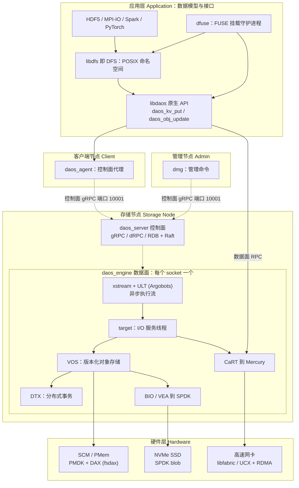
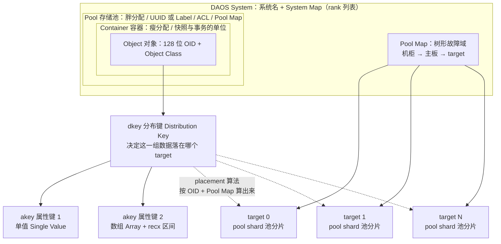
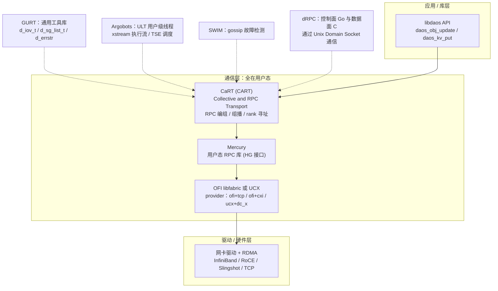
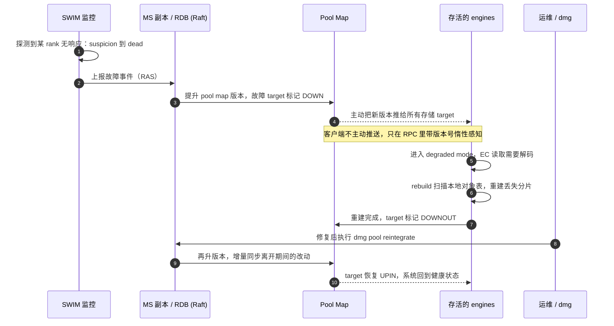
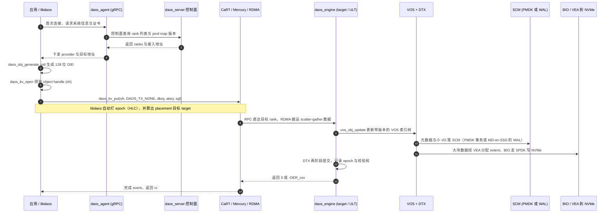

读 DAOS 代码最劝退的往往不是算法，而是满屏的缩写：`poh`、`coh`、`dkey`、`akey`、`VOS`、`DTX`、`CaRT`、`dRPC`、`DER_*`……它们像一堵墙，把人挡在门外。

这篇文章把 DAOS 的英文术语按**分层地图**拆开讲。每个词都给 **中文译名 + 英文全称 + 它是什么（大白话）+ 它做什么（作用）+ 在代码哪儿能找到**，并配架构图、时序图和一段完整可编译的 C 示例，把术语真正串起来。零基础也能顺着读，想读源码的人可以直接当速查手册。

> 依据：`D:\Codes\github\daos`（`master` @ `788f8773`，2026-11-09）的 `docs/overview/terminology.md`（官方缩写表）、`docs/overview/architecture.md`、`storage.md`、`transaction.md`、`fault.md`、`src/vos/README.md`、`src/bio/README.md`、`src/rdb/README.md`、`src/rebuild/README.md`、`src/include/daos*.h`、`utils/config/daos_server.yml`，以及 [daos.io](https://daos.io/) 与 [DAOS Overview](https://daos.io/daos-overview) 官网。

## 〇、一句话和一张图

**一句话**：DAOS 的术语不是一堆要背的单词，而是一张**四层地图**——上面是数据模型（Pool / Container / Object / dkey / akey），中间是进程与通信（Server / Engine / Target / CaRT / Mercury），下面是硬件与 I/O 库（SCM / PMDK / NVMe / SPDK），横切过去的是可靠性（Epoch / DTX / EC / Rebuild）。**先记住层，再填词，就不会乱。**

官网把 DAOS 的定位说得很清楚：它是 **Distributed Asynchronous Object Storage**（分布式异步对象存储），是给 AI 与 HPC 用的开源存储平台；基线接口是 `libdaos` 提供的 **key-value-array store**（键值—数组存储），POSIX 文件系统、HDF5、Python 字典等都是架在它上面的"数据模型"。设计原则里有一串很能说明术语来源的 "No"：**No kernel code**（全用户态）、**No centralized metadata server**（无中心元数据服务器）、**No locking**（无锁）、**No synchronous read-modify-write**（不做同步读改写）、**No client tracking**（不跟踪客户端）。

先看全景，图中每个方框都是本文要讲的一个术语：



**怎么读这张图**：左边是"谁在存"（应用和客户端），中间是"谁在管"（控制面）与"谁在干"（数据面），下面是"存在什么硬件上"。DAOS 官网强调 **End-to-End in user space**（端到端全用户态、绕过操作系统内核），所以图里从应用到硬件几乎不经过内核——这正是后面 `SPDK`、`RDMA`、`DAX`、`ULT` 这些词存在的根本原因。

## 一、先学会"看词根"：命名规律比背单词管用

DAOS 是 C + Go 混写的：数据面在 `src/` 下用 C，控制面在 `src/control/` 下用 Go。代码里的前缀基本等于"这是哪个模块的"，先记这张表，看到陌生函数就能猜个八九不离十。

| 前缀 / 后缀 | 中文含义 | 英文全称 / 来源 | 例子（在代码里） |
| --- | --- | --- | --- |
| `daos_` | 公共 API，应用能调用的函数 | DAOS API | `daos_init()`、`daos_obj_update()`，声明在 `src/include/daos.h` |
| `crt_` | CaRT 通信层函数 | Collective and RPC Transport | `crt_rpc()`、`crt_bulk()`，在 `src/cart/` |
| `vos_` | VOS 存储引擎函数 | Versioning Object Store | `vos_obj_update()`，在 `src/vos/` |
| `bio_` | 块设备 I/O 层 | Blob I/O | `bio_iod_prep()`，在 `src/bio/` |
| `dtx_` | 分布式事务 | Distributed Transaction | `dtx_commit()`，在 `src/dtx/` |
| `dmg` | 管理命令行工具 | DAOS Management | `dmg pool create`，在 `src/control/cmd/dmg/` |
| `DER_` | 错误码 | DAOS Error | `-DER_NONEXIST`、`-DER_TX_RESTART`，在 `src/include/daos_errno.h` |
| `OC_` | 对象类 | Object Class | `OC_S1`、`OC_RP_2G1`（2 副本 1 冗余组）、`OC_SX`（铺满池内所有 target），在 `src/include/daos_obj_class.h` |
| `DAOS_OT_` | 对象类型 | Object Type | `DAOS_OT_KV_HASHED` |
| `DAOS_OO_` | 对象打开模式 | Object Open | `DAOS_OO_RW` |
| `DAOS_PC_` / `DAOS_COO_` | 池连接 / 容器打开标志 | Pool Connect / Container Open | `DAOS_PC_RW`、`DAOS_COO_RW` |
| `d_` / `D_` | GURT 通用库的类型与宏 | Gurt Useful Routines and Types | `d_iov_t`、`d_sg_list_t`、`d_errstr()` |
| `_t` | 用 `typedef` 定义的类型 | type | `daos_handle_t`、`daos_epoch_t`、`daos_obj_id_t` |
| `_srv` | 服务端内部头文件，应用不该用 | server | `src/include/daos_srv/` |
| `poh` / `coh` / `oh` / `th` | 句柄缩写 | pool handle / container handle / object handle / transaction handle | 见第八节 C 示例 |

还有一个读代码的小陷阱：`src/include/daos_pool.h` 里写着 `#define daos_pool_connect daos_pool_connect2`，`daos_obj.h` 里写着 `#define daos_obj_generate_oid daos_obj_generate_oid2`。也就是说**你调用的名字和实际链接的符号不是同一个**，用 `grep daos_pool_connect(` 找不到实现时，别怀疑自己，去搜带 `2` 的版本。

## 二、系统与进程层：谁在管、谁在干

这层术语最适合用"仓库"来比喻：**System 是整个物流公司，Server 是一个仓库的经理，Engine 是仓库里的一个班组，Target 是班组里具体干活的工人，Rank 是工人的工号**。

| 英文 | 中文译名 | 英文全称 | 是什么 · 做什么 |
| --- | --- | --- | --- |
| **DAOS** | 分布式异步对象存储 | Distributed Asynchronous Object Storage | 整个系统的名字；一套开源、软件定义、面向 NVM 和 AI/HPC 的对象存储 |
| **System** | 系统 / 集群 | DAOS System | 由系统名标识、连在同一网络上的一组存储节点；两个 System 互不通信、互不相干 |
| **Storage Node** | 存储节点 | Storage Node | 一台直接接了 NVM 存储的物理机（也可以是 VM/容器），上面跑一个 Server |
| **CN** | 计算节点 | Compute Node | 只跑应用、不接 DAOS 存储的机器，也就是 Client |
| **Server / daos_server** | 服务端 / 控制面守护进程 | DAOS Server | 每个存储节点一个的多租户守护进程，读 `/etc/daos/daos_server.yml`，监听管理端口，负责拉起 Engine、做管理操作 |
| **Engine / daos_engine** | 引擎 / 数据面进程 | DAOS Engine | 每个物理 CPU socket 起一个，把本节点挂着的 SCM 和 NVMe 通过网络暴露出去；真正处理 I/O 的是它 |
| **Target** | 目标 / I/O 服务线程 | Storage Target | Engine 内部把存储静态切成多份，每份叫一个 target；**每个 target 有自己独立的存储、线程池和网络上下文**，互不争抢 |
| **Rank** | rank / 编号 | Rank | 系统地图（system map）给每个 Engine 进程分配的唯一整数，日志和 `dmg` 输出里到处都是 |
| **Client / daos_agent** | 客户端 / 代理 | Client / Agent | 客户端节点上跑的非特权守护进程，帮应用拿证书、解析 UID/GID、查询系统信息 |
| **Admin / dmg** | 管理节点 / 管理命令 | Admin / DAOS Management | 用 `dmg` 下发建池、格式化、剔除节点等管理操作；同一个节点可以同时兼任三种角色 |
| **Control Plane** | 控制面 | Control Plane | "管人不管货"：配置、证书、成员管理、故障判定，走 gRPC（Go 实现） |
| **Data Plane** | 数据面 | Data Plane | "只管搬货"：真正的读写 I/O，走 CaRT + RDMA（C 实现），追求零拷贝与低延迟 |
| **MS / mgmt_svc_replicas** | 管理服务副本 | Management Service replicas | 一组保存系统成员关系的服务器，配置在 `daos_server.yml` 的 `mgmt_svc_replicas`，生产建议 3–5 台 |
| **Access Point** | 接入点 | Access Point | 客户端第一次连系统时去问"有哪些 rank"的入口，写在 `daos_agent.yml` 的 `access_points` |
| **Pool Map / System Map** | 池地图 / 系统地图 | Pool Map / System Map | 记录有哪些 target、它们按机柜/主板组成的树形拓扑、以及每次变更的版本号；数据该放哪儿全靠它算 |
| **Fault Domain** | 故障域 | Fault Domain | "可能一起坏掉的一组服务器"，比如同机柜、同主板；DAOS 故意把冗余数据分散到不同故障域 |
| **SWIM** | 故障检测协议 | Scalable Weakly-consistent Infection-style process group Membership Protocol | 一种 gossip（流言）协议，Engine 之间互相探测心跳，谁不响应就上报并剔除 |
| **COTS** | 商用现货硬件 | Commercial Off-The-Shelf | 指不用定制硬件、普通服务器就能搭 DAOS |
| **RAS** | 可靠性/可用性/可维护性 | Reliability, Availability & Serviceability | 事件与告警体系，比如磁盘健康、节点故障都会产生 RAS 事件 |

**几个最容易混的点，单独说清**：

- **Server 和 Engine 不是一回事**。Server 是"经理"，管配置和进程生命周期；Engine 是"班组"，干 I/O。一个节点一个 Server，但通常一个 CPU socket 一个 Engine（双路机器就是两个）。
- **Target 才是并发单位**。官方 `docs/overview/architecture.md` 明确说每个 target 有私有存储、私有线程池、独立网络上下文，可以被网络直接寻址。配置项 `targets:` 就是每 Engine 开几个，官方验证范围 4–32。
- **控制面和数据面走两条路**。管理流量走 TCP 10001 的 gRPC；真正的数据走高速网络上的 RDMA。所以你在 `daos_server.yml` 里会同时看到 `fabric_iface`（数据面网卡）和 `control_iface`（控制面网卡）。

## 三、数据模型层：数据长什么样

这是读客户端代码最需要的一层。DAOS 官网用一句话概括：**"Datasets as First-class Citizen"**（数据集是一等公民）——你管理的不是一堆散落的文件，而是一个个叫 **Container（容器）** 的数据集。



| 英文 | 中文译名 | 英文全称 | 是什么 · 做什么 |
| --- | --- | --- | --- |
| **Pool** | 存储池 | Storage Pool | 跨一组 target 的"存储预留"，用 UUID 或 Label 标识；**是分配与隔离的单位**，由管理员创建，可以设 ACL；池不能跨 System |
| **Pool Shard** | 池分片 | Pool Shard | 某个池在**单个 target 上**实际占到的那块空间；容量固定，写满就报 `-DER_NOSPACE` |
| **Container** | 容器 / 数据集 | Container | 池内的一个私有对象地址空间，**是快照、事务和数据管理的单位**，由用户创建；官网说它 thin-provisioned（瘦分配），共享池的空间 |
| **Object** | 对象 | DAOS Object | 容器内由 128 位 **OID** 标识的数据单元；故意做得很"笨"——不记录时间、大小、属主、权限，也不跟踪谁打开了它，只为扩展性 |
| **OID** | 对象 ID | Object ID / object address | 128 位地址：高 32 位给 DAOS 编码对象类等内部信息，低 96 位由用户自己保证唯一 |
| **Object Class** | 对象类 | Object Class | 一组"数据怎么分布、怎么冗余"的模板（副本数、条带数、纠删码参数）；如 `OC_S1`、`OC_RP_2G1`、`OC_SX` |
| **dkey** | 分布键 | Distribution Key | 两级键中的第一级；**同一个 dkey 下的所有数据保证落在同一个 target 上**，这是局部性（locality）的来源 |
| **akey** | 属性键 | Attribute Key | 两级键中的第二级；一个 akey 对应一个"单值"或一个"定长元素数组"；dkey 和 akey 都能枚举 |
| **recx** | 记录区间 | Record Extent | 数组里一段连续元素的 (起始下标, 长度)，用来表达"读第 100–199 个元素"这类范围 I/O |
| **SV / Array** | 单值 / 数组 | Single Value / Array | akey 下两种值形态：SV 是不可部分覆写的变长值；Array 是定长元素的一维数组 |
| **KV store / KV API** | 键值存储 / 键值接口 | Key-Value store | 在两级键之上封装的传统 put/get/remove/list 接口，如 `daos_kv_put()` |
| **Epoch** | 纪元 / 版本号 | Epoch | 一个 64 位时间戳，**每一次 I/O 都带一个 epoch**；它不是墙钟时间，而是混合逻辑时钟（HLC），用来给数据排版本 |
| **HLC** | 混合逻辑时钟 | Hybrid Logical Clock | 把物理时钟和逻辑计数揉在一起的时钟，既能对应现实时间又能保证分布式下的因果顺序 |
| **Snapshot** | 快照 | Container Snapshot | 钉在某个 epoch 上的永久引用，防止旧版本被回收；轻量，可读可回滚，是 producer/consumer 流水线的基础 |
| **MVCC** | 多版本并发控制 | Multi-Version Concurrency Control | 靠 epoch 排序而不是加锁来解决冲突；不同版本的写互不覆盖，读按版本取数据 |
| **DTX** | 分布式事务 | Distributed Transaction | 把同一容器里的多次更新打包成一个 ACID 事务；采用无锁乐观并发，冲突时返回 `-DER_TX_RESTART` 让应用重试 |
| **ACID** | 原子性/一致性/隔离性/持久性 | Atomicity, Consistency, Isolation, Durability | 事务的四个保证，`docs/overview/transaction.md` 说 DAOS 事务是可串行化的 |
| **VOS** | 版本化对象存储 | Versioning Object Store | 单个 pool shard 上的本地持久对象存储，维护带版本索引的持久化数据结构；`src/vos/README.md` 说它靠日志式架构 + PMDK 事务保证一致 |
| **Aggregate / Discard / Punch** | 归并 / 丢弃 / 打洞 | VOS Aggregate / Discard / Punch | 回收旧版本空间的三种动作：aggregate 合并重叠写，discard 丢弃未提交版本，punch 表示"删除"这一版本化操作 |
| **DFS / libdfs** | DAOS 文件系统 / 其实现库 | DAOS File System | 在 `libdaos` 之上实现的文件与目录（POSIX 命名空间）抽象；**引擎上没有任何 POSIX 专用代码**，只处理键值数组操作 |
| **dfuse** | FUSE 挂载守护进程 | DAOS FUSE | 把容器挂成客户端本地目录的守护进程，可配合 interception library 绕过 FUSE 内核开销 |
| **DUNS** | 统一命名空间 | DAOS Unified Namespace | 用路径把池/容器关联起来的机制，让应用通过普通路径找到 DAOS 容器 |
| **libdaos** | DAOS 原生库 | libdaos | C 写的客户端基础库，官网称整个生态都架在它上面 |

**这里最需要提前建立的直觉**：

- **Pool 是"胖分配"、Container 是"瘦分配"**（官网原话 fat-provisioned / thin-provisioned）：建池时就把空间划走了；容器只是池里的一个逻辑地址空间，用多少占多少。所以 `dmg pool create --size 10G` 和 `daos cont create` 是两种完全不同的操作。
- **dkey / akey 是"两级键"**，像"抽屉 → 格子"：dkey 决定整个抽屉放在哪台机器的哪个 target，akey 是抽屉里的格子。同一个 dkey 的数据一定在同一 target，这就是 DAOS 说的 locality。
- **Epoch 是版本号，不是时间**。官网说"版本化是 DAOS 的核心"，连系统成员关系都带版本。写代码时看到 `daos_epoch_t` 别当 `time_t` 用。
- **VOS 是"单 target 本地引擎"**，不是全局元数据服务。DAOS 没有中心元数据服务器，每个 target 自己管自己的 VOS 索引，全局位置靠 OID + Pool Map 算出来。

## 四、存储与硬件层：数据落在什么上面

DAOS 是**为 NVM 从头设计**的，这层术语几乎都围绕"怎么绕过内核直接碰硬件"。

| 英文 | 中文译名 | 英文全称 | 是什么 · 做什么 |
| --- | --- | --- | --- |
| **NVM** | 非易失内存 | Non-Volatile Memory | 断电不丢数据的内存类介质统称，DAOS 的设计起点 |
| **SCM** | 存储级内存 | Storage-Class Memory | 放**元数据和小 I/O** 的第一层，要求能按字节寻址；`docs/overview/architecture.md` 说它被直接 mmap 进服务进程地址空间 |
| **PM / PMEM** | 持久内存 / 傲腾 | Persistent Memory / Intel Optane Persistent Memory | SCM 的经典硬件实现，Intel Optane 持久内存条 |
| **PMDK** | 持久内存开发套件 | Persistent Memory Development Kit | 管理 SCM 事务访问的库；VOS 用它把"块分配 + 索引更新"做成一个原子事务 |
| **DAX / fsdax** | 直接访问 / 文件系统 DAX 模式 | Direct Access | Linux 让应用直接映射持久内存、跳过页缓存的机制；PMem 配成 AppDirect 交错模式后，每 socket 呈现为一个 `fsdax` 命名空间 |
| **NVMe** | 非易失内存高速接口 | Non-Volatile Memory express | 放**大块数据**的第二层 SSD 接口协议（HDD、SATA/SAS SSD 都不支持） |
| **SPDK** | 存储性能开发套件 | Storage Performance Development Kit | 在用户态直接驱动 NVMe 的工具包，避开内核块设备栈 |
| **BIO** | 块 I/O 模块 | Blob I/O | DAOS 里管 NVMe 的模块：`src/bio/README.md` 说它负责 SSD 支持、故障盘检测、健康监控、热插拔和 VMD 识别 |
| **Blob / Blobstore** | blob / blob 存储 | SPDK Blob / Blobstore | SPDK 里对 NVMe 空间的抽象，DAOS 把一个 blob 当作一个 target 的块空间来用 |
| **VEA** | 版本化块分配器 | Versioned Block Allocator | VOS 用来管理 NVMe 上空闲 extent 的分配器，元数据放在 SCM 上以便和索引一起原子提交 |
| **MD-on-SSD** | 元数据放在 SSD 上 | Metadata-on-SSD | 没有 PMem 时的方案：DRAM 存元数据，靠 WAL + 异步 checkpoint 持久化到 NVMe |
| **WAL** | 预写日志 | Write-Ahead Log | "先记流水账再改账本"：元数据变更先顺序追加到 NVMe，崩溃后能重放恢复 |
| **bdev_role** | 块设备角色 | block device role | MD-on-SSD 下 NVMe 盘的三种角色：`wal`（日志）、`meta`（检查点）、`data`（用户数据） |
| **VMD** | 卷管理设备 | Intel Volume Management Device | Intel 平台管理 NVMe 热插拔和 LED 定位灯的能力 |
| **IOMMU / VT-d / VFIO** | I/O 内存管理单元 / 虚拟化直通 | Input-Output Memory Management Unit / Virtual Function I/O | 让非 root 的 `daos_server` 安全地直通访问 NVMe；BIOS 开 VT-d、内核加 `intel_iommu=on` |
| **Hugepage / THP** | 大页 / 透明大页 | Huge Page / Transparent Huge Page | SPDK 用大页做 DMA 缓冲；官方要求**预分配 hugepages 并关闭 THP**，否则容易因内存碎片分配失败 |
| **NUMA / UPI** | 非一致内存访问 / 超路径互连 | Non-Uniform Memory Access / Ultra Path Interconnect | 双路 CPU 访问"自己这路"的内存和 PCIe 设备最快；`pinned_numa_node` 就是用来绑核绑设备避免跨 UPI |
| **E2E Integrity / Checksum** | 端到端完整性 / 校验和 | End-to-End Data Integrity / Checksum | 数据在网络传输和落盘全程带校验，防止静默数据损坏 |
| **DAOS Target / xstream** | 目标 / 执行流 | target / execution stream | 见第二、五节；`src/bio/README.md` 里 "per-xstream NVMe context" 指每个执行流有自己的 NVMe 上下文 |

**两层存储为什么这样分**：`docs/overview/architecture.md` 说得很直白——延迟敏感的小 I/O 和元数据放 SCM（按字节读写、亚微秒级），checkpoint 和大块数据放 NVMe（流式写、拿满带宽）。官网把这套叫 **Versioned Byte-granular I/Os**（带版本的字节粒度 I/O）。

**MD-on-SSD 为什么值得单独记**：傲腾停产、PMem 300 系列被取消后，新集群基本走这条路。它在配置里的痕迹是 `class: ram` + `scm_mount`（用 tmpfs 当 SCM）+ 给 NVMe 指定 `bdev_roles`。注意官方约束：**同一角色组合的盘容量必须相同，且 `wal` 和 `data` 不能放在同一个 tier**。

## 五、网络与并发层：数据怎么跑起来

这层最容易一团乱麻，其实是一条**层层封装的快递链**：应用把包裹交给 CaRT，CaRT 贴上面单交给 Mercury，Mercury 选一家快递公司（libfabric 或 UCX），最后由网卡用 RDMA 直接送到对方内存。



| 英文 | 中文译名 | 英文全称 | 是什么 · 做什么 |
| --- | --- | --- | --- |
| **OFI** | 开放网络接口 | Open Fabrics Interfaces | 一套面向高性能网络的标准接口 |
| **libfabric** | OFI 的实现库 | OFI libfabric library | 高性能网络抽象库，DAOS 默认推荐用它；官方术语表写它是 Open Fabrics Interfaces 的库 |
| **Provider** | 网络提供者 | fabric provider | 具体走哪种网络协议的字符串，如 `ofi+tcp`、`ofi+verbs`、`ofi+cxi`、`ucx+dc_x`；写在 `daos_server.yml` 的 `provider:` |
| **RDMA / RMA** | 远程直接内存访问 | Remote (Direct) Memory Access | 网卡直接读写远端内存，不惊动对方 CPU 和内核；DAOS 低延迟的关键 |
| **UCX** | 统一通信 X | Unified Communication X | 另一套通信框架，NVIDIA InfiniBand / RoCE 环境推荐；内含 UCP/UCT/UCS 三层 |
| **UCP / UCT / UCS** | UCX 的三层 | Unified Communication Protocols / Transports / Services | 分别是高层 API、底层传输 API、公共服务 |
| **Mercury** | Mercury RPC 库 | Mercury | 用户态 RPC 库，可以拿 libfabric 或 UCX 当传输层；官方术语表原文即如此 |
| **CART / CaRT** | 集合与 RPC 传输层 | Collective and RPC Transport | DAOS 自研通信层，提供 RPC、bulk 传输、组通信（collective）、rank 寻址和 SWIM；代码在 `src/cart/` |
| **RPC** | 远程过程调用 | Remote Procedure Call | "像调本地函数一样调远端函数"；数据面 RPC 走 CaRT |
| **gRPC** | gRPC 远程过程调用 | gRPC Remote Procedure Calls | **控制面**用的 RPC 框架（Go 实现），`dmg` / `daos_agent` 到 `daos_server` 走它 |
| **dRPC** | DAOS 远程过程调用 | DAOS Remote Procedure Call | **同一节点内**控制面（Go）与数据面（C）之间的通信，走 Unix Domain Socket |
| **GURT** | 通用工具库 | Gurt Useful Routines and Types | 全项目共用的基础类型与工具，看到 `d_iov_t`、`d_sg_list_t`、`d_errstr()` 就是它 |
| **d_iov_t / sgl / d_sg_list_t** | I/O 向量 / 分散聚集表 | I/O Vector / Scatter-Gather List | 描述"数据分散在内存的哪几段"，配合 RDMA 做零拷贝；`daos_obj_update()` 参数里就有 `d_sg_list_t *sgls` |
| **Argobots / ABT** | 用户级线程库 | Argobots | 提供比操作系统线程更轻的并发执行单元，让 engine 能扛住极深队列 |
| **ULT** | 用户级线程 | User Level Thread | 在用户态调度的"协程"，切换不用陷入内核；DAOS 用它处理海量并发 I/O |
| **xstream / XS** | 执行流 | Execution Stream | 绑定到一个 CPU 核的执行上下文，ULT 在它上面跑；`nr_xs_helpers` 配的是额外 offload 执行流 |
| **TSE** | 任务执行引擎 | Task Execution Engine | 通用调度器，负责创建任务以及任务之间的依赖；`src/include/daos/tse.h` 文件头原文即 "Generic scheduler for creating tasks and dependencies between them" |
| **Event / Future-Promise** | 事件 / 未来与承诺 | Event / Futures & Promises | 官网说 engine 基于 futures & promises 的异步模型；API 里 `daos_event_t *ev` 传 NULL 就是同步阻塞 |
| **bulk / crt_bulk** | 大块数据传输 | Bulk Transfer | 把大块内存直接 RDMA 搬到对端，不走 RPC 小消息通道 |

**记住一个对比就不会混**：`gRPC` 是"人管人"（控制面，Go 写的），`CaRT + Mercury` 是"货找货"（数据面，C 写的），`dRPC` 是"同一台机器上 Go 和 C 说话"。三者名字里都有 RPC，但完全不是一回事。

## 六、可靠性与安全层：坏了怎么办

官网把这块叫 **Data Protection with Self Healing**（带自愈的数据保护）。DAOS 假定每个 target 都是单点故障，靠跨故障域的冗余活下来。

| 英文 | 中文译名 | 英文全称 | 是什么 · 做什么 |
| --- | --- | --- | --- |
| **Replication** | 多副本 | Replication | 同一份数据存 N 份，简单可靠；`OC_RP_2G1` 里的 RP 就是副本 |
| **EC** | 纠删码 | Erasure Coding | 类似 RAID 的校验冗余，如 4+2（4 份数据 + 2 份校验）；官网说已验证 2+1、4+2、8+2、16+2 等 Reed-Solomon 组合 |
| **RF** | 冗余因子 | Redundancy Factor | 容器/池属性 `rd_fac`，让 DAOS 按对象类型自动挑合适的冗余方案，不用逐个对象设 |
| **Stripe / Shard / Parity** | 条带 / 分片 / 校验片 | Stripe / Shard / Parity | EC 里的一组概念：数据切成条带，每个分片落在不同 target，校验片用来恢复丢失分片 |
| **Declustering** | 分散布局 | Declustering | 对象分片铺到所有 engine 上，官网说这让 rebuild 能由所有存活节点并行参与、速度极快 |
| **Object Class** | 对象类 | Object Class | 见第三节；决定用副本还是 EC、条带数多少 |
| **Self-healing / Rebuild** | 自愈 / 重建 | Self-healing / Rebuild | target 被剔除后，自动在存活 target 上把丢失的冗余补回来；`src/rebuild/README.md` 标题就是 Self-healing (aka Rebuild) |
| **Exclude / Drain** | 剔除 / 排空 | Exclude / Drain | 把故障 target 或主动下线的 target 从 pool map 移除，`dmg pool exclude` / `drain` |
| **Reintegration** | 重新纳入 | Reintegration | 修好后把节点加回来；官网说若盘没换，走 **incremental reintegration**（增量重建），只同步离开期间的改动 |
| **Degraded mode** | 降级模式 | Degraded Mode | 冗余未补齐期间，EC 读取需要额外解码，性能下降但不丢数据 |
| **Delayed rebuild** | 延迟重建 | Delayed Rebuild | 云环境专用：先等新实例补进来再开始重建，避免白白搬两遍数据 |
| **RDB** | 复制数据库 | Replicated Database | 保存池/容器元数据、用 Raft 在多台服务器间同步的副本库；`src/rdb/README.md` |
| **RAFT** | Raft 共识算法 | Raft | 让多个副本对"状态变更顺序"达成一致的算法，避免脑裂 |
| **RSVC / PS / CS** | 复制服务框架 / 池服务 / 容器服务 | Replicated Services / Pool Service (`pool_svc`) / Container Service (`cont_svc`) | `src/rsvc/README.md` 说明：框架用 Raft 状态机复制这两个元数据服务，容忍少数派副本故障；是 DAOS 系统启动所必需 |
| **ACL / ACE** | 访问控制列表 / 访问项 | Access Control List / Entry | 池和容器上的权限控制；官网说类似 NFSv4 ACL，可以细到每个项目/数据集 |
| **TLS / Certificate** | 传输层安全 / 证书 | Transport Layer Security / Certificate | 控制面通信加密，相关配置在 `transport_config:`（`allow_insecure`、`ca_cert`、`cert`、`key`） |
| **RAS / Telemetry** | 告警事件 / 遥测 | RAS / Telemetry | RAS 上报健康事件；`telemetry_port`（默认 9191）暴露 Prometheus 指标 |
| **Scrubber / Checksum scrub** | 校验和扫描器 | Checksum Scrubber | 后台定期读数据校验、发现静默损坏并借助冗余修复 |
| **MTBF** | 平均无故障时间 | Mean Time Between Failures | 可靠性指标，出现在容量与冗余规划文档里 |

一次故障从发现到恢复的时序，把上面这些词串起来：



## 七、命令行与错误码：日志里那些符号

| 英文 | 中文译名 | 是什么 · 做什么 |
| --- | --- | --- |
| **dmg** | 管理命令 | `src/control/cmd/dmg/main.go` 里定义了 server / storage / config / system / network / support / pool / container / version / telemetry 等子命令 |
| **daos** | 用户命令 | `src/control/cmd/daos/main.go` 里定义了 container / pool / filesystem / object / system / version / health 等子命令 |
| **daos_server / daos_engine / daos_agent** | 服务端 / 引擎 / 客户端代理 | 三种进程，见第二节 |
| **daos_server_helper** | 特权辅助程序 | 代替非 root 的 `daos_server` 执行需要 root 的操作（setuid） |
| **dfuse** | FUSE 挂载 | 把容器挂成本地目录 |
| **ddb** | DAOS 调试工具 | `src/control/cmd/ddb/`，用于离线检查/修复 VOS 数据 |
| **dmg storage format** | 格式化存储 | 首次部署必须执行，会清空 SCM/NVMe 上的 DAOS 数据 |
| **dmg system query -v** | 查询系统状态 | 看每个 rank 是否 `Joined` |
| **dmg pool create --size 10G tank** | 建池 | `tank` 是 pool label；`--size`、`--nranks`、`--nsvc` 是常用参数 |
| **daos cont create --type POSIX tank demo** | 建容器 | `tank` 是池、`demo` 是容器标签；`--type POSIX`、`--oclass`、`--properties rd_fac:2` |
| **DER_\*** | DAOS 错误码 | 定义集中在 `src/include/daos_errno.h`；函数成功返回 0，失败返回**负数**，如 `-DER_NONEXIST` |
| **d_errstr()** | 错误码转字符串 | 把 `-DER_NOSPACE` 变成可读名字，日志和示例里常用 |
| **DAOS_TX_NONE** | 无事务句柄 | 表示"这次操作不放在显式事务里"；定义为 `DAOS_HDL_INVAL` |
| **DAOS_HDL_INVAL** | 无效句柄 | `((daos_handle_t){0})`，用来初始化 `poh` / `coh` / `oh` |
| **Joined / UPIN / DOWN / DOWNOUT / DRAIN** | 状态词 | `Joined` 是 `dmg system query -v` 里的 rank 状态（已加入）；其余是 pool map 里的 target 状态，对应正常运行、故障待重建、已剔除、排空中，见 `daos_target_state_t` 的 `DAOS_TS_*` 常量 |

常见 `DER_*` 速记（都来自 `src/include/daos_errno.h`）：

| 错误码 | 中文含义 | 什么时候会遇到 |
| --- | --- | --- |
| `-DER_NONEXIST` | 指定的实体不存在 | 池/容器/键不存在 |
| `-DER_EXIST` | 实体已存在 | 重复创建 |
| `-DER_NO_PERM` | 无权限 | ACL 或证书没配对 |
| `-DER_UNREACH` | 节点不可达 | 网络或 rank 挂了 |
| `-DER_NOSPACE` | target 空间不足 | pool shard 写满 |
| `-DER_TIMEDOUT` | 超时 | 常见于 fabric 不通 |
| `-DER_AGAIN` | 请重试 | 临时性失败 |
| `-DER_IO` | I/O 错误 | 盘故障 |
| `-DER_MISMATCH` | 版本不匹配 | 客户端/服务器版本不兼容或 pool map 陈旧 |
| `-DER_REC2BIG` | 记录太大 | 给的 buffer 小于要读的数据 |
| `-DER_TX_RESTART` | 事务需要重启 | MVCC 检测到读写冲突，应用应重试整个事务 |
| `-DER_NOMEM` | 内存不足 | 分配失败 |

## 八、把术语放进真实代码：一段完整可编译的 C 示例

光看表容易忘，下面这段程序把 **System / Pool / Container / Object / OID / KV / epoch / DER_\*** 全部用上。它连接一个池、打开容器、生成一个对象 ID，写入一个键值对再读回来。**逐行都有注释**，可以直接抄去对照源码。

```c
#include <stdio.h>        /* 提供 printf、fprintf，用来打印结果和错误 */
#include <stdlib.h>       /* 提供 calloc、free、exit、EXIT_FAILURE */
#include <string.h>       /* 提供 strlen，用来计算要写入的字节数 */
#include <daos.h>         /* DAOS 公共总头文件，内部已包含 daos_obj.h / daos_kv.h 等 */
#include <daos_errno.h>   /* 提供 d_errstr()，把 DER_ 错误码转成可读字符串 */

#define POOL_LABEL "tank"         /* 池标签，对应 dmg pool create 的最后一个参数 */
#define CONT_LABEL "demo"         /* 容器标签，对应 daos cont create 的第二个参数 */
#define SYS_NAME   "daos_server"  /* 系统名，必须与 daos_server.yml 里的 name 一致 */
#define DEMO_KEY   "hello"        /* KV 的键：对应底层 akey 的概念 */
#define DEMO_VAL   "world"        /* KV 的值：写入的内容 */

static void die(const char *what, int rc)                       /* 定义统一的出错处理函数 */
{                                                               /* 函数体开始 */
    fprintf(stderr, "%s 失败: %s (rc=%d)\n", what, d_errstr(rc), rc);  /* 打印动作名、错误名和数字错误码 */
    exit(EXIT_FAILURE);                                         /* 以失败状态结束进程 */
}                                                               /* 函数体结束 */

int main(void)                                                  /* 程序入口，不接收命令行参数 */
{                                                               /* main 函数体开始 */
    daos_handle_t poh = DAOS_HDL_INVAL;                         /* pool handle：池连接句柄，先初始化为无效 */
    daos_handle_t coh = DAOS_HDL_INVAL;                         /* container handle：容器打开句柄 */
    daos_handle_t oh  = DAOS_HDL_INVAL;                         /* object handle：对象打开句柄 */
    daos_obj_id_t oid;                                          /* 128 位对象 ID，高 32 位由库填，低 96 位自己给 */
    daos_size_t   size = 0;                                     /* KV 值字节数，get 时是输入输出参数 */
    char         *buf = NULL;                                   /* 读回数据的缓冲区，稍后按实际大小分配 */
    int           rc = 0;                                       /* 返回码：0 表示成功，负数是 -DER_xxx */

    rc = daos_init();                                           /* 初始化 libdaos，必须在任何 DAOS 调用之前 */
    if (rc != 0)                                                /* 检查初始化是否成功 */
        die("daos_init", rc);                                   /* 失败则打印错误并退出 */

    rc = daos_pool_connect(POOL_LABEL, SYS_NAME, DAOS_PC_RW,    /* 以读写方式连接池，返回池句柄 poh */
                           &poh, NULL, NULL);                   /* 不查询池信息、不用事件，最后 NULL 表示同步阻塞 */
    if (rc != 0)                                                /* 检查连接是否成功 */
        die("daos_pool_connect", rc);                           /* 常见失败原因：-DER_NONEXIST 或证书问题 */

    rc = daos_cont_open(poh, CONT_LABEL, DAOS_COO_RW,            /* 在该池中打开容器，返回容器句柄 coh */
                        &coh, NULL, NULL);                      /* 同样采用同步阻塞模式 */
    if (rc != 0)                                                /* 检查打开是否成功 */
        die("daos_cont_open", rc);                              /* 常见失败原因：-DER_NO_PERM */

    oid.hi = 0;                                                 /* 高 64 位清零，留给 DAOS 填内部编码 */
    oid.lo = 1;                                                 /* 低 64 位自己给一个容器内唯一的值 */
    rc = daos_obj_generate_oid(coh, &oid, DAOS_OT_KV_HASHED,    /* 让库按容器和对象类型补全 OID 的高 32 位 */
                               OC_SX, 0, 0);                    /* OC_SX 表示把分片铺到池内所有 target，其余参数保留 */
    if (rc != 0)                                                /* 检查 OID 生成是否成功 */
        die("daos_obj_generate_oid", rc);                        /* 失败则退出 */

    rc = daos_kv_open(coh, oid, DAOS_OO_RW, &oh, NULL);          /* 打开这个 OID 对应的 KV 对象，得到 oh */
    if (rc != 0)                                                /* 检查打开是否成功 */
        die("daos_kv_open", rc);                                /* 失败则退出 */

    rc = daos_kv_put(oh, DAOS_TX_NONE, 0, DEMO_KEY,              /* 写入 KV：不用显式事务，flags 为 0 */
                     (daos_size_t)strlen(DEMO_VAL), DEMO_VAL, NULL);  /* 值长度按字节算，NULL 表示同步 */
    if (rc != 0)                                                /* 检查写入是否成功 */
        die("daos_kv_put", rc);                                 /* 库会自动给这次写打上 epoch */

    rc = daos_kv_get(oh, DAOS_TX_NONE, 0, DEMO_KEY,              /* 第一次 get：buf 传 NULL，只查询值的大小 */
                     &size, NULL, NULL);                        /* 结果写回 size */
    if (rc != 0)                                                /* 检查查询是否成功 */
        die("daos_kv_get (查询大小)", rc);                       /* 失败则退出 */

    buf = (char *)calloc(1, (size_t)size + 1);                   /* 分配 size+1 字节，多出的 1 字节留给字符串结尾 */
    if (buf == NULL)                                            /* 检查内存是否分配成功 */
        die("calloc", -DER_NOMEM);                              /* 分配失败时报告内存不足 */

    rc = daos_kv_get(oh, DAOS_TX_NONE, 0, DEMO_KEY,              /* 第二次 get：把值真正读进 buf */
                     &size, buf, NULL);                         /* size 仍是输入输出参数 */
    if (rc != 0)                                                /* 检查读取是否成功 */
        die("daos_kv_get (读数据)", rc);                         /* 失败则退出 */
    buf[size] = '\0';                                           /* DAOS 不负责字符串结尾，必须自己补上 \0 */

    printf("读回 %s = %s (共 %lu 字节)\n", DEMO_KEY, buf, (unsigned long)size);  /* 打印结果验证读写正确 */

    free(buf);                                                  /* 释放读缓冲区 */
    daos_kv_close(oh, NULL);                                    /* 关闭对象句柄 */
    daos_cont_close(coh, NULL);                                 /* 关闭容器句柄 */
    daos_pool_disconnect(poh, NULL);                            /* 断开池连接 */
    daos_fini();                                                /* 释放 libdaos 全局资源 */
    return 0;                                                   /* 正常结束 */
}                                                               /* main 函数体结束 */
```

**运行方式**（从一台装好 `daos-client` 与 `daos-devel` RPM 的 EL9 机器开始；先把上面整段 C 源码保存为 `daos_terms_demo.c`，然后依次执行下面每一行）：

```bash
test -f daos_terms_demo.c                                     # 确认源码文件已保存，避免后面 gcc 报找不到文件
dmg pool create --size 10G tank                               # 创建一个 10G 的池，标签叫 tank（需要管理员权限）
daos cont create --type POSIX tank demo                       # 在 tank 池里创建名为 demo 的 POSIX 容器
gcc -Wall -Wextra -o daos_terms_demo daos_terms_demo.c -ldaos  # 编译，头文件由 daos-devel 装到 /usr/include
./daos_terms_demo                                             # 运行，预期输出：读回 hello = world (共 5 字节)
```

几点说明，免得踩坑：链接参数按 `docs/user/interface.md` 的说明是 `libdaos`（`-ldaos`）；`daos_kv_get` 传 `NULL` 缓冲区时是"只查大小"，这是仓库 `src/tests/simple_obj.c` 里的官方用法；`buf[size] = '\0'` 不能省——DAOS 返回的是原始字节，不会替你补字符串结尾。若报 `-DER_NO_PERM`，多半是 `/etc/daos/certs/` 证书没配；若报 `-DER_UNREACH`，检查 `daos_agent.yml` 的 `access_points` 和防火墙 10001 端口。

## 九、一张时序图串起全部术语

最后回到第八节那句 `daos_kv_put`，看它从应用走到磁盘，中间每一个方框都是本文讲过的词：



## 十、总结与速查

1. **先分层再记词**：应用/数据模型 → 控制面与数据面 → 通信 → 硬件 → 横切的可靠性。看到一个生词，先问"它属于哪一层"，比硬背全称有效得多。
2. **看前缀定位模块**：`daos_` 是公共 API、`crt_` 是 CaRT、`vos_` 是 VOS、`bio_` 是块 I/O、`dtx_` 是事务、`DER_` 是错误码、`OC_` 是对象类；`_t` 结尾是类型，`poh/coh/oh/th` 是四种句柄。
3. **最容易混淆的三组**：Server（经理）/ Engine（班组）/ Target（工人）；Pool（胖分配的隔离单位）/ Container（瘦分配的快照与事务单位）；gRPC（控制面 Go）/ dRPC（同机 Go↔C）/ CaRT（数据面 C）。
4. **最有 DAOS 特色的四个词**：**Epoch**（每个 I/O 的版本号，不是时间）、**dkey/akey**（两级键，dkey 决定落在哪个 target）、**VOS**（每个 target 自己的本地版本化对象存储，没有中心元数据服务器）、**SCM + NVMe**（元数据/小 I/O 与大块数据的两层分工）。
5. **读日志的两个抓手**：`-DER_xxx` 查 `src/include/daos_errno.h`；`Joined / UPIN / DOWN / DOWNOUT / DRAIN` 查 `daos_target_state_t`。

### 参考来源

- 本地仓库 `D:\Codes\github\daos`，`master` @ `788f8773`（2026-11-09）
- 官方术语表与架构文档：`docs/overview/terminology.md`、`architecture.md`、`storage.md`、`transaction.md`、`fault.md`、`data_integrity.md`、`security.md`
- 模块说明：`src/vos/README.md`、`src/bio/README.md`、`src/vea/README.md`、`src/rdb/README.md`、`src/rebuild/README.md`、`src/cart/README.md`
- 公共头文件与配置：`src/include/daos.h`、`daos_types.h`、`daos_obj.h`、`daos_kv.h`、`daos_pool.h`、`daos_cont.h`、`daos_errno.h`、`daos_obj_class.h`、`utils/config/daos_server.yml`、`utils/config/examples/`
- 命令与用户文档：`src/control/cmd/dmg/main.go`、`src/control/cmd/daos/main.go`、`docs/QSG/tour.md`、`docs/user/interface.md`、`docs/user/container.md`、`docs/user/filesystem.md`
- 官网：<https://daos.io/>、<https://daos.io/daos-overview>、<https://docs.daos.io/latest/>
