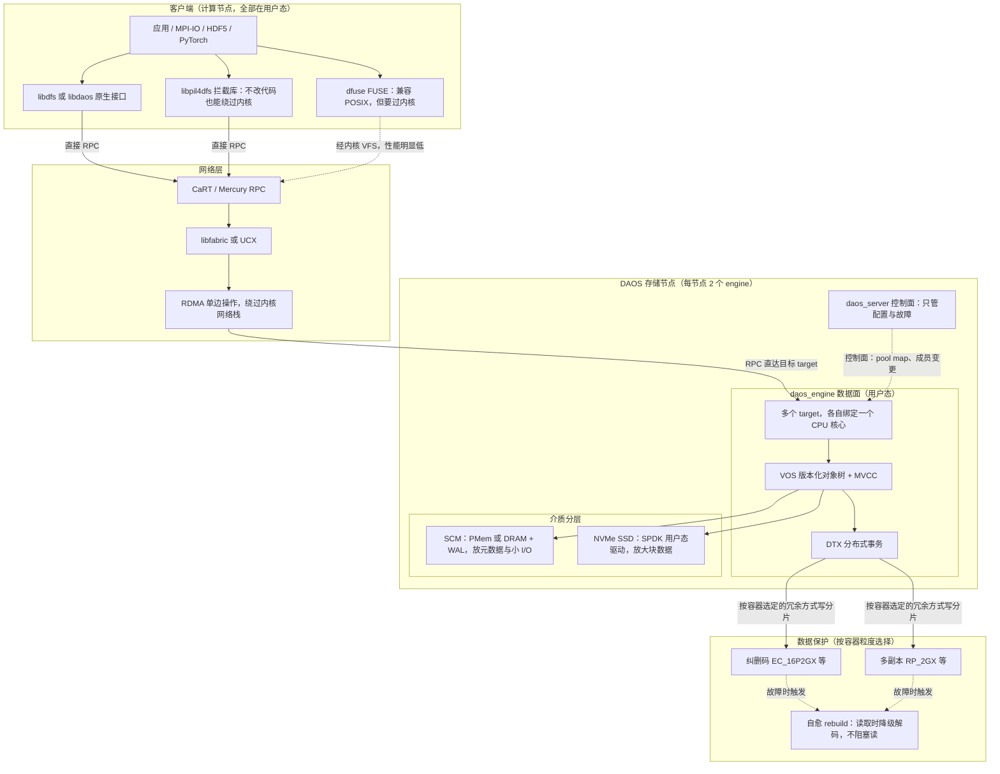
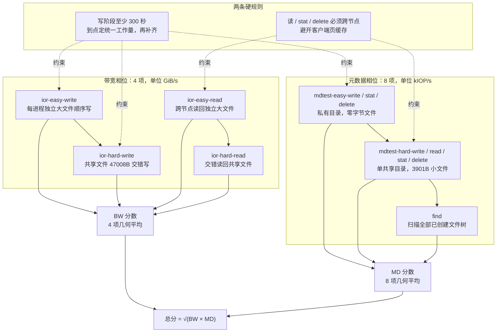
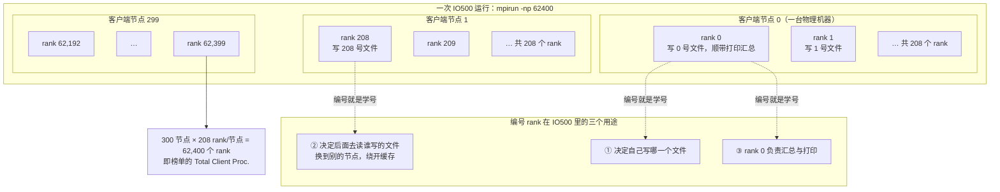
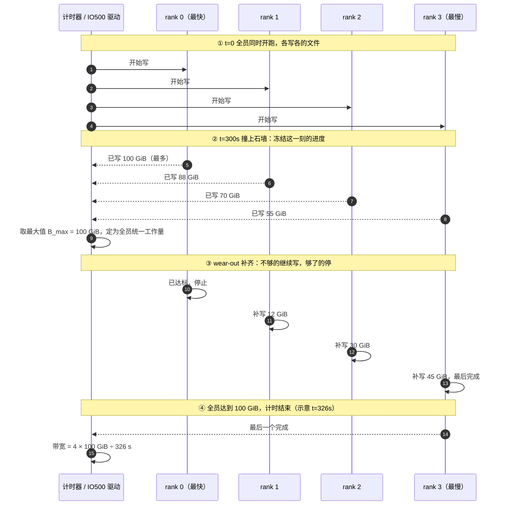
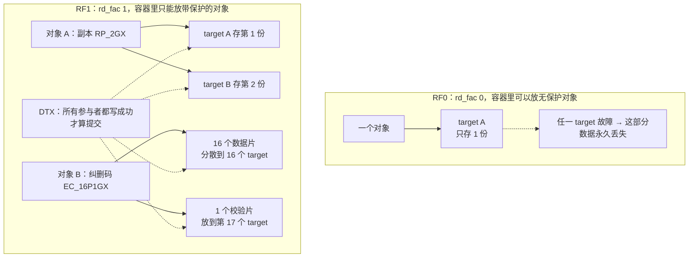
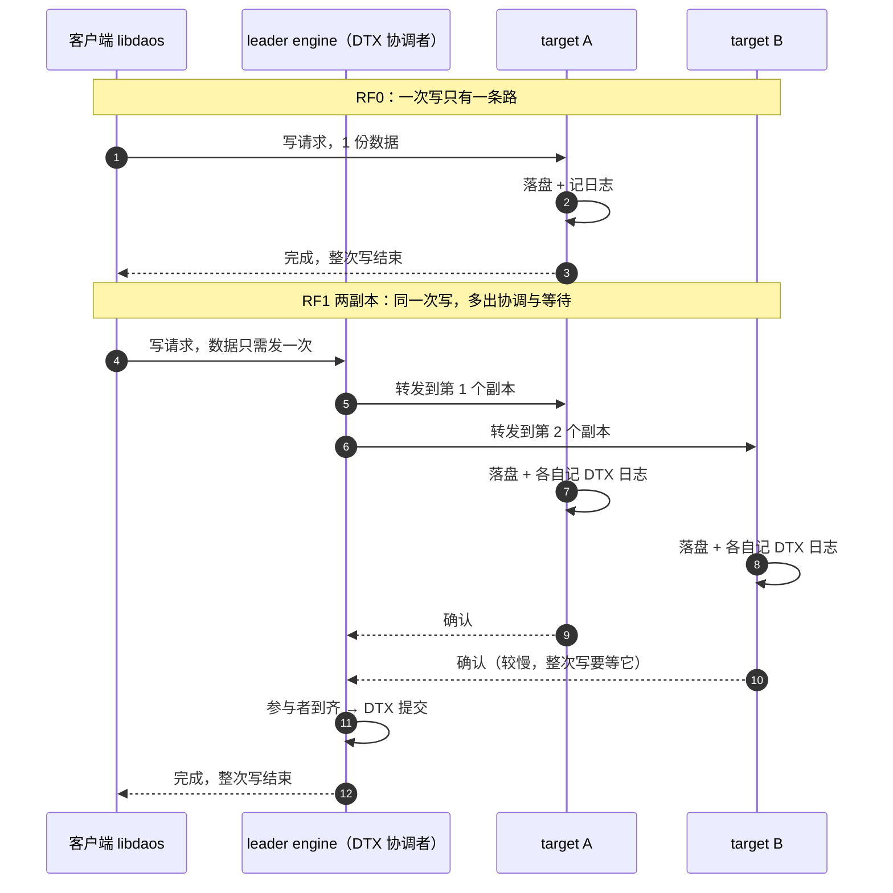
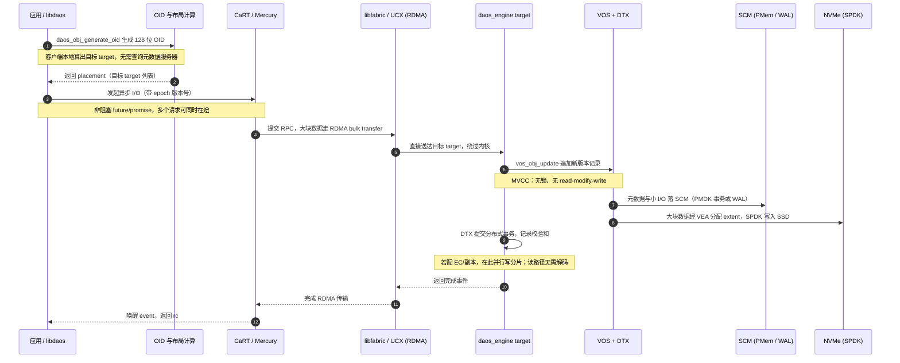

这篇文章只做一件事：**把 DAOS 的性能数字摊开，讲清楚它们是怎么测出来的、代表什么、不代表什么**。

网上关于 DAOS 的性能说法很多："10 TB/s""1 亿 IOPS""20 微秒延迟""比 Lustre 快 10 倍"……这些话大多没错，但混在一起容易误读——有的是理论峰值，有的是 IO500 单项成绩，有的是几何平均后的分数，有的来自无冗余配置，有的来自开了纠删码的生产配置。本文所有数字都标注来源与测试口径，能复算的地方会给出复算过程。

> **口径说明**：IO500 官方用 **GiB/s**（1024 进制）作带宽单位、**kIOP/s**（千次操作/秒）作元数据速率单位；厂商新闻稿常用 **GB/s**、**TB/s**（1000 进制）。两者相差 7.4%（1 GiB = 1.073741824 GB），本文在换算时会显式写出，不混用。全文数据截至 **2026 年 11 月**，对应 IO500 的 **ISC26** 榜单。

## 〇、一句话和一张图

**一句话**：DAOS 的性能优势不是"硬盘更快"，而是**把 I/O 路径上所有串行化的东西都拆掉了**——内核不用走、锁不用加、元数据服务器不存在、对象位置靠算法算出来、写操作不需要"先读再改再写"。结果是：**大块顺序带宽能线性堆到几十 TB/s，同时小文件元数据能堆到每秒上亿次**，而这两件事在传统并行文件系统里通常是互斥的。

先看整体的 I/O 路径，理解性能从哪里来：



**看懂这张图，就看懂了后面所有数字**：客户端算出的 128 位对象 ID 直接决定数据落在哪几个 target 上，客户端因此可以把 RPC **直接发到目标节点**，中间没有"先问元数据服务器要位置"这一步；服务端用 MVCC（多版本并发控制）而不是锁，写操作追加新版本而不是覆盖旧版本，因此也不需要"读-改-写"。

## 一、先把标尺立起来：IO500 到底测什么

### 1.1 十二个阶段，五组场景、两对"最好 / 最坏"对照

IO500 不是一个测试，而是把 **IOR**（测带宽）和 **mdtest / pfind**（测元数据速率）按固定规则串起来的一套**基准套件**。它的设计哲学是：一个系统既要能跑大块顺序 I/O，也要能扛小文件和高并发元数据，还必须在**最不友好的访问模式下别崩得太难看**。

看规则之前，先认识这套测试里的"人"：它是一个 **MPI 并行程序**，一次会启动成千上万个一模一样的进程副本，每个副本有一个编号，这个编号叫 **rank**。下面表格里写的"每进程"，指的就是一个 rank。**rank 到底是什么、和节点是什么关系，见 1.2；这些 rank 具体怎么跑一轮测试，见 1.3。**

| 组别 | 测试项 | 单位 | 规则要点 | 为什么要这样设计 |
| --- | --- | --- | --- | --- |
| IOR easy | `ior-easy-write`、`ior-easy-read` | GiB/s | 每进程一个独立文件，大块、对齐、顺序；参数可自由调优 | 存储系统的"理想上限" |
| IOR hard | `ior-hard-write`、`ior-hard-read` | GiB/s | **所有进程写同一个共享文件**，交错写 47008 字节（故意不对齐）的记录 | 共享文件 + 非对齐小记录，考验条带对齐与并发写协调 |
| mdtest easy | `easy-write`、`easy-stat`、`easy-delete` | kIOP/s | 每进程一个私有目录，创建**零字节**文件 | 元数据"理想上限"，无目录竞争 |
| mdtest hard | `hard-write`、`hard-read`、`hard-stat`、`hard-delete` | kIOP/s | **所有进程挤在同一个共享目录**，文件固定 3901 字节 | 单目录热点，是集中式 MDS 最容易跪的场景 |
| Find | `find` | kIOP/s | 扫描前面所有阶段创建的文件树，按时间戳、大小、文件名模式筛选 | 命名空间遍历能力 |

还有两个容易被忽略但非常关键的规则：

- **stonewall（石墙）计时**：所有 `create` / `write` 阶段**至少执行 300 秒**。但 300 秒不是"到点就收卷"，而是"到点定标准"——在第 300 秒这一刻，看谁写得最多，把它的数据量定为全体 rank 的统一工作量，写得少的还要继续补，直到全员达标才结束。所以一次写阶段的总耗时通常是 **300 多秒**，不是恰好 300 秒。完整过程在 **1.3** 展开。
- **读跨节点**：`*-read` / `*-stat` / `*-delete` 阶段要求每个 rank 处理的是**别的节点上的 rank** 写出来的文件。这条规则直接掐掉了客户端页缓存作弊的可能（数据刚被自己写进本机内存，读起来当然快）。

新版本还增加了 `ior-rnd4k-easy-read`（随机 4 KiB 读），它是**唯一一个读阶段也用 300 秒 stonewall** 的测试：所有 rank 一直随机读 4 KiB 块，到 300 秒到点才停，不补齐。它不计入总分，只作为附加观测项——后文 SuperMUC-NG 的 218.31 GiB/s 就是这一项。



### 1.2 rank 是什么：先把"人"数清楚

**MPI**（Message Passing Interface，消息传递接口）是高性能计算里跑并行程序的标准套路：同一份程序被同时复制成 N 份，分别跑在很多台机器的很多个 CPU 核上，彼此靠收发消息协同。启动命令形如 `mpirun -np 62400 ...`，意思就是"把这份程序复制 62,400 份，一起跑"。

这 62,400 份进程**代码完全一样**，怎么区分谁是谁？靠编号。MPI 给每份进程发一个从 0 开始、不重复的整数编号，这个编号就叫 **rank**——可以理解成"学号"或"工号"：`rank 0`、`rank 1`……一直到 `rank 62399`。程序里于是可以写："如果我是 rank 0，就负责打印汇总；如果我是 rank 7，就写第 7 号文件。"

三个容易混的概念，用 Aurora 那次测试对齐一下：

| 概念 | 是什么 | Aurora 的数字 |
| --- | --- | --- |
| **节点（node）** | 一台物理机器（一台服务器） | 300 台客户端节点 |
| **rank / 进程** | 跑在节点上的一份程序副本，有唯一编号 | 62,400 个 rank |
| **CPU 核** | 真正执行指令的硬件单元 | 每节点几十个核，靠多个 rank 把它们喂满 |

一台节点上可以同时跑很多个 rank——Aurora 是**每节点 208 个**，所以 `300 × 208 = 62,400`。榜单里的 **Total Client Proc.（客户端总进程数）就是 rank 总数，不是节点数**；本文 2.1 表格里"客户端节点 × 进程"那一列说的就是这件事。



### 1.3 一次写测试怎么跑：石墙、定标准、补齐

**先打个比方**：全班 62,400 个同学（rank）同时抄书，每人抄自己的那本。第 300 秒铃响（撞上"石墙"），老师不看谁先抄完，而是记下每个人抄了多少页，然后宣布："抄得最多的那位抄了 100 页，今天全班每个人都必须交满 100 页。" 抄得快的人已经够了，可以停笔；抄得慢的人继续补，直到最后一个人交卷，全班才下课。最后算全班成绩：**全班总页数 ÷ 从上课到最后一人交卷的总时间**。

对应的正式流程，以 `ior-easy-write`（每个 rank 写自己的一个大文件）为例，分五步：

1. **同时开跑**：所有 rank 在同一时刻开始写，各写各的文件，计时开始。
2. **第 300 秒撞墙**：不是停写，而是**冻结这一刻的进度**，统计每个 rank 已经写进去多少字节。由于网络、NUMA 绑定、CPU 亲和、存储 target 忙闲不同，各 rank 的进度必然不一样。
3. **定统一工作量**：取所有 rank 中的**最大值** `B_max`（IO500 官方原话是"the rank which was able to write the most data"），把它定为每个人都必须达到的量。这一步由 MPI 的**全局归约**（把各 rank 的数字汇总求最大值，常用 `MPI_Allreduce`）完成。
4. **wear-out（补齐）阶段**：写得少的 rank 继续写，直到各自累计写到 `B_max`；已达标的最快 rank 停下等待。这段时间的长短，取决于最慢的那个 rank（术语叫 **straggler**，拖尾者）。IOR 里控制它的开关是 `-D 300`（石墙时间）配 `-y`（启用补齐）。
5. **全员达标、计时结束**：从第一个 rank 开始写，到最后一个 rank 写完，这段总时间才是分母。IOR 官方文档写明：带宽 = 传输的数据总量 ÷ `START` 到 `STOP` 的耗时，所以**补齐阶段的时间是被算进去的**。



> 图里的 100 / 88 / 70 / 55 GiB 和 326 秒都是**示意数字**，只为讲清机制；真实规模是 62,400 个 rank，每个 rank 写的数据量也远大于此。

**不同阶段，"统一工作量"定的东西不一样**：

| 阶段 | 第 300 秒定下的统一工作量 | 由谁定 |
| --- | --- | --- |
| `ior-easy-write` | 每个 rank 要写的**文件字节数** | 写得最多的 rank |
| `ior-hard-write` | 每个 rank 要写的 **47008 字节记录条数** | 写记录最多的 rank |
| `mdtest-easy-write` | 每个 rank 要创建的**零字节文件个数** | 建文件最多的 rank |
| `mdtest-hard-write` | 每个 rank 要创建的 **3901 字节文件个数** | 建文件最多的 rank |
| 读 / stat / delete / find | **没有 300 秒要求**，把前面生成的东西全处理一遍即可 | — |
| `ior-rnd4k-easy-read` | 唯一例外：读也用 300 秒，**到点即停，不补齐** | 计时器 |

**三个"为什么"**：

- **防止"快 rank 刷分"**：如果不补齐，快的 rank 写完就退出，用"数据量 ÷ 时间"算出来的数字会失真，也没法在几百个系统之间横向比较。
- **保证后面的阶段公平**：读、stat、delete 阶段是"去处理别人写的文件"。要是每个 rank 写的文件大小或数量不一样，后面每个 rank 的活儿就不一样多，整场测试就散了。
- **把慢节点的代价算进来**：真实应用里，作业完成时间由最慢的那个进程决定。补齐阶段正好把这种"拖尾"暴露在成绩里——这符合 IO500 自己的定位：**衡量用户实际感受到的性能**（user-experienced performance），而不只是硬件峰值。

**看一眼真实的 IOR 输出**，就能明白"300 秒 ≠ 总时长"。下面是一份教学环境（2 个节点、10 个 rank）用 Darshan 抓取的 `ior-easy-write` 结果，字段已精简：

```text
stonewallingTime    : 300
stoneWallingWearOut : 1
stonewalling pairs accessed min: 32297   max: 134306
    -- min data: 63.1 GiB   mean data: 105.1 GiB   time: 300.0s
write   2929.46 MiB/s   ...   total(s) 916.93
```

- `stonewallingTime: 300`：石墙设在第 300 秒；`stoneWallingWearOut: 1`：补齐阶段已开启；
- `min: 32297 / max: 134306`：同样跑 300 秒，最慢的 rank 只写了 3.2 万个数据段，最快的写了 13.4 万个，**差了 4 倍多**——所以才必须定标准、再补齐；
- `total(s) 916.93`：补齐之后整个写阶段花了 916.93 秒，远超 300 秒。这是一套很慢的小集群，拖尾特别严重；Aurora 这类系统一般只多出几十秒。

IO500 的结果行也印证了这一点，例如 `[RESULT] ior-easy-write 14.385031 GiB/s : time 323.882 seconds`——`time` 是 323.882 秒而不是 300 秒，多出来的正是补齐阶段。IO500 提交规则里的原话是："The stonewall flag must be set to 300 to ensure all create/write phases execute for **at least** 300 seconds"——**at least（至少）** 这两个字是关键。

**最后，三个最常见的误解**：

| 误解 | 实际 |
| --- | --- |
| "300 秒是一次测试的时长" | 是**最低门槛 + 定标准的时刻**，总时长一般 300 多秒甚至更久 |
| "到 300 秒所有人停写" | 到 300 秒只是**冻结基准**，落后的 rank 还要继续写（wear-out） |
| "石墙是为了限制测试跑太久" | 恰恰相反，它是为了**让每个 rank 干一样多的活**，慢的也必须干完 |

### 1.4 分数怎么算：几何平均，不是算术平均

这是理解榜单最关键的一点。IO500 用**几何平均**而不是算术平均，因为几何平均有一个特性：**任何一项特别差，都会把总分狠狠拉下来，别的项再高也补不回来**。这就逼着参测系统必须"均衡"。

公式如下：

$$
BW = \sqrt[4]{\prod_{i=1}^{4} IOR_i} \qquad
MD = \sqrt[8]{\prod_{i=1}^{8} MD_i} \qquad
Score = \sqrt{BW \times MD}
$$

其中 4 个 IOR 项是 easy/hard 的写与读，8 个 MD 项是 mdtest 的 7 个操作加 `find`。注意 **BW 和 MD 的单位不同**（GiB/s 与 kIOP/s），这两个数直接相乘再开方得到一个"无量纲"的总分，所以 **IO500 分数只能横向比较，不能当成某个物理量**。

### 1.5 三个榜单，别看错

| 榜单 | 含义 | 关键要求 |
| --- | --- | --- |
| **Production（生产榜）** | 每个存储系统只保留一条最好成绩；本文讨论的主榜 | 架构必须有充分文档、文件系统**通用可得**、系统不能有单点故障（必须开冗余）、结果要能被独立复现 |
| **10 Node Production（10 节点生产榜）** | 客户端**恰好 10 个节点**的成绩，便于同规模横向比较 | 同上，但固定客户端规模，屏蔽"靠堆客户端刷分" |
| **Research（研究榜）** | 允许实验性、专有、不可复现的系统 | 门槛低，数字可以非常夸张 |

一个很现实的例子：ISC26 研究榜第 1 名是鹏城实验室的 **Pengcheng CloudBrain**（OceanFS），分数 **603,334.56**，MD 高达 **43,903,983.64 kIOP/s**（约 439 亿次/秒）；而生产榜第 1 名 Aurora 的分数是 **32,165.90**。两者相差近 19 倍，但**不具可比性**——研究榜允许专有文件系统、允许实验配置，生产榜则要求可复现、无单点故障。ISC26 还有一起公开争议：据公开报道，**某厂商**的一份提交最初进入生产榜（分数 79,110.10、BW 26,888.39 GiB/s），后因可复现性审查未通过被移到研究榜；对照官方榜单，该提交现在确实只出现在研究榜，ISC26 生产榜的头名仍是 Aurora。这类事件正说明了**"分数高"和"可信"是两件事**。

## 二、IO500 榜单全景（ISC26）

### 2.1 生产榜：DAOS 占据第 1、第 2

ISC26 生产榜共 46 个条目，DAOS 有 5 个系统入榜（表里"客户端节点 × 进程"的第二个数，就是 1.2 说的 **rank 总数**）：

| 排名 | 届次 | 机构 / 系统 | 客户端节点 × 进程 | Score | BW (GiB/s) | MD (kIOP/s) |
| ---: | --- | --- | --- | ---: | ---: | ---: |
| **1** | SC23 | Argonne / **Aurora** (Intel DAOS EC) | 300 × 208 = 62,400 | **32,165.90** | **10,066.09** | **102,785.41** |
| **2** | SC25 | LRZ / **SuperMUC-NG-Phase2-EC** (Lenovo DAOS) | 192 × 112 = 21,504 | **3,470.22** | **861.22** | **13,982.88** |
| 3 | ISC25 | NHR@FAU / Helma (Lustre) | 186 × 100 = 18,600 | 838.99 | 438.62 | 1,604.84 |
| 4 | ISC25 | Samsung / SSC-24 (WekaIO) | 291 × 55 = 16,005 | 826.86 | 248.67 | 2,749.41 |
| 5 | SC23 | KAUST / Shaheen III (Lustre) | 2,080 × 8 = 16,640 | 797.04 | 709.52 | 895.35 |
| **6** | SC25 | Core42 / **Maximus-01** (Enakta Labs DAOS) | 10 × 96 = 960 | **666.70** | **247.90** | **1,793.03** |
| 7 | SC24 | MSKCC / IRIS (WekaIO) | 261 × 104 = 27,144 | 665.49 | 252.54 | 1,753.69 |
| **15** | ISC24 | ZIB / **Lise** (Megware DAOS) | 10 × 96 = 960 | **324.54** | **65.01** | **1,620.13** |
| **20** | ISC22 | 中国电信研究院 / **CTPAI** (CTCLOUD DAOS) | 10 × 20 = 200 | **187.84** | **25.29** | **1,395.01** |

几个值得注意的比例关系：

- Aurora 的 MD 是 **102,785.41 kIOP/s ≈ 1.028 亿次/秒**，比第 3 名 Helma 的 1,604.84 kIOP/s 高出 **64 倍**；BW 是 10,066.09 GiB/s，比第 3 名高 **23 倍**。DAOS 的领先主要来自元数据侧。
- Aurora 的分数自 SC23 起**连续六届**位居生产榜第一（SC23 1/15 → ISC24 1/21 → SC24 1/26 → ISC25 1/34 → SC25 1/45 → ISC26 1/46），三年没有被超越。
- 榜单里唯一在**客户端规模上远超 Aurora** 的是 Shaheen III（2,080 节点）和 Leonardo（2,000 节点），成绩却只有 797 和 649 分——**堆客户端数量换不来分数**，这恰好印证了几何平均的"均衡"约束。

### 2.2 10 节点榜：前三名全是 DAOS

固定 10 个客户端节点，能更公平地看单位效率。ISC26 10 节点生产榜前六名：

| 排名 | 系统 | 文件系统 | 进程数 | Score | BW (GiB/s) | MD (kIOP/s) |
| ---: | --- | --- | ---: | ---: | ---: | ---: |
| **1** | Aurora (Argonne) | **DAOS** | 2,080 | **2,885.57** | 734.50 | 11,336.27 |
| **2** | SuperMUC-NG-Phase2-EC-10 (LRZ) | **DAOS** | 1,120 | **1,253.56** | 253.98 | 6,187.21 |
| **3** | Maximus-01 (Core42) | **DAOS** | 960 | **666.70** | 247.90 | 1,793.03 |
| 4 | JoyBuilder (京东探索研究院) | JPFS | 960 | 405.50 | 117.37 | 1,400.93 |
| 5 | HRT (Hudson River Trading) | EXAScaler | 1,600 | 348.08 | 136.05 | 890.51 |
| **6** | Lise (ZIB) | **DAOS** | 960 | 324.54 | 65.01 | 1,620.13 |

有意思的是：Aurora 的 10 节点成绩（2,885.57）只占其全量成绩（32,165.90）的 **9.0%**，说明 IO500 成绩对客户端并发规模极度敏感——**DAOS 是需要"喂饱"才有性能的系统**，这一点在第五节还会反复出现。

### 2.3 DAOS 在 IO500 上的演进（研究榜 / 生产榜合并看）

| 年份 / 届次 | 代表系统 | Score | BW (GiB/s) | MD (kIOP/s) | 意义 |
| --- | --- | ---: | ---: | ---: | --- |
| ISC20 | Intel Wolf | 1,792.98 | 371.67 | 8,649.57 | DAOS 早期上榜，52 客户端节点 |
| ISC21 | Intel Endeavour | 1,859.56 | 398.77 | 8,671.65 | 10 节点挑战赛阶段 |
| ISC22 | 中国电信 CTPAI | 187.84 | 25.29 | 1,395.01 | 国内早期生产榜提交 |
| SC23 | Aurora（**RF0 无冗余，研究榜**） | 43,218.80 | 11,362.27 | 164,391.73 | 硬件上限的展示 |
| SC23 | Aurora（**RF1 开冗余，生产榜**） | **32,165.90** | 10,066.09 | 102,785.41 | 至今生产榜第一 |
| SC23 | SuperMUC-NG Phase2 EC | 2,508.85 | 742.90 | 8,472.60 | 42 台存储服务器，首次登生产榜第 2 |
| ISC24 | ZIB Lise | 324.54 | 65.01 | 1,620.13 | 10 节点规模 |
| SC25 | SuperMUC-NG Phase2 EC（重测） | **3,470.22** | 861.22 | 13,982.88 | 客户端从 90 → 192 节点，分数提升 **38.3%** |
| SC25 | Core42 Maximus-01 | 666.70 | 247.90 | 1,793.03 | 商业 DAOS 方案 |
| ISC26 | HPE K3000-NDR（研究榜） | 1,007.63 | 253.69 | 4,002.19 | 面向 ORNL Discovery 的新一代存储 |

**同一套 42 台存储服务器，只把客户端从 90 个节点加到 192 个节点，分数涨了 38.3%**——这是理解 DAOS 性能模型的最好例子：瓶颈往往在客户端并发，而不在服务端。

## 三、冠军拆解：Aurora 那次 IO500 到底跑了多少东西

### 3.1 硬件与运行规模

Aurora 是阿贡国家实验室的 E 级超算，DAOS 是它的主存储。IO500 提交页（[submission 688](https://io500.org/submissions/view/688)）与 [Aurora 架构论文（arXiv:2509.08207）](https://arxiv.org/html/2509.08207v2) 给出的配置：

| 层次 | 配置 |
| --- | --- |
| 存储节点 | 全系统 **1024 台** Intel Coyote Pass 双路 Ice Lake（2×Xeon 5320）、512 GB DRAM |
| 每台介质 | **16 × 15.3 TB NVMe**（约 244.8 TB）+ **16 × 512 GB Optane PM200**（8 TB PMem）+ 2 × HPE Slingshot-11 NIC |
| 引擎 | 每节点 2 个 `daos_engine`，全系统 **2048 个 engine**；每节点 32 个 target |
| 容量 | **约 260 PB 裸容量**；采用 ALCF 推荐的 **EC_16P2GX**（16 数据 + 2 校验）后约 **220 PB**；不同冗余级别下 220–249 PB |
| 理论峰值 | **≥ 31 TB/s**、**400 M IOPS**（论文口径）；ALCF 用户文档常用"230 PB / >25 TB/s"的保守口径 |
| 网络 | Slingshot-11 Dragonfly，8 个 DAOS I/O 组；计算节点 8 × 200 Gb/s，存储节点 2 张网卡约 40 GiB/s |
| 对照系统 | 同机房 Lustre "Flare"：约 100 PB、峰值 **约 650 GB/s**（不同 ALCF 文档给出 91/100 PB、160/56 OST、48/100 网关，口径略有出入） |
| 本次 IO500 规模 | **300 客户端节点 × 208 进程 = 62,400 进程**（约 63k MPI tasks）、**642 台 DAOS 服务器 / 1284 个 engine**、18 个计算组 + 8 个 DAOS 组 |
| 软件 | DAOS CLI `2.5.100-g9597af`、libdaos `v2.7.0`；提交于 2023-11-06 |

DAOS Foundation 披露的[同一次运行细节](https://daos.io/?p=38/)还包括：最大池 **160 PiB**、最大单文件 **8.5 PiB**、总文件数 **1770 亿**、单目录文件数 **330 亿**、24k 计算端点。**单目录 330 亿个文件**这个数字，本身就是对"没有集中式元数据服务器"最直接的证明。

### 3.2 十二个分项的原始成绩

这 12 个数字是全文最重要的一组数据，全部来自官方提交页：

| 阶段 | 成绩 | 单位 | 在 ISC26 生产榜 46 个条目中的排位 |
| --- | ---: | --- | --- |
| ior-easy-write | **20,693.63** | GiB/s | 1 / 46 |
| ior-easy-read | 12,122.87 | GiB/s | 1 / 46 |
| ior-hard-write | 4,216.34 | GiB/s | 1 / 46 |
| ior-hard-read | 9,706.55 | GiB/s | 1 / 46 |
| mdtest-easy-write | 60,985.13 | kIOP/s | 1 / 46 |
| mdtest-easy-stat | 225,295.35 | kIOP/s | 1 / 46 |
| mdtest-easy-delete | 57,648.44 | kIOP/s | 1 / 46 |
| mdtest-hard-write | 33,827.19 | kIOP/s | 1 / 46 |
| mdtest-hard-read | 141,467.16 | kIOP/s | 1 / 46 |
| mdtest-hard-stat | 230,086.03 | kIOP/s | 1 / 46 |
| mdtest-hard-delete | 62,196.78 | kIOP/s | 1 / 46 |
| find | 229,672.10 | kIOP/s | 1 / 46 |

**12 项全部第一**。其中 `ior-easy-write` 的 20,693.63 GiB/s 就是新闻稿里"突破 20 TiB/s"的来源（严格换算约 22.2 TB/s 或 20.2 TiB/s）。

### 3.3 自己动手复算分数

下面这段脚本把 12 个分项按官方公式复算一遍，顺便算出单位效率与冗余开销。它是完整、自包含的，只用 Python 标准库，逐行都有注释。保存为 `daos_io500_check.py` 后直接运行：

```bash
python3 daos_io500_check.py
```

```python
#!/usr/bin/env python3                                      # 指定解释器，Python 3 自带，无需安装依赖
# -*- coding: utf-8 -*-                                     # 声明源码编码，保证中文注释不乱码
"""复算 IO500 SC23 Aurora (DAOS EC) 的分数、每服务器效率与数据保护开销。"""  # 模块说明

from math import prod, sqrt                                 # 只导入标准库的两个数学函数：连乘与开方

IOR = {                                                     # 官方提交页 688 的 4 个 IOR 带宽分项，单位 GiB/s
    "ior-easy-write": 20693.63,                             # 每进程独立大文件顺序写，最优带宽场景
    "ior-easy-read":  12122.87,                             # 读回其他节点写的独立大文件
    "ior-hard-write":  4216.34,                             # 单共享文件、47008 字节交错写，最差带宽场景
    "ior-hard-read":   9706.55,                             # 交错读回共享文件的 47008 字节记录
}

MD = {                                                      # 官方提交页 688 的 8 个元数据分项，单位 kIOP/s
    "mdtest-easy-write":  60985.13,                         # 每进程私有目录内创建零字节文件
    "mdtest-easy-stat":  225295.35,                         # 查询其他节点创建的文件属性
    "mdtest-easy-delete": 57648.44,                         # 删除其他节点创建的文件与目录
    "mdtest-hard-write":  33827.19,                         # 单共享目录内创建 3901 字节小文件
    "mdtest-hard-read":  141467.16,                         # 读取共享目录里的 3901 字节内容
    "mdtest-hard-stat":  230086.03,                         # 查询共享目录里小文件的属性
    "mdtest-hard-delete": 62196.78,                         # 删除共享目录里的小文件
    "find":             229672.10,                         # 全命名空间扫描并按条件筛选文件
}

PUBLISHED = {"score": 32165.90, "bw": 10066.09, "md": 102785.41}  # 榜单公布的三项汇总值，用于核对

AURORA_SERVERS = 642                                        # 该次运行使用的 DAOS 存储服务器数量
RF0 = {"score": 43218.80, "bw": 11362.27, "md": 164391.73}  # 同硬件无冗余(RF0)研究榜提交 695 的成绩


def geomean(values):                                        # 定义几何平均函数，避免算术平均掩盖短板
    """返回一组正数的几何平均：n 个数连乘后开 n 次方。"""  # 函数功能说明
    return prod(values) ** (1.0 / len(values))              # 连乘后取 1/n 次幂，等价于开 n 次方


def main():                                                 # 主函数，所有输出集中在这里
    bw = geomean(list(IOR.values()))                        # 4 个 IOR 分项求几何平均，得到 BW 分数
    md = geomean(list(MD.values()))                         # 8 个元数据分项求几何平均，得到 MD 分数
    score = sqrt(bw * md)                                   # 总分是 BW 与 MD 两个几何平均再取几何平均
    print("BW   = %10.2f GiB/s   (榜单 %10.2f, 差 %+.2f)" % (bw, PUBLISHED["bw"], bw - PUBLISHED["bw"]))
    print("MD   = %10.2f kIOP/s  (榜单 %10.2f, 差 %+.2f)" % (md, PUBLISHED["md"], md - PUBLISHED["md"]))
    print("SCORE= %10.2f         (榜单 %10.2f, 差 %+.2f)" % (score, PUBLISHED["score"], score - PUBLISHED["score"]))
    print("元数据总量 = %.2f MIOPS" % (md / 1000.0))        # kIOP/s 换算成百万次每秒
    print("带宽总量   = %.2f TB/s" % (bw * 1.073741824 / 1000.0))  # GiB 换算成 TB（1 GiB = 1.073741824 GB）
    print("每服务器：score %.2f, BW %.2f GiB/s, MD %.1f kIOP/s" % (score / AURORA_SERVERS, bw / AURORA_SERVERS, md / AURORA_SERVERS))
    print("easy/hard 写带宽比 = %.2fx" % (IOR["ior-easy-write"] / IOR["ior-hard-write"]))
    print("easy/hard 元数据属性比 = %.2fx" % (MD["mdtest-easy-stat"] / MD["mdtest-hard-stat"]))
    print("开启数据保护后总分变化 = %.1f%%" % ((score / RF0["score"] - 1) * 100))
    print("开启数据保护后 hard-write 变化 = %.1f%%" % ((IOR["ior-hard-write"] / 10500.042182 - 1) * 100))


if __name__ == "__main__":                                  # 只有直接运行本文件才执行，被 import 时不执行
    main()                                                  # 调用主函数
```

运行结果（已实测）：

```text
BW   =   10066.09 GiB/s   (榜单   10066.09, 差 -0.00)
MD   =  102785.41 kIOP/s  (榜单  102785.41, 差 -0.00)
SCORE=   32165.93         (榜单   32165.90, 差 +0.03)
元数据总量 = 102.79 MIOPS
带宽总量   = 10.81 TB/s
每服务器：score 50.10, BW 15.68 GiB/s, MD 160.1 kIOP/s
easy/hard 写带宽比 = 4.91x
easy/hard 元数据属性比 = 0.98x
开启数据保护后总分变化 = -25.6%
开启数据保护后 hard-write 变化 = -59.8%
```

那 0.03 分的差异只是**四舍五入**：提交页显示 32,165.93，榜单列表显示 32,165.90，12 个分项本身是完整的。这也提醒我们，看榜单时优先看**分项原始数据**，别只看汇总分数。

### 3.4 RF0 vs RF1：数据保护的真实代价

同一次 SC23 测试，ALCF 提交了两份结果：一份开冗余进生产榜（RF1，[submission 688](https://io500.org/submissions/view/688)），一份不开冗余进研究榜（RF0，[submission 695](https://io500.org/submissions/view/695)）。[IXPUG ISC'24 的公开幻灯片](https://www.ixpug.org/images/docs/isc_2024/Optimizing_Communications_and_IO_on_Aurora.pdf)还给出了 RF1 的具体对象类配置：

| 测试项 | 对象类 |
| --- | --- |
| ior-easy | `EC_16P1GX`（16 数据 + 1 校验的纠删码） |
| ior-hard | `RP_2GX`（2 副本） |
| mdtest 文件 | `RP_2G1` |
| mdtest hard 目录 | `RP_2GX` |
| mdtest easy 目录 | `RP_2G32` |

对比结果非常有价值——它把"可靠性不是免费的"量化了：

| 指标 | RF0（无冗余，研究榜） | RF1（生产配置） | 变化 |
| --- | ---: | ---: | ---: |
| ior-easy-write | 21,029.85 GiB/s | 20,693.63 GiB/s | −1.6% |
| **ior-hard-write** | **10,500.04 GiB/s** | **4,216.34 GiB/s** | **−59.8%** |
| ior-easy-read | 11,890.36 GiB/s | 12,122.87 GiB/s | +2.0% |
| ior-hard-read | 6,348.03 GiB/s | 9,706.55 GiB/s | **+52.9%** |
| BW 分数 | 11,362.27 | 10,066.09 | −11.4% |
| MD 分数 | 164,391.73 | 102,785.41 | **−37.5%** |
| **总分** | **43,218.80** | **32,165.90** | **−25.6%** |

这张表里的每个数字都是"结果"，但要读懂它，得先知道**钱到底花在哪一步**。下面按"是什么 → 为什么 → 谁在付钱"逐层拆。

**一、RF0 / RF1 是什么：这是容器级的强制开关，不是"顺手调了个参数"**

`RF` 是 **Redundancy Factor（冗余因子）**，在 DAOS 源码里是正式枚举 `DAOS_PROP_CO_REDUN_RF0 = 0` 到 `RF4 = 4`（`src/include/daos_prop.h:483-491`），对应容器的 `rd_fac` 属性。官方文档的定义是：`rd_fac` 描述"**容器内对象能承受的并发 engine 故障数**"，取值 0（无保护）到 4（容忍 4 台同时挂），而且**容器创建时定死，之后不能改**（`docs/user/container.md:331-340`）。

| | RF0（`rd_fac:0`） | RF1（`rd_fac:1`） |
| --- | --- | --- |
| 能容忍的故障 | 0 台 | 1 台 |
| 容器里能放什么对象 | 随便，包括单副本对象 | **只能放带数据保护的对象**；无保护对象类（如 `SX`）连打开都会失败 |
| 一台 engine 挂了 | 上面那部分数据永久丢失，没有第二份也没有校验片可重建 | 从另一份副本读，或由校验片算出丢失的分片，并在线 rebuild |
| 进哪个榜 | 只能进研究榜 | 才有资格进生产榜 |

关键在 `docs/user/container.md:364-367` 那句：**"Only objects with data protection enabled can be stored in such a container."** 也就是说 RF1 是一刀切的准入规则——**12 个测试项没有一个能"裸奔"**。这就是下面所有开销的总开关。

打个比方：RF0 是把一份文件只存一份，丢了就没了；RF1 是规定"这个柜子里每份文件都必须留一条后路"——要么复印一份放到另一个房间（副本），要么切成 16 片、再配 1 张能反推的校验拼图（纠删码）。

**二、表里那串黑话怎么读**

| 对象类 | 逐段拆开 | 用在哪个测试项 |
| --- | --- | --- |
| `EC_16P1GX` | **EC** 纠删码 + **16** 个数据片 + **P1** 个校验片 + **GX** 冗余组数取最大、铺满所有 target | ior-easy |
| `RP_2GX` | **RP** 副本 + **2** 份 + **GX** 组数取最大 | ior-hard、mdtest hard 目录 |
| `RP_2G1` | 2 份副本，但只用 **1** 个冗余组 | mdtest 文件 |
| `RP_2G32` | 2 份副本，分成 **32** 个冗余组 | mdtest easy 目录 |

命名规则来自 `src/include/daos_obj_class.h`：第 55–69 行说明 EC 的 `N P K` 分别是数据片数与校验片数，第 220–239 行说明"第一个数字是副本数，`G` 后面的数字是冗余组数，`X` 表示铺满池内所有 target"。同一文件第 32–35 行把 `OR_RP_1` 直接注释成 **"No data protection, aka single replica"**——这就是 RF0 那侧的对象长什么样。

再补三个后面会反复用到的词（零基础版）：

- **target**：一台存储节点上切出来的独立"小仓库"，各有自己的 CPU 核、自己的一份 SCM/NVMe、自己的网络端点（详见 4.1）。冗余的本质就是**把同一个对象的不同份放到不同 target 上**。
- **分片 / cell**：对象被切成的块。DAOS 的 EC 用固定 cell 大小，默认 64 KiB（`docs/user/container.md:464-507`）。
- **DTX**：DAOS 的分布式事务。官方事务文档说，commit 时所有操作会被打包成一个 compound RPC，发给**选举出的 leader engine**，再由 leader 把变更应用到所有存储节点（`docs/overview/transaction.md:116-127`）；源码里能看到 `DTX_COMMIT` / `DTX_ABORT` / `DTX_CHECK` 这一组 RPC（`src/dtx/dtx_internal.h`）。一句话：**"要么所有副本都写成功，要么当没发生过"**，代价是必须等所有参与者回话。

**三、一张图看清两种布局**



**四、同样一次写，RF1 多出来的步骤在哪**



图上多出来的东西可以列成一张"账单"：

| 多出来的环节 | RF0 | RF1 | 主要打在哪个指标上 |
| --- | --- | --- | --- |
| 数据写入份数 | 1 份 | 2 份（副本）或 16+1 片（EC） | 写带宽、网络流量 |
| 参与的 target 数 | 1 个 | 多个，且必须落在不同故障域 | 每次写的 RPC 数 |
| 原子提交 | 不需要跨 target 协调 | DTX leader + 所有参与者确认 | 延迟、小 I/O 的 IOPS |
| 校验计算 | 无 | EC 需算校验片（有 SIMD 加速库支撑，见 `docs/admin/hardware.md:21-26`） | CPU，可流水化摊薄 |
| 元数据与日志 | 1 份 | 每个副本各一份 | 元数据 IOPS |
| 等最慢者 | 无 | 有，和 1.3 的 straggler 是同一种效应 | 尾延迟 |
| 正常读 | 读 1 份 | 读 1 份即可，不需要解校验 | **基本不变** |
| 故障时 | 直接丢数据 | 降级读 / EC 解码 + 在线 rebuild | 只影响故障期间 |

**五、逐条解释四个数字的原因**

**① `ior-easy-write` 只降 1.6%：为什么几乎不疼**

easy 是"每进程一个独立大文件、对齐、顺序写"（见 1.1），一次写的是 1 MiB 这种整块。RF1 用 `EC_16P1GX`，而 1 MiB 正好等于 **16 × 64 KiB cell**，也就是**刚好写满一个完整条带**。官方 `docs/user/container.md:484-507` 讲得很直白：条带宽度与容器 chunk size 对齐时性能最好；**填不满条带才会产生 "read-modify-write penalty"**（要先读旧数据和旧校验片，改完再写回去）。

完整条带意味着不必读旧数据、不必修补校验片，只多两件小事：算 1 个校验片、把它写到第 17 个 target。网络流量只多 1/16 ≈ 6.25%，校验计算有 SIMD 加速且能和传输流水化。而大块顺序写本身的时间主要花在"搬数据"上，这点固定开销一摊薄，就只剩 −1.6% 了。

**② `ior-hard-write` 降 59.8%：五件不利的事叠在同一项上**

先把场景摆出来：所有 rank 写**同一个共享文件**、交错写 **47008 字节**（故意不对齐）的记录（见 1.1）。小、不对齐、共享，本来就是 IO500 里最难写的一种模式。RF1 又给它加了三笔账：

- **第一笔 · 写两份**：`RP_2GX` 是 2 副本，每个更新要在 2 个 target 各落一份，网络流量和落盘量翻倍。
- **第二笔 · 等两边回话**：DTX 要保证两份副本原子提交，整次写入必须等**较慢的那个**完成（时序图第 12 步）。大块顺序写能把这段等待藏进流水线，47008 字节的小更新藏不住。
- **第三笔 · 固定开销占比高**：一次 RPC、一条事务记录、一次日志持久化，对 47008 字节来说是很大的比例，翻倍之后直接砸在吞吐上。非对齐还可能跨 cell 边界、触发额外读取修补——不过要说清楚，**ior-hard 用的是副本而不是 EC**，这里的主因是前两笔，不是 EC 的读改写。

所以它不是"冗余让写慢了 60%"，而是 **"小 + 不对齐 + 共享 + 两份 + 等两边"** 五个不利因素同时落在这一项上，才成了全表最惨的一项。这也解释了为什么同样是写，easy 和 hard 能差出 1.6% 与 59.8% 两个完全不同的结果。

**③ `ior-hard-read` 涨 52.9%：这不是冗余的功劳，必须单独说**

正常读只需要拿到一份完整数据：副本读一个分片即可，EC 正常读也只读数据分片、不算校验。只有故障降级时才需要额外解码——`docs/overview/fault.md:48-50` 的原文是降级模式 "might require extra processing on access (e.g. **reconstructing data out of erasure code**)"。所以**"数据保护不惩罚读路径"这个设计结论是成立的**。

但"不惩罚"最多解释"不掉"，解释不了"涨 52.9%"。这两次提交除了冗余开关，还有对象类、客户端参数、调优和运行时差异。**这一项恰恰就是"这不是严格受控实验"的直接证据**。因此这张表的正确读法是：它能可靠地说明**开冗余之后写路径要付多少钱**；读项和跨项差异不能单独归因给冗余，更不能反过来宣传"副本能提速"。

**④ MD 降 37.5%，比 BW 的 11.4% 疼得多：因为元数据没有"大块"可以摊薄**

MD 是 8 个 `mdtest`/`find` 项的几何平均，其中 create / delete 是写操作。元数据对象极小（一个目录项、一个零字节文件的记录），**没有大块数据去摊薄固定开销**。RF1 下它们用 `RP_2G1` / `RP_2GX` / `RP_2G32` 保护：每建一个文件，不再是"在一个 target 写一条记录"，而是"在两个 target 各写一条，再由 DTX 保证两边原子提交"。RPC 数、日志记录数、参与 target 数都翻倍，IOPS 自然往下掉。

stat / find 是读，不付写放大；但 RF1 下目录对象类变了（冗余组数不同，热点分布不同），整组数字又叠加了调优差异，所以 −37.5% 是**以写类操作为主、叠加配置变化**的综合结果，不能全算在副本头上。反过来看带宽：4 个 IOR 项里有 2 个是读（不付写放大），唯一的大块写又能把固定开销摊薄，于是 BW 只降 11.4%。

**六、为什么 `hard-write` 掉了 59.8%，总分却只掉 25.6%**

因为 IO500 用的是**几何平均**（见 1.4）：

- `BW` 是 4 个 IOR 项的几何平均，一个分项跌到 0.4016 倍，传到 BW 上只有 `0.4016^(1/4) − 1 = −20.4%`（假设另外 3 项不变）；而实际 `hard-read` 涨了 52.9%，又把 BW 拉回到只降 11.4%。
- `Score = √(BW × MD)`，所以 `√(0.886 × 0.625) = 0.744`，也就是 **−25.6%**。
- 反事实分解更能看出代价来自哪一侧：只让 BW 降、MD 不动，总分只降 **5.88%**；只让 MD 降、BW 不动，总分降 **20.93%**。也就是说这次"数据保护的代价"，**大头在元数据侧，不在带宽侧**。

下面这段脚本把上面的分解完整复算一遍。它只用 Python 标准库、自带全部数据，保存为 `rf_cost_breakdown.py` 后直接运行 `python rf_cost_breakdown.py` 即可：

```python
# rf_cost_breakdown.py
# 作用：把 RF0 → RF1 的分数变化拆开，看清"哪一项跌得最惨"和"总分为什么只跌 25.6%"。
# 运行：python rf_cost_breakdown.py   （Python 3 标准库即可，无需安装任何包）
# 数据来源：IO500 SC23 Aurora 两次提交（生产榜 688 / 研究榜 695）与 IXPUG ISC'24 幻灯片。

from math import prod, sqrt          # 导入连乘与开平方函数，两者都属于标准库

# 4 个 IOR 分项，单位 GiB/s；字典的键就是 IO500 的测试项名字
RF0_IOR = {
    "ior-easy-write": 21029.85,    # RF0：大块顺序写，无冗余
    "ior-easy-read":  11890.36,    # RF0：跨节点读回独立大文件
    "ior-hard-write": 10500.04,    # RF0：47008 字节共享文件交错写
    "ior-hard-read":   6348.03,    # RF0：交错读回共享文件
}
RF1_IOR = {
    "ior-easy-write": 20693.63,    # RF1：EC_16P1GX 完整条带写
    "ior-easy-read":  12122.87,    # RF1：读回
    "ior-hard-write":  4216.34,    # RF1：RP_2GX 两副本，全表跌幅最大
    "ior-hard-read":   9706.55,    # RF1：读回，反而比 RF0 高
}

# MD 分数是 8 个 mdtest/find 项的几何平均，这里直接用提交页给出的汇总值
RF0_MD = 164391.73                 # 单位 kIOP/s，RF0 无冗余
RF1_MD = 102785.41                 # 单位 kIOP/s，RF1 开副本保护


def geomean(values):
    """几何平均：全部相乘后开 n 次方；IO500 的 BW / MD 都用它"""
    return prod(values) ** (1.0 / len(values))


# 第 1 步：用 4 个 IOR 分项复算 BW，确认与榜单汇总值一致
bw0 = geomean(list(RF0_IOR.values()))   # 期望 11362.27
bw1 = geomean(list(RF1_IOR.values()))   # 期望 10066.09
print("BW0 = %.2f  BW1 = %.2f" % (bw0, bw1))   # 打印两次带宽分数

# 第 2 步：按官方公式 Score = sqrt(BW * MD) 复算两次总分
score0 = sqrt(bw0 * RF0_MD)             # 期望 43218.80
score1 = sqrt(bw1 * RF1_MD)             # 期望 32165.90
print("SCORE0 = %.2f  SCORE1 = %.2f" % (score0, score1))   # 打印两次总分

# 第 3 步：把总分变化拆成带宽侧与元数据侧
print("BW 变化  = %.2f%%" % ((bw1 / bw0 - 1) * 100))          # 带宽侧跌幅
print("MD 变化  = %.2f%%" % ((RF1_MD / RF0_MD - 1) * 100))    # 元数据侧跌幅
print("总分变化 = %.2f%%" % ((score1 / score0 - 1) * 100))     # 几何平均后的总跌幅

# 第 4 步：hard-write 单独跌 59.8%，为什么 BW 只跌 11.4%
ratio = RF1_IOR["ior-hard-write"] / RF0_IOR["ior-hard-write"]  # 该分项的比值
solo = ratio ** 0.25                    # 4 项几何平均，单项影响要开 4 次方
print("hard-write 比值 = %.4f" % ratio)                        # 打印 0.4016
print("若只有它跌、其余 3 项不变，BW 会跌 %.2f%%" % ((solo - 1) * 100))  # 打印 -20.40%

# 第 5 步：反事实实验，判断总分的代价主要来自哪一侧
only_bw = sqrt(bw1 * RF0_MD)            # 假装 MD 没变，只让 BW 下降
only_md = sqrt(bw0 * RF1_MD)            # 假装 BW 没变，只让 MD 下降
print("只降 BW、MD 不变 → 总分 %.2f%%" % ((only_bw / score0 - 1) * 100))  # -5.88%
print("只降 MD、BW 不变 → 总分 %.2f%%" % ((only_md / score0 - 1) * 100))  # -20.93%
```

运行结果（与榜单汇总仅差四舍五入）：

```text
BW0 = 11362.27  BW1 = 10066.09
SCORE0 = 43218.79  SCORE1 = 32165.93
BW 变化  = -11.41%
MD 变化  = -37.48%
总分变化 = -25.57%
hard-write 比值 = 0.4016
若只有它跌、其余 3 项不变，BW 会跌 -20.40%
只降 BW、MD 不变 → 总分 -5.88%
只降 MD、BW 不变 → 总分 -20.93%
```

**七、明知要付钱，为什么生产榜还非开不可**

1.5 节说过生产榜要求"系统不能有单点故障、结果要能被独立复现"。到这里可以把原因说具体了：RF0 下任一 target / engine 故障，那部分数据就是**永久丢失**——既没有第二份，也没有校验片能重建。DAOS 官方对 `rd_fac` 的处理也很直白：并发故障数超过冗余因子时，容器会被标成 `UNCLEAN` 并拒绝访问（`docs/user/container.md:372-395`，`dfuse` 挂载会直接报 `DER_RF: Failures exceed RF`）。RF1 才有副本或校验片可用，才能在线 rebuild。

一个"跑分时把保险丝拔了"的系统，不能代表生产里真正会跑的那套系统——这正是两个榜单要分开的根本原因，也是 1.5 节强调"三个榜单门槛不同、不能混着比"的原因。

**结论**：把 "43,218.80" 和 "32,165.90" 混着引用是错的；前者是裸性能展示，后者才是能被独立复现、有冗余、能进生产榜的数字。而两者之间那 25.6% 的差距，主要不是"带宽变慢了"，而是**每一个小文件、每一次非对齐小更新都要多写一份、多等一个确认**。

### 3.5 单位效率：不是只靠堆机器

用"总分 / 存储服务器数"看效率（这是 DAOS Foundation 官方幻灯片用的口径）：

| 系统 | 存储服务器 | Score | Score/台 | BW/台 (GiB/s) | MD/台 (kIOP/s) |
| --- | ---: | ---: | ---: | ---: | ---: |
| Aurora DAOS（SC23） | 642 | 32,165.90 | **50.10** | 15.68 | 160.1 |
| SuperMUC-NG-EC DAOS（SC23，90 客户端） | 42 | 2,508.85 | 59.73 | 17.69 | 201.7 |
| SuperMUC-NG-EC DAOS（SC25，192 客户端） | 42 | 3,470.22 | **82.62** | 20.51 | 332.9 |
| IRIS WekaIO（SC24） | 54 | 665.49 | 12.32 | 4.68 | 32.5 |

DAOS Foundation 在 SC23 后曾评论：LRZ 用 42 台服务器做到约 59 分/台，Aurora 是 50 分/台，且"生产榜上没有其他并行文件系统接近这个效率"。到 SC25，同一套 LRZ 硬件靠增加客户端把效率推到 **82.62 分/台**。

> 这个对比要谨慎：不同提交的客户端/服务器配比、网络（Slingshot vs HDR InfiniBand）、冗余策略都不同，"每台分数"不是严格受控实验。它更适合说明**DAOS 的单台效率处在什么量级**，以及**客户端并发是首要调优变量**。

## 四、性能从哪里来：架构归因

### 4.1 五个被拆掉的串行点

DAOS Foundation 与 ALCF 的公开材料把设计原则概括成一组"没有"：

| 传统并行文件系统的做法 | DAOS 的做法 | 对性能的影响 |
| --- | --- | --- |
| 客户端经内核 VFS / 块设备栈 | **端到端用户态**：libdaos 直连 CaRT/Mercury，服务端 SPDK 直驱 NVMe | 消除系统调用、上下文切换、内核锁 |
| 先向 MDS 查文件布局 | **算法化放置**：128 位 OID 由客户端计算目标 target，无全局对象表 | 省掉一次元数据往返，首字节时间（TTFB）降到 10 µs 量级 |
| 分布式锁管理（DLM）保证一致性 | **MVCC + 版本化对象**，写追加新版本，无同步读-改-写 | 共享文件/共享目录的并发不再串行 |
| 集中式或少量 MDS 承担元数据 | 元数据与数据**分散在所有 target** | 元数据 IOPS 随服务器数线性扩展 |
| 客户端状态跟踪与故障恢复 | **无客户端跟踪**，服务端无状态化 RPC | 客户端规模可扩展到百万级进程 |

用大白话说：传统文件系统像"去图书馆借书要先问管理员书在哪、登记、还书再登记"；DAOS 像"书的位置由书号直接算出在哪个货架，自己去拿，放回去时贴个新版本标签"。

### 4.2 一次写操作的完整时序

下面这张时序图把上面的原则和实际 I/O 路径对应起来（`Note` 标出了每一处性能关键点）：



### 4.3 用分项比值验证架构论断

12 个分项之间的比值，可以直接检验上面的架构解释：

| 观察 | 数值 | 说明 |
| --- | --- | --- |
| easy/hard **写**带宽比 | 20,693.63 / 4,216.34 = **4.91×** | 47008 字节非对齐交错写 + 共享文件 + 副本，是全场最苛刻的路径；即使如此仍有约 4.1 TiB/s |
| easy/hard **读**带宽比 | 12,122.87 / 9,706.55 = **1.25×** | 读路径几乎不受共享文件影响，MVCC 的只读语义在这里体现得很清楚 |
| easy/hard **stat** 比 | 225,295.35 / 230,086.03 = **0.98×** | **共享目录的 stat 甚至比私有目录还略快**——没有集中式 MDS，就没有目录热点 |
| find / MD 分数 | 229,672.10 / 102,785.41 = **2.23×** | 命名空间扫描不是瓶颈，1770 亿文件的命名空间依然能被并行遍历 |
| MD / 第 3 名 Helma | 102,785.41 / 1,604.84 = **64×** | 元数据才是 DAOS 与 Lustre 类系统差距最大的地方 |

`hard-stat ≥ easy-stat` 这一条最反直觉，也最能说明问题：在 Lustre 这类系统里，几万个进程同时 `stat` 同一个目录，会撞上 MDS 的目录锁；DAOS 把目录条目当成分散的 KV 对象，压根不存在"那把锁"。

### 4.4 官方量级口径

DAOS Foundation / ALCF 的[公开讲座](https://alcf.anl.gov/sites/default/files/2025-06/DAOS_developer_session_ALCF_v2.pdf)给出的设计目标是：

| 指标 | 官方口径 | 实际达到 |
| --- | --- | --- |
| 单台服务器 | **O(100) GB/s**、**O(1M) IOPS** | Aurora IO500 实测 15.68 GiB/s、160 kIOP/s（受 EC 与客户端配比影响）；无冗余 IOR 峰值更高 |
| 聚合性能 | **TB/s 级**、**十亿级 IOPS** | 10,066.09 GiB/s ≈ 10.81 TB/s；102.8 MIOPS（IO500 元数据口径）；理论峰值 400 MIOPS |
| 客户端规模 | **O(1M) 进程** | IO500 实测 62,400 进程；2026 年扩展到 8192 计算节点 |
| 首字节时间 TTFB | **O(10) µs**，官网写"低于 20 µs" | 用户态 + RDMA + 算法化寻址的结果；注意这是**首次访问定位**的开销，不是完整的 4 KiB 读延迟 |

最后一行要特别小心：**TTFB 不等于 I/O 延迟**。TTFB 指的是"从发起请求到第一个字节到达"的定位/链路开销，完整的小 I/O 延迟还要算上服务端事务提交与介质访问。把 "20 µs" 当成"4 KiB 随机读延迟 20 µs"是常见的误读。

## 五、延迟、单客户端与扩展性：性能是有条件的

### 5.1 PDSW'24 论文：把"喂不饱就没性能"量化了

阿贡的论文 [《Initial Experiences with DAOS Object Storage on Aurora》（SC-W 2024）](https://conferences.computer.org/sc-wpub/pdfs/SC-W2024-6oZmigAQfgJ1GhPL0yE3pS/555400b304/555400b304.pdf) 在小规模上做了系统的敏感性分析，结论对调优非常实用。测试床是 20 个 DAOS provider 的池，估算峰值约 800 GiB/s：

| 实验 | 结论 | 具体数字 |
| --- | --- | --- |
| CART `self_test`（纯网络，单网卡） | 并发不足时链路吃不饱 | RPC 在途数达到 **16** 时性能收敛；请求 **64 KiB** 时单网卡峰值最好 |
| 加上真实存储后的 fio（单客户端单进程） | 介质访问把门槛抬高 | 需要 **≥32** 个并发操作、**≥256 KiB** 请求才到平台期；128 个 1 MiB 并发反而下降（过量并发） |
| IOR 单节点多进程 | 需要把 8 张网卡都用上 | 曲线在 **16 进程**出现明显拐点，约 **32 进程**（每网卡 4 进程）才饱和 |
| 传输块大小 | 太小会显著掉速 | **512 KiB 及以上**的 chunk size 表现稳定；libdfs 默认 1 MiB chunk |
| NUMA / CPU 绑定 | 网卡分属两个 CPU，绑错就废一半带宽 | 默认"先填满一个 CPU 再填另一个"的绑定只有在**每个核都有进程**时才够用；跨双路 CPU 的 `breadth` 绑定明显更好 |
| 接口选择 | FUSE 是性能陷阱 | FUSE 把所有请求串行过内核，最多只用一张网卡，其余 7 张闲置；应优先 `libpil4dfs` 或原生 `libdfs` |

论文结论原文很直白：**单进程、单线程的 I/O 在 DAOS 上跑不出性能；请求大小必须是几百 KiB；FUSE 接口应尽一切代价避免**。这解释了为什么 IO500 要用 62,400 个进程，也解释了 10 节点成绩只有全量成绩 9% 的现象。

### 5.2 接口选择：兼容 POSIX 要付多少钱

从 ALCF 讲座与 EPCC / JLab 的实测可以看到接口层次的巨大差异：

| 接口 | 是否改代码 | 路径 | 性能 |
| --- | --- | --- | --- |
| `libdaos` / `libdfs`（DFS） | 需要 | 全用户态、直连 RPC | **最高**，低延迟高并发，无缓存 |
| `libpil4dfs` + dfuse | 不需要（设 `LD_PRELOAD`） | 数据与元数据都被拦截到用户态 | 接近 DFS，官方推荐 |
| `libioil` + dfuse | 不需要 | 只拦截数据，元数据仍走 FUSE | 中等，新版本已不推荐 |
| dfuse 纯 FUSE | 不需要 | 全部经内核 VFS | **最低**，PDSW'24 实测"very little performance" |

[JLab 2026 年的 DAOS 基准报告](https://misportal.jlab.org/sti/publications/27648/print)（127 节点、4,064 target 的池，用 fio / IOR / IO500 / mdtest 测试）给出了一个刺眼的量化结果：**8 节点 IO500 运行中，DFS 接口的带宽约是 DFuse+POSIX 的 5 倍、IOPS 约是 190 倍**。同一份报告还发现：多节点 IOR 的带宽在 **约 32 tasks/node** 处饱和、大 transfer size 在高并发下反而伤读吞吐、写延迟比读延迟增长更快，并记录了 SCM target 被 mdtest 填满、`NA_HOSTUNREACH` 间歇报错、fio CPU 亲和失效等运维坑。

**结论**：拿到一台 DAOS 集群后，第一件该做的事不是调 IOR 参数，而是**确认应用走在哪个接口上**。

### 5.3 扩展性：2026 年的最新数据

[ALCF 2026 年 10 月的公告](https://www.alcf.anl.gov/news/aurora-s-expanded-daos-storage-system-targets-data-demands-exascale-science-and-ai)更新了 Aurora DAOS 的扩容与实测：

| 阶段 | 存储服务器 | 说明 |
| --- | ---: | --- |
| 初期 | 128 | 早期用户池（`daos_user` / `daos_perf`） |
| 中间 | 370 | 扩容过渡 |
| 最终 | **800** | 2026 年完成扩容 |

用**全部 800 台服务器**、分别以 **2,048 / 4,096 / 8,192 个 Aurora 计算节点**作为客户端压测，数据吞吐达到 **最高 30 TB/s**，且"性能随规模上升而不塌"。这比 2023 年 IO500 用的 642 台服务器、300 个客户端节点又上了一个台阶，也侧面说明 IO500 榜单那次提交**并不是 Aurora 的硬件极限**。

另外，[ALCF 2025 科学报告](https://www.alcf.anl.gov/sites/default/files/2025-12/ALCF_2025ScienceReport.pdf)的口径是："DAOS 在 642 个服务器节点上实现了超过 10 TiB/s 聚合带宽和每秒 1 亿次以上元数据操作"——与本文复算的 10,066.09 GiB/s、102.79 MIOPS 完全吻合，可以互相印证。

## 六、真实工作负载：不只有 IO500

IO500 测的是"存储层在几种极端模式下的能力"，不等于应用能拿到的性能。这一节看几组应用级数据。

### 6.1 HACC：真实宇宙学模拟的写带宽

ALCF 讲座公开的 [HACC 测试](https://alcf.anl.gov/sites/default/files/2025-06/DAOS_developer_session_ALCF_v2.pdf)（512 节点、6,144 ranks、12 ranks/node、6,467 亿粒子）：

| 存储 | 实测写入 | 备注 |
| --- | ---: | --- |
| DAOS（128 服务器池） | **5,262,890 MB/s ≈ 5.26 TB/s** | 同一池子的 IOR 峰值写是 5,723,194.84 MB/s ≈ 5.72 TB/s，**应用到峰值的 92%** |
| Lustre（Flare，100 PB） | 597,492 MB/s ≈ **0.60 TB/s** | 已达到其约 600,000 MB/s 的理论峰值 |

**约 8.8 倍的差距**，而且 Lustre 那侧已经跑满、DAOS 那侧还有余量。更值得注意的是"应用到基准峰值的 92%"——真实应用几乎把存储压满了，这在传统文件系统里并不常见。

2026 年的两次生产级 HACC 模拟更进一步：通过 DAOS 写出 **超过 85 PB** 数据（主要是重启检查点），保留约 8 PB 供分析，每次运行在 **8,100 个 Aurora 节点**上演化超过 **13 万亿粒子**。

### 6.2 MLPerf Storage v2.0：大模型检查点

[ALCF 的 MLPerf Storage v2.0 结果](https://alcf.anl.gov/news/auroras-daos-and-lustre-excel-mlperf-storage-benchmark-large-scale-ai)（2025 年 8 月，用 DLIO 基准模拟训练 I/O）：

| 系统 | 写吞吐 | 读吞吐 | 效果 |
| --- | --- | --- | --- |
| DAOS（**仅 128 台服务器**） | **接近 1 TB/s** | 600 GB/s | LLaMA3-405B 全量检查点 **< 10 秒** |
| Lustre（Flare，100 PB） | 400–600 GB/s | 400–600 GB/s | 接近其峰值 |

关于"128 台"的占比，两份 ALCF 材料口径不同：MLPerf 新闻稿写的是"1024 台规划中的 128 台"（1/8），而 [ALCF 2025 科学报告](https://www.alcf.anl.gov/sites/default/files/2025-12/ALCF_2025ScienceReport.pdf)按当时**已部署规模**写作"约三分之一"——因为 Aurora 的 DAOS 是分阶段从 128 台扩到 370 台再到 800 台的。引用时务必说清分母。即便按较小的分母算，**用一部分存储就超过整座 Lustre**，这就是"检查点不再让 GPU 空转"的实际含义。

### 6.3 ECMWF：竞争条件下的扩展性（以及一个反例）

ECMWF 的 [PASC'24 论文](https://arxiv.org/html/2404.03107) 用 `fdb-hammer`（1 MiB 气象场，模拟数值天气预报的 I/O 争用）在同硬件的 NEXTGenIO 上对比 DAOS v2.4 与 Lustre：

- 服务器从 1 扩到 16 台（Lustre 额外 1 台 MDS），客户端/服务器比最优为 **2:1**，每客户端 **16 或 32 进程**时带宽饱和。
- **无读写竞争时**：两者表现接近，DAOS 略高，纯写场景 Lustre 甚至更好。
- **有读写竞争时**（一半客户端写、一半同时读）：**DAOS 近乎线性扩展，Lustre 带宽低约 50%，且从第 4 台服务器起明显下滑**，论文推测原因是文件锁开销。
- **反例**：`list()` 操作上，POSIX/Lustre 后端在所有服务器规模下都**比 DAOS 后端快一倍**——因为 POSIX 后端把同组索引放在单文件里、一次读即可加载，而 DAOS 后端对每个索引项都要做一次 `daos_kv_get`。

这个反例很重要：**DAOS 不是所有场景都赢**。数据模型没设计好时，原生 KV 接口的往返次数反而会变成瓶颈。同一篇论文还指出，DAOS 侧需要调整 FDB schema、避免读路径上的 array size 查询、批量预分配 OID、把客户端进程绑到两个 socket 上，才能拿到好性能。

### 6.4 无 PMem（MD-on-SSD）的性能代价

傲腾停产之后，DAOS 2.6 起支持把元数据放 SSD、DRAM 缓存、WAL 落盘（[DAOS Foundation 的实测](https://daos.io/wp-content/uploads/2024/06/DAOS_md_ssd_perf.pdf)）。在 4 服务器 + 16 客户端的 IOR easy 写测试中：

| 传输块 | PMem 模式 | MD-on-SSD 模式 | 差异 |
| --- | ---: | ---: | ---: |
| 1 KiB | 5 GiB/s | 4 GiB/s | −20% |
| 4 KiB | 12 GiB/s | 10 GiB/s | −17% |
| 16 KiB | 40 GiB/s | 35 GiB/s | −13% |
| 64 KiB | 178 GiB/s | 145 GiB/s | −19% |
| **1 MiB** | **178 GiB/s** | **178 GiB/s** | **0%** |

16 服务器 + 64 客户端时，1 MiB 写是 720 vs 710 GiB/s、读是 710 vs 715 GiB/s，**基本持平**。元数据侧（16 服务器、`OC_S1` 类）mdtest easy create 是 12,000 vs 9,800 kIOP/s（−18%），`RP_3G1` 类 2,600 vs 2,400 kIOP/s（−8%）。

**规律很清晰：块越大，WAL 的额外写入越能被摊薄；大块场景几乎无损，小 I/O 与元数据有 10–20% 左右代价。** 另外幻灯片显示"专用 SSD 放 WAL"的配置比"WAL 与数据混放"在 1 MiB 写上明显更差（179 vs 114 GiB/s），说明**介质布局本身就是性能参数**。

### 6.5 生态层的优化也能带来数量级差异

| 场景 | 优化前 | 优化后 | 来源 |
| --- | ---: | ---: | --- |
| PyTorch 扫描 110 万文件 | 291 s | **32 s**（约 9×） | [DAOS IT Press Tour 2025](https://daos.io/wp-content/uploads/2025/08/DAOS_ITPressTour_022025.pdf)，用 dfs anchor API 并行扫描 |
| `dcp` 拷贝 200 GiB（16 ranks + libpil4dfs） | — | **38.088 GiB/s**，全程 5.299 s 平均 37.744 GiB/s | [ALCF 讲座](https://alcf.anl.gov/sites/default/files/2025-06/DAOS_developer_session_ALCF_v2.pdf) |
| SuperMUC-NG 4 KiB 随机读（附加项） | — | **218.31 GiB/s**，17 个上报者中第 1 | [IO500 submission 772](https://io500.org/submissions/view/772) |

## 七、性能的边界与常见误读

这一节是全文最该被专业读者记住的部分。

**1）"31 TB/s"是理论峰值，"10,066 GiB/s"是 IO500 综合分，"20,693 GiB/s"是单项峰值，三者不是一回事。** 31 TB/s 是 [Aurora 架构论文](https://arxiv.org/html/2509.08207v2)对 1024 台服务器 / 2048 个 engine 给出的理论峰值（ALCF 用户文档用 ">25 TB/s" 的保守口径）；IO500 的 10,066.09 GiB/s 是 4 个 IOR 项的几何平均（≈10.81 TB/s），被 hard-write 拉低了；20,693.63 GiB/s 是 easy-write 单项。2026 年 800 台服务器的实测是"最高 30 TB/s"。理论峰值、基准综合分、单项峰值、生产实测，四个口径别互相代入。

**2）IO500 分数不是 IOPS，也不是带宽。** 它是两个不同量纲的几何平均再开方，只能用于系统间排序。

**3）IO500 是"存储层的最好成绩"，不是应用能拿到的性能。** 官方与学术界反复指出几条局限：测试刻意规避缓存效应；只测存储层，不含 HDF5/MPI-IO 等中间件开销；提交者只上报**最好的那次**结果；专用机时运行，没有应用干扰。所以看到 32,165.90 分，不代表你的 checkpoint 就能跑满 10 TB/s。

**4）冗余策略必须先问清楚。** RF0 与 RF1 差 25.6% 总分、59.8% 的 hard-write，且代价大头在元数据侧而不在带宽侧（逐项成因见 **3.4**）。看到漂亮数字先查 object class。

**5）接口比硬件更容易成为瓶颈。** DFS / `libpil4dfs` / 纯 FUSE 之间可以差 5 倍带宽、190 倍 IOPS（JLab 实测）。

**6）DAOS 依赖"足够的并发"。** 少于 16–32 个在途请求、小于 256–512 KiB 的请求、单进程单线程、绑错 NUMA，都跑不出性能。对小规模、轻并发的通用业务，DAOS 未必比成熟的 POSIX 系统划算。

**7）硬件门槛真实存在。** 需要 NVMe（带掉电保护）、高速 RDMA 网络（Slingshot / InfiniBand / 高速以太网）、以及 PMem 或大容量 DRAM + WAL SSD；生态与运维经验也远不如 Lustre 成熟。DAOS Foundation 自己在 2024 年才把"无 PMem"做成生产可用特性。

**8）元数据强不等于所有元数据操作都强。** ECMWF 的 `list()` 反例（POSIX 快一倍）说明数据模型与对象类选择能反转结论。

**9）单位换算。** 1 GiB = 1.073741824 GB；`kIOP/s` × 1000 = `MIOPS`；IO500 的 MD 分数单位是 kIOP/s，容易出现"102,785 kIOP/s"被误写成"102,785 IOPS"的错。

**10）榜单可比性。** 生产榜、10 节点榜、研究榜的门槛不同；ISC26 的可复现性争议也提醒我们，提交成绩需要看 `Reproducibility` 标记与配置文件。

**11）"300 秒"不是一次测试的时长。** stonewall 的 300 秒是"最低门槛 + 定统一工作量的时刻"，后面还有 wear-out 补齐，结果行里的 `time` 通常大于 300 秒（详见 1.3）。只有 `ior-rnd4k-easy-read` 是到点即停、不做补齐，它的 `time` 才会接近 300 秒，别和写阶段混为一谈。

## 八、给要自己评估 DAOS 的人：一份检查清单

如果你要在自己的集群上复现或评估这些数字，按下面的顺序做，能少走很多弯路：

1. **先确认榜单口径**：查 [io500.org](https://io500.org/) 对应届次，看分项表（`submissions/view/<id>`）、配置（`configuration/<id>`）和可复现性问卷（`questionnaires/view/<id>`），不要只看首页汇总。
2. **记下冗余配置**：`file_oclass` / `dir_oclass` / `rd_fac`，以及是否有 EC。Aurora RF1 用的是 `EC_16P1GX` + 多种 `RP_2G*` 组合。
3. **确认并发规模**：ECMWF 在 NEXTGenIO 上发现"客户端节点数约为服务器 2 倍"才能压满服务端网卡；Aurora 却是 300 个客户端节点对 642 台服务器，靠每节点 208 个进程（共 62,400）把并发喂满。**真正关键的是并发进程数与在途请求数，不是节点数之比**；小规模测试照搬 2:1 规则往往会得出错误结论。
4. **确认接口**：优先 `libdfs` 或 `libpil4dfs`；用纯 FUSE 时，测出来的其实是 FUSE 的性能。
5. **把并发与请求大小扫一遍**：请求 ≥ 512 KiB、每进程在途 16–32 个请求、IOR 每节点约 32 进程，是 Aurora 上的经验起点。
6. **绑核**：跨 NUMA 双路均匀绑定，让所有网卡都参与。
7. **同时看 easy 与 hard**：easy/hard 比值能直接反映协调开销；写/读比值反映读路径是否有意外。
8. **补测应用级负载**：MLPerf Storage / DLIO（AI 检查点）、HACC（大块 checkpoint）、fdb-hammer（小对象 + 竞争）、你自己的真实作业，一个都不能少。
9. **记录干扰因素**：rebuild 是否在进行、SCM target 使用率、是否有 `NA_HOSTUNREACH` 类网络错误。
10. **核对 rank 数与 `time` 字段**：`Total Client Proc.` 是 rank 总数（不是节点数）；每个写阶段的 `time` 应 ≥ 300 秒，超出的部分就是 wear-out 补齐时间，明显偏大说明有 straggler 拖尾，值得单独排查（见 1.2、1.3）。

## 九、总结

把全文的数字压缩成几句话：

- **IO500 生产榜（ISC26）**：Aurora / DAOS 以 **32,165.90** 分连续六届第一，12 个分项全部第一；第 2 名也是 DAOS（LRZ SuperMUC-NG-EC，**3,470.22**）；10 节点榜前三全是 DAOS。
- **量级**：**10,066.09 GiB/s**（≈10.81 TB/s）综合带宽、**102,785.41 kIOP/s**（≈1.028 亿次/秒）元数据速率，来自 642 台服务器、62,400 个客户端进程、开启了 EC/副本的生产配置。
- **领先来源**：元数据侧最悬殊（对第 3 名 Lustre 约 **64 倍**），根因是无集中式 MDS、算法化放置、MVCC 无锁、端到端用户态 + RDMA。
- **可靠性成本**：同样硬件关掉冗余可以拿到 **43,218.80** 分，代价是不能进生产榜；hard-write 一项就差 **59.8%**。
- **应用侧**：HACC 5.26 TB/s（约为同机房 Lustre 峰值的 8.8 倍）、MLPerf Storage 近 1 TB/s 写且 LLaMA3-405B 检查点 <10 秒、2026 年 800 服务器扩展到 **30 TB/s**。
- **前提条件**：足够的并发、够大的请求、正确的 NUMA 绑定、正确的接口、恰当的冗余策略，以及配套的高速网络与 NVMe。缺一条，数字就会掉下来。

DAOS 真正的价值，不是"某个指标比别人快几倍"，而是它证明了**大块带宽和亿级元数据 IOPS 可以在同一套系统里同时线性扩展**——这正是 E 级计算和大规模 AI 训练同时需要的两件事。

## 十、数据来源

1. IO500 官方榜单与提交页：[ISC26 Production List](https://io500.org/list/isc26/production)、[10 Node Production](https://io500.org/list/isc26/ten-production)、[Research List](https://io500.org/list/isc26/io500)、[IO500 方法与 12 项定义](https://io500.org/about)
2. Aurora IO500 提交：[生产榜 688](https://io500.org/submissions/view/688)、[10 节点 694](https://io500.org/submissions/view/694)、[无冗余研究榜 695](https://jbez.io500.org/submissions/view/695)、[SuperMUC-NG-EC 772](https://io500.org/submissions/view/772)
3. [IXPUG ISC'24：Optimizing Communications and I/O on Aurora（含 RF0/RF1 分项与对象类配置）](https://www.ixpug.org/images/docs/isc_2024/Optimizing_Communications_and_IO_on_Aurora.pdf)
4. [DAOS Foundation：DAOS Breaks 20 TiB/s!（运行规模细节）](https://daos.io/?p=38/)
5. [DAOS Foundation：IT Press Tour 2025（架构、Aurora/LRZ 硬件、PyTorch 扫描优化）](https://daos.io/wp-content/uploads/2025/08/DAOS_ITPressTour_022025.pdf)
6. [DAOS Foundation：DAOS – A Year In Review（2025 榜单与版本进展）](https://daos.io/daos-a-year-in-review)
7. [DAOS Foundation：no-pmem / MD-on-SSD 性能实测](https://daos.io/wp-content/uploads/2024/06/DAOS_md_ssd_perf.pdf)、[Metadata on SSD Status Update](https://daos.io/wp-content/uploads/2025/02/MD-on-SSD-DUG24.pdf)
8. [ALCF：DAOS on Aurora Developer Session（2025-06，HACC、dcp、接口、硬件）](https://alcf.anl.gov/sites/default/files/2025-06/DAOS_developer_session_ALCF_v2.pdf)
9. [ALCF：Aurora's expanded DAOS storage system（2026-10，800 服务器 / 30 TB/s）](https://www.alcf.anl.gov/news/aurora-s-expanded-daos-storage-system-targets-data-demands-exascale-science-and-ai)
10. [ALCF：MLPerf Storage v2.0 结果](https://alcf.anl.gov/news/auroras-daos-and-lustre-excel-mlperf-storage-benchmark-large-scale-ai)、[ALCF 2025 Science Report](https://www.alcf.anl.gov/sites/default/files/2025-12/ALCF_2025ScienceReport.pdf)
11. [arXiv:2509.08207 — Aurora: Architecting Argonne's First Exascale Supercomputer](https://arxiv.org/html/2509.08207v2)
12. [Latham et al., SC-W 2024 — Initial Experiences with DAOS Object Storage on Aurora](https://conferences.computer.org/sc-wpub/pdfs/SC-W2024-6oZmigAQfgJ1GhPL0yE3pS/555400b304/555400b304.pdf)
13. [Manubens et al., PASC'24 — Reducing the Impact of I/O Contention in NWP Workflows at Scale Using DAOS](https://arxiv.org/html/2404.03107)、[EPCC 后续接口研究](https://epcc.ed.ac.uk/whats-happening/articles/exploring-daos-interfaces-and-performance)
14. [Jefferson Lab：DAOS Benchmarks and Findings（2026-05，DFS vs DFuse+POSIX）](https://misportal.jlab.org/sti/publications/27648/print)
15. [VI4IO / GWDG：IO500 几何平均与局限性讨论](https://gwdg.de/en/hpc/_publications/usfiuiblpl21/publication.pdf)、[VI4IO IO500 教学材料](https://hps.vi4io.org/_media/teaching/autumn_term_2025/hpcsa/io500.pdf)
16. [IO500 官方提交规则 v2.0（"stonewall flag must be set to 300 … at least 300 seconds"）](https://io500.org/rules/submission)、[LLNL 的 IO500 各阶段说明](https://software.llnl.gov/benchmarks/80_io500/io500.html)
17. [IOR 官方 FAQ / 文档（带宽 = 数据量 ÷ START→STOP 耗时、`-D` stonewall、跨节点读 `-C`）](https://ior.readthedocs.io/en/3.2/userDoc/faq.html)、[IOR 的 stonewall + wear-out 实现讨论](https://github.com/hpc/ior/pull/11)
18. [GWDG / VI4IO 用 Darshan 抓取的真实 IOR stonewall 输出](https://hps.vi4io.org/_media/teaching/autumn_term_2022/nthpda_zoya_masih_darshan.pdf)、[Lenovo DAOS 白皮书中的 IO500 结果行示例](https://lenovopress.lenovo.com/lp1398.pdf)
19. DAOS 源码（3.4 节 RF0/RF1 与对象类命名的依据）：[`src/include/daos_prop.h`（RF0~RF4 冗余因子枚举）](https://github.com/daos-stack/daos/blob/master/src/include/daos_prop.h)、[`src/include/daos_obj_class.h`（RP/EC/G/GX 命名与 OR_RP_1 单副本）](https://github.com/daos-stack/daos/blob/master/src/include/daos_obj_class.h)、[`src/dtx/dtx_internal.h`（DTX_COMMIT 等事务 RPC）](https://github.com/daos-stack/daos/blob/master/src/dtx/dtx_internal.h)
20. DAOS 官方文档（3.4 节开销机制的依据）：[Container 属性、rd_fac 定义与 EC read-modify-write penalty](https://github.com/daos-stack/daos/blob/master/docs/user/container.md)、[Transaction Model（commit 经 leader engine 应用到所有节点）](https://github.com/daos-stack/daos/blob/master/docs/overview/transaction.md)、[Fault Model（降级读才需 EC 解码重建）](https://github.com/daos-stack/daos/blob/master/docs/overview/fault.md)、[Hardware Requirements（ISA-L 等 SIMD 加速库）](https://github.com/daos-stack/daos/blob/master/docs/admin/hardware.md)

> 本文所有复算（几何平均、单位换算、每服务器效率、RF0/RF1 变化率）均由第三节的脚本完成，脚本已在 Python 3 环境下实测通过。若官方榜单更新，请以 io500.org 当届数据为准。
