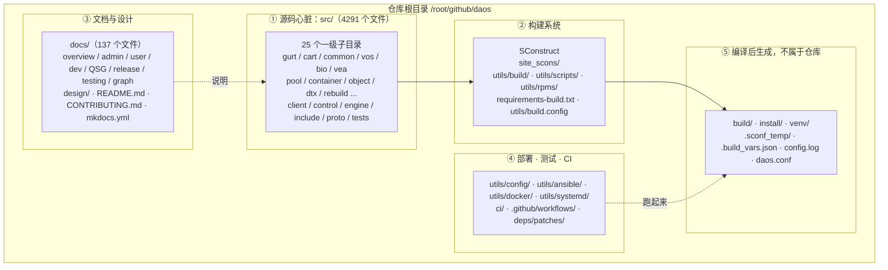
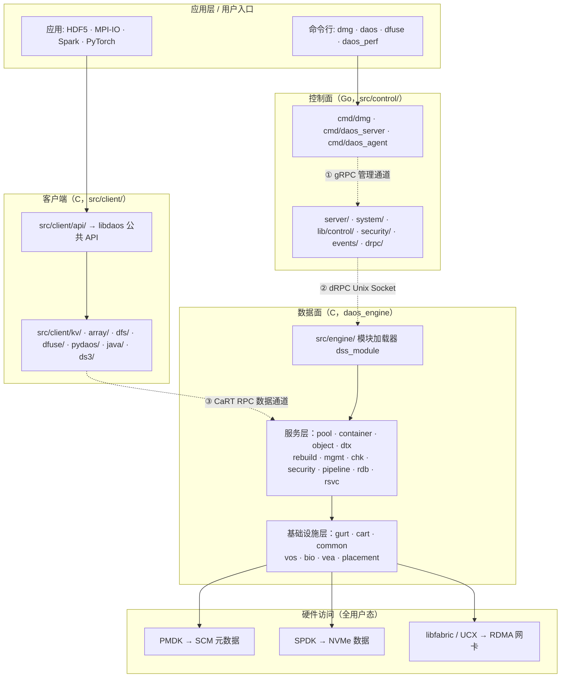
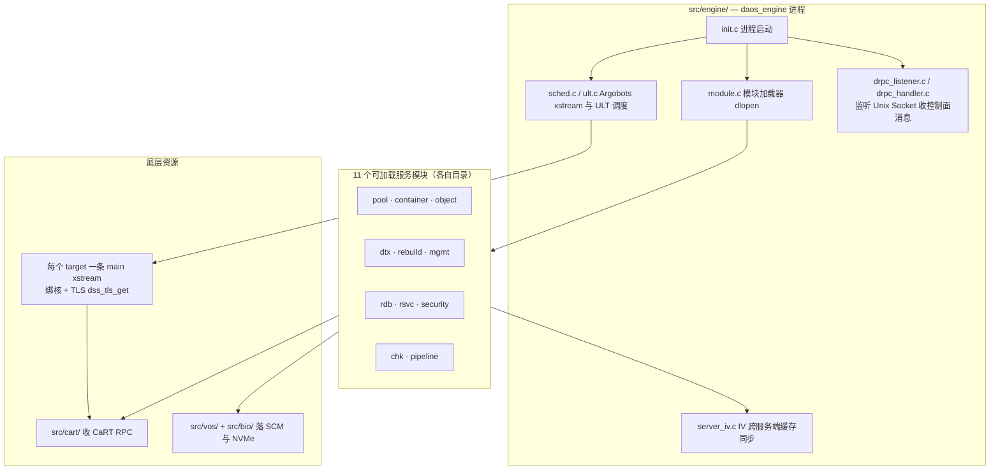
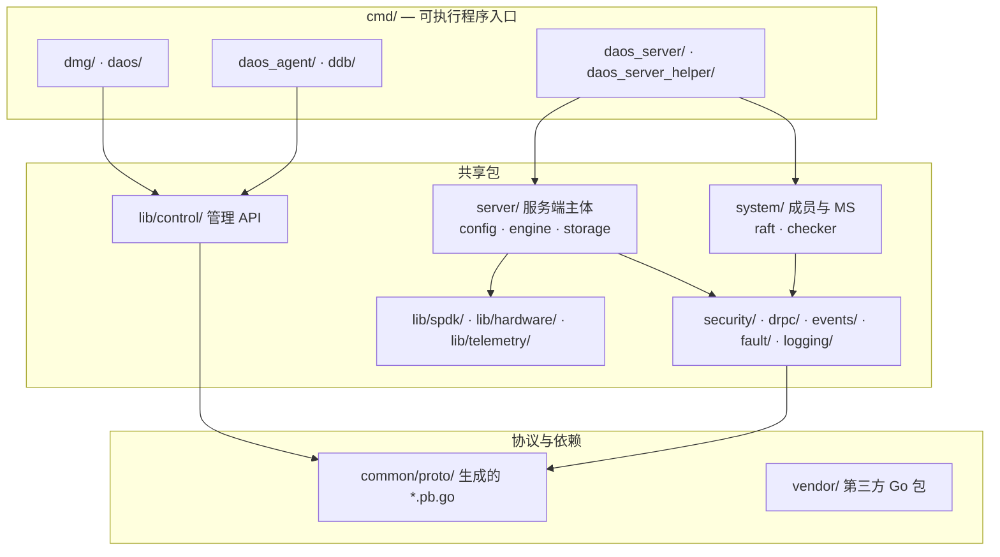
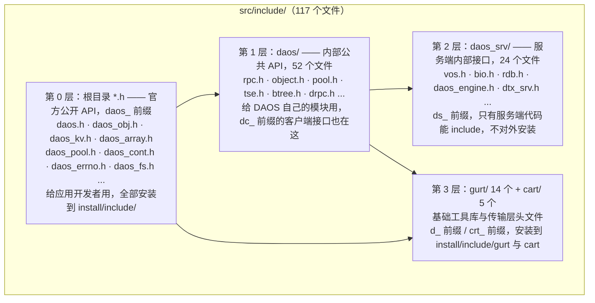
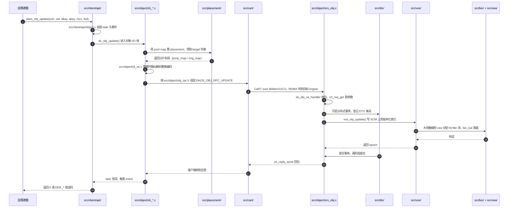
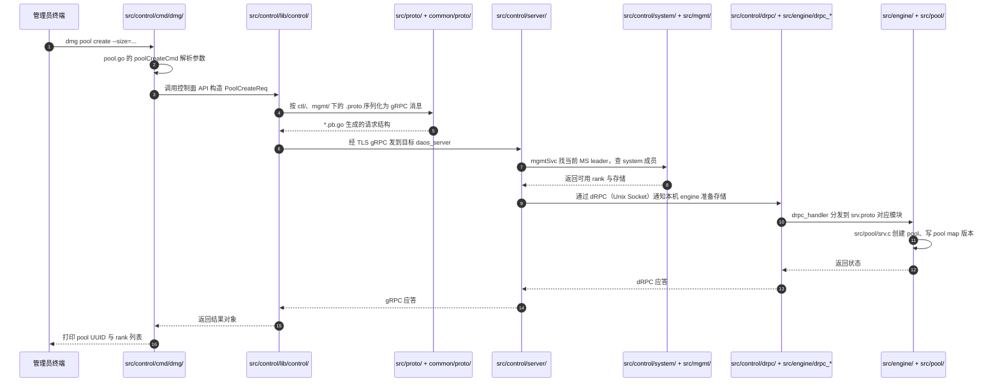
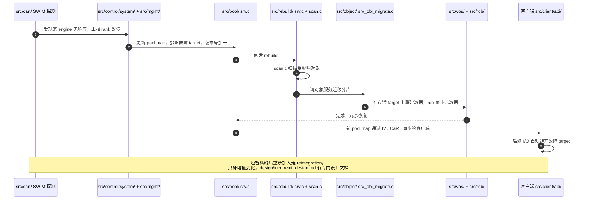

前面三篇分别解决了「选什么版本和硬件」「英文术语怎么读」「怎么把代码编译出来」。这一篇解决读代码时最要命的问题：**四千多个文件摆在面前，我该从哪个目录开始看？**

DAOS 的目录不是随便分的。仓库里有一份官方的 `src/README.md`，其中 "Source Code Structure" 一节把命名规律写得清清楚楚；`src/SConscript` 里那串 `SConscript('xxx/SConscript')` 的顺序，几乎就是整个系统的依赖层次图；`src/proto/README.md` 和 `src/control/README.md` 又各自把协议和控制面的组织方式交代了一遍。**把这几份"目录说明书"读懂，四千多个文件就变成了一张有坐标的地图。**

本文所有目录、文件数、命令和输出都来自对服务器上真实代码树的逐条扫描，不是照着文档抄的目录名。文章会公开发布，**不记录任何登录口令**，涉及连接的地方用 `<HOST>` 代替；代码路径 `/root/github/daos`、版本号和命令都是真实值。

## 〇、先看全景

**一句话**：DAOS 的目录结构可以记成 **「一个入口、两个平面、三类通道、四层头文件、二十五模块」**——`src/` 是唯一的心脏，里面按「控制面 Go / 数据面 C」分成两个平面，用 gRPC、dRPC、CaRT 三条通道通信，头文件按对谁可见分成四层，而 `src/` 下每个子目录就是一个独立的库或服务。

先看整棵树：



### 0.1 实验环境

| 项目 | 实际值 | 来源命令 |
| --- | --- | --- |
| 操作系统 | Rocky Linux release 9.8 (Blue Onyx) | `cat /etc/rocky-release` |
| 内核 | `5.14.0-687.10.1.el9_8.0.1.x86_64` | `uname -r` |
| 代码路径 | `/root/github/daos` | 服务器 |
| 代码版本 | `VERSION = 2.9.100`、`TAG = 2.9.100-tb` | `cat VERSION` / `cat TAG` |
| Git 提交 | `788f8773b6`，分支 `master` | `git rev-parse --short HEAD` |
| 仓库跟踪文件总数 | 4778 | `git ls-files` 后统计行数 |
| `src/` 下文件数 | 4291（占全仓库约 90%） | `git ls-files src` 后统计行数 |
| 全仓库 `SConscript` 数 | 79 | `find . -name SConscript` |
| 文档图片 | 68 个（在 `docs/graph/`） | `find docs/graph -type f` 后统计行数 |

> **版本提醒**：`2.9.100` 的 `9` 是奇数，按 DAOS 语义化版本规则属于**开发版**，这条线通往 3.0。`mkdocs.yml` 里就写着 `site_name: DAOS v3.0`。如果你要对的是生产环境的 `v2.8.1`，目录骨架一致，但个别文件会有出入。

### 0.2 顶层目录总表

下面是 `git ls-files` 按一级目录统计的真实结果——**第一列的文件数就是各目录的"体量"**：

| 目录 | 跟踪文件数 | 一句话职责 | 语言 / 内容 |
| --- | --- | --- | --- |
| `src/` | 4291 | 全部产品源码，整个系统的心脏 | C + Go + Python + Java |
| `utils/` | 205 | 构建、打包、部署、配置、脚本工具箱 | Bash / Python / YAML / Dockerfile |
| `docs/` | 137 | 官方文档源码，用 MkDocs 生成 docs.daos.io | Markdown + PNG |
| `ci/` | 59 | 持续集成脚本、覆盖率、静态扫描配置 | Bash / Python / YAML |
| `.github/` | 23 | GitHub Actions 工作流与 PR 模板、CODEOWNERS | YAML |
| `site_scons/` | 14 | SCons 的自定义构建规则与依赖检查框架 | Python |
| `design/` | 12 | 较完整的设计提案文档 | Markdown + PNG |
| `deps/` | 11 | 外部依赖的补丁文件，加一个子模块准备脚本 | `.patch` / `.diff` / Shell |

再加一条**特别重要的区分**——下面这些目录虽然也在根目录里，但**不是仓库自带的**，是上一篇文章里那次编译生成的：

| 生成目录 / 文件 | 谁生成的 | 能不能删 | 说明 |
| --- | --- | --- | --- |
| `build/` | SCons 编译 | 能，`scons -c` 会清 | 2220 个文件，全是 `.os` 目标文件与中间产物 |
| `install/` | `scons install` | 能 | 1010 个文件，默认 `PREFIX`，49 个可执行文件在 `install/bin` |
| `venv/` | `python3.11 -m venv venv` | 能 | 4209 个文件，Python 构建工具隔离环境 |
| `.sconf_temp/` | SCons 配置检查 | 能 | 编译期临时探测目录 |
| `.build_vars.json` / `.build_vars.sh` | SCons | 能 | 保存 `PREFIX`、各依赖 prefix 等构建变量 |
| `config.log` / `daos.conf` / `.sconsign.dblite` | SCons | 能 | 配置日志、配置快照、增量编译指纹库 |

判断某个目录是不是仓库原生的，一行命令就够：

```bash
# 进入代码根目录
cd /root/github/daos

# 列出所有一级路径，并标注它是否被 git 跟踪
# git ls-files 只输出仓库里的文件，所以能被它匹配到的一定是原生目录
for d in */; do
    # 统计这个目录里被 git 跟踪的文件数
    n=$(git ls-files "$d" | wc -l)
    # 打印目录名和文件数；0 表示是编译生成的，不是仓库自带的
    printf "%-20s %6s 个跟踪文件\n" "$d" "$n"
done
```

## 一、根目录：每个文件都是干什么的

### 1.1 根目录文件逐个说明

| 文件 | 作用 | 什么时候会看它 |
| --- | --- | --- |
| `SConstruct` | SCons 的总入口，等价于 Makefile；定义 `--build-deps`、`--skip-download` 等选项 | 编译、改构建参数时 |
| `VERSION` | 产品版本号，本机是 `2.9.100` | 确认代码版本、`src/SConscript` 会读它生成头文件 |
| `TAG` | 版本标签，本机是 `2.9.100-tb` | 打 RPM 包时 |
| `README.md` | 项目首页：DAOS 是什么、许可证、文档链接、社区联系方式 | 第一次打开仓库 |
| `CONTRIBUTING.md` | 贡献指南：提交规范、代码风格、评审流程 | 准备提 PR |
| `LICENSE` / `NOTICE` | BSD-2-Clause Plus Patent 许可证与版权声明 | 合规 |
| `third_party_programs.txt` | 第三方软件清单 | 合规、供应链审计 |
| `mkdocs.yml` | 文档站配置，`site_name: DAOS v3.0`，`nav` 定义整站目录树 | 想本地起文档站、找某篇文档归在哪 |
| `Doxyfile` | Doxygen 配置，从 C 源码注释生成 API 文档 | 查 C 内部 API |
| `pyproject.toml` | Python 项目配置（格式化、lint 规则） | 改 Python 测试代码 |
| `requirements.txt` | 运行 / 测试用 Python 依赖 | 跑 ftest |
| `requirements-build.txt` | **构建**用 Python 依赖：`scons`、`ninja`、`meson`、`distro`、`pyelftools`、`uv`、`hatchling` | 编译前装工具 |
| `requirements-utest.txt` | 单元测试 Python 依赖 | 跑 C 单元测试 |
| `requirements-ftest.txt` | 功能测试 Python 依赖（avocado 框架等） | 跑 `src/tests/ftest` |
| `ftest.sh` | 功能测试入口脚本 | 跑集成测试 |
| `Jenkinsfile` | 老一代 CI 流水线定义 | 查 CI 历史 |
| `.gitmodules` | 子模块定义，本机只有一个：`src/rdb/raft` | 拉子模块 |
| `.gitignore` | 忽略 `build/`、`install/`、`venv/` 等生成目录 | 理解为什么 `git status` 干净 |
| `.clang-format` / `.clang-format-ignore` | C 代码格式化规则 | 写 C 代码前 |
| `.flake8` / `.flake8-scons` | Python 代码检查规则 | 写 Python 代码前 |
| `.yamllint.yaml` | YAML 格式检查规则 | 改 CI / 配置 |
| `.dockerignore` / `.rpmignore` | 打镜像 / 打 RPM 时排除的文件 | 打包 |
| `.gitmodules` 之外的隐藏文件 | 见上 | — |

> 这些 `requirements*.txt` 分成四份不是冗余，而是**按用途隔离**：编译只要 `requirements-build.txt`，跑单元测试才需要 `utest`，跑集群功能测试才需要 `ftest`。上一篇文章里只装了 build 那份就能编译成功，就是这个道理。

### 1.2 一个容易踩的坑：`daos_version.h.in` 不是头文件

`src/include/daos_version.h.in` 是**模板**，里面的 `@TMPL_MAJOR@` 之类的占位符由 `src/SConscript` 的 `env.Substfile()` 在编译时替换，生成 `build/release/gcc/src/include/daos_version.h`，最后装到 `install/include/daos_version.h`。所以**刚 clone 下来时在 `src/include/` 里找不到 `daos_version.h` 是正常的**，不要以为缺文件。第四节的示例会用到它。

## 二、`src/` 是心脏：先记住三条命名规律

这一节是全文最值得划重点的地方。DAOS 官方在 `src/README.md` 的 "Source Code Structure" 里写了三条约定，掌握之后看到任何一个文件都能猜出它大概在哪、属于哪一侧。

### 2.1 规律一：一个模块 = `src/` 下一个目录

> 官方原文：*Each infrastructure library and service is allocated a dedicated directory under `src/`.*

也就是说，目录名就是模块名。想找「对象 I/O」的代码，直接去 `src/object/`；想找「分布式事务」，去 `src/dtx/`。没有隐藏的深层命名空间。

### 2.2 规律二：`dc_` 是客户端，`ds_` 是服务端

> 官方原文：*Functions that are part of the client component are prefixed with `dc_` (stands for DAOS Client) whereas server-side functions use the `ds_` prefix (stands for DAOS Server).*

这是 DAOS 最实用的一条命名规则。同一个服务（比如 pool、container、object）往往**同时有客户端侧和服务端侧代码，而且放在同一个目录里**，靠文件名前缀区分：

| 模块 | 客户端侧文件 | 服务端侧文件 | 一眼怎么分 |
| --- | --- | --- | --- |
| `src/pool/` | `cli.c`、`srv_cli.c` | `srv.c`、`srv_internal.h` | `cli` = client，`srv` = server |
| `src/container/` | `cli.c`、`cli_internal.h` | `srv.c`、`srv_container.c`、`srv_target.c` | 同上 |
| `src/object/` | `cli_obj.c`、`cli_shard.c`、`cli_ec.c`、`cli_mod.c` | `srv_obj.c`、`srv_mod.c`、`srv_ec.c`、`srv_enum.c` | 同上 |
| `src/rebuild/` | `rpc.c` | `srv.c`、`scan.c`、`rebuild_iv.c` | 同上 |
| `src/security/` | `cli_security.c` | `srv.c`、`srv_acl.c` | 同上 |
| `src/client/kv/` | `dc_kv.c` | — | 纯客户端封装 |
| `src/client/array/` | `dc_array.c` | — | 纯客户端封装 |

实测证据（在代码根目录执行）：

```bash
# 统计有多少 .c 文件里出现了 dc_ 开头的函数调用
git grep -lE "\bdc_[a-z_]+\(" -- "*.c" | wc -l
# 实测输出：74

# 统计有多少 .c 文件里出现了 ds_ 开头的函数调用
git grep -lE "\bds_[a-z_]+\(" -- "*.c" | wc -l
# 实测输出：87
```

> 注意 `dc_` / `ds_` 是**函数前缀**，而 `cli_` / `srv_` 是**文件名前缀**，两者是配套的两种线索。另外别把 `dc_` 和 `d_` 搞混：`d_` 是 GURT 基础库（`d_list_t`、`d_iov_t`），`src/cart/README.md` 里还专门解释了——"All Gurt Useful Routines and Types are prefixed with 'd', the 4th letter in the alphabet because gurt useful words have 4 letters"（因为 gurt、list、hash、heap 这些词都是 4 个字母，所以用第 4 个字母 d）。这个冷笑话能帮你记一辈子。

### 2.3 规律三：RPC 协议放在 `rpc.h` 里

> 官方原文：*The protocol and RPC format used between the client and server components is usually defined in a header file named `rpc.h`.*

实测 `find src -name rpc.h` 的结果：

```text
src/container/rpc.h
src/include/daos/rpc.h
src/mgmt/rpc.h
src/pool/rpc.h
src/rdb/tests/rpc.h
src/rebuild/rpc.h
src/rsvc/rpc.h
```

**但"通常"两个字很重要**：`src/object/` 用的是 `obj_rpc.h`，命名更具体。里面能看到这样的宏：

```c
/* src/object/obj_rpc.h 片段 */
#define OBJ_PROTO_CLI_RPC_LIST(ver)                 \
    X(DAOS_OBJ_RPC_UPDATE,                          \
        0, ver == 9 ? &CQF_obj_rw : &CQF_obj_rw_v10, \
        ds_obj_rw_handler, NULL, "update")          \
    X(DAOS_OBJ_RPC_FETCH, ...)
```

这一行同时告诉你三件事：客户端发的 RPC 叫 `DAOS_OBJ_RPC_UPDATE`、服务端处理函数叫 `ds_obj_rw_handler`（`ds_` 前缀又出现了）、协议有 v9 / v10 两个版本。**所以读一个服务模块的正确顺序是：先看 `rpc.h` 或 `*_rpc.h` 摸清有哪些操作，再看 `cli_*.c` / `srv_*.c` 看两侧怎么实现。**

### 2.4 `src/` 分层架构图



### 2.5 三条通信通道分别落在哪些目录

`src/README.md` 明确说 DAOS 有三条通信通道，它们的定义文件和实现文件分布完全不同：

| 通道 | 用途 | 底层 | 协议定义 | 实现目录 |
| --- | --- | --- | --- | --- |
| **gRPC** | 管理员 ↔ 服务端的管理通道，双向 TLS 认证 | TCP/IP 带外管理网 | `src/proto/ctl/`、`src/proto/mgmt/`，生成 `*.pb.go` | `src/control/lib/control/`、`src/control/server/`、`src/control/cmd/dmg/` |
| **dRPC** | **同一台机器内**的进程间通信：`daos_server` ↔ `daos_engine`、`daos_agent` ↔ `libdaos` | Unix Domain Socket | `src/proto/drpc.proto`、`src/proto/srv/`，C 侧生成 `*.pb-c.[ch]` | C 侧 `src/common/drpc.c`、`src/engine/drpc_*.c`；Go 侧 `src/control/drpc/` |
| **CaRT** | 客户端 ↔ 引擎、引擎 ↔ 引擎的**数据面** RPC | Mercury + libfabric / UCX，支持 RDMA | 各服务自己的 `rpc.h` / `*_rpc.h` | `src/cart/`，服务端 handler 在各 `src/*/srv*.c` |

> 官网 [DAOS Overview](https://daos.io/?page_id=36) 里那句 *"Thanks to a flexible network stack, DAOS can run over either libfabric or UCX and leverage RDMA capabilities whenever available"* 对应的就是第三条通道；而 *"No kernel code"*、*"End-to-end in user space"* 这两条设计原则，正是为什么 `src/bio/` 要直接用 SPDK、`src/vos/` 要直接用 PMDK，而不是走文件系统。

## 三、`src/` 下 25 个模块逐一详解

`src/` 下有 **25 个一级子目录**，加上直属的 `README.md` 和 `SConscript` 两个文件，共 4291 个被 git 跟踪的文件。先看总表，后面再拆开讲。

### 3.1 总表：25 个模块一览

| 目录 | 文件数 | 分类 | 一句话职责 | 代表性文件 |
| --- | --- | --- | --- | --- |
| `src/control/` | 2142 | 控制面 Go | `daos_server` / `dmg` / `daos_agent` 全部 Go 代码 | `cmd/dmg/pool.go`、`server/`、`go.mod`、`vendor/` |
| `src/tests/` | 944 | 测试 | 功能测试、单元测试、集成测试套件 | `ftest/`、`suite/daos_obj.c` |
| `src/client/` | 291 | 客户端 | `libdaos` 及各语言绑定、POSIX 模拟 | `api/object.c`、`dfs/`、`dfuse/` |
| `src/common/` | 180 | 基础设施 | 通用库：B 树、哈希、ACL、TSE 任务调度、dRPC C 接口 | `btree.c`、`tse.c`、`acl_api.c` |
| `src/include/` | 117 | 头文件 | 全部对外 / 内部头文件，分四层 | `daos.h`、`daos/object.h`、`daos_srv/vos.h` |
| `src/vos/` | 94 | 基础设施 | 版本化对象存储，SCM 上的持久索引 | `vos_io.c`、`vos_obj.c`、`evtree.c`、`ilog.c` |
| `src/utils/` | 95 | 工具 | 命令行工具与调试器实现 | `daos_hdlr.c`、`ddb/`、`dlck/` |
| `src/cart/` | 42 | 基础设施 | CaRT 用户态 RPC 传输层 | `crt_context.c`、`crt_bulk.c`、`crt_group.c` |
| `src/mgmt/` | 42 | 服务 | 管理服务的服务端与客户端 | `srv.c`、`cli_mgmt.c`、`*.pb-c.c` |
| `src/object/` | 39 | 服务 | 对象 I/O 栈，最核心的数据路径 | `cli_obj.c`、`srv_obj.c`、`obj_rpc.h` |
| `src/engine/` | 39 | 数据面入口 | `daos_engine` 进程主体、模块加载、Argobots 线程模型 | `init.c`、`module.c`、`srv.c`、`sched.c` |
| `src/proto/` | 30 | 协议 | gRPC / dRPC 的 `.proto` 定义与生成规则 | `ctl/`、`mgmt/`、`Makefile` |
| `src/placement/` | 28 | 基础设施 | 对象布局算法（jump map、ring map） | `jump_map.c`、`ring_map.c`、`pl_map.c` |
| `src/gurt/` | 24 | 基础设施 | 最底层工具库：日志、链表、哈希、错误码、遥测 | `debug.c`、`hash.c`、`errno.c`、`hlc.c` |
| `src/dtx/` | 24 | 服务 | 分布式事务，两阶段提交与冲突检测 | `dtx_srv.c`、`dtx_common.c`、`dtx_rpc.c` |
| `src/pool/` | 23 | 服务 | Pool 服务与 pool map | `cli.c`、`srv.c`、`rpc.h` |
| `src/bio/` | 22 | 基础设施 | Blob I/O，NVMe/SPDK 访问、设备健康、热插拔 | `bio_device.c`、`bio_buffer.c`、`bio_monitor.c` |
| `src/rdb/` | 21 | 基础设施 | 基于 Raft 的复制键值库 | `rdb_module.c`、`raft/`（git 子模块） |
| `src/container/` | 18 | 服务 | Container 服务与对象地址空间 | `cli.c`、`srv.c`、`srv_target.c` |
| `src/security/` | 17 | 服务 | ACL、凭证、访问控制 | `acl.c`、`cli_security.c`、`srv_acl.c` |
| `src/pipeline/` | 15 | 服务 | 服务端下推查询与聚合，实验性 | `cli_pipeline.c`、`filter.c`、`aggr_funcs.c` |
| `src/chk/` | 12 | 服务 | 一致性检查与修复（checker） | `chk_engine.c`、`chk_leader.c` |
| `src/vea/` | 12 | 基础设施 | NVMe 块空间分配器 | `vea_alloc.c`、`vea_free.c`、`vea_init.c` |
| `src/rebuild/` | 10 | 服务 | 故障自愈 / 数据重建 | `srv.c`、`scan.c`、`rebuild_iv.c` |
| `src/rsvc/` | 8 | 基础设施 | 通用复制服务框架 | `srv.c`、`srv_common.c`、`rpc.h` |

> 把文件数加起来正好是 4289，再加 `src/README.md` 和 `src/SConscript` 就是 4291。**`src/control/` 一个目录占了整个 `src/` 的一半**，主要因为里面有 `vendor/`——Go 的第三方依赖按惯例整份 vendored 进仓库，这就是上一篇文章里 `go build -mod vendor` 不需要联网的原因。

### 3.2 基础设施库：底下垫着的九块砖

官网 Overview 说 DAOS 的基线接口是 *"a high-performance scalable key-value-array store supported by the libdaos library"*，而把这层接口撑起来的就是下面这些库。`src/README.md` 把它们叫 "Infrastructure Libraries"：

| 目录 | 全称 | 干什么 | 为什么需要它 |
| --- | --- | --- | --- |
| `src/gurt/` | Gurt Useful Routines and Types | 链表、哈希表、堆、日志、错误码、HLC 混合逻辑时钟、遥测 | 所有 C 代码共用的"螺丝钉"，`d_` 前缀 |
| `src/cart/` | Collective and RPC Transport | 用户态 RPC、集合通信、组管理、SWIM 故障探测 | 数据面所有跨节点通信，基于 Mercury + libfabric |
| `src/common/` | Common Library | B 树、校验和、ACL、压缩、TSE 任务调度引擎、dRPC C 接口 | 服务层共享的数据结构与异步任务框架 |
| `src/vos/` | Versioning Object Store | 版本化持久索引，管理单个 pool shard 的元数据 | 官网说 *"Versioning is at the heart of DAOS"*，多版本并发控制就在这里 |
| `src/bio/` | Blob I/O | NVMe 的 SPDK 用户态 I/O、DMA 缓冲、设备健康、坏盘剔除、热插拔、VMD | 大块数据落盘 |
| `src/vea/` | Versioned Block Allocator | NVMe 上的 extent 分配器，空闲空间用 B 树记在 SCM 上 | VOS 要写 NVMe 时向它要块 |
| `src/placement/` | Algorithmic Placement | 根据 pool map 和对象 ID 算出对象分片落在哪些 target | 决定数据怎么打散、怎么冗余 |
| `src/rdb/` | Replicated DataBase | 基于 Raft 的复制 KV 库 | pool / container 元数据的高可用 |
| `src/rsvc/` | Replicated Services | 通用复制服务框架，封装 leader 选举、任期、重定向 | `pool_svc` / `cont_svc` 都从它派生 |

几个可以顺手验证的官方说法：

- `src/vos/README.md`：*"The Versioning Object Store (VOS) is responsible for providing and maintaining a persistent object store that supports byte-granular access and versioning for a single shard in a DAOS pool."*
- `src/vea/README.md`：*"The Versioned Block Allocator is used by VOS for managing blocks on NVMe SSD"*，还解释了为什么分配元数据要放 SCM——这样"块分配"和"索引更新"能塞进**同一个 PMDK 事务**里。
- `src/placement/README.md`：*"DAOS uses the pool map to create a set of placement maps that are used to compute algorithmic object layouts"*，对应 `jump_map.c` 和 `ring_map.c` 两种算法。
- `src/common/README.md` 里专门有一节 **TSE = Task Execution Engine**，说明它按依赖图调度异步任务——这正是官网说的 *"built on an asynchronous model using futures & promises"*。

### 3.3 服务层：一个目录就是一个"服务"

`src/README.md` 说 DAOS 是"a collection of storage services over a client/server architecture"。每个服务目录里通常同时有 `cli*.c`（客户端侧）和 `srv*.c`（服务端侧），外加 `rpc.h`（协议）。

| 目录 | 服务 | 客户端做什么 | 服务端做什么 | 关键文件 |
| --- | --- | --- | --- | --- |
| `src/pool/` | Pool Service `pool_svc` | 连接 pool、查询属性 | 维护 pool map、ACL、副本元数据 | `rpc.h`、`cli.c`、`srv.c` |
| `src/container/` | Container Service `cont_svc` | 打开 container、拿句柄 | 维护 container 元数据、快照、OID 分配 | `srv_target.c`、`oid_iv.c` |
| `src/object/` | Object Service | 把 I/O 拆成分片、算布局、编码纠删码 | 接收 RPC、执行读写、调 VOS | `obj_rpc.h`、`cli_obj.c`、`srv_obj.c` |
| `src/dtx/` | DTX | 发起 / 提交分布式事务 | 两阶段提交、冲突检测、重同步 | `dtx_srv.c`、`dtx_rpc.c` |
| `src/rebuild/` | Rebuild | 基本没有 | 扫描并重建故障 target 上的数据 | `scan.c`、`srv.c`、`rebuild_iv.c` |
| `src/mgmt/` | Management Service | `dmg` 的 C 侧接口 | 系统成员、rank 状态、存储准备 | `srv.c`、`cli_mgmt.c` |
| `src/chk/` | Checker | 发起检查 | 一致性检查与自动修复 | `chk_leader.c`、`chk_engine.c` |
| `src/security/` | Security | 向 agent 申请凭证 | 校验签名凭证、生成 ACL、算 capability | `acl.c`、`srv_acl.c` |
| `src/pipeline/` | Pipeline | 构造下推查询 | 在服务端执行过滤 / 聚合，减少数据搬运 | `filter.c`、`aggr_funcs.c` |
| `src/rsvc/` | RSVC | 找当前 leader | 复制服务通用框架 | `srv.c`、`rpc.h` |
| `src/rdb/` | RDB | Raft 客户端 | Raft 日志与状态机 | `rdb_module.c`、`raft/` |

官网关于自愈的那段 *"DAOS engines monitor each other constantly via a SWIM algorithm. When an engine becomes unresponsive, it is excluded from the system and self-healing is triggered"*，落到代码上就是 `src/cart/` 里的 SWIM 探测 + `src/rebuild/` 里的重建逻辑 + `src/pool/` 里的 pool map 版本更新，三个目录协作完成。

### 3.4 `src/engine/`：数据面怎么把服务"装"进去

`src/engine/README.md` 说得很清楚：`daos_engine` 支持**模块接口**，每个服务其实是一个通过 `dlopen` 动态加载的库，接口就是 `struct dss_module`。模块要声明名字、模块 ID、特性位掩码、初始化 / 清理函数，还可以注册 CaRT RPC handler 和 dRPC handler。

在源码里实测能找到这些注册点：

```text
src/chk/chk_srv.c:368        struct dss_module chk_module = {
src/container/srv.c:150      struct dss_module cont_module = {
src/dtx/dtx_srv.c:587        struct dss_module dtx_module = {
src/mgmt/srv.c:650           struct dss_module mgmt_module = {
src/object/srv_mod.c:500     struct dss_module obj_module = {
src/pipeline/srv_mod.c:38    struct dss_module pipeline_module = {
src/pool/srv.c:236           struct dss_module pool_module = {
src/rdb/rdb_module.c:71      struct dss_module rdb_module = {
src/rebuild/srv.c:3588       struct dss_module rebuild_module = {
src/rsvc/srv.c:1785          struct dss_module rsvc_module = {
src/security/srv.c:43        struct dss_module security_module = {
```

**11 个生产模块，正好对应 11 个服务目录。** 这条线索的价值在于：想知道「引擎启动时到底加载了哪些功能」，不用读 `main()`，直接搜 `struct dss_module` 就行。



### 3.5 `src/client/`：从 `libdaos` 到 POSIX 文件系统

官网特别强调了一句 *"libdfs is the library implementing a POSIX namespace over libdaos ... there is no POSIX-specific code executed on the engines which only handle key-value-array store operations"*。这句话在目录上的体现就是：**所有"文件"概念都只在 `src/client/` 里，服务端一个 POSIX 相关的目录都没有。**

| 子目录 | 作用 | 代表性文件 |
| --- | --- | --- |
| `api/` | **libdaos 本体**，实现 `daos.h` 里声明的公共 API | `init.c`、`object.c`、`container.c`、`pool.c`、`event.c`、`task.c` |
| `kv/` | KV 接口封装 | `dc_kv.c` |
| `array/` | 数组接口封装 | `dc_array.c` |
| `dfs/` | `libdfs`：在 KV/array 之上模拟 POSIX 文件与目录 | `file.c`、`dir.c`、`io.c`、`lookup.c`、`mnt.c`、`duns.c` |
| `dfuse/` | 基于 `fused` 的用户态 FUSE 守护进程 | `dfuse_core.c`、`dfuse_main.c`、`dfuse_fuseops.c` |
| `dfuse/ops/` | 每个 POSIX 系统调用一个文件 | `open.c`、`read.c`、`write.c`、`readdir.c`、`create.c`、`rename.c`、`unlink.c` … 共 21 个 |
| `dfuse/il/` / `pil4dfs/` | 拦截库 / LD_PRELOAD 旁路优化 | — |
| `pydaos/` | Python 绑定，含 `torch` 子包 | `pydaos_core.py`、`pydaos_shim.c` |
| `java/` | Java / Hadoop 连接器 | `hadoop-daos/`、`daos-java/` |
| `ds3/` | S3 接口模拟 | — |
| `serialize/` | 序列化辅助 | — |

> `src/client/dfuse/ops/` 是全仓库最好读的目录之一：**一个文件对应一个系统调用**，`read.c` 就是 `read()`、`mkdir` 逻辑在 `create.c` 附近。想搞懂"POSIX 是怎么映射到对象的"，从这里入手比从 `api/object.c` 入手直观得多。

### 3.6 `src/control/`：Go 写的另一个程序

`src/control/README.md` 的 "Code Organization" 把包职责列得很清楚：

| 子目录 | 作用 |
| --- | --- |
| `cmd/` | 各个可执行程序的 `main` 包：`dmg`、`daos_server`、`daos_agent`、`daos_server_helper`、`ddb`、`daos`、`hello_drpc` |
| `cmd/dmg/` | `dmg` 的子命令，一个文件管一类：`pool.go`、`cont.go`、`storage.go`、`system.go`、`network.go`、`check.go`、`telemetry.go`、`support.go` |
| `lib/control/` | **控制面 API**，被各命令行程序 import |
| `lib/` | 通用包：`spdk/`（Go 调 SPDK 绑定）、`hostlist/`、`ranklist/`、`hardware/`、`telemetry/`、`ui/`、`txtfmt/`、`atm/` |
| `server/` | `daos_server` 主体，含 `config/`、`engine/`、`storage/`、`init/` |
| `system/` | DAOS system 与成员关系，含 `raft/`、`checker/` |
| `security/` | 证书、认证、`auth/` |
| `drpc/` | dRPC 的 **Go 侧**实现 |
| `events/` | RAS 事件框架，收引擎通过 dRPC 发来的事件并转给 MS leader |
| `fault/` | 结构化错误码定义 |
| `logging/` | 日志 |
| `pbin/` | 把特权操作转发给 `daos_server_helper` 执行 |
| `provider/` | 对外部环境（目前是 Linux）的接口适配层 |
| `common/proto/` | `.proto` 生成的 `*.pb.go` 落在这里 |
| `vendor/` | Go 第三方依赖整份内置，所以 `-mod vendor` 不联网 |
| `build/` | 编译期注入的版本信息包 |

一个可以马上验证的例子：

```bash
# 找 "dmg pool create" 这条命令的实现落在哪个文件
git grep -n "poolCreateCmd" -- src/control/cmd/dmg/pool.go | head -5
# 实测输出（节选）：
# src/control/cmd/dmg/pool.go:35:  Create  poolCreateCmd  `command:"create" ...`
# src/control/cmd/dmg/pool.go:169: type poolCreateCmd struct {
```



### 3.7 `src/proto/`：协议定义按"发给谁"分目录

`src/proto/README.md` 里的分类标准特别清楚，值得原样记住：

| 子目录 | 消息发给谁 | 备注 |
| --- | --- | --- |
| `ctl/` | 任何有 gRPC 服务能力的 DAOS Server，**不要求系统已初始化** | 可组播，如存储扫描、网络扫描 |
| `mgmt/` | **必须**由管理服务的 leader 处理，要求系统已初始化 | pool / container / system / ACL 相关 |
| `security/` | 安全上下文专用 | `auth.proto`、`pop.proto` |
| `shared/` | 被子目录共享的消息定义 | `event.proto`、`ranks.proto`、`check_engine.proto` |
| `srv/` | I/O Engine → DAOS Server 的 dRPC 消息 | `srv.proto` |
| `chk/` | checker 一致性检查 | `chk.proto`、`faults.proto` |
| `test/` | 测试用 | `drpc_test.proto` |
| 根目录 | `drpc.proto`、`Makefile`、`README.md` | 改 `.proto` 后要跑 `make` 重新生成，并同步改 `Makefile` |

生成物分两种语言：**Go 侧**生成 `*.pb.go` 到 `src/control/common/proto/`，**C 侧**用 `protobuf-c` 生成 `*.pb-c.[ch]` 到对应服务目录（例如 `src/mgmt/acl.pb-c.c`）。所以你在服务目录里看到一堆 `.pb-c.c` 文件不用奇怪，它们是生成代码，别手改。

### 3.8 `src/utils/` 与 `src/tests/`

| `src/utils/` 内容 | 作用 |
| --- | --- |
| `daos_hdlr.c` / `daos_dfs_hdlr.c` | `daos` 命令行工具的命令处理 |
| `daos_obj_ctl.c` / `obj_ctl` | 对象级调试工具 |
| `ddb/` | DAOS Debugger，直接检视 VOS 持久结构 |
| `dlck/` | 分布式锁检查工具 |
| `daos_autotest.c` | 自动测试入口 |

| `src/tests/` 内容 | 文件数 | 作用 |
| --- | --- | --- |
| `ftest/` | 845 | 基于 avocado 的**功能测试**，下面按主题分了 40 个子目录 |
| `ftest/util/` | 90 | 测试框架公共库：`dmg_utils.py`、`daos_utils.py`、`dfuse_utils.py` 等 |
| `ftest/pool/` / `control/` / `rebuild/` | 67 / 74 / 32 | 按功能分组的测试用例与 YAML 配置 |
| `suite/` | 49 | C 语言集成测试套件：`daos_obj.c`、`daos_kv.c`、`daos_epoch.c`、`daos_obj_ec.c` |
| `ftest/cart/` | 47 | CaRT 网络层测试 |
| `ftest/erasurecode/` / `nvme/` / `dfuse/` | 40 / 20 / 46 | 专项测试 |
| `drpc/` / `rpc/` / `security/` | 各 3 | 小范围单元与协议测试 |
| `nlt/` | 17 | 网络层测试工具 |

> 找某个功能"官方是怎么用的"，**最快的办法往往不是读文档，而是去 `src/tests/suite/` 或 `src/tests/ftest/` 搜对应的 API 名**——那里有最贴近真实用法的调用示例。

## 四、`src/include/`：四层头文件，以及"谁会被安装"

`src/README.md` 对头文件的分层说得很精确，这是理解"哪些 API 是给我用的"的关键。

### 4.1 四层结构



| 层 | 路径 | 文件数 | 典型前缀 | 谁能用 | 是否安装 |
| --- | --- | --- | --- | --- | --- |
| 0 | `src/include/*.h` | 22（含 1 个 `.in` 模板） | `daos_` | 应用 / I/O 中间件开发者 | 是，装到 `install/include/` |
| 1 | `src/include/daos/` | 52 | `dc_`、`daos_` | DAOS 各模块内部 | **只装 6 个** |
| 2 | `src/include/daos_srv/` | 24 | `ds_` | 仅服务端 | **完全不装** |
| 3 | `src/include/gurt/` / `cart/` | 14 / 5 | `d_` / `crt_` | 全栈基础库 | 装，按 `HEADERS_GURT` / `HEADERS_CART` 列表 |

### 4.2 一个真实实验：`install/include/` 里到底有什么

上一篇文章编译完成后，我列了一下安装目录，结果有点反直觉：

```bash
# 列出安装后的头文件（相对路径）
find /root/github/daos/install/include -type f -printf "%P\n" | sort
```

实测得到 44 个文件：

```text
cart/api.h          cart/iv.h          cart/swim.h        cart/types.h
daos_api.h          daos_array.h       daos_cont.h        daos_errno.h
daos_event.h        daos_fs.h          daos_fs_sys.h      daos.h
daos_kv.h           daos_mgmt.h        daos_obj_class.h   daos_obj.h
daos_pipeline.h     daos_pool.h        daos_prop.h        daos_s3.h
daos_security.h     daos_task.h        daos_types.h       daos_uns.h
daos_version.h
daos/cmd_parser.h   daos/common.h      daos/debug.h       daos/dtx.h
daos/profile.h      daos/tse.h
gurt/atomic.h       gurt/common.h      gurt/debug.h       gurt/debug_setup.h
gurt/dlog.h         gurt/fault_inject.h gurt/hash.h       gurt/heap.h
gurt/list.h         gurt/slab.h        gurt/telemetry_common.h
gurt/telemetry_consumer.h              gurt/types.h
```

**关键结论**：`daos_srv/` 一个都没装，`daos/` 只装了 6 个。原因就在 `src/SConscript` 里——它用三个显式列表决定装什么：

```python
# src/SConscript 片段
HEADERS = ['daos_api.h', 'daos_types.h', 'daos_errno.h', 'daos_kv.h',
           'daos_event.h', 'daos_mgmt.h', 'daos_array.h', 'daos_task.h',
           'daos_fs.h', 'daos_uns.h', 'daos_security.h', 'daos_prop.h',
           'daos_obj_class.h', 'daos_obj.h', 'daos_pool.h', 'daos_cont.h',
           'daos_version.h', 'daos_fs_sys.h', 'daos_s3.h', 'daos_pipeline.h',
           'daos.h']
HEADERS_GURT = ['dlog.h', 'debug.h', 'common.h', 'hash.h', 'list.h',
                'heap.h', 'fault_inject.h', 'debug_setup.h', 'types.h',
                'atomic.h', 'slab.h', 'telemetry_consumer.h', 'telemetry_common.h']
HEADERS_CART = ['api.h', 'iv.h', 'types.h', 'swim.h']
```

另外还额外装了 6 个 `daos/` 头文件：

```python
# src/SConscript 片段
env.Install(os.path.join('$PREFIX', 'include/daos'), 'include/daos/tse.h')
# For daos_der2errno() used by pydaos.torch module
env.Install(os.path.join('$PREFIX', 'include/daos'), 'include/daos/common.h')
env.Install(os.path.join('$PREFIX', 'include/daos'), 'include/daos/debug.h')
env.Install(os.path.join('$PREFIX', 'include/daos'), 'include/daos/profile.h')
env.Install(os.path.join('$PREFIX', 'include/daos'), 'include/daos/dtx.h')
env.Install(os.path.join('$PREFIX', 'include/daos'), 'include/daos/cmd_parser.h')
```

注释里那句 *"For daos_der2errno() used by pydaos.torch module"* 特别有意思：为了 PyTorch 绑定能用一个错误码转换函数，专门多装了一个内部头文件。**读构建脚本能看到很多这种"为什么这个目录长这样"的历史原因。**

> 所以当你 `#include <daos/object.h>` 编译失败时，不是代码有问题，而是**这个头文件本来就不对外安装**。要么把 `-I` 指到源码的 `src/include/`，要么老老实实用公开的 `daos_obj.h`。

### 4.3 完整示例：验证四层头文件，并看懂两个版本号

下面这个 C 程序只做一件事：包含安装后的四类头文件，打印两个版本号。它**不需要链接任何 DAOS 库**，因为用到的都是头文件里的宏。

```c
/* demo_headers.c
 * 目的：验证 src/include 的四层头文件在编译安装后分别落在哪里。
 * 只用到头文件里的宏，所以不需要 -ldaos 或运行中的 DAOS 系统。
 */
#include <stdio.h>            /* 标准库：提供 printf() */
#include <daos.h>             /* 第 0 层：官方公开 API 总头文件 */
#include <daos_version.h>     /* 第 0 层：由 daos_version.h.in 生成，含版本宏 */
#include <gurt/types.h>       /* 第 3 层：GURT 基础类型 */
#include <cart/types.h>       /* 第 3 层：CaRT 传输层类型 */
#include <daos/tse.h>         /* 第 1 层：被额外安装的内部头文件之一 */

int main(void)
{
    /* DAOS_API_VERSION_* 来自 API_VERSION，当前是 2.8.0 */
    printf("DAOS API version: %d.%d.%d\n", DAOS_API_VERSION_MAJOR,
           DAOS_API_VERSION_MINOR, DAOS_API_VERSION_FIX);
    /* DAOS_VERSION_* 来自根目录 VERSION 文件，当前是 2.9.100 */
    printf("DAOS package version: %d.%d.%d\n", DAOS_VERSION_MAJOR,
           DAOS_VERSION_MINOR, DAOS_VERSION_FIX);
    return 0;
}
```

编译和运行方式（在代码根目录执行）：

```bash
# 进入已编译好的 DAOS 代码树
cd /root/github/daos

# -I install/include 让编译器找到安装后的头文件
# -Wall -Wextra 打开常用警告；本例不需要链接任何库
gcc -Wall -Wextra -I install/include -o /tmp/demo_headers /tmp/demo_headers.c

# 运行
/tmp/demo_headers
```

实测输出：

```text
DAOS API version: 2.8.0
DAOS package version: 2.9.100
```

**为什么两个版本号不一样？** 因为它们是两回事：

| 宏 | 来源 | 含义 | 本机值 |
| --- | --- | --- | --- |
| `API_VERSION` | `src/SConscript` 里写死的 `2.8.0` | **API / 协议兼容版本**，客户端与服务端靠它判断能不能互通 | 2.8.0 |
| `DAOS_VERSION` | 根目录 `VERSION` 文件 | **产品发布版本** | 2.9.100 |

`src/SConscript` 里的 `read_and_save_version()` 会读 `VERSION` 文件，把 `2.9.100` 填进 `daos_version.h.in` 的 `@TMPL_PKG_*@` 占位符；而 `@TMPL_MAJOR@` 等来自写死的 `API_VERSION_MAJOR/MINOR/FIX`。这也解释了上一篇文章编译日志里为什么同时出现 `-DAPI_VERSION=\"2.8.0\"` 和 `-DDAOS_VERSION=\"2.9.100\"`。`src/README.md` 最后一节的 "Protocol Compatibility" 讲的就是这个：`Client libraries linked with the application may be up to one protocol version older than the targets`。

## 五、构建系统：目录是怎么被串起来的

### 5.1 三层入口

| 文件 | 层级 | 作用 |
| --- | --- | --- |
| `SConstruct` | 根 | 解析命令行选项、设置 `PREFIX`、初始化依赖检查、调用 `src/SConscript` |
| `src/SConscript` | 中层 | **按依赖顺序**调用各模块的 `SConscript`，定义要安装哪些头文件 |
| 各模块 `SConscript` | 叶子 | 声明本模块要编哪些 `.c`、生成哪个 `.so` / 可执行文件 |

全仓库共 **79 个 `SConscript`**（排除 `build/`、`install/`、`venv/` 后统计）。也就是说，除了 25 个一级模块，每个模块内部还有子目录级别的构建文件（例如 `src/placement/tests/SConscript`）。

### 5.2 `src/SConscript` 的顺序就是依赖层次图

把 `src/SConscript` 里那串调用按顺序画出来，会得到一张比任何架构文档都准确的依赖图：

```mermaid
flowchart LR
    subgraph P1["阶段 1：公共基础库"]
        A["gurt"] --> B["cart"] --> C["common"] --> D["bio"] --> E["vea"] --> F["vos"]
    end
    subgraph P2["阶段 2：服务组件"]
        G["rsvc"] --> H["chk"] --> I["mgmt"] --> J["pool"] --> K["container"]
        K --> L["placement"] --> M["dtx"] --> N["object"] --> O["rebuild"]
        O --> P["security"] --> Q["pipeline"]
    end
    subgraph P3["阶段 3：客户端与复制库"]
        R["client"] --> S["rdb"]
    end
    subgraph P4["阶段 4：可执行程序"]
        T["engine"] --> U["utils"] --> V["control"]
    end
    subgraph P5["阶段 5：测试"]
        W["placement/tests"] --> X["pool/tests"] --> Y["tests"]
    end
    F --> G
    Q --> R
    S --> T
    V --> W
```



对应到源码里的原始顺序（`src/SConscript` 里的注释也标了阶段）：

| 阶段 | 模块顺序 | 为什么是这个顺序 |
| --- | --- | --- |
| 1 公共库 | `gurt` → `cart` → `common` → `bio` → `vea` → `vos` | `gurt` 谁都不依赖；`cart` 用 `gurt`；`vos` 要用 `vea` 分配块、`bio` 落盘 |
| 2 服务 | `rsvc` → `chk` → `mgmt` → `pool` → `container` → `placement` → `dtx` → `object` → `rebuild` → `security` → `pipeline` | 越靠前越"元"：`rsvc` 是复制服务框架，`pool`/`container` 依赖它；`rebuild` 要和 pool/container/object 都打交道，所以排后面 |
| 3 客户端 | `client` → `rdb` | 源码注释写着 *"rdb unit test rdbt depends on libdaos"*，所以 `rdb` 必须在 `client` 之后 |
| 4 可执行 | `engine` → `utils` → `control` | `engine` 链接前面所有服务库；`control` 是 Go，最后编 |
| 5 测试 | `placement/tests` → `pool/tests` → `tests` | 测试依赖所有产品库 |

> **这是本文最实用的一个技巧**：当你想知道"模块 A 和模块 B 谁依赖谁"，不用通读代码，去 `src/SConscript` 看谁排在前面就行。构建顺序天然是拓扑排序。

### 5.3 `site_scons/`：SCons 的自定义大脑

| 文件 | 作用 |
| --- | --- |
| `components/__init__.py` | **定义每一个外部依赖**：去哪下载、怎么编译、检查哪些头文件和库。上一篇文章里 `fused` 的 meson 命令就出自这里 |
| `prereq_tools/base.py` | 依赖检查框架：实现 `passed install check` / `BuildRequired`、prefix 计算、`--skip-download` 逻辑 |
| `prereq_tools/c_source/` | 编译探测用的小 C 测试程序（`cmocka_tests.h`、`unit_test.c`） |
| `site_tools/daos_builder.py` | DAOS 通用构建函数、库注册 |
| `site_tools/go_builder.py` | Go 代码的构建规则 |
| `site_tools/compiler_setup.py` | 编译器告警 / 优化参数探测 |
| `site_tools/protoc/` | protobuf 代码生成规则 |
| `site_tools/stack_analyzer.py` | 栈使用分析（`docs/dev/development.md` 里有说明） |
| `site_tools/extra/` | 辅助构建工具 |
| `env_modules.py` | 加载 MPI 环境模块，找不到 MPI 就跳过 MPI 相关测试 |

### 5.4 `utils/build/` 与 `utils/rpms/`

| `utils/build/` 脚本 | 作用 |
| --- | --- |
| `install_deps.sh` | 安装与当前代码树版本匹配的预编译依赖 RPM（**不允许 root 运行**） |
| `build_deps.sh` | 从源码编译依赖 |
| `build_daos.sh` | 官方构建封装，默认 `--jobs $(nproc) USE_INSTALLED=all PREFIX=/opt/daos` |
| `build_packages.sh` | 打 RPM 包 |
| `build_utils.sh` / `verify_packages.sh` | 公共函数、产物校验 |

| `utils/rpms/` 关键文件 | 作用 |
| --- | --- |
| `daos.spec` | DAOS 主包的 RPM spec，`BuildRequires: fused-devel` 就写在这 |
| `package_info.sh` / `package_version.sh` | 依赖包版本号与包名映射 |
| `daos.sh` / `fused.sh` / `mercury.sh` / `libfabric.sh` / `argobots.sh` / `isa-l.sh` / `pmdk.sh` | 各依赖包的打包脚本 |
| `*.changelog` | 各包的变更记录 |
| `fpm_common.sh` / `create_local_repo.sh` | fpm 打包公共函数、建本地 repo |

`utils/build.config` 则把外部依赖的版本钉死（`fused=v1.2.0`、`spdk=v26.01`、`mercury=v2.4.1` 等），配合 `deps/patches/` 里对 argobots、mercury、spdk 的 10 个补丁——上一篇文章里编译 `fused` 之所以要手工来，就是因为这个文件里写了 `fused=v1.2.0`，而官方 RPM 仓库里偏偏没有对应包。

## 六、文档、部署、测试与 CI

### 6.1 `docs/`：官方文档地图（137 个文件）

| 子目录 | 文件数 | 内容 | 什么时候看 |
| --- | --- | --- | --- |
| `overview/` | 8 | `architecture.md`、`storage.md`、`transaction.md`、`fault.md`、`terminology.md`、`security.md`、`data_integrity.md`、`use_cases.md` | **读代码前必看**，前两篇文章主要依据这里 |
| `admin/` | 19 + `media/` 5 | `hardware.md`、`predeployment_check.md`、`deployment.md`、`pool_operations.md`、`self_healing.md`、`rebuild_controls.md`、`performance_tuning.md`、`troubleshooting.md` | 运维、部署 |
| `user/` | 13 | `interface.md`、`container.md`、`filesystem.md`、`python.md`、`hdf5.md`、`mpi-io.md`、`spark.md`、`pytorch.md`、`tensorflow.md` | 用 DAOS 写应用 |
| `QSG/` | 7 | `build_from_scratch.md`、`setup_rhel.md`、`setup_suse.md`、`tour.md`、`docker.md`、`qemu-vms.md`、`cloud.md` | 装环境、第一次上手 |
| `release/` | 6 | `support_matrix.md`、`support_matrix.draft.md`、`release_notes.md`、`upgrading.md`、`version_interop.md` | 选版本、升级 |
| `dev/` | 3 | `contributing.md`、`development.md`、`documentation.md` | **开发必看**：`development.md` 里有自定义构建目标、栈分析、ASan、Go vendor、protobuf 编译器版本 |
| `testing/` | 4 | `autotest.md`、`datamover.md`、`dbench.md`、`ior.md` | 跑测试 |
| `graph/` | 63 + `data_integrity/` 5 | 全部文档插图，`*.png` | 看架构图 |
| `mkdocs.yml` | 根 | MkDocs 配置，`nav` 定义整站目录树 | 本地起文档站 |

`src/README.md` 引用的三张关键架构图就在 `docs/graph/` 里，实测都存在：

```text
docs/graph/system_architecture.png   ← "DAOS SDS Components"
docs/graph/services.png              ← "DAOS Internal Services & Libraries"
docs/graph/layering.png              ← "DAOS Internal Layering"
```

> 这三张图和本文的架构图可以对照着看：官方图讲**运行时组件**，本文的图讲**代码目录**，两者一一对应。`mkdocs.yml` 的 `edit_uri: blob/master/docs/` 也说明文档源码就在这个目录，改文档直接改 Markdown 即可。

### 6.2 `utils/`：部署与运维工具箱

| 子目录 | 文件数 | 作用 |
| --- | --- | --- |
| `docker/` | 55 | 各发行版的 Dockerfile 与镜像构建脚本 |
| `rpms/` | 27 | RPM 打包（见 5.4） |
| `ansible/` | 26 | Ansible 部署 playbook |
| `githooks/` | 19 | 提交前检查钩子 |
| `scripts/` | 16 | 系统依赖安装脚本：`install-el9.sh`、`install-leap15.sh`、`install-ubuntu.sh`、`copy_files.sh` 等 |
| `sl/` | 12 | 服务层辅助脚本 / SLURM 集成 |
| `config/` | 9 | **配置样板**：`daos_server.yml`、`daos_agent.yml`、`daos_control.yml`，以及 `examples/` 下 5 个场景配置 |
| `cq/` | 7 | 代码质量工具 |
| `build/` / `certs/` | 6 / 6 | 构建脚本、证书生成 |
| `ci/` / `systemd/` / `grafana/` / `trivy/` / `completion/` / `unit/` | 4 / 3 / 2 / 3 / 1 / 1 | CI 辅助、systemd unit、Grafana 面板、安全扫描、命令补全、单元测试辅助 |

`utils/config/examples/` 里的 5 个文件正好对应 5 种部署场景，非常值得作为读代码的入口：

| 文件 | 场景 |
| --- | --- |
| `daos_server_local.yml` | 单机学习，用 RAM + 文件模拟 SCM/NVMe |
| `daos_server_mdonssd.yml` | MD-on-SSD，无 PMem 的新硬件 |
| `daos_server_tcp.yml` | TCP 网络（无 RDMA） |
| `daos_server_verbs.yml` | InfiniBand verbs |
| `daos_server_ucx.yml` | UCX 网络后端 |

### 6.3 `ci/`、`.github/`、`design/`、`deps/`

| 目录 | 内容 |
| --- | --- |
| `ci/`（59） | `docker/` 下三套扫描镜像、`provisioning/` 下各发行版的节点初始化脚本、`functional/` 下功能测试入口、`gen_commit_pragmas.py`、`jira_query.py`、覆盖率与静态扫描配置 |
| `.github/workflows/`（13） | `ci2.yml`（主构建，用 rockylinux/rockylinux:9 等镜像）、`unit-testing.yml`、`linting.yml`、`rpm-build-and-test.yml`、`trivy.yml`、`landing-builds.yml`、`create_release.yml` 等 |
| `design/`（12） | 完整设计提案：`multi_provider/`（多网络后端，含 5 张图）、`control/`（dmg system erase MD-on-SSD、PCI 热插拔）、`large_obj_support.md`、`incr_reint_design.md`、`bucket-selection-design.md`、`user_data_global_consistency_verification.md` |
| `deps/patches/`（10） | `argobots/` 2 个、`.diff`、`mercury/` 7 个 `.patch`、`spdk/` 1 个 `.patch`，加 `prepare_submodule.sh` |
| `.gitmodules` | 只有一个子模块：`src/rdb/raft` → `https://github.com/daos-stack/raft.git` |

> 想给 DAOS 加一个新的网络 provider，或想理解 MD-on-SSD 的设计取舍，先读 `design/` 比直接翻代码快得多；这些文档是"为什么这么设计"，代码是"最后怎么实现的"。

## 七、一次写请求穿过哪些目录

把前面所有目录串起来，看一次 `daos_obj_update()` 是怎么从应用走到磁盘的。这也是读代码时最该建立的一条主线：



**对照目录记忆**：`client/api` 是门面 → `object/cli_*` 是拆包与布局 → `cart` 是网络 → `object/srv_*` 是落地 → `dtx` 保证一致性 → `vos` 存索引 → `bio`/`vea` 存数据。官网说的 *"No POSIX-specific code executed on the engines"* 在这张图里也能看出来：服务端完全不知道"文件"是什么，只处理 dkey/akey/recx。

## 八、一次管理命令穿过哪些目录

数据面用 C + CaRT，管理面用 Go + gRPC + dRPC，走的是完全不同的一条路。以 `dmg pool create` 为例：



**这张图解释了三个目录为什么存在**：`src/proto/` 是 gRPC/dRPC 的"共同语言"；`src/control/` 完全用 Go，负责编排；`src/engine/drpc_*.c` 是 C 侧接收控制面消息的入口。两个平面互不混入对方语言，只在 dRPC 这座桥上握手。

## 九、一次故障自愈穿过哪些目录

官网 Overview 里那句 *"DAOS engines monitor each other constantly via a SWIM algorithm ... self-healing is triggered to restore redundancy on the surviving engines"*，落到目录上是这样：



## 十、「我想改 X，代码在哪？」速查表

### 10.1 需求 → 目录

| 我想做的事 | 第一个该打开的目录 | 再看哪里 |
| --- | --- | --- |
| 加一个新的 `dmg` 子命令 | `src/control/cmd/dmg/` | `src/control/lib/control/`、`src/proto/ctl/` 或 `mgmt/` |
| 改 `daos_server.yml` 的某个配置项 | `src/control/server/config/` | `utils/config/daos_server.yml` |
| 改 NVMe 设备发现 / 热插拔 | `src/bio/`、`src/control/server/storage/` | `src/control/lib/spdk/`、`docs/admin/vmd.md` |
| 加一种新的对象冗余布局 | `src/placement/` | `src/include/daos/obj_class.h`、`src/object/obj_class.c` |
| 改纠删码编码逻辑 | `src/object/cli_ec.c`（客户端）、`src/object/srv_ec.c`（服务端） | `src/include/daos_srv/srv_obj_ec.h` |
| 调 VOS 索引 / 聚合 / GC | `src/vos/` | `src/vos/README.md` |
| 调分布式事务 | `src/dtx/` | `docs/overview/transaction.md` |
| 改重建速度 / 策略 | `src/rebuild/`、`src/control/cmd/dmg/` | `docs/admin/rebuild_controls.md`、`design/incr_reint_design.md` |
| 改 POSIX 语义（某个系统调用） | `src/client/dfuse/ops/` | `src/client/dfs/` |
| 加一种语言绑定 | `src/client/` 下新建子目录 | 参考 `pydaos/` 或 `java/` |
| 改 RPC 协议格式 | 对应服务的 `rpc.h` / `*_rpc.h` | `src/include/daos/rpc.h`、`docs/release/version_interop.md` |
| 改 gRPC/dRPC 消息 | `src/proto/` | 跑 `make` 重新生成，同步改 `Makefile` |
| 加一个引擎可加载模块 | 服务目录里定义 `struct dss_module` | `src/engine/README.md`、`src/engine/module.c` |
| 加一个外部依赖 | `site_scons/components/__init__.py` | `utils/build.config`、`utils/rpms/` |
| 改编译参数 | `SConstruct`、`src/SConscript` | `site_scons/site_tools/compiler_setup.py` |
| 找某个功能的用法示例 | `src/tests/suite/`、`src/tests/ftest/` | `docs/user/` |
| 改官方文档 | `docs/` | `mkdocs.yml` 的 `nav` |

### 10.2 命名前缀速查

| 前缀 / 后缀 | 含义 | 例子 |
| --- | --- | --- |
| `daos_` | 公开 API | `daos_obj_update()`、`daos_pool_connect()` |
| `dc_` | DAOS Client，客户端侧函数 | `dc_obj_update()`、`dc_kv_put()` |
| `ds_` | DAOS Server，服务端侧函数 | `ds_obj_rw_handler()`、`ds_cont_child` |
| `d_` | GURT 基础工具 | `d_list_t`、`d_iov_t`、`d_log()` |
| `crt_` | CaRT 传输层 | `crt_req_send()`、`crt_rpc_t` |
| `vos_` | VOS 版本化存储 | `vos_obj_update()`、`vos_pool_open()` |
| `bio_` | Blob I/O | `bio_iod_alloc()`、`bio_device.c` |
| `dtx_` | 分布式事务 | `dtx_begin()`、`dtx_commit()` |
| `DER_` | DAOS 错误码 | `DER_NONEXIST`、`DER_NOSPACE` |
| `OC_` / `DAOS_OT_` | 对象类别 / 对象类型 | `OC_SX`、`DAOS_OT_KV_HASHED` |
| `cli_*.c` / `srv_*.c` | 文件名层面的客户端 / 服务端 | `src/pool/cli.c`、`src/pool/srv.c` |
| `*.pb-c.c` / `*.pb.go` | protobuf 生成代码，别手改 | `src/mgmt/acl.pb-c.c` |
| `*.in` | 构建时替换占位符的模板 | `src/include/daos_version.h.in` |
| `SConscript` | 该目录的构建说明 | 全仓库 79 个 |
| `README.md` | 该模块的官方说明 | `src/` 下有 52 个（不含 `vendor/`），几乎每个核心模块都有 |

### 10.3 常用定位命令（实测可运行）

```bash
# 进入代码根目录，后面所有命令都在这里执行
cd /root/github/daos

# 1. 看整个仓库的目录体量，按文件数从多到少排序
git ls-files | awk -F/ '{print $1}' | sort | uniq -c | sort -rn

# 2. 列出 src/ 下所有一级子目录
find src -maxdepth 1 -type d | sort

# 3. 找某个 API 的实现文件（只列文件名）
git grep -l "daos_obj_update" -- "src/*.c"

# 4. 找客户端侧函数 dc_obj_update 出现在哪些文件
git grep -l "dc_obj_update" -- "src/*.c" "src/*.h"

# 5. 找引擎加载了哪些服务模块
git grep -n "struct dss_module .*_module = {" -- "src/*/*.c"

# 6. 找某个 dmg 子命令的实现
git grep -n "poolCreateCmd" -- src/control/cmd/dmg/pool.go | head -5

# 7. 找所有 RPC 协议定义文件
find src -name "rpc.h" -o -name "*_rpc.h" | sort

# 8. 看某个目录有哪些测试
find src/tests/ftest -maxdepth 1 -type d | sort

# 9. 看某个模块的官方说明（如果存在）
cat src/vos/README.md

# 10. 看构建顺序，也就是依赖层次
grep -n "SConscript(" src/SConscript
```

> 用 `git grep` 而不是 `grep -r` 的原因：它**只搜被 git 跟踪的文件**，自动跳过 `build/`、`install/`、`venv/` 里几千个生成文件，结果干净得多。这是阅读 DAOS 这种"源码和产物混在一个根目录"的仓库时最省事的一个习惯。

## 十一、一键目录探索脚本

下面这份脚本把本文用到的主要探查动作打包起来，**完整、自包含、可直接运行**，不需要任何前置步骤。它会生成一份 `daos-tree-report.txt` 放在代码根目录。

```bash
#!/usr/bin/env bash
# daos-tree-report.sh
# 作用：为一份 DAOS 源码树生成"目录结构速览"报告。
# 用法：bash daos-tree-report.sh [代码根目录]
# 示例：bash daos-tree-report.sh /root/github/daos
set -euo pipefail

# 1. 取第一个参数作为代码根目录，没给就用默认值
DAOS_SRC="${1:-/root/github/daos}"

# 2. 检查目录存在，避免后面 cd 失败却继续跑
if [ ! -d "$DAOS_SRC" ]; then
    echo "错误：目录不存在：$DAOS_SRC" >&2
    exit 1
fi

# 3. 进入代码树，后续命令都用相对路径
cd "$DAOS_SRC"

# 4. 报告文件名，固定放在代码根目录，方便下次翻
REPORT="$DAOS_SRC/daos-tree-report.txt"

# 5. 用一个大括号把所有输出重定向到报告，同时 tee 到屏幕
{
    echo "========== DAOS 目录结构速览 =========="
    echo "生成时间：$(date)"

    echo
    echo "---------- [1] 版本与提交 ----------"
    # VERSION 是产品版本，TAG 是标签，git 命令给出当前提交
    printf "VERSION : %s\n" "$(cat VERSION 2>/dev/null || echo '无')"
    printf "TAG     : %s\n" "$(cat TAG 2>/dev/null || echo '无')"
    printf "COMMIT  : %s\n" "$(git rev-parse --short HEAD 2>/dev/null || echo '非 git 仓库')"
    printf "BRANCH  : %s\n" "$(git branch --show-current 2>/dev/null || echo '未知')"

    echo
    echo "---------- [2] 顶层目录体量（git 跟踪文件数）----------"
    # awk -F/ 取路径第一段，uniq -c 计数，sort -rn 按数量倒序
    git ls-files | awk -F/ '{print $1}' | sort | uniq -c | sort -rn

    echo
    echo "---------- [3] src/ 各模块文件数 ----------"
    # 遍历 src 下每个一级子目录，统计 git 跟踪的文件数
    for d in src/*/; do
        n=$(git ls-files "$d" | wc -l)
        printf "%-28s %5s\n" "$d" "$n"
    done | sort -k2 -rn

    echo
    echo "---------- [4] 构建顺序（= 依赖层次）----------"
    grep -n "SConscript(" src/SConscript || true

    echo
    echo "---------- [5] 引擎加载的服务模块 ----------"
    git grep -n "struct dss_module .*_module = {" -- "src/*/*.c" || true

    echo
    echo "---------- [6] RPC 协议定义文件 ----------"
    find src -name "rpc.h" -o -name "*_rpc.h" | sort

    echo
    echo "---------- [7] 各模块自带 README ----------"
    git ls-files "src/*README*" | grep -v vendor | sort

    echo
    echo "---------- [8] 安装后的头文件（若已编译）----------"
    if [ -d install/include ]; then
        find install/include -type f -printf "%P\n" | sort
    else
        echo "尚未执行 scons install，参考本系列编译篇"
    fi

    echo
    echo "---------- [9] 构建产物目录（非仓库原生）----------"
    for d in build install venv .sconf_temp; do
        if [ -d "$d" ]; then
            printf "%-16s %6s 个文件\n" "$d" "$(find "$d" -type f | wc -l)"
        fi
    done

    echo
    echo "========== 报告结束：$(date) =========="
} | tee "$REPORT"

# 6. 告诉用户报告在哪
echo "报告已写入：$REPORT"
```

运行方式：

```bash
# 保存为文件后执行（脚本自带默认值 /root/github/daos）
bash daos-tree-report.sh

# 或者显式指定代码目录
bash daos-tree-report.sh /root/github/daos

# 只看报告，不再重跑
less /root/github/daos/daos-tree-report.txt
```

脚本里 `| wc -l`、`grep ... || true`、`2>/dev/null || echo` 这些写法都是为了避免 `set -euo pipefail` 下因为"某个文件不存在"就整份报告中断——**读别人的大仓库时，探查脚本一定要容忍缺项**。

## 十二、给零基础读者的阅读路线

如果这是你第一次打开 DAOS，按下面四阶段走，比"从 `src/` 第一个目录开始看"省很多时间：

| 阶段 | 目标 | 具体看什么 | 大概收获 |
| --- | --- | --- | --- |
| 一：建立地图 | 知道系统有哪些零件 | `README.md` → `docs/overview/architecture.md` → `docs/overview/terminology.md` → 本文第〇、二节 | 能用中文说清 pool / container / object / target / engine |
| 二：跟一条主线 | 知道一次 I/O 怎么走 | `src/include/daos.h` → `src/client/api/object.c` → `src/object/obj_rpc.h` → `src/object/srv_obj.c` → `src/vos/README.md` | 把「目录」和「动作」对上号 |
| 三：挑一个模块深入 | 掌握一个子系统 | 选 `src/vos/` 或 `src/placement/`，先读它的 `README.md`，再看 `SConscript` 知道编了哪些文件，最后读主 `.c` | 具备独立读其它模块的能力 |
| 四：动手验证 | 让代码可运行、可调试 | `docs/QSG/build_from_scratch.md` → 编译篇 → `src/tests/suite/daos_kv.c` → `docs/dev/development.md` | 能改一行、重编、跑测试 |

配套的三条建议：

1. **先读 `README.md`，再读 `.c`**。`src/` 下有 52 个非 vendor 的 README，几乎每个核心模块都有，官方把算法设计写得比注释详细。
2. **顺着 `SConscript` 而不是字母序看目录**。构建顺序就是依赖顺序，从 `gurt` 看到 `control` 刚好是由底向上。
3. **拿测试用例当 API 示例**。`src/tests/suite/` 里的 `daos_kv.c`、`daos_obj.c` 是最短的"完整用法"，比读头文件猜参数快。

## 十三、常见误区速查

| 误区 | 真相 |
| --- | --- |
| 「`build/`、`install/`、`venv/` 是仓库的一部分」 | 全是编译生成的，被 `.gitignore` 忽略，`git ls-files` 里一个都没有 |
| 「`src/include/` 里的头文件都能 `#include`」 | 只有根目录那 22 个公开头会完整安装；`daos_srv/` 完全不装，`daos/` 只装 6 个 |
| 「找不到 `daos_version.h` 是代码缺文件」 | 它是 `daos_version.h.in` 经 SCons `Substfile` 生成的，编译后才有 |
| 「`dc_` 和 `ds_` 是两个不同目录」 | 同一个服务目录里靠**函数前缀**和 `cli_*.c` / `srv_*.c` **文件名前缀**区分 |
| 「所有 RPC 都在 `rpc.h`」 | 官方说是 "usually"，`src/object/` 用的是 `obj_rpc.h` |
| 「POSIX 文件系统逻辑在服务端」 | 官网明确说引擎不跑 POSIX 代码，全在 `src/client/dfs/` 和 `src/client/dfuse/` |
| 「`src/control/` 文件多是因为逻辑复杂」 | 一半以上是 `vendor/` 里的第三方 Go 依赖，业务代码没那么多 |
| 「`.pb-c.c` / `.pb.go` 是手写代码」 | protobuf 生成物，改 `src/proto/` 下的 `.proto` 再跑 `make` |
| 「`API_VERSION` 和 `VERSION` 是同一个东西」 | 前者是 API/协议兼容版本（2.8.0），后者是产品发布版本（2.9.100） |
| 「用 `grep -r` 全仓搜符号就行」 | 会撞进 `build/`、`install/`、`venv/` 几千个生成文件，用 `git grep` 更干净 |

## 十四、总结

把这篇长文压缩成几句可以贴在显示器边上的话：

1. **一个入口**：`src/` 占全仓库约 90% 的文件，其它目录都是围着它转的——`docs/` 解释它、`site_scons/` + `SConstruct` 编译它、`utils/` + `ci/` 部署测试它。
2. **两个平面**：控制面是 `src/control/` 的 Go 代码（`daos_server`/`dmg`/`daos_agent`），数据面是 C 写的 `src/engine/` 加各服务目录（`daos_engine`）。两者通过 dRPC 在本机握手。
3. **三类通道**：gRPC 走管理网、dRPC 走 Unix Socket、CaRT 走 RDMA 数据网；协议分别在 `src/proto/` 和各服务的 `rpc.h`。
4. **四层头文件**：根目录公开 API → `daos/` 内部公共 → `daos_srv/` 服务端专用 → `gurt/` + `cart/` 基础库；安装范围逐层收窄。
5. **三条命名规律**：目录即模块、`dc_`/`ds_` 分客户端服务端、`rpc.h` 定协议。记住这三条，看到陌生文件也能猜个八九不离十。
6. **构建顺序即依赖图**：`src/SConscript` 里从 `gurt` 到 `tests` 的 25 次调用，是比架构文档更可靠的自底向上阅读顺序。

官网 [DAOS Overview](https://daos.io/?page_id=36) 列的设计原则——*"No kernel code"*、*"No centralized metadata server"*、*"End-to-end in user space"*、*"Versioning is at the heart of DAOS"*——不是抽象口号，每一条都能在目录里找到落点：用户态绕内核对应 `src/bio/` + `src/vos/`，无中心元数据对应 `src/placement/` 的算法布局，版本化对应 `src/vos/` 的 epoch 与 `src/dtx/` 的事务。**看懂目录，其实就看懂了架构的一半。**

配套阅读：版本与硬件选型见[《DAOS 版本、操作系统与硬件选型指南》]()，术语缩写见[《DAOS 英文技术术语全景图解》]()，环境搭建见[《DAOS 编译开发实战》]()。

### 参考来源

- [DAOS 官网 daos.io](https://daos.io/) 与 [DAOS Overview](https://daos.io/?page_id=36)
- 服务器 `/root/github/daos` 与本地 `D:\Codes\github\daos`，`master` @ `788f8773b6`，`VERSION=2.9.100`
- `src/README.md`（官方 "Source Code Structure" / "Infrastructure Libraries" / "DAOS Services" / "Software Compatibility"）
- `src/control/README.md`、`src/engine/README.md`、`src/proto/README.md`、`src/vos/README.md`、`src/bio/README.md`、`src/vea/README.md`、`src/placement/README.md`、`src/rdb/README.md`、`src/rsvc/README.md`、`src/common/README.md`、`src/cart/README.md` 及各服务 README
- `SConstruct`、`src/SConscript`、`site_scons/components/__init__.py`、`utils/build.config`、`mkdocs.yml`、`README.md`
- `docs/overview/`、`docs/admin/`、`docs/dev/development.md`、`docs/graph/` 中的三张官方架构图
- 实测命令输出：`git ls-files`、`find`、`git grep`、`gcc -I install/include` 编译示例
