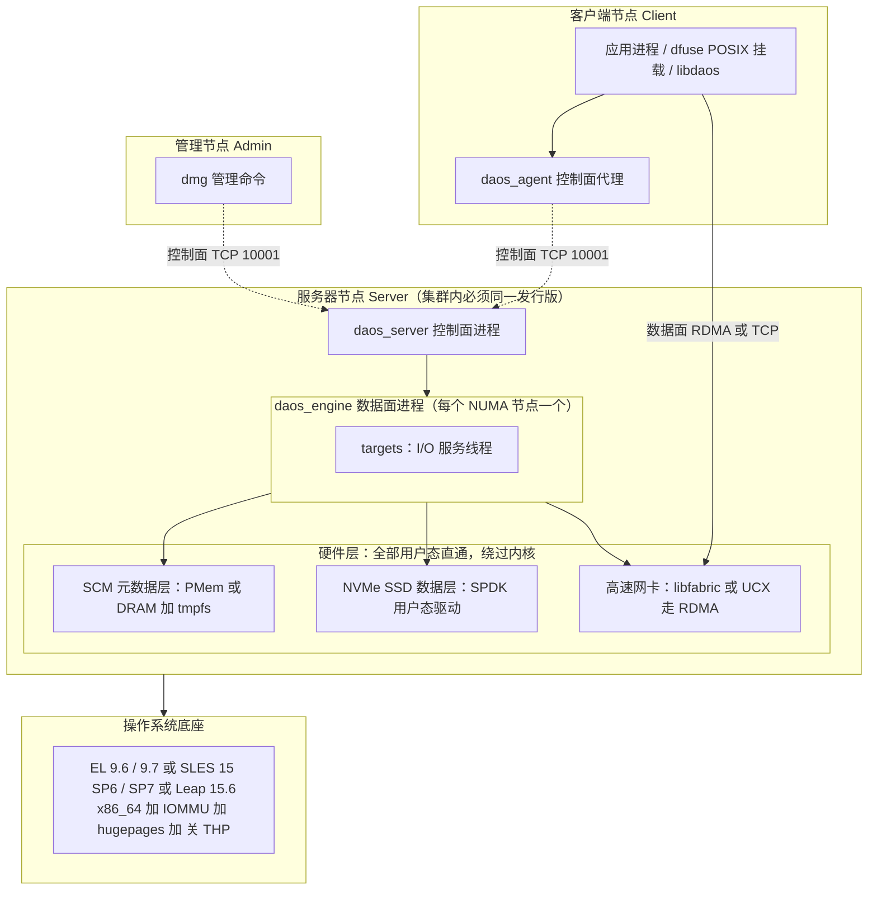
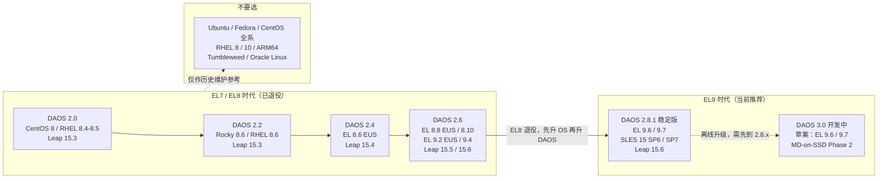
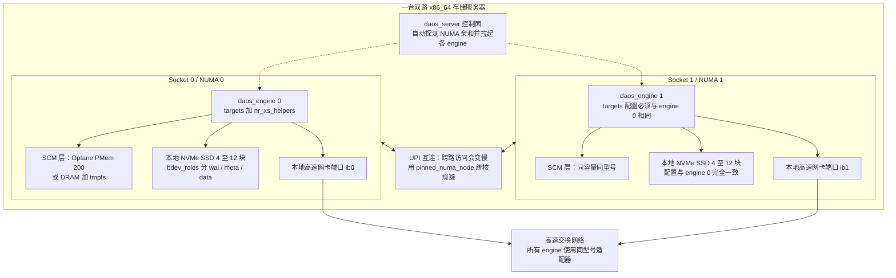
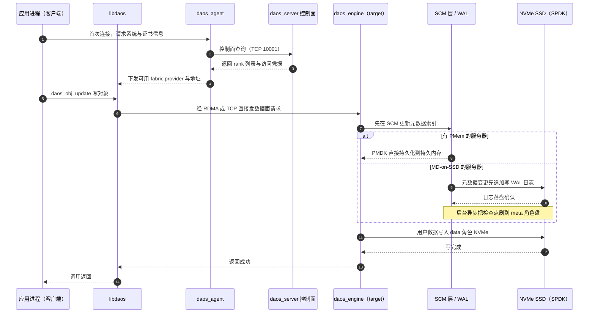
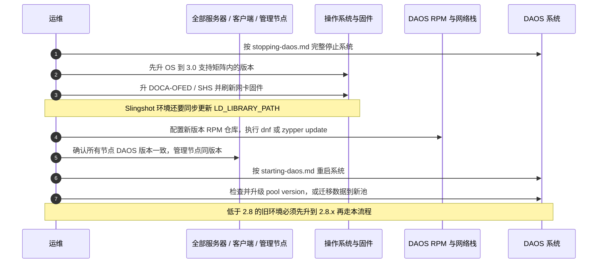

准备长期研究和运维 DAOS 之前，最容易踩的坑不是代码看不懂，而是**环境从一开始就选错了**：装了个 Ubuntu，或者挑了个"看起来差不多"的 Rocky 8，结果连官方 RPM 仓库都没有对应目录；再或者兴冲冲买了新至强服务器，才发现 DAOS 依赖的傲腾持久内存早已停产。

这篇文章把 **DAOS 每个版本认哪些操作系统**、**每种硬件该怎么配**一次讲清楚。结论全部来自 `daos-stack/daos` 仓库里各版本标签的 `docs/release/support_matrix.md`（支持矩阵）、`docs/admin/`（管理指南）、`utils/config/`（配置样例），以及 [daos.io](https://daos.io/) 官网，不是凭印象给的建议。文中会标出关键依据的文件位置，方便你后续自己复核。

> 说明：本地仓库当前 `master` 的 `VERSION` 是 `2.9.100`、`TAG` 是 `2.9.100-tb`，最新提交日期为 2026-11-09；按 DAOS 的语义化版本约定，**奇数次版本号是开发版**，所以这条线是通往 3.0 的开发主线，而仓库里 `v2.8.1` 标签（发行说明标注 2026-09-30）是目前的稳定版。下文的 3.0 内容来自 `support_matrix.draft.md` 草案，尚未 GA，只作前瞻，不作选型依据。

## 〇、一句话和一张图

**一句话**：DAOS 对"版本 ↔ 操作系统小版本"的绑定极严，几乎是**一个 DAOS 版本只认两三个具体的 Linux 次版本**；硬件上它要的是"元数据用字节可寻址的 SCM、数据用 NVMe、网络走 RDMA"这三件套，而新项目已经可以用 **MD-on-SSD**（用 DRAM + NVMe 日志替代停产的傲腾）把这套要求落到普通服务器上。

先看整体架构，理解它为什么这么挑环境：



**关键就在"用户态直通"这四个字**：DAOS 的数据面用 SPDK 直接操作 NVMe（不走内核块设备栈），用 libfabric / UCX 直接操作网卡（不走内核网络栈），元数据还可能通过 DAX 直接映射持久内存。这些路径全都紧贴内核接口、驱动和固件，所以内核小版本、OFED 版本、网卡固件一旦对不上，出的问题往往不是"性能差一点"，而是"根本起不来"。这就是支持矩阵写得如此具体的原因。

## 一、先把术语和版本规则弄明白

### 1.1 DAOS 是什么

[daos.io](https://daos.io/) 官网对它的定位是 **"面向 AI 与 HPC 的开源存储平台"**（Distributed Asynchronous Object Storage，分布式异步对象存储）。官网强调的几个数字和特性：完全分布式的元数据、在有 RDMA 时首字节延迟低于 20 微秒、原生并行文件系统，以及可以按对象/文件、按数据集/目录动态设置纠删码与副本策略。

先解释后面会反复出现的一组名词，零基础也能读下去：

| 名词 | 大白话解释 |
| --- | --- |
| **SCM**（Storage Class Memory） | 存放"目录/索引"这类元数据的快速存储层，要求 CPU 能按字节直接读写，而不是按块读写 |
| **PMem / 傲腾持久内存** | Intel Optane 持久内存条，断电不丢数据、又能按字节寻址，是 SCM 的经典实现（现已停产） |
| **PMDK / DAX** | PMem 的编程库，以及 Linux 让应用直接映射持久内存、跳过页缓存的机制 |
| **MD-on-SSD** | 没有 PMem 时的替代方案：元数据放 DRAM，靠 **WAL**（预写日志，先记流水账再改账本）和检查点把元数据刷到 NVMe 上 |
| **SPDK** | 让程序在用户态直接驱动 NVMe 的工具包，省掉内核中断和上下文切换 |
| **RDMA** | 网卡直接读写远端机器内存，不经过对方 CPU 和内核网络栈 |
| **libfabric / UCX** | 两套"高速网络抽象层"，`provider`（如 `ofi+tcp`、`ucx+dc_x`）决定底层走哪种网络和协议 |
| **engine / target** | 一个服务器上跑一个或多个 `daos_engine` 进程（通常一个 NUMA 节点一个），每个 engine 里再开若干个 `target` I/O 线程，一个 target 大致对应一块 NVMe 的一个分片 |
| **NUMA 亲和** | 双路服务器上，CPU 访问"插在自己这路"的内存和 PCIe 设备最快，跨路走 UPI 会变慢 |
| **bdev_role** | MD-on-SSD 下给 NVMe 盘分配的角色：`wal`（日志）、`meta`（元数据检查点）、`data`（用户数据） |

### 1.2 版本号怎么读

仓库 `docs/release/version_interop.md` 写明：DAOS 用 `MAJOR.MINOR.PATCH` 语义化版本，**奇数 MINOR 是开发版，偶数 MINOR 是稳定版**。所以 2.1、2.3、2.5、2.7、2.9 都是开发线，2.0 / 2.2 / 2.4 / 2.6 / 2.8 才是能上生产的线。

同一份文档还规定了互操作规则，运维必须记牢：

- 同一个 DAOS 系统里，**所有服务器必须是同一个 DAOS 版本、同一个 Linux 发行版**；客户端可以跑别的发行版。
- 客户端与服务器的 `MAJOR.MINOR` 最多**差一个次版本**（例如 2.8 客户端可以连 2.6 或 2.8 服务器），管理节点的 `dmg` 必须与服务器同版本。
- `docs/release/upgrading.md` 规定：**2.8.x → 3.0 是离线升级**（要停系统、保留池数据），而低于 2.8 的版本必须先升到 2.8.x 再升 3.0。

### 1.3 依据在哪儿，以及一个容易误读的细节

每个版本的官方口径都在 `docs/release/support_matrix.md`。但直接从 `master` 读会踩两个坑：

1. `master` 上的 `support_matrix.md` 只有一句话——"3.0 尚未发布，请看最新稳定版"，真正的内容在 **`support_matrix.draft.md`** 里。
2. 历史版本要切到对应 git 标签读。例如 `v2.6.0` 标签里的支持矩阵其实是个占位符（"2.6 还在开发中，计划 2023 年底发布"），**2.6 的权威口径在 `v2.6.5` 这样的后期维护标签里**。

更有意思的是：3.0 草案自身就有口径冲突——开头的 General Support 和 `release_notes.draft.md` 写"EL 9.7/9.8"，正文却写"支持 EL 9.6 和 9.7，9.8 验证计划在未来维护版本"。这正说明**草案不能当选型依据**，也说明读源码比读二手资料可靠。

## 二、版本 ↔ 操作系统对照表（核心）

下面这张表是我逐个 `git show <tag>:docs/release/support_matrix.md` 核对出来的。"主验证平台"是官方主要跑测试的组合，优先照抄它，出问题最容易得到社区支持。

| DAOS 版本 | 主验证平台 | EL8 系（RHEL / Rocky / Alma） | EL9 系 | SUSE 系 | 已淘汰 / 明确不支持 |
| --- | --- | --- | --- | --- | --- |
| **2.0** | CentOS Linux 8 + openSUSE Leap 15.3 | CentOS 8.4/8.5、RHEL 8.4 EUS/8.5；CentOS/RHEL **7.9 仅限二代至强 Cascade Lake** | 无 | Leap 15.3、SLES 15 SP3 | Rocky、AlmaLinux、Ubuntu、CentOS Stream、Oracle Linux |
| **2.2** | Rocky Linux 8.6 + Leap 15.3 | RHEL 8.4 EUS/8.6、Rocky 8.6；CentOS/RHEL 7.9 仅限二代至强 | 无 | Leap 15.3、SLES 15 SP3 | CentOS Linux 8 已 EOL、AlmaLinux、Ubuntu、Fedora |
| **2.4** | Rocky Linux 8.6 + Leap 15.4 | EL **8.6 EUS**（RHEL/Rocky/Alma），8.8 验证中 | 明确不支持，文档写"9.2+ 将在 2.6 加入" | Leap 15.4、SLES 15 SP4 | **CentOS 7 / RHEL 7 被移除**、CentOS 8、Ubuntu |
| **2.6** | Rocky 8.8、Rocky 9.2、Leap 15.5 / 15.6 | EL 8.8 EUS、EL 8.10 | EL 9.2 EUS、EL 9.4 | Leap 15.5/15.6、SLES 15 SP5/SP6（**SP6 与 15.6 自 2.6.3 起**） | EL 8.9、EL 9.3 未验证；CentOS 7/8、Ubuntu、Fedora、RHEL 7 |
| **2.8 / 2.8.1** | **Rocky 9.6、Rocky 9.7**、Leap 15.6、SLES 15 SP7 | **未验证**（8.10 是 EL8 最后一版），官方建议升 EL9 | **EL 9.6、EL 9.7**；9.8 计划后续维护版 | Leap 15.6、SLES 15 SP6 / SP7（注意**不存在 Leap 15.7**） | EL8 全系、RHEL 7、CentOS 全系、Ubuntu、Fedora、Tumbleweed、Oracle Linux；RHEL 10 与 SLES/Leap 16 **未验证** |
| **3.0（草案，未 GA）** | Rocky 9.7 / 9.8、Leap 15.6、SLES 15 SP7 | 未验证 | 正文 EL 9.6/9.7（草案内部对 9.8 口径不一致） | SLES 15 SP6/SP7、Leap 15.6 | 同 2.8；**仅供前瞻** |

几个反复出现、值得单独拎出来的硬规则：

- **架构只支持 x86_64**。社区有人在小端 ARM64 上编译通过并做了基础测试，但 `docs/release/support_matrix.md` 明确说这不是 CI 覆盖范围内的配置，生产环境不予支持。
- **同一个 DAOS 系统里的所有服务器必须跑同一个 Linux 发行版**；客户端可以不同发行版，但 2.0–2.8 的客户端支持清单**与服务器完全相同**。
- **Ubuntu 全系列都在"不支持"名单里**。但 `docs/QSG/build_from_scratch.md` 提供了 `utils/scripts/install-ubuntu.sh`，仓库里也有 `utils/docker/Dockerfile.ubuntu`（默认 `ubuntu:26.04`）和 CI 里的 `ubuntu:noble` 构建任务。所以准确定位是：**Ubuntu 可以用来编译和学习源码，不能用来部署 DAOS 服务器**。
- **官网与社区/商业支持是分开的**：社区支持走邮件列表、Slack 和 JIRA，尽力而为无 SLA；商业支持由 DAOS 生态伙伴提供，且可能附带更严格的版本约束。

下面这张迁移图把"版本 ↔ OS"的演进路径画出来，选路线时照着走就行：



### 2.1 具体怎么选（给你一个明确答案）

| 你的场景 | 推荐组合 | 理由 |
| --- | --- | --- |
| **新项目 / 开发运维研究（首选）** | **DAOS 2.8.1 + Rocky Linux 9.6 或 9.7** | 免费、社区资料最多、EL9 是当前唯一被验证的红帽系，`dnf` 装 RPM 最省事；仓库 `.github/workflows/ci2.yml` 的构建矩阵也用 `rockylinux/rockylinux:9` |
| 已有红帽订阅的企业 | DAOS 2.8.1 + RHEL 9.6 / 9.7 | 同上，且能拿到 RHEL 的 EUS 与商业支持 |
| 已有 SUSE 技术栈 | DAOS 2.8.1 + SLES 15 SP6 / SP7（或学习用 Leap 15.6） | 官方主验证平台之一，`zypper` 装包 |
| 只想读代码、跑单元测试 | Ubuntu 24.04 / 26.04 容器 + `install-ubuntu.sh` | 能编译，但**别把结论外推到部署环境** |
| 维护老集群 | 按上表锁定原版本对应 OS，先升到 2.8.x 再考虑 3.0 | 跨大版本只能离线升级，且要遵守 N±1 互操作 |

一句话：**别在操作系统上"创新"**。研究 DAOS 的乐趣在于分布式事务、纠删码、rebuild 这些地方，不在于跟驱动版本搏斗。

## 三、硬件推荐：先弄懂"为什么"，再看清单

### 3.1 一台 DAOS 服务器长什么样

`docs/admin/hardware.md` 说得很直白：DAOS 的服务器设计本质是**平衡网络带宽与本地 NVMe 的聚合带宽**。文档举的例子是：一块 200Gbps 的 PCIe4 x4 网卡，纯读负载大约 4 块 NVMe4 x4 SSD 就能喂饱，写负载因为 SSD 写比读慢，需要约 8 块。

同时，双路至强的 PCIe 设备天然归属于某一路 CPU，PMem 也有 NUMA 特性。所以官方做法是 **每个 CPU socket 起一个 engine，只访问本路的 PMem、NVMe 和网卡**，尽量避免跨 UPI 访问：



`docs/admin/hardware.md` 还给了两条容易忽略的约束：**HDD、SATA SSD、SAS SSD 都不支持**（必须是 NVMe，通过 SPDK 用户态访问）；**SCM 容量相对 SSD 容量至少 6%**，否则会出现"数据盘还有空间、元数据区先满了"的尴尬。

### 3.2 一次写请求走过的路

理解了分层，再看一次写 I/O 的时序，就明白每个硬件层在干什么、为什么 MD-on-SSD 要多一步 WAL：



图里 `alt` 分支就是两条硬件路线的根本差别：**PMem 路线靠硬件本身断电不丢；MD-on-SSD 靠"先写日志再异步落盘"换来了对普通 DRAM + NVMe 的支持**。

### 3.3 两条路线对比：新项目基本只能选 MD-on-SSD

| 维度 | PMem 路线 | MD-on-SSD 路线 |
| --- | --- | --- |
| SCM 怎么来 | Intel Optane PMem 100 系列（**二代至强 Cascade Lake**）/ 200 系列（**三代至强 Ice Lake**），通过 PMDK 访问 | DRAM 放元数据，NVMe 上用 WAL + 异步检查点持久化 |
| 现状 | **300 系列（四代至强）已被 Intel 取消，DAOS 不支持**；傲腾整体停产，新机器买不到 | 2.6 起 Phase 1 生产可用；2.8 中 Phase 2 为技术预览（降低 DRAM 需求）；3.0 草案计划把 Phase 2 + allocator v2 作为新建池默认 |
| 内存要求 | 强烈建议**每个内存通道插 1 条 DRAM + 1 条 PMem**，且所有 PMem 模块容量相同 | 强烈建议**每个内存通道都插满 DRAM DIMM** |
| NVMe 配置 | 单个 engine 管理的所有 NVMe **容量必须相同**，建议同型号 | 分成 `wal` / `meta` / `data` 三种角色；**同一角色组合的盘容量必须相同**，不同角色之间可以不同容量（如 wal/meta 用高耐久小容量盘） |
| 限制 | 配置最"正统"，但硬件已断供 | `wal` 与 `data` **不能放在同一个 tier**；最多 3 个 bdev tier；`class: dcpm` 时不允许指定 `bdev_roles` |
| 适合谁 | 维护既有傲腾集群 | **所有新项目、所有自建研究环境** |

这里的"角色"约束来自 `docs/admin/deployment.md`，配置样例在 `utils/config/examples/daos_server_mdonssd.yml`。官方还给了个实用的策略提示：盘少（4–5 块/engine）时，把所有角色放在同一个 tier 反而比"1 块盘独占 WAL"更快，因为多盘聚合带宽更高。

### 3.4 关键参数速查表

这些值散落在 `docs/admin/predeployment_check.md`、`docs/admin/hardware.md` 和 `utils/config/daos_server.yml` 的注释里，汇总如下：

| 项目 | 推荐值 | 依据与原因 |
| --- | --- | --- |
| SCM : NVMe 容量比 | **≥ 6%** | `hardware.md`，保证元数据放得下 |
| Hugepages | **每个 target 1 GiB**，建议开机 `hugepages=N` 预分配 | `daos_server.yml` 注释：`2 engines × 16 targets × 1GiB / 2MiB = 16384` 页 |
| Transparent HugePage | **关闭** | `predeployment_check.md`，避免内存碎片导致 DMA 缓冲分配失败 |
| IOMMU | BIOS 开 VT-d + 内核 `intel_iommu=on`，走 VFIO | `predeployment_check.md`，让非 root 的 `daos_server` 能直通 NVMe |
| NVMe 逻辑块大小 | **4 KiB（LBA Format #03）** | `predeployment_check.md`，DAOS 按 4K 粒度做 I/O，避免对齐损失 |
| `vm.max_map_count` | 提高到 **约 1000000** | 默认 65530 太小，会拖累 Argobots 的 ULT 栈分配 |
| `rmem_default` / `rmem_max` | **≥ 1 MB** | 否则 SPDK 报 `Failed to set socket option` |
| `memlock` | **unlimited** | 否则 SPDK 报 `cannot set up DMA remapping` |
| 时间同步 | 全节点 NTP / chrony | DAOS 事务模型依赖时间戳 |
| 防火墙 | 放行 **TCP 10001** | `dmg` 与 `daos_agent` 连不上服务器多半是这里 |
| `targets` / engine | 官方验证范围 **4–32**；上限约为 NVMe 盘数 × 64（PMem）/ × 21（MD-on-SSD） | 支持矩阵 + 配置注释 |
| `nr_xs_helpers` | EC 场景约 **targets 的 1/4**（16 targets 配 4） | `daos_server.yml` 注释，需留足物理核 |
| 全系统一致性 | 所有 engine 的 **NVMe 配置、target 数、网卡型号**必须一致 | 支持矩阵明确说异构配置未测试 |
| 架构上限 | **65536 个 target** | 128 位对象 ID 里只用 16 位编码 target |

### 3.5 网络：版本差异最大的一块

网络栈的推荐**随 DAOS 版本变过**，做版本升级时一定要连驱动一起规划：

| DAOS 版本 | 推荐栈 | 关键版本约束 |
| --- | --- | --- |
| 2.4 | libfabric 1.18.1rc1；IB 可用 UCX 1.14.0-1（MOFED 5.8），`ucx+dc_x` | 老版本，不建议新建 |
| 2.6 | libfabric 1.19.1 / 1.22.0；**MLNX_OFED 24.04-0.6.6.0**，UCX 1.17.0/1.18.0，推荐 `ucx+dc_mlx5` | 低于 24.04 的 MOFED 不支持 |
| 2.8 / 2.8.1 | libfabric **1.22.0**；NVIDIA IB/RoCE 改走 **DOCA-OFED 3.1.0/3.2.0/3.2.1（推荐 3.2.1）+ UCX 1.20.0 + `ucx+dc_x`**，配合包内 mercury 2.4.1 | **MLNX_OFED 及低于 3.1 的 DOCA-OFED 不再支持**；`ucx+dc_mlx5` 在大规模 IB 重负载下有不稳记录 |
| 3.0 草案 | 同上，另验证 Slingshot SHS 13.1 / 14，推荐 SHS ≥ 13.1 | 草案口径 |

还有几条跨版本通用的硬规则：

- **每个 engine 一个高速端口**，2.8/3.0 不支持单 engine 多端口；多端口就多起几个 engine。两个 engine 共用一个端口只可用于开发测试。
- **不要用发行版自带的 inbox OFED**，必须装厂商 DOCA-OFED，并把网卡固件刷到该版本自带的级别；所有服务器和客户端用同一版本、同一型号适配器。
- `ofi+tcp` 在**所有网卡上都能跑但不走 RDMA**，是学习和功能验证的首选；`ofi+verbs` 可用但 RC 资源消耗限制扩展性；`ofi+cxi` 专供 HPE Slingshot；`ofi+psm3`、`ofi+psm2`、`ofi+opx` 均有已知问题或未经支持。
- 从 libfabric 1.18.0 起 `ofi+tcp` 不再自动加 `rxm`，要用得显式写成 `ofi+tcp;ofi_rxm`。
- 规模参考：官方 2.8 已验证 800 台服务器 / 8000 客户端 / 每 engine 4–32 targets / 每 engine 4–12 块 NVMe / 单池 100 容器。

## 四、面向"开发 + 运维研究"的三档配置

不同研究目标需要的硬件差一个数量级，先定档再花钱：

| 档位 | 目标 | CPU / 内存 | SCM | NVMe | 网络 | 软件 |
| --- | --- | --- | --- | --- | --- | --- |
| **A 入门：能跑通就行** | 读源码、改代码、跑通 pool/container/dfuse、看日志 | ≥ 4 核、≥ 16 GB RAM（官方 QEMU 文档下限） | tmpfs 模拟 | 普通文件模拟（`class: file`） | 普通网卡 + `ofi+tcp` | Rocky 9.6/9.7 虚拟机 + DAOS 2.8.1 |
| **B 单机进阶：摸真实路径** | 真实 NVMe、MD-on-SSD、telemetry、故障与 rebuild 演练 | 8–16 核、64–128 GB DRAM，内存通道插满 | DRAM + tmpfs（MD-on-SSD） | 2–4 块 NVMe，4K LBA，尽量同型号同容量 | 25/100GbE 或一张 IB/RoCE 卡 | EL 9.6/9.7 + 2.8.1 + 官方 RPM |
| **C 准生产：集群行为** | 多节点 EC、扩缩容、升级演练、性能调优 | 双路至强，每路 ≥ 16 核，通道插满 | MD-on-SSD（或存量 PMem 200） | 每 engine 4–12 块，全集群同构 | 200/400G IB（DOCA-OFED 3.2.1 + `ucx+dc_x`）或 Slingshot（SHS ≥ 13.1） | 全集群统一 EL 9.6/9.7 或 SLES 15 SP7 + 2.8.1 |

> A 档的两条"模拟"路径在 `docs/QSG/qemu-vms.md`、`docs/QSG/docker.md` 和 `utils/config/examples/daos_server_local.yml` 里都有现成做法。**注意这两份 QSG 文档偏旧**：QEMU 文档写的是 Rocky Linux 8.9，Docker 文档写的是 `rockylinux:8.9` + DAOS 2.6，而 2.8 已经不验证 EL8 了——照抄时把镜像换成 Rocky 9.6/9.7、DAOS 换成 2.8.1。Docker 方案还有两个硬前提：必须用 **host 网络**（bridge/loopback 支持不好）、宿主机至少预留 **4096 个 2MiB hugepage**。另外官方明确说明：**用文件/内存模拟 NVMe 与 SCM 仅用于开发测试，生产不支持**。

### 4.1 示例一：在 EL9 上从零编译 DAOS（完整脚本）

做二次开发迟早要自己编译。下面脚本在 Rocky/Alma/RHEL 9.6 或 9.7 上从零拉源码、装依赖、编译，逐行都有注释，可直接保存为 `build-daos-el9.sh` 使用：

```bash
#!/usr/bin/env bash                                                    # 指定用 bash 解释执行本脚本
set -euo pipefail                                                       # 任一命令失败、变量未定义、管道出错都立即停止，避免带病继续
DAOS_SRC="${DAOS_SRC:-/opt/daos-src}"                                   # 定义源码目录，固定为 root 可写的路径，可用环境变量覆盖
DAOS_VER="${DAOS_VER:-v2.8.1}"                                          # 定义要编译的版本标签，默认为当前稳定版 2.8.1
if [[ $EUID -ne 0 ]]; then                                              # 判断当前用户是否为 root（安装系统依赖需要 root）
    echo "请用 sudo 运行：sudo bash $0" >&2                                # 非 root 时打印可直接复制的正确命令到标准错误
    exit 1                                                              # 立即退出，防止依赖只装了一半
fi                                                                      # 结束 root 权限判断
if [[ ! -d "$DAOS_SRC/.git" ]]; then                                    # 判断源码目录是否已经存在且是个 git 仓库
    git clone --recurse-submodules https://github.com/daos-stack/daos.git "$DAOS_SRC"   # 首次克隆，并一并初始化 raft 子模块
fi                                                                      # 结束克隆判断
cd "$DAOS_SRC"                                                          # 进入源码根目录，后续相对路径都基于这里
git fetch --tags origin                                                 # 同步远端标签，确保目标版本标签在本地可见
git checkout "$DAOS_VER"                                                # 切换到指定稳定版标签（要跟开发主线就改成 master）
git submodule update --init --recursive                                  # 把子模块同步到该标签对应的提交
./utils/scripts/install-el9.sh                                          # 安装 EL9 编译依赖：gcc、golang、daxctl、libfabric 开发包等
python3 -m venv "$DAOS_SRC/venv"                                        # 创建独立 Python 虚拟环境，不污染系统 Python
"$DAOS_SRC/venv/bin/pip" install --upgrade pip                           # 升级 pip，避免老版本解析依赖失败
"$DAOS_SRC/venv/bin/pip" install -r requirements-build.txt               # 安装 scons、ninja、meson 等构建工具
source "$DAOS_SRC/venv/bin/activate"                                    # 激活虚拟环境，让 scons 进入 PATH
scons --jobs "$(nproc)" --config=force --build-deps=yes install          # 用全部 CPU 核编译 DAOS 及依赖，产物装入 install/ 目录
echo "构建完成，二进制位于：$DAOS_SRC/install/bin"                        # 打印产物位置，方便继续验证
```

**运行方式**（在 Rocky Linux 9.6/9.7 上，需能联网）：

```bash
chmod +x build-daos-el9.sh                                  # 给脚本加上可执行权限
sudo bash ./build-daos-el9.sh                               # 以 root 身份执行（首次编译较久，会下载并编译 SPDK 等依赖）
/opt/daos-src/install/bin/daos_server version              # 编译完成后验证二进制可用
```

要换目录或换版本时用 `sudo env DAOS_SRC=/data/daos DAOS_VER=master bash ./build-daos-el9.sh`；验证命令中的路径也要同步替换。

`docs/QSG/build_from_scratch.md` 里对应的是 `install-el9.sh` / `install-leap15.sh` / `install-ubuntu.sh` 三个入口和同一条 `scons` 命令。注意：**从源码安装比 RPM 多一堆手工活**——`/run/daos_server` 目录、`daos_server_helper` 的 setuid、`memlock`、`vm.max_map_count`、socket buffer 都得自己配，官方在 `predeployment_check.md` 末尾明确说"RPM 安装是生产首选，手工安装适合开发与 PoC"。所以哪怕你走开发路线，也建议用 RPM 起服务、用源码只做代码改动和验证。

### 4.2 示例二：上线前环境自检（完整脚本）

这个脚本只读不写，把前面速查表里的项目一次性过一遍，适合每台的服务器和客户端都跑一次。逐行注释，可直接保存为 `daos-precheck.sh`：

```bash
#!/usr/bin/env bash                                                   # 指定用 bash 解释执行本脚本
ok()   { printf '  [OK]   %s\n' "$1"; }                                # 定义函数：打印检查通过的信息
warn() { printf '  [WARN] %s\n' "$1"; }                                # 定义函数：打印需要人工确认的信息
echo "=== 1. 操作系统与架构 ==="                                        # 打印第一组检查的标题
if [[ -f /etc/os-release ]]; then                                       # 确认系统提供了标准的发行版信息文件
    . /etc/os-release                                                   # 读入 PRETTY_NAME 等变量
    echo "  PRETTY_NAME = ${PRETTY_NAME:-unknown}"                       # 打印发行版全名，人工对照支持矩阵
else                                                                    # 没有 os-release 文件的分支
    warn "找不到 /etc/os-release，请手动确认发行版"                       # 提示人工确认
fi                                                                      # 结束发行版判断
echo "  uname -m     = $(uname -m)"                                     # 打印 CPU 架构，必须是 x86_64
echo "  kernel       = $(uname -r)"                                      # 打印内核版本，便于与 DOCA-OFED 兼容性对照
echo "=== 2. IOMMU 与透明大页 ==="                                       # 打印第二组检查的标题
if grep -qE 'intel_iommu=on|amd_iommu=on' /proc/cmdline; then            # 检查内核启动参数是否开启了 IOMMU
    ok "IOMMU 已在内核命令行启用"                                         # 已开启则通过
else                                                                    # 未开启的分支
    warn "未检测到 intel_iommu=on，SPDK/VFIO 直通 NVMe 可能失败"           # 提示需要改 grub 并重启
fi                                                                      # 结束 IOMMU 判断
thp=$(cat /sys/kernel/mm/transparent_hugepage/enabled 2>/dev/null || echo unknown)   # 读取 THP 当前状态，读不到则记为 unknown
echo "  THP = ${thp}"                                                    # 打印 THP 状态，期望出现 [never]
echo "=== 3. 内存相关内核参数 ==="                                        # 打印第三组检查的标题
echo "  nr_hugepages        = $(sysctl -n vm.nr_hugepages 2>/dev/null || echo NA)"       # 打印已分配的大页数
echo "  vm.max_map_count    = $(sysctl -n vm.max_map_count 2>/dev/null || echo NA)"      # 打印 mmap 区域上限，建议约 1000000
echo "  net.core.rmem_max   = $(sysctl -n net.core.rmem_max 2>/dev/null || echo NA)"    # 打印 socket 接收缓冲上限，应 >= 1MB
echo "  ulimit -l (memlock) = $(ulimit -l)"                              # 打印内存锁定上限，期望 unlimited
echo "=== 4. 存储设备 ==="                                               # 打印第四组检查的标题
if command -v nvme >/dev/null 2>&1; then                                # 检查是否安装了 nvme-cli 工具
    nvme list 2>/dev/null | head -n 20                                   # 列出 NVMe 设备，核对型号、容量与 PCI 地址
else                                                                    # 未安装 nvme-cli 的分支
    warn "未安装 nvme-cli，可用 lspci | grep -i nvme 粗查"                  # 给出替代检查命令
fi                                                                      # 结束存储检查
echo "=== 5. 网络与时间 ==="                                             # 打印第五组检查的标题
echo "  fabric 接口："                                                   # 提示下面列出网卡
ip -br link 2>/dev/null | head -n 20                                    # 简要列出网络接口，确认 fabric_iface 名称
if command -v chronyc >/dev/null 2>&1; then                             # 检查是否安装了 chrony 客户端
    chronyc tracking 2>/dev/null | head -n 5                             # 打印时间同步状态，确认时钟已同步
else                                                                    # 未安装 chrony 的分支
    warn "未检测到 chronyc，请用 timedatectl 确认 NTP 已启用"              # 给出替代检查命令
fi                                                                      # 结束时间同步检查
echo "=== 6. 控制面端口 ==="                                             # 打印第六组检查的标题
if command -v ss >/dev/null 2>&1; then                                  # 检查是否有 ss 工具
    ss -ltn '( dport = :10001 )' 2>/dev/null                             # 查看 10001 端口监听情况，未启动时为空属正常
fi                                                                      # 结束端口检查
echo "=== 检查结束：请把 [WARN] 项与支持矩阵逐条核对 ==="                  # 打印结束提示
```

**运行方式**（无需 root，纯只读）：

```bash
chmod +x daos-precheck.sh   # 给脚本加上可执行权限
bash ./daos-precheck.sh     # 在每台服务器和客户端上执行，逐条核对输出
```

### 4.3 示例三：单机学习环境的完整配置

A 档最省事的起步方式：把 SCM 用 tmpfs 模拟、NVMe 用文件模拟，`ofi+tcp` 走普通网卡。下面配置改自仓库的 `utils/config/examples/daos_server_local.yml`，逐行注释，保存为 `/etc/daos/daos_server.yml`：

```yaml
name: daos_server                  # DAOS 系统名，同一系统内所有节点必须一致
mgmt_svc_replicas: ['localhost']  # 管理服务副本，单机实验环境就填本机；生产建议 3 至 5 台
provider: ofi+tcp                 # 数据面网络 provider，开发用 TCP 即可，有 RDMA 再换 ucx+dc_x 等
control_log_file: /var/log/daos/daos_server.log   # 控制面日志路径，需保证 daos_server 用户可写
transport_config:                # 控制面通信的 TLS 配置段
  allow_insecure: true           # 仅实验环境关闭证书校验；生产必须生成证书并设为 false
telemetry_port: 9191             # Prometheus 遥测端口，学习阶段可用来观察指标
engines:                         # 数据面 engine 列表，单机先起一个
  - pinned_numa_node: 0          # 把 engine 绑到 NUMA 0，双路机器可按路起多个 engine
    targets: 1                   # I/O 线程数；真实 NVMe 环境按 4 至 32 调整，每 target 预留 1GiB 大页
    nr_xs_helpers: 0             # 校验和/RPC 卸载线程数，EC 场景建议约 targets 的四分之一
    fabric_iface: eth0           # 数据面网卡名，务必改成 `ip -br link` 查到的真实名称
    fabric_iface_port: 31416     # 数据面监听端口，多 engine 时每个用不同端口
    log_file: /var/log/daos/daos_engine.0.log   # engine 日志路径
    env_vars:                    # 传给 engine 的环境变量列表
      - FI_SOCKETS_MAX_CONN_RETRY=1   # TCP provider 连接重试次数，避免学习环境里长时间等待
      - FI_SOCKETS_CONN_TIMEOUT=2000  # TCP provider 连接超时，单位毫秒
    storage:                     # 存储分层定义，顺序固定：先 SCM 层，再 NVMe 层
      - class: ram               # SCM 用 tmpfs（内存）模拟，断电不保数据，仅限学习
        scm_size: 8              # tmpfs 大小，单位 GiB；生产用 MD-on-SSD 需按容量规划
        scm_mount: /mnt/daos     # tmpfs 挂载点，目录需存在
      - class: file              # NVMe 用普通文件 + Linux AIO 模拟
        bdev_size: 16            # 模拟盘大小，单位 GiB
        bdev_list: [/tmp/daos-bdev]   # 模拟盘文件路径，需可写且剩余空间充足
```

**运行方式**（Rocky 9.6/9.7，用官方 RPM，避免源码安装的手工配置）。这一段从空系统开始，包含仓库、依赖、三份配置和启动，不需要假设前面做过任何一步：

```bash
sudo wget -O /etc/yum.repos.d/daos-packages.repo https://packages.daos.io/v2.8/EL9/packages/x86_64/daos_packages.repo   # 配置 DAOS 2.8 的 EL9 官方 RPM 仓库
sudo rpm --import https://packages.daos.io/RPM-GPG-KEY                     # 导入官方包签名公钥，否则 dnf 会拒绝安装
sudo dnf install -y epel-release                                            # 启用 EPEL，部分依赖包来自该源
sudo dnf install -y mercury-libfabric                                       # 安装 ofi+tcp 所需的 Mercury 网络插件
sudo dnf install -y daos-admin daos-server daos-client                      # 单机同时装管理端、服务端与客户端
sudo mkdir -p /etc/daos /var/log/daos /mnt/daos                            # 创建配置、日志与 tmpfs 挂载目录
sudo cp ./daos_server.yml /etc/daos/daos_server.yml                         # 安装上一步写好的服务端配置
sudo tee /etc/daos/daos_control.yml >/dev/null <<'EOF'                      # 写 dmg 管理端配置，单机实验关闭 TLS
name: daos_server                 # 系统名，必须与 daos_server.yml 一致
hostlist: ['localhost']           # 管理命令连接本机
port: 10001                       # 控制面默认端口
transport_config:                 # 控制面通信设置
  allow_insecure: true            # 仅实验环境；生产要签发证书并设为 false
EOF
sudo tee /etc/daos/daos_agent.yml >/dev/null <<'EOF'                        # 写客户端代理配置，同样关闭 TLS
name: daos_server                 # 系统名，必须与服务端一致
access_points: ['localhost']      # 客户端从本机接入点获取系统信息
port: 10001                       # 控制面默认端口
transport_config:                 # 控制面通信设置
  allow_insecure: true            # 仅实验环境；生产要签发证书并设为 false
EOF
sudo systemctl start daos_server                                             # 启动 DAOS 服务端
dmg storage format                                                           # 首次使用必须格式化（会清空模拟盘数据，交互式确认时可加 --force）
sudo systemctl start daos_agent                                              # 启动客户端代理
daos system query --verbose                                                  # 验证系统连通，看到 Joined 状态即成功
```

仓库地址与安装顺序依据 `v2.8.1` 标签的 `docs/QSG/setup_rhel.md`，三份配置模板来自 `utils/config/daos_control.yml`、`utils/config/daos_agent.yml`。**生产环境务必反过来做**：生成并分发 `/etc/daos/certs/` 下的证书，把三份配置里的 `allow_insecure` 全部改回 `false`，`mgmt_svc_replicas` 换成 3–5 台不同故障域的主机。

### 4.4 运维视角：版本与 OS 升级的顺序

最后用一张时序图说明"为什么顺序不能乱"。`docs/release/upgrading.md` 要求 2.8.x → 3.0 整体停机、所有节点同时升级：



## 五、常见坑速查

| 现象 | 根因 | 处理 |
| --- | --- | --- |
| 官方 RPM 仓库里找不到对应目录 | 用了 Ubuntu / EL8 / Leap 15.7（该版本根本不存在）等未支持系统 | 换成 EL 9.6/9.7 或 Leap 15.6 / SLES 15 SP6/SP7 |
| `daos_engine: EAL: cannot set up DMA remapping` | `memlock` 太小 | `ulimit -l unlimited`，用 systemd 时确认 `LimitMEMLOCK=infinity` |
| `spdk_pci_event_listen: Failed to set socket option` | socket 接收缓冲 < 1 MB | 调高 `rmem_default` / `rmem_max` |
| `mkdir /var/run/daos_server: permission denied` | 源码安装缺运行时目录 | 用 RPM 安装，或按 `predeployment_check.md` 建目录 / 配 tmpfiles.d |
| 性能忽高忽低、大页分配失败 | THP 开着或大页运行时才分配导致碎片 | 关 THP，开机用 `hugepages=N` 预分配 |
| 跨路访问导致带宽不达标 | engine 与 NVMe / 网卡不在同一 NUMA | 设 `pinned_numa_node`，每 socket 一个 engine |
| 升级后客户端连不上 | 忽略 N±1 互操作，或管理节点版本没跟上 | 客户端与服务器最多差一个次版本，`dmg` 必须与服务器同版 |
| IB 网络大规模下不稳定 | 用了旧 `ucx+dc_mlx5` 或 inbox OFED | 2.8 用 DOCA-OFED 3.2.1 + `ucx+dc_x` + mercury 2.4.1 |
| 照抄 QSG 的 QEMU/Docker 文档跑不起来 | 文档仍写 Rocky 8.9 / DAOS 2.6，已落后于 2.8 支持矩阵 | 镜像换成 Rocky 9.6/9.7，DAOS 换 2.8.1 |

## 六、总结

1. **版本选 2.8.1，系统选 EL 9.6 / 9.7（或 SLES 15 SP6/SP7、Leap 15.6）**，这是当前唯一"稳定版 × 被验证系统"的组合。3.0 还在草案阶段，而且草案里对 EL 9.8 的口径自相矛盾，别拿来定方案。
2. **Ubuntu 只能编译、不能部署**；CentOS 全系、RHEL 7/8、Fedora、ARM64、RHEL 10 都不在支持清单内。同集群服务器必须同发行版同版本，客户端可不同发行版但版本要遵守 N±1。
3. **新硬件一律走 MD-on-SSD**：傲腾 PMem 300 系列已被取消、产品线停产，2.8 的 Phase 1 已可生产使用。DRAM 通道插满、NVMe 分好 `wal` / `meta` / `data` 角色、留意 `wal` 与 `data` 不能同 tier。
4. **记住几个数字**：SCM:NVMe ≥ 6%、每 target 1 GiB 大页、NVMe 4KiB LBA、targets 4–32、`nr_xs_helpers` ≈ targets/4、控制面端口 10001、架构上限 65536 targets。
5. **研究的正确起步姿势**：A 档 Rocky 9.6/9.7 虚拟机 + 官方 RPM + `class: ram` / `class: file` 模拟，先把 pool/container/dfuse 和日志跑熟；要碰性能、EC、rebuild 再上 B 档真 NVMe 与 RDMA。模拟配置只适合学习，别拿它的性能数字做结论。

### 参考来源

- 本地仓库 `D:\Codes\github\daos`，`master` @ `788f8773`（2026-11-09）：`docs/release/support_matrix.draft.md`、`docs/release/release_notes.draft.md`、`docs/release/upgrading.md`、`docs/release/version_interop.md`、`docs/admin/hardware.md`、`docs/admin/deployment.md`、`docs/admin/predeployment_check.md`、`docs/QSG/*`、`utils/config/daos_server.yml`、`utils/config/examples/*.yml`、`.github/workflows/ci2.yml`
- 历史版本标签：`v2.0.0`（`docs/release/support_matrix_v2_0.md`）、`v2.2.0`、`v2.4.0`、`v2.6.5`、`v2.8.1` 的 `docs/release/support_matrix.md` 与 `docs/release/release_notes.md`
- 官网：<https://daos.io/>；在线文档：<https://docs.daos.io/latest/>；包仓库：<https://packages.daos.io/v2.8/>
