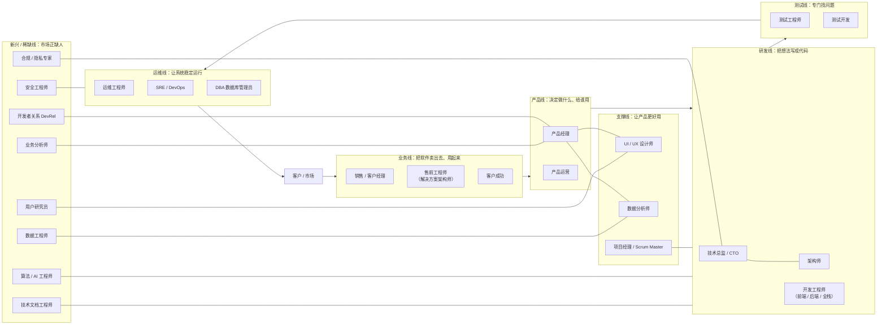
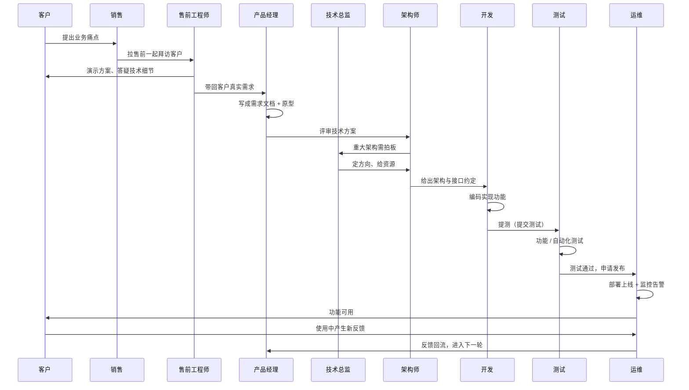
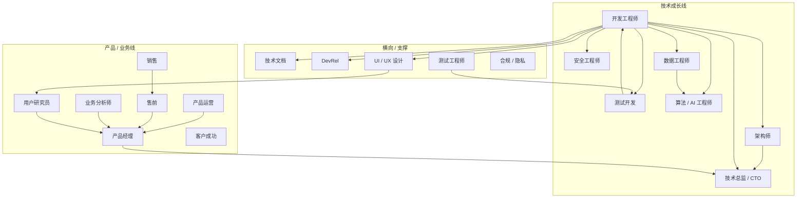

很多人对软件公司的印象就是「一群程序员在敲代码」。其实从「客户有个想法」到最后「系统稳定运行」，中间要过十几道不同的手。**售前、销售、技术总监**这些岗位，常常被外人（甚至刚入行的新人）忽略——它们不仅存在，而且决定了产品到底能不能做出来、卖出去、活下去。

这篇文章用一张全景图把常见岗位摆出来，再一个个说清楚：它**是什么、平时怎么干活、背后的原理是什么**。最后用一个「需求从生到死」的时序图，看大家怎么配合。

## 〇、先建立整体印象

把软件公司想象成一家**餐厅**：

- **业务线（销售 / 售前 / 客户成功）**是拉客、点单、餐后回访的人；
- **产品线（产品经理）**是写菜单、决定今天主推什么菜的厨师长；
- **研发线（开发 / 架构师 / 技术总监）**是真正掌勺炒菜的厨师；
- **测试线**是尝菜、挑刺的品控；
- **运维线**是管灶台、水电、不让后厨着火的物业；
- **设计 / 数据 / 项目管理**是摆盘、算账、盯进度的帮手。



这条主线是一个**闭环**：客户的需求从业务线进来，经过产品、研发、测试、运维，最终回到客户手里；客户用完的反馈，又成为下一轮需求的源头。下面按这条线，逐个岗位拆开讲。

## 一、产品线：决定「做什么、给谁用」

### 1. 产品经理（PM，Product Manager）

**是什么**：产品的「迷你 CEO」。不写代码，但对一个产品从生到死负总责——既要懂用户想要什么，又要能说服研发把它做出来。

**怎么用（日常在干嘛）**：
- 跟客户、销售聊，收集痛点；
- 把模糊的「我想要个好用的系统」翻译成明确的**需求文档**和**原型图**；
- 排优先级：「这个月先做登录，搜索先放放」；
- 跟研发、测试、设计反复对齐，确保做出来的东西没跑偏。

**原理是什么**：产品经理的核心工具是**用户故事（User Story）**——用「作为谁 / 想要什么 / 以便怎样」的句式，把需求钉死，避免「你做的不是我要的」。

> 示例：作为【注册用户】，我想要【用手机号登录】，以便于【不记得密码时也能快速进 App】。

注意「原理」二字：用户故事不是为了写漂亮话，而是强制三方（需求方、研发、测试）对同一件事建立**同一个标准**，后面测试验收就照它来。

### 2. 产品运营（Product Operations）

**是什么**：产品上线后的「拉长尾」选手。产品经理负责「生出来」，产品运营负责「活得好」。

**怎么用**：盯数据（日活、留存、转化）、做活动、写推送、回应用户反馈，把已有用户盘活。

## 二、研发线：把想法变成能跑的代码

### 3. 开发工程师（前端 / 后端 / 全栈）

**是什么**：真正写代码、实现功能的人。
- **前端**：你眼睛能看到、手指能点的部分（网页、App 界面）；
- **后端**：你看不到、但支撑一切运转的部分（数据库、业务逻辑、接口）；
- **全栈**：前后端都自己扛。

**怎么用**：拿到需求文档 → 写代码 → 自测 → 提交给测试。**自包含**地交付一个功能，不依赖别人临时帮你补环境。

### 4. 架构师（Architect）

**是什么**：研发的「总设计师」。不天天写业务代码，但负责定**整体结构**：用哪种数据库、服务怎么拆、接口怎么设计，让系统既能跑、又能撑住未来的量。

**原理是什么**：架构的本质是** trade-off（取舍）**——没有「最好的方案」，只有「在当前人、钱、时间下最合适的方案」。架构师的价值，就是把这些取舍讲清楚并拍板。

### 5. 技术总监 / CTO（技术负责人）← 常被漏掉的角色

**是什么**：研发线的最高负责人，你说得对，**它必须存在**。小公司叫技术总监，创业公司叫 CTO（Chief Technology Officer，首席技术官）。

**怎么用**：
- 定技术战略：用什么技术栈、要不要上云、安全合规怎么兜底；
- 管人管钱：招人、排兵布阵、给架构师和开发分配资源；
- 对外：跟产品、业务、投资人沟通技术可行性，**把「技术语言」翻译成「生意语言」**。

**为什么容易被忽略**：它不直接产出代码，也不是面向客户的岗位，所以外人看不见。但它决定了「这帮人能不能高效地把事做成」。没有技术总监，研发容易陷入「各自为战、技术债堆积」。

## 三、测试线：专门找茬的人

### 6. 测试工程师（QA）

**是什么**：产品的「挑刺专业户」。开发想的是「功能实现了」，测试想的是「怎么把它搞崩」。

**怎么用**：写测试用例 → 手动点点点 / 跑自动化 → 发现 bug 提给开发 → 验证修复。**验收标准**就是产品经理写的用户故事。

### 7. 测试开发（SDET）

**是什么**：会写代码的测试。把重复的点击变成**自动化脚本**，半夜也能帮你想着「回归测试」（regression testing，回归测试：改了一处、确认别的地方没被带崩）。

## 四、运维线：让系统别宕机

### 8. 运维工程师（Ops）

**是什么**：系统的「物业 + 保安」。服务器崩了、网络断了、磁盘满了，找他。

**怎么用**：部署上线、监控告警、备份容灾。一个典型的一键发布流程长这样（注意每句都有注释）：

```bash
git pull origin main     # 1. 拉取最新代码到服务器
npm run build            # 2. 构建生产环境用的打包文件
systemctl restart myapp  # 3. 重启服务，让新版本生效
systemctl status myapp   # 4. 确认服务处于 active（运行中）状态
```

### 9. SRE / DevOps

**是什么**：SRE（Site Reliability Engineer，网站可靠性工程师）和 DevOps 工程师，是「开发」和「运维」的融合体。目标不是手动救火，而是**用工具和自动化让系统自己稳**。

**原理是什么**：核心指标是 **SLO（Service Level Objective，服务水平目标）**，比如「99.9% 的时间可用」。低于它就算「事故」，要靠监控、自动扩容、灰度发布（灰度发布：先放一小撮用户，没问题再全量）来兜底。

### 10. DBA（数据库管理员）

**是什么**：专门看护数据库的「金库管理员」。数据是公司最值钱的家底，DBA 负责备份、调优、权限管控，防止「删库跑路」式灾难。

## 五、业务线：把软件卖出去、还让客户满意 ← 你特别问的

这一条线，恰恰是**最常被技术博客漏掉**的，你问得对，必须补上。

### 11. 销售 / 客户经理（Sales）

**是什么**：把软件「卖出去」的人。负责找客户、谈价格、签合同。

**怎么用**：不像研发拼技术，销售拼的是**信任和沟通**——让客户相信「这东西能解决我的问题，而且值这个价」。

### 12. 售前工程师（Pre-sales / 解决方案架构师）← 你特别问的

**是什么**：销售的「技术搭档」。销售负责拉关系、谈商务，**售前负责把技术讲明白、把方案做出来**。

**怎么用**：
- 跟着销售去客户现场，演示产品、回答「你们这系统能对接我们老 ERP 吗」这类硬问题；
- 把客户的模糊诉求，写成**解决方案 / 投标文档**；
- 对内把客户真实需求带回给产品经理。

**为什么关键**：客户在签单前最关心「技术上行不行」。售前就是那个「用技术帮销售搞定单子」的人。没有售前，销售容易乱承诺，最后研发背锅。

### 13. 客户成功（Customer Success，CS）

**是什么**：单子签完之后，陪客户「用得好、续费、增购」的人。和销售不同，CS 不急着成交，而盯着**长期满意度和续约**。

## 六、支撑线：让产品更好用、更可控

### 14. UI / UX 设计师

**是什么**：UI（User Interface，用户界面）管「好不好看」，UX（User Experience，用户体验）管「用着顺不顺」。负责原型、视觉、交互流程。

### 15. 数据分析师

**是什么**：从产品产生的数据里挖结论的人。比如「哪个按钮没人点」「用户为什么流失」，给产品和运营指方向。

### 16. 项目经理 / Scrum Master

**是什么**：盯进度、清障碍的人。Scrum Master 是敏捷开发里专门帮团队去掉「卡点」的角色，不指挥人，只服务团队。

## 七、市场上还缺、正在冒头的职业（你问的补充）

前面几节是「标准配置」，但软件行业变化极快，下面这些岗位是**近几年需求猛涨、却常被全景图漏掉**的。它们大多不是「新发明」，而是老岗位在 AI、数据、安全、合规浪潮下被逼出来的细分。

### 17. 算法 / AI 工程师（Algorithm / ML / LLM Engineer）

**是什么**：让系统「会思考」的人。训练推荐模型、做图像识别、调大模型（LLM，大语言模型，就是 ChatGPT 那类）。2023 年之后，这是**最缺人、薪资最卷**的方向之一。

**怎么用**：喂数据 → 训练模型 → 评估效果 → 部署成线上服务。和开发的区别：开发写「确定逻辑」，AI 工程师调「概率模型」，结果可能不是 100% 准。

**原理是什么**：核心是**数据 + 算力 + 模型**三角。模型效果的上限往往由数据质量和数量决定——所以下面这位和它形影不离。

### 18. 数据工程师（Data Engineer）

**是什么**：数据分析师的「上游」。分析师要「看数」，数据工程师负责**把散落各处的数，洗干净、打通、存好**，让分析师随时能取。

**怎么用**：搭数据管道（pipeline，数据管道：把数据从 A 搬到 B 并加工的一连串自动步骤）、维护数据仓库。一句话区分：**数据分析师回答「为什么」，数据工程师保证「数从哪来、准不准」**。

### 19. 安全工程师（Security Engineer / 信息安全）

**是什么**：公司的「防盗门 + 保镖」。防黑客入侵、做渗透测试（penetration testing，渗透测试：模拟攻击找漏洞）、管权限和加密。

**怎么用**：定期扫漏洞、做代码安全审计、定安全规范。原理上靠**纵深防御**——不指望一道门，而是层层设防，任何一层被破还有下一道。

### 20. 技术文档工程师（Technical Writer）

**是什么**：把「代码怎么用」写成人话的人。你看到的 API 文档、SDK 手册、产品帮助中心，大多是他们写的。

**怎么用**：读源码 / 问研发 → 写成教程和参考文档。**好文档是产品的门面**——尤其 To B（面向企业）软件，文档烂客户根本用不起来。

### 21. 开发者关系 / 技术布道师（DevRel / Evangelist）

**是什么**：对外「交朋友」的技术人。在大会演讲、写技术博客、运营社区，让更多开发者愿意用自家的开源项目或云产品。

**怎么用**：不是纯销售，而是用**技术影响力**换 adoption（采用率，即有多少人真的用起来）。是技术能力和表达能力的结合体。

### 22. 用户研究员（UX Researcher）

**是什么**：设计师的「情报员」。不画界面，而是用访谈、问卷、可用性测试，搞清楚用户**到底在想什么、卡在哪**。

**怎么用**：在产品动手前先做研究，避免「团队自我感动、用户根本不买账」。**原理**：需求不是拍脑袋来的，是观察出来的。

### 23. 业务分析师（Business Analyst，BA）

**是什么**：业务方和研发之间的「翻译官」。业务说「我要提升效率」，BA 把它翻译成「要做 3 个功能、改 2 张表」的可执行清单。

**怎么用**：比产品经理更靠业务侧，比销售更懂系统。在政企、金融这类流程复杂的项目里尤其吃香。

### 24. 合规 / 隐私专家（Compliance / Privacy）

**是什么**：帮公司「别踩法律红线」的人。管数据合规（比如个人信息保护法、GDPR）、做审计、应对监管。

**怎么用**：随着各国数据监管收紧，这个岗位从「可有可无」变成「必须配」。原理是**风险前置**——上线前把合规问题解决了，比被罚款再补救便宜一万倍。

> 这几类岗位的共同点是：**它们都不是「写业务功能」的，而是让前面的功能更安全、更智能、更合规、更好用**。市场缺的，往往正是这些「看不见的底座」。

## 八、一个需求从生到死，大家怎么配合

下面这张时序图，跟着一个功能走完整条链路：从客户提痛点，到售前演示、产品写需求、架构师定方案、开发写码、测试验收、运维上线，最后回到客户。**技术总监**在关键架构决策上拍板。



可以看到：**没有哪个岗位是孤立的**。销售离了售前讲不清技术，产品离了研发落不了地，研发离了测试不敢上线，上线离了运维随时可能崩。

## 九、一张表看懂所有岗位

| 岗位 | 属于哪条线 | 核心职责 | 主要产出 | 典型工具 |
| --- | --- | --- | --- | --- |
| 产品经理 PM | 产品 | 决定做什么、给谁用 | 需求文档、原型 | Axure、Figma、PRD |
| 产品运营 | 产品 | 让产品活得好 | 活动、数据报告 | 数据后台、推送平台 |
| 开发工程师 | 研发 | 写代码实现功能 | 可运行的功能 | Git、IDE、各类语言 |
| 架构师 | 研发 | 定整体技术方案 | 架构设计文档 | 画图工具、白皮书 |
| 技术总监 / CTO | 研发 | 技术战略 + 团队 | 技术规划、人才梯队 | 会议、OKR、预算 |
| 测试工程师 QA | 测试 | 找 bug、保质量 | 测试用例、缺陷报告 | Jira、Postman |
| 测试开发 SDET | 测试 | 自动化测试 | 测试脚本 | Selenium、Pytest |
| 运维工程师 | 运维 | 部署、保稳定 | 稳定运行的环境 | Shell、监控、Ansible |
| SRE / DevOps | 运维 | 可靠性 + 自动化 | 自动化流水线 | Prometheus、K8s |
| DBA | 运维 | 看护数据库 | 备份、调优 | MySQL、MongoDB |
| 销售 / 客户经理 | 业务 | 把软件卖出去 | 合同、回款 | CRM、报价单 |
| 售前工程师 | 业务 | 技术演示 + 方案 | 解决方案、投标书 | PPT、Demo 环境 |
| 客户成功 CS | 业务 | 让客户满意续费 | 续约、增购 | 工单、回访记录 |
| UI / UX 设计师 | 支撑 | 视觉与体验 | 设计稿、交互稿 | Figma、Sketch |
| 数据分析师 | 支撑 | 从数据挖结论 | 分析报告 | SQL、Python、BI |
| 项目经理 / Scrum Master | 支撑 | 盯进度清障碍 | 排期、站会记录 | Jira、看板 |
| 算法 / AI 工程师 | 新兴 | 让系统会思考 | 模型、推理服务 | Python、PyTorch、CUDA |
| 数据工程师 | 新兴 | 打通并清洗数据 | 数据管道、数据仓库 | Spark、Flink、SQL |
| 安全工程师 | 新兴 | 防入侵、保安全 | 漏洞报告、安全规范 | Burp Suite、Wireshark |
| 技术文档工程师 | 新兴 | 把用法写成人话 | API 文档、手册 | Markdown、Swagger |
| 开发者关系 DevRel | 新兴 | 用技术影响力拉用户 | 博客、演讲、社区 | 技术博客、社交媒体 |
| 用户研究员 | 新兴 | 搞清用户真实想法 | 研究报告、访谈记录 | 访谈、问卷、可用性测试 |
| 业务分析师 BA | 新兴 | 业务 ↔ 研发的翻译 | 需求清单、流程图 | Visio、Axure |
| 合规 / 隐私专家 | 新兴 | 守住法律红线 | 合规报告、审计报告 | 合规框架、审计工具 |

## 十、入行门槛与转岗路径

看完岗位全景，最现实的问题来了：**我该从哪个岗切入？以后又能往哪跳？** 这一节专门讲两件事——门槛高低，和转岗路线。

### 入行门槛到底由什么决定

「门槛」不是一句「难 / 不难」，它通常由四样东西叠出来：

1. **硬技能坡度**：要不要写代码、要不要数学底子（算法 / AI 最吃这个）；
2. **学历 / 证书**：合规、安全、部分算法岗对学历或证书更挑剔；
3. **经验背书**：架构师、技术总监几乎不可能「直接入行」，得从开发熬上来；
4. **软技能权重**：销售、售前、客户成功靠沟通和情商，技术反而次要。

一句话规律：**离「写代码 + 数学」越近，门槛越高；离「人和沟通」越近，门槛越低但更吃天赋（社交力）。**

### 一张表看清门槛与去向

| 岗位 | 入行门槛 | 常见来源（从哪转来） | 常见去向（往哪转） |
| --- | --- | --- | --- |
| 销售 / 客户成功 | 低 | 应届、跨行均可 | 售前、销售管理 |
| 产品运营 | 低 | 应届、运营转岗 | 产品经理 |
| 技术文档工程师 | 低~中 | 开发、编辑、外语背景 | 产品经理、DevRel |
| 业务分析师 BA | 中 | 实施、测试、业务方 | 产品经理 |
| 产品经理 | 中 | 运营、BA、开发、设计 | 技术总监（产品型）、创业 |
| UI/UX 设计师 | 中 | 美术、设计专业 | 用户研究 |
| 用户研究员 | 中 | 心理学、设计、产品 | 产品经理 |
| 测试工程师 | 中 | 应届、开发转测试 | 测试开发、开发 |
| 运维 / SRE | 中~高 | 开发、网络/系统背景 | 开发、安全 |
| 数据分析师 | 中~高 | 统计、开发、运营 | 数据工程师、算法 |
| 开发工程师 | 中~高 | 计算机专业、培训班 | 架构师、算法、安全、管理 |
| 数据工程师 | 高 | 开发、数据分析 | 算法 / AI 工程师 |
| 安全工程师 | 高 | 开发、运维 | 安全架构、合规 |
| 算法 / AI 工程师 | 很高 | 硕博、数据工程 | 技术专家、研究 |
| 架构师 | 很高 | 资深开发 | 技术总监 / CTO |
| 技术总监 / CTO | 极高 | 架构师、资深开发 | 创业、高管 |
| 合规 / 隐私专家 | 高 | 法律、审计、安全 | 风控、法务管理 |

### 常见转岗路径图

开发工程师是整张图的「中转站」——技术岗几乎都能从它跳出去；产品 / 业务线则多从运营、BA、售前汇入产品经理。



### 几条最典型的转岗路线

- **技术往上走**：开发 → 架构师 → 技术总监 / CTO（靠技术深度 + 带人）。
- **技术转算法**：开发 / 数据分析 → 数据工程师 → 算法 / AI 工程师（补数学 + 工程化）。
- **技术转安全**：开发 / 运维 → 安全工程师（学攻防、考证书）。
- **技术转「说」**：开发 → 技术文档 / DevRel（爱写、爱对外分享）。
- **业务转产品**：产品运营 / 售前 / BA / 用户研究 → 产品经理（懂人、懂业务）。
- **测试转开发**：测试 → 测试开发 → 开发（把脚本能力升级成工程能力）。

### 给新人的三条建议

1. **零基础先选「低门槛入口」**：销售、运营、测试、技术文档，都是能先上车、再在车里学的方向。
2. **想走技术，开发是最佳中转站**：它向下能接运维 / 测试，向上能接架构 / 算法 / 安全 / 管理，转岗自由度最高。
3. **别只看薪资看「复利」**：AI、安全、合规这类高门槛岗，前期难，但越老越吃香；纯销售则靠业绩，波动大。

## 十一、总结

软件行业不是一个「程序员大家庭」，而是一条**从客户到客户**的协作链：

1. **业务线（销售 / 售前 / 客户成功）**负责把需求带进来、把产品卖出去、把客户留住；
2. **产品线（产品经理 / 运营）**负责把需求想清楚、排好队；
3. **研发线（开发 / 架构师 / 技术总监）**负责把它做出来，技术总监管方向与团队；
4. **测试线**负责拦住 bug；
5. **运维线**负责让它一直跑；
6. **支撑线（设计 / 数据 / 项目管理）**让整个过程更稳、更美、更可控；
7. **新兴 / 稀缺线（AI 工程师 / 数据工程师 / 安全 / 文档 / DevRel / 用户研究 / 业务分析 / 合规）**是近几年需求猛涨、却常被全景图漏掉的「看不见的底座」。

回到你的问题：**售前、销售、技术总监不仅应该有，而且缺一不可**——销售和售前决定「能不能卖出去」，技术总监决定「这帮人能不能高效做成」。这篇已经把它们和其余常被忽略的角色（客户成功、DBA、SRE、数据分析师……）一并补齐；第七节的 8 个新兴岗位，则是市场上真正「还缺人」的方向——尤其 AI 工程师、数据工程师、安全工程师，在 2026 年的招聘市场依旧供不应求。选岗位时，不妨先想清楚：你是喜欢跟人打交道（业务线），还是跟逻辑打交道（研发 / 测试），还是跟系统稳定性死磕（运维线），又或者想做那个「让一切更安全、更智能、更合规」的底座型角色？如果还拿不准从哪进门、以后往哪跳，直接看**第十节「入行门槛与转岗路径」**——那张门槛表和转岗路线图，已经把「哪个岗好进、哪个岗能跳去哪」画清楚了：零基础先挑低门槛入口，想走技术就把「开发工程师」当最佳中转站。
