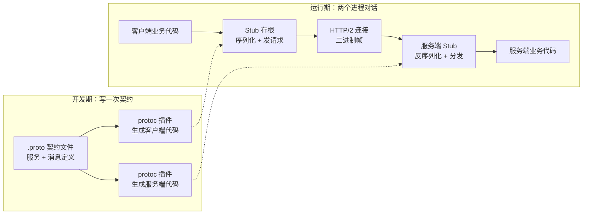
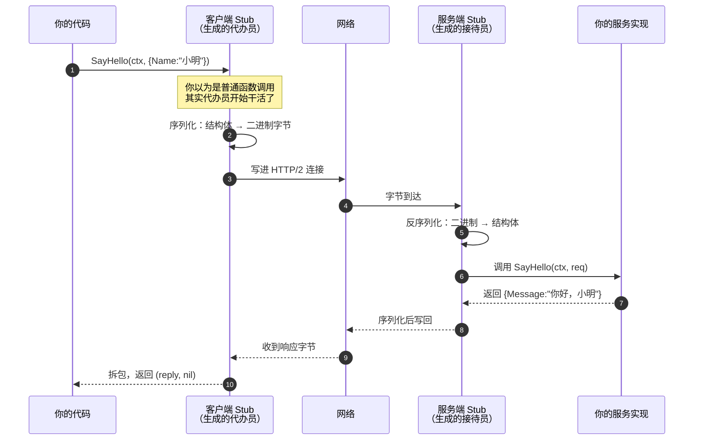
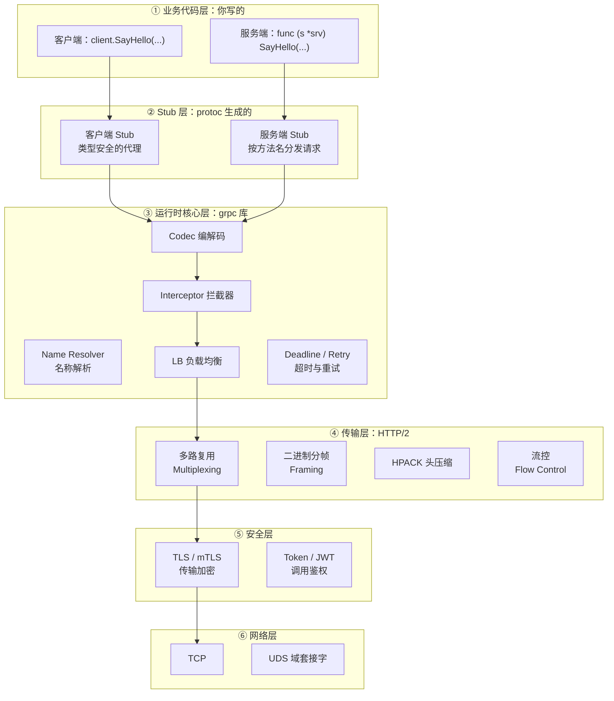
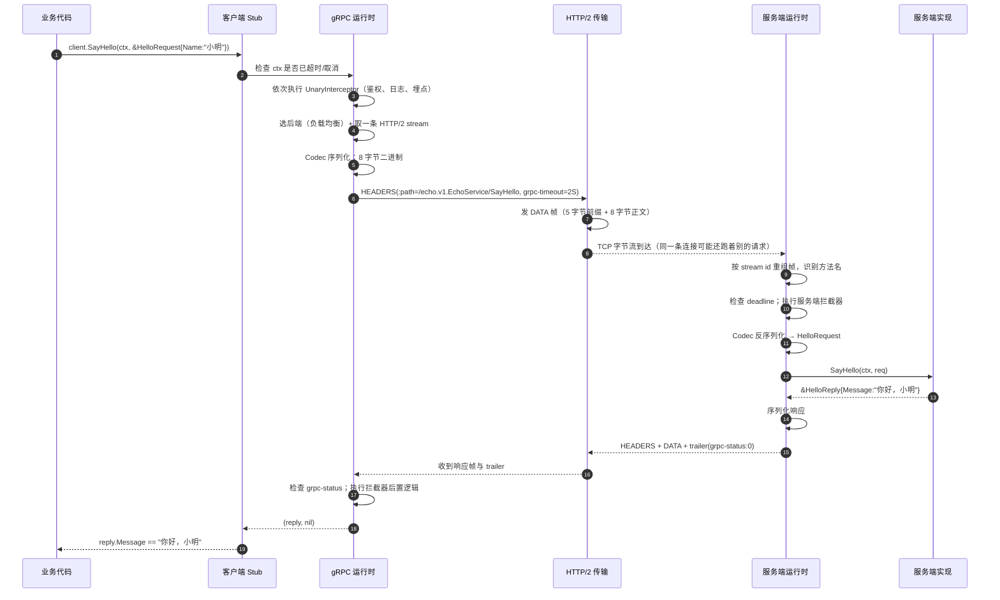
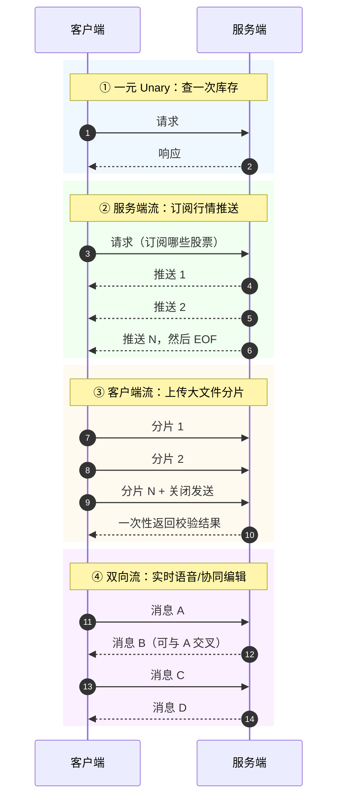
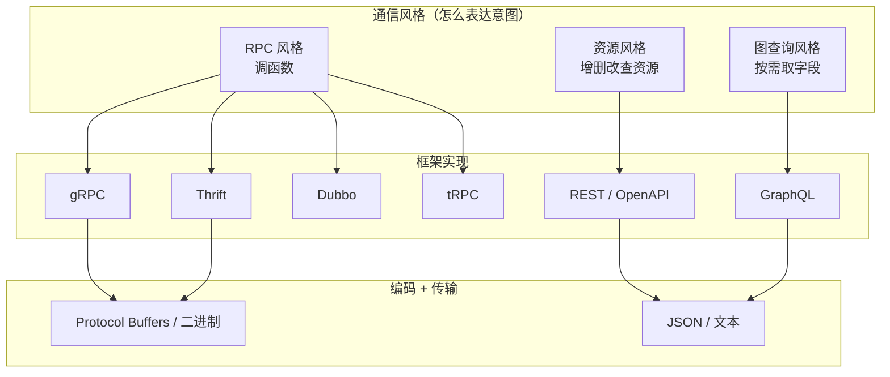
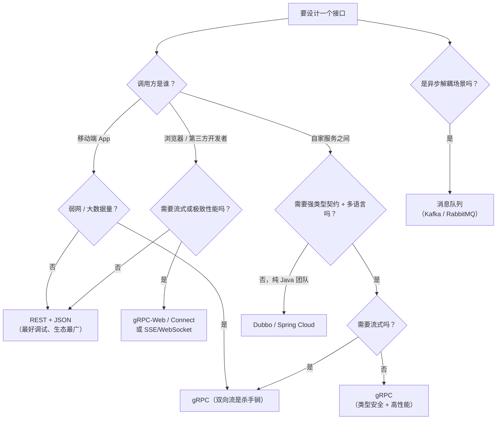

如果你写过微服务，一定遇到过这种时刻：**服务 A 想调用服务 B 的一个函数，但这两个函数住在两台机器上**。你只能把它包装成一个 HTTP 请求发出去，等服务 B 把结果用 JSON 打包寄回来，再在服务 A 里手工解析。

这就像两个同事隔着两个房间办公：想说一句话，得先写在纸上、装进信封、走一趟收发室、对方再拆信读出来。**话本身只有一句，信封和流程占了九成成本。**

gRPC 要解决的就是这件事：**让"调用远程机器上的函数"这件事，用起来跟调用本机函数几乎一样，同时把信封成本压到极低。**

这篇文章按技术文档的方式讲透它：**解决什么问题 → 架构长什么样 → 一次调用怎么跑 → 数据怎么编码 → 怎么上手写代码 → 和别的方案怎么比 → 什么场景该用**。术语第一次出现时都会给出英文全称和中文解释。

> 本文核对日期：2026 年 11 月 16 日。gRPC Core 当前为 **1.84 / 1.85 系列**（自 1.83.0 起，TLS 密钥交换默认启用后量子密码 PQC）；**文中所有示例代码已在 gRPC-Go v1.85.0 + protoc 36.2 上实际编译、`go vet` 并运行验证通过**。gRPC 是 **CNCF（Cloud Native Computing Foundation，云原生计算基金会）的孵化项目**，由 Google 在 2015 年开源，源自其内部使用了多年的 Stubby 框架。文中协议与 API 描述以 [grpc.io 官方文档](https://grpc.io/docs/) 为准。

## 〇、一句话、一张全景图

**一句话**：gRPC 是一套"用 `.proto` 文件定义服务接口 → 自动生成客户端和服务端代码 → 在 HTTP/2 上跑二进制消息"的远程调用框架。

打个比方：gRPC 像给两家公司之间装了**一套统一的内部电话系统**。双方先签一份"通话协议"（`.proto` 文件，规定了有哪些电话分机、每通电话要说什么），然后各自装一台标准话机（生成的代码）。之后想找对方办事，拿起话筒拨分机号就行——**不用每次都重新商量"先说什么后说什么、用中文还是英文"**。



**先记住这条主线**：`.proto` 定义契约 → `protoc` 生成代码 → 客户端调本地方法 → Stub 序列化成二进制 → 走 HTTP/2 帧 → 服务端 Stub 反序列化 → 调用你的业务函数 → 结果按原路返回。

几个词先用白话过一遍，后面遇到就不会卡住：

| 词 | 白话解释 |
| --- | --- |
| RPC | 远程过程调用。让你"调远程函数"写起来像"调本地函数" |
| Stub（存根） | 自动生成的"假函数"。你调它，它负责把参数打包寄走、把结果拆包还给你 |
| IDL（接口定义语言） | 专门用来描述"接口长什么样"的一门小语言，`.proto` 就是 gRPC 用的那种 |
| Protocol Buffers | Google 的二进制序列化格式，把结构体压成紧凑字节，比 JSON 小、解析快 |
| HTTP/2 | 新一代 HTTP。一条 TCP 连接上能同时跑很多请求（多路复用），还支持双向流 |
| 一元调用（Unary） | 一问一答，最普通的调用方式 |
| 流式（Streaming） | 一次请求对应多次响应，或反过来，或两边都能一直发 |
| Channel（通道） | 客户端到服务端的一条"逻辑连接"，负责找地址、做负载均衡、管连接 |

**本文路线**

| 章节 | 回答的问题 |
| --- | --- |
| 〇 | 一句话、全景图、术语速览 |
| 一 | 没有 gRPC 的世界，痛在哪？ |
| 二 | RPC 到底是什么？为什么它值得单独发明一套框架？ |
| 三 | gRPC 的架构分几层？每层负责什么？ |
| 四 | 一次调用从发出到返回，时序怎么跑？ |
| 五 | 四种通信模式：什么时候用哪种？ |
| 六 | Protocol Buffers 到底怎么把数据压小？ |
| 七 | 上手实战：完整可运行的 Go 服务端 + 客户端 |
| 八 | 生产环境必备的六件事：超时、拦截器、错误码、元数据、负载均衡、TLS |
| 九 | 技术对比：gRPC vs REST vs GraphQL vs Thrift vs Dubbo |
| 十 | 使用场景：什么时候该用，什么时候别用 |
| 十一 | 常见坑与最佳实践 |
| 附录 | 术语中英对照表 |

## 一、没有 gRPC 的世界，痛在哪？

假设你有一个电商系统：**订单服务**要问**库存服务**"这件商品还有货吗"。用最朴素的 REST + JSON 方式，大概长这样：

```
GET /api/v1/stock?sku=10086
→ {"sku":"10086","available":true,"warehouse":"sh-01","updated_at":"2026-11-16T09:00:00Z"}
```

能跑，但只要系统变大，五个问题会陆续冒出来：

**① 契约靠"口头约定"，改了就炸。**
字段叫什么、是 `sku` 还是 `productId`、`available` 是布尔还是字符串 `"true"`——全靠文档和口头沟通。库存服务哪天把 `available` 改成 `stock_status`，订单服务在运行时才发现，属于线上事故。**这叫"缺少强类型契约"。**

**② 信封比信还重。**
JSON 是文本格式，每个字段名都要原样传一遍。一个只有 6 字节正文的请求，JSON 里要写成 17 字节（后面第六节会逐字节算给你看）。QPS 上去了，带宽和 CPU 都在给"字段名"付钱。

**③ HTTP/1.1 的队头阻塞。**
HTTP/1.1 一条连接同一时刻只能处理一个请求：前一个没回来，后一个只能排队。这叫 **HOL Blocking（Head-of-Line Blocking，队头阻塞）**。常见解法是开一堆连接（浏览器通常限每个域名 6 条），但连接多了握手开销、内存、端口都不便宜。

**④ 没有真正的流。**
"实时推送一万条行情"这种需求，REST 只能靠轮询（polling）或 SSE（Server-Sent Events，服务器发送事件），前者浪费、后者单向且是文本。**双向持续对话**基本做不了。

**⑤ 每个语言都要手写一遍客户端。**
服务端加了接口，Java、Go、Python、iOS、Android 五份客户端代码都得手工同步，还容易写歪。

gRPC 对这五条的回应，正好一一对应：

| 痛点 | gRPC 的答案 |
| --- | --- |
| 契约靠嘴说 | `.proto` 文件即契约，是**唯一事实来源**，编译期就检查 |
| 信封太重 | Protocol Buffers 二进制编码，正文按字段号传，不带字段名 |
| 队头阻塞 | HTTP/2 多路复用，一条连接并发跑成千上万个请求 |
| 没有流 | 原生支持四种模式，包括**双向流** |
| 客户端要手写 | `protoc` 一条命令给十几种语言生成类型安全的客户端 |

## 二、RPC 到底是什么？

**RPC = Remote Procedure Call，远程过程调用。**

"过程"（procedure）是老派说法，今天你就理解成"函数"或"方法"。所以 RPC 的字面意思就是：**调用一个不在本进程里的函数**。

它的核心追求只有一句：**让远程调用在代码里看起来和本地调用没区别。**

```go
// 本地调用：函数就在当前进程里
reply := SayHello("小明")

// RPC 调用：函数在另一台机器上，但写起来几乎一样
reply, err := client.SayHello(ctx, &HelloRequest{Name: "小明"})
```

只多了两样东西：`ctx`（上下文，管超时和取消）和 `err`（网络调用一定会失败，必须处理）。**这个"看起来像本地调用"的假象，是靠 Stub 撑起来的。**

### Stub 是怎么骗过你的

**Stub（存根/桩）** 是一段自动生成的代码，它实现了和服务端一模一样的函数签名，但函数体里没有业务逻辑，只有"打包 → 传输 → 等结果 → 拆包"这套动作。你可以把它理解成一个**代办员**：



**为什么这层"骗局"有价值？** 因为它把网络编程里所有恶心的事——字节序、连接复用、超时、重试、压缩、加密、负载均衡——全都关进 Stub 和它下面的运行时里。业务代码只需要关心"我要什么数据"。

### 为什么要有"框架"，而不是自己写 HTTP 调用？

你可以手工 `http.Post` + `json.Unmarshal`，也能跑。但当你有 200 个接口、8 种语言、3 个数据中心时，你会需要：统一的错误语义、统一的超时传递、统一的链路追踪埋点、统一的鉴权注入、统一直连后端做负载均衡。**gRPC 就是把这 200 个接口 × 8 种语言 × 这些横切关注点，标准化成一套框架。**

## 三、gRPC 的架构：六层，从上到下

这张图是本文最重要的一张。**从你的业务代码往下，每一层只关心一件事，层层外包。**



逐层说明，每层只回答一个问题：

**① 业务代码层——"我要什么"。**
只写业务逻辑。服务端实现一个接口，客户端调用一个方法，都不碰字节和连接。

**② Stub 层——"怎么把函数调用翻译成消息"。**
`protoc` + 语言插件生成的代码。客户端侧提供 `NewXxxClient(conn)`，服务端侧要求你实现 `XxxServer` 接口。**这一层是强类型的**：传错参数类型编译都过不去，这是"契约"落地的位置。

**③ 运行时核心层——"消息怎么可靠地送到对的地方"。**
这是 gRPC 库本体，干六件事：

- **Codec（编解码器）**：把结构体和字节互相转换。默认用 Protocol Buffers，也可以换成 JSON（调试期有用）。
- **Interceptor（拦截器）**：本质是**中间件**，能在每次调用前后插入逻辑——日志、鉴权、指标、链路追踪、重试。相当于 Go 的 `http.Handler` 中间件、Java 的 Filter。
- **Name Resolver（名称解析器）**：把 `myservice.prod:50051` 这种名字解析成一串真实 IP。支持 DNS，也支持 **xDS**（一套由控制面下发配置的标准协议，服务网格里常用）。
- **Load Balancer（负载均衡）**：拿到 IP 列表后决定打哪个。这跟 Nginx 那种"客户端 → 代理 → 后端"不同，gRPC 是**客户端自己直连后端**（叫 lookaside load balancing，旁路负载均衡），少一跳。
- **Deadline（截止时间）与 Retry（重试）**：超时会通过 HTTP 头**跨服务传递**——A 给 B 3 秒，B 调 C 时只剩 2.5 秒，不会出现"上游已经放弃了，下游还在傻算"。
- **Health Check（健康检查）与 Channelz（连接诊断）**：标准化的健康探针与内部状态查询。

**④ HTTP/2 传输层——"怎么在一条连接上高效跑很多消息"。**
四个关键能力：

| 能力 | 英文 | 解决什么 |
| --- | --- | --- |
| 多路复用 | Multiplexing | 一条 TCP 连接上并发跑多个请求，互不阻塞（解决 HTTP/1.1 队头阻塞） |
| 二进制分帧 | Binary Framing | 消息切成带类型的小帧（HEADERS / DATA / RST_STREAM 等），接收端按 stream id 重组 |
| 头压缩 | HPACK | 请求头里重复的部分（`:path`、`user-agent`）只传一次索引，后续只传编号 |
| 流控 | Flow Control | 接收方告诉发送方"我还能收多少"，防止快发慢收把内存撑爆 |

**⑤ 安全层——"谁能调、路上会不会被看"。**
TLS 加密；**mTLS（mutual TLS，双向 TLS）** 让双方互验证书，是服务网格里"零信任"的底座；再往上还有基于 Metadata 的 Token / JWT 鉴权。

**⑥ 网络层——"物理上怎么连"。**
通常是 TCP，也支持 **UDS（Unix Domain Socket，Unix 域套接字）** 做同机通信，省掉协议栈开销。

### 一条消息在应用层到底长什么样

这是最容易被忽略、但面试和排障最有用的一块。一个 gRPC 请求在 HTTP/2 上就是：

```
HEADERS 帧（请求头）
  :method: POST
  :path: /echo.v1.EchoService/SayHello     ← 服务名/方法名，就这么简单
  content-type: application/grpc+proto     ← 标记这是 gRPC
  te: trailers                             ← 告诉对方"响应末尾还有 trailer"
  grpc-timeout: 2S                         ← 超时时间
  x-request-id: demo-001                   ← 你自己的 metadata

DATA 帧（消息体）
  [1 字节压缩标志][4 字节大端长度][N 字节 proto 编码的消息]
   └── 这 5 个字节叫 LPM（Length-Prefixed Message，长度前缀消息）

HEADERS 帧（trailer，响应结束时发送）
  grpc-status: 0                           ← 0 表示 OK
  grpc-message: （出错时的描述）
```

**这里有个关键设计**：gRPC 的成功/失败状态不走 HTTP 状态码，而是走**尾部 trailer 里的 `grpc-status`**。原因是流式调用过程中可能中途出错，那时 HTTP 头早就发出去了，只能靠 trailer 补一条"结束状态"。**理解了这一点，你就明白为什么浏览器不能直接调 gRPC、为什么很多老代理会把 gRPC 弄坏**——它们不认识 trailer。

## 四、一次一元调用的完整时序

把上面所有层串起来，看一次 `SayHello` 从按下"发送"到拿到结果，到底发生了什么。



**注意三个容易漏掉的点**：

1. **连接是复用的**。第 5 步取的是"一条 stream"，不是"一条新连接"。一万个并发请求可能只跑在 4 条 TCP 连接上，这是 HTTP/2 多路复用带来的直接收益。
2. **超时是端到端传导的**。`grpc-timeout: 2S` 会跟着请求走到服务端，服务端 `ctx.Deadline()` 就能拿到剩余时间，可以继续往下传给第三个服务。
3. **错误分两大类**。网络层错误（连不上、连接断了）由运行时直接返回 `codes.Unavailable`；业务错误由服务端 `status.Error(codes.InvalidArgument, "...")` 返回。两者都变成同一个 `error` 接口，客户端一视同仁地处理。

## 五、四种通信模式：一张表选对

gRPC 在 `.proto` 里用 `stream` 关键字声明流。四种组合，覆盖了几乎所有的交互形态：

| 模式 | 英文全称 | `.proto` 写法 | 白话 |
| --- | --- | --- | --- |
| 一元 | Unary RPC | `rpc M (Req) returns (Resp)` | 一问一答 |
| 服务端流 | Server Streaming RPC | `rpc M (Req) returns (stream Resp)` | 问一句，对方持续报 |
| 客户端流 | Client Streaming RPC | `rpc M (stream Req) returns (Resp)` | 我持续上报，最后给个总结 |
| 双向流 | Bidirectional Streaming RPC | `rpc M (stream Req) returns (stream Resp)` | 两边同时聊，各说各的 |



**怎么选？问自己三个问题：**

- 结果是不是"一次就能说完"？→ 是，用**一元**。
- 我要的是一批陆续产生的结果（日志、行情、进度）？→ **服务端流**。
- 我有一大批数据要往上送，但只想要一个总结（上传、批量写）？→ **客户端流**。
- 双方都要随时主动说话（聊天、协同、游戏状态同步）？→ **双向流**。

**一个重要提醒**：流不是"免费的实时推送"。一条流存活期间占着一个 stream 和一个连接，服务端每个流还有内存和 goroutine/线程成本。**十万客户端各开一条永久双向流，是典型的容量事故来源**，要做好上限控制、空闲超时和重连退避（reconnect backoff）。

## 六、Protocol Buffers：数据是怎么压小的

**Protocol Buffers**（常简称 protobuf，中文一般叫"协议缓冲区"）是 Google 的二进制序列化格式。它的设计目标有两个：**体积小**和**解析快**。

### 核心思想：字段名不进二进制

JSON 每次都把 `"available"` 这 9 个字符发一遍。protobuf 说：**字段名只存在于 `.proto` 文件里，二进制里只传字段号。**

```proto
message HelloRequest {
  string name = 1;   // 这个 1 就是字段号（field number），是二进制里的身份证
}
```

### 亲手算一遍：8 字节 vs 17 字节

请求是 `name = "小明"`。`小明` 的 UTF-8 编码是 6 个字节（每字 3 字节）。

**protobuf 编码：**

```
第 1 字节: 0x0A
   └── key = (字段号 << 3) | wire_type = (1 << 3) | 2 = 0x0A
       wire_type=2 表示"length-delimited"（长度前缀的字节串）
第 2 字节: 0x06  ← 后面还有 6 字节
第 3~8 字节: E5 B0 8F E6 98 8E  ← "小明" 的 UTF-8
合计: 8 字节
```

**JSON 编码：**

```
{"name":"小明"}
ASCII 部分 11 字节 + 中文 6 字节 = 17 字节
```

**8 字节 vs 17 字节，2.1 倍差距**，而且这还没算 HTTP 头的差异（HTTP/2 的 HPACK 会把重复的头压成几个字节，所以早期"gRPC 比 REST 省一半流量"的说法里，头压缩贡献很大）。这个计算你可以拿任意 protobuf 库验证。

### 三种 wire type 和 varint

protobuf 只有几种"线格式"（wire type），决定了字节怎么读：

| wire type | 名字 | 用于 |
| --- | --- | --- |
| 0 | VARINT | `int32`/`int64`/`bool`/`enum` |
| 1 | I64 | `fixed64`/`double` |
| 2 | LEN | `string`/`bytes`/嵌套 message/`repeated` |
| 5 | I32 | `fixed32`/`float` |

**varint（可变长度整数）** 是省空间的关键：小数字用少字节，大数字用多字节。数值 5 编码成 1 字节；数值 300 编码成 2 字节（`0xAC 0x02`）。**所以字段号 1~15 应该留给最常出现的字段**——因为它们的 key 只占 1 字节，16 以上要占 2 字节。这是官方的最佳实践，也是很多团队忽略的细节。

### 兼容性规则（这条不遵守会出线上事故）

protobuf 的向后兼容是**真的**，但有前提：

| 操作 | 安全吗 | 说明 |
| --- | --- | --- |
| 新增字段 | ✅ 安全 | 老代码读到不认识的字段号会跳过 |
| 删除字段 | ✅ 安全，但要 `reserved` | 保留字段号，防止以后有人复用导致数据串位 |
| 改字段号 | ❌ 禁止 | 等于换了身份证，老数据全部错位 |
| 改字段类型 | ⚠️ 部分可以 | `int32`↔`int64` 兼容；`string`↔`int32` 会炸 |
| 改字段名 | ✅ 安全 | 名字不进二进制，只影响生成的代码 |
| 复用已删除的字段号 | ❌ 禁止 | 老客户端会用新语义解释老数据 |

标准做法是删字段时立刻加一行：

```proto
message HelloRequest {
  reserved 2, 3;              // 这两个字段号永久废弃，谁也别用
  reserved "old_name_field";  // 字段名也一起保留，防止误用
  string name = 1;
}
```

另外两个**必须知道**的 proto3 行为：

- **默认值不序列化**。`int32 age = 1` 的值是 `0` 时，二进制里**根本没有这个字段**。所以"没设置"和"设成 0"在 proto3 里无法区分——需要区分时用 `optional int32 age = 1`（显式存在性，presence）。
- **proto3 没有 `required`**。proto2 的 `required` 因为"删不掉、加不上"被公认是设计错误，proto3 直接移除了。

## 七、上手实战：一个能跑的完整例子

下面这套代码是**完全自包含**的：从建目录到跑通，每一步都给全，代码逐行注释。用 Go 演示，因为它最能体现"生成的代码长什么样"，也不需要额外的虚拟机和配置。

### 7.1 目录结构

```
grpcdemo/
├── go.mod
├── proto/echo/v1/echo.proto     ← 你手写的契约（唯一事实来源）
├── gen/echo/v1/                 ← protoc 生成，不要手改
│   ├── echo.pb.go
│   └── echo_grpc.pb.go
├── server/main.go               ← 服务端实现
└── client/main.go               ← 客户端调用
```

### 7.2 写契约：`proto/echo/v1/echo.proto`

```proto
// 指定用 proto3 语法。proto2 已是历史，新项目一律 proto3。
syntax = "proto3";

// proto 包名，防止不同服务的同名 message 撞车。
// 约定用"业务.版本"的形式，版本号进包名是 gRPC 的推荐做法：
// 将来不兼容的改动就发 v2，v1 继续给老客户端用。
package echo.v1;

// 生成 Go 代码时的导入路径和包名（分号前是 import path，分号后是 package 名）。
// 别的语言用别的 option，比如 java_package、csharp_namespace。
option go_package = "grpcdemo/gen/echo/v1;echov1";

// service 定义一个服务：一组可以被远程调用的方法。
service EchoService {
  // 一元调用：一个请求 → 一个响应。
  rpc SayHello (HelloRequest) returns (HelloReply);

  // 服务端流式：一个请求 → 一串响应（stream 关键字放在返回值上）。
  rpc CountDown (CountDownRequest) returns (stream CountDownReply);
}

// message 定义一个数据结构，等价于其他语言的 struct / class。
message HelloRequest {
  // "= 1" 是字段号，不是默认值。它决定二进制里的顺序，一旦上线就不能改。
  string name = 1;
}

message HelloReply {
  string message = 1;
}

message CountDownRequest {
  // 从几开始倒数。
  int32 from = 1;
}

message CountDownReply {
  // 当前倒数的值。
  int32 value = 1;
}
```

### 7.3 装工具、生成代码

```bash
# 1. 建模块（在 grpcdemo 目录下执行）
go mod init grpcdemo

# 2. 拉 gRPC 运行时依赖
go get google.golang.org/grpc@latest
go get google.golang.org/protobuf@latest

# 3. 装两个 protoc 插件（生成 Go 结构体 / 生成 gRPC 客户端服务端骨架）
go install google.golang.org/protobuf/cmd/protoc-gen-go@latest
go install google.golang.org/grpc/cmd/protoc-gen-go-grpc@latest

# 4. 确认 $GOBIN（通常是 ~/go/bin）在 PATH 里，否则 protoc 找不到插件
export PATH="$PATH:$(go env GOPATH)/bin"

# 5. 生成代码
#    --go_opt=module=grpcdemo 的意思是：按 go_package 里写的路径输出，
#    并去掉 grpcdemo 前缀 —— 所以文件落在 gen/echo/v1/ 下。
protoc \
  --go_out=.        --go_opt=module=grpcdemo \
  --go-grpc_out=.   --go-grpc_opt=module=grpcdemo \
  proto/echo/v1/echo.proto
```

如果你还没装 `protoc` 本体（它不是 Go 工具）：

```bash
# macOS
brew install protobuf
# Debian / Ubuntu
sudo apt install -y protobuf-compiler
# Windows（scoop）
scoop install protobuf
```

生成成功后会多出两个文件，**看一眼就知道它替你写了什么**：

- `echo.pb.go`：`HelloRequest` / `HelloReply` 等结构体，加上 `GetName()`、`GetMessage()` 这些访问器和序列化方法。
- `echo_grpc.pb.go`：`EchoServiceClient` 接口 + `NewEchoServiceClient()`、`EchoServiceServer` 接口 + `RegisterEchoServiceServer()`、以及那个必须内嵌的 `UnimplementedEchoServiceServer`。

### 7.4 服务端：`server/main.go`

```go
package main

import (
	"context"      // 传超时、取消信号
	"flag"         // 解析命令行参数
	"log"          // 打日志
	"net"          // 监听端口
	"time"         // 模拟流式推送的间隔

	"google.golang.org/grpc"           // gRPC 运行时
	"google.golang.org/grpc/codes"     // 标准错误码
	"google.golang.org/grpc/reflection" // 服务端反射：让 grpcurl 能自动发现方法
	"google.golang.org/grpc/status"    // 构造带错误码的 error

	echov1 "grpcdemo/gen/echo/v1" // 生成的代码
)

// echoServer 是 EchoService 的实现。
type echoServer struct {
	// 内嵌这个结构体，将来 .proto 新增方法时，老代码不会编译失败。
	// 新方法会返回 Unimplemented，而不是让整个服务起不来。
	echov1.UnimplementedEchoServiceServer
}

// SayHello 实现一元调用。
// 第一个参数是 context，第二参数是请求，返回值是响应 + error。
func (s *echoServer) SayHello(ctx context.Context, req *echov1.HelloRequest) (*echov1.HelloReply, error) {
	// GetName() 是生成的安全访问器：req 为 nil 时返回零值，不会 panic。
	name := req.GetName()

	// 参数校验失败时，返回标准错误码 INVALID_ARGUMENT。
	// 客户端拿到的 error 会带上 code 和 message，可以精确判断。
	if name == "" {
		return nil, status.Error(codes.InvalidArgument, "name 不能为空")
	}

	// 正常返回响应。
	return &echov1.HelloReply{Message: "你好，" + name}, nil
}

// CountDown 实现服务端流式调用。
// 注意签名不同：这里是两个参数，第二个参数就是一个"可以反复 Send 的流对象"。
func (s *echoServer) CountDown(req *echov1.CountDownRequest, stream echov1.EchoService_CountDownServer) error {
	from := req.GetFrom()

	// 边界检查，超出范围就报错，避免客户端传个 1 亿把服务端拖死。
	if from <= 0 || from > 100 {
		return status.Errorf(codes.OutOfRange, "from 必须在 1..100 之间，收到 %d", from)
	}

	// 循环发送，每次发一个 CountDownReply。
	for i := from; i > 0; i-- {
		// Send 出错说明客户端断开或超时了，直接把错误交给框架。
		if err := stream.Send(&echov1.CountDownReply{Value: i}); err != nil {
			return err
		}

		// 用 select 同时等两件事：200ms 到了，或者客户端取消了。
		// 只写 time.Sleep 的话，客户端断开后服务端还会傻等完剩余时间。
		select {
		case <-stream.Context().Done():
			return stream.Context().Err() // 客户端取消 / 超时，结束这条流
		case <-time.After(200 * time.Millisecond):
		}
	}

	// 返回 nil 表示正常结束，客户端会收到 io.EOF。
	return nil
}

func main() {
	// 允许用 -addr 覆盖监听地址，默认监听所有网卡的 50051 端口。
	addr := flag.String("addr", ":50051", "监听地址")
	flag.Parse()

	// 先建监听器，端口被占用能在这里立刻发现，而不是起了一半才报错。
	lis, err := net.Listen("tcp", *addr)
	if err != nil {
		log.Fatalf("监听 %s 失败: %v", *addr, err)
	}

	// 创建 gRPC 服务实例。想加拦截器就传 grpc.UnaryInterceptor(...)。
	s := grpc.NewServer()

	// 把实现注册进去：这一步把"方法名 → 你的函数"的映射表建好。
	echov1.RegisterEchoServiceServer(s, &echoServer{})

	// 注册反射服务，这样 grpcurl 这类工具不用 .proto 文件也能调。
	// 生产环境如果不想暴露接口列表，可以去掉这一行。
	reflection.Register(s)

	log.Printf("gRPC 服务已启动，监听 %s", *addr)

	// Serve 是阻塞的，直到进程被杀或出错。
	if err := s.Serve(lis); err != nil {
		log.Fatalf("Serve 退出: %v", err)
	}
}
```

### 7.5 客户端：`client/main.go`

```go
package main

import (
	"context"  // 超时控制
	"flag"     // 命令行参数
	"io"       // 判断流结束的 io.EOF
	"log"      // 日志
	"time"     // 超时时长

	"google.golang.org/grpc"
	"google.golang.org/grpc/credentials/insecure" // 明文连接（本地测试用）
	"google.golang.org/grpc/metadata"             // 自定义请求元数据

	echov1 "grpcdemo/gen/echo/v1"
)

func main() {
	addr := flag.String("addr", "localhost:50051", "服务端地址")
	flag.Parse()

	// NewClient 只创建"逻辑连接"，不立即建 TCP。
	// 真正的连接在第一次调用时才建立，失败会在调用时以 Unavailable 返回。
	// 本地测试用 insecure 明文；上生产要换成 credentials.NewTLS(...)。
	conn, err := grpc.NewClient(*addr, grpc.WithTransportCredentials(insecure.NewCredentials()))
	if err != nil {
		log.Fatalf("创建连接失败: %v", err)
	}
	defer conn.Close() // 进程退出前关闭连接

	// 用连接构造强类型的客户端（就是前面说的 Stub）。
	client := echov1.NewEchoServiceClient(conn)

	// ===== ① 一元调用 =====
	// 每次远程调用都必须有超时。没有超时的调用是线上最危险的东西：
	// 下游卡住，你的 goroutine 就会一直挂着，最后把自己的内存和连接池耗光。
	ctx, cancel := context.WithTimeout(context.Background(), 2*time.Second)
	defer cancel() // 必须 defer，否则 context 泄漏

	// 附加自定义 metadata（等价于 HTTP header），常用于传 trace-id、租户信息。
	// key 必须全小写；以 -bin 结尾的 key 会被当作二进制并自动 base64。
	ctx = metadata.AppendToOutgoingContext(ctx, "x-request-id", "demo-001")

	resp, err := client.SayHello(ctx, &echov1.HelloRequest{Name: "小明"})
	if err != nil {
		// 这里的 err 打印出来形如：
		//   rpc error: code = InvalidArgument desc = name 不能为空
		// 用 status.Code(err) 可以取出 code 做分支处理。
		log.Fatalf("SayHello 失败: %v", err)
	}
	log.Printf("SayHello 返回: %s", resp.GetMessage())

	// ===== ② 服务端流式调用 =====
	// 流式调用的超时要覆盖整条流，所以给得比单次调用长。
	streamCtx, streamCancel := context.WithTimeout(context.Background(), 5*time.Second)
	defer streamCancel()

	stream, err := client.CountDown(streamCtx, &echov1.CountDownRequest{From: 3})
	if err != nil {
		log.Fatalf("CountDown 失败: %v", err)
	}

	// 反复 Recv 直到 EOF。
	for {
		reply, err := stream.Recv()
		if err == io.EOF {
			// io.EOF 不是错误，是"服务端正常发完了"的约定信号。
			break
		}
		if err != nil {
			log.Fatalf("接收失败: %v", err)
		}
		log.Printf("倒计时: %d", reply.GetValue())
	}

	log.Println("流正常结束")
}
```

### 7.6 跑起来

```bash
# 终端 1：启动服务端
go run ./server

# 终端 2：运行客户端
go run ./client
```

预期输出：

```
# 终端 1
2026/11/16 10:00:00 gRPC 服务已启动，监听 :50051

# 终端 2
2026/11/16 10:00:01 SayHello 返回: 你好，小明
2026/11/16 10:00:01 倒计时: 3
2026/11/16 10:00:01 倒计时: 2
2026/11/16 10:00:01 倒计时: 1
2026/11/16 10:00:01 流正常结束
```

### 7.7 不用写代码也能调：grpcurl

排障时最常用的工具（需要服务端注册了 `reflection`）：

```bash
# 安装
go install github.com/fullstorydev/grpcurl/cmd/grpcurl@latest

# 列出所有服务
grpcurl -plaintext localhost:50051 list

# 列出某个服务的方法
grpcurl -plaintext localhost:50051 list echo.v1.EchoService

# 直接调用（-d 里写 JSON，grpcurl 帮你转成 proto）
grpcurl -plaintext -d '{"name":"小明"}' localhost:50051 echo.v1.EchoService/SayHello

# 调流式方法（会持续打印每一帧）
grpcurl -plaintext -d '{"from":3}' localhost:50051 echo.v1.EchoService/CountDown
```

**这就是 `reflection` 的价值**：不用拿着 `.proto` 文件，也能像 `curl` 一样把接口敲一遍。它相当于 gRPC 世界的"接口文档 + 调试台"。

## 八、生产环境必备的六件事

Demo 跑通只是起点。真上线前，下面六件事一件都不能少。

### 8.1 超时：每次调用都要有 deadline

```go
// 错误示范：没有超时，下游卡住 = 你的 goroutine 永久泄漏
resp, err := client.SayHello(context.Background(), req)

// 正确示范：明确给一个上限
ctx, cancel := context.WithTimeout(context.Background(), 3*time.Second)
defer cancel()
resp, err := client.SayHello(ctx, req)
```

gRPC 会把 deadline 编码成 `grpc-timeout` 头传下去，下游 `ctx.Deadline()` 拿到的是**剩余时间**，不是重新计时。**这是 gRPC 相比手写 HTTP 调用最有价值的能力之一**：超时预算自动沿调用链收缩，杜绝"上游已放弃、下游还在算"的资源浪费。

### 8.2 拦截器：别在每个方法里抄一遍日志

```go
// 一个最简的一元拦截器：记录耗时 + 把错误码打进日志
func loggingInterceptor(ctx context.Context, req any, info *grpc.UnaryServerInfo, handler grpc.UnaryHandler) (any, error) {
	start := time.Now()
	resp, err := handler(ctx, req) // 调用真正的业务方法
	log.Printf("method=%s cost=%v code=%s", info.FullMethod, time.Since(start), status.Code(err))
	return resp, err
}

// 服务端注册（多个拦截器用 ChainUnaryInterceptor，按顺序执行）
s := grpc.NewServer(grpc.ChainUnaryInterceptor(loggingInterceptor))
```

拦截器的顺序很重要：**鉴权应该在最外层**（先拒绝，再干活），**指标埋点应该在靠近框架的那侧**（能统计到所有失败）。

### 8.3 错误码：用标准码，别自造字符串

gRPC 定义了 16 个标准状态码，跨语言一致，客户端可以据此做重试决策：

| 码 | 名称 | 典型场景 | 能重试吗 |
| --- | --- | --- | --- |
| 0 | OK | 成功 | — |
| 1 | CANCELLED | 调用方主动取消 | 否 |
| 3 | INVALID_ARGUMENT | 参数不合法 | 否 |
| 4 | DEADLINE_EXCEEDED | 超时 | 视幂等性 |
| 5 | NOT_FOUND | 资源不存在 | 否 |
| 6 | ALREADY_EXISTS | 重复创建 | 否 |
| 7 | PERMISSION_DENIED | 无权限 | 否 |
| 8 | RESOURCE_EXHAUSTED | 限流/配额用尽 | 退避后可以 |
| 9 | FAILED_PRECONDITION | 状态不满足前提 | 否 |
| 10 | ABORTED | 并发冲突（如事务冲突） | 可以 |
| 13 | INTERNAL | 服务端内部错误 | 谨慎 |
| 14 | UNAVAILABLE | 服务不可达，临时故障 | **最适合重试** |
| 16 | UNAUTHENTICATED | 未认证 | 否 |

```go
// 服务端
return nil, status.Error(codes.NotFound, "sku 10086 不存在")

// 客户端判断
if status.Code(err) == codes.NotFound {
	// 走"商品不存在"分支
}
```

### 8.4 元数据：横切信息走 metadata，别塞进业务字段

```go
// 客户端发送
ctx = metadata.AppendToOutgoingContext(ctx, "authorization", "Bearer xxx")

// 服务端读取
md, ok := metadata.FromIncomingContext(ctx)
if ok {
	vals := md.Get("authorization") // 注意：返回的是 []string
}
```

约定：**key 全小写**，以 `-bin` 结尾表示二进制值（自动 base64）。trace-id、租户 id、灰度标、鉴权 token 都适合放这里；**业务数据不要放**，因为它不可见于 `.proto`，等于绕过了契约。

### 8.5 负载均衡：客户端直连，少一跳

gRPC 默认是**客户端侧负载均衡**：客户端通过名称解析拿到所有后端 IP，自己按策略挑一个直连。常用策略两种：

- `pick_first`：连上第一个可用的就一直用它（默认，适合单后端或开发环境）。
- `round_robin`：轮询（需要能拿到完整 IP 列表，通常配 DNS 多 A 记录或 xDS）。

```go
// 用 DNS 解析 + 轮询，需要服务名能返回多个 A 记录
conn, err := grpc.NewClient(
	"dns:///echo.prod.svc.cluster.local:50051",
	grpc.WithTransportCredentials(creds),
	grpc.WithDefaultServiceConfig(`{"loadBalancingConfig":[{"round_robin":{}}]}`),
)
```

在 Kubernetes 里要特别注意：**默认的 Service 是 ClusterIP，解析出来只有一个 VIP**，客户端看不到 Pod 列表，轮询就退化成"全打到同一个 Pod"。解决办法是用 **headless Service**（`clusterIP: None`）或者上服务网格（Envoy + xDS）。

### 8.6 安全：TLS 起步，mTLS 是服务网格的常态

```go
// 单向 TLS：客户端验证服务端
creds := credentials.NewTLS(&tls.Config{
	RootCAs: caPool,       // 信任的 CA
	ServerName: "echo.prod", // 必须匹配证书里的 SAN，否则校验失败
})
conn, err := grpc.NewClient("echo.prod:443", grpc.WithTransportCredentials(creds))
```

**mTLS（双向 TLS）** 在此之上再要求服务端验证客户端证书，双方都有身份。它解决的是"集群内部谁都能假装是任何人"的问题——服务网格（Istio、Linkerd）默认就用它给所有 Pod 间流量加密并做身份认证。

## 九、技术对比：gRPC 站在哪

先看一张"家族树"，理清这些名词的关系——它们**不在同一个抽象层**，混着比容易比错：



**核心对比表**（横着看，看清每个维度的取舍）：

| 维度 | gRPC | REST + JSON | GraphQL | Thrift | Dubbo |
| --- | --- | --- | --- | --- | --- |
| 风格 | RPC，调函数 | 资源，动名词 | 图查询 | RPC | RPC |
| 契约 | `.proto`（强类型，必填） | OpenAPI（可选，易脱节） | SDL schema | `.thrift` | Java 接口 / IDL |
| 编码 | 二进制（protobuf） | 文本（JSON） | 文本（JSON） | 二进制 | 默认 Hessian，可换 |
| 传输 | HTTP/2 | HTTP/1.1 或 2 | HTTP | 自定义 TCP / HTTP | 自定义 TCP / HTTP/2 |
| 流式 | 四种模式原生支持 | 需 SSE/WebSocket 补 | 订阅（有限） | 支持 | 支持 |
| 浏览器直连 | ❌ 需 gRPC-Web 代理 | ✅ 原生 | ✅ 原生 | ❌ | ❌ |
| 人肉可读 | ❌ 需要工具 | ✅ 一眼看懂 | ⚠️ 一般 | ❌ | ❌ |
| 代码生成 | 一等公民，十几语言 | 工具链参差 | 强（类型） | 强 | 主要 Java 生态 |
| 调试成本 | 中（grpcurl / 反射） | 低（curl） | 中（Playground） | 高 | 中 |
| 过度获取 | 无（按契约） | 常见 | 可精确控制 | 无 | 无 |
| 典型主场 | 服务间内部通信 | 对外公开 API | 前端聚合多源 | 大数据/跨语言 | Java 微服务 |

几个必须说清的细节：

**① "gRPC 比 REST 快 10 倍"是营销话术。**
真实收益来自三处：二进制编码（省带宽、省解析 CPU）、HTTP/2 多路复用（省连接和握手）、头压缩（省重复头）。**在同机、小 payload、单并发的情况下，差距可能只有 2 倍以内**；优势主要出现在高并发、大 payload、跨机房、移动弱网这些场景。别拿 benchMark 当决策依据，要看你的瓶颈在哪。

**② 浏览器为什么不能直接调 gRPC？**
两个硬限制：浏览器不给 JS 暴露 HTTP/2 的帧控制（你没法自己发 trailer），也不能读响应 trailer（而 `grpc-status` 就在 trailer 里）。官方方案是 **gRPC-Web**：由 Envoy 之类的代理在中间做协议转换，把 trailer 折进 body 的最后一帧。另一条路是 Buf 的 **Connect**，它同时支持 HTTP/1.1 + JSON + gRPC 三种协议，前端可以像调普通接口一样调它。

**③ gRPC 和 Dubbo、Thrift 不是替代关系，是同类竞争。**
它们都解决"跨进程调函数"。差别在生态：gRPC 赢在多语言和云原生标准（xDS、OTel、K8s 生态原生支持），Dubbo 赢在国内 Java 体系的成熟度（服务治理、控制台、限流熔断开箱即用），Thrift 赢在大数据生态（Hive、HBase、Cassandra 都在用）。

**④ 消息队列不是替代品。**
Kafka、RabbitMQ 解决的是**异步、解耦、削峰**；gRPC 解决的是**同步请求-响应**。订单创建后发个事件让积分服务慢慢算，用 MQ；用户点"查订单"要立刻看到结果，用 gRPC。**两者互补，不是二选一。**

## 十、使用场景：什么时候用，什么时候别用

### 10.1 决策图



### 10.2 五个真正的"主场"

**① 内部微服务之间的东西向流量。**
这是 gRPC 最经典的场景。服务数量多、调用链深、语言杂（Go 写网关、Java 写交易、Python 写算法），`.proto` 就是跨语言沟通的唯一真相。配合 mTLS + 拦截器埋点，还能顺手把可观测性做掉。

**② 移动端 / 弱网 / IoT。**
二进制编码体积小、HPACK 省头、HTTP/2 一条连接多路复用——这三点直接对应"流量贵、延迟高、连接难维持"的移动端困境。很多 App 的行情、IM、配置下发都用 gRPC 流。

**③ 实时流式场景。**
双向流能做的事，REST 做不了：实时语音转写、协同编辑的增量同步、游戏状态同步、金融行情推送、长任务的进度回报。

**④ 大数据量分块传输。**
客户端流式上传：分片发、服务端边收边处理，最后返回一个总结果。比"一个 HTTP 请求塞 2GB body"友好得多——内存不会爆，断了还能知道传到哪。

**⑤ 你可能已经在用它了。**
这些基础设施全是 gRPC：
- **Kubernetes** 的 kubelet 调容器运行时（CRI）走 gRPC；
- **etcd** v3 的 API 是 gRPC；
- **Envoy** 的 xDS 控制面协议是 gRPC 流；
- **OpenTelemetry** 的 OTLP 上报默认走 gRPC。

### 10.3 四个"别用"的场景

**① 面向公众的开放 API。**
第三方开发者拿不到你的 `.proto`，也没法用 grpcurl，还要面对各种防火墙对 HTTP/2 的不友好。**对外用 REST/OpenAPI，对内用 gRPC**，这是绝大多数公司的分层做法，同一套能力可以并行暴露两种入口。

**② 极简单的 CRUD，只有一两个接口。**
引入 protoc、插件、代码生成、CI 里的生成步骤——收益远小于成本。`curl` 就能测完的东西，别上重型装备。

**③ 需要人肉调试、需要"打开链接看结果"的场景。**
浏览器地址栏敲一个 URL 就能看到数据，这种便利性在排障时价值极高。gRPC 必须靠工具才能看一眼请求长什么样。

**④ 强依赖中间代理做流量治理的架构。**
老的 Nginx、LVS、部分硬件负载均衡不认识 HTTP/2 trailer，会把 gRPC 请求弄坏（典型症状：请求成功但客户端报 `Unavailable`，或流被莫名截断）。要用就得确认代理支持 gRPC，或者干脆走 L4 转发。

## 十一、常见坑与最佳实践

**坑 1：没有 deadline 的调用。**
后果是 goroutine / 线程泄漏，最终 OOM。→ 强制规范：所有 RPC 调用必须带 `context.WithTimeout`，代码评审必查。

**坑 2：把大 message 当文件传输用。**
protobuf 单条消息默认上限 4MB（可调，但调大是错的方向）。大量数据用流式分片，不要塞进一个 message。

**坑 3：改字段号。**
线上最隐蔽的事故之一：老数据用新 schema 解析，字段全部错位，还不报错。→ 用 `reserved`，并把"字段号不可变更"写进团队规范。

**坑 4：K8s 里 round_robin 退化成单点。**
默认 ClusterIP Service 解析出单一 VIP，客户端看到的"一个后端"就是 kube-proxy。→ 用 headless Service 或服务网格。

**坑 5：忘记 `defer cancel()`。**
`context.WithTimeout` 返回的 cancel 必须调用，否则 context 树泄漏（静态检查工具如 `lostcancel` 能抓到）。

**坑 6：proto3 默认值不序列化导致的"空值"歧义。**
要区分"未设置"和"设成零值"，用 `optional`；要区分"未设置"和"空字符串"，也可以 `optional`。千万别自己发明 `has_xxx` 布尔字段来绕。

**坑 7：流式连接不做上限。**
每客户端一条永久双向流 × 10 万客户端 = 服务端连接数、goroutine 数、内存同时爆。→ 设最大并发流数（`MaxConcurrentStreams`）、空闲超时、客户端重连退避。

### 生产落地清单

| 项 | 做什么 |
| --- | --- |
| 契约管理 | `.proto` 单独仓库或集中目录，CI 里做 breaking change 检查（`buf breaking`） |
| 兼容策略 | 不兼容改动发新版本包名（`v1` → `v2`），旧版本保留至少一个发布周期 |
| 超时 | 所有调用强制 deadline，网关层统一兜底 |
| 重试 | 只对 `UNAVAILABLE` / `DEADLINE_EXCEEDED` 重试，必须配指数退避 + 抖动 + 幂等保证 |
| 可观测性 | 拦截器统一注入 trace-id，接 OpenTelemetry；指标看 QPS / 延迟分位 / 错误码分布 |
| 安全 | 内部流量 mTLS，对外入口走网关转 REST |
| 容量 | 明确单连接并发流上限、单 message 大小上限、单流时长上限 |

## 十二、总结

回到最初那个比喻：两个房间里的同事想说话。

- **REST + JSON** 是把话写在纸上、装信封、走收发室——**谁都看得懂，但每次都重新写一遍格式**。
- **gRPC** 是装了一套内部电话系统——**先签协议（`.proto`），再装话机（生成的 Stub），之后拨分机号就行**。话是压缩过的二进制，一条线能同时接通很多通电话，还能一直不挂断地聊（流式）。
- 代价是：**外人打不进来**（浏览器直连难）、**你听不到对方原话**（二进制不可读，得靠工具）。

所以判断标准其实很简单：

> **内部服务之间、多语言、要性能、要流式 → gRPC。**
> **对外公开、要易调试、接口很少 → REST。**
> **异步解耦 → 消息队列。**

三者不是互相替代，是现代系统里同时存在的三层。搞清楚每层解决什么问题，比记住"gRPC 快 10 倍"有用得多。

## 附录：术语中英对照表

| 缩写 / 术语 | 英文全称 | 中文 | 一句话解释 |
| --- | --- | --- | --- |
| RPC | Remote Procedure Call | 远程过程调用 | 调用另一台机器上的函数，写起来像调本地函数 |
| gRPC | —（Google RPC，g 每版含义不同） | 谷歌远程过程调用框架 | Google 开源的高性能 RPC 框架，基于 HTTP/2 |
| IDL | Interface Definition Language | 接口定义语言 | 专门描述接口长什么样的语言，`.proto` 是其中一种 |
| Protobuf | Protocol Buffers | 协议缓冲区 | Google 的二进制序列化格式，按字段号编码 |
| HTTP/2 | HyperText Transfer Protocol version 2 | 超文本传输协议第 2 版 | 支持多路复用、二进制分帧、头压缩的新一代 HTTP |
| HPACK | Header Compression for HTTP/2 | HTTP/2 头部压缩算法 | 用静态表 + 动态表把重复的请求头压成索引 |
| HOL Blocking | Head-of-Line Blocking | 队头阻塞 | 前一个请求没完成，后面的只能排队 |
| Multiplexing | Multiplexing | 多路复用 | 一条连接上并发跑多个请求，用 stream id 区分 |
| Framing | Binary Framing | 二进制分帧 | 把消息切成带类型的帧传输，接收端重组 |
| Flow Control | Flow Control | 流控 | 接收方声明还能收多少，防止被发爆 |
| Stub | Stub / Client Stub | 存根 / 桩 | 自动生成的代理代码，负责打包发请求、拆包给结果 |
| Channel | Channel | 通道 | 客户端到服务端的逻辑连接，管寻址、负载均衡、连接复用 |
| Unary RPC | Unary Remote Procedure Call | 一元调用 | 一个请求对应一个响应 |
| Server Streaming | Server Streaming RPC | 服务端流式调用 | 一个请求，服务端连续返回多条 |
| Client Streaming | Client Streaming RPC | 客户端流式调用 | 客户端连续发送多条，服务端最后回一条 |
| Bidi Streaming | Bidirectional Streaming RPC | 双向流式调用 | 双方都能随时发消息，互不阻塞 |
| Codec | Codec (Coder-Decoder) | 编解码器 | 负责结构体和字节之间的相互转换 |
| Interceptor | Interceptor | 拦截器 | 调用前后插入逻辑的钩子，等同中间件 |
| Metadata | Metadata | 元数据 | gRPC 的自定义请求头，传 trace-id、token 等 |
| Deadline | Deadline | 截止时间 | 调用的最晚完成时间，会沿调用链传递 |
| Trailer | HTTP/2 Trailer | 尾部首部 | 响应结束后才发的头，`grpc-status` 就在这里 |
| LPM | Length-Prefixed Message | 长度前缀消息 | gRPC 消息前的 5 字节（压缩标志 + 长度） |
| Varint | Variable-length Integer | 变长整数 | 小数字少字节、大数字多字节的整数编码 |
| Wire Type | Wire Type | 线格式 | 标记这个字段在二进制里按哪种方式读 |
| xDS | x Discovery Service | x 发现服务 | 控制面下发路由/负载均衡配置的一组标准协议 |
| mTLS | Mutual Transport Layer Security | 双向 TLS | 客户端和服务端互相验证证书 |
| ALPN | Application-Layer Protocol Negotiation | 应用层协议协商 | TLS 握手时协商用 h2 还是 http/1.1 |
| UDS | Unix Domain Socket | Unix 域套接字 | 同机进程通信，不走网络协议栈 |
| PQC | Post-Quantum Cryptography | 后量子密码 | 抗量子计算机攻击的加密算法，gRPC 1.83 起默认启用 |
| gRPC-Web | gRPC for Web Browsers | 浏览器版 gRPC | 通过代理做协议转换，让浏览器能调 gRPC |
| REST | Representational State Transfer | 表述性状态转移 | 以资源为中心的 HTTP 接口风格 |
| GraphQL | Graph Query Language | 图查询语言 | 让客户端自己声明要哪些字段的查询语言 |
| Thrift | Apache Thrift | 阿帕奇 Thrift | Facebook 起源的跨语言 RPC + 序列化框架 |
| Dubbo | Apache Dubbo | 阿帕奇 Dubbo | 阿里开源的 Java 微服务 RPC 框架 |
| CNCF | Cloud Native Computing Foundation | 云原生计算基金会 | 托管 Kubernetes、gRPC 等云原生项目的基金会 |
| OTel | OpenTelemetry | 开放遥测 | 统一的链路追踪 / 指标 / 日志采集标准 |
