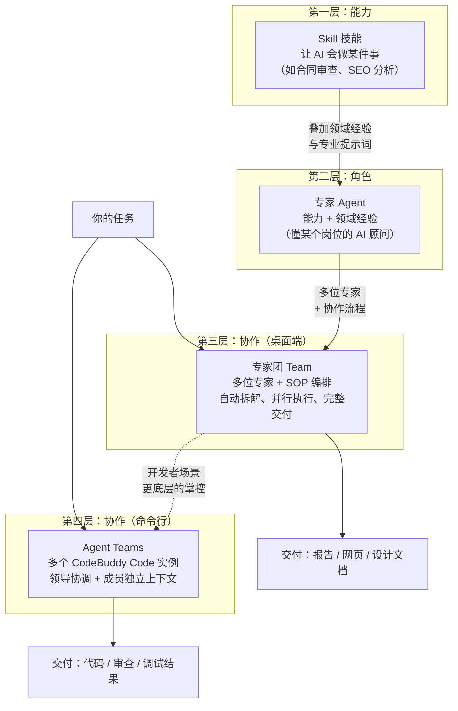
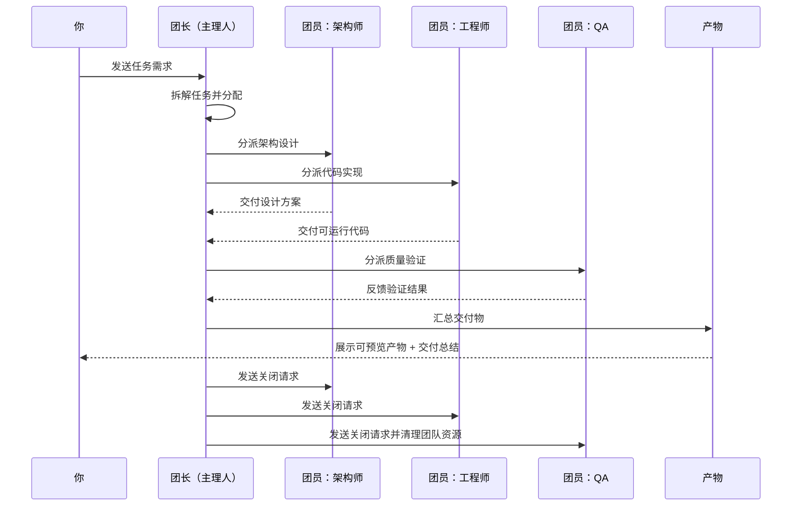

一个人干活，什么都要自己来；一支团队干活，有人拆解、有人执行、有人检查。WorkBuddy 把这套「团队作战」搬进了 AI 工作台——你可以召唤一个由多个 AI 角色组成的团队，并行完成复杂任务。

这篇文章基于《WorkBuddy 多智能体使用指南》整理，用**八张真实界面截图**带你走完整流程：先分清 Skill、专家、专家团这三个最容易搞混的概念，再分别上手桌面端的「专家团」和命令行的「Agent Teams」，最后给出最佳实践和排错清单。

> 说明：文中的**架构图与时序图**按本站惯例用 mermaid 绘制（可缩放、可交互）；**界面截图**是原文的界面实录，以图片形式保留，方便你对照着在软件里找到对应按钮。

## 〇、先建立整体印象

一句话理解多智能体：**把多个各有所长的 AI 组织成一支队伍，像真实项目组一样分工、并行、汇总交付。**

从下往上，WorkBuddy 的能力是层层叠加的：



两条主线要记住：

1. **桌面端「专家团」**：开箱即用，用自然语言召唤一支团队，不用关心内部细节，适合文档创作、方案设计、内容营销等办公场景。
2. **命令行「Agent Teams」**：把团队结构、任务列表、消息通信都交到你手里，适合开发者做并行代码审查、调试、跨层开发。

## 一、先分清三个概念：Skill、专家、专家团

刚开始用最容易混淆的就是这三个词。一句话概括：**Skill 是能力，专家是能力加经验，专家团是多位专家加协作流程。**


图 1　Skill、专家、专家团的关系与选型

| 维度 | Skill（技能） | 专家（Agent 型） | 专家团（Team 型） |
| --- | --- | --- | --- |
| 组成关系 | 工具能力：让 AI 能做某件事 | AI 顾问：懂某个领域的 AI 角色 | AI 协作团队：自动拆解、并行执行、完整交付 |
| 解决什么 | AI 会不会做 | AI 懂不懂行 | 活儿太多太复杂 |
| 怎么选 | 需要 AI 具备某种工具能力 | 有一个明确的单点问题 | 任务复杂，需要多角色配合 |
| 典型例子 | 装上合同审查 Skill 看合同风险 | 找「搜霸霸」给一份 SEO 优化方案 | 召唤 SEO 内容营销团队，7 人并行出报告 |

再展开一点：

- **Skill** 是一段可被 AI 调用的能力，解决「AI 会不会做」的问题。装上合同审查 Skill，AI 就能帮你看合同风险。
- **专家** 内置了某个人设、方法论和工具链，解决「AI 懂不懂行」的问题。召唤谁，就像请来了那个岗位的资深从业者。
- **专家团** 由团长统筹，把任务拆给擅长不同领域的团员并行完成，解决「活儿太多太复杂」的问题。

> **提示**：简单任务不必追求多智能体，直接找单个专家或普通对话更快。只有当任务确实需要多个角色配合时，专家团才划算。另外，专家团涉及多位成员、多轮调用，积分消耗通常高于单个专家，且无法按固定倍数估算——请留意账户余额与召唤时的提示。

## 二、桌面端专家团：零基础上手

桌面端的多智能体入口是「专家团」，藏在左侧边栏的「专家·技能·连接器」里。下面以「软件开发团队」为例，走一遍完整流程。

### （一）打开专家中心

在 WorkBuddy 桌面端左侧边栏单击「专家·技能·连接器」，默认进入「专家」页签。页面顶部有「专家」「技能」「连接器」三个标签，右侧是搜索框和「我的专家」入口。


图 2　专家中心首页，可切换「专家 / 专家团」标签

专家中心里有两条重要路径：

- **专家中心**：按分类浏览官方提供的专家和专家团，找到合适的直接召唤。
- **我的专家**：在这里创建属于你自己的专家、专家团，或把喜欢的专家置顶、分享给好友。

在「专家」和「专家团」标签之间切换，即可分别查看单专家和多智能体团队。也可以用搜索框按名称关键词快速定位。

### （二）找到并了解一个专家团

在「专家团」列表里单击一张团队卡片，会弹出团队详情。以「软件开发团队」为例：


图 3　「软件开发团队」详情页：能力简介、示例提示词与团队成员

详情页会告诉你这些信息：

- **能力简介**：例如「高效软件研发团队，产品经理定需求、架构师设计加拆任务、工程师批量实现代码、QA 验证质量」。
- **领域标签**：如「软件公司」「组织管理」「产品交付」，帮你判断它擅不擅长你的任务。
- **版本与使用量**：如 v1.1.0、823.56w 使用量，反映成熟度与热度。
- **团队帮你做**：官方给出的示例提示词，可以直接点击使用。
- **团队成员**：明确列出团长与团员的职责。**看成员分工是判断一个专家团是否适合你的最快方法。**

单个专家的详情页结构类似，只是没有「团队成员」一栏：


图 4　单个专家详情页：简介、领域标签与任务示例

### （三）召唤专家团进入对话

确认团队合适后，点击「召唤」（有的版本叫「召唤专家 / 立即召唤」），WorkBuddy 会把这个团队添加到主页的对话输入框中。

也可以直接在输入框里操作：点击输入框旁边的「专家」入口，从下拉列表里选择团队；如果列表里没有，点击底部的「召唤更多专家」回到专家中心挑选。


图 5　输入框的专家下拉列表与「召唤更多专家」入口

召唤完成后，输入框左下角会显示当前绑定的团队名称（如「软件开发团队」），旁边还能看到当前使用的模型。

> 注意：召唤专家只是把团队挂到对话上，**并不等于已经提交任务**，你还需要输入并发送具体需求。

### （四）描述任务并发送

在输入框里用自然语言写清楚你要做的事。官方示例提示词可以点一下直接填入，再按自己的情况修改。


图 6　在输入框中描述任务，左下角显示已召唤的专家

描述任务时建议包含三要素：

1. **整体目标**：要解决什么问题、做成什么东西。
2. **已有材料**：相关背景、上传的文件或参考资料。
3. **交付要求**：希望最终产出什么形式，例如可运行的网页、一份报告、一套设计文档。

一个写得好的任务示例：

```text
帮我开发一个贪吃蛇游戏   // 整体目标：要做成一个游戏；简洁明确，团队可据此自动拆解出设计、开发、测试等子任务
```

复杂任务可以写得更细：

```text
把我这份创业案例材料改成学生版案例和教师使用说明，  // 目标：产出两个版本；"这份材料"指已上传的文件
保留来源与不确定性                                    // 交付要求：不篡改出处、不掩盖不确定的结论
```

### （五）观察执行过程并查看产物

发送任务后，团长（主理人）会拆解任务并分配给团员，能并行的步骤并行推进。整个过程用时序图看最清楚：



对话区会实时显示各成员的工作动态，例如「QA 严过关已关闭，现在关闭工程师并清理团队资源」「已向 @software-engineer 发送关闭请求」。执行结束后，你会看到一份完整的交付总结。


图 7　专家团完成任务：对话总结、成员收尾与可预览产物

以「帮我开发一个贪吃蛇游戏」为例，交付结果通常包括：

- **下一步建议**：如「双击 index.html 即可在浏览器中运行」「在 WorkBuddy 内预览」「单文件可直接发给朋友」。
- **二次开发与后续迭代**的方向提示。
- **可点击的产物文件**：如 index.html，右侧会打开预览面板，直接展示游戏效果。
- **明确的收尾**：成员会主动关闭并清理团队资源。

再看一个多角色协作的产出示例：请「游戏设计团队」设计游戏机制时，不同团员分别贡献核心循环设计、数值平衡等内容，最终汇总成一份完整文档——这是单个专家很难一次性交付的完整度。


图 8　专家团协作产出的《GDD 设计支柱与核心循环》文档

> **提示**：在专家团会话里想再召唤别的专家时，系统会提示切换需要开启新对话，不能直接在同一会话里混用另一个专家团，这点与单专家会话不同。

### （六）创建你自己的专家团

官方团队之外，还可以定制专属团队。路径是：专家中心右上角「我的专家」 → 「创建专家」，在对话框中按提示补全创建专家团的提示词，告诉 WorkBuddy 你要一个什么样的团长、哪些团员、各自负责什么，即可开启创建。

创建完成后，它会出现在「我的专家」里，可以置顶、分享给好友，或像官方团队一样召唤使用。

创建时建议明确写出：**团队目标、团长与各成员的角色职责、协作流程（谁先做谁后做、怎样算完成），以及交付物的格式要求**。角色划分越清晰，运行越顺畅。

## 三、命令行 Agent Teams：开发者多智能体协作

如果你在开发场景工作，命令行里的 Agent Teams 提供了更底层、更灵活的多智能体协作。它让你协调多个 CodeBuddy Code 实例组成团队：一个会话作为**团队领导（team-lead）**负责协调、分配和汇总，其余**成员（teammates）**各自独立工作、拥有独立上下文，并可通过消息系统直接互相对话。

> 该功能目前处于**实验阶段**，存在已知限制（见第五节），使用前请了解清楚。

### （一）什么时候该用 Agent Teams

它在「并行探索能创造真正价值」的任务上最有效：

| 场景 | 说明 |
| --- | --- |
| 研究与评审 | 多个成员同时调研不同方面，再共享和质疑彼此的发现 |
| 新模块开发 | 每个成员负责独立模块，互不干扰 |
| 竞争性假设调试 | 成员并行测试不同假设，更快收敛到正确答案 |
| 跨层协调 | 前端、后端、测试各由不同成员负责，同步推进 |

它的协调开销和 Token 消耗明显高于单会话。**顺序执行、需要反复编辑同一文件、依赖关系复杂的任务，用单会话或子代理更合适。**

### （二）创建你的第一个团队

用自然语言告诉 CodeBuddy 你想要什么样的团队，它会自动创建团队、生成成员、分配任务。例如：

```text
我正在设计一个帮助开发者追踪代码中 TODO 注释的 CLI 工具。  // 背景：要做的产品
创建一个团队从不同角度探索这个问题：                        // 指令：创建团队并行探索
一个负责用户体验设计，                                      // 成员1：UX 视角
一个负责技术架构，                                          // 成员2：架构视角
一个扮演"挑刺者"的角色提出质疑。                            // 成员3：质疑视角，主动找漏洞
```

CodeBuddy 会依次创建团队和共享任务列表、为每个角色生成独立成员、协调各成员工作、汇总最终成果。创建成功后终端显示 `Team design-review created`，随后每个成员以「@成员名 · 描述」的形式展示，并用不同颜色标识。

### （三）控制团队：对话、看状态、切视角

下面是一份带注释的操作速查：

```text
@ux-designer <你的消息>   // 直接与指定成员对话，无需通过领导中转；输入 @ 触发成员名 Tab 补全
@all <广播消息>           // 向所有成员广播；Token 消耗随成员数线性增长，谨慎使用
@main <消息>              // 聚焦成员时，把消息直接回传给团队领导
↓                         // 输入框为空时按 ↓ 进入成员焦点切换模式
← / →                     // 在焦点切换模式里选择成员
Enter                     // 确认切换到选中的成员
Esc                       // 取消焦点切换
Ctrl+O                    // 从成员焦点返回主视图
```

- 补全列表支持模糊搜索，下拉菜单按成员颜色显示并标注状态（如 ✓ completed）。
- 已完成任务的成员也会出现在补全列表里，给它发消息即可**重新唤醒它**。
- 输入框下方是实时状态栏，例如 `Team (2 active) · @ux-designer ● @tech-architect ● @devils-advocate ✓`，其中 `●` 表示正在工作、`✓` 表示已完成、`✗` 表示失败、`—` 表示已取消。
- 聚焦成员后，终端会显示它的完整对话历史、实时进度和 Token 消耗。

### （四）指定成员数量与模型

CodeBuddy 会根据任务自动决定生成多少成员，也可以明确指定：

```text
创建一个 4 人团队并行重构这些模块，每个成员使用 lite 模型。  // 4 人 = 成员数量；lite = 成员模型档位
```

成员使用与子代理相同的模型解析规则：提示词中指定的模型属于本次调用设置，可被 `CODEBUDDY_CODE_SUBAGENT_MODEL` 环境变量覆盖；未指定时依次考虑项目级和用户级的按子代理设置、内置声明，最后继承团队领导的模型。用 `/agents` 管理按子代理设置，用 `/model` 管理 lite / reasoning 对应的具体模型。

### （五）任务分配、委派模式与计划审批

**共享任务列表**是团队协调的核心，任务有「待处理、进行中、已完成」三种状态，并支持依赖关系——被依赖的任务完成后，下游自动解除阻塞。分配方式有两种：你告诉领导把某任务分给某成员（领导分配），或成员完成后自动认领下一个未分配且未阻塞的任务（自主认领）。按 `Ctrl+T` 可在终端切换显示任务列表。

默认情况下领导可能自己动手实现任务。若希望它只做协调，按 `Shift+Tab` 切换到**委派模式（Delegate Mode）**，领导将只能使用协调工具（Agent、TaskStop、SendMessage、AskUserQuestion 等），不直接改代码或读文件。

对于复杂或高风险任务，还可以要求成员先提交计划再实施：

```text
生成一个架构师成员来重构认证模块，  // 成员角色：架构师；任务：重构认证模块
要求在修改代码前先提交计划等待审批。  // 安全约束：先计划、后动手，需人工/领导审批
```

成员完成计划后会向领导发送审批请求，领导批准或拒绝（附反馈），被拒绝的成员保持在计划模式修改后重新提交。

### （六）关闭成员与清理团队

```text
让研究员成员关闭   // 结束某个成员的会话：领导发送关闭请求，成员可接受（优雅退出）或拒绝（附解释）
清理团队           // 工作全部完成后：领导移除共享团队资源目录
```

> **重要**：清理前必须先关闭所有活跃成员，否则会失败；且始终通过领导来清理，成员不应自行执行清理操作。

## 四、最佳实践

无论用哪种形态，下面几条都能显著提升多智能体的效果：

1. **给成员提供充分的上下文**。成员不会继承领导的对话历史，要在初始 Prompt 里写清具体信息。例如：

   ```text
   审查 src/auth/ 目录的认证模块，              // 任务范围：具体目录
   重点关注 Token 处理、会话管理和输入验证；     // 关注点：三个具体方向
   应用使用 JWT 存储在 httpOnly Cookie 中；     // 背景事实：避免成员猜错实现方式
   对发现的问题按严重等级排序报告。              // 交付要求：排序输出
   ```

2. **合理划分任务粒度**。太小则协调开销超过收益，太大则成员长时间不汇报、返工风险高。恰当做法是让每个成员负责自包含的工作单元，产出明确的交付物（一个函数、一个测试文件、一份审查报告），每人保持 5 到 6 个任务。

3. **避免文件冲突**。两名成员同时编辑同一文件会互相覆盖，拆分工作时确保每人负责不同的文件集合。

4. **定期检查进度**。长时间无人监管的团队更容易浪费资源。若发现领导自己动手而成员闲着，可以说「等你的成员完成各自的任务后再继续」，或切到委派模式。

## 五、常见问题与排错

| 现象 | 排查与处理 |
| --- | --- |
| 成员没有出现 | 查看团队状态栏确认成员是否已生成；确认任务复杂度是否足以需要团队 |
| 权限请求过多 | 在生成成员前，先在权限设置中预先批准常见操作，减少汇总到领导的打扰 |
| 成员遇错后停止 | 用 @成员名 直接给它发额外指令，或让领导生成一个替代成员继续 |
| 领导过早结束 | 告诉它继续等待，或使用委派模式限制其行为 |
| 任务状态卡住 | 手动检查工作是否已完成并更新状态，避免依赖任务一直被阻塞 |
| 保存的会话恢复后成员消失 | /resume、/rewind 不恢复成员，让领导重新生成成员即可 |

**Agent Teams 已知限制**：无会话恢复；任务状态可能滞后；成员关闭较慢（会先完成当前工具调用）；每个会话只能管理一个团队，需清理后才能新建；不支持嵌套团队；创建团队的会话在整个生命周期中固定为领导；成员权限在生成时确定。另外，`CODEBUDDY.md` 在多智能体中正常工作——成员会从工作目录读取它，可用来给所有成员统一下发项目级指导。

## 六、结语

桌面端的**专家团**让你无需关心内部细节，用自然语言召唤一支团队就能并行完成复杂任务，适合文档创作、方案设计、内容营销等办公场景；命令行的 **Agent Teams** 则把团队结构、任务列表、消息通信都交到你手里，适合开发者做并行代码审查、调试与跨层开发。

选择时记住一条原则：**任务越是需要多角色配合、越能并行，多智能体的价值越大；简单任务用单专家或普通对话反而更高效。** 现在就打开 WorkBuddy，从专家中心挑一个专家团，把第一个任务交给它吧。
