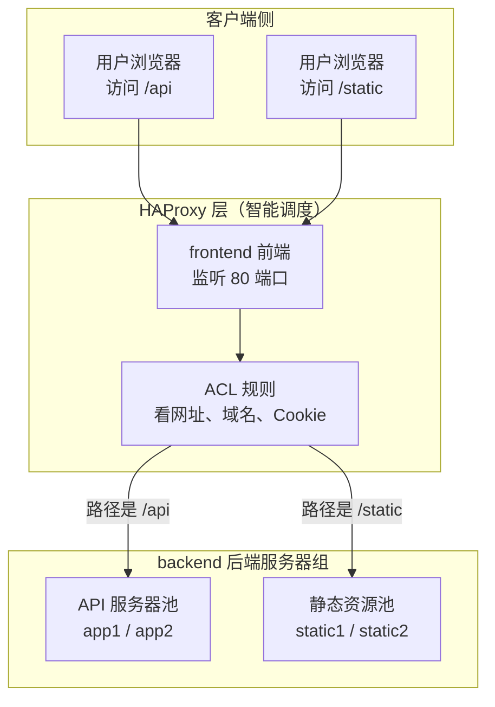
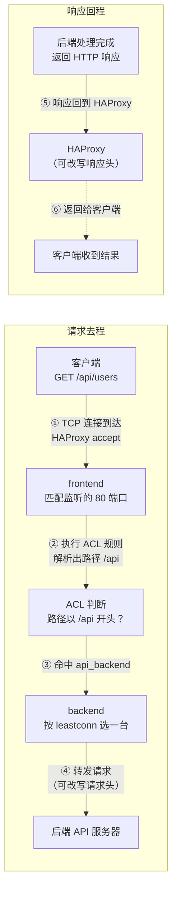
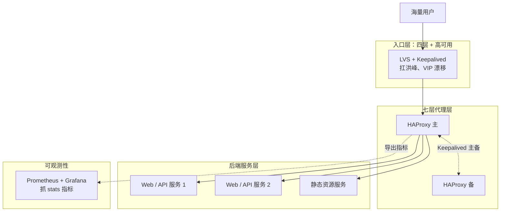
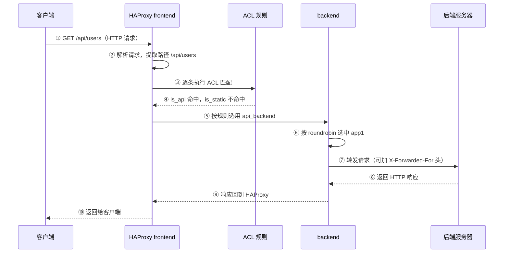
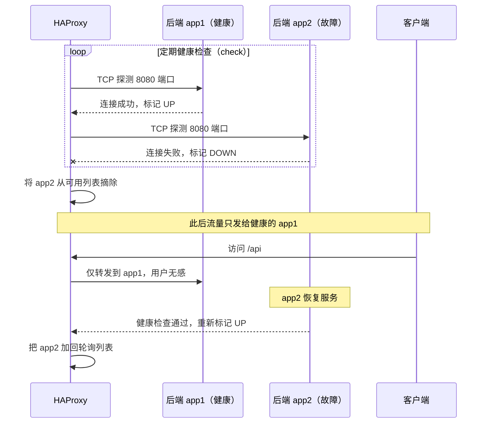

前两篇讲了 LVS（四层领班）和 Keepalived（保镖）。这三剑客里还差一位——**HAProxy**。

如果说 LVS 是只看"门牌号（IP+端口)"就把人往里带的粗放领班，那 HAProxy 是个**会看你说什么话的智能调度员**：你不光告诉它去几楼（IP+端口），还能告诉它"我要找财务部"（网址路径 `/finance`）、"我是老客户"（Cookie），它据此把你带到不同的窗口。

这篇面向零基础，讲清 HAProxy 解决什么问题、和谁配合、请求到底怎么被"看懂"和分发。

## 〇、先看整体：HAProxy 在系统中的位置

一句话理解：**HAProxy 站在用户和后端服务器之间，替用户接收请求，按规则挑一台后端服务器转发，并把响应带回给用户。**

先记住几个 HAProxy 特有的术语，它们是配置的骨架：

| 术语 | 英文 | 作用 | 生活化比喻 |
| --- | --- | --- | --- |
| 前端 | frontend | 定义"在哪接客"：监听哪个 IP、端口 | 大厅接待台 |
| 后端 | backend | 定义"客人去哪"：一组服务器和分发规则 | 各个业务窗口 |
| 监听 | listen | 前端+后端合二为一的简写 | 一条龙服务台 |
| 默认 | defaults | 前后端共用的默认参数 | 统一的服务规范 |
|  ACL | Access Control List | 按条件匹配请求（如路径、域名）的规则 | "识别客人需求的判断标准" |



读懂这张图就抓住了 HAProxy 的灵魂：**它能"看懂"请求内容，把不同的请求分流到不同的服务器组**——这是四层的 LVS 做不到的。

## 一、HAProxy 解决什么问题

它主要解决五类问题：

1. **负载均衡——分摊压力**。和 LVS 一样，把请求摊到多台服务器，避免单点被压垮。
2. **七层智能分流——按内容派单**。这是它的看家本领：根据网址路径、域名、请求头、Cookie 把请求发到不同后端。比如 `/api` 给应用服务器，`/images` 给图片服务器。
3. **会话保持（Session Stickiness）**。用户登录后，后续请求必须落到同一台服务器（否则登录状态丢失）。HAProxy 能用 Cookie 把用户"粘"在固定后端上。
4. **SSL 终结（SSL Termination）**。把耗 CPU 的 HTTPS 加解密集中在 HAProxy 上做，后端服务器只需处理明文 HTTP，减轻后端负担。
5. **健康检查和灰度**。定期检查后端存活，坏的自动摘除；还能按权重把一小部分流量导到新版本做灰度发布。

> 一句话概括：**HAProxy = 高性能 + 会看内容 + 会话保持 + SSL 卸载的七层负载均衡与反向代理**。

## 二、HAProxy 是什么，工作在网络的哪一层

HAProxy 有三个鲜明身份：

- **它主打七层，也支持四层**。回顾 OSI 七层模型（网络通信的分层标准）：四层是传输层，只看 IP+端口；七层是应用层，能看懂 HTTP 的网址、请求头、Cookie。HAProxy 两层都能干，但**最强的能力在七层**——能读懂应用层内容做精细调度。
- **它是事件驱动的，性能极高**。单个进程就能扛数万并发连接，常和 LVS 搭配：LVS 在最外层扛洪峰，HAProxy 在后面做精细分发。
- **它是纯软件、开源、久经考验**。用 C 语言写成，从 2000 年发展至今，是业界最成熟的负载均衡器之一，很多大厂的核心入口都在用它。

和前两篇的主角对比一下，位置就清楚了：

| 对比项 | LVS（四层） | HAProxy（四层+七层） | Nginx（七层为主） |
| --- | --- | --- | --- |
| 工作层次 | 传输层 | 四层 + 七层 | 七层为主 |
| 看内容 | 不看，只看 IP+端口 | 能看 URL、Header、Cookie | 能看 URL、Header |
| 转发性能 | 最高（内核态） | 很高（用户态优化极佳） | 高 |
| 会话保持 | 弱 | 强（Cookie 粘滞） | 中等 |
| 健康检查 | 需 Keepalived 配合 | 内置丰富 | 内置 |
| 典型站位 | 最外层入口 | LVS 之后 / 独立入口 | Web 前置、反向代理 |

## 三、请求数据流图：一次 HTTP 请求怎么被分发

用一张图看清请求从用户到后端、再返回的完整数据流：



**原理**：HAProxy 在去程会**解析 HTTP 请求内容**（这就是七层的含义），根据规则选后端；转发时还能改写请求头（比如加上真实客户端 IP 的 `X-Forwarded-For`）。响应回来时同样能改写响应头，最后交还客户端。

## 四、和哪些软件配合使用

HAProxy 很少单独出场，它常出现在这套组合拳里：

| 搭档软件 | 角色 | 和 HAProxy 的关系 |
| --- | --- | --- |
| **LVS** | 四层入口 | LVS 在最外层扛洪峰，HAProxy 在后面做七层精细分流 |
| **Keepalived** | 高可用 | 给 HAProxy 做主备，避免代理自己成为单点 |
| **Nginx / 应用服务器** | 后端服务 | HAProxy 后面的真实干活的节点 |
| **MySQL / Redis** | 数据服务 | HAProxy 也能做数据库读负载均衡（四层 TCP 模式） |
| **Prometheus / Grafana** | 监控 | 抓取 HAProxy 的 stats 指标做可视化告警 |



**最经典的分层是：LVS 抗量 → HAProxy 分流 → 应用服务 → 数据库。** 每层各司其职：LVS 只管转发最快，HAProxy 管"看懂内容 + 精细调度"，应用服务专心跑业务。

## 五、典型使用场景与调度算法

### （一）使用场景

| 场景 | 用法 | 价值 |
| --- | --- | --- |
| Web / API 负载均衡 | 七层按路径分流 | 一个入口服务多个应用 |
| 微服务网关 | 按域名/路径路由到不同服务 | API 网关雏形 |
| 会话保持 | Cookie 粘滞 | 登录状态不丢 |
| HTTPS 卸载 | SSL 终结在 HAProxy | 后端免做加解密 |
| 数据库读负载 | 四层 TCP 模式转发到读库 | 分摊查询压力 |
| 灰度发布 | 按权重分流到新旧版本 | 平滑上线 |

### （二）常用调度算法

| 算法 | 名称 | 规则 | 适合 |
| --- | --- | --- | --- |
| roundrobin | 轮询 | 挨个分，可带权重 | 后端性能相近 |
| leastconn | 最少连接 | 谁连接少给谁 | 连接时长差异大（如数据库、长连接） |
| source | 按来源 IP | 同一 IP 固定到同一后端 | 简易会话保持 |
| uri | 按 URL | 同一网址固定到同一后端 | 缓存命中率优化 |

> **小白怎么选**：一般 Web 用 `roundrobin`；连接耗时差异大（数据库、长连接）用 `leastconn`。

## 六、动手实践：配一个七层分流 + 健康检查

下面给一个**完整、自包含、逐行注释**的最小可用配置。目标：HAProxy 监听 80 端口，`/api` 转给 API 服务器池，`/static` 转给静态服务器池，并对后端做健康检查。

### （一）安装

```bash
# 安装 HAProxy
sudo apt install -y haproxy   # Debian/Ubuntu
# sudo yum install -y haproxy # CentOS/RHEL 用这一行
```

### （二）配置文件（/etc/haproxy/haproxy.cfg）

```conf
# HAProxy 最小可用配置：七层分流 + 健康检查 + 监控页
global                                 # 全局配置块
    daemon                             # 以守护进程方式后台运行
    maxconn 4000                       # 每个进程最大并发连接数
    log /dev/log local0                # 日志输出到系统 local0 设备

defaults                               # 默认配置块，被 frontend/backend 继承
    mode http                          # 默认工作模式为 http（七层）
    log global                         # 使用 global 里定义的日志
    option httplog                     # 记录 HTTP 详细日志
    option dontlognull                 # 不记录空连接
    timeout connect 5000ms             # 连接后端超时 5 秒
    timeout client  50000ms            # 客户端超时 50 秒
    timeout server  50000ms            # 后端服务器超时 50 秒

frontend web_front                     # 定义前端：监听地址与端口
    bind *:80                          # 在所有网卡的 80 端口监听
    default_backend api_backend        # 默认转发到 api_backend

    # ACL：匹配请求路径前缀（acl 名字 匹配方法 值）
    acl is_api     path_beg /api       # 路径以 /api 开头 → 命名为 is_api
    acl is_static  path_beg /static    # 路径以 /static 开头 → 命名为 is_static

    use_backend static_backend if is_static   # 命中 is_static → 走静态池
    use_backend api_backend    if is_api      # 命中 is_api → 走 API 池

backend api_backend                    # 定义 API 后端服务器组
    balance roundrobin                 # 调度算法：轮询
    server app1 192.168.1.11:8080 check # 后端 app1，check 表示启用健康检查
    server app2 192.168.1.12:8080 check # 后端 app2

backend static_backend                 # 定义静态资源后端服务器组
    balance roundrobin
    server st1 192.168.1.21:80 check    # 静态服务器 st1
    server st2 192.168.1.22:80 check    # 静态服务器 st2

listen stats                           # 定义监控统计页
    bind *:8404                        # 监控页监听 8404 端口
    stats enable                       # 启用统计页
    stats uri /stats                   # 访问路径 /stats
    stats refresh 10s                  # 每 10 秒自动刷新
```

### （三）启动与验证

```bash
# 1. 先检查配置文件语法是否正确（很重要，改配置后必做）
sudo haproxy -c -f /etc/haproxy/haproxy.cfg

# 2. 启动 HAProxy
sudo systemctl enable --now haproxy

# 3. 验证七层分流：访问不同路径，应落到不同后端
curl http://127.0.0.1/api/users       # 应转发到 API 池（8080 端口的服务）
curl http://127.0.0.1/static/logo.png # 应转发到静态池（80 端口的服务）

# 4. 浏览器打开监控页，查看后端健康状态与流量
#    地址：http://<服务器IP>:8404/stats
```

> **排错提示**：① 改完配置一定要先 `haproxy -c -f` 检查语法，否则可能启动失败；② `check` 参数才会启用健康检查，忘了写的话坏节点不会被摘除；③ ACL 的 `path_beg` 是"路径开头匹配"，如果要精确匹配整个路径用 `path_eq`；④ 防火墙要放行 80 和 8404 端口。

## 七、时序图：分流与健康检查怎么发生

先看一次带 ACL 判断的七层分发时序：



再看健康检查：某台后端挂了，HAProxy 如何自动摘除与恢复：



这两张图说明 HAProxy 的两个关键动作：**七层 ACL 让分流"看得懂内容"，健康检查让后端"坏一个不影响整体"**。

## 八、HAProxy 与 LVS、Nginx 怎么选

| 需求 | 推荐 | 原因 |
| --- | --- | --- |
| 极致吞吐、只需四层转发 | LVS | 内核态转发，性能天花板 |
| 按网址/域名分流、会话保持、SSL 卸载 | HAProxy | 七层能力专业、健康检查强 |
| 兼顾静态资源、Web 服务器、反向代理 | Nginx | 生态全，静态处理强 |
| 大流量 + 精细分流 | LVS + HAProxy 组合 | LVS 抗量在前，HAProxy 分流在后 |

> **一句话决策**：要"看懂内容做精细调度"选 HAProxy；只要"无脑快速转发"选 LVS；要"一个工具干很多事"选 Nginx。三者常组合使用，而非互相替代。

## 九、总结

回到开头的智能调度员比喻，把这篇收拢成四句话：

1. **HAProxy 是什么**：高性能的七层（兼四层）负载均衡与反向代理，能"看懂"HTTP 请求内容。
2. **解决什么**：负载均衡、按内容智能分流、会话保持、SSL 卸载、健康检查与灰度。
3. **和谁配合**：LVS 在前抗量、Keepalived 保高可用、后端跑应用、Prometheus 做监控。
4. **怎么工作**：frontend 接客 → ACL 判断 → backend 按算法选节点 → 转发并带回响应；健康检查自动摘除坏节点。

三篇连起来，正好是一套完整的高可用负载均衡体系：**LVS 在最外层扛洪峰，HAProxy 在中间看懂内容精细分流，Keepalived 让每一层都不再是单点**。现在你手里已经有了搭一套生产级入口架构的全部拼图。不妨在虚拟机里照着第六节的配置跑一遍，用 `curl` 访问不同路径，亲眼看看请求是怎么被"智能"分到不同后端的。
