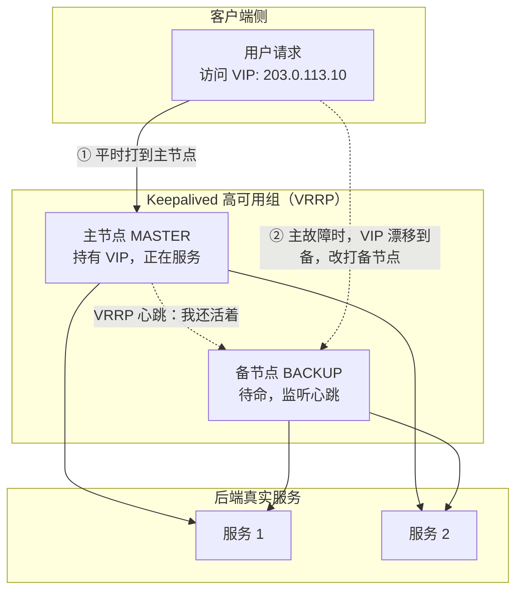
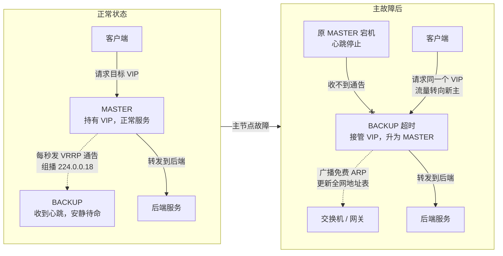
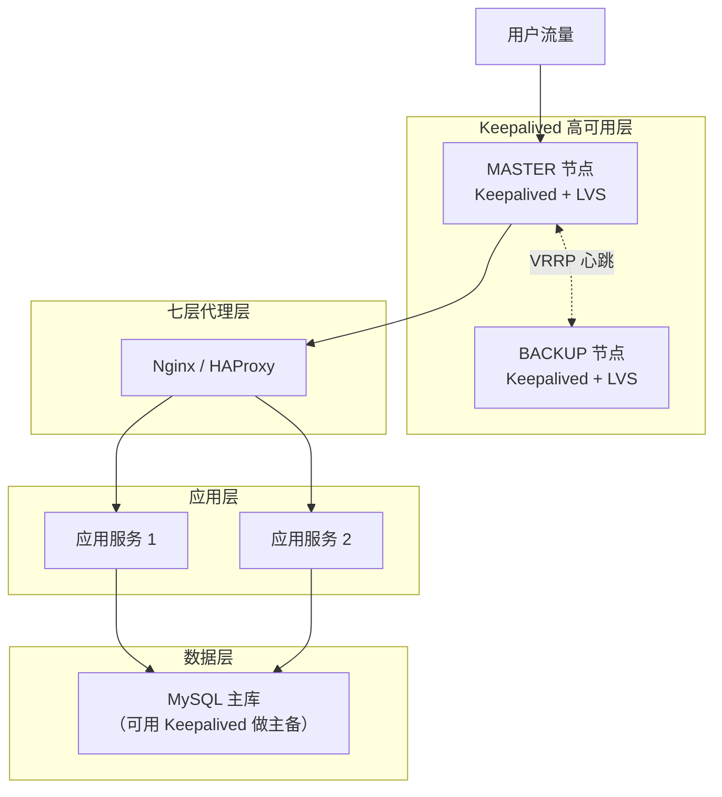
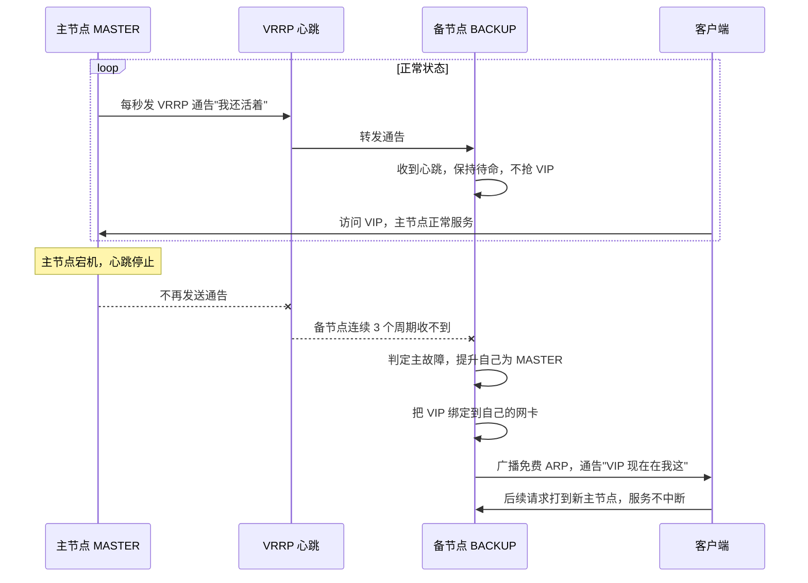
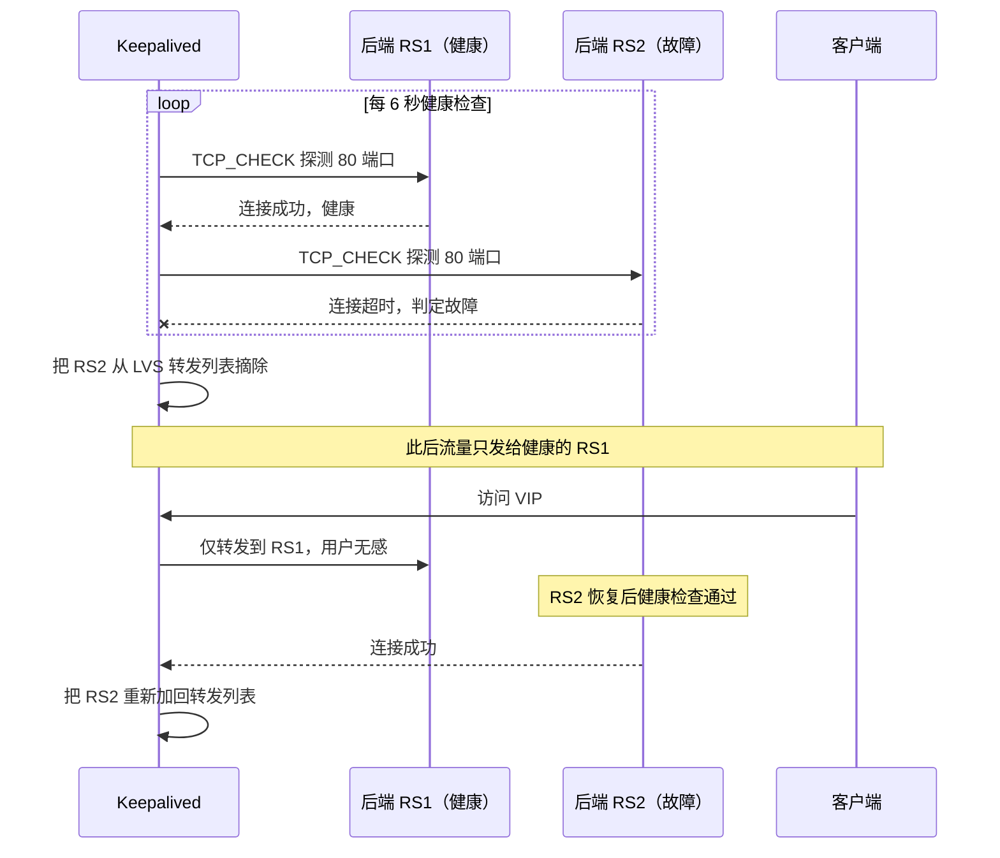

上一篇讲 LVS 时留了个伏笔：LVS 这位"领班"自己要是累倒了怎么办？整个网站入口不就瘫了吗？

现实里，任何一个单点——一台调度器、一个网关、一台数据库——挂了都可能导致整站不可用。这叫**单点故障（SPOF，Single Point Of Failure）**。

**Keepalived** 就是专门治这个病的。它像给关键岗位配了个"影子"：主的那位一旦倒下，影子立刻顶上，用户几乎感觉不到。这篇面向零基础，讲清它解决什么问题、和谁配合、以及切换到底怎么发生。

## 〇、先看整体：Keepalived 在系统中的位置

一句话理解：**Keepalived 让两台（或多台）机器共享同一个 VIP（虚拟 IP），正常情况下只有"主"机器对外服务，主挂了"备"机器自动接管这个 VIP。**

先记住几个角色和术语：

| 角色 / 术语 | 英文 | 作用 | 生活化比喻 |
| --- | --- | --- | --- |
| 主节点 | MASTER | 平时持有 VIP、对外服务的机器 | 正班保安 |
| 备节点 | BACKUP | 时刻待命、盯着主节点的机器 | 替班保安 |
| 虚拟 IP | VIP（Virtual IP） | 对外暴露、会在主备间"漂移"的地址 | 值班岗的电话号码 |
| 心跳 | VRRP 通告 | 主节点定期发的"我还活着"信号 | 正班每 10 秒喊一声"在岗" |
| 漂移 | failover | VIP 从主机器挪到备机器的动作 | 电话转移到替班身上 |



读懂这张图就抓住了 Keepalived 的灵魂：**对用户来说 VIP 始终不变，变的只是背后"谁在接电话"**。

## 一、Keepalived 解决什么问题

它主要解决四类问题：

1. **单点故障——最关键**。任何一台关键机器挂了就整站瘫痪。Keepalived 给它配备胎，主挂备顶，服务不中断。
2. **网关高可用**。内网机器把网关指向一个 VIP，出口路由器用 Keepalived 做主备，网关挂了自动切换，内网用户照常上网。
3. **负载均衡器自身高可用**。给 LVS、Nginx、HAProxy 这类入口配主备，避免"领班自己倒下"。
4. **后端健康检查**。它不只是切主备，还能定期检查后端 RS 是否健康，发现某台挂了就自动从转发列表里摘掉，恢复后再加回来。

> 一句话概括：**Keepalived = 自动故障转移 + 健康检查，让关键服务"永远在线"**。

## 二、Keepalived 是什么，靠什么原理工作

Keepalived 有三个核心模块，理解它们就理解了它的全部能力：

| 模块 | 英文 | 干什么 | 对应能力 |
| --- | --- | --- | --- |
| 心跳与选举 | VRRP | 主备之间发通告、选谁持有 VIP | 故障转移 |
| 健康检查 | Checkers | 定期探测后端服务是否存活 | 自动摘除坏节点 |
| LVS 管理 | ipvs wrapper | 自动生成并维护 LVS 规则 | 免手写 ipvsadm |

### （一）VRRP：主备切换的核心协议

VRRP（Virtual Router Redundancy Protocol，虚拟路由冗余协议）是 Keepalived 的基石。原理分四步：

1. **组队**：多台机器配成同一个 VRRP 组，共享一个虚拟 IP（VIP）和一个组 ID。
2. **选主**：每个节点有个优先级 `priority`（0~255，越大越优先）。优先级最高的成为 MASTER，持有 VIP。
3. **发心跳**：MASTER 定期（默认每秒）向组播地址发 VRRP 通告，大喊"我还活着"。
4. **接管**：备节点一段时间收不到心跳，就认为主挂了，按优先级重新选主，新的 MASTER 把 VIP 抢到自己身上，并广播一条免费 ARP（gratuitous ARP，主动通告"这个 IP 现在在我这台机器上"），让网络里的交换机更新地址表。

> 术语解释：**优先级 priority** 决定谁当主；**组播地址**是主节点喊话用的公共频道（IPv4 下是 `224.0.0.18`）；**免费 ARP** 是切换后"昭告天下"新主人是谁的手段，没有它，别人还按旧地址表把流量发给死掉的主节点。

### （二）健康检查：坏节点自动下线

Keepalived 支持多种检查方式：

- **TCP_CHECK**：试着连一下某端口，连不上就算挂了。
- **HTTP_GET / HTTPS_GET**：请求一个网页，看返回码对不对。
- **脚本检查（track_script）**：执行你写的脚本，根据返回值判断健康状态——最灵活。

一旦发现后端节点不健康，Keepalived 就把它从 LVS 转发列表里摘掉；恢复后再自动加回来。

## 三、VRRP 数据流图：心跳与 VIP 漂移

用一张图看清正常情况下的数据流，和主故障后的漂移过程：



关键点：VIP 始终是同一个地址（`203.0.113.10`），客户端配置完全不用改。变的是**这个地址"飘"到了哪台机器上**——这就是"VIP 漂移"。

## 四、和哪些软件配合使用

Keepalived 几乎没有"单打独斗"的场景，它总是给别的服务当保镖：

| 搭档软件 | 组合效果 | 典型场景 |
| --- | --- | --- |
| **LVS / ipvs** | Keepalived 管高可用 + 自动生成 LVS 规则，最经典的黄金搭档 | 四层负载均衡入口 |
| **Nginx / HAProxy** | 给七层代理做主备，避免入口单点 | Web 反向代理高可用 |
| **MySQL / Redis** | 数据库主备切换时 VIP 跟着漂移到新主库 | 数据库高可用 |
| **自定义脚本** | track_script 调用脚本做复杂健康检查、发告警 | 业务级健康探测 |



**最经典的组合就是 Keepalived + LVS**：Keepalived 一边用 VRRP 保证调度器不单点，一边帮你自动生成 LVS 转发规则、检查后端 RS——上一节手写的那些 `ipvsadm` 命令，Keepalived 全包了。

## 五、典型使用场景

| 场景 | 架构 | 价值 |
| --- | --- | --- |
| 负载均衡器高可用 | Keepalived + LVS/Nginx 主备 | 入口不宕机 |
| 数据库高可用 | Keepalived + MySQL 双主/主备 | 主库挂了 VIP 漂到备库 |
| 出口网关高可用 | 两台网关 + Keepalived | 内网用户不断网 |
| Web 服务高可用 | 两台 Nginx + Keepalived | 前端入口冗余 |

**主备模式（Active/Backup）**最常见：一主一备，平时只有主干活。**双主模式（Active/Active）**则用两个 VRRP 实例、两个 VIP，两台机器互为主备，平时都干活，资源利用率更高，但配置更复杂。

## 六、动手实践：配一组 Keepalived + LVS 主备

下面给一个**完整、自包含、逐行注释**的最小可用配置。拓扑假设：

- 主节点：`192.168.1.10`，备节点：`192.168.1.20`
- 对外 VIP：`192.168.1.100`，端口 80
- 后端 RS：`192.168.1.11`、`192.168.1.12`（DR 模式，配置见上一篇 LVS 文章）

### （一）安装

```bash
# 在主备两台节点上都安装 Keepalived 和 ipvsadm
sudo apt install -y keepalived ipvsadm   # Debian/Ubuntu
# sudo yum install -y keepalived ipvsadm # CentOS/RHEL 用这一行
```

### （二）主节点配置（/etc/keepalived/keepalived.conf）

```conf
! 主节点 Keepalived 配置文件 —— DR 模式 + LVS 高可用
global_defs {                          # 全局定义块
    router_id LVS_MASTER               # 本机路由标识，主备要不同，用于区分日志
}

vrrp_instance VI_1 {                   # 定义一个 VRRP 实例，名字 VI_1 随意
    state MASTER                       # 角色：主节点（备机这里写 BACKUP）
    interface eth0                     # 绑定 VIP 的网卡名，按实际改
    virtual_router_id 51               # 虚拟路由 ID，同一组主备必须一致（0~255）
    priority 100                       # 优先级，主 > 备（备机建议 90）
    advert_int 1                       # VRRP 通告间隔，1 秒发一次心跳
    authentication {                   # 主备间的认证配置，防止误加入别的组
        auth_type PASS                 # 认证方式：简单密码
        auth_pass 1111                 # 密码，主备必须一致（生产环境要改复杂）
    }
    virtual_ipaddress {                # 虚拟 IP 列表
        192.168.1.100                  # 对外 VIP，主备写同一个
    }
}

virtual_server 192.168.1.100 80 {      # 定义一个 LVS 虚拟服务 = VIP:80
    delay_loop 6                       # 健康检查间隔，6 秒查一次后端
    lb_algo rr                         # 调度算法：轮询
    lb_kind DR                         # 工作模式：DR（直接路由）
    protocol TCP                       # 转发协议：TCP

    real_server 192.168.1.11 80 {      # 后端真实服务器 RS1
        weight 1                       # 权重，1 表示和其它 RS 均分流量
        TCP_CHECK {                    # TCP 健康检查：连端口判断存活
            connect_port 80            # 检查的目标端口
            connect_timeout 3          # 连接超时 3 秒就算失败
        }
    }
    real_server 192.168.1.12 80 {      # 后端真实服务器 RS2
        weight 1
        TCP_CHECK {
            connect_port 80
            connect_timeout 3
        }
    }
}
```

### （三）备节点配置（差异部分）

```conf
! 备节点配置与主节点几乎一样，只改三处（其余原样复制）
! 1. router_id 改成不同名字：
    router_id LVS_BACKUP
! 2. state 改成 BACKUP：
    state BACKUP
! 3. priority 改小（低于主节点）：
    priority 90
! virtual_router_id、virtual_ipaddress、密码、virtual_server 段全部保持一致
```

### （四）启动与验证

```bash
# 1. 两台节点都启动 Keepalived（会自动加载配置并生成 LVS 规则）
sudo systemctl enable --now keepalived

# 2. 在主节点查看 VIP 是否在 eth0 上
ip addr show eth0 | grep 192.168.1.100   # 主节点应能看到 VIP

# 3. 查看 Keepalived 是否为 active 状态
sudo systemctl status keepalived

# 4. 查看自动生成的 LVS 规则（不用手写 ipvsadm 了）
sudo ipvsadm -Ln

# 5. 故障切换测试：在主节点停掉 Keepalived
sudo systemctl stop keepalived
# 再到备节点执行 ip addr show eth0，应看到 VIP 已漂移到备节点
```

> **排错提示**：主备切换失败最常见的原因有三个——① `virtual_router_id` 主备不一致，两边各玩各的；② 防火墙拦了 VRRP 组播流量（协议号 112、组播地址 `224.0.0.18`），备节点收不到心跳，导致"脑裂"；③ 网卡名写错，VIP 绑到了不存在的网卡上。所谓**脑裂（split-brain）**，就是主备都以为对方挂了、同时持有 VIP，会造成 IP 冲突。

## 七、时序图：切换到底怎么发生

把切换过程用时序图串起来，先看主备故障转移的完整时序：



再看健康检查：某台后端 RS 挂了，Keepalived 如何自动摘除它：



这两张图揭示了 Keepalived 的两个核心动作：**主备切换保入口不倒，健康检查保后端不拖累**。

## 八、Keepalived 与常见高可用方案对比

| 方案 | 层次 | 特点 | 适用 |
| --- | --- | --- | --- |
| Keepalived | 网络层（VRRP）+ 四层 | 轻量、切换快、能和 LVS 深度集成 | 网关、LVS、数据库入口高可用 |
| Heartbeat / Pacemaker | 应用层 | 功能强、能管理复杂集群资源 | 大型集群、多资源编排 |
| Nginx / HAProxy 自身 | 应用层 | 靠上游健康检查，无 VIP 漂移 | 七层分流，通常配合 Keepalived 用 |
| 云厂商 SLB | 托管服务 | 免运维、弹性，按量付费 | 上云场景，省去自建 |

> **一句话决策**：中小规模、需要 VIP 漂移和 LVS 集成，Keepalived 是最省心的选择；复杂资源编排才上 Pacemaker；上云直接用云负载均衡。

## 九、总结

回到开头的保安比喻，把这篇收拢成四句话：

1. **Keepalived 是什么**：基于 VRRP 的高可用软件，让主备机器共享一个 VIP，主挂备顶。
2. **解决什么**：单点故障、网关/入口/数据库高可用、后端健康检查。
3. **和谁配合**：和 LVS 是黄金搭档（管高可用 + 自动生成规则），也常配 Nginx、MySQL、自定义脚本。
4. **怎么工作**：VRRP 心跳检测 + 优先级选主 + VIP 漂移 + 免费 ARP 通告；健康检查自动摘除坏节点。

上一篇你学会了用 LVS 把流量分给一群服务器，这一篇补上了关键的一环——**让那台分流量的调度器自己也不再是单点**。LVS + Keepalived 组合起来，才是一套真正"不宕机"的高可用负载均衡方案。不妨在两台虚拟机里照着第六节的配置搭一组主备，亲手停掉主节点，看看 VIP 是怎么"飘"过去的。
