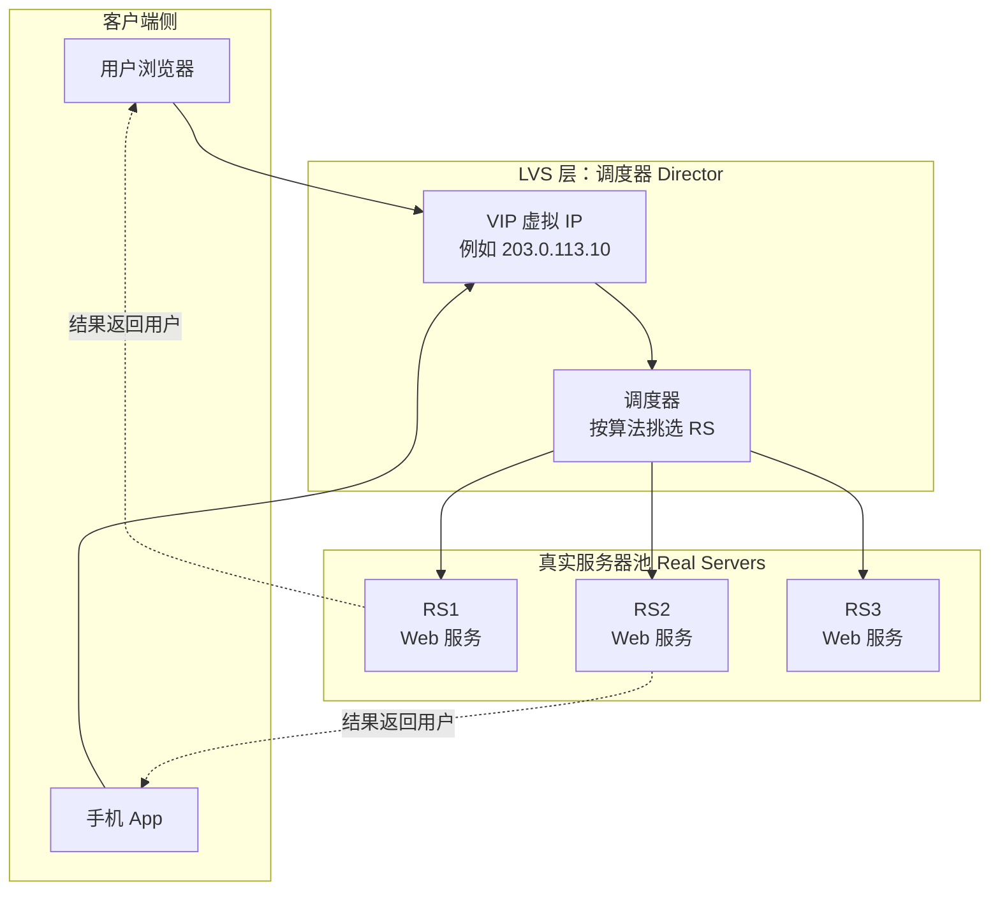
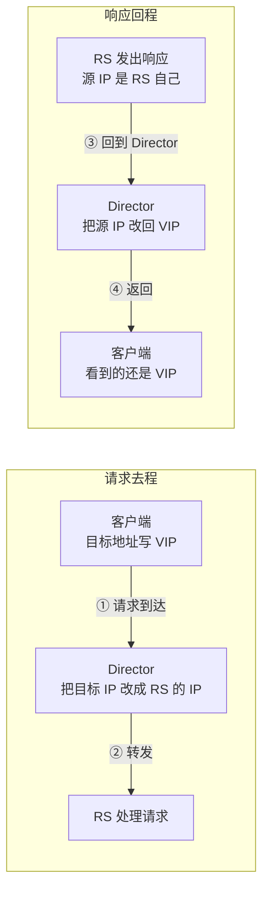
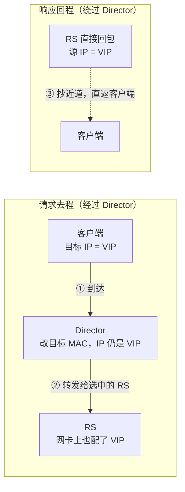
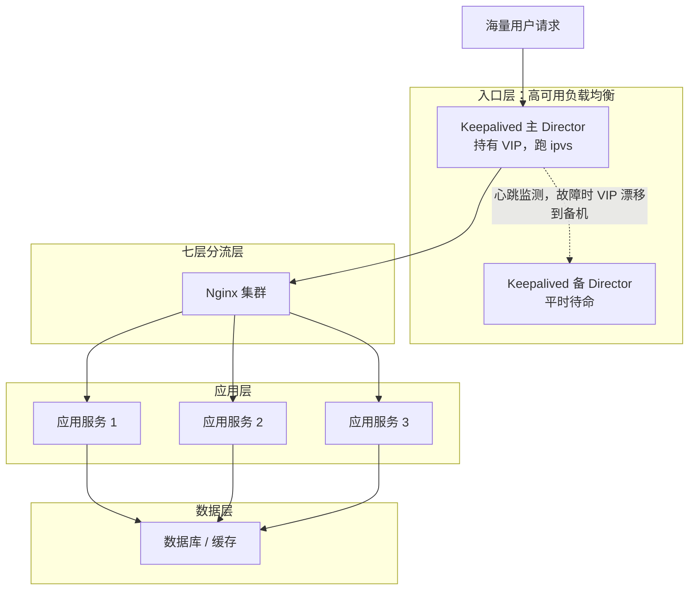
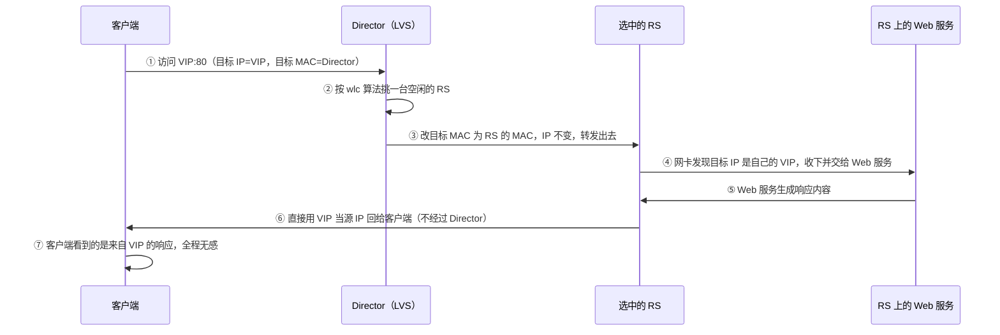
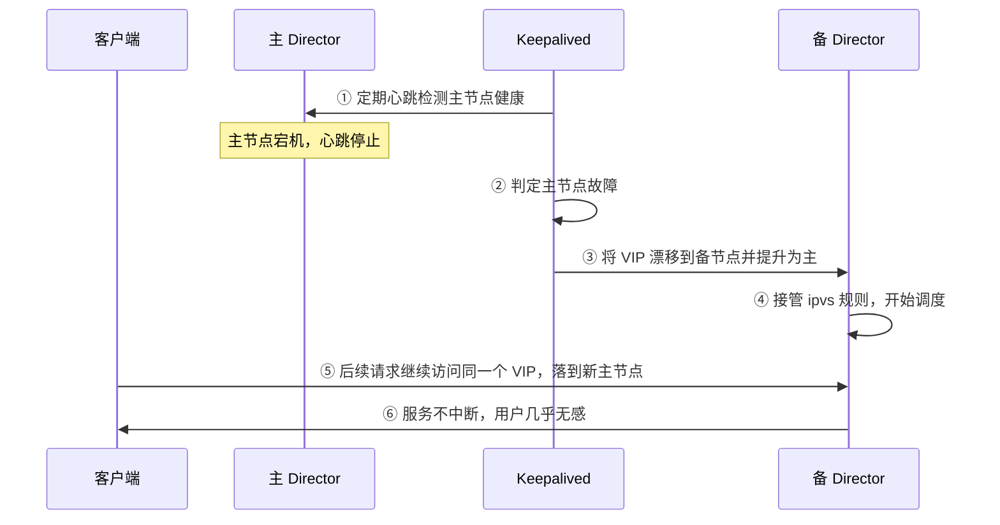

想象一家火到爆的餐厅：门口只挂一个招牌、一个订位电话，但后厨有二十个灶台同时炒菜。客人不用知道是哪个厨师做的，只管打电话报需求；门口的"领班"根据谁空闲把单子派下去。

**LVS（Linux Virtual Server，Linux 虚拟服务器）**就是网站门口这位领班。它对外只暴露一个地址，背后却能把海量请求分发给一群真实服务器，让它们看起来像一台"超级服务器"。

这篇文章面向零基础，先建立整体印象，再逐个回答三个核心问题：**它解决什么问题、一般和谁配合、请求到底怎么流**。

## 〇、先看整体：LVS 在系统中的位置

先记住三个角色，后面所有内容都围绕它们：

| 角色 | 英文 | 作用 | 生活化比喻 |
| --- | --- | --- | --- |
| 虚拟 IP | VIP（Virtual IP） | 对外暴露的那一个"招牌地址" | 餐厅的订位电话 |
| 调度器 | Director / LB | 接收请求并决定分给谁 | 门口的领班 |
| 真实服务器 | RS（Real Server） | 真正处理请求的服务器 | 后厨的厨师们 |



一句话读懂这张图：用户只认 VIP，**调度器把请求转给某一台 RS，RS 把结果交回用户**。用户从头到尾不知道背后有几台机器，这就是"虚拟"的含义。

## 一、LVS 到底解决什么问题

单台服务器能力有上限，业务一大就会遇到四道坎。LVS 就是来拆这四道坎的：

1. **高并发——一台扛不住**。双十一、抢票、热点新闻，流量瞬间翻几十倍。LVS 把请求摊到多台 RS，等于把一根扁担分给一群人挑。
2. **高可用——不能宕机**。任何一台 RS 挂了，调度器把它摘掉，流量转给剩下的机器，用户几乎无感。配合 Keepalived 还能让调度器自己也有备胎。
3. **可扩展——加机器就行**。流量涨了？往池子里再加一台 RS、注册进去即可，不用改用户访问的入口地址。
4. **隐藏后端——安全防护**。外界只看到 VIP，真实服务器的 IP 藏在后面，减少被直接攻击的面。

> 用一句话概括：**LVS 用"一群便宜机器"拼出"一台高性能、不宕机、能扩容的服务器"**。

## 二、LVS 是什么，工作在网络的哪一层

LVS 有三个鲜明的身份：

- **它是四层负载均衡**。所谓"层"，指的是 OSI 网络模型（一套把网络通信分成 7 层的标准模型）。四层是**传输层**，只看 IP 地址和端口号（TCP/UDP），不关心网页内容；七层是**应用层**，能看懂 HTTP 网址、Cookie 这些具体内容。LVS 只看"IP+端口"，所以它**快**——不用拆开数据包细看。
- **它在内核里跑**。LVS 的核心模块 `ipvs` 直接编进 Linux 内核，数据包在内核态就被转发了，不需要在应用程序里绕一圈，性能极高（单机百万级并发不在话下）。
- **它是中国人发起的开源项目**。由章文嵩博士在 1998 年创建，如今已是 Linux 内核的一部分。

和常见的七层代理对比一下，你就知道它适合站在哪个位置：

| 对比项 | LVS（四层） | Nginx / HAProxy（七层） |
| --- | --- | --- |
| 工作层次 | 传输层，看 IP + 端口 | 应用层，能看 URL、Header、Cookie |
| 性能 | 极高（内核态转发） | 较高（用户态处理） |
| 功能 | 纯粹转发，功能少 | 能做路径路由、重写、缓存、压缩 |
| 典型站位 | 最外层入口，扛总流量 | LVS 后面，做精细分流 |

**常见组合是：LVS 在最前面扛住洪峰，Nginx 在后面按网址做精细分发。** 各干各擅长的。

## 三、四种工作模式与数据流图

这是理解 LVS 最关键的一节。LVS 有 NAT、DR、TUN、FullNAT 四种模式，核心区别在于：**请求包和响应包分别怎么走**。先看最经典的两种。

### （一）NAT 模式：进出都经过领班

NAT（Network Address Translation，网络地址转换）模式下，调度器会改写数据包里的目标 IP，把它从 VIP 改成某台 RS 的真实 IP。**响应回来时还要再经过调度器**，把源 IP 改回 VIP。



**原理**：因为要改写 IP，请求的进和出都必须经过 Director，所以 Director 容易成为瓶颈（网卡带宽是上限）。优点是配置简单，RS 和 Director 可以不在同一个网段。

### （二）DR 模式：请求过领班，响应抄近道

DR（Direct Routing，直接路由）模式更聪明：调度器**只改写数据包的目标 MAC 地址**（网卡物理地址），不改 IP。RS 处理完后，**响应直接发给客户端，不再绕回调度器**。



**原理**：RS 的网卡上也配置了同一个 VIP（隐藏的），所以它敢直接用 VIP 当源地址回包。这样 Director 只处理进来的请求，不处理出去的响应，**吞吐量大幅提升**——这是生产环境最常用的模式。代价是 Director 和 RS 必须在同一个物理网络（局域网）里。

### （三）四种模式对比表

| 模式 | 响应是否经 Director | 性能 | RS 与 Director 同网段 | 适用场景 |
| --- | --- | --- | --- | --- |
| NAT | 是（进出都过） | 中等 | 不需要 | 小规模、配置简单、跨网段 |
| DR | 否（响应直返） | 最高 | 需要 | 生产环境主流、大流量 |
| TUN（IP 隧道） | 否（响应直返） | 高 | 不需要 | RS 分散在不同地域/机房 |
| FullNAT | 是 | 中等 | 不需要 | 改进版 NAT，双向都改地址，兼容性好 |

> 小白记住一句：**追求性能选 DR，图省事/跨网段选 NAT 或 TUN**。

## 四、调度算法：领班按什么规矩派单

请求来了，到底分给谁？这就是调度算法干的活。LVS 内置十种算法，最常用的有四种：

| 算法 | 名称 | 派单规则 | 比喻 |
| --- | --- | --- | --- |
| rr | 轮询 | 挨个来，一人一个轮流分 | 发扑克牌，人人有份 |
| wrr | 加权轮询 | 性能强的多分几个 | 能干的厨师多派几桌 |
| lc | 最少连接 | 谁当前手上活少就给谁 | 谁闲着就找谁 |
| wlc | 加权最少连接 | 结合了权重和当前连接数（默认） | 又看能力又看忙闲 |

**原理**：`rr` 最简单但不管服务器忙闲；`wlc` 是默认算法，既考虑服务器性能（权重），又看它当前扛了多少连接，分配更均衡。

## 五、和哪些软件配合使用

LVS 很少单打独斗，它通常出现在一套组合拳里：

| 搭档软件 | 角色 | 和 LVS 的关系 |
| --- | --- | --- |
| **ipvsadm** | 命令行管理工具 | 用它来配置 LVS 的 VIP、RS 和算法（下一节实操） |
| **Keepalived** | 高可用 + 健康检查 | 自动帮 LVS 做主备切换、故障 RS 摘除，还能自动生成规则 |
| **Nginx / HAProxy** | 七层反向代理 | 常放在 LVS 后面，做基于网址的精细分流 |
| **后端服务** | Web / API / 数据库 | RS 上真正跑的业务，如 Nginx、Tomcat、MySQL 读库 |



**Keepalived 是 LVS 的黄金搭档**：LVS 自己不会检查 RS 死活，也不会在自己宕机时把 VIP 让给备机。这两件事全靠 Keepalived——它通过心跳检测主备状态，主挂了就把 VIP 飘到备机；同时定期探测 RS，挂了就自动摘除。

## 六、动手实践：用 ipvsadm 配一个 DR 模式集群

下面给一个**完整、自包含、可直接运行**的 DR 模式最小配置。拓扑假设：

- 调度器 Director：`192.168.1.10`
- 真实服务器 RS1：`192.168.1.11`，RS2：`192.168.1.12`
- 对外 VIP：`192.168.1.100`，端口 80
- 三者都在同一个局域网

### （一）安装工具

```bash
# 在 Director 上安装 ipvsadm（LVS 的命令行管理工具）
sudo apt install -y ipvsadm     # Debian/Ubuntu 系统
# sudo yum install -y ipvsadm   # CentOS/RHEL 系统用这一行
```

### （二）在 Director 上配置（保存为 director.sh）

```bash
#!/bin/bash
# DR 模式调度器配置脚本 —— 以下变量按你的实际环境修改
VIP=192.168.1.100        # 对外虚拟 IP
RIP1=192.168.1.11        # 第一台真实服务器 IP
RIP2=192.168.1.12        # 第二台真实服务器 IP
PORT=80                  # 服务端口

# 第 1 步：清空已有 ipvs 规则，保证脚本可重复执行、不叠加旧配置
sudo ipvsadm -C

# 第 2 步：添加一个 TCP 虚拟服务，绑定 VIP:PORT，调度算法用加权最少连接 wlc
sudo ipvsadm -A -t $VIP:$PORT -s wlc

# 第 3 步：把两台 RS 加入服务，-g 表示使用 DR 模式（g = gatewaying）
sudo ipvsadm -a -t $VIP:$PORT -r $RIP1:$PORT -g
sudo ipvsadm -a -t $VIP:$PORT -r $RIP2:$PORT -g

# 第 4 步：把 VIP 绑定到网卡 eth0 上，掩码 32 位（只代表自己这一个地址）
sudo ip addr add $VIP/32 dev eth0

# 第 5 步：打印当前规则，确认配置生效
sudo ipvsadm -Ln
```

### （三）在每台 RS 上配置（保存为 realserver.sh）

```bash
#!/bin/bash
# DR 模式真实服务器配置脚本 —— 两台 RS 都要执行，VIP 必须和 Director 一致
VIP=192.168.1.100        # 与 Director 相同的虚拟 IP

# 第 1 步：把 VIP 绑定到回环网卡 lo，让 RS 能以 VIP 作源地址回包（DR 的关键）
sudo ip addr add $VIP/32 dev lo

# 第 2 步：关闭 lo 网卡的 ARP 响应，避免 RS 对外 "抢答" VIP 的 ARP 请求
# arp_ignore=1：只响应目标 IP 就是本机该网卡地址的 ARP
sudo sysctl -w net.ipv4.conf.lo.arp_ignore=1
# arp_announce=2：只使用与目标网络匹配的最佳本地地址对外通告
sudo sysctl -w net.ipv4.conf.lo.arp_announce=2
# all 网卡同样设置，双保险，防止 VIP 泄露
sudo sysctl -w net.ipv4.conf.all.arp_ignore=1
sudo sysctl -w net.ipv4.conf.all.arp_announce=2
```

### （四）运行与验证

```bash
# 1. 给脚本加执行权限（两个脚本都要）
chmod +x director.sh realserver.sh
# 2. Director 上执行调度器脚本，两台 RS 上分别执行真实服务器脚本
sudo ./director.sh      # 在 Director 执行
sudo ./realserver.sh    # 在 RS1、RS2 各执行一次
# 3. 在任意客户端反复访问 VIP，观察响应在两台 RS 间切换（前提是 RS 已跑 Web 服务）
curl http://192.168.1.100
# 4. 用 ipvsadm 查看连接数分布，确认流量确实被分摊
sudo ipvsadm -Ln --stats
```

> **排错提示**：DR 模式最常见的坑就是忘了在 RS 上关闭 ARP 响应——一旦 RS 对外抢答了 VIP 的 ARP，客户端会直接连到某台 RS，绕过调度器，负载均衡就失效了。第二个坑是 VIP 忘绑到 RS 的 `lo` 网卡，导致 RS 不敢用 VIP 回包。

## 七、请求时序：一次访问到底怎么走

把前面所有角色串起来，看一次请求在 DR 模式下的完整时序：



再看高可用场景：当主 Director 宕机时，Keepalived 如何让 VIP 漂移到备机——这就是"不宕机"的真相：



## 八、LVS、Nginx、HAProxy 怎么选

| 场景 | 推荐 | 原因 |
| --- | --- | --- |
| 超大流量入口、只需四层转发 | LVS（DR 模式） | 内核态转发，性能天花板最高 |
| 需要按网址分流、URL 重写、HTTPS 终止 | Nginx / HAProxy | 七层能力丰富，能看懂应用层内容 |
| 既要性能又要七层功能 | LVS + Nginx 组合 | LVS 扛量在前，Nginx 精细分流在后 |
| 小规模、配置越简单越好 | Nginx 单用即可 | 引入 LVS 反而增加复杂度 |

> **一句话决策**：流量大到 Nginx 单机扛不住，才在前面加 LVS；否则别为了"高级"而过度设计。

## 九、总结

回到开头的餐厅比喻，把这篇的要点收拢成一句话：

1. **LVS 是什么**：Linux 内核里的四层负载均衡器，对外用一个 VIP 隐藏背后的一群真实服务器。
2. **解决什么**：高并发分摊、高可用容灾、方便扩容、隐藏后端。
3. **和谁配合**：`ipvsadm` 配置规则，Keepalived 做高可用和健康检查，Nginx/HAProxy 在后面做七层分流。
4. **怎么流**：NAT 模式进出都过调度器（简单）；DR 模式响应直返客户端（高性能，生产主流）。
5. **怎么选**：大流量入口用 LVS，精细分流用 Nginx，两者常组合使用。

现在你已经能看懂 LVS 在架构图里的位置、请求为什么"抄近道"、以及故障切换为什么用户无感了。下一步，不妨在你自己的虚拟机里照着第六节的脚本搭一个最小集群，亲手 `curl` 一下，比读十遍原理都记得牢。
