你打开这篇文章时，数据包大概跨过了十几个网络、好几个国家、几十台路由器。**没有一台机器知道"从你家到这台服务器"的完整路径**——每一跳的路由器只知道自己下一站该交给谁，就像驿站的马夫只知道"往北三十里有个驿站"。

让这些互不认识的网络能拼成一张连通的网、并且在大规模故障时还能自己绕路的，就是 **BGP（Border Gateway Protocol，边界网关协议）**。

它是**互联网唯一在用的域间路由协议**。换句话说：**BGP 挂了，互联网就分成一个个孤岛**。2021 年某社交平台一次配置失误撤回了自己的 BGP 通告，全球用户数小时内完全找不到它——服务器没坏，DNS 没坏，只是"没人知道路怎么走了"。

这篇文章按技术文档的方式讲透它：**解决什么问题 → 架构长什么样 → 会话怎么建立 → 路由怎么流动 → 怎么配 → 配什么软件 → 什么场景用 → 怎么防坑**。术语第一次出现都给英文全称和中文解释。

> 本文核对日期：2026 年 11 月 21 日。BGP 现行标准是 **BGP-4（RFC 4271，2006 年）**，BGP 本身诞生于 1989 年。全球 IPv4 路由表约 **108 万条前缀**、约 **7.9 万个 AS**（CIDR Report，2026-10-05 快照；不同采集点数字有差异，Hurricane Electric 同期报告约 130 万条 / 8.8 万个 AS）。RPKI 的 ROA 覆盖率约 **65%～70%**，而更新的路径校验机制 ASPA 只有约 **2.5%～3%** 的 AS 部署。文中配置以 **FRR 10.7**（2026 年 7 月发布）语法为准。

## 〇、一句话、一张全景图

**一句话**：BGP 是各个网络之间"互相告诉对方我这里能到达哪些地址段"的协议——它不负责转发数据，只负责**画出地图**。

用邮政系统打比方，这套体系能被完整映射：

| 现实世界 | BGP 世界 |
| --- | --- |
| 一家独立的邮政公司（有自己的分拣中心） | **AS**（自治系统），一个由单一机构管理、路由策略一致的大网 |
| 邮政公司的编号 | **ASN**（自治系统号），如 AS4134、AS15169 |
| 邮编段（如 100080） | **前缀**（prefix），如 `203.0.113.0/24` |
| 各邮政局之间打电话通告"寄往 100080 的件请送我这里" | **BGP 通告**（announcement） |
| 邮件途经的邮政公司清单 | **AS_PATH**，同时也用来防绕圈 |
| 商务合同（哪些件免费送、哪些不接） | **路由策略**（routing policy） |
| 邮政公司内部的分拣路线图 | **IGP**（OSPF / IS-IS），管 AS 内部怎么走 |

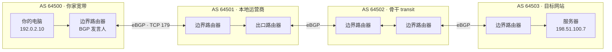

**先记住这条主线**：每个 AS 由一台（或几台）**边界路由器**代表，它们之间用 **TCP 179 端口**建立 **BGP 会话**；会话里交换的是"我能到达 `X/Y` 这个地址段，途经的 AS 是这些"这样的**路由通告**；路由器把收到的一堆通告比较一遍，挑出最好的写进**路由表**，再翻译成内核的**转发表**；真正转发数据包时，只看转发表，**不再管 BGP**。

几个词先用白话过一遍：

| 词 | 白话解释 |
| --- | --- |
| AS | 自治系统。一个"说话算话的独立网络"，比如一家运营商、一家云厂商、一家大公司 |
| 前缀（prefix） | 一段连续的 IP 地址，写作 `A.B.C.D/掩码长度`，掩码越长范围越小、越"具体" |
| eBGP / iBGP | 跨 AS 的会话 / 同一 AS 内部的会话，规则差别很大 |
| 路径向量（path vector） | BGP 的选路方式：不看"距离多远"，而是看"沿途经过哪些 AS" |
| RIB | 路由信息库，路由器的"候选路线总表" |
| FIB | 转发表，从 RIB 里挑出的最终结果，硬件按它转发 |
| 收敛（convergence） | 网络变化后，所有路由器重新达成一致所需的过程 |
| 路由策略 | 用规则决定"这条路由收不收、发不发、优先不优先" |

**本文路线**

| 章节 | 回答的问题 |
| --- | --- |
| 〇 | 一句话、全景图、术语速览 |
| 一 | 没有 BGP，互联网会怎样？ |
| 二 | BGP 是什么？和 OSPF 有什么本质区别？ |
| 三 | 架构：AS 之间怎么连、路由器内部怎么存、iBGP 为什么需要 RR |
| 四 | 时序：会话建立的六个状态、一条路由的完整旅程 |
| 五 | 报文与路径属性：UPDATE 里到底装了什么 |
| 六 | 选路：11 步决策，为什么"策略"排在"最短"前面 |
| 七 | 数据流：一个数据包如何跨 4 个 AS 到达终点 |
| 八 | 需要配合什么软件：FRR / BIRD / GoBGP / 内核 / RPKI |
| 九 | 实战：两台路由器跑通 eBGP（完整配置 + 验证命令） |
| 十 | 使用场景：多线接入、Anycast、EVPN、K8s、DDoS 清洗 |
| 十一 | 安全与常见坑：劫持、泄漏、RPKI、ASPA、max-prefix |
| 附录 | 术语中英对照表 |

## 一、没有 BGP，互联网会怎样？

想象三个独立的网络要互通：A 公司、B 运营商、C 云厂商。**如果只有 BGP 缺席**，你有三种笨办法：

**① 手工写静态路由。**
A 的运维要知道 B 的每个网段，B 要知道 C 的每个网段，C 要知道 A 的。**N 个网络就是 N² 份配置**。全球 7.9 万个 AS，就是 62 亿份——不现实。

**② 全都直连。**
不经过任何中转，那"互联网"就退化成一张全连接的专线图。同样不现实。

**③ 用 AS 内部那套协议（OSPF/IS-IS）打通全球。**
这更糟，有三个致命问题：

- **规模**：OSPF 要求每个路由器都知道全网的拓扑，7.9 万个 AS、几百万条链路，任何一台设备的 CPU 和内存都撑不住。
- **信任**：OSPF 是"我相信你告诉我的链路开销"，让全球所有运营商互相信任对方的内部拓扑，等于把家底公开。
- **策略**：OSPF 只会算最短路径。但商业世界不是这样——**A 和 B 是竞争对手，A 宁愿绕道 C 也不直接把流量交给 B**。这种"跟距离无关、跟合同有关"的需求，IGP 根本无法表达。

BGP 就是为了这三件事生的：

| 需求 | BGP 的答案 |
| --- | --- |
| 规模 | 只通告**可达性摘要**（前缀 + 路径），不传拓扑；增量更新，不周期性泛洪 |
| 信任 | 每个 AS 自己做决定，只把**自己愿意公开的部分**告诉邻居 |
| 策略 | 路由自带一堆可编程属性，**先按策略筛，再按长度比** |

**这就是 BGP 最反直觉的地方**：它不追求最短路径，它追求**符合商业合同的最优路径**。所以会出现"数据包从北京到广州，绕了一圈日本"这种事——从拓扑上看很蠢，从商业上看很合理。

## 二、BGP 是什么？

**BGP = Border Gateway Protocol，边界网关协议。** 它是**域间路由协议**（inter-domain routing protocol），也就是 **EGP**（Exterior Gateway Protocol，外部网关协议）这一类里唯一还在用的成员。

它有三个身份标签，理解了这三个词就理解了一半：

**① 它是"路径向量"协议（path vector）。**
不像 RIP 只记"距离几跳"，也不像 OSPF 记整张拓扑图，BGP 记的是**沿途经过了哪些 AS**——这个列表叫 **AS_PATH**（AS 路径）。

这个设计解决了**环路**问题，手法极其简单：**路由器收到一条通告，先看 AS_PATH 里有没有自己的 AS 号；有，直接丢弃**。就像快递单上如果出现了自己这站的名字，说明这单在绕圈，立刻退回。

**② 它是"策略路由"协议（policy-based routing）。**
BGP 选路不是比长短，而是按**优先级从高到低的规则**逐条比较（第六节详述）。管理员可以用 **route-map**、**prefix-list** 决定"这条路由我不收 / 收了但优先级调低 / 只发给某个邻居"。**策略是第一位的，AS_PATH 长度只是其中一条**。

**③ 它跑在 TCP 之上，端口 179。**
所以它**不需要自己实现重传、排序、流控**——TCP 都干好了。BGP 只需要管"会话活着没""通告有没有变"。这也是 BGP 能长成今天这样的原因：**它把可靠性外包给了 TCP**。

### 和 IGP 的对比（这张表值得记住）

| 维度 | BGP（域间） | OSPF / IS-IS（域内，IGP） |
| --- | --- | --- |
| 作用范围 | AS 之间 | 一个 AS 内部 |
| 承载协议 | TCP 179 | 直接跑在 IP 上（协议号 89 / 124） |
| 交换内容 | 前缀 + 路径属性（**不传拓扑**） | 链路状态（**传拓扑**） |
| 选路依据 | 策略优先，AS_PATH 长度次之 | 链路开销（cost）最短 |
| 规模上限 | 百万级前缀、十万级 AS | 通常几千台路由器 |
| 收敛速度 | 秒级到分钟级（慢） | 毫秒到秒级（快） |
| 谁在用 | 运营商、云、IDC、大型企业 | 机房内部、企业内部 |
| 比喻 | 各国邮政之间的路由协定 | 一个城市内的街道地图 |

**一句话总结两者关系**：**IGP 负责"AS 内部怎么走到边界"，BGP 负责"出了边界往哪个 AS 走"**。BGP 的 `NEXT_HOP` 属性指向一个 IP，这个 IP 怎么到达，是 IGP 的事——**BGP 依赖 IGP，IGP 不管 BGP**。

## 三、架构：三个层次

BGP 的架构可以从三个尺度看：**AS 之间怎么连**（宏观）、**一台路由器内部怎么存路由**（微观）、**iBGP 怎么组织**（中观）。三张图分别对应。

### 3.1 宏观：AS 之间的三种商业关系

这是理解 BGP 的**第一关键**。两个 AS 之间有会话，不代表"平等互通"，而是有明确的商业关系：

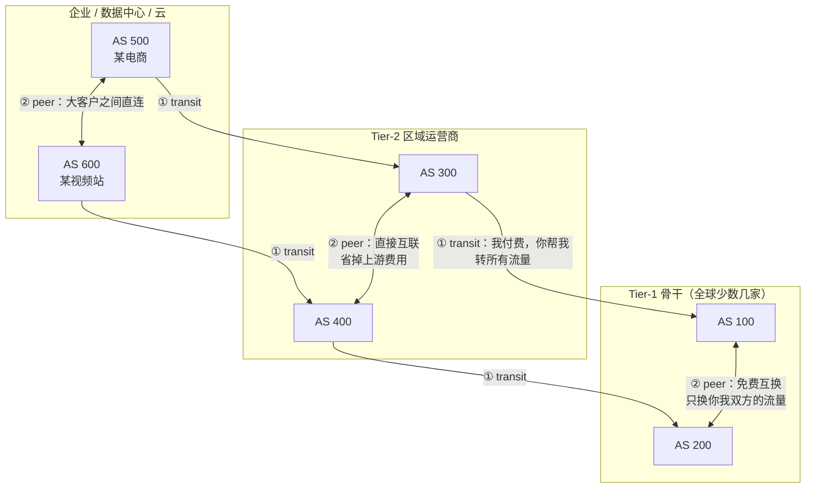

三种关系，对应三种 BGP 行为：

| 关系 | 英文 | 谁付钱 | 允许传什么流量（策略） |
| --- | --- | --- | --- |
| 客户—提供商 | customer → provider（transit，转接） | 客户付给提供商 | 客户的所有流量（含客户自己的客户） |
| 对等 | peer（peering，对等互联） | 互不付费 | **只传双方各自的流量**，不帮对方转别人的 |
| 上游—下游 | 与 transit 是同一根线的两端 | 同上 | 同上 |

**"只传双方的流量"这条规矩，是互联网路由策略的核心。** 它带来一个术语：**valley-free routing（无谷路由）**——正常的流量路径只有三种形状：`上→下`（去客户）、`下→上`（走提供商）、`上→平→下`（经过对等）。**一旦出现"上→下→上"这种 V 形，就说明有人在偷用别人的带宽帮第三方转发**，这叫**路由泄漏**（route leak），是 BGP 世界最常见的事故类型（第十一节详述）。

落到配置上，就是三个动作：

```
! 从客户收到的路由 → 可以发给所有人（上游、对等、其他客户）
! 从上游收到的路由 → 只发给自己的客户，绝不发给对等和上游
! 从对等收到的路由 → 只发给自己的客户，绝不发给其他对等和上游
```

这套规则靠 **LOCAL_PREF**（本地优先级）和 **community**（团体属性）实现——给不同来源的路由打不同标签，出口时按标签过滤。**这就是为什么 BGP 配置里全是 route-map。**

### 3.2 微观：一台路由器内部的路由流水线

这是本文**最重要的一张架构图**。BGP 收到一条路由后，要经过三道"关卡"才可能被用上：

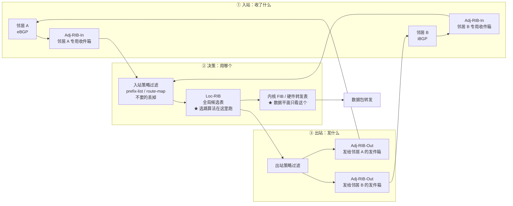

四个 RIB 必须分清（面试高频）：

| 名字 | 全称 | 是什么 | 打个比方 |
| --- | --- | --- | --- |
| **Adj-RIB-In** | Adjacency RIB Inbound | 从某个邻居**收到的原始路由**，未过滤 | 你收到的快递，还没拆检 |
| **Loc-RIB** | Local RIB | 经过入站策略过滤、并跑完选路后**本机决定使用的路由** | 你整理后决定留下的东西 |
| **Adj-RIB-Out** | Adjacency RIB Outbound | 准备**发给某个邻居**的路由（各家不同） | 你要寄出去的不同包裹 |
| **FIB** | Forwarding Information Base | 从 Loc-RIB 挑出最优、**下发给内核/硬件**的转发表 | 贴在墙上的"往哪走"速查表 |

**为什么必须分成四个？**
因为**每个邻居看到的应该不一样**。你从上游收到的路由不该发给另一个上游，但从客户收到的应该发给所有人。**一份 Loc-RIB，N 份 Adj-RIB-Out**——这就是策略的落地点。而 FIB 只留"最终生效的那一条"，因为转发表要快，不能有候选。

**控制平面 / 数据平面的分工**（这两个词必须会）：

- **控制平面（control plane）**：跑 BGP、算路由、填 RIB。慢，但聪明。
- **数据平面（data plane）**：查 FIB、转发包。快，但傻——它只会"最长前缀匹配"，不知道 BGP 存在。

**BGP 收敛慢，数据转发却很快**，原因就在这里：BGP 在控制平面折腾，数据平面完全不受影响，直到新路由下发。

### 3.3 中观：iBGP 与 Route Reflector

**iBGP（internal BGP，内部 BGP）** 是同一个 AS 内部的路由器之间跑 BGP。为什么 AS 内部也要跑 BGP？因为**边界路由器从外面学到的路由，必须告诉 AS 内其他边界路由器**——IGP 只会算"到某个 IP 怎么走"，不知道"某个前缀属于哪个 AS"。

iBGP 有一条**奇怪的规矩**（这叫 **split horizon，水平分割**）：**从 iBGP 邻居学到的路由，不能转发给其他 iBGP 邻居。**

原因还是防环：iBGP 不改 AS_PATH，没有环路检测手段，只能靠"不转发"来防止路由在 AS 内无限打转。

**这条规矩带来一个工程灾难**：N 台边界路由器需要 **N×(N-1)/2 条会话**。10 台是 45 条，100 台是 4950 条——运维会疯。

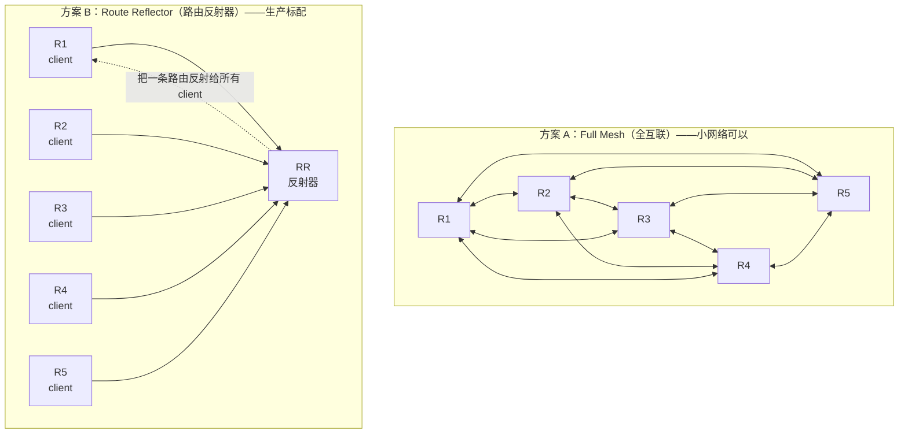

**RR（Route Reflector，路由反射器）** 是标准解法（RFC 4456）：挑几台路由器当"广播站"，客户只跟 RR 建会话，RR 把从 A 学到的路由**反射**给 B、C、D。5 台从 10 条会话降到 5 条，100 台从 4950 条降到 100 条。

RR 要防环，加了两个属性：

- **Originator-ID**：记录路由最初的发起者，RR 看到自己发出过的就不重复反射。
- **Cluster-ID / Cluster-List**：记录经过哪些 RR 集群，防止多个 RR 之间来回反射。

**生产经验**：RR 至少两台（一主一备或双活），放在 IGP 距离最优的位置；大规模网络分多个 cluster，每台边界路由器连 2 台 RR；RR **不转发业务流量**，纯控制平面角色。

## 四、时序：两个关键过程

### 4.1 会话建立：六个状态

BGP 邻居从"不认识"到"可以交换路由"，要走一个状态机（**FSM，Finite State Machine，有限状态机**）。这是排障时最该看的东西——`show bgp summary` 里邻居卡在哪个状态，就知道问题在哪。

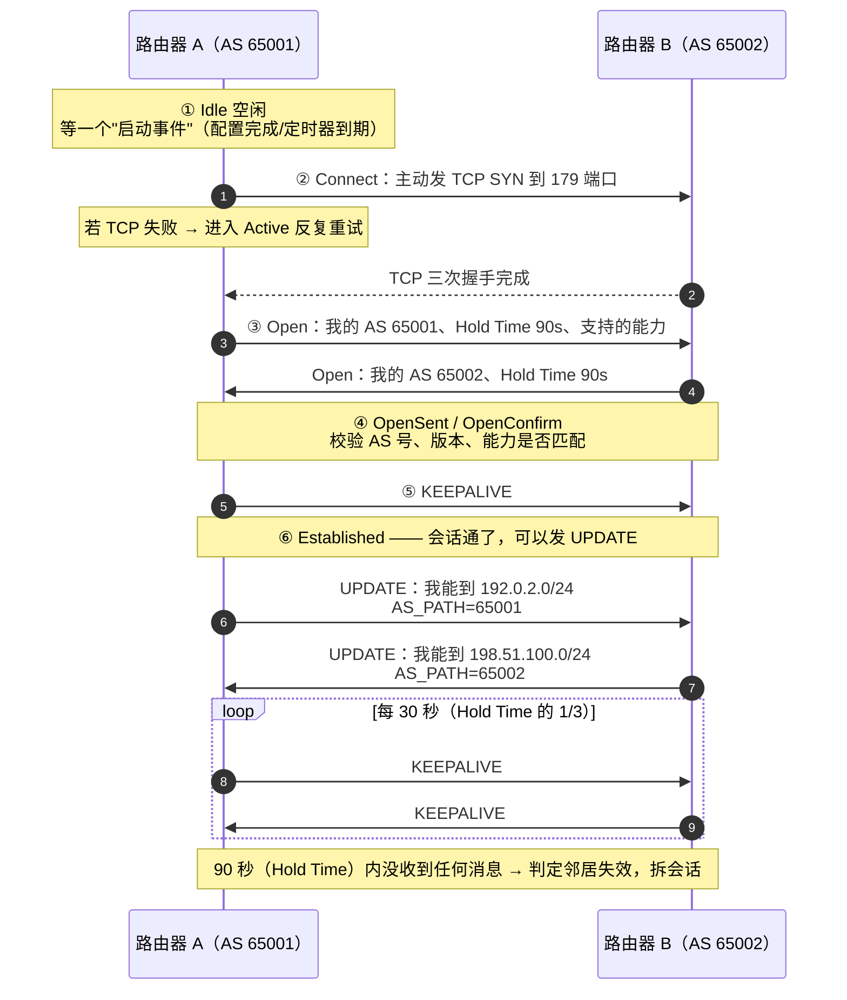

六个状态逐个说清（**排障必备**）：

| 状态 | 含义 | 卡在这里说明什么 |
| --- | --- | --- |
| **Idle** | 空闲，还没尝试连接 | 一般是没配邻居、或路由不可达 |
| **Connect** | 正在等 TCP 握手完成 | 对端没开 179、防火墙拦了、路由不通 |
| **Active** | TCP 连接失败，等重试定时器再试 | **最容易被误解的状态**：它不代表"活着"，而是"连不上，正在重试" |
| **OpenSent** | OPEN 报文已发出，等对方回 | 对端 AS 号配错了、或对端不接受你的能力 |
| **OpenConfirm** | 收到对方 OPEN，等 KEEPALIVE | 认证失败（MD5 不匹配）、Hold Time 谈不拢 |
| **Established** | 会话建立，可以交换路由 | 会话正常。但**路由没来**可能是策略过滤了 |

**两个新手最容易踩的坑**：

1. **看到 `Active` 以为正常**——恰恰相反，`Active` 是"连不上"。
2. **`Established` 了却没路由**——会话只是"能说话"，路由还被 prefix-list、route-map、`activate` 开关拦着。**会话通 ≠ 路由通**。

**定时器**（默认值因厂商而异，记住量级即可）：

| 定时器 | 建议值 | 说明 |
| --- | --- | --- |
| Hold Time | 90 秒（Cisco 默认 180） | 多久收不到任何报文就判定邻居死 |
| Keepalive | Hold / 3 = 30 秒 | 心跳间隔 |
| Connect Retry | 120 秒 | TCP 失败后多久重试 |
| Keepalive 协商 | 取双方较小值 | 一方 30、一方 60，最终按 30 走 |

### 4.2 一条路由的完整旅程

这是**数据流图 + 时序图**的结合：一条外部路由从 AS 65003 出发，怎么进到 AS 65001 的 RIB，再被通告给另一个邻居。

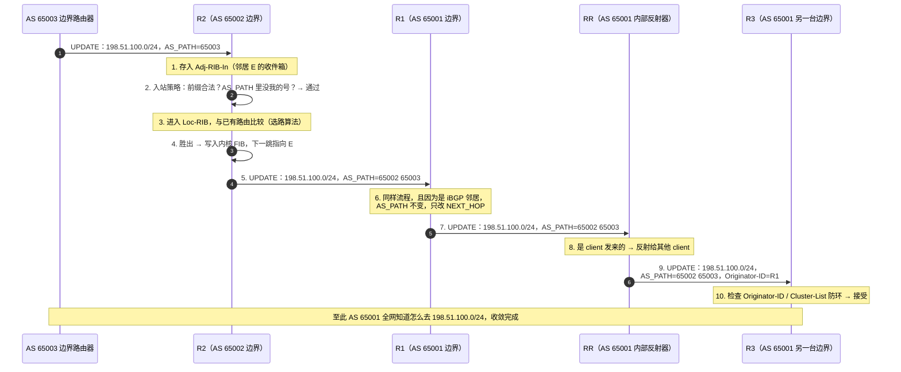

看图时的三个要点：

1. **AS_PATH 每经过一个 eBGP 邻居就追加一个 AS 号**；iBGP 内部不变（所以 iBGP 才需要另外的防环手段）。
2. **`NEXT_HOP` 会被改写**：eBGP 默认改成"我的接口地址"，iBGP 默认**不改**（保留外部下一跳）——这也是为什么 iBGP 里常要配 `next-hop-self`，否则内部路由器拿到一个"我不知道怎么去"的外部 IP。
3. **RR 是透明转发**：它不改变 AS_PATH 和 NEXT_HOP，只加 Originator-ID / Cluster-List。

## 五、报文与路径属性：UPDATE 里装了什么

BGP 只有 **4 种基本报文**（外加后来扩展的 ROUTE-REFRESH）：

| 报文 | 英文 | 作用 | 类比 |
| --- | --- | --- | --- |
| **OPEN** | OPEN Message | 建会话：报 AS 号、Hold Time、能力（4 字节 AS、MP-BGP、ADD-PATH 等） | 握手自我介绍 |
| **UPDATE** | UPDATE Message | **核心**：宣告新路由 / 撤销旧路由 | 寄一份新的通讯录 |
| **KEEPALIVE** | KEEPALIVE Message | 心跳，只有 19 字节头 | "我还在" |
| **NOTIFICATION** | NOTIFICATION Message | 出错，附带错误码后立即断会话 | 挂电话前说一句"出错了" |
| **ROUTE-REFRESH** | ROUTE-REFRESH Message | 请求对方重发某类路由（RFC 2918） | "把通讯录再发我一份" |

**UPDATE 报文的结构**（这是 BGP 的精华）：

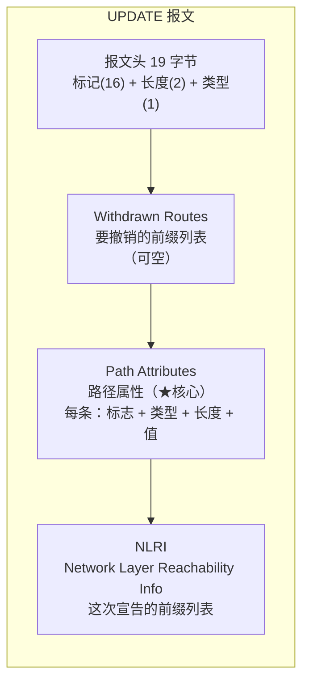

**同一条 UPDATE 里，所有前缀共享同一组属性。** 所以一条 UPDATE 可以一次宣告几百个前缀（这带来的问题是：一个属性变化就要重发整批，这是 BGP 收敛慢的原因之一）。

### 路径属性：BGP 的"可编程"从哪来

属性分两类：**well-known（公认）**——所有实现都必须认识；**optional（可选）**——认识的才处理。

| 属性 | 全称 | 中文 | 作用（白话） |
| --- | --- | --- | --- |
| **ORIGIN** | ORIGIN | 起源 | 这条路是 IGP/EGP/手工 `network` 来的，用来判断可信度 |
| **AS_PATH** | AS Path | AS 路径 | 途经的 AS 列表；**防环 + 算长度** |
| **NEXT_HOP** | Next Hop | 下一跳 | 数据包下一步交给谁的 IP |
| **LOCAL_PREF** | Local Preference | 本地优先级 | **只在 AS 内部传**。"我更喜欢从哪条路出去"，越大越优 |
| **MED** | Multi-Exit Discriminator | 多出口鉴别器 | **传给外部邻居**。"同一个目的地，请优先走我这个口"，越小越优 |
| **COMMUNITY** | Community | 团体 | 给路由**贴标签**（如 `65001:100`），配合 route-map 批量处理 |
| **ATOMIC_AGGREGATE** | Atomic Aggregate | 原子聚合 | 标记"这是聚合过的路由，原始明细丢失了" |
| **AGGREGATOR** | Aggregator | 聚合者 | 谁做的聚合 |
| **OTC** | Only-To-Customer | 仅发客户 | RFC 9234 引入，**专门用来防路由泄漏**（第十一节） |

**LOCAL_PREF 和 MED 的区别，是 BGP 面试必问**，一句话记住：

> **LOCAL_PREF 管"我怎么出去"（只在自家生效），MED 管"请你怎么进来"（说给外人听，外人不一定听）。**

打个比方：LOCAL_PREF 是你自己心里的偏好排名（别人看不见）；MED 是你贴在门口的建议牌"送货请走东门"（送货的人可以选择不理）。

### 一个真实感的配置片段：用 community 实现"三选一出口策略"

```bash
# 给从上游 A 收到的路由打标签 65001:100（"来自上游"）
route-map FROM-UPSTREAM-A permit 10
 set community 65001:100 additive
# 给从对等 B 收到的路由打标签 65001:200（"来自对等"）
route-map FROM-PEER-B permit 10
 set community 65001:200 additive

# 出口时：来自上游的路由，只发给自己的客户，不发给其他上游和对等
ip community-list standard FROM-UP permit 65001:100
route-map TO-PEER-B deny 10
 match community FROM-UP
route-map TO-PEER-B permit 20
```

**这一段就是"商业关系"落到代码的样子**：同一个前缀，因为来源不同，被允许去的地方不同。这也是为什么 BGP 配置看起来那么啰嗦——**啰嗦背后是钱和合同**。

## 六、选路：11 步决策

收到同一个前缀的多条路径时，BGP 逐条比较，**先命中先赢**（后面的不再看）：

| 步 | 比较项 | 规则 | 备注 |
| --- | --- | --- | --- |
| 1 | **Weight**（权重） | 大者优 | 厂商私有（Cisco 系有），只在本机有效，不进报文 |
| 2 | **LOCAL_PREF** | 大者优 | 只在 AS 内传播，**最常用的"出口选择"旋钮** |
| 3 | 本地始发 | 本机 `network`/`redistribute` 的优先 | "自己家的路由最亲" |
| 4 | **AS_PATH 长度** | 短者优 | 注意：是**数量**，不是跳数，AS_SET 只算 1 |
| 5 | **ORIGIN** | IGP < EGP < INCOMPLETE | 越小越可信 |
| 6 | **MED** | 小者优 | 默认只在同一邻接 AS 之间比较 |
| 7 | eBGP > iBGP | 外部路由优先 | 因为 eBGP 路由更"直接" |
| 8 | 到 NEXT_HOP 的 IGP 开销 | 小者优 | **这一步才轮到 IGP 参与** |
| 9 | 最老的 eBGP 路由 | 稳定优先 | 减少抖动 |
| 10 | Router ID 最小 | 小者优 | 兜底 |
| 11 | 邻居地址最小 | 小者优 | 最后一道 |

**这张表最重要的不是背下来，而是记住排序逻辑**：

- **前 3 步全是"本地意志"**（Weight、LOCAL_PREF、本地始发）——**人可以完全压过拓扑**。
- **第 4 步才看 AS_PATH**——"最短"只排第四。
- **第 8 步才用到 IGP**——距离是最后才考虑的因素之一。

**这句总结值得单独记住**：

> BGP 的选路顺序是 **人为策略 → 路径长度 → 技术指标**。它天生就是"管理员的意志优先于网络的最短路径"。

配置里最常用的两个旋钮：

```bash
# 让从某个邻居来的路由优先（LOCAL_PREF 大者优）
route-map PREFER-A permit 10
 set local-preference 200
!
# 告诉外部邻居"请优先走我"（MED 小者优）
route-map SET-MED permit 10
 set metric 50
```

## 七、数据流图：一个包怎么跨 4 个 AS

BGP 已经把地图画好了。现在看**真正转发数据时发生了什么**——注意：**这一节里 BGP 一次都没出现**。

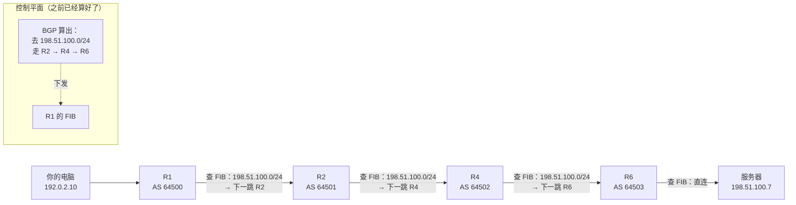

**关键认知有三条**：

**① 每一跳都是独立决策。**
R1 只知道"交给 R2"，不知道后面怎么走。**没有任何一台设备掌握全程路径**——这正是互联网能扩展的原因，也是 BGP 出问题时很难排查的原因。

**② 转发用的是"最长前缀匹配"（Longest Prefix Match，LPM），不是"最短 AS_PATH"。**
FIB 里可能同时有 `198.51.100.0/24`（来自 AS 64502）和 `198.51.0.0/16`（来自 AS 64504）。数据包目的地址是 `198.51.100.7`，**两条都匹配，选掩码更长的 /24**。这带来一个经典攻击面：**宣告更具体的前缀（more-specific）总能赢**，哪怕 AS_PATH 更长（第十一节）。

**③ 数据平面完全不看 BGP。**
所以"BGP 收敛慢"不会让已有连接断掉（老路径还在 FIB 里），但"BGP 收敛错了"会让流量立刻跑偏。

**关于对称性**：去程走 AS 64502，回程可能走 AS 64504。这叫**非对称路由**（asymmetric routing），在互联网上**完全正常**，因为去和回是两个方向各自选路。**排查"为什么慢"时忽略这一点，会白折腾很久。**

## 八、需要配合什么软件

BGP 不是单个程序，它是一套"协议 + 路由表 + 内核转发"的组合。按角色分成五类：

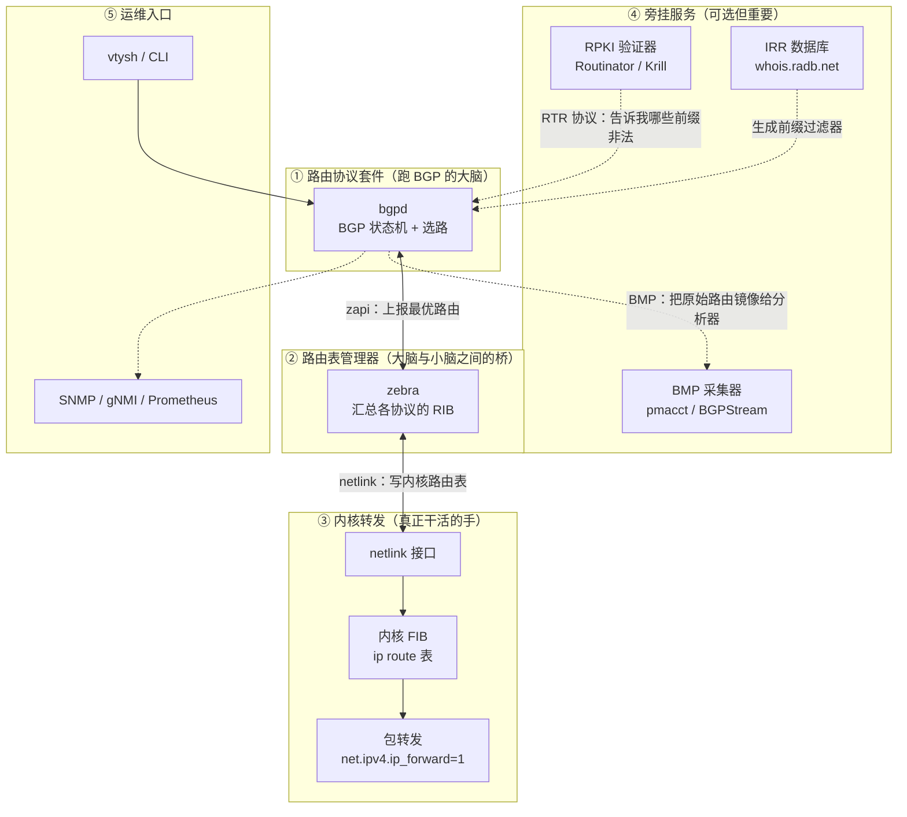

### 8.1 路由套件（选一个）

| 软件 | 语言 | 特点 | 什么时候选它 |
| --- | --- | --- | --- |
| **FRRouting（FRR）** | C | 最主流的开源套件，CLI 像 Cisco，功能最全（BGP/OSPF/IS-IS/EVPN/BFD/RPKI） | **默认首选**，服务器当路由器、IDC、云网关 |
| **BIRD** | C | 轻量、配置语言优雅、性能好，BGP 实现质量高 | 只做 BGP、追求简洁；K8s 里的 Calico 就用它 |
| **OpenBGPD** | C | OpenBSD 出品，安全性强，ASPA 支持最早 | 安全敏感场景、OpenBSD 环境 |
| **GoBGP** | Go | 库化，可嵌进程序，gRPC API | 做路由控制器、SDN、Anycast 自动化 |
| **ExaBGP** | Python | 专长"用脚本注入/接收路由" | DDoS 引流、RTBH、自动化实验 |
| **Quagga** | C | FRR 的前身，已停止维护 | 只在老系统上见到，新项目别用 |

厂商设备则是 **Cisco IOS-XR / NX-OS**、**Juniper Junos**、**Arista EOS**、**华为 VRP**——概念和本文完全一致，只是命令语法不同。

### 8.2 Linux 内核必须配合的三件事

把 Linux 服务器变成 BGP 路由器时，这三项不配就是"配完不通"：

```bash
# ① 开启 IP 转发（否则内核收到别人的包直接丢）
sysctl -w net.ipv4.ip_forward=1
# ② 关闭反向路径过滤（多线/非对称路由会被 rp_filter 误杀）
sysctl -w net.ipv4.conf.all.rp_filter=0
sysctl -w net.ipv4.conf.default.rp_filter=0
# ③ 允许路由表规模（默认上限够，但大表要调）
sysctl -w net.ipv4.route.max_size=2097152
```

**原理**：`bgpd` 只算路由，**真正写内核的是 `zebra`**（通过 **netlink**，Linux 内核与用户态交换网络配置的接口）。zebra 把 Loc-RIB 里最优的路由写进内核 FIB，内核转发时才用得上。**所以 `bgpd` 挂了不会立刻断网（FIB 还在），但 `zebra` 挂了通常会被内核保留已装路由——这也是排障时容易误判的地方。**

### 8.3 云与容器生态（BGP 无处不在）

| 环境 | 谁在跑 BGP | 干什么 |
| --- | --- | --- |
| AWS | Transit Gateway / Direct Connect / VPN | 把 VPC 和本地 IDC 打通，交换路由 |
| Azure | Route Server / ExpressRoute | 同上 |
| GCP | Cloud Router | 同上 |
| Kubernetes | **Calico**（内嵌 BIRD） | 宣告 Pod 网段，让外部知道 Pod IP |
| Kubernetes | **MetalLB** BGP 模式 | 把 Service 的 ExternalIP 宣告出去，实现裸金属 LoadBalancer |
| Kubernetes | **Cilium** BGP Control Plane | 同上 + eBPF 数据面 |
| 数据中心 | FRR / 厂商交换机 + **EVPN** | 用 BGP 当 VXLAN 的控制平面（替代泛洪学习） |
| 容器实验 | containerlab / GNS3 | 用 YAML 拉起整套 BGP 拓扑 |

**这条值得单独强调**：**BGP 早就不是"运营商的协议"了**。今天你在 K8s 里装一个 MetalLB，它就在用 BGP 给你的 Service 宣告地址；Calico 用 BIRD 维护着每个节点的 Pod 网段路由。**会 BGP 已经是云原生网络的基本功。**

### 8.4 必须知道的三个周边工具

**① RPKI 验证器**（`Routinator`、`Krill`、`OctoRPKI`）
把全局的 **ROA**（Route Origin Authorization，路由起源授权）下载下来，通过 **RTR**（RPKI to Router Protocol）喂给路由器，让路由器判断"这个前缀是不是被它合法的 AS 宣告的"。

**② IRR 与前缀过滤器生成**（`whois -h whois.radb.net`、`bgpq4`）
IRR（Internet Routing Registry，互联网路由注册库）里记录了"谁允许宣告什么"。用 `bgpq4 AS65001` 能直接生成一份 prefix-list/route-map，**比手工写好几百条靠谱得多**。

**③ BMP 与流量分析**（`pmacct`、`BGPStream`、`BGPalerter`）
**BMP**（BGP Monitoring Protocol，BGP 监控协议）把路由器收到的原始路由**实时镜像**给采集器。没有它，你只能看到"最终选出的那一条"，看不到"其他候选为什么没被选"。

## 九、实战：两台路由器跑通 eBGP

下面这套配置是**完整可粘贴**的。拓扑极简：两台 FRR 路由器，跨两个 AS 互联，各自宣告一个业务网段。

```
        AS 65001                          AS 65002
   ┌────────────────┐                ┌────────────────┐
   │  r1            │  10.0.0.0/24   │            r2  │
   │  eth0 10.0.0.1 ├────────────────┤ 10.0.0.2 eth0  │
   │  lo   192.168.1.1/24            │ lo 192.168.2.1/24 │
   └────────────────┘                └────────────────┘
       宣告 192.168.1.0/24               宣告 192.168.2.0/24
```

### 9.1 r1 的完整配置 `/etc/frr/frr.conf`

```bash
! ===== 基础设置 =====
frr version 10.7
frr defaults traditional
hostname r1
! 日志打到 stdout，容器里方便 docker logs 看
log stdout informational
! 允许用 vtysh 写回配置（等价 Cisco 的 write memory）
service integrated-vtysh-config
!
! ===== 要先在 lo 上配好业务地址，network 才有东西可宣告 =====
! （这一步不在 frr.conf 里，见 9.3 的 ip addr 命令）
!
! ===== 全局 BGP 参数 =====
router bgp 65001
 ! Router ID 建议手工指定；不指定会自动选最大的 loopback 或接口地址
 bgp router-id 10.0.0.1
 ! 关键：默认不会自动为 IPv4 建立邻居，必须显式进 address-family 激活
 no bgp default ipv4-unicast
 ! 指定邻居 IP 和对方的 AS 号（写错 AS 号会卡在 OpenSent）
 neighbor 10.0.0.2 remote-as 65002
 neighbor 10.0.0.2 description link-to-r2
 ! 只接受来自 1 跳以内的报文，防伪造源地址的 BGP 攻击（GTSM）
 neighbor 10.0.0.2 ttl-security hops 1
 ! 收路由上限：超过就告警；这是防路由泄漏最有效的一道闸
 neighbor 10.0.0.2 maximum-prefix 1000 80 warning-only
 !
 address-family ipv4 unicast
  ! 宣告业务网段；前提是这条前缀必须已存在于本机 RIB（lo 上有地址即可）
  network 192.168.1.0/24
  ! 显式激活这个邻居的 IPv4 地址族（不写这行，会话通了也没路由）
  neighbor 10.0.0.2 activate
  ! 入站/出站过滤器（定义见下）
  neighbor 10.0.0.2 prefix-list ALLOW-IN in
  neighbor 10.0.0.2 prefix-list ALLOW-OUT out
 exit-address-family
!
! ===== 前缀过滤器 =====
! 入站：只接受对端应该宣告的网段（本例只有 192.168.2.0/24）
ip prefix-list ALLOW-IN seq 5 permit 192.168.2.0/24
! 出站：只允许宣告自己的网段
ip prefix-list ALLOW-OUT seq 5 permit 192.168.1.0/24
!
line vty
!
```

### 9.2 r2 的完整配置 `/etc/frr/frr.conf`

```bash
frr version 10.7
frr defaults traditional
hostname r2
log stdout informational
service integrated-vtysh-config
!
router bgp 65002
 bgp router-id 10.0.0.2
 no bgp default ipv4-unicast
 neighbor 10.0.0.1 remote-as 65001
 neighbor 10.0.0.1 description link-to-r1
 neighbor 10.0.0.1 ttl-security hops 1
 neighbor 10.0.0.1 maximum-prefix 1000 80 warning-only
 !
 address-family ipv4 unicast
  network 192.168.2.0/24
  neighbor 10.0.0.1 activate
  neighbor 10.0.0.1 prefix-list ALLOW-IN in
  neighbor 10.0.0.1 prefix-list ALLOW-OUT out
 exit-address-family
!
ip prefix-list ALLOW-IN seq 5 permit 192.168.1.0/24
ip prefix-list ALLOW-OUT seq 5 permit 192.168.2.0/24
!
line vty
!
```

**注意 `network 192.168.1.0/24` 这一行的隐含前提**：它要求这条前缀**已经在本机路由表里**（精确匹配），否则 BGP 什么都不会宣告。所以必须先在 `lo` 上配一个该网段的地址，这是新手最常踩的坑——**配置没报错，但对端什么都收不到**。

### 9.3 单机复现：用 network namespace 造两台"路由器"

需要 Linux（Windows/macOS 请用虚拟机或 Docker Desktop 的 Linux 容器）。**FRR 用发行版包安装**：

```bash
# Debian / Ubuntu 装官方源的最新版（发行版自带版本较旧）
sudo apt install -y curl gnupg lsb-release ca-certificates
curl -s https://deb.frrouting.org/frr/keys.gpg | sudo tee /usr/share/keyrings/frrouting.gpg > /dev/null
echo "deb [signed-by=/usr/share/keyrings/frrouting.gpg] https://deb.frrouting.org/frr $(lsb_release -s -c) frr-stable" \
  | sudo tee /etc/apt/sources.list.d/frr.list
sudo apt update && sudo apt install -y frr frr-pythontools
# 确认版本（应为 10.x）
vtysh --version
```

然后是完整实验脚本（**逐行注释，可直接存成 `bgp-lab.sh` 用 root 跑**）：

```bash
#!/usr/bin/env bash
# 用途：在一台 Linux 上用两个 network namespace 造两台 BGP 路由器
# 依赖：root 权限、iproute2、FRR（>= 9）
set -euo pipefail

# ---------- 1. 造两个命名空间（各自独立的网络栈）----------
ip netns add r1
ip netns add r2

# ---------- 2. 用一对 veth 把两台"路由器"连起来 ----------
# veth 是成对的虚拟网卡：从一端进去的包会从另一端出来
ip link add r1-eth0 type veth peer name r2-eth0
ip link set r1-eth0 netns r1     # 把一端塞进 r1 的网络栈
ip link set r2-eth0 netns r2     # 另一端塞进 r2

# ---------- 3. 配 IP 并启用 ----------
ip netns exec r1 ip addr add 10.0.0.1/24 dev r1-eth0
ip netns exec r2 ip addr add 10.0.0.2/24 dev r2-eth0
ip netns exec r1 ip link set r1-eth0 up
ip netns exec r2 ip link set r2-eth0 up
ip netns exec r1 ip link set lo up
ip netns exec r2 ip link set lo up

# ---------- 4. 业务网段挂在 loopback 上 ----------
# 这是让 network 语句"有东西可宣告"的关键一步
ip netns exec r1 ip addr add 192.168.1.1/24 dev lo
ip netns exec r2 ip addr add 192.168.2.1/24 dev lo

# ---------- 5. 开启转发 ----------
ip netns exec r1 sysctl -qw net.ipv4.ip_forward=1
ip netns exec r2 sysctl -qw net.ipv4.ip_forward=1

# ---------- 6. 准备两份配置（用 FRR 的 pathspace 机制隔离）----------
# pathspace = 一套独立的配置目录 + socket 目录，让同名 daemon 能跑多个实例
mkdir -p /etc/frr/r1 /etc/frr/r2
cp r1.conf /etc/frr/r1/frr.conf
cp r2.conf /etc/frr/r2/frr.conf
chown -R frr:frr /etc/frr/r1 /etc/frr/r2

# 运行目录也要按 pathspace 建好，否则 daemon 起不来（权限不足 / 目录不存在）
mkdir -p /var/run/frr/r1 /var/run/frr/r2
chown -R frr:frr /var/run/frr/r1 /var/run/frr/r2

# ---------- 7. 在每个命名空间里只启动 zebra 和 bgpd ----------
# -d 后台运行；-N r1 指定 pathspace
# daemon 路径因发行版而异，可用 dpkg -L frr | grep zebra 确认
ip netns exec r1 /usr/lib/frr/zebra -d -N r1
ip netns exec r1 /usr/lib/frr/bgpd  -d -N r1
ip netns exec r2 /usr/lib/frr/zebra -d -N r2
ip netns exec r2 /usr/lib/frr/bgpd  -d -N r2

# ---------- 8. 验证 ----------
ip netns exec r1 vtysh -N r1 -c "show bgp summary"
```

**验证清单**（按顺序敲，每一步该看到什么）：

```bash
# ① 会话是否建立：State 列必须是 Established，不是 Active
ip netns exec r1 vtysh -N r1 -c "show bgp summary"

# ② 收到了什么路由：应看到 192.168.2.0/24，且 best 标记为 >
ip netns exec r1 vtysh -N r1 -c "show bgp ipv4 unicast"

# ③ 单条路由详情：核对 AS_PATH、NEXT_HOP、valid
ip netns exec r1 vtysh -N r1 -c "show bgp ipv4 unicast 192.168.2.0/24"

# ④ 内核里有没有落地（这一步才证明真的能转发）
ip netns exec r1 ip route show

# ⑤ 抓包看报文（可选）：能看到 OPEN / KEEPALIVE / UPDATE
ip netns exec r1 tcpdump -i r1-eth0 -n tcp port 179
```

预期关键输出（字段随版本略有差异，抓重点看）：

```
r1# show bgp ipv4 unicast
BGP table version is 2, local router ID is 10.0.0.1
   Network            Next Hop        Metric LocPrf Weight Path
*> 192.168.1.0/24     0.0.0.0              0         32768 i
*> 192.168.2.0/24     10.0.0.2             0             0 65002 i
```

- 第一行 `*> ` 表示"有效且最优"，`32768` 是本地始发的默认 Weight，`i` 表示 ORIGIN = IGP。
- 第二行的 `65002` 就是 **AS_PATH**——这条路要经过 AS 65002。

**清理环境**：

```bash
ip netns del r1   # 删除命名空间会连带删除里面的网卡和进程
ip netns del r2
```

### 9.4 更省事的方案：Docker 两个容器

如果不想动 systemd 和 netns，用官方镜像：

```bash
# 建一个专用网络（固定子网，方便分配固定 IP）
docker network create --subnet 10.0.0.0/24 bgp-lab

# 起两台 FRR，配置挂载进去
docker run -d --name r1 --privileged --network bgp-lab --ip 10.0.0.1 \
  -v $PWD/r1.conf:/etc/frr/frr.conf:ro quay.io/frrouting/frr:10.7.1
docker run -d --name r2 --privileged --network bgp-lab --ip 10.0.0.2 \
  -v $PWD/r2.conf:/etc/frr/frr.conf:ro quay.io/frrouting/frr:10.7.1

# 进容器看状态
docker exec -it r1 vtysh -c "show bgp summary"
```

**注意**：容器里同样需要 `lo` 上那条业务地址，否则 `network` 宣告不出去：

```bash
docker exec r1 ip addr add 192.168.1.1/24 dev lo
docker exec r2 ip addr add 192.168.2.1/24 dev lo
# 地址加上之后，若没自动宣告，重新应用一次 network 语句
docker exec r1 vtysh -c "conf t" -c "router bgp 65001" \
  -c "address-family ipv4 unicast" -c "no network 192.168.1.0/24" \
  -c "network 192.168.1.0/24"
```

### 9.5 生产级的 iBGP + RR 片段

单区域两台路由器只是开胃菜。真实 IDC 通常是"两台边界 + 两台 RR"：

```bash
! ===== 边界路由器 R1（只跟 RR 建 iBGP，不跟所有边界互联）=====
router bgp 65001
 bgp router-id 10.0.0.1
 ! 允许 ECMP：AS_PATH 长度相同即视为等价，可多路径负载分担
 bgp bestpath as-path multipath-relax
 maximum-paths 4
 neighbor 10.0.0.2 remote-as 65002
 ! 两台 RR 作为 iBGP 邻居
 neighbor 10.255.0.11 remote-as 65001
 neighbor 10.255.0.12 remote-as 65001
 ! 关键：把外部路由发给 iBGP 邻居时，把下一跳改成自己
 ! 否则 RR 和其他边界拿到的是外部 IP，可能不可达
 neighbor 10.255.0.11 next-hop-self
 neighbor 10.255.0.12 next-hop-self
 !
 address-family ipv4 unicast
  network 192.168.1.0/24
  neighbor 10.0.0.2 activate
  neighbor 10.255.0.11 activate
  neighbor 10.255.0.12 activate
 exit-address-family
!
! ===== 路由反射器 RR1 =====
router bgp 65001
 bgp router-id 10.255.0.11
 ! cluster-id 建议手工指定，默认用 router-id，换设备时会变
 bgp cluster-id 10.255.0.1
 neighbor 10.0.0.1 remote-as 65001
 neighbor 10.0.0.1 route-reflector-client
 neighbor 10.0.0.5 remote-as 65001
 neighbor 10.0.0.5 route-reflector-client
 !
 address-family ipv4 unicast
  neighbor 10.0.0.1 activate
  neighbor 10.0.0.5 activate
 exit-address-family
!
```

## 十、使用场景：什么时候真的需要 BGP

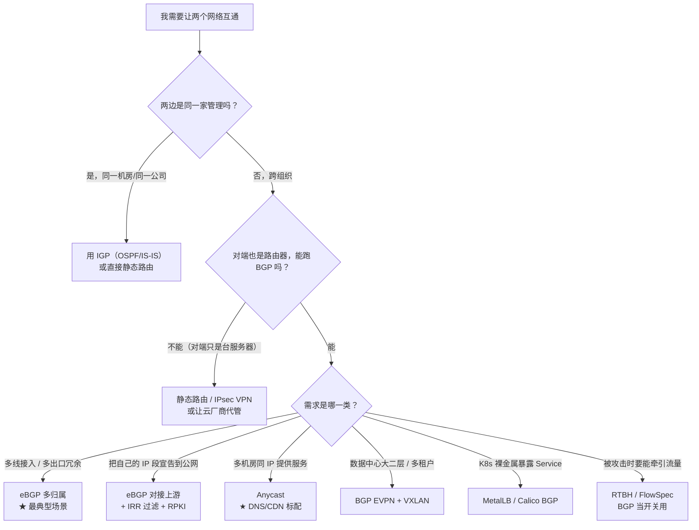

### 10.1 六个真实场景

**① 多线接入（多归属，multihoming）。**
一家公司同时接电信、联通、移动三条线。三条线各跑一个 eBGP 会话，用 **LOCAL_PREF** 决定"平时从哪条出"，用 **MED** 告诉对方"进我请走这条"。某条线断了，BGP 自动切到另一条——**这是 BGP 给企业带来的最大价值：出口冗余**。

**② 把自己的 IP 段宣告到公网。**
机房/IDC 从 APNIC 等 RIR 申请到 `203.0.113.0/24` 和 AS 号后，用 eBGP 对接上游运营商。**必须做三件事**：IRR 登记（让上游能生成过滤器）、RPKI 签发 ROA、设置 `maximum-prefix`。否则你的前缀可能被上游拒绝，或者你自己成为泄漏源。

**③ Anycast（任播）。**
同一个 IP 段在**多个地理位置同时宣告**。BGP 天然会选"AS_PATH 最短"的那条，于是用户总是被送到最近的节点。**全球 DNS 根服务器、CDN、8.8.8.8 都是这么做的**——同一个人 IP，在北京解析到北京机房，在法兰克福解析到法兰克福机房。

**④ 数据中心：BGP EVPN 作为 VXLAN 的控制平面。**
传统 VXLAN 靠"泛洪学习"找 MAC，规模一大就广播风暴。**EVPN**（Ethernet VPN，RFC 7432）用 BGP 来分发 MAC/IP 可达性——**谁在哪，BGP 直接告诉你，不用泛洪**。这是今天几乎所有云数据中心网络的基础。

**⑤ Kubernetes 裸金属。**
MetalLB 的 BGP 模式把 Service 的 ExternalIP 宣告给上游交换机，外部流量就能直达集群。Calico 用 BIRD 宣告每个节点的 Pod 网段，让 Pod IP 在整个机房可路由（省掉 overlay 封装）。

**⑥ DDoS 清洗与流量牵引。**
被打时，通过 BGP 把被攻击的前缀**改指向清洗中心**（宣告更具体的前缀或改 community），流量就绕进清洗设备，洗完再回注。**RTBH**（Remotely Triggered Black Hole，远程触发黑洞）更暴力：宣告该前缀到一个 null 接口，直接把攻击流量丢掉——用"牺牲这个 IP"换"保住整个机房"。

### 10.2 什么时候**不**该用 BGP

| 场景 | 为什么不用 | 该用什么 |
| --- | --- | --- |
| 只有一条出口、一个上游 | BGP 的全部价值在"多路径选择"，单路径用不上 | 静态默认路由 |
| 两台服务器之间要通 | BGP 是运营商级工具，杀鸡用牛刀 | 直连路由 / 静态路由 |
| 团队完全没有网络运维经验 | BGP 配错会**影响整个互联网**（泄漏/劫持），风险不对称 | 托管服务、云厂商的路由服务 |
| 需要"自动发现拓扑" | BGP 不传拓扑，只传可达性 | IGP（OSPF/IS-IS） |

## 十一、安全与常见坑

**BGP 的原始设计假设是"邻居都是好人"**——1989 年的互联网是一群互相信任的大学和运营商。今天这个假设完全破产。

### 11.1 两类经典事故

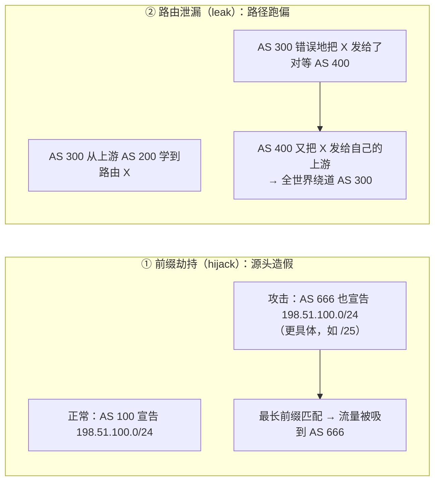

两者的区别很关键：

| | 劫持（hijack） | 泄漏（leak） |
| --- | --- | --- |
| 本质 | **伪造起源**：不是我的段我宣告 | **路径越界**：段是对的，但我不该转给别人 |
| 起源 AS | 假的 | **真的** |
| 典型原因 | 恶意、或 BGP 配置错误的 `network` | 出口策略写错，把"上游来的"发给了对等 |
| 防御 | **RPKI ROV** | **ASPA / OTC / 出口过滤** |

**三个标志性案例**（都是公开的技术事故，值得记住）：

- **2008 年**：某运营商为封锁一个视频网站，宣告了更具体的路由，结果把全球该网站的流量吸到自己网络里，持续约两小时。**这是"更具体前缀必胜"的经典教材。**
- **2018 年**：某云厂商的路由被第三方错误宣告，导致加密货币钱包服务的 DNS 被劫持，用户资金被盗。
- **2021 年**：某社交平台在维护中撤回了自己的 BGP 通告，**服务器和 DNS 都正常，但全球没人知道路怎么走**，服务中断数小时。这说明 BGP 事故不一定是"被攻击"，**自己配错一样能自断经脉**。

### 11.2 防御：四层，从便宜到贵

**① 前缀过滤与 max-prefix（现在就做，零成本）**

```bash
! 只接受对端"应该"宣告的前缀，其余全丢
ip prefix-list FROM-UPSTREAM seq 5 permit 203.0.113.0/24
ip prefix-list FROM-UPSTREAM seq 10 deny 0.0.0.0/0 le 32
!
router bgp 65001
 address-family ipv4 unicast
  neighbor 10.0.0.2 prefix-list FROM-UPSTREAM in
  ! 兜底：超过 1000 条就断开（防泄漏把整张表灌进来）
  neighbor 10.0.0.2 maximum-prefix 1000
 exit-address-family
```

**② RPKI ROV（前缀起源校验，覆盖率已 65%+）**

原理：每个地址段的持有者在 RPKI 体系里签发 **ROA**（Route Origin Authorization），声明"这个段只能由 AS X 宣告，最长到 /24"。路由器拿到 RTR 传来的 ROA 后，把每条路由判定为 Valid / Invalid / NotFound，**Invalid 的直接丢**。

```bash
! 先启动 rpki 子系统，连上验证器（Routinator/Krill 的 RTR 端口通常是 3323）
rpki
 rpki cache 10.0.0.9 3323 preference 1
exit
!
! 组一个入站策略：RPKI 判定 Invalid 的路由直接拒绝
route-map RPKI-IN deny 10
 match rpki invalid
!
route-map RPKI-IN permit 20
!
router bgp 65001
 address-family ipv4 unicast
  neighbor 10.0.0.2 route-map RPKI-IN in
 exit-address-family
```

> 建议先跑 `logging` 模式观察一段时间（只记录不丢弃），确认没有误杀自己的合法前缀，再改成拒绝。**一次性全开是常见事故来源**——尤其是 RTR 缓存还没同步完就启用过滤，所有路由都会变成 NotFound，等于把全表放行或全表误杀。
>
> 还有一个前置条件：FRR 里如果开了 `bgp bestpath prefix-validate disallow-invalid`，Invalid 路由根本进不了选路，route-map 里的 `match rpki invalid` 也就永远匹配不到。两者只能选一种用法。

**③ ASPA（路径校验，2026 年仍在早期）**

RPKI 只校验"起源"，**不管路径**——所以对"泄漏"完全无能为力。**ASPA**（Autonomous System Provider Authorization，自治系统提供商授权）让每个 AS 签发"我的合法上游是谁"，收到路由时可以检查 AS_PATH 是否符合拓扑（正常只有"下→上→平→下"，一旦出现"上→下→上"的谷形就是泄漏）。

现状：2026 年 ASPA 规范仍在 IETF 收尾（`draft-ietf-sidrops-aspa-*`），**部署率仅约 2.5%～3%**。覆盖不全时校验结果是 Unknown，通常按 Valid 处理，所以**现在打开 ASPA 基本拦不住东西**——但记录（publish）是值得先做的。

**④ OTC（唯一已经在用的路径防泄漏手段）**

**RFC 9234** 定义了 BGP 角色和 **OTC**（Only-To-Customer）属性：从上游/对等学到的路由，在发给别人时打上 OTC 标记；收到带 OTC 的路由，如果你不是客户，就拒绝。**这是目前唯一标准化、且能实际阻断泄漏的机制**，配置只需几行，**强烈建议所有多出口网络开启**。

**⑤ 其他必备项**

| 措施 | 防什么 | 一行命令 |
| --- | --- | --- |
| **GTSM / TTL Security** | 伪造源 IP 的 BGP 攻击 | `neighbor X ttl-security hops 1` |
| **TCP MD5 / TCP-AO** | 会话被冒充、被注入 | `neighbor X password 密钥`（更好的是 TCP-AO） |
| **bogon 过滤** | 私有地址、未分配段被宣告 | prefix-list 拒绝 `10.0.0.0/8`、`192.168.0.0/16` 等 |
| **路由抖动抑制** | 邻居反复震荡拖垮 CPU | `bgp dampening`（慎用，会延长恢复时间） |
| **RPKI 签发 ROA** | 别人冒充你 | 在 RIR 门户签发，`.maxLength` 收紧到最小值 |

### 11.3 七个常见坑

**坑 1：`Active` 状态被当成"正常"。**
它是"TCP 连不上，正在重试"。查：对端 179 端口、防火墙、到邻居 IP 的路由。

**坑 2：`network` 语句不生效。**
`network 192.168.1.0/24` 要求该前缀**精确存在于本机 RIB**。没配地址、或配的是 `/25`，都不会宣告。查：`show ip route 192.168.1.0/24`。

**坑 3：iBGP 里下一跳不可达。**
iBGP 默认不改 NEXT_HOP，内部路由器拿到一个外部 IP 却不知道怎么去。解法：在边界路由器上 `neighbor X next-hop-self`。

**坑 4：忘了 `activate`。**
FRR/Cisco 的 `no bgp default ipv4-unicast` 之后，**必须在 address-family 里显式激活**。会话 Established 但一条路由都没有，八成是这个。

**坑 5：`maximum-prefix` 没设。**
邻居（或攻击者）灌进来 80 万条路由，设备内存直接爆。**这是最便宜的一道保险，没有理由不配。**

**坑 6：以为 BGP 会负载均衡。**
默认只选一条最优路径，其余都是备份。要多路径必须显式开 `maximum-paths` + `bgp bestpath as-path multipath-relax`。

**坑 7：改完配置不 `clear`，以为没生效。**
出站策略变了，**已经发出去的路由不会自动重发**。需要 `clear bgp <neighbor> out`（或 `soft out`）才生效。**这是"我明明改了策略却没变化"的最常见原因。**

## 十二、总结

回到邮政系统的比喻：

- **IGP（OSPF/IS-IS）** 是"一家邮政公司内部的街道地图"——告诉你从分拣中心到某个投递点怎么走，追求**最短**。
- **BGP** 是"各国邮政公司之间的路由协定"——大家互相通告"寄往某些邮编的件请交给我"，追求**符合合同**。
- 两者**分工明确、互相依赖**：BGP 说"往那个方向走"，IGP 负责"怎么走到那个方向"。

三句话记住 BGP 的本质：

1. **它不转发数据，它画地图。** 控制平面算路，数据平面查表，两者严格分离。
2. **它先看策略，再看长度。** 11 步选路里，人为意志排在拓扑之前——这就是为什么会出现"绕远路反而更优"。
3. **它的安全性靠"大家互相约束"。** 协议本身不验证任何东西，所以必须靠 prefix-list、max-prefix、RPKI、OTC 这些外加的护栏。

**如果你只想记住一件事**：BGP 是唯一把 7.9 万个独立网络缝成一张网的东西，也因此，**它的一次配置失误可以影响半个互联网**。敬畏它，配之前先想清楚"这条路由该不该发给他"。

## 附录：术语中英对照表

| 缩写 / 术语 | 英文全称 | 中文 | 一句话解释 |
| --- | --- | --- | --- |
| BGP | Border Gateway Protocol | 边界网关协议 | 互联网唯一在用的域间路由协议 |
| AS | Autonomous System | 自治系统 | 路由策略统一管理的一个独立网络 |
| ASN | Autonomous System Number | 自治系统号 | AS 的编号，16 位或 32 位 |
| IGP | Interior Gateway Protocol | 内部网关协议 | AS 内部用的路由协议，如 OSPF、IS-IS |
| EGP | Exterior Gateway Protocol | 外部网关协议 | AS 之间用的路由协议，BGP 是唯一现役成员 |
| eBGP | External BGP | 外部 BGP | 跨 AS 的 BGP 会话 |
| iBGP | Internal BGP | 内部 BGP | 同一 AS 内的 BGP 会话，不改 AS_PATH |
| prefix | Network Prefix | 网络前缀 | 一段连续 IP 地址，如 203.0.113.0/24 |
| NLRI | Network Layer Reachability Information | 网络层可达信息 | UPDATE 报文里"我宣告哪些前缀"的字段 |
| RIB | Routing Information Base | 路由信息库 | 候选路由总表，分 Adj-RIB-In / Loc-RIB / Adj-RIB-Out |
| Loc-RIB | Local RIB | 本地路由表 | 经过策略过滤和选路后，本机决定使用的路由 |
| FIB | Forwarding Information Base | 转发表 | 从 RIB 挑出最优后下发给内核/硬件的表 |
| LPM | Longest Prefix Match | 最长前缀匹配 | 转发时选掩码最长的那条路由 |
| CIDR | Classless Inter-Domain Routing | 无类别域间路由 | 用 /n 表示网段大小的地址表示法 |
| AS_PATH | AS Path | AS 路径 | 途经 AS 的列表，用于选路和防环 |
| NEXT_HOP | Next Hop | 下一跳 | 数据包下一步交给的 IP |
| LOCAL_PREF | Local Preference | 本地优先级 | 只在 AS 内传递，越大越优先，管"怎么出去" |
| MED | Multi-Exit Discriminator | 多出口鉴别器 | 传给外部邻居，越小越优先，管"请怎么进来" |
| COMMUNITY | BGP Community | 团体属性 | 给路由贴标签，配合 route-map 批量处理 |
| RR | Route Reflector | 路由反射器 | 替代 iBGP 全互联的"广播站" |
| IXP | Internet Exchange Point | 互联网交换中心 | 多家网络在此互联互通、建立对等的地方 |
| ISP | Internet Service Provider | 互联网服务提供商 | 运营商 |
| transit | Transit | 转接 | 付费给上游，让它帮你转发所有流量 |
| peering | Peering | 对等互联 | 两网免费互换流量，只换双方的 |
| route leak | Route Leak | 路由泄漏 | 把不该转的路由转给了别人，导致流量绕道 |
| hijack | Prefix Hijacking | 前缀劫持 | 冒充别人的前缀，把流量吸过来 |
| valley-free | Valley-Free Routing | 无谷路由 | 正常路径不走"上→下→上"的 V 形 |
| convergence | Convergence | 收敛 | 网络变化后所有路由器重新达成一致的过程 |
| FSM | Finite State Machine | 有限状态机 | BGP 邻居的六个状态：Idle→...→Established |
| Hold Time | Hold Time | 保持时间 | 多久收不到消息就判定邻居失效，默认 90 秒 |
| RPKI | Resource Public Key Infrastructure | 资源公钥基础设施 | 用签名证书证明"谁能宣告哪个前缀" |
| ROA | Route Origin Authorization | 路由起源授权 | RPKI 里的签名记录，声明前缀与 AS 的绑定 |
| ROV | Route Origin Validation | 路由起源校验 | 用 ROA 检查通告是否合法，得出 Valid/Invalid/NotFound |
| ASPA | Autonomous System Provider Authorization | 自治系统提供商授权 | RPKI 的路径校验扩展，能识别泄漏 |
| OTC | Only-To-Customer | 仅发客户 | RFC 9234 属性，用来阻断路由泄漏 |
| IRR | Internet Routing Registry | 互联网路由注册库 | 公开的路由策略登记库，用来生成过滤器 |
| RTR | RPKI to Router Protocol | RPKI 到路由器协议 | 验证器把 ROA 数据推给路由器的协议 |
| BMP | BGP Monitoring Protocol | BGP 监控协议 | 把原始路由镜像给分析器 |
| GTSM | Generalized TTL Security Mechanism | 通用 TTL 安全机制 | 只接受 TTL 接近 255 的报文，防伪造源 IP |
| RTBH | Remotely Triggered Black Hole | 远程触发黑洞 | 通过 BGP 把攻击流量引到 null 接口丢弃 |
| Anycast | Anycast | 任播 | 同一 IP 多地宣告，用户被路由到最近节点 |
| EVPN | Ethernet VPN | 以太网 VPN | 用 BGP 分发 MAC/IP 可达性，VXLAN 的控制平面 |
| VXLAN | Virtual Extensible LAN | 虚拟可扩展局域网 | 用 UDP 封装二层帧，跨三层打通大二层 |
| ECMP | Equal-Cost Multi-Path | 等价多路径 | 多条同代价路径同时转发，做负载分担 |
| dampening | Route Dampening | 路由抖动抑制 | 对反复震荡的路由降低优先级，防 CPU 过载 |
| bogon | Bogon | 未分配/私有地址 | 不该出现在公网路由表里的地址段 |
