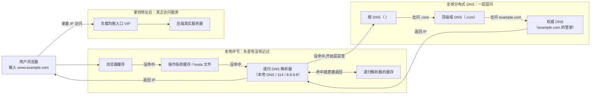
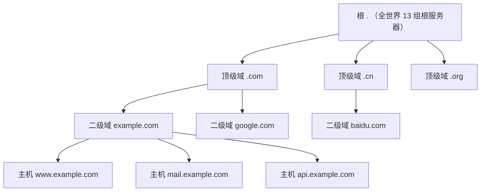
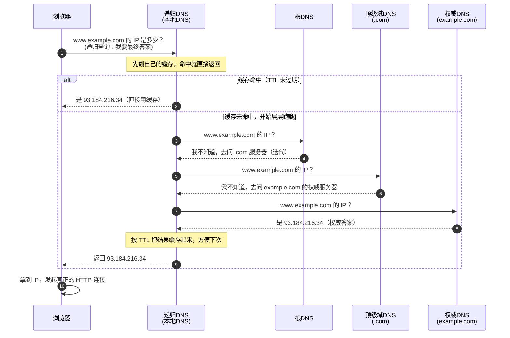
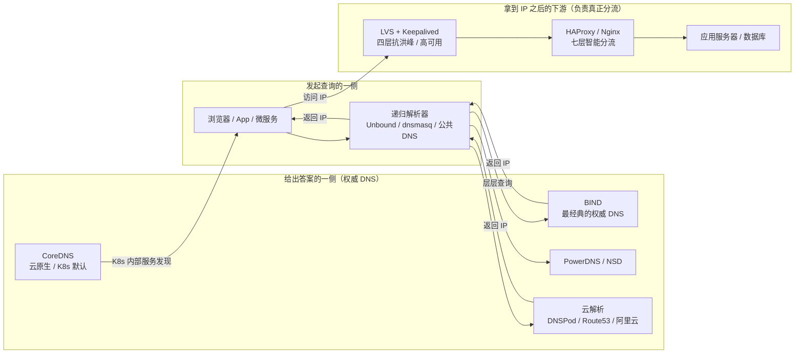
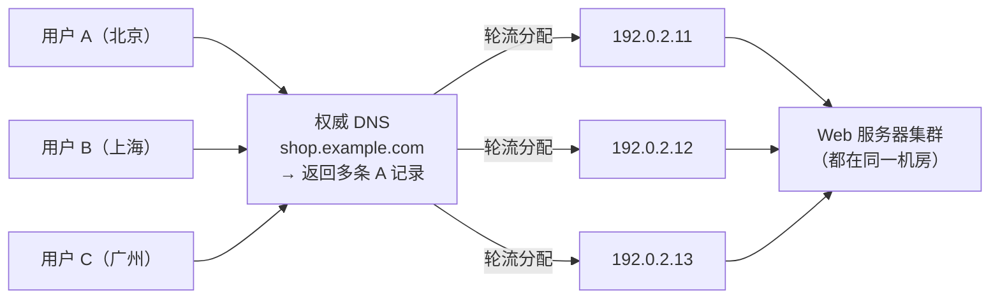
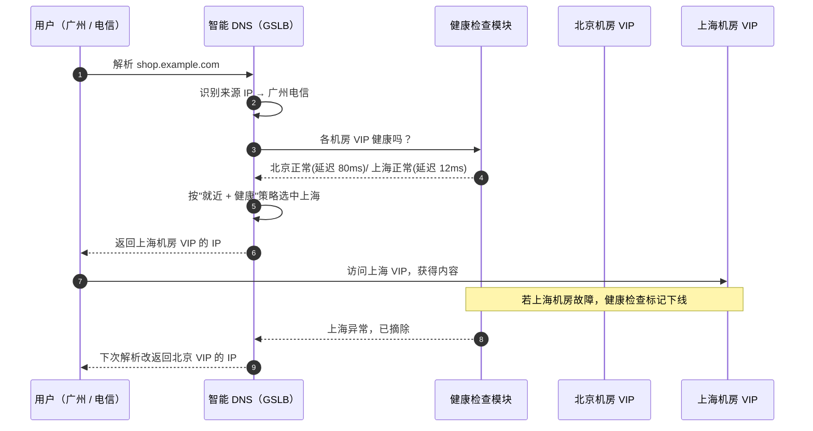
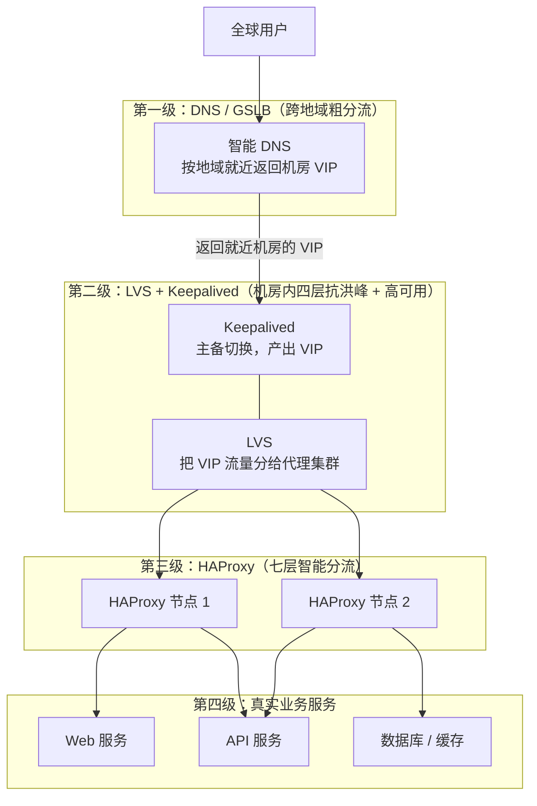

## 〇、先建立整体印象：DNS 是互联网的"查号台"

你在浏览器里输入 `www.example.com`，敲下回车，网页就出来了。但计算机之间通信其实只认 **IP 地址**（像 `93.184.216.34` 这样的一串数字），它根本不认识"example.com"这种字母。

DNS（Domain Name System，域名系统）就是夹在中间的**查号台**：你报一个好记的名字，它帮你查出对应的数字门牌号，然后浏览器才能拿着门牌号去找服务器。

一句话记住它：**DNS = 互联网的通讯录，把"名字"翻译成"地址"。**

先看它在一次上网里处在哪一环：



这张图先让你有个全局印象：**DNS 只负责"查地址"这一步**，查完就退场了，后面的负载均衡、真实服务器那是另外的角色。但有意思的是，正因为一个名字可以查出多个地址，DNS 自己也能干一部分"分流的活"——这正是第七节的重点。

## 一、DNS 到底解决什么问题？

打个比方。你想给朋友"张三"打电话，你不会去背他的 11 位手机号，而是打开通讯录搜"张三"就拨出去了。这里：

- **域名**（`www.example.com`）= 通讯录里的名字，给人看的、好记；
- **IP 地址**（`93.184.216.34`）= 手机号，给机器看的、精确但难记；
- **DNS** = 那本通讯录，负责"名字 → 号码"的翻译。

具体解决了五件事：

| 问题 | 没有 DNS 会怎样 | DNS 怎么解决 |
|------|----------------|--------------|
| **好记** | 得背一串串数字才能上网 | 用 `baidu.com` 这种有意义的字母 |
| **地址会变** | 服务器一搬家，所有人都得改 | 只改 DNS 记录，域名不变，用户无感 |
| **一个名字对应多台机器** | 一个地址只能指一台 | 一个域名可返回多个 IP，天然能分流 |
| **就近访问** | 全球用户都挤到一个机房 | 智能 DNS 把用户导向最近的机房 |
| **抗故障** | 一个目录挂了全网瘫痪 | 全球分布式部署，一处挂了还有别处 |

最后一条尤其关键：DNS 不是一个单一的服务器，而是一套**分布在全世界的层级系统**。你每次查域名，背后可能是十几台不同机器接力回答——所以它能扛住全球几十亿次查询。

## 二、域名是怎么组织的？——一棵倒着长的树

理解 DNS 的第一步，是理解域名是**分层**的。它像一棵倒过来的树，根在最上面：



域名要**从右往左读**，越往右层级越高：

- 最右边的 `.` 是**根**（平时省略不写）；
- `.com` / `.cn` / `.org` 是**顶级域**（TLD，Top-Level Domain）；
- `example.com` 是**二级域**，也就是你注册的那个域名；
- `www` / `mail` / `api` 是**主机名**，由域名拥有者自己定义。

所以 `www.example.com` 的完整写法其实是 `www.example.com.`（末尾那个点就是根），查询时从右往左一层层定位。

配合这棵树，有几个角色要认识：

- **根 DNS 服务器**：最顶层，它不直接给答案，只告诉你"去问 .com 的管理员"。
- **顶级域（TLD）DNS 服务器**：管 `.com`、`.cn` 这一层，也不给最终答案，告诉你"去问 example.com 的管家"。
- **权威 DNS 服务器**：真正保存 `example.com` 这条记录的地方，它给出最终 IP。你可以把它理解成"这个域名的户籍所在地"。
- **递归 DNS 解析器**（也叫本地 DNS）：你电脑直接问的那台，它替你跑腿，把上面三层都问一遍，最后把答案带回来。你家的路由器、运营商、或 `114.114.114.114` / `8.8.8.8` 这类公共 DNS 都是它。

## 三、一次域名解析到底发生了什么？

这是 DNS 最核心的过程。看图之前，先分清两个词：

- **递归查询**："我把问题交给你，你负责给我最终答案，中间怎么问不用管。"——你的电脑对本地 DNS 就是这么干的。
- **迭代查询**："我不知道答案，但我告诉你该去问谁。"——本地 DNS 对根、顶级域、权威就是这么干的，一问一答、层层引导。

一次完整解析的时序如下：



注意几个细节：

1. **浏览器和本地 DNS 之间只有一问一答**（递归），本地 DNS 把这趟腿全跑了。
2. **本地 DNS 和三层服务器之间是多次往返**（迭代），每一层只给"下一步找谁"的线索。
3. **权威 DNS 给出的是最终答案**，这也是整条链路里唯一真正"知道"这个域名对应哪个 IP 的角色。

### 为什么要缓存？TTL 又是什么？

如果每次上网都要从根问到权威，全球网络早就堵死了。所以**每一层都会缓存**结果。缓存能活多久，由一条叫 **TTL（Time To Live，存活时间）** 的值决定——单位是秒。

- TTL = 3600，表示这个答案可以被缓存 1 小时，期间再问直接用缓存，不再层层查。
- TTL 一到期，缓存失效，下次查询重新跑一遍流程。

这里埋着一个后面会反复提到的坑：**TTL 越长缓存越久、越省事，但改了 DNS 记录后生效越慢**。这正是"DNS 做负载均衡切换慢"的根源，第七节会详细讲。

## 四、DNS 记录类型：通讯录里都存了些什么？

权威 DNS 里存的是一条条**记录（Record）**，不同类型干不同的活。小白最常遇到这几种：

| 类型 | 全称 | 作用 | 举例 |
|------|------|------|------|
| **A** | Address | 域名 → IPv4 地址（最常用） | `www` → `93.184.216.34` |
| **AAAA** | Quad-A | 域名 → IPv6 地址 | `www` → `2606:2800:220:1:...` |
| **CNAME** | Canonical Name | 域名 → 另一个域名（别名） | `cdn` → `www.example.com` |
| **MX** | Mail Exchange | 指定负责收邮件的服务器 | → `mail.example.com` |
| **NS** | Name Server | 指定哪个服务器是这个域的权威 | → `ns1.dnsprovider.com` |
| **PTR** | Pointer | IP → 域名（A 记录的反向） | 用于反查 |
| **SOA** | Start of Authority | 域的"总档案"，存序列号、TTL 默认值等 | 每个域必有且仅有一条 |
| **TXT** | Text | 任意文本，常用于域名验证、SPF 反垃圾邮件 | `v=spf1 include:...` |
| **SRV** | Service | 定义提供某服务的主机和端口 | 微服务发现、SIP 等 |

对小白来说记住前四个就够用了：**A 最重要**（域名转 IP），**CNAME 做别名**（比如把 `cdn` 指向 `www`，以后改一处即可），**MX 管邮箱**，**AAAA 是 IPv6 版 A 记录**。

## 五、一般都在哪些场景用 DNS？

DNS 藏在几乎所有网络行为的背后，常见场景有这些：

| 场景 | DNS 扮演的角色 |
|------|----------------|
| **网站访问** | 把域名翻译成 Web 服务器 IP，最基础的用法 |
| **邮箱收发** | 靠 MX 记录找到对方的邮件服务器 |
| **CDN 加速** | 用 CNAME 把域名交给 CDN，再由 CDN 分配就近节点 |
| **负载均衡入口** | 一个域名返回多个 IP，把流量分给多台机器（第七节主角） |
| **微服务 / 容器发现** | Kubernetes 里服务之间直接互调服务名，靠 CoreDNS 解析 |
| **企业内部网络** | 用 dnsmasq 给局域网设备起名字、做本地解析 |
| **故障切换** | 主 IP 挂了，改 DNS 指向备 IP（配合健康检查自动做） |

## 六、DNS 和哪些软件 / 服务配合？

DNS 不是孤立的，它有一整套生态。按角色分：



- **权威 DNS 软件**：`BIND`（业界老大哥，功能最全）、`CoreDNS`（云原生时代的新贵，Kubernetes 默认）、`PowerDNS` / `NSD`；不想自己维护就用**云解析**（腾讯云 DNSPod、阿里云 DNS、AWS Route 53）。
- **递归解析器**：`Unbound`（性能好、安全）、`dnsmasq`（轻量，常跑在路由器 / 本机）、以及 `114.114.114.114`、`8.8.8.8`、`1.1.1.1` 这类公共 DNS。
- **下游负载设备**：DNS 给出 IP 后，流量通常落到 **LVS**（四层，扛洪峰）、**HAProxy / Nginx**（七层，按内容分流），最终到应用服务器。
- **容器场景**：Kubernetes 里服务之间直接用名字互调，靠 **CoreDNS** 解析成集群 IP。

## 七、重点：DNS 如何配合负载均衡？

这是很多人容易忽略的一点：**DNS 自己就能做负载均衡**，而且它往往是整个流量链路的**第一级分流**。

### 7.1 最简单的玩法：域名返回多个 IP（轮询）

在权威 DNS 里，给同一个名字配多条 A 记录，指向不同服务器：

```text
shop  IN  A  192.0.2.11
shop  IN  A  192.0.2.12
shop  IN  A  192.0.2.13
```

DNS 服务器每次被问到，就按某种顺序返回其中一个 IP（或全部返回让客户端挑），于是不同用户被分到不同机器——这就是 **DNS 轮询（Round Robin）**。

数据流长这样：



### 7.2 进阶玩法：智能 DNS / GSLB（全局负载均衡）

上面那种轮询是"盲分"——不管用户在哪、服务器死没死。真正厉害的是 **智能 DNS**，也叫 **GSLB（Global Server Load Balancing，全局服务器负载均衡）**。它会看：

- **用户在哪**（根据来源 IP 判断地区 / 运营商）→ 返回**最近机房**的 IP；
- **服务器还活着吗**（健康检查）→ 故障节点从返回列表里摘掉；
- **各机房负载如何** → 把流量导向更空闲的那边。

时序如下：



### 7.3 DNS 负载均衡的"天花板"

DNS 分流很好用，但它有个绕不过去的**软肋：缓存（TTL）**。

因为结果会被各级缓存，当你把故障 IP 摘掉、或调整分流比例后，**旧的 IP 会在缓存里继续存活 TTL 那么久**。这段时间里，部分用户仍会被导向旧地址。所以：

- DNS 切换通常是**分钟级**生效，做不到秒级；
- DNS 看不到服务器的**实时连接数和负载**，只能按静态策略分；
- DNS 对**会话保持**支持很弱。

结论：**DNS 适合做"粗粒度、跨地域"的第一级分流**，精细的、秒级的负载交给机房内的 LVS / HAProxy。

### 7.4 完整配合：DNS + LVS + Keepalived + HAProxy 分层协作

把前面几篇讲的角色和 DNS 串起来，就是一个经典的高可用架构：



一句话总结这套分工：**DNS 决定"去哪个机房"，LVS 决定"进哪台代理"，Keepalived 保证"入口不单点"，HAProxy 决定"转给哪个服务"**。层层递进，每一层只管自己最擅长的事。

### 7.5 三种负载均衡怎么选？（横向对比）

| 维度 | DNS 负载均衡 | LVS（四层） | HAProxy（七层） |
|------|--------------|------------|----------------|
| 工作层次 | 域名解析阶段 | 传输层（IP + 端口） | 应用层（URL / Header / Cookie） |
| 分流依据 | 返回不同 IP，客户端自己连 | IP + 端口 + 调度算法 | URL、域名、请求头、内容 |
| 作用范围 | **全局 / 跨机房** | 机房内集群 | 机房内集群 |
| 健康检查 | 弱（靠 GSLB 模块） | 配 Keepalived 实现 | **内置且强** |
| 会话保持 | 弱 | 一般 | **强** |
| 切换速度 | 慢（受 TTL 影响，分钟级） | 快（秒级） | 快（秒级） |
| 抗并发能力 | 不直接扛流量 | **极强**（内核转发） | 强（但弱于 LVS） |
| 典型产品 | DNSPod / Route53 / 智能 DNS | LVS + Keepalived | HAProxy / Nginx |

记住一句口诀：**"DNS 管方向，LVS 管流量，HAProxy 管内容，Keepalived 管不死。"**

## 八、动手实践：配置与验证

光说不练假把式。下面给两份最常用配置，都**自包含、逐行注释**，可以直接拿去改。

### 8.1 用 BIND 配置一个带轮询的区域文件

这是一个完整的 BIND 正向解析区域文件（通常放在 `/etc/bind/db.example.com`）：

```conf
$TTL 60                          ; 默认 TTL = 60 秒，改记录后最多缓存 1 分钟，切换较快
@   IN  SOA ns1.example.com. admin.example.com. (  ; SOA：本域的起始授权记录
    2026112301  ; 序列号，格式建议 年月日+序号，每次改配置都必须 +1，从服务器才知道要同步
    3600        ; 刷新时间：从 DNS 服务器多久来拉一次最新数据（秒）
    600         ; 重试时间：拉取失败后多久再试（秒）
    604800      ; 过期时间：这么久都拉不到，从服务器就放弃这份数据（秒）
    60 )        ; 否定缓存 TTL：查不到的记录缓存多久（秒）
@        IN  NS   ns1.example.com.     ; 声明本域的权威 DNS 是 ns1
ns1      IN  A    192.0.2.10           ; ns1 自己的 IP（胶水记录，否则会循环依赖）
www      IN  A    93.184.216.34        ; 普通 A 记录：www → 单台服务器
; ↓ 下面是 DNS 负载均衡：同一个名字配多条 A 记录，BIND 会轮询返回
shop     IN  A    192.0.2.11           ; 第 1 台 Web 服务器
shop     IN  A    192.0.2.12           ; 第 2 台 Web 服务器
shop     IN  A    192.0.2.13           ; 第 3 台 Web 服务器
cdn      IN  CNAME www.example.com.   ; CNAME 别名：cdn 指向 www，以后只改 www 一处
```

改完记得递增序列号，然后让 BIND 重新加载：

```bash
sudo named-checkconf                  # 检查主配置文件语法有没有错
sudo named-checkzone example.com /etc/bind/db.example.com  # 检查这个区域文件语法
sudo systemctl reload bind9           # 平滑重载配置（不中断正在跑的服务）
```

### 8.2 用 CoreDNS 做简易轮询（容器 / 内网场景）

CoreDNS 用 `hosts` 插件，把同一个名字写多行就是轮询：

```conf
.:53 {                           ; 监听 53 端口，负责解析根域（即全部请求）
    hosts {                      ; 启用 hosts 插件，从内置记录里应答
        192.0.2.11 shop.example.com   ; 第 1 台：同一个名字写三行
        192.0.2.12 shop.example.com   ; 第 2 台
        192.0.2.13 shop.example.com   ; 第 3 台，CoreDNS 会轮流返回
        fallthrough              ; 本插件没命中时，继续交给后面的插件处理
    }
    forward . 8.8.8.8            ; 其它域名转发给上游 8.8.8.8 递归解析
    cache 30                     ; 缓存 30 秒（TTL 上限，便于快速切换）
    log                          ; 打印查询日志，方便排错
    errors                       ; 打印错误信息
}
```

### 8.3 验证：怎么确认解析和轮询真的生效了？

```bash
dig www.example.com A +short     # 查 A 记录，+short 只输出 IP，最常用
dig shop.example.com A +short    # 多执行几次，看是否轮流返回不同 IP（验证轮询）
dig @8.8.8.8 www.example.com A   # 指定用 8.8.8.8 这台 DNS 查，测试公共解析是否生效
dig shop.example.com +trace      # 追踪从根 → 顶级域 → 权威的完整解析路径
nslookup www.example.com         # Windows 下的等价查询命令
```

小提示：如果改完记录但 `dig` 还返回旧 IP，八成是**缓存没过期**——等一个 TTL 的时间，或用 `dig @你的权威DNS ...` 绕过本地缓存直接问权威。

## 九、常见问题与安全小常识

| 现象 | 可能原因 | 怎么查 |
|------|----------|--------|
| 改了记录不生效 | TTL 缓存还没过期 | 等 TTL 时间，或 `dig @权威DNS` 直连查询 |
| 时好时坏，部分人访问异常 | 轮询列表里有台服务器挂了 | 多 `dig` 几次看是否有坏 IP，摘掉它 |
| 访问到陌生 / 广告页面 | **DNS 劫持**（解析被篡改） | 换公共 DNS，或启用 DNS over HTTPS |
| 解析在某些地区失败 | **DNS 污染 / 屏蔽** | 换解析线路，或走加密 DNS |
| 邮箱收不到信 | MX 记录配错 / 缺失 | `dig example.com MX +short` 检查 |

两个常被提到的安全概念：

- **DNS 劫持**：运营商或恶意软件篡改解析结果，把你导向别的地址。
- **DNS 污染 / 投毒**：往解析器缓存里塞假记录，让一片用户都拿到错误 IP。

对策是用**加密 DNS**（DoH / DoT，即 DNS over HTTPS / TLS），把查询包加密，避免中途被篡改或窥探。

## 十、总结

回到开头那句话：**DNS 是互联网的通讯录，把好记的名字翻译成机器认识的地址。**

- 它靠**分布式的层级结构**（根 → 顶级域 → 权威）扛住全球查询；
- 解析时你问本地 DNS 要**最终答案（递归）**，本地 DNS 再层层**问线索（迭代）**；
- 靠 **TTL 缓存**提速，但缓存也带来了"改了不马上生效"的副作用；
- 一个域名配多条 A 记录就能做**DNS 轮询**，再加上就近判断和健康检查就成了**智能 DNS / GSLB**；
- 但在整套高可用架构里，DNS 只负责**第一级、跨地域的粗分流**，机房内的精细负载还是要交给 LVS 和 HAProxy，Keepalived 保证入口不单点。

把这几篇连起来看，一条完整的流量链路就清晰了：

> **DNS（去哪个机房）→ Keepalived（守住入口 VIP）→ LVS（把洪峰分给代理）→ HAProxy（按内容转给服务）→ 应用服务器**

下次再听到这些词，你就能说出每个角色站在哪一环、各自解决什么问题了。
