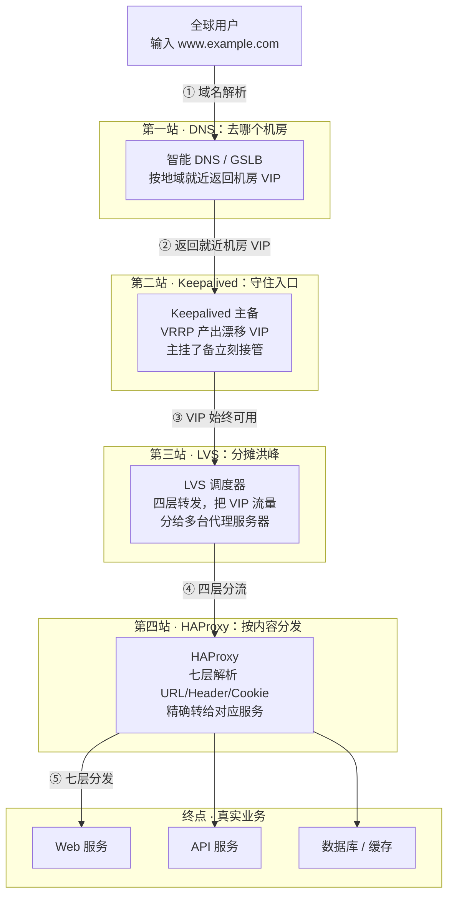
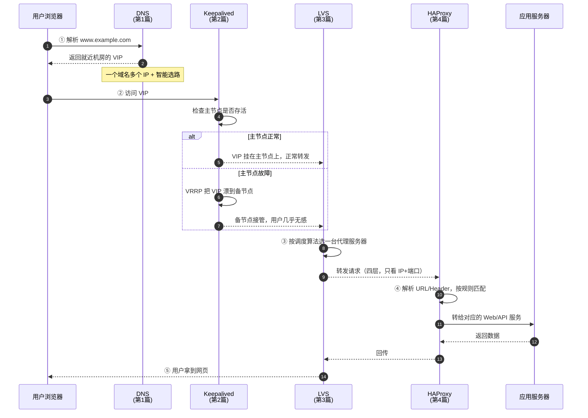

## 〇、这四篇是什么关系？

之前写了四篇小白入门文章，分别讲 DNS、Keepalived、LVS、HAProxy。它们不是四篇孤立的知识，而是**同一条流量链路上的四个环节**——用户点开一个网址，到拿到网页内容，请求会依次经过它们。

如果用一次送外卖来比喻：

- **DNS** 是"查地址"：先搞清楚顾客在哪个城市、该从哪个门店出餐；
- **Keepalived** 是"门店的值班经理"：保证门店大门始终有人守着，经理倒了副经理立刻顶上；
- **LVS** 是"门口的叫号员"：把涌进来的订单快速分给后厨的多个窗口；
- **HAProxy** 是"懂行的配餐员"：看清每单要什么（网址、内容），精确递给对应的厨师。

一句话串起来：**DNS 管方向，Keepalived 管不死，LVS 管流量，HAProxy 管内容。**

先看全景图，找到每个角色站在哪一环：

## 一、四篇各自解决什么问题？

| 文章 | 一句话定位 | 解决的核心问题 | 关键关键词 |
|------|-----------|----------------|-----------|
| [《DNS 入门》]() | 互联网的"查号台" | 名字翻译成地址；一个域名能返回多个 IP，做第一级分流 | 递归 / 迭代、TTL、A/CNAME、GSLB |
| [《Keepalived 入门》]() | 让服务"永不宕机"的幕后英雄 | 消除单点故障；VIP 在主备间漂移；健康检查自动摘坏节点 | VRRP、VIP、主备切换、脑裂 |
| [《LVS 入门》]() | 一台"前台"分给一群服务器 | 高并发扛洪峰；四层转发性能极强 | NAT / DR、调度算法、ipvsadm |
| [《HAProxy 入门》]() | 能看懂"网址"的智能调度员 | 按 URL / 请求头 / Cookie 智能分流；会话保持、SSL 终结 | 七层、ACL、健康检查、会话保持 |

它们合起来，正好回答了一个完整问题：**用户从输入网址到看到内容，中间每一环是怎么接力、怎么做到又快又稳的？**

## 二、一次访问的贯穿时序

把四篇里的时序图"合并"成一张，你就能看到各角色是怎么配合的。注意每一步属于哪一篇：

这张图的关键：**每一层只解决自己那一层的问题，层层接力**。DNS 不关心请求内容，LVS 不看 URL，HAProxy 不操心机房选址——各司其职，才换来了整个系统的高性能与高可用。

## 三、推荐阅读路线

两条路线，按你的目的选：

**路线 A：零基础系统学（推荐）**

1. 先读 [DNS 入门]() —— 搞清"名字怎么变成地址"，这是上网第一步；
2. 再读 [Keepalived 入门]() —— 理解"入口为什么不单点"；
3. 然后读 [LVS 入门]() —— 学"洪峰怎么被分摊"；
4. 最后读 [HAProxy 入门]() —— 看"精细分流怎么做"。

顺序正好是请求流动的方向，读完脑子里自然形成一条完整链路。

**路线 B：带着问题跳读**

- 想解决"一个域名怎么导向多个机房" → 看 DNS 篇第七节（配合负载均衡）；
- 想解决"负载均衡器自己挂了怎么办" → 看 Keepalived 篇；
- 想解决"亿级并发怎么扛" → 看 LVS 篇的 NAT / DR 对比；
- 想解决"按网址 / 用户做灰度、会话保持" → 看 HAProxy 篇。

## 四、横向速查表

四篇涉及的组件容易混，这张表帮你一次分清：

| 角色 | 工作层次 | 核心能力 | 典型搭档 | 切换速度 |
|------|----------|----------|----------|----------|
| DNS / GSLB | 域名解析 | 就近选路、跨机房分流 | 云解析、dnsmasq | 慢（受 TTL 影响，分钟级） |
| Keepalived | 网络层（VRRP） | VIP 漂移、主备高可用 | LVS、Nginx、MySQL | 快（秒级） |
| LVS | 四层（IP + 端口） | 高性能转发、扛洪峰 | Keepalived、Real Server | 快（秒级） |
| HAProxy | 七层（应用） | 按内容分流、会话保持、SSL 终结 | Nginx、后端应用 | 快（秒级） |

一句口诀再送一遍：**DNS 管方向，Keepalived 管不死，LVS 管流量，HAProxy 管内容。**

## 五、总结

这四篇从"名字怎么变成地址"讲到"请求怎么精确落到某个服务"，覆盖了一整套高可用负载均衡体系：

- **DNS** 让你用好记的名字上网，并做第一级跨机房分流；
- **Keepalived** 保证入口 VIP 永远有人值守；
- **LVS** 在内核层把海量请求分摊出去；
- **HAProxy** 看懂请求内容，做精细分发。

它们不是"四选一"的关系，而是**一套组合拳**：真实生产环境里往往四者同时上场，各守一层。理解了这个分层，你再看到任何一套高可用架构图，都能很快拆出"这是第几层、谁在干什么"。

四篇原文都在上面的链接里，按顺序读或直接跳到你关心的那一篇即可。
