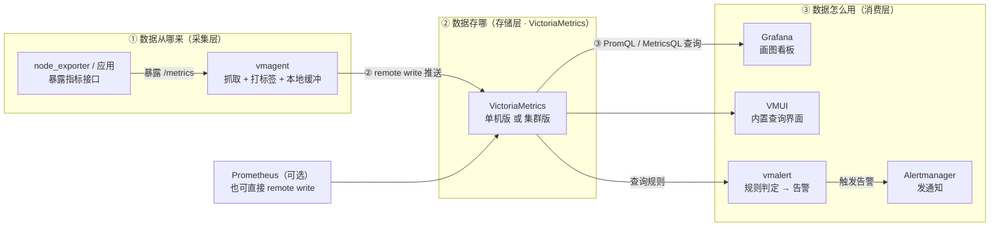
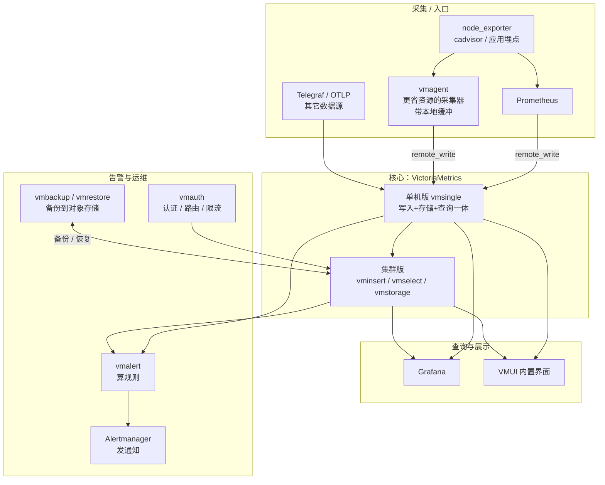
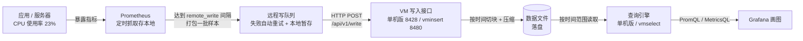
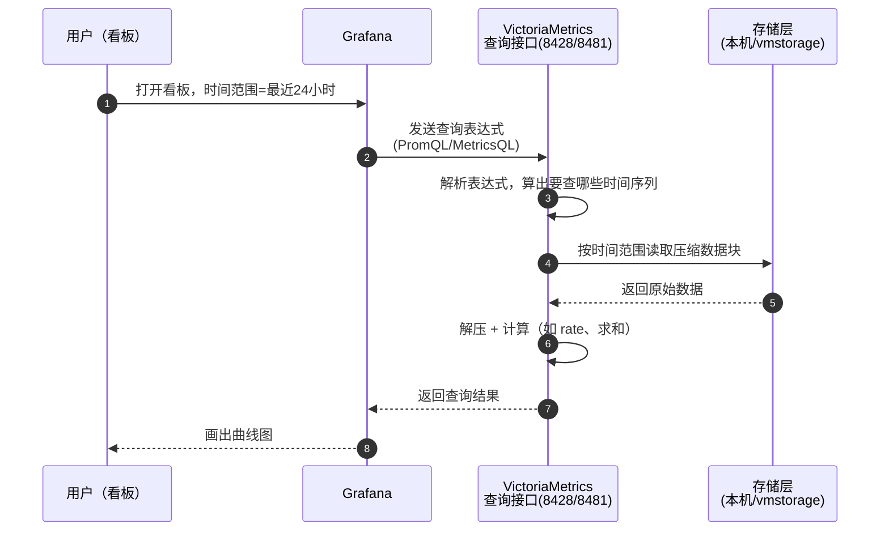
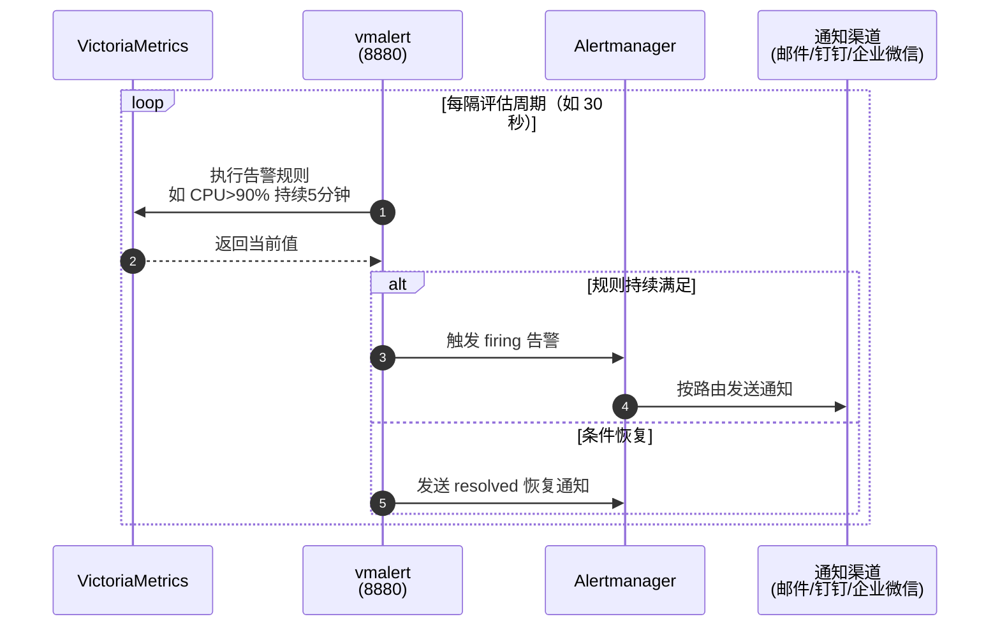

## 〇、先建立整体印象：它是一间存"带时间的数据"的仓库

先问一个问题：如果你的电脑每秒记一次 CPU 使用率，记一年，会得到什么？会得到**一串串「时间 + 数字」**，比如 `10:00:01 → 23%`、`10:00:02 → 25%`……这种"按时间排着队、不断追加、几乎不改"的数据，就叫 **时序数据（Time Series Data）**。

**VictoriaMetrics（简称 VM）就是专门存这种数据的仓库**，而且以"省"和"快"出名：同样的数据，它占用的磁盘和内存往往比同类产品少得多，查询还快。

生活化比喻：把监控数据想成超市的流水账。

- **Prometheus** 像店里自带的小账本，记当下、看短期很顺手，但本子放久了翻不动、也占地方；
- **VictoriaMetrics** 像后厨那间专门堆账本的大仓库：别的账本可以整箱运过来存着（兼容 Prometheus），堆得再满也能快速翻出任意一天的记录，而且同样多的账本它叠得特别省地方。

一句话记住它：**VM = 时序数据的省钱仓库，既能当 Prometheus 的长期存储，也能独立扛下整套监控。**

先看它在整套监控里站在哪：



## 一、它到底解决什么问题？

VM 主要是被 Prometheus 的"成长烦恼"催生出来的。Prometheus 很好用，但规模一大就遇到几道坎：

| 痛点 | Prometheus 单机的处境 | VM 怎么解决 |
|------|----------------------|-------------|
| **长期存储** | 数据默认存本地磁盘，保留几个月就吃紧 | 专为长期存储设计，存几年也经济 |
| **资源消耗** | 数据点多了内存涨得凶，高基数（标签组合爆炸）容易 OOM | 高压缩、低内存，官方称单样本常低于 1 字节 |
| **单点与扩容** | 单机存所有数据，不好横向扩展 | 集群版把写、查、存拆开，各自水平扩展 |
| **多套数据聚合** | 多个 Prometheus 的数据分散，查询要分别连 | 统一收口，一个入口查所有 |
| **兼容性** | 只用 PromQL | 兼容 Prometheus 写入/查询协议，还扩展出 MetricsQL |

**为什么它能这么省？** 核心是它的存储引擎会按时间块把数据打包压缩（可以理解成把大量相似的账本页压缩成一小摞），再加上对"活跃时间序列"的内存占用做了优化。对小白来说，只要记住结论：**同样一台机器，VM 能存更多数据、跑得更稳**。

## 二、一般都在哪些场景用？

| 场景 | 怎么用 VM |
|------|-----------|
| **Prometheus 长期存储** | Prometheus 只留近期热数据，历史数据 `remote_write` 到 VM 存一年甚至更久 |
| **直接替代 Prometheus** | 用 vmagent 采集 + VM 存储 + vmalert 告警，完全不部署 Prometheus |
| **多套监控数据汇总** | 多个机房 / 多个集群的 Prometheus 统一写到中心 VM，一处查询 |
| **大规模监控** | 单机版不够时上集群版，写入、查询、存储各自扩容 |
| **物联网 / 业务指标** | 传感器、订单、用户行为等带时间戳的指标持续入库分析 |
| **多租户平台** | 集群版支持用 account ID 隔离不同客户的数据 |
| **边缘到中心** | 边缘用 vmagent 缓冲，网络断了先存本地，恢复后续传 |

一句话判断：**只要你的数据是"不断产生、按时间查、要留存很久"，VM 就派得上用场。**

## 三、和哪些软件配合使用？

VM 很少单打独斗，它在一个监控体系里的"朋友圈"很清晰：



- **数据源侧**：`node_exporter`（机器指标）、应用埋点、`Prometheus`（`remote_write` 推过来）、`vmagent`（VM 自家采集器，更省资源、断网可缓冲）、以及 Telegraf / OTLP 等。
- **展示侧**：**Grafana**（把 VM 当 Prometheus 数据源配）、VM 自带的 **VMUI**（浏览器直接查）。
- **告警侧**：**vmalert** 负责按规则判定，**Alertmanager** 负责把告警发到钉钉 / 邮件 / 企业微信。
- **运维侧**：**vmauth** 做认证和路由，**vmbackup / vmrestore** 做备份恢复，K8s 里还有 **VictoriaMetrics Operator** 帮你托管集群。

## 四、单机版还是集群版？先搞清组件

VM 有两种形态，新手常常分不清。

**单机版（vmsingle）**：一个进程搞定写入、存储、查询，默认端口 `8428`。**绝大多数场景选它就够了**——它本身能抗住每秒上百万数据点。

**集群版**：把功能拆成三个角色，适合超大规模：

| 组件 | 默认端口 | 角色 | 是否有状态 |
|------|----------|------|-----------|
| **vminsert** | 8480 | 写入入口，接收数据并按算法分片给存储节点 | 无状态，可随意加实例 |
| **vmselect** | 8481 | 查询入口，向各存储节点取数并汇总 | 无状态，可随意加实例 |
| **vmstorage** | 8482 | 真正存数据的地方 | **有状态**，是核心 |

集群版的数据通路是：`写入 → vminsert（分片）→ vmstorage（落盘）`；`查询 → vmselect（广播取数）→ vmstorage → 汇总返回`。因为 vminsert 和 vmselect 都无状态，压力大时直接加机器；只有 vmstorage 持有数据，扩容时要考虑数据迁移。

其它常见组件的端口一并记住：`vmagent 8429`、`vmalert 8880`、`vmauth 8427`。

## 五、写进去的数据，走过了一条什么路？（数据流图）

以最常见的"Prometheus remote_write 到 VM"为例，一条 CPU 指标的完整旅程：



几个关键点：

1. **remote_write 是"推"**：不是 VM 去拉，而是 Prometheus 定时把数据打包推给 VM。
2. **队列会缓冲**：网络抖动或 VM 短暂不可用时，Prometheus 会把数据暂存、重试，恢复后续传——这是数据不丢的关键。
3. **写入接口兼容 Prometheus 协议**：所以 Prometheus 几乎不用改概念，加一段配置就能写进来。
4. **落盘时压缩**：同样的数据被压成紧凑格式，这是 VM 省磁盘的根本原因。

## 六、查询和告警是怎么跑起来的？（时序图）

看数据（Grafana 查询）的时序：



告警（vmalert）的时序：



注意 vmalert 的思路：它**不存数据**，只是定时向 VM 提问"现在满足条件吗"，满足条件就交给 Alertmanager 去发通知。职责拆得很干净。

## 七、动手实践：最小可运行配置

### 7.1 用 Docker 起一个单机版 VM

```bash
docker run -d \                                      # 后台运行容器
  --name vm \                                         # 容器起名 vm，方便后续管理
  -p 8428:8428 \                                      # 把容器 8428 端口映射到主机（默认查询/写入端口）
  -v vmdata:/victoria-metrics-data \                  # 挂一个数据卷，容器删了数据也还在
  victoriametrics/victoria-metrics:latest \           # 官方单机版镜像
  -retentionPeriod=1y \                               # 数据保留 1 年（可写 90d / 12 / 1y）
  -storageDataPath=/victoria-metrics-data             # 指定数据落盘目录，和上面的卷对应
```

验证是否起来：

```bash
curl http://localhost:8428/health                     # 返回 OK 说明服务正常
```

浏览器打开 `http://localhost:8428/vmui`，就能看到内置查询界面了。

### 7.2 写一条测试数据并查出来

```bash
curl -X POST 'http://localhost:8428/api/v1/import/prometheus' \  # 走 Prometheus 文本格式导入接口
  -d 'cpu_usage{host="server01"} 23'                             # 写入一条样本：指标名+标签+数值
```

```bash
curl -G 'http://localhost:8428/api/v1/query' \         # 调用即时查询接口
  --data-urlencode 'query=cpu_usage{host="server01"}'  # 查询刚才写入的指标
```

能查到 `23`，说明写入和查询链路都通了。

### 7.3 让 Prometheus 把数据写到 VM

在 `prometheus.yml` 末尾加这一段（其余配置不动）：

```yaml
remote_write:                                  # 远程写入配置（Prometheus 定时把数据推给外部存储）
  - url: http://<VM地址>:8428/api/v1/write      # VM 单机版的写入地址；集群版改成 vminsert:8480/insert/0/prometheus/api/v1/write
    queue_config:                              # 队列参数，决定堆积和重试行为
      capacity: 5000                           # 内存中每批样本队列的容量
      max_shards: 10                           # 并发发送的最大分片数，越大吞吐越高
      max_samples_per_send: 1000               # 每次 HTTP 请求最多带多少样本
```

改完重启 Prometheus，稍等片刻，在 VMUI 里查 `up` 指标，能看到 Prometheus 抓上来的数据就成功做了长期存储。

### 7.4 用 vmagent 替代 Prometheus 直接采集（可选）

```bash
docker run -d \                                          # 后台运行
  --name vmagent \                                       # 容器名
  -p 8429:8429 \                                         # 暴露 vmagent 端口
  -v $(pwd)/scrape.yml:/etc/vmagent/scrape.yml \         # 挂载抓取配置
  victoriametrics/vmagent:latest \                       # 官方 vmagent 镜像
  -promscrape.config=/etc/vmagent/scrape.yml \           # 指定抓取配置文件（写法和 Prometheus 的 scrape_configs 一样）
  -remoteWrite.url=http://vm:8428/api/v1/write           # 抓到的数据推给 VM（vm 是上一步起的容器名）
```

`scrape.yml` 内容：

```yaml
scrape_configs:                        # 抓取任务列表，格式与 Prometheus 一致
  - job_name: 'node'                   # 任务名，会作为 label 加到指标上
    static_configs:                    # 静态目标配置（写死地址）
      - targets: ['127.0.0.1:9100']    # node_exporter 的地址；容器里换成宿主机可达地址
```

vmagent 比 Prometheus 更省资源，还会用本地磁盘做缓冲——网络断了数据先攒着，恢复后继续推。

## 八、横向对比：VM 和它的对手们

| 维度 | VictoriaMetrics | Prometheus（单机） | InfluxDB | Thanos / Mimir |
|------|-----------------|-------------------|----------|----------------|
| 数据模型 | 时序 + 标签 | 时序 + 标签 | 时序 + 标签 | 兼容 Prometheus |
| 查询语言 | PromQL + MetricsQL | PromQL | InfluxQL / Flux | PromQL |
| 资源效率 | **很高**（主打省） | 中等 | 中等 | 需对象存储 + 多组件 |
| 长期存储 | **原生强项** | 弱（本地为主） | 可以 | 强（依赖对象存储） |
| 部署复杂度 | 单机极简，集群中等 | 简单 | 简单 | 较复杂 |
| 适合谁 | 想要省心省钱的监控存储 | 中小规模、短期监控 | 通用时序场景 | 已在 K8s、要对象存储方案 |

**怎么选**：中小规模、想长期留存又不想折腾 → **VM 单机版**；超大规模、要多租户 → **VM 集群版**；已经重度使用 Thanos 生态 → 继续用也无妨。VM 的一个巨大优势是**兼容 Prometheus 协议**，迁移成本很低。

## 九、常见坑与排错

| 现象 | 可能原因 | 怎么查 / 怎么解 |
|------|----------|-----------------|
| Prometheus 写入报 4xx / 5xx | VM 地址或路径写错 | 核对 `url`，单机版是 `/api/v1/write` |
| 数据写进去了但 Grafana 查不到 | 数据源地址配错、时间范围不对 | 先在 VMUI 里查，能查到就是 Grafana 配置问题 |
| 内存 / 磁盘涨得快 | **高基数**：标签取值太多太散 | 用 VMUI 的基数分析功能找出"罪魁"标签 |
| 数据保留时间不符合预期 | `retentionPeriod` 没设或设短了 | 检查启动参数，单机版默认只留 1 个月 |
| 集群版查不到数据 | 写到了 vminsert 却查错了 vmselect | 确认读写两边 tenant（account ID）一致 |

一个特别提醒：**高基数是时序数据库的头号杀手**。如果你给指标加了个"用户 ID"标签，一百万用户就是一百万条序列，再省的仓库也扛不住。标签要用来区分"类别"，不要用来装"唯一值"。

## 十、总结

回到开头那句话：**VictoriaMetrics 是时序数据的省钱仓库。**

- 它靠**压缩存储**解决 Prometheus 的长期存储与资源消耗问题；
- **兼容 Prometheus** 的写入和查询协议，接入成本极低，还扩展出 MetricsQL；
- **单机版**一个进程就能用，覆盖绝大多数场景；**集群版**拆成 vminsert / vmselect / vmstorage，各司其职、水平扩展；
- 配套 **vmagent**（采集缓冲）、**vmalert**（告警）、**Grafana**（展示）、**Alertmanager**（通知），组成完整监控体系。

一句话口诀：**采集用 vmagent，存储用 VM，看图用 Grafana，告警 vmalert + Alertmanager。**

想动手实操的话，本站还有两篇配套文章：

- [《CentOS Stream 9 安装 VictoriaMetrics》]()——从二进制安装到 systemd 服务，一步步落地单机版；
- [《CentOS Stream 9：Prometheus 对接 VictoriaMetrics 长期存储》]()——完整走一遍 `remote_write` 配置与数据流转验证。

两篇实操 + 这一篇原理，正好从"懂"到"会"。
