你在北京打开一个部署在广州的网站，第一个字节回来之前，要等 **30～40 毫秒**。听起来不多？但一个页面有 80 个请求，光"路上"就要花掉两秒多。如果服务器在另一个大洲，这个数字会变成 **200 毫秒以上**——用户会明确感到"卡"。

**CDN（Content Delivery Network，内容分发网络）** 做的事只有一句：**把内容提前搬到离用户几十公里内的地方**，让"跑一趟"变成"下楼取"。

这篇文章按技术文档的方式讲透它：**解决什么问题 → 架构分几层 → 一次请求怎么走 → 缓存怎么管 → 用什么软件搭 → 什么场景用**。术语第一次出现都给英文全称和中文解释。

> 本文核对日期：2026 年 11 月 24 日。文中 nginx 配置片段（第八节）已在 **nginx 1.30.8** 上通过 `nginx -t` 语法校验，并实测出 `MISS → HIT → BYPASS` 三种缓存状态；商业 CDN 的调度与配额细节各家不同，以厂商文档为准。

## 〇、一句话、一张全景图

**一句话**：CDN 是一张**分布在全球的边缘缓存网络**——它替你接住用户请求，手上有就直接给，没有才回源站取一次，然后留一份给后面的人。

用生活场景打比方：**它不是把图书馆搬到你楼下，而是在每个小区门口开了一个快递柜**。第一次有人要某本书，快递柜空了，得去总馆调（**回源**）；调来之后放柜里，后面这个人再来就直接拿走（**命中**）。

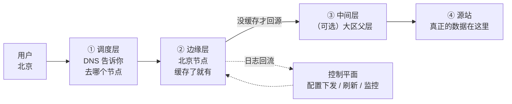

**先记住这条主线**：DNS 先把你**调度**到最近节点 → 节点**查本地缓存** → 命中就直接返回，未命中才**回源** → 回源拿到内容**存一份** → 下次别人来就命中了。

几个词先用白话过一遍：

| 词 | 白话解释 |
| --- | --- |
| CDN | 内容分发网络。一堆分布各地的缓存服务器，替源站接客 |
| 源站（origin） | 内容真正存放的地方，你的服务器或对象存储 |
| 边缘节点（edge / PoP） | 离用户最近的那一层服务器，真正接请求的地方 |
| 回源（origin fetch） | 边缘没缓存，去源站取一次 |
| 命中（hit）／未命中（miss） | 边缘有没有这份内容 |
| 缓存键（cache key） | 判断"这两个请求是不是要同一份内容"的依据 |
| TTL | 这份缓存能放多久（Time To Live，生存时间） |
| 调度（scheduling） | 决定"这个用户该去哪个节点" |
| 刷新（purge）／预热（prefetch） | 主动删掉旧缓存／主动提前把内容推下去 |

**本文路线**

| 章节 | 回答的问题 |
| --- | --- |
| 〇 | 一句话、全景图、术语速览 |
| 一 | 没有 CDN，慢在哪？贵在哪？ |
| 二 | CDN 到底是什么？不只是"缓存服务器" |
| 三 | 架构：调度层、边缘层、中间层、源站、控制平面 |
| 四 | 时序：一次首次请求要走多少步？命中时又是什么样？ |
| 五 | 数据流：内容怎么从源站"铺"到全国 |
| 六 | 缓存怎么管：键、TTL、校验、合并、失效 |
| 七 | 需要配合什么软件：从边缘到调度的完整清单 |
| 八 | 实战：用 nginx 搭一个能跑的边缘节点 |
| 九 | 使用场景：什么时候该用，什么时候别用 |
| 十 | 十个最常见的坑 |
| 附录 | 术语中英对照表 |

## 一、没有 CDN，慢在哪、贵在哪？

先算三笔账。

### 1.1 第一笔：物理距离是硬约束

光在光纤里的速度约 **20 万公里/秒**（真空的 2/3）。

| 链路 | 单程距离 | 理论单程耗时 | 实际 RTT（往返） |
| --- | --- | --- | --- |
| 北京 → 上海 | 约 1200 km | 6 ms | 15～25 ms |
| 北京 → 广州 | 约 1900 km | 9.5 ms | 30～40 ms |
| 上海 → 洛杉矶 | 约 10500 km | 52 ms | 150～180 ms |
| 上海 → 法兰克福 | 约 9200 km | 46 ms | 200～250 ms |

**RTT**（Round-Trip Time，往返时延）为什么比"单程 × 2"还大？因为光缆不是直线，还要经过几十台路由器，每台都要排队、查表、转发。

**关键在于：一次 HTTPS 请求要跑好几个 RTT。**

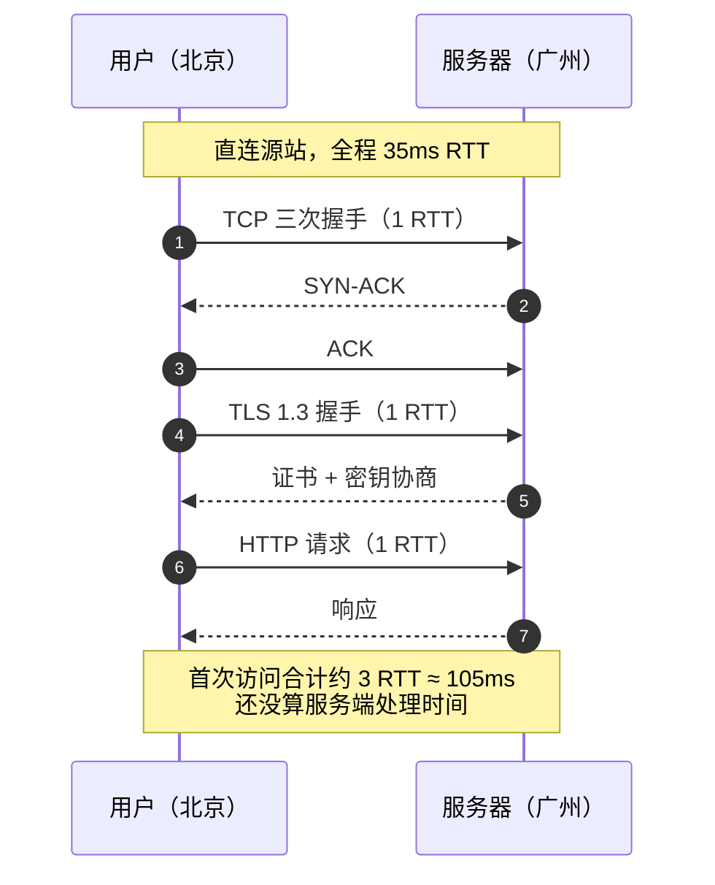

一个页面有 80 个静态资源，就算浏览器用 6 条并发连接跑，也要 **十几轮 RTT**，光"等路上"就一两秒。

**CDN 的解法很粗暴**：把 RTT 从 35ms 降到 3ms（同城节点），3 RTT 就从 105ms 变成 9ms。**没有任何算法优化能比"缩短物理距离"更有效。**

### 1.2 第二笔：带宽是要花钱的

假设一个页面 2 MB，日活 10 万，每人看 5 个页面：

```
每天流量 = 2 MB × 5 × 100000 = 1 TB
每月流量 = 30 TB
```

- 全部打源站：源站出口带宽要扛住峰值（假设峰值是均值的 5 倍），机房带宽成本直线上升。
- 上了 CDN，命中率按 95% 算：**源站只需要出 5% 的流量**，即每天 50 GB。

**这就是 CDN 的商业本质：用"边缘的低价带宽"换"源站的高价带宽 + 服务器成本"。**

### 1.3 第三笔：源站会被打垮

促销开场那一秒，十万个用户同时刷新。源站的 Nginx 再强，也有连接数上限、磁盘 IO 上限。**CDN 在这一刻扮演的是"缓冲池"**：所有请求先落在全国几百个节点上，只有缓存没命中的那 5% 才落到源站。

顺带它还挡住了两类攻击：**DDoS**（流量打到节点上，源站看不见）和**缓存穿透**（用随机 URL 刷你的动态页，如果有 404 缓存和限速就能挡住）。

**一句话总结 CDN 的三重价值**：

| 价值 | 手段 | 效果 |
| --- | --- | --- |
| 更快 | 缩短物理距离 | RTT 从 35ms → 3ms |
| 更省 | 边缘承担 90%+ 流量 | 源站带宽降一个数量级 |
| 更稳 | 缓存兜底 + 分散攻击面 | 源站扛住流量尖峰 |

## 二、CDN 到底是什么？

很多人以为 CDN 就是"很多台缓存服务器"。**不完整。** 一个能用的 CDN 必须有四件东西：

**① 一层缓存（cache）**：把内容存在离用户近的地方，这是主体。
**② 一套调度（scheduling）**：知道"这个用户该去哪个节点"。没有调度，缓存再多也没用——用户不会自己找最近的节点。
**③ 一条回源链路（origin fetch path）**：缓存没有时，怎么高效地去源站取、取完怎么存。
**④ 一个控制平面（control plane）**：配置怎么下发到几千个节点、缓存怎么刷新、日志怎么收回来。

**这四件事缺一不可**，也解释了为什么"自己拿 nginx 开个缓存"不等于 CDN——你缺的是调度和控制平面。

### 和"反向代理"的区别

| | 反向代理（如单台 nginx） | CDN |
| --- | --- | --- |
| 位置 | 一台/几台，通常在源站前面 | 几百上千个，分布在各地 |
| 调度 | 靠 DNS 或负载均衡 | 专门的 GSLB，按地理位置/运营商/健康度选 |
| 缓存 | 有 | 有，但只是基础能力 |
| 失效 | 手动删本机文件 | 一次 API 调用，全网秒级生效 |
| 安全 | 有限 | WAF、DDoS 清洗、Bot 管理 |
| 运维 | 自己管 | 厂商管，你只管配置 |

**CDN = 反向代理 + 全局调度 + 分布式控制平面 + 安全能力。**

## 三、架构：五层

这是本文最重要的一张图。**数据路径**（用户请求怎么走）和**控制路径**（配置怎么下去）是两条完全不同的线。

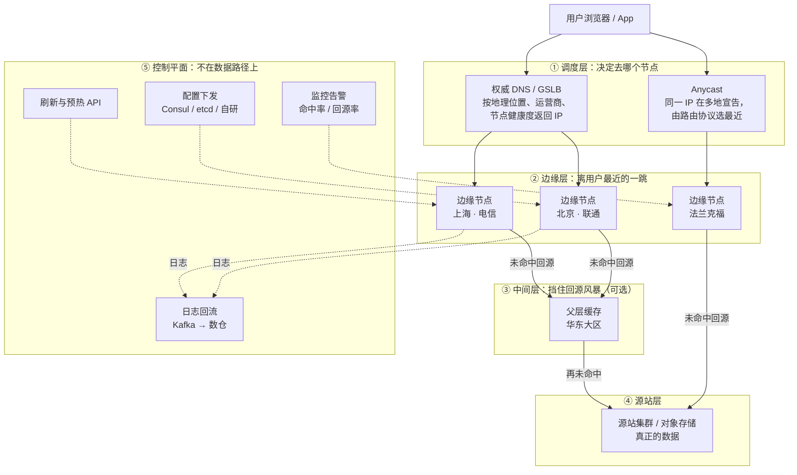

### 3.1 调度层：为什么"就近"没那么简单

调度层只回答一个问题：**这个用户的请求，应该交给哪个节点？**

三种主流做法，各有取舍：

| 方式 | 原理 | 优点 | 缺点 |
| --- | --- | --- | --- |
| **DNS 调度**（CNAME 到 GSLB） | 用户解析你的域名，CNAME 到 CDN 的调度域名，权威 DNS 按来源 IP 返回最近节点的 A 记录 | 实现简单、通用、可精确到省市和运营商 | **受 LocalDNS 影响**，解析结果会被缓存，切换有延迟（受 TTL 约束） |
| **Anycast** | 同一个 IP 在全球多个节点同时用 BGP 宣告，路由协议自动把包送到"最近"的那个 | 切换快（路由收敛）、抗 DDoS 天然分散 | 需要自有 IP 段和 AS 号；路由抖动会影响会话；对运营商间路由敏感 |
| **HTTP 302 跳转** | 先回一个跳转，让客户端去指定节点 | 可以做很精细的策略 | 多一次往返，体验差，基本被淘汰 |

**DNS 调度的核心难题是 LocalDNS**：用户用的是 `114.114.114.114` 这类公共 DNS，CDN 的权威 DNS 看到的"来源 IP"是**这个 DNS 服务器**，不是用户本人。于是出现了 **ECS**（EDNS Client Subnet，EDNS 客户端子网）：解析请求里带上用户的网段前缀，让权威 DNS 能看到"大概是哪个小区的用户"。

> 顺带说一句：Anycast 用的就是 BGP。**同一条前缀在多个机房宣告，路由协议天然选"AS_PATH 最短"的那条**，用户就被送到最近的机房。这也是为什么全球根 DNS、8.8.8.8 这类服务能做到"一个 IP 全球可用"。

### 3.2 边缘层：一台节点长什么样

边缘节点不是"一台装了大硬盘的服务器"，而是一组角色：

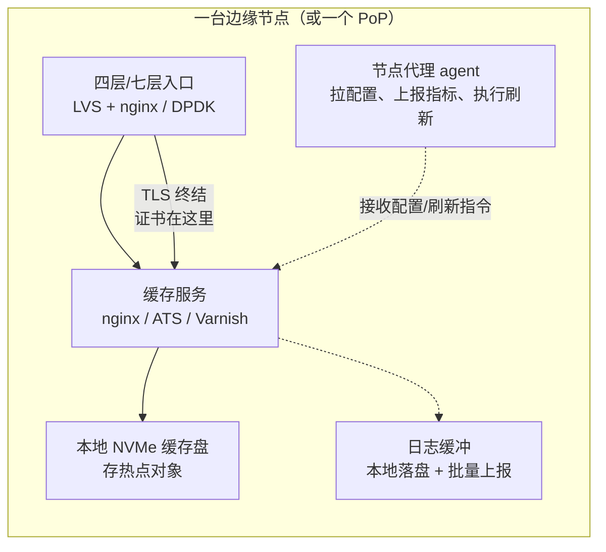

四个要点：

- **TLS 在这里终结**：用户和节点之间是 HTTPS，节点和源站之间可以再走 HTTPS（**回源 TLS**）。证书由控制平面统一下发和续期。
- **缓存盘用 NVMe**：命中率取决于"热点内容能不能装下"，机械盘扛不住随机读。
- **节点有 agent**：它是控制平面在节点上的"手"，负责拉配置、执行刷新、上报指标。**agent 挂了节点还能继续服务（用旧配置），这是设计上的重要容错。**
- **一台物理机跑多个逻辑节点**：大厂会按租户隔离资源，避免一个客户的流量打爆整机。

### 3.3 中间层：为什么要"再套一层缓存"

如果全国 300 个节点都没缓存，同时回源，源站会被 **300 倍** 的请求打穿。这叫**回源风暴**。

解法是**分层缓存**（也叫父层 / mid-tier / shield）：

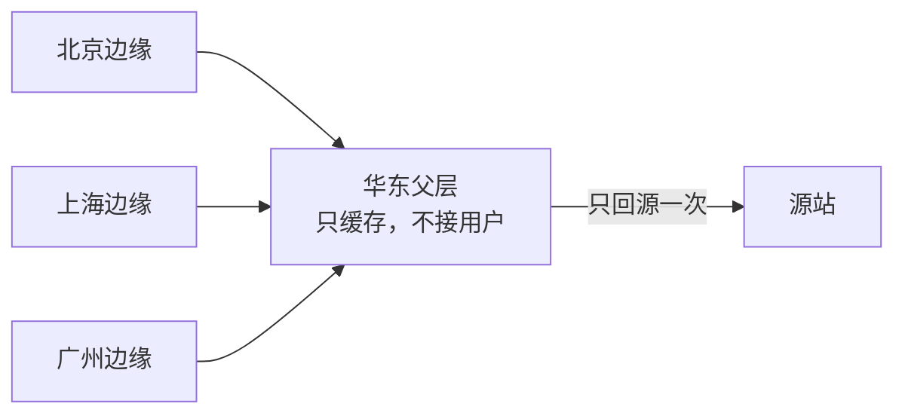

同一个对象，300 个边缘节点各自回源 = 300 次；经过父层收敛后 = **1 次**。父层通常按大区部署（华东、华北、华南、欧美），用**一致性哈希**决定"某个 URL 归哪个父层"，这样同一个对象总是打到同一台父层机器，命中率才高。

**代价是多一跳**：边缘 → 父层 → 源站，延迟增加。所以父层只对"回源成本高 / 回源频率高"的内容启用，或者设置"边缘直连源站优先、连续未命中的才走父层"。

## 四、时序：一次请求的完整旅程

### 4.1 首次访问（未命中）

这是最完整的一条链路，也是最该背下来的一张图。

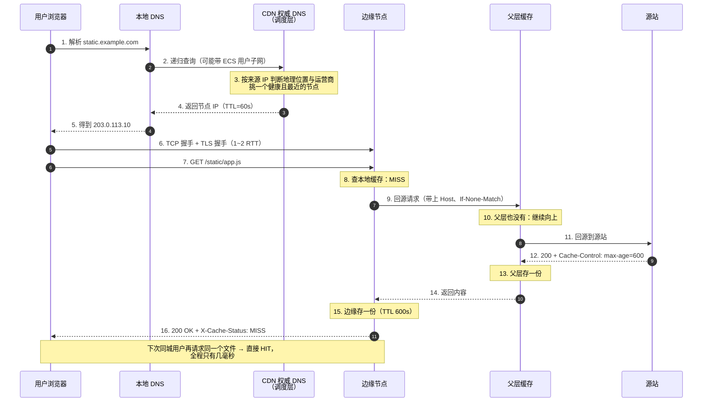

**注意第 9 步的 `If-None-Match`**：边缘有"过期但还在"的内容时，会先拿 **ETag**（内容指纹）问源站"变了没"。没变，源站只回一个 **304 Not Modified**（没有正文），边缘刷新 TTL 继续用旧内容。**这一步能省掉 90% 以上的回源流量**。

### 4.2 第二次访问（命中）

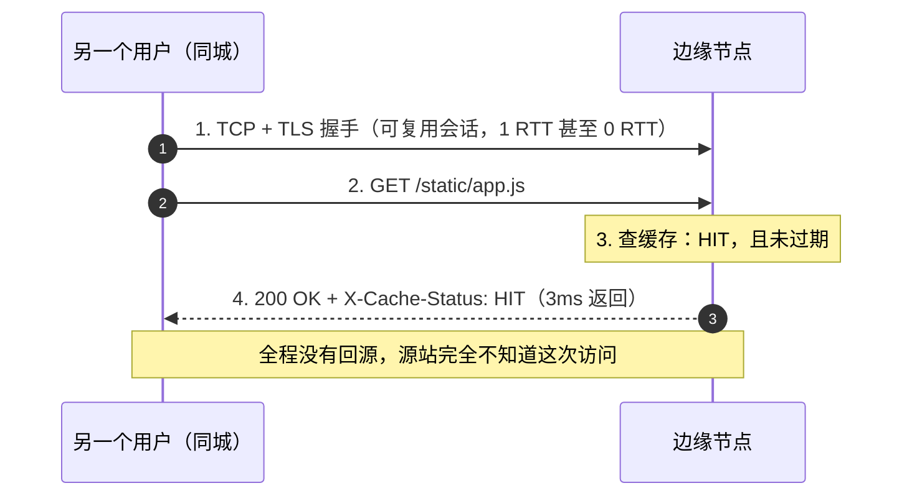

**这就是 CDN 的全部魔法**：把"跨半个中国的一次往返"变成"同城的一次往返"，而且源站连这个请求都看不见。

### 4.3 内容更新：刷新与预热

内容改了就完了——用户看到的还是旧缓存。所以必须有两个反向操作：

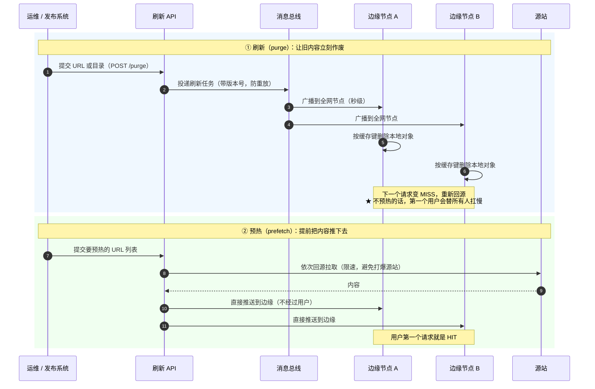

**刷新和预热必须成对使用**：发布新版本时，先刷新旧对象，再预热新对象。只刷新不预热，等于让第一个用户当"人肉预热器"。

## 五、数据流：内容怎么"铺"到全国

时序图讲的是"一次请求"，数据流图讲的是"内容怎么分布"。两条方向相反的流：

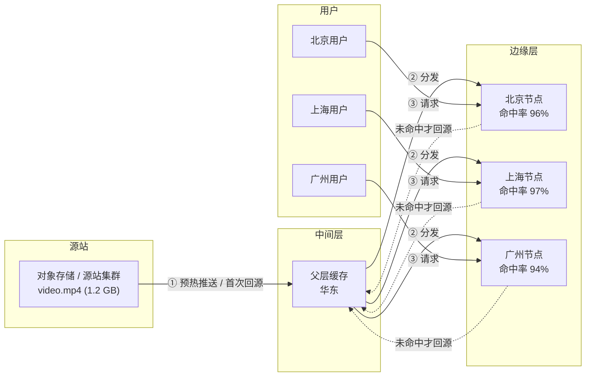

三条流要分清：

1. **内容下行流（① ②）**：源站 → 父层 → 边缘。触发方式有三种：预热主动推、用户请求被动拉、定时巡检主动拉。
2. **用户请求流（③）**：用户 → 边缘，绝大多数在这里就结束了。
3. **回源流（虚线）**：只有未命中才发生，方向与请求流相反。**回源率 = 1 - 命中率**，这是 CDN 最重要的指标。

**一个数字感受差异**：假设命中率 96%，每天 100 TB 用户流量 → 源站只出 4 TB。命中率从 96% 提到 98%，源站带宽就减半。**优化 CDN 本质上是在优化命中率。**

### 5.1 大文件（视频）的特殊路径

1.2 GB 的视频不可能整段缓存（装不下也浪费）。常用两招：

**① Range 请求 + 分片缓存**：播放器请求 `Range: bytes=0-1048575`，边缘只缓存这 1 MB 片段，用户拖到哪就缓存哪段。**这叫按需分片，热点片段自带局部性。**

**② 分片回源（slice）**：边缘把一个大文件切成固定大小的块（如 1 MB），每块独立缓存、独立回源。好处是"多个用户同时看同一个视频的不同位置"时，回源请求可以被切成并行的小块，也能合并相同块的请求。

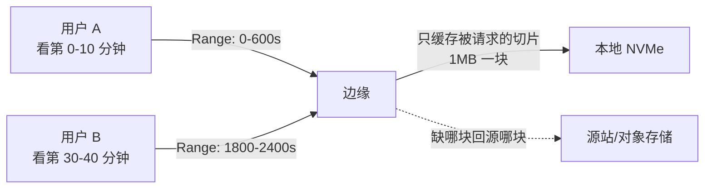

## 六、缓存怎么管：六个必须懂的概念

这一节是 CDN 的"内功"。**配置 CDN 90% 的坑，都出在这六个概念上。**

### 6.1 缓存键（cache key）：什么算"同一个文件"

缓存键是 CDN 判断"这两个请求是不是要同一份内容"的依据。最常见的形式：

```
默认：scheme + host + uri（含查询串）
例：https cdn.example.com /static/app.js?v=2
```

**关键取舍**：查询串算不算进缓存键？

| 配置 | 后果 |
| --- | --- |
| 包含查询串（默认） | `?v=1` 和 `?v=2` 是两份缓存，**安全但命中率低** |
| 忽略查询串 | 命中率极高，但**容易串内容**（不同参数返回不同内容时就出事） |
| 只忽略指定参数（忽略 `utm_*`、`from=` 这类营销参数） | **最佳实践**：既提升命中率又不出错 |

### 6.2 TTL 与 Cache-Control：缓存活多久

TTL 由源站的响应头决定，CDN 会尊重它（也可以被 CDN 配置覆盖）。必须认识的指令：

| 响应头 | 含义 | 典型用法 |
| --- | --- | --- |
| `Cache-Control: max-age=600` | 缓存 600 秒 | 普通静态资源 |
| `Cache-Control: s-maxage=3600` | **只对共享缓存**（CDN、代理）生效，优先级高于 max-age | 想让 CDN 缓存久、浏览器缓存短 |
| `Cache-Control: no-store` | 完全不缓存 | 支付页、个人信息 |
| `Cache-Control: private` | 只允许浏览器缓存，CDN 不许存 | 登录后的页面 |
| `Cache-Control: no-cache` | **可以存，但每次用前必须回源校验** | 需要"最新但可复用"的内容 |
| `Cache-Control: public, max-age=31536000, immutable` | 一年不变，永不校验 | 带内容哈希的文件名（`app.a3f9.js`） |
| `ETag` / `Last-Modified` | 内容指纹 / 最后修改时间，配合 304 校验 | 省回源流量 |
| `Vary: Accept-Encoding` | 缓存键要区分 gzip / br 版本 | 开了压缩就必须有 |

**一条黄金法则**：**文件名带内容哈希的资源，TTL 设一年且 immutable；HTML 入口文件，TTL 设 0～60 秒。** 这样既能长期缓存，又能即时发布新版本。

### 6.3 过期不删：stale-while-revalidate

这是让"更新"和"快"不再矛盾的关键机制（RFC 5861）：

```
Cache-Control: max-age=60, stale-while-revalidate=600
```

含义：60 秒内的缓存是"新鲜"的；60 秒后进入"过期但可用"状态，**先立刻把旧内容返回给用户（快），同时后台去回源刷新（新）**。下一个用户就能拿到新内容。

还有 `stale-if-error=86400`：**源站挂了，继续用一天前的旧内容顶着**。这是 CDN 高可用最有效的一招——**宁可给旧内容，也不要给 502**。

### 6.4 请求合并（request collapsing）

新品开售瞬间，一万个用户同时请求同一个商品图，边缘缓存正好过期——**如果一万个请求同时回源，源站当场去世**。

解法是**请求合并**：同一个缓存键，**只放一个请求回源，其他全部挂起等结果**，拿到后一起返回。nginx 里就是这两行：

```nginx
proxy_cache_lock on;          # 开合并
proxy_cache_lock_timeout 5s;  # 等 5 秒还没结果就放过一个
```

### 6.5 缓存失效：purge 与 surrogate key

三种粒度，从粗到细：

| 方式 | 精度 | 适用 |
| --- | --- | --- |
| **整站刷新** | 全部 | 灾难恢复，慎用（等于让全网缓存清空、回源风暴） |
| **URL / 目录刷新** | 单条或前缀 | 最常见。`/static/app.js` 或 `/static/2026/` |
| **标签刷新**（surrogate key / cache tag） | 按业务标签批量 | 最优雅：给响应打 `Surrogate-Key: product-123`，商品改了刷这个标签，**所有相关 URL 一次全废** |

**标签刷新的价值**：一个商品出现在首页、列表页、详情页、推荐位……有几十个 URL。按 URL 刷要列几十条，按标签刷只要一条，而且不会漏。

### 6.6 Vary：一个不小心就把命中率打骨折的头部

`Vary: Accept-Encoding` 是对的（gzip 和非 gzip 是两份缓存）。但如果你写了 `Vary: User-Agent`，**每个浏览器版本都会生成一份缓存**，命中率瞬间跌到个位数。

**原则：Vary 里只放"真的会改变响应内容"的头部，通常只有 `Accept-Encoding`。**

## 七、需要配合什么软件

CDN 不是单个软件，而是一整套系统。按角色分类，**自建就从左到右凑齐，用商业 CDN 则只需要管最右一列**。

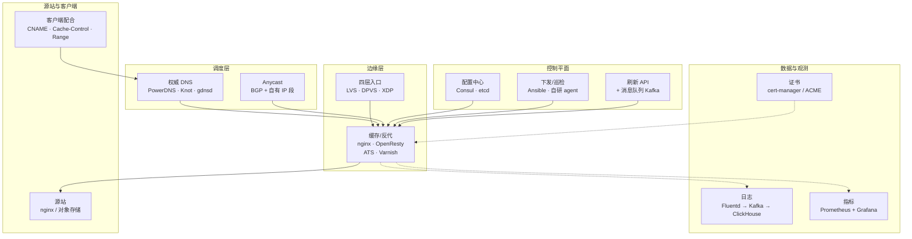

### 7.1 边缘缓存软件：五个选一个

| 软件 | 语言 | 特点 | 适合谁 |
| --- | --- | --- | --- |
| **nginx** | C | 最通用，`proxy_cache` 够用，配置生态最广，性能好 | **默认首选**，中小规模自建 |
| **OpenResty** | C + Lua | nginx + LuaJIT，能在请求链路里写业务逻辑（鉴权、改写、AB 测试） | 需要边缘逻辑（防盗链、灰度、边缘计算） |
| **Apache Traffic Server（ATS）** | C++ | Yahoo 出身，专为大型 CDN 设计，磁盘缓存和分层缓存能力强 | 大规模自建 CDN |
| **Varnish Cache** | C + VCL | VCL 配置语言极灵活，缓存策略表达力最强，纯内存为主 | 缓存策略复杂、对象不大的场景 |
| **Squid** | C | 老牌代理缓存，功能全但性能一般 | 传统代理、合规审计场景 |

**怎么选**：先问"要不要在边缘跑逻辑"。要 → OpenResty；不要 → nginx；规模上到几百节点、需要精细的磁盘缓存管理 → ATS。

### 7.2 调度软件

| 需求 | 方案 |
| --- | --- |
| 按地理位置/运营商返回不同 IP | **PowerDNS** + GeoIP backend（最常用）、**gdnsd**（专为地理调度设计）、Knot DNS + geobackend |
| 不想自建 DNS | 云厂商的"云解析"+"CDN 调度"，或直接买商业 CDN |
| 要做 Anycast | 需要自有 IP 段 + AS 号 + BGP（这块门槛最高，通常只有运营商和大型云厂商做） |

### 7.3 周边：容易被忽略但必须有

| 角色 | 软件 | 不做的后果 |
| --- | --- | --- |
| 配置下发 | Consul / etcd + 自研 agent | 改一个规则要手工登几百台机器 |
| 刷新通道 | Kafka / Redis Pub-Sub | 刷新延迟不可控，只能干等 TTL |
| 日志 | Fluentd / Filebeat → Kafka → ClickHouse | 出问题查不到"哪个 URL 未命中" |
| 指标 | Prometheus + Grafana | 命中率跌了没人知道 |
| 证书 | cert-manager / ACME 客户端 | 证书过期，全网 HTTPS 挂掉 |
| 压测 | wrk / vegeta / k6 | 不知道单节点能扛多少 QPS |
| 回源鉴权 | 源站校验 `X-Origin-Token` | 别人绕过 CDN 直连源站，打爆你 |

### 7.4 你的源站和客户端也要配合

这一条最常被忽略：**CDN 配好了，源站不改，效果等于零。**

```nginx
# 源站必须做的三件事
# ① 告诉 CDN 缓存多久（否则 CDN 只能用自己的兜底 TTL）
location ~* \.(js|css|png|jpg|woff2)$ {
    add_header Cache-Control "public, max-age=31536000, immutable";
}
# ② 支持 ETag / Last-Modified（让 CDN 能用 304 校验，省带宽）
etag on;
# ③ 支持 Range（大文件拖动进度条、断点续传）
```

客户端侧要做的：**把域名 CNAME 到 CDN**，并且**不要给静态资源加随机参数**（`?t=时间戳` 会让缓存键每次都不同，命中率归零——这是最经典的自杀式优化）。

## 八、实战：用 nginx 搭一个能跑的边缘节点

下面这份配置是**完整自包含**的，直接替换 `/etc/nginx/nginx.conf` 就能用（Linux）。**它已通过 `nginx -t`，并实测出 MISS / HIT / BYPASS 三种状态。**

```nginx
# ============================================================
# CDN 边缘节点最小可用配置（nginx 1.30）
# 作用：接收用户请求 → 查本地缓存 → 命中直接返回 / 未命中回源
# ============================================================

# 工作进程数按 CPU 核数自动决定（多核才能吃满网卡）
worker_processes auto;
# 主进程 PID 文件位置
pid /run/nginx.pid;

events {
    # 每个工作进程允许的最大并发连接数
    worker_connections 10240;
}

http {
    # 引入常见文件扩展名 → Content-Type 的映射表
    include       mime.types;
    default_type  application/octet-stream;

    # 访问日志里带上缓存状态，排障时第一眼要看这个
    log_format edge '$remote_addr - [$time_local] "$request" $status '
                    'cache=$upstream_cache_status bytes=$body_bytes_sent '
                    'rt=$request_time urt=$upstream_response_time';

    access_log /var/log/nginx/edge.log edge;

    # 零拷贝发送文件（内核态直接读文件到 socket）
    sendfile on;
    # 配合 sendfile，攒满一个包再发，减少小包
    tcp_nopush on;
    # 客户端连接空闲超时
    keepalive_timeout 65;

    # 小文件压缩（文本类才有效，图片视频别开）
    gzip on;
    gzip_min_length 1024;
    gzip_comp_level 5;
    gzip_types text/plain text/css application/javascript application/json
               image/svg+xml application/xml;

    # ---------------- 缓存存储 ----------------
    # levels=1:2          目录分两级（如 a/1b/xxxx），避免单目录几十万文件
    # keys_zone=edge:100m 内存里存"缓存键 → 文件"的索引，100MB 约可索引 80 万个对象
    # max_size=20g        缓存文件总大小上限，超过按 LRU 淘汰
    # inactive=60m        60 分钟没被访问就淘汰（不管 TTL 还有多久）
    # use_temp_path=off   直接写缓存目录再改名，避免跨分区复制
    proxy_cache_path /var/cache/nginx/edge
                     levels=1:2
                     keys_zone=edge:100m
                     max_size=20g
                     inactive=60m
                     use_temp_path=off;

    # ---------------- 回源集群 ----------------
    upstream origin {
        server 10.0.0.10:80;
        server 10.0.0.11:80;
        # 与源站保持长连接，避免每次回源都重新 TCP 握手
        keepalive 32;
    }

    # ---------------- 是否跳过缓存的判断 ----------------
    # 带 Authorization 头（登录态请求）默认不缓存，防止把 A 用户的内容给 B
    map $http_authorization $skip_by_auth {
        default 1;
        ""      0;
    }
    # 业务侧可以显式加 ?nocache=1 强制穿透，用于验证源站最新内容
    map $arg_nocache $skip_by_arg {
        default 0;
        "1"     1;
    }

    server {
        listen 80;
        server_name cdn.example.com;

        # 缓存键：协议 + 域名 + 完整 URI（含查询串）
        # 这个键决定了"什么算同一个资源"，设错会串内容，见第十节
        proxy_cache_key "$scheme$host$request_uri";

        # ---------------- 静态资源：走缓存 ----------------
        location /static/ {
            proxy_pass http://origin;
            # 回源用 HTTP/1.1，才能复用 upstream 里的长连接
            proxy_http_version 1.1;
            # 清空 Connection 头，避免发给上游 keep-alive 之外的值
            proxy_set_header Connection "";
            # 透传原始 Host，源站可能按域名做虚拟主机
            proxy_set_header Host $host;
            proxy_set_header X-Real-IP $remote_addr;
            proxy_set_header X-Forwarded-For $proxy_add_x_forwarded_for;

            # 启用刚定义的缓存区
            proxy_cache edge;
            # 源站没给 Cache-Control 时的兜底缓存时间
            proxy_cache_valid 200 301 302 10m;
            # 404 也缓存 1 分钟，防止被刷不存在路径打穿回源
            proxy_cache_valid 404 1m;
            # 命中这两个条件就绕过缓存（直接回源）
            proxy_cache_bypass $skip_by_auth $skip_by_arg;
            # 命中这两个条件时不写入缓存
            proxy_no_cache     $skip_by_auth $skip_by_arg;

            # 请求合并：同一个 key 并发来 100 个请求，只放 1 个回源，其余等结果
            proxy_cache_lock on;
            proxy_cache_lock_timeout 5s;

            # 源站故障或超时时，用已过期的旧缓存顶上（保可用性）
            proxy_cache_use_stale error timeout updating
                                  http_500 http_502 http_503 http_504;
            # 过期后先返回旧内容，同时后台异步去回源刷新
            proxy_cache_background_update on;
            # 有过期缓存时，先拿 If-Modified-Since 问源站"变了没"，没变就不传正文
            proxy_cache_revalidate on;

            # 把缓存状态回写给客户端，便于验证：HIT / MISS / EXPIRED / STALE / BYPASS
            add_header X-Cache-Status $upstream_cache_status always;

            # Range 请求原样透传给源站（大文件断点续传/拖动进度条靠它）
            proxy_set_header Range $http_range;
            proxy_set_header If-Range $http_if_range;
            # 允许对不支持 Range 的源站做本地切片
            proxy_force_ranges on;
        }

        # ---------------- 动态接口：不缓存 ----------------
        location /api/ {
            proxy_pass http://origin;
            proxy_http_version 1.1;
            proxy_set_header Connection "";
            proxy_set_header Host $host;
            # 显式关掉缓存，避免把用户私有数据缓存成公共内容
            proxy_cache off;
            # 动态请求通常要更长的读超时
            proxy_read_timeout 30s;
        }
    }
}
```

### 8.1 部署与验证

```bash
# ① 建缓存目录（nginx 不会自动建父目录）
sudo mkdir -p /var/cache/nginx/edge
sudo chown -R www-data:www-data /var/cache/nginx

# ② 检查语法（改配置后必须做，别直接 reload）
sudo nginx -t

# ③ 生效
sudo nginx -s reload

# ④ 验证缓存行为：看 X-Cache-Status
curl -sI http://cdn.example.com/static/app.js | grep -i x-cache-status
# 第一次：X-Cache-Status: MISS
# 第二次：X-Cache-Status: HIT

# ⑤ 强制穿透验证源站最新内容
curl -sI "http://cdn.example.com/static/app.js?nocache=1" | grep -i x-cache-status
# X-Cache-Status: BYPASS

# ⑥ 看缓存目录里到底存了什么
find /var/cache/nginx/edge -type f | head
```

**实测输出**（我在 nginx 1.30.8 上跑出来的真实结果）：

```
--- 第 1 次:  HTTP/1.1 200 OK   X-Cache-Status: MISS
--- 第 2 次:  HTTP/1.1 200 OK   X-Cache-Status: HIT
--- 带 nocache=1: HTTP/1.1 200 OK   X-Cache-Status: BYPASS
```

`X-Cache-Status` 的六种值，排障时必须认识：

| 值 | 含义 | 该怎么办 |
| --- | --- | --- |
| **MISS** | 缓存里没有，回源了 | 正常；如果一直 MISS，检查缓存键和 TTL |
| **HIT** | 命中，直接用缓存 | 理想状态 |
| **EXPIRED** | 有缓存但过期，回源了 | 正常；TTL 太短会导致大量 EXPIRED |
| **STALE** | 源站异常，用了过期缓存顶住 | 要查源站健康 |
| **BYPASS** | 被规则跳过（如带 Authorization） | 检查 bypass 条件是否过宽 |
| **UPDATING** | 正在后台更新，先返回了旧内容 | 说明开了 background_update |

### 8.2 加两个常用能力

**① 防盗链（只允许自己的页面引用）**

```nginx
# 校验 Referer：不是本站域名的请求直接拒绝
location /static/ {
    valid_referers none blocked server_names *.example.com;
    if ($invalid_referer) {
        return 403;   # 被别的网站盗链了
    }
    # ...其余缓存配置同上
}
```

**② 签名防盗链（更可靠，防 Referer 伪造）**

```nginx
# 校验 ?sign=md5(路径 + 过期时间 + 密钥)
# 用 map 拼出期望的签名，再和传入的比
secure_link $arg_sign,$arg_expires;
secure_link_md5 "$secure_link_expires$uri cdn-secret-key";

location /private/ {
    # 签名不对或已过期 → 403；-1 表示过期，0 表示不匹配
    if ($secure_link = "") { return 403; }
    if ($secure_link = "0") { return 410; }
}
```

### 8.3 大文件切片（可选）

```nginx
# 开启 slice：把大文件切成 1MB 的块，每块独立缓存
slice 1m;
# 切片必须配合一个包含 $slice_range 的缓存键，否则所有切片共用一个键
proxy_cache_key "$scheme$host$uri$slice_range";
# 把当前需要的字节范围传给源站
proxy_set_header Range $slice_range;
proxy_cache_valid 200 206 1h;   # 206 Partial Content 也要缓存
```

**注意**：切片和 gzip 一起用时，源站可能返回整体压缩的内容，导致 Range 失效。**大文件（视频、安装包）不要开 gzip。**

## 九、使用场景

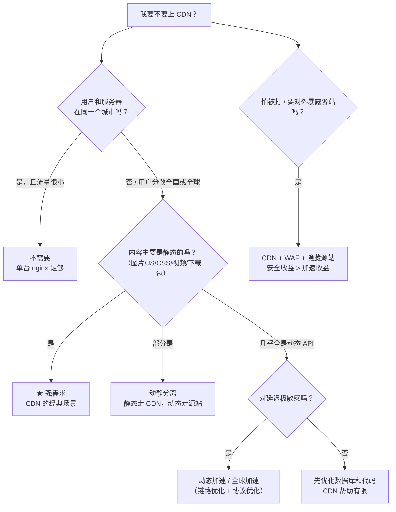

### 9.1 六个典型场景

**① 静态资源加速（最常见）。**
JS / CSS / 图片 / 字体。这类文件小、数量多、重复访问率高，**命中率轻松 95%+**，是 CDN 收益最大的场景。配合"文件名带哈希 + 一年 TTL"，几乎零维护。

**② 视频点播与直播。**
点播靠 Range + 分片缓存；直播靠 **HLS/DASH** 切片（几秒一个 ts 文件）+ 边缘缓存，或者用 **LL-HLS / WebRTC** 做低延迟。视频是 CDN 消耗流量最大的业务，也是 CDN 厂商的主战场。

**③ 大文件下载 / 游戏更新 / 软件分发。**
一个安装包 2 GB，十万用户下载 = 200 TB。**没有 CDN 这件事根本做不了**——源站带宽成本会直接劝退。

**④ 电商大促与秒杀。**
平时命中率 96%，大促瞬间请求量翻 20 倍。CDN 在这里是**容量池**：把并发打在几百个节点上，源站只承接那 4% 的回源。再配合"请求合并"和"预热爆款商品图"，源站基本不会被打穿。

**⑤ 出海与跨国业务。**
用户在欧洲，服务器在国内，RTT 250ms 起步。**CDN 的海外节点把这一跳变成 20ms**。这是"技术手段无法弥补、只能靠节点"的典型场景。

**⑥ 安全加固。**
CDN 天然隐藏源站 IP，配合 WAF（Web Application Firewall，Web 应用防火墙）挡 SQL 注入、XSS，配合 DDoS 清洗吃掉流量攻击。**很多公司上 CDN 的真实动机是"别让源站直接暴露在公网"**，加速只是顺带。

### 9.2 什么时候不该用

| 场景 | 为什么 | 替代方案 |
| --- | --- | --- |
| 纯内网系统 | 用户本来就在内网，CDN 反而绕远 | 内网 nginx / 本地缓存 |
| 强一致的实时数据（如账户余额） | 缓存必然带来延迟，一致性要求高的场景不适合 | 直接回源 + 数据库优化 |
| 流量极小（每天几百请求） | 配置成本、证书、计费复杂度大于收益 | 单机 nginx + 浏览器缓存 |
| 内容全部个性化（每人不同） | 命中率趋近 0，缓存毫无意义 | 边缘计算 / 动态加速 |
| 需要按请求计费且请求量巨大 | 静态资源上 CDN 省钱，但**大量小请求的计费可能反而更贵** | 先算清账：流量费 vs 请求数费 |

## 十、十个最常见的坑

**坑 1：缓存键漏了查询参数，A 的内容给了 B。**
最典型的是"忽略全部查询串"。`/detail?id=1` 和 `/detail?id=2` 共用一份缓存，用户看到别人的数据。→ 只在明确安全时才裁剪参数。

**坑 2：HTML 也缓存一年，发布后用户看不到新版。**
入口 HTML 必须短 TTL（0～60 秒）或不缓存；带哈希的静态资源才用长 TTL。

**坑 3：给静态资源加时间戳防缓存。**
`app.js?t=1699999999` 每次发布都变，命中率直接从 96% 掉到 5%。→ 用文件名哈希，不要用查询串。

**坑 4：动态接口被缓存，用户数据泄露。**
`/api/user/profile` 返回 A 的信息，被 CDN 缓存后 B 也拿到。→ 带 `Authorization` 或 `Set-Cookie` 的请求强制 `BYPASS`（本文配置已处理）。

**坑 5：`Vary` 写了 `User-Agent`。**
每个浏览器版本一份缓存，命中率崩塌。→ Vary 通常只留 `Accept-Encoding`。

**坑 6：回源 Host 配错。**
CDN 回源时如果不透传原始 `Host`，源站的虚拟主机会匹配不到，返回 404 或默认站点。→ `proxy_set_header Host $host;`

**坑 7：只刷新不预热。**
发布后第一个用户回源慢，甚至因为并发打到源站。→ 刷新 + 预热成对操作。

**坑 8：证书到期，全网 HTTPS 挂掉。**
几百个节点、几十个域名，人工续期必然出事。→ 用 ACME 自动化 + 到期告警。

**坑 9：源站没做回源鉴权，被人绕过 CDN 直连。**
CDN 只能挡住普通用户，挡不住知道源站 IP 的人。→ 源站只允许 CDN 回源 IP 段访问，或校验 `X-Origin-Token` 签名。

**坑 10：gzip 和 Range 打架，视频拖动失效。**
对视频开 gzip 后，源站返回整体压缩流，Range 请求退化成全量下载。→ 视频/安装包类**不要开 gzip/brotli**。

## 十一、总结

回到快递柜的比喻：

- **CDN 不是"把服务器变快"，而是"把内容搬近"**。它解决的是物理距离这个算法永远绕不过的约束。
- **缓存只是它的一半，调度是另一半**。没有调度，几百个节点就是一盘散沙；没有缓存，调度再好也只是把请求转发得更快一点。
- **命中率是它的生命线**。96% 和 98% 的差别，是源站带宽差一倍。所有配置优化最终都在服务这一个指标。

三句话记住它：

1. **DNS 决定去哪，缓存决定给不给，TTL 决定什么时候重新问。**
2. **能长期缓存的是"带哈希的文件名"，必须短缓存的是"入口 HTML"。**
3. **刷新让旧的作废，预热让新的一开始就快——两者必须成对用。**

## 附录：术语中英对照表

| 缩写 / 术语 | 英文全称 | 中文 | 一句话解释 |
| --- | --- | --- | --- |
| CDN | Content Delivery Network | 内容分发网络 | 分布各地的边缘缓存网络，替源站接客 |
| PoP | Point of Presence | 服务节点 / 接入点 | CDN 在某个城市或机房的一个部署单元 |
| Edge | Edge Node | 边缘节点 | 离用户最近、直接接请求的那层服务器 |
| Origin | Origin Server | 源站 | 内容真正存放的服务器 |
| 回源 | Origin Fetch / Origin Pull | 回源 | 边缘没缓存，去源站取一次 |
| 回源率 | Origin Traffic Ratio | 回源率 | 未命中比例，= 1 − 命中率 |
| 命中率 | Cache Hit Ratio | 命中率 | 请求直接在边缘被满足的比例 |
| Cache Key | Cache Key | 缓存键 | 判断"两个请求是否要同一份内容"的依据 |
| TTL | Time To Live | 生存时间 | 缓存能放多久 |
| SWR | Stale-While-Revalidate | 过期后异步刷新 | 先返回旧内容，同时后台去更新 |
| SIE | Stale-If-Error | 出错时用旧内容 | 源站挂了继续拿旧缓存顶着 |
| Purge | Cache Purge / Invalidation | 刷新 / 失效 | 主动删掉全网旧缓存 |
| Prefetch | Prefetch / Preload | 预热 | 提前把内容推到边缘 |
| Surrogate Key | Surrogate Key / Cache Tag | 缓存标签 | 给响应打业务标签，按标签批量失效 |
| GSLB | Global Server Load Balancing | 全局负载均衡 | 按地理位置/健康度决定用户去哪个节点 |
| CNAME | Canonical Name | 别名记录 | 把域名指向另一个域名，CDN 接入的常规方式 |
| Anycast | Anycast | 任播 | 同一 IP 多地宣告，由路由选最近节点 |
| BGP | Border Gateway Protocol | 边界网关协议 | 互联网的域间路由协议，Anycast 靠它选路 |
| ECS | EDNS Client Subnet | EDNS 客户端子网 | 让权威 DNS 看到用户所在网段，提升调度精度 |
| RTT | Round-Trip Time | 往返时延 | 一个包来回的时间，物理距离的下限体现 |
| HTTP/3 | HyperText Transfer Protocol 3 | 超文本传输协议 v3 | 基于 QUIC/UDP，减少握手和队头阻塞 |
| QUIC | Quick UDP Internet Connections | 快速 UDP 互联网连接 | HTTP/3 的底层传输协议 |
| TLS | Transport Layer Security | 传输层安全 | HTTPS 的加密层，握手要花 RTT |
| OCSP Stapling | Online Certificate Status Protocol Stapling | 证书状态装订 | 由服务器代查证书吊销状态，省客户端一次请求 |
| Mid-tier | Mid-tier Cache / Parent Cache | 中间层 / 父层缓存 | 边缘与源站之间的一层，收敛回源风暴 |
| Request Collapsing | Request Collapsing / Coalescing | 请求合并 | 同一资源的并发回源合并成一次 |
| Consistent Hashing | Consistent Hashing | 一致性哈希 | 节点增减时尽量少地打乱缓存归属 |
| HLS | HTTP Live Streaming | HTTP 实时流 | 把视频切成小片段，用 HTTP 分发 |
| DASH | Dynamic Adaptive Streaming over HTTP | 基于 HTTP 的动态自适应流 | 类似 HLS 的另一种切片标准 |
| Range | HTTP Range Request | 范围请求 | 只请求文件的一部分，支持续传和拖动 |
| WAF | Web Application Firewall | Web 应用防火墙 | 挡 SQL 注入、XSS 等应用层攻击 |
| DDoS | Distributed Denial of Service | 分布式拒绝服务 | 用海量流量打瘫目标 |
| immutable | immutable | 永不变更 | 告诉缓存"这个文件永远不会改"，跳过校验 |
| LRU | Least Recently Used | 最近最少使用 | 缓存满了淘汰最久没被访问的对象 |
