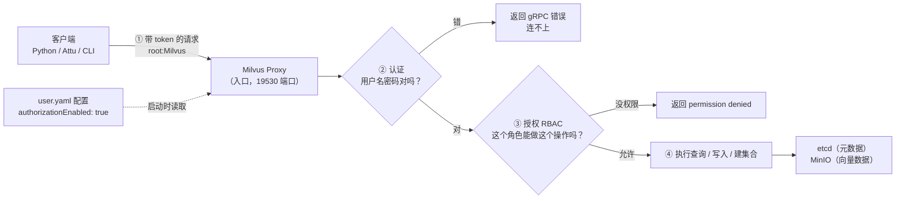
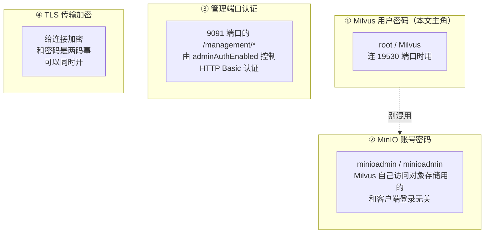
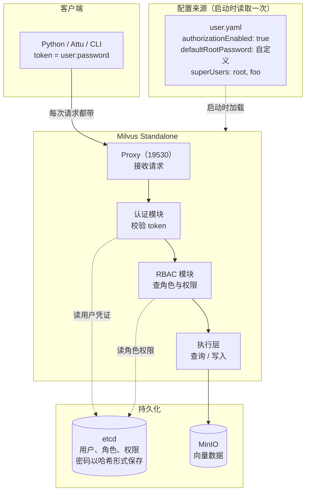
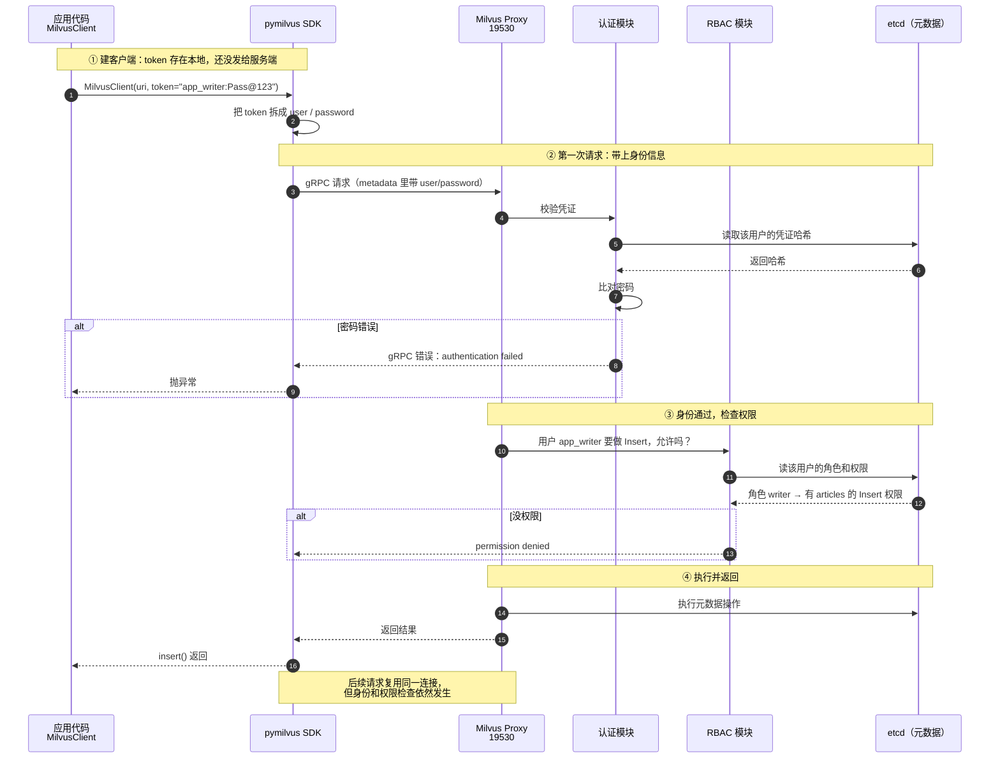
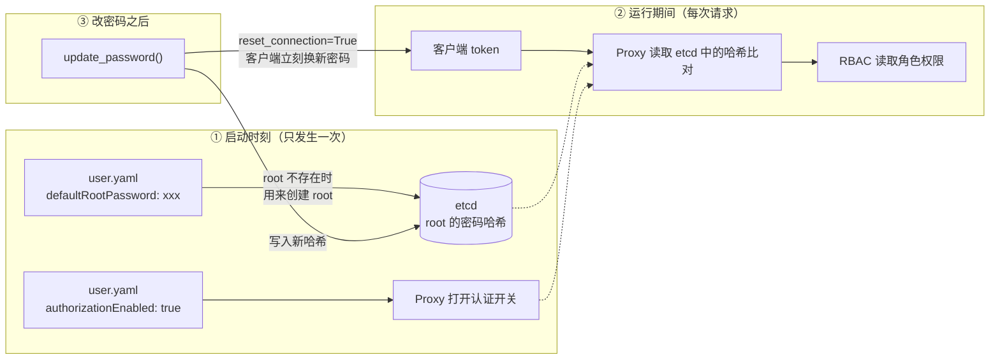

刚装好的 Milvus 有个让人后背发凉的特性：**只要能连上 19530 端口，谁都能建库、写数据、删集合**。

它默认不检查账号密码——就像一座没装门锁的图书馆，任何人推门进来都能把书搬走。本地自己玩没问题，但只要你把端口映射到服务器的公网 IP 上，别人扫到就能直接操作你的向量数据。

这篇文章就是给这座图书馆**装门锁、发门禁卡、规定谁能进哪个阅览室**的完整指南。全程面向零基础：每一条命令都解释在干什么，每一步都说明为什么。

> 本文核对日期：2026 年 11 月 24 日。Milvus 最新稳定版是 **v3.0.6**，官方安装文档示例使用 **v3.0.5** 的 Compose 文件。认证配置项、默认账号和客户端 API 均按 **v3.0.x 官方文档**核对。如果你用的是 2.5 / 2.6 老版本，思路一致，但 Compose 文件名和个别参数可能不同。

## 〇、一句话、一张全景图

**一句话**：Milvus 的"密码"是一套**两层机制**——先开认证让每个请求必须报上身份（`root: Milvus`），再用 RBAC（Role-Based Access Control，基于角色的访问控制）决定这个身份能干什么。

用图书馆打比方：

| 图书馆里的东西 | Milvus 里的对应物 |
| --- | --- |
| 大门门禁 | **认证**（authentication）：报用户名密码，验明正身 |
| 不同阅览室的通行证 | **授权 / RBAC**：你是普通读者还是管理员 |
| 门禁卡上写的名字 | **token**：`用户名:密码`，客户端每次请求都要带 |
| 馆长（初始就有最高权限） | **root 用户**，默认密码 `Milvus` |
| 借书规则清单 | **角色（role）**和**权限（privilege）** |



**先记住这条主线**：**开认证 → 用 root/Milvus 登录 → 第一件事改密码 → 建普通用户和角色 → 应用用普通账号连**。

几个词先用白话过一遍：

| 词 | 白话解释 |
| --- | --- |
| 认证（authentication） | "你是谁"——检查用户名密码 |
| 授权（authorization / RBAC） | "你能干什么"——检查角色权限 |
| token | Milvus 的凭证格式：`用户名:密码`，如 `root:Milvus` |
| root | 内置超级管理员，默认密码是 `Milvus`（首字母大写） |
| role（角色） | 一组权限的打包，比如"只读""只写" |
| privilege（权限） | 具体动作，如 `Search`、`Insert`、`DropCollection` |
| `user.yaml` | 覆盖默认配置的额外配置文件，官方推荐用它改配置 |
| 9091 端口 | 管理 / 指标 / WebUI 端口，和密码认证是两套开关 |

**本文路线**

| 章节 | 回答的问题 |
| --- | --- |
| 〇 | 一句话、全景图、术语速览 |
| 一 | 为什么默认"裸奔"？开认证到底开了什么？ |
| 二 | 认证、授权、TLS、MinIO 密码：别搞混 |
| 三 | 架构：密码在 Milvus 里怎么流转 |
| 四 | 动手：Docker Compose 开启密码认证（完整步骤） |
| 五 | 时序：一次带密码的请求怎么被验证 |
| 六 | 客户端怎么用：Python、界面工具、命令行 |
| 七 | 数据流：root 密码什么时候生效，改完存哪里 |
| 八 | Helm / Operator 部署在哪改配置 |
| 九 | 十个小白常见坑与排错 |
| 十 | 安全清单 |
| 附录 | 术语中英对照表 |

## 一、为什么默认"裸奔"？开认证到底开了什么？

Milvus 默认配置里有一行：

```yaml
common:
  security:
    authorizationEnabled: false   # 默认是 false，也就是不检查身份
```

`authorizationEnabled: false` 意味着：**任何能连上 19530 端口的请求，都会被当作合法用户处理**，拥有完整权限。

把它改成 `true` 之后，变化是：

| 行为 | 开启前 | 开启后 |
| --- | --- | --- |
| 不传密码连接 | ✅ 直接连上 | ❌ 报 gRPC 错误 |
| 传错密码 | （没人检查） | ❌ 连接失败 |
| 传 `root:Milvus` | 能用 | ✅ 用管理员身份进入 |
| 普通用户操作 | 全部权限 | 只能做角色允许的操作 |

**注意一个常见误解**：开启认证**不会**自动把 root 默认密码改掉。`root` / `Milvus` 是公开的默认值，所以**开启认证后第一件事必须是改密码**——不然你只是把"没有锁"换成了"一把所有人都知道钥匙的锁"。

### 默认端口也要注意

官方 Compose 文件默认把端口发布到所有网卡：

```
0.0.0.0:19530 → 容器 19530   # Milvus 客户端端口
0.0.0.0:9091  → 容器 9091    # 指标 / WebUI 端口
0.0.0.0:9001  → 容器 9001    # MinIO 控制台
```

**这意味着局域网甚至公网能直接访问。** 如果你只在本机用，建议把端口绑到回环地址：把 `19530:19530` 改成 `127.0.0.1:19530:19530`，MinIO 的 `9000:9000`、`9001:9001` 同理。

## 二、四套东西别搞混

新手最容易在这里绕晕——**这四样完全不是一回事**：



| 是哪一套 | 默认账号 | 在哪配 | 什么时候要管 |
| --- | --- | --- | --- |
| **Milvus 认证** | `root` / `Milvus` | `common.security.authorizationEnabled` | 只要不是纯本机单机就要开 |
| **MinIO 凭据** | `minioadmin` / `minioadmin` | Compose 里 `MINIO_ACCESS_KEY` / `MINIO_SECRET_KEY` | 生产必须改，和 Milvus 用户无关 |
| **管理端口认证** | root + HTTP Basic | `common.security.adminAuthEnabled` | 暴露 9091 端口时建议开 |
| **TLS** | 无 | `common.security.tlsMode` 等 | 跨网络传输时建议开 |

**一句话记住**：**19530 用 Milvus 账号，9001 用 MinIO 账号，9091 是管理端口——三扇门，三把钥匙。**

## 三、架构：密码在 Milvus 里怎么流转



**关键认知有三条**：

1. **配置只在启动时生效**。官方明确说明：所有参数都要重启 Milvus 才生效。改完 `user.yaml` 必须重建或重启容器。
2. **`defaultRootPassword` 只在 root 用户"不存在时创建"的那一刻用一次**。实例已经跑过之后，改这个配置项**不会**改变现有 root 的密码。这是最容易踩的坑。
3. **用户和权限存在 etcd 里**，所以只要不动 `volumes` 目录，改密码、建用户这些数据在容器重建后都还在。

## 四、动手：Docker Compose 开启密码认证

### 4.1 下载官方 Compose 文件

```bash
# 建一个专门放 Milvus 的目录，后面都在这里操作
mkdir -p ~/milvus-auth && cd ~/milvus-auth

# 下载 v3.0.5 官方单机版 Compose 文件（文件名是 .yaml，2.x 时代是 .yml）
wget https://github.com/milvus-io/milvus/releases/download/v3.0.5/milvus-standalone-docker-compose.yaml \
  -O docker-compose.yaml

# 先看一眼里面有哪些服务，确认文件下对了
grep -E "^  [a-z-]+:" docker-compose.yaml | head -10
```

**下载后先别急着改**，建议先原样启动一次，确认 Milvus 能正常跑起来，再开启认证——这样出问题时你能确定"是认证配置的问题，不是安装问题"。

### 4.2 先原样启动，确认基线正常

```bash
# 启动（会拉 etcd / MinIO / Milvus 三个镜像，第一次要等一会儿）
docker compose up -d

# 看容器状态，三个服务都 healthy 才算起来
docker compose ps

# 浏览器打开 http://127.0.0.1:9091/webui/ 能看到页面，说明服务层就绪
```

> **此时不要开启认证**：先确认 `docker compose ps` 里 `milvus-standalone` 是 healthy。`docker compose` 是 V2 写法，老版本的 `docker-compose`（带横杠）是 V1，命令不通用。

### 4.3 写 `user.yaml` 开启认证

**这是官方推荐的做法**：不改巨大的 `milvus.yaml`，而是写一个只放"要覆盖的项"的小文件。

```bash
# 在 docker-compose.yaml 同目录创建 user.yaml
# 注意：必须先创建文件再挂载！如果文件不存在，Docker 会创建一个同名"目录"，导致挂载失败
cat > user.yaml <<'EOF'
# 这个文件只写要覆盖默认值的配置项，其余配置继续用镜像里的 milvus.yaml
common:
  security:
    # 关键开关：true = 开启用户名密码认证
    authorizationEnabled: true

    # root 的初始密码：只在首次创建 root 用户时生效
    # 如果实例已经跑过、root 已存在，改这里没用，必须用 SDK 改密码
    defaultRootPassword: "Root@2026Secure"

    # 超级用户：忘记旧密码时可以免旧密码重置
    # 多个用户用英文逗号分隔，这里只放 root
    superUsers: root
EOF

# 确认文件内容写对了
cat user.yaml
```

**密码要求**（v3.0 官方文档）：6～72 个 UTF-8 字节。ASCII 字符 1 字节，中文一个字 3 字节。不强制要求大小写混合，但**请务必用强密码**。纯数字长密码要加引号，避免 YAML 把它解析成数字丢精度。

### 4.4 挂载 `user.yaml` 并重建容器

在 `docker-compose.yaml` 里找到 `standalone:` 服务的 `volumes:` 部分，加一行挂载：

```yaml
  standalone:
    # ... 保留原有的其他配置，不要删
    volumes:
      - ${DOCKER_VOLUME_DIRECTORY:-.}/volumes/milvus:/var/lib/milvus   # 原有：数据目录
      - ./user.yaml:/milvus/configs/user.yaml                          # 新增：覆盖配置
```

然后：

```bash
# up -d 会检测到 volumes 变化，自动重建 standalone 容器（数据卷不会丢）
docker compose up -d

# 确认容器确实重建了（看 STATUS 是否 healthy）
docker compose ps

# 如果日志里报配置错误，看这里
docker compose logs standalone --tail 50
```

**为什么是 `up -d` 而不是 `restart`？** 因为挂载配置属于"服务定义变化"，`restart` 只是重启进程，不会应用新的挂载。`up -d` 才会重建容器。

后续如果只是修改 `user.yaml` 的内容（挂载关系没变），用 `docker compose restart standalone` 即可。

### 4.5 验证认证真的开了

```python
# verify_auth.py —— 验证认证是否生效
from pymilvus import MilvusClient

# ① 不传密码尝试连接，并主动发一次请求
# 注意：构造函数本身可能不立即建连，所以必须调一个接口强制发起 RPC
try:
    anonymous = MilvusClient(uri="http://localhost:19530")
    anonymous.list_users()
    print("⚠️  警告：无密码也能操作，认证可能没生效！")
except Exception as e:
    print("✅ 无密码被拒绝：", str(e)[:120])

# ② 用我们配置的 root 密码连接
client = MilvusClient(
    uri="http://localhost:19530",
    token="root:Root@2026Secure",   # token 格式：用户名:密码
)
print("✅ root 登录成功，当前用户列表：", client.list_users())
```

```bash
# 安装客户端（v3.0 对应 pymilvus 3.0.x）
pip install -U 'pymilvus>=3.0.0'

# 运行验证
python verify_auth.py
```

**预期结果**：第一次连接报 gRPC 错误（说明认证生效），第二次连上并打印 `['root']`。

> 如果你当初没设 `defaultRootPassword`，初始密码就是官方默认的 **`Milvus`**（首字母大写，不是 `milvus`）。把上面 token 换成 `root:Milvus` 即可。

## 五、时序：一次带密码的请求怎么被验证



**要点**：**认证和授权是两道独立的门**。密码对只证明"你是你"，不代表"你想干什么都行"。这就是为什么开了认证之后还要配角色。

## 六、客户端怎么用

### 6.1 第一件事：改掉 root 默认密码

```python
# 01_init_admin.py —— 只跑一次的管理员初始化脚本
from pymilvus import MilvusClient

# 用初始密码连接（如果你在 user.yaml 里设了 defaultRootPassword，就填那个）
client = MilvusClient(
    uri="http://localhost:19530",
    token="root:Root@2026Secure",
)

# 修改 root 自己的密码
# reset_connection=True：客户端立刻用新密码重建连接，后续请求不用手动重连
client.update_password(
    user_name="root",
    old_password="Root@2026Secure",
    new_password="Root@EvenMoreSecure2026",
    reset_connection=True,
)

print("✅ root 密码已修改")

# 用新密码重新建一个客户端，验证能否登录
admin = MilvusClient(
    uri="http://localhost:19530",
    token="root:Root@EvenMoreSecure2026",
)
print("✅ 新密码登录成功，用户列表：", admin.list_users())
```

```bash
python 01_init_admin.py
```

> **忘记旧密码怎么办？** 这就是 `user.yaml` 里 `superUsers: root` 的用途——超级用户重置密码时可以免旧密码。如果连超级用户都没配、密码也忘了，就只能靠保留数据卷的方式重置（见第九节）。

### 6.2 创建应用账号并授予最小权限

**永远不要让应用直接用 root**。给应用建独立账号，只给它需要的权限。

```python
# 02_create_users.py —— 创建应用账号与角色（用 root 执行）
from pymilvus import MilvusClient

# 以管理员身份连接
admin = MilvusClient(
    uri="http://localhost:19530",
    token="root:Root@EvenMoreSecure2026",
)

# ① 建两个用户：一个写、一个读
admin.create_user(user_name="app_writer", password="Writer@2026")
admin.create_user(user_name="app_reader", password="Reader@2026")
print("✅ 用户已创建：", admin.list_users())

# ② 建角色
admin.create_role(role_name="writer")
admin.create_role(role_name="reader")

# ③ 给角色授权
# privilege_v2 是 v2.x/v3.x 推荐的授权接口
# 这里用内置的权限组 COLL_RW（集合读写）和 COLL_RO（集合只读）
admin.grant_privilege_v2(
    role_name="writer",
    privilege="COLL_RW",          # 内置权限组：集合的读写权限
    collection_name="articles",   # 只针对这个集合
    db_name="default",            # 默认数据库
)
admin.grant_privilege_v2(
    role_name="reader",
    privilege="COLL_RO",          # 内置权限组：集合只读
    collection_name="articles",
    db_name="default",
)

# ④ 把角色授予用户
admin.grant_role(user_name="app_writer", role_name="writer")
admin.grant_role(user_name="app_reader", role_name="reader")

# ⑤ 核对结果
print("writer 角色权限：", admin.describe_role("writer"))
print("app_writer 的角色：", admin.describe_user("app_writer"))
```

```bash
python 02_create_users.py
```

**内置权限组**（不用自己逐条配权限）：

| 权限组 | 含义 |
| --- | --- |
| `COLL_RO` | 集合只读（Search、Query 等） |
| `COLL_RW` | 集合读写（在只读基础上加 Insert、Delete） |
| `COLL_ADMIN` | 集合管理（含建索引、删集合） |
| `DB_RO` / `DB_RW` / `DB_ADMIN` | 整个数据库级别的读 / 读写 / 管理 |
| `Cluster_RO` / `Cluster_RW` / `Cluster_ADMIN` | 整个实例级别 |

### 6.3 应用用普通账号读写

```python
# 03_app_demo.py —— 应用代码：用最小权限账号操作
from pymilvus import MilvusClient

# 用只读账号连接，先验证查询能力
reader = MilvusClient(
    uri="http://localhost:19530",
    token="app_reader:Reader@2026",
)
print("✅ reader 登录成功")

# 用写入账号连接并建集合、写数据、检索
writer = MilvusClient(
    uri="http://localhost:19530",
    token="app_writer:Writer@2026",
)

# 只能在有权限的集合上操作；这里如果换一个集合名就会被拒绝
writer.create_collection(
    collection_name="articles",
    dimension=4,          # 向量维度：每个向量是 4 个浮点数
)

# 插入两条数据
writer.insert(
    collection_name="articles",
    data=[
        {"id": 1, "title": "Milvus 认证入门", "vector": [0.1, 0.2, 0.3, 0.4]},
        {"id": 2, "title": "向量检索实践", "vector": [0.5, 0.1, 0.2, 0.3]},
    ],
)
print("✅ 写入成功")

# 检索：找与查询向量最相似的一条
results = writer.search(
    collection_name="articles",
    data=[[0.1, 0.2, 0.3, 0.4]],
    limit=1,
    output_fields=["title"],
)
print("✅ 检索结果：", results)

# 验证权限边界：reader 不应该能插入
try:
    reader.insert(
        collection_name="articles",
        data=[{"id": 3, "title": "越权写入", "vector": [0.9, 0.9, 0.9, 0.9]}],
    )
    print("⚠️  异常：只读账号居然写成功了！")
except Exception as e:
    print("✅ 只读账号写入被拒绝（符合预期）：", str(e)[:100])
```

```bash
python 03_app_demo.py
```

**注意**：`create_collection` 需要 `COLL_ADMIN` 或更高权限。如果 `app_writer` 只有 `COLL_RW`，建集合这步会失败——在真实项目里，**建集合通常由管理员预置，应用账号只负责读写数据**。这里的演示为了自包含让 writer 建了集合；生产环境请按最小权限拆分。

### 6.4 用图形界面（Attu）连接

不想敲代码的话，可以用官方 GUI 工具 **Attu**（最新版 v3.0.2，与 Milvus 3.0 配套）：

```bash
# 第一步：查出 Milvus compose 创建的网络名（通常叫"目录名_default"）
docker network ls | grep -i milvus

# 第二步：用这个网络名启动 Attu，才能通过服务名 milvus-standalone 访问 Milvus
# 把下面的 milvus-auth_default 换成你上一步查到的实际名字
docker run -d \
  --name attu \
  --network milvus-auth_default \
  -p 8000:3000 \
  -e MILVUS_URL=milvus-standalone:19530 \
  zilliz/attu:v3.0.2
```

```text
浏览器打开 http://localhost:8000
用户名：root
密码：Root@EvenMoreSecure2026（你改后的密码）
```

> 网络名来自 compose 项目名：本文建的是 `~/milvus-auth` 目录，所以默认网络通常是 `milvus-auth_default`。如果目录名不同，网络名也不同——**以 `docker network ls` 查到的为准**。

### 6.5 用命令行连接

```bash
# 安装命令行工具
pip install milvus-cli

# 交互式连接（-t 后面是 token，格式 用户名:密码）
milvus_cli > connect -uri http://127.0.0.1:19530 -t root:Root@EvenMoreSecure2026

# 常用管理命令
milvus_cli > list users
milvus_cli > list roles
milvus_cli > show user -u app_writer
milvus_cli > exit
```

## 七、数据流：密码什么时候生效，改完存哪里



**三个必须记住的行为**：

1. **`defaultRootPassword` 不是"每次启动都覆盖密码"**。官方文档明确说：Milvus 只在**没有 root 用户时**用它创建 root；之后改这个配置不会影响已有 root。想改密码必须用 `update_password()`。
2. **改密码后数据不会丢**。用户、角色、权限都存在 etcd 里，对应宿主机的 `volumes/etcd` 目录。只要不执行 `docker compose down -v` 或 `rm -rf volumes`，重建容器后账号密码依然有效。
3. **`reset_connection=True` 很实用**。改 root 密码后，当前客户端连接会自动用新密码继续工作，不用手动重建客户端。

**数据卷在哪里**：官方 Compose 默认把数据映射到当前目录下的 `volumes/`：

```
~/milvus-auth/
├── docker-compose.yaml
├── user.yaml
└── volumes/
    ├── etcd/      ← 用户、角色、权限、元数据
    ├── minio/     ← 向量数据
    └── milvus/    ← Milvus 运行数据
```

## 八、其他部署方式在哪改配置

| 部署方式 | 配置文件 | 开启认证的位置 |
| --- | --- | --- |
| **Docker Compose** | `user.yaml` 挂到 `/milvus/configs/user.yaml` | `common.security.authorizationEnabled: true` |
| **Helm Chart** | `values.yaml` | `extraConfigFiles.user.yaml` 里写同样的 YAML |
| **Milvus Operator** | CRD 资源 | `spec.config.common.security.authorizationEnabled: true` |
| **Milvus Lite**（本地文件版） | 无服务端 | 不支持这套认证，本地单机玩玩即可 |

**Helm 的写法**（官方示例）：

```yaml
extraConfigFiles:
  user.yaml: |+
    common:
      security:
        authorizationEnabled: true
```

**Operator 的写法**（官方示例）：

```yaml
apiVersion: milvus.io/v1beta1
kind: Milvus
metadata:
  name: my-release
spec:
  config:
    common:
      security:
        authorizationEnabled: true
```

### v3.0 提供的独立开关：保护管理端口 9091

v3.0 的配置里有一个独立开关 **`common.security.adminAuthEnabled`**，默认 `false`。把它设为 `true` 后，`/management/*`、`/log/level`、`/debug/pprof/*`、Web Console 等管理接口需要 root 的 HTTP Basic 认证。

```yaml
common:
  security:
    authorizationEnabled: true
    adminAuthEnabled: true    # v3.0 新增：管理端口也要认证
```

**注意两个副作用**（官方文档明确提到）：

- 健康检查和 Prometheus 抓取**仍然开放**，不受影响。
- 不带 `Origin` 或 Fetch Metadata 请求头的客户端（比如脚本、profiling 工具）需要额外加 `X-Milvus-Admin-Request: true` 头。**上线前先改这些脚本**，否则会突然失败。
- 9091 端口仍是明文 HTTP，只应在可信网络或 TLS 代理后暴露。

## 九、十个小白常见坑与排错

**坑 1：改了 `defaultRootPassword`，旧密码居然还能用。**
这是设计如此——它只在首次创建 root 时生效。要改密码用 `update_password()`。

**坑 2：把 `root:Milvus` 当成永久答案。**
`Milvus` 是公开默认值。开启认证后如果不改，等于没设密码。

**坑 3：只 `docker compose restart`，配置没生效。**
新增挂载或改环境变量必须 `docker compose up -d` 触发重建；只有挂载关系没变时改文件内容，`restart` 才够。

**坑 4：`user.yaml` 文件不存在，Docker 建了个同名目录。**
**先创建文件再挂载**。用 `cat user.yaml` 确认它是文件；如果手滑建成了目录，先 `rm -rf user.yaml` 再重建。

**坑 5：密码里有特殊字符，YAML 解析出错。**
纯数字长密码要加引号；含 `:` `#` 等字符也建议加引号。密码是 6～72 个 **UTF-8 字节**，中文一个字算 3 字节。

**坑 6：应用直接用 root 账号。**
一旦应用代码泄露，整个库就没了。用最小权限的普通账号。

**坑 7：开了认证就把端口放开到公网。**
认证和网络安全是两件事。仍然建议绑 `127.0.0.1` 或放在内网/VPN/SSH 隧道后面，跨网络再加 TLS。

**坑 8：把 MinIO 的 `minioadmin` 和 Milvus 的 root 混用。**
两套账号，改一个不影响另一个。生产环境两个都要改。

**坑 9：端口 9091 忘了管。**
v3.0 之前 9091 的管理接口不需要密码。只用 19530 的认证并不能保护它。开 `adminAuthEnabled` 或限制访问来源。

**坑 10：忘记密码就 `docker compose down -v`。**
`-v` 会删掉 volumes，**所有向量数据一起没了**。正确路径是：配 `superUsers` → 用免旧密码重置；实在不行先备份 `volumes/etcd` 和 `volumes/minio` 再考虑重置。

### 快速排错表

| 现象 | 最可能的原因 | 怎么查 |
| --- | --- | --- |
| 无密码居然能连上 | 认证没开启 / 容器没重建 | `docker compose logs standalone` 看配置报错；确认挂载的文件是文件不是目录 |
| 带密码连不上 | 密码写错 / 用了旧的初始值 | 先确认 `user.yaml` 里 `defaultRootPassword` 的值，或试默认 `Milvus` |
| 报 `permission denied` | 角色权限没授对 | `describe_user` 看角色，`describe_role` 看权限 |
| 改完配置没变化 | 只 restart 没重建 | `docker compose up -d --force-recreate standalone` |
| 数据全没了 | 执行过 `down -v` 或 `rm -rf volumes` | 检查 `volumes/` 目录是否还在 |

## 十、安全清单（上线前逐条打勾）

- [ ] 开启 `common.security.authorizationEnabled: true`
- [ ] **立即修改 root 默认密码**，并用 `reset_connection=True` 验证
- [ ] 配置 `superUsers: root`，为忘记密码留一条后路
- [ ] 为应用创建独立账号，按 `COLL_RO` / `COLL_RW` 等权限组授权
- [ ] 把 Milvus 端口绑到 `127.0.0.1` 或限制到内网
- [ ] 修改 MinIO 的 `minioadmin` 默认凭据，并与 Milvus 配置保持一致
- [ ] 视情况开启 `adminAuthEnabled: true`（注意先改管理脚本）
- [ ] 跨网络传输开启 TLS
- [ ] 密码放进密钥管理系统或环境变量，不要硬编码进代码仓库
- [ ] **备份 `volumes/etcd` 和 `volumes/minio`**，任何时候都不要随手 `down -v`

## 十一、总结

三句话记住 Milvus 的密码：

1. **默认是裸奔的**：`authorizationEnabled` 默认 `false`，能连端口就有全部权限。
2. **root/Milvus 只是初始钥匙**：开认证后第一件事就是改掉，而且要用 `update_password()` 改——改 `user.yaml` 里的 `defaultRootPassword` 对已存在的 root 没用。
3. **认证 ≠ 授权**：密码证明"你是谁"，角色决定"你能干什么"。应用账号必须按最小权限配。

配套阅读：CentOS Stream 9 环境下的详细 RBAC 实战见[《CentOS Stream 9 配置 Milvus 账号密码》]()；安装与基础使用见同期的两篇 Milvus 文章。

## 附录：术语中英对照表

| 缩写 / 术语 | 英文全称 | 中文 | 一句话解释 |
| --- | --- | --- | --- |
| Milvus | Milvus | 开源向量数据库 | 专门存高维向量、做相似检索的数据库 |
| authentication | Authentication | 认证 | 验证"你是谁"，即检查用户名密码 |
| authorization | Authorization | 授权 | 决定"你能干什么"，即检查角色权限 |
| RBAC | Role-Based Access Control | 基于角色的访问控制 | 权限先打包给角色，再把角色授予用户 |
| token | Token | 凭证 | Milvus 里格式为 `用户名:密码` |
| root | Root User | 超级管理员 | 内置最高权限用户，默认密码 `Milvus` |
| privilege | Privilege | 权限 | 具体动作，如 `Search`、`Insert`、`DropCollection` |
| role | Role | 角色 | 一组权限的集合，可授予用户 |
| privilege group | Privilege Group | 权限组 | 预置的权限打包，如 `COLL_RO`、`COLL_RW` |
| `COLL_RO` | Collection Read Only | 集合只读权限组 | 只能查，不能写 |
| `COLL_RW` | Collection Read Write | 集合读写权限组 | 能查能写 |
| auth | Authorization (short) | 认证开关 | `common.security.authorizationEnabled` |
| `defaultRootPassword` | Default Root Password | 默认 root 密码 | 只在首次创建 root 时生效的配置项 |
| `superUsers` | Super Users | 超级用户列表 | 这些人重置密码时不用提供旧密码 |
| `adminAuthEnabled` | Admin Authentication Enabled | 管理端口认证开关 | v3.0 新增，保护 9091 端口的管理接口 |
| `user.yaml` | User Configuration File | 用户配置文件 | 挂载到容器里覆盖默认配置的小文件 |
| etcd | etcd | 分布式键值存储 | Milvus 用它存用户、角色、权限等元数据 |
| MinIO | MinIO | 对象存储 | Milvus 用它存向量数据，账号与 Milvus 独立 |
| TLS | Transport Layer Security | 传输层安全 | 给网络连接加密，和密码认证是两码事 |
| HTTP Basic | HTTP Basic Authentication | HTTP 基本认证 | 浏览器弹窗输入用户名密码那种认证 |
| gRPC | gRPC Remote Procedure Call | 高性能远程调用 | Milvus 客户端与服务端之间的通信协议 |
| pymilvus | Python SDK for Milvus | Milvus 的 Python 客户端 | 本文示例用的 SDK |
| MilvusClient | Milvus Client | Milvus 客户端类 | 新版 SDK 的统一入口 |
| Attu | Attu | Milvus 图形管理工具 | 不写代码也能管理 Milvus 的 Web 界面 |
| Helm | Helm | Kubernetes 包管理器 | 用 values.yaml 配 Milvus 集群 |
| Operator | Kubernetes Operator | 运维控制器 | 用 CRD 声明式管理 Milvus 集群 |
| CRD | Custom Resource Definition | 自定义资源定义 | Kubernetes 扩展资源类型的机制 |
| volume | Docker Volume | 数据卷 | 容器重建后仍保留数据的目录 |
| SHA-256 | Secure Hash Algorithm 256 | 安全哈希算法 | 下载 Compose 文件时校验完整性用 |
