nginx 是当今最强的反向代理之一，但它有个让人抓狂的缺点：**它只会"按配置转发"，不会"按情况思考"**。

想加个鉴权？写几行 `if`——然后你会看到 nginx 官方文档写着 **"if is evil"**。想根据请求内容查一下 Redis 再决定转给谁？原生 nginx 做不到，你得写 C 模块、重新编译、重新部署。想加个限流？可以用 `limit_req`，但"按用户等级区别限流"就又不行了。

**OpenResty 就是来解决这个矛盾的**：它让你**用 Lua 这门小语言，在 nginx 处理请求的每个阶段插入自己的逻辑**——写起来像脚本一样简单，跑起来还是 nginx 的性能。

这篇文章按技术文档的方式讲透它：**解决什么问题 → 架构长什么样 → 请求怎么跑 → 核心机制是什么 → 怎么配 → 用什么生态 → 什么场景用**。术语第一次出现都给英文全称和中文解释。

> 本文核对日期：2026 年 11 月 24 日。OpenResty 最新稳定版是 **1.31.8.1（2026-10-26 发布）**，对应内置 nginx 1.31.8 + LuaJIT 2.1。文中的 Lua 代码已通过 Lua 语法解析校验；nginx 配置按 OpenResty 1.31.x / lua-nginx-module 的指令集编写。**官方不提供现代 Windows 二进制**（官网最后一份 Win32 包停留在 2016 年），所以实操请用 Linux / macOS / Docker。

## 〇、一句话、一张全景图

**一句话**：OpenResty = **nginx + LuaJIT + 一堆让 Lua 能插进 nginx 的模块**，让你用几行脚本就把 nginx 改造成"会思考的网关"。

打个比方：**nginx 是一条标准化流水线，每个工位只能做固定动作**（检查、拧螺丝、装箱）。OpenResty 的做法是：**在每个工位旁边装了一个可编程的机械臂**（Lua 脚本），你想让它干什么就写什么，而且不用停线改装设备。

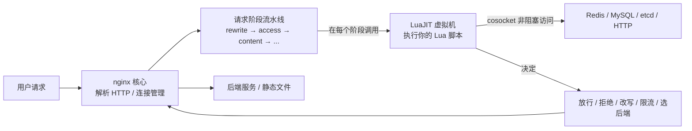

**先记住这条主线**：**请求进入 nginx → 走固定的阶段流水线 → 每个阶段可以插入 Lua → Lua 里用 cosocket 非阻塞地访问外部服务 → 根据结果决定这一步怎么走**。

几个词先用白话过一遍：

| 词 | 白话解释 |
| --- | --- |
| OpenResty | 把 nginx 和 Lua 打包在一起的"增强版 nginx"，不是另一门语言 |
| Lua | 一门非常小的脚本语言，语法简单，适合写"业务小片段" |
| LuaJIT | Lua 的即时编译器版，把 Lua 代码编译成机器码，性能接近 C |
| ngx_lua | 把 Lua 嵌进 nginx 的那个模块（正式名 `lua-nginx-module`） |
| 阶段（phase） | nginx 处理请求的一道道工序，如"鉴权阶段""响应头阶段" |
| cosocket | OpenResty 的灵魂：**写起来像同步代码，跑起来是非阻塞 IO** |
| 共享字典 | 所有 worker 进程都能读写的内存表，用来做限流、缓存 |
| opm | OpenResty 的包管理器，一条命令装 Lua 库 |

**本文路线**

| 章节 | 回答的问题 |
| --- | --- |
| 〇 | 一句话、全景图、术语速览 |
| 一 | 原生 nginx 到底痛在哪？ |
| 二 | OpenResty 是什么？它凭什么这么快？ |
| 三 | 架构：组件栈、进程模型、阶段流水线、cosocket |
| 四 | 时序：一次请求怎么跑、热配置怎么生效 |
| 五 | 数据流：请求数据和配置数据分别怎么流动 |
| 六 | 核心机制深入：cosocket / 共享字典 / 定时器 |
| 七 | 技术对比：和 C 模块、Node.js、Envoy、Kong 比怎么样 |
| 八 | 需要配合什么软件 |
| 九 | 实战：完整 nginx.conf + Lua 网关代码 |
| 十 | 使用场景与决策图 |
| 十一 | 十个常见的坑 |
| 附录 | 术语中英对照表 |

## 一、原生 nginx 到底痛在哪？

### 1.1 配置语言能力太弱

nginx.conf 是一种**声明式配置语言**——你只能声明"什么路径转发到哪里"，不能写"先查一下 Redis，根据结果决定转到哪"。

于是大家开始用 `if` 硬凑：

```nginx
if ($http_authorization = "") { return 401; }
if ($arg_debug = "1") { set $upstream backend_debug; }
if ($http_x_user_level = "vip") { set $limit 100; }
```

看起来挺美，但 nginx 官方专门写了一篇 **If Is Evil**（"if 是邪恶的"）：`if` 在 location 里和 `try_files`、`proxy_pass` 一起用时行为不可预测，**而且多个 `if` 之间会互相干扰**。生产环境踩过这个坑的人都懂。

### 1.2 加功能要写 C 模块

nginx 的扩展机制是 **C 模块**：你要懂 nginx 的内部结构（ngx_http_request_t、upstream、filter chain），写几百行 C，然后用 `./configure --add-module=...` 重新编译。**改一行逻辑 = 重新编译 + 重新部署整套 nginx**。这对业务迭代来说太重了。

### 1.3 调外部服务会把 worker 卡死

假设你想在 nginx 层做鉴权：请求来了，先去 Redis 查 token 有没有效。

- 原生 nginx：**做不到**（`auth_request` 只能发子请求，逻辑还是写不了）。
- 普通写法（比如用外部程序）：每查一次 Redis 就 fork 一个进程，或者发起同步网络调用——**调用期间 worker 进程被阻塞，其他请求全部排队**。

**这就是 OpenResty 的两大杀手锏要解决的问题**：

| 痛点 | OpenResty 的答案 |
| --- | --- |
| 配置语言太弱 | 用 Lua 写逻辑，想怎么写怎么写 |
| 加功能要重编译 | 改 Lua 文件 + `nginx -s reload`，秒级生效 |
| 调外部服务卡 worker | **cosocket**：协程让出 CPU，等 IO 时去处理别的请求 |

## 二、OpenResty 是什么？

**OpenResty** 是一个**打包发行版**（bundle），它把这些东西装在一起：

```
nginx（核心 + OpenResty 的补丁）
  ├── LuaJIT（Lua 的 JIT 编译器，把 Lua 编成机器码）
  ├── lua-nginx-module（把 Lua 嵌进 nginx 各阶段的模块）
  ├── stream-lua-nginx-module（TCP/UDP 四层也能写 Lua）
  ├── lua-resty-* 系列库（Redis/MySQL/HTTP/lock/balancer 等客户端）
  └── opm + resty CLI（包管理与命令行工具）
```

**关键认知**：OpenResty **不是 nginx 的替代品**，它**就是 nginx**，只是多了"在每个阶段执行 Lua"的能力。所以 nginx 的所有知识（location、upstream、proxy_pass、日志）都照旧有效。

### 2.1 它凭什么这么快

三个原因，从重要到次要：

**① cosocket（协程 socket）：非阻塞 IO + 同步写法。**
这是最核心的。传统异步编程（Node.js 的回调、C 的状态机）写起来很绕；OpenResty 用 Lua 的**协程（coroutine）**，让代码看起来是"发请求 → 等结果 → 继续"，但底层遇到 IO 就 `yield`（让出），IO 就绪再 `resume`（恢复）。**一个 worker 进程可以同时处理上万个"卡在等待"的请求，而不用开上万个线程。**

**② LuaJIT 的 JIT 编译。**
Lua 本身是解释型的小语言，但 LuaJIT 会把热点代码**即时编译成机器码**，性能接近 C。所以"用脚本写逻辑"并不等于"慢"。

**③ 逻辑跑在 nginx 进程内。**
不用跨进程通信、不用每次请求都 fork、不用 JSON 序列化绕一圈。**鉴权、限流、改写这些动作就在请求的实际处理路径上完成。**

## 三、架构：四张图

### 3.1 组件栈：从网卡到你的 Lua 代码

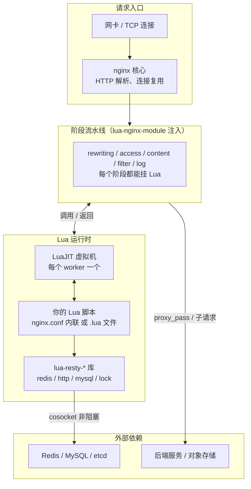

### 3.2 进程模型：为什么需要"共享字典"

nginx 是 **master + 多 worker** 架构。OpenResty 里**每个 worker 有自己独立的 LuaJIT 虚拟机**（Lua 全局状态互不干扰），这带来一个问题：**我在 worker 1 里记的"这个 IP 请求了 3 次"，worker 2 看不见**。

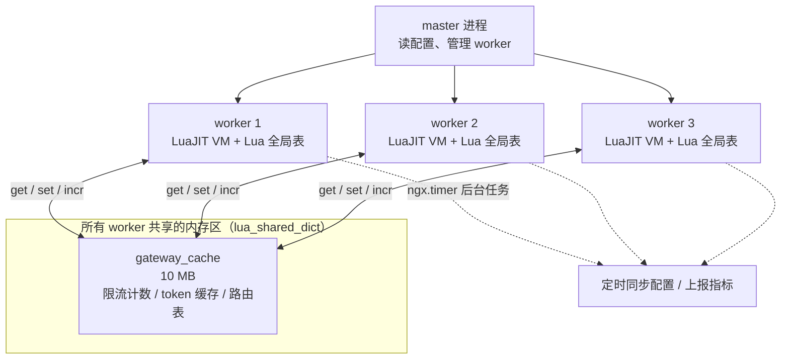

**记住这条规则**：

> **Lua 全局变量 = 每个 worker 一份（快，但不共享）；`ngx.shared.DICT` = 所有 worker 共享（慢一点，但一致）。**

限流计数、token 缓存、动态路由表这类**必须跨 worker 一致**的数据，只能放共享字典。

### 3.3 阶段流水线：一次请求要过多少站

这是理解 OpenResty 的**核心图**。nginx 把一次请求切成若干阶段，Lua 可以挂在几乎所有阶段上：

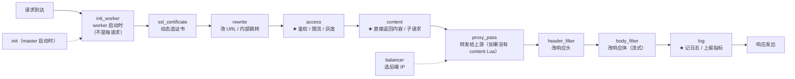

**各阶段能干什么，必须分清**（这是新手最常搞混的）：

| 阶段 | 触发时机 | 典型用途 | 关键限制 |
| --- | --- | --- | --- |
| `init_by_lua_block` | master 启动时，一次 | 加载模块、预热数据 | **不能做网络 IO** |
| `init_worker_by_lua_block` | 每个 worker 启动时，一次 | 起定时器、初始化连接 | 不能访问请求对象 |
| `ssl_certificate_by_lua_block` | TLS 握手时 | 按 SNI 动态选证书 | 极少用 |
| `rewrite_by_lua_block` | 解析完 URL | 改写 URI、做内部跳转 | 别在这里做鉴权 |
| `access_by_lua_block` | 路由确定后、转发前 | **鉴权、限流、风控** | 拿不到响应体 |
| `content_by_lua_block` | 生成响应时 | **直接返回 JSON、调后端** | 一个 location 只能有一个 |
| `balancer_by_lua_block` | 选后端 IP 时 | 动态负载均衡、熔断 | 只能用有限 API |
| `header_filter_by_lua_block` | 收到响应头 | 改/加响应头 | 此时 body 还没读完 |
| `body_filter_by_lua_block` | 收到响应体（可能分块） | 替换内容、脱敏 | **可能被调用多次** |
| `log_by_lua_block` | 请求结束后 | 日志、指标上报 | **不能再改响应** |

### 3.4 cosocket：OpenResty 的灵魂

**cosocket = coroutine + socket**。它是"用同步的写法，实现异步的效果"。

用一个比喻：**普通阻塞 IO 像一个人打电话订餐，电话打着就干不了别的**；**cosocket 像你发了微信就放下手机去干活，饭店回了消息你再看**——代码里写的是"发消息、等回复"，但实际你没傻等。

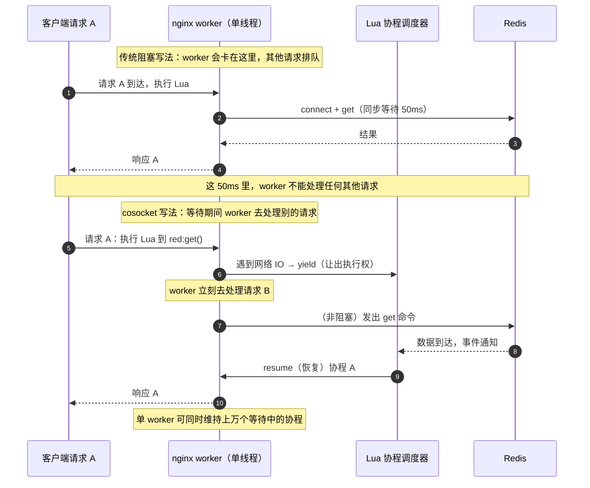

**为什么这件事重要？** 因为一个 worker 只有一个线程。如果鉴权查 Redis 用阻塞调用，10ms 的 Redis 延迟就会让这个 worker 在这 10ms 内**什么都干不了**；用 cosocket，这 10ms 它还能处理几千个请求。

## 四、时序图：三个关键过程

### 4.1 一次带鉴权的请求，完整走过各阶段

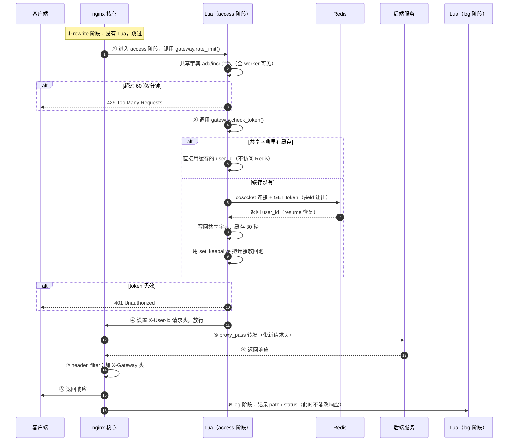

**三个必须注意的点**：

1. **鉴权必须在 access 阶段**，不能放 log（`ngx.exit` 在 log 阶段没意义，因为响应已经发了）。
2. **共享字典的 token 缓存让 Redis QPS 直接降一个数量级**——这是性能关键。
3. **连接必须 `set_keepalive` 放回池**，否则每次请求新建 TCP，Redis 会被连接数打爆。

### 4.2 动态配置热更新：改路由不用 reload

传统方式是"改 nginx.conf → reload"，但频繁 reload 会影响长连接。OpenResty 的常见做法是：**配置放 etcd/Redis，worker 起定时器定期拉取，存进共享字典，请求时直接读字典**。

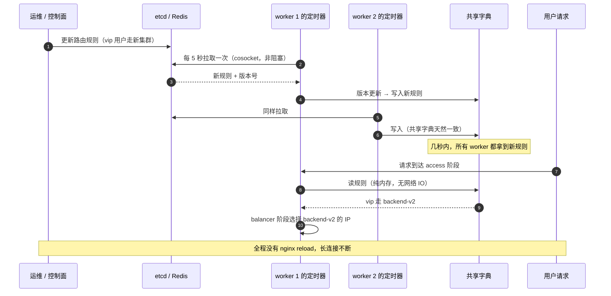

### 4.3 请求合并（dogpile 防护）

**场景**：一个热点 key 的缓存刚好过期，1000 个请求同时来，如果每个都去查 Redis/后端，会把后端打穿。OpenResty 用 `lua-resty-lock` 解决：

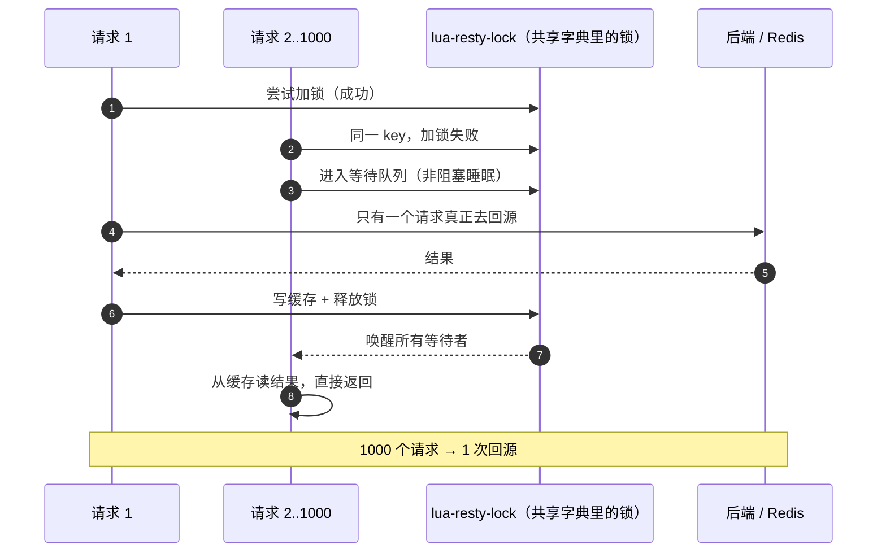

## 五、数据流图：两种数据，两条路

### 5.1 请求数据流

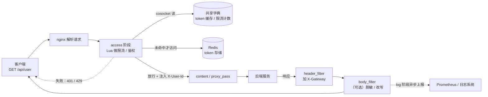

### 5.2 配置与控制数据流

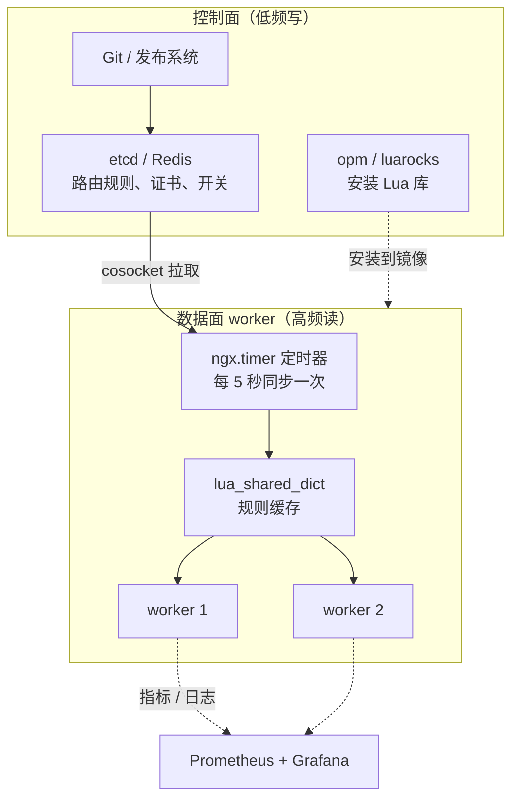

**要点**：**控制面低频写、数据面高频读，中间用共享字典解耦**。这样即使 etcd 短暂挂掉，worker 用旧规则继续服务——**这就是"配置中心挂了业务不受影响"的设计**。

## 六、核心机制深入

### 6.1 cosocket 的三个使用规则

```lua
-- 规则 1：必须设置超时，否则后端卡住会把协程永久挂起
red:set_timeout(500)              -- 连接、发送、接收共用的超时（毫秒）

-- 规则 2：用完放回连接池，别每次新建 TCP
red:set_keepalive(10000, 100)     -- 空闲 10 秒，池里最多留 100 条连接

-- 规则 3：出错要显式关闭，避免连接泄漏
red:close()
```

**还有一条隐含规则**：**不是所有阶段都能用 cosocket**。按 lua-nginx-module 官方文档，cosocket API 在 `set_by_lua*`、`log_by_lua*`、`header_filter_by_lua*`、`body_filter_by_lua*` 中是**禁用的**；在 `init_by_lua*` 和 `init_worker_by_lua*` 中目前也不支持。能放心用 cosocket 的是 `rewrite_by_lua*`、`access_by_lua*`、`content_by_lua*`、`ssl_certificate_by_lua*` 这些阶段，以及**定时器回调函数**。

> 如果确实要在"禁用 cosocket 的阶段"发起网络请求，官方 workaround 是：**创建一个零延迟的 `ngx.timer.at(0, handler)`，把网络 IO 放到定时器回调里异步做**——原阶段不等待结果，直接返回。

### 6.2 共享字典：限流与缓存的基石

```lua
local dict = ngx.shared.gateway_cache

-- get：读
local v = dict:get("key")

-- set：写，第三个参数是过期时间（秒）
dict:set("key", "value", 30)

-- add：只有不存在时才写，返回 true/false
-- 这个特性天然适合"限流第一个名额"
local first = dict:add("rl:1.2.3.4:12345", 1, 60)

-- incr：原子自增（多个 worker 同时调用也安全）
local count, err = dict:incr("rl:1.2.3.4:12345", 1)
```

**为什么不用 Lua 全局表做限流？** 因为每个 worker 一个 Lua 虚拟机，全局表是**各算各的**：3 个 worker 的限流阈值 60 会变成实际 180。**必须放共享字典。**

**容量要算清楚**：`lua_shared_dict gateway_cache 10m;` 的 10MB 是**真实内存占用**，不是 key 数量。存 100 万个短 key 大概需要 100MB 级别。共享字典满了 `set` 会返回 `nil, "no memory"`——**务必检查返回值**。

### 6.3 定时器：后台任务怎么做

```lua
-- init_worker_by_lua_block 里启动一个自重复定时器
local delay = 5
local handler
handler = function(premature)
    -- premature=true 表示 worker 正在退出，必须立刻返回
    if premature then return end

    -- 这里做后台任务：拉配置、上报指标、清理过期数据
    ngx.log(ngx.INFO, "tick from worker ", ngx.worker.id())

    -- 重新注册下一次（ngx.timer.every 也可以，但手动注册更好控制）
    local ok, err = ngx.timer.at(delay, handler)
    if not ok then ngx.log(ngx.ERR, "timer failed: ", err) end
end
ngx.timer.at(delay, handler)
```

**定时器里用的是"轻量线程"**，不能用 `ngx.req.*`（没有请求上下文），但**可以用 cosocket**（这是它与 init 阶段的重要区别）。

### 6.4 热加载：改代码要不要 reload？

| 改动内容 | 是否要 reload | 原因 |
| --- | --- | --- |
| `.lua` 文件内容 | **通常不用**（但生产建议 reload） | Lua 模块默认被 `package.loaded` 缓存；OpenResty 的 `lua_code_cache` 打开时改文件不自动生效 |
| `nginx.conf` | 要 `nginx -s reload` | 配置只在启动时读 |
| 共享字典里的规则 | **不用** | 定时器自动同步 |
| 新增 `.lua` 文件（首次 require） | 不用 | 第一次 require 时才加载 |

**生产铁律**：`lua_code_cache` **必须保持 on**（默认就是 on）。开发时为了改文件立即生效可以设 off，但**那会每个请求重新编译 Lua，性能掉一个数量级，并且不能用 cosocket 连接池**。

## 七、技术对比：OpenResty 站在哪

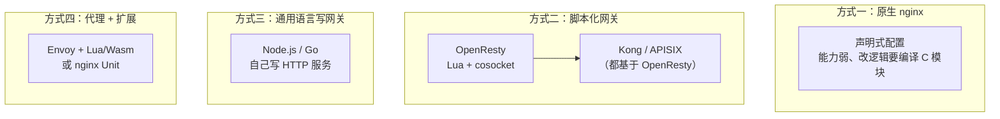

| 维度 | 原生 nginx | OpenResty | Node.js 自研网关 | Envoy + Lua/Wasm |
| --- | --- | --- | --- | --- |
| 逻辑表达力 | 弱（配置语言） | **强（Lua 图灵完备）** | 最强（通用语言） | 中 |
| 性能 | 极高 | **接近原生 nginx** | 中（单线程 + GC） | 高 |
| 调 Redis/DB | 不支持 | **cosocket，非阻塞** | 异步库，语法繁琐 | Lua 有限支持 |
| 改逻辑成本 | 重编译 | **改文件 + reload** | 重新构建部署 | 重编译/Wasm 构建 |
| 学习曲线 | 低 | 中（要理解阶段与协程） | 中 | 高 |
| 生态 | nginx 模块 | opm + resty 库 + APISIX/Kong | npm 全家桶 | 服务网格生态 |
| 典型主场 | 静态服务、简单反代 | **网关、WAF、鉴权限流、边缘逻辑** | 业务逻辑复杂的 Web 服务 | 服务网格 sidecar |

**什么时候不要用 OpenResty**：如果你只是在做普通的反向代理和静态资源服务，**原生 nginx 就够了**，上 OpenResty 徒增复杂度。如果你要写的是复杂的业务系统（订单、支付），**用 Go/Java/Python**，别把所有业务逻辑塞进 Lua——Lua 适合的是"请求级的横切逻辑"，不适合写大系统。

## 八、需要配合什么软件

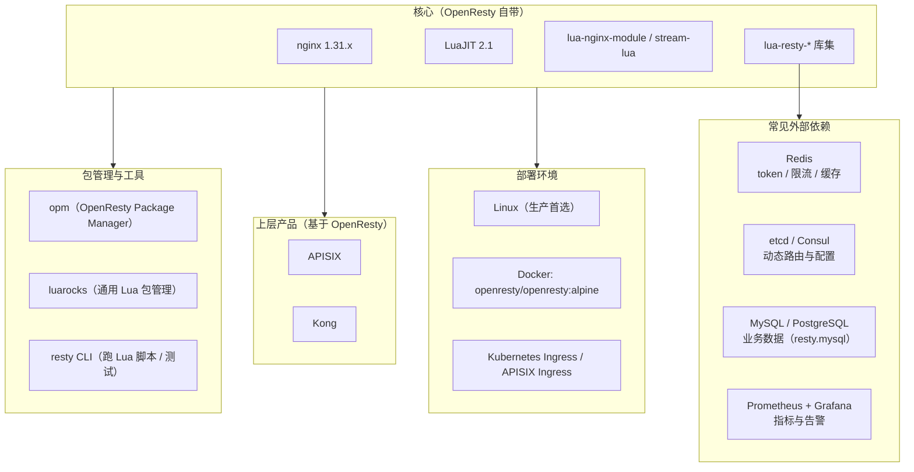

**各组件的作用，一句话说清**：

| 组件 | 全名 / 类型 | 什么时候需要 |
| --- | --- | --- |
| **LuaJIT** | Just-In-Time 编译器 | 必备。没有它 Lua 就是解释执行，性能不够 |
| **lua-nginx-module** | nginx 的 Lua 模块 | 必备。它提供所有 `*_by_lua_block` 指令 |
| **lua-resty-redis** | Redis 的 cosocket 客户端 | 做 token 校验、缓存、限流时 |
| **lua-resty-http** | HTTP 客户端 | Lua 里要调别的 HTTP 服务时 |
| **lua-resty-lock** | 分布式锁 | 防缓存击穿、请求合并 |
| **lua-resty-balancer** | 负载均衡算法库 | 自定义动态选后端时 |
| **lua-resty-jit-uuid** | UUID 生成 | 生成 request-id |
| **opm** | OpenResty Package Manager | 装 OpenResty 官方生态的库：`opm install xxx` |
| **luarocks** | LuaRocks 包管理器 | 装更通用的 Lua 库（部分不兼容 OpenResty，慎用） |
| **resty CLI** | 命令行工具 | 不启动 nginx 也能跑 Lua 脚本、做单元测试 |
| **APISIX / Kong** | 基于 OpenResty 的 API 网关 | 不想从零写网关逻辑时，直接用现成产品 |
| **Prometheus** | 监控系统 | 把限流数、错误率、延迟暴露成指标 |

## 九、实战：一个能跑的最小 API 网关

目标：实现**每 IP 每分钟 60 次限流 + Bearer Token 鉴权 + 请求头注入 + 响应头标记 + 访问日志**。

### 9.1 目录结构

```
/opt/openresty-gateway/
├── conf/
│   └── nginx.conf          ← nginx 配置（一级）
└── lua/
    └── gateway.lua         ← 业务 Lua 模块（二级）
```

### 9.2 `lua/gateway.lua`（完整，逐行注释）

```lua
-- ============================================================
-- gateway.lua：OpenResty 网关的公共逻辑
-- 所有函数都在 nginx 的请求阶段里被调用
-- ============================================================

local _M = {}                                  -- 模块表，文件末尾返回

-- cjson.safe 是"安全版"JSON 库：出错返回 nil 而不是抛异常
local cjson = require "cjson.safe"
-- resty.redis 是基于 cosocket 的 Redis 客户端（非阻塞）
local resty_redis = require "resty.redis"

-- 从环境变量读 Redis 地址；读不到就用本机默认值，方便本地调试
local REDIS_HOST = os.getenv("REDIS_HOST") or "127.0.0.1"
local REDIS_PORT = tonumber(os.getenv("REDIS_PORT")) or 6379

-- ------------------------------------------------------------
-- ① 校验 Bearer Token，成功返回 user_id，失败返回 nil + 原因
-- ------------------------------------------------------------
function _M.check_token()
    -- 读取 Authorization 请求头；没有就当空字符串
    local auth = ngx.req.get_headers()["authorization"] or ""

    -- 用 Lua 模式匹配剥掉 "Bearer " 前缀，只留 token 本体
    local token = auth:match("^Bearer%s+(.+)$")
    if not token then
        return nil, "missing token"            -- 格式不对，直接失败
    end

    -- 第一层缓存：worker 共享内存。命中就不查 Redis，省一次网络 IO
    local cache_key = "token:" .. token
    local cached = ngx.shared.gateway_cache:get(cache_key)
    if cached then
        ngx.req.set_header("X-User-Id", cached) -- 把用户 id 传给后端
        return cached
    end

    -- 创建 cosocket Redis 客户端
    local red, err = resty_redis:new()
    if not red then
        return nil, "redis new failed: " .. tostring(err)
    end

    -- 必须设超时（毫秒）：后端卡住时不能让协程永久挂着
    red:set_timeout(500)

    -- 连接 Redis（这里遇到 IO 会 yield，worker 可以去处理别的请求）
    local ok, err = red:connect(REDIS_HOST, REDIS_PORT)
    if not ok then
        return nil, "redis connect failed: " .. tostring(err)
    end

    -- 查 token 对应的 user_id
    local user_id, err = red:get(cache_key)
    if not user_id then
        red:close()                             -- 出错要显式关闭，避免连接泄漏
        return nil, "redis get failed: " .. tostring(err)
    end
    -- resty.redis 用 ngx.null 表示"key 不存在"（不是 nil，也不是空串）
    if user_id == ngx.null or user_id == "" then
        red:close()
        return nil, "invalid token"
    end

    -- 用完了放回连接池，下次请求复用这条 TCP 连接
    local ok, err = red:set_keepalive(10000, 100) -- 空闲 10s，池上限 100 条
    if not ok then
        ngx.log(ngx.WARN, "redis keepalive failed: ", tostring(err))
    end

    -- 第二层缓存：写回共享字典 30 秒，后续请求不用再查 Redis
    ngx.shared.gateway_cache:set(cache_key, user_id, 30)

    -- 把 user_id 作为请求头传给后端（后端就不用再鉴权了）
    ngx.req.set_header("X-User-Id", user_id)
    return user_id
end

-- ------------------------------------------------------------
-- ② 固定窗口限流：每个 IP 每分钟最多 60 次
-- ------------------------------------------------------------
function _M.rate_limit()
    -- 用"当前分钟"做 key 的一部分，天然形成固定窗口
    local minute = math.floor(ngx.time() / 60)
    local key = "rl:" .. ngx.var.remote_addr .. ":" .. minute

    -- add 只在 key 不存在时写入成功 → 这个请求拿到"第一个名额"
    local first, err = ngx.shared.gateway_cache:add(key, 1, 60)
    if first then
        return true                            -- 限额内，放行
    end
    if err and err ~= "exists" then
        ngx.log(ngx.WARN, "ratelimit add: ", err) -- 共享内存满等异常，保守放行
        return true
    end

    -- 已存在则原子自增（多 worker 并发安全）
    local count = ngx.shared.gateway_cache:incr(key, 1)
    if not count then
        return true                            -- 异常时保守放行，避免误伤
    end
    return count <= 60                         -- 超过 60 次返回 false
end

-- ------------------------------------------------------------
-- ③ 输出 JSON 响应（用于 /health 和健康检查）
-- ------------------------------------------------------------
function _M.json_response(tbl, status)
    local body, err = cjson.encode(tbl)         -- Lua 表 → JSON 字符串
    if not body then
        ngx.status = 500
        return ngx.say('{"error":"encode failed"}')
    end
    ngx.status = status or 200                  -- 没传状态码就默认 200
    ngx.header["Content-Type"] = "application/json; charset=utf-8"
    ngx.say(body)                               -- 输出响应体
end

return _M                                       -- 返回模块表供 require 使用
```

### 9.3 `conf/nginx.conf`（完整，逐行注释）

```nginx
# ============================================================
# OpenResty 网关配置（对应 OpenResty 1.31.8.1）
# ============================================================

# worker 数量按 CPU 核数自动决定
worker_processes auto;
pid /usr/local/openresty/nginx/logs/nginx.pid;

events {
    # 每个 worker 的并发连接上限
    worker_connections 10240;
}

http {
    include       mime.types;
    default_type  application/octet-stream;

    access_log /usr/local/openresty/nginx/logs/access.log;

    # Lua 模块搜索路径：
    # "/opt/openresty-gateway/lua/?.lua" 是我们放 gateway.lua 的地方
    # 结尾的 ";;" 表示保留 OpenResty 默认的搜索路径（lua-resty-* 库在那里）
    lua_package_path "/opt/openresty-gateway/lua/?.lua;;";

    # 共享字典：所有 worker 可见的 10MB 内存，用于限流计数和 token 缓存
    lua_shared_dict gateway_cache 10m;

    # master 启动时执行一次：加载模块，提前发现缺失依赖
    init_by_lua_block {
        local ok, err = pcall(require, "gateway")
        if not ok then
            ngx.log(ngx.ERR, "failed to load gateway module: ", err)
        end
    }

    # 每个 worker 启动时执行一次：起一个每 10 秒的心跳定时器
    init_worker_by_lua_block {
        local delay = 10
        local handler
        handler = function(premature)
            -- worker 正在退出，必须立刻返回，不能做新工作
            if premature then return end
            ngx.log(ngx.INFO, "heartbeat from worker ", ngx.worker.id())
            -- 重新注册下一次定时器
            local ok, err = ngx.timer.at(delay, handler)
            if not ok then
                ngx.log(ngx.ERR, "timer register failed: ", err)
            end
        end
        local ok, err = ngx.timer.at(delay, handler)
        if not ok then ngx.log(ngx.ERR, "timer init failed: ", err) end
    }

    # 上游服务
    upstream backend {
        server 127.0.0.1:8081;
        keepalive 32;                      # 到后端的长连接池
    }

    server {
        listen 80;
        server_name api.example.com;

        # ---------------- 健康检查：只用到 Lua，不转发 ----------------
        location /health {
            content_by_lua_block {
                local gw = require "gateway"
                gw.json_response({ status = "ok", worker = ngx.worker.id() })
            }
        }

        # ---------------- 业务 API：限流 + 鉴权 + 转发 ----------------
        location /api/ {
            # access 阶段：限流与鉴权；失败时 ngx.exit 直接结束请求
            access_by_lua_block {
                local gw = require "gateway"

                if not gw.rate_limit() then
                    return ngx.exit(429)   -- 429 Too Many Requests
                end

                local user_id, err = gw.check_token()
                if not user_id then
                    ngx.header["WWW-Authenticate"] = 'Bearer realm="api"'
                    return ngx.exit(401)   -- 401 Unauthorized
                end
                -- check_token 内部已经用 ngx.req.set_header 注入了 X-User-Id
            }

            # 上面通过后，才真正转发给后端
            proxy_pass http://backend;
            proxy_http_version 1.1;
            proxy_set_header Connection "";

            # header_filter 阶段：给响应加一个网关标记
            header_filter_by_lua_block {
                ngx.header["X-Gateway"] = "openresty";
            }

            # log 阶段：请求已经结束，这里只能记录，不能再改响应
            log_by_lua_block {
                ngx.log(ngx.INFO, "path=", ngx.var.uri,
                                  " status=", ngx.status);
            }
        }
    }
}
```

### 9.4 跑起来（Linux / Docker）

```bash
# ① 装 OpenResty（Ubuntu / Debian 官方源）
sudo apt-get update
sudo apt-get install -y openresty

# ② 放代码
sudo mkdir -p /opt/openresty-gateway/lua
sudo cp gateway.lua /opt/openresty-gateway/lua/

# ③ 检查配置语法（★ 改完必做）
sudo openresty -t -c /opt/openresty-gateway/conf/nginx.conf

# ④ 启动（用指定配置）
sudo openresty -c /opt/openresty-gateway/conf/nginx.conf

# ⑤ 造一个假后端（另一个终端）
python3 -m http.server 8081

# ⑥ 验证 1：健康检查（不需要 token）
curl -i http://127.0.0.1/health
# 期望：200 + {"status":"ok","worker":0}

# ⑦ 验证 2：不带 token（期望 401）
curl -i http://127.0.0.1/api/test
# 期望：HTTP/1.1 401 Unauthorized + WWW-Authenticate 头

# ⑧ 验证 3：先在 Redis 里造一个 token，再带 token 访问
redis-cli SET token:abc123 user-9527
curl -i -H "Authorization: Bearer abc123" http://127.0.0.1/api/test
# 期望：200 + X-Gateway: openresty

# ⑨ 验证 4：刷 61 次，第 61 次期望 429
for i in $(seq 1 61); do curl -s -o /dev/null -w "%{http_code} " \
  -H "Authorization: Bearer abc123" http://127.0.0.1/api/test; done
```

**用 Docker 更省事**（不用装到宿主机）：

```bash
docker run -d --name or-gateway --network host \
  -v $PWD/conf/nginx.conf:/usr/local/openresty/nginx/conf/nginx.conf:ro \
  -v $PWD/lua:/opt/openresty-gateway/lua:ro \
  openresty/openresty:alpine
```

## 十、使用场景

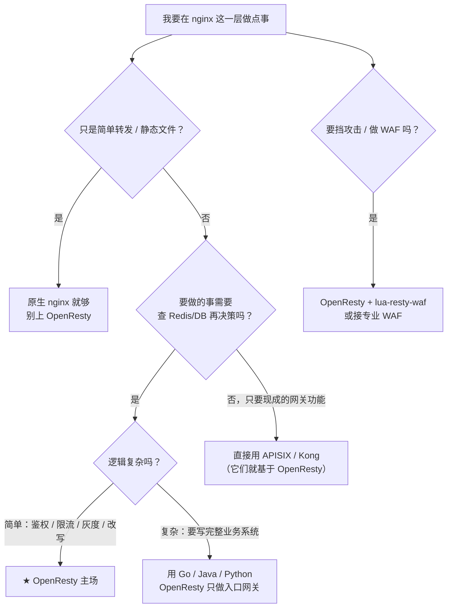

### 10.1 五个典型场景

**① API 网关。**
路由、鉴权、限流、熔断、请求改写、灰度分流——全在 access/balancer 阶段完成。**Kong 和 APISIX 就是基于 OpenResty 做的**，你要么直接用它们，要么照着这个思路自己写。

**② WAF（Web Application Firewall，Web 应用防火墙）。**
在 access 阶段检查请求特征：SQL 注入、XSS、恶意 UA、IP 黑名单。因为 cosocket 能实时查威胁情报库，判断比静态规则灵活得多。

**③ 动态路由与灰度发布。**
配置放 etcd，定时器同步到共享字典。按用户 ID 哈希、按 Header 标记，把 5% 流量导到新版本——**改规则不用 reload，长连接不受影响**。

**④ 限流与防刷。**
比 nginx 原生 `limit_req` 灵活得多：按用户等级（VIP 每分钟 1000 次，普通 60 次）、按接口权重、按租户配额，全部用共享字典 + Lua 实现。

**⑤ CDN / 边缘逻辑。**
在 CDN 边缘节点上做防盗链签名校验、AB 测试、图片 URL 改写、按设备返回不同内容。这就是所谓的**边缘计算（edge computing）**——CDN 解决"把内容搬近"，OpenResty 解决"在近处还能思考"。

### 10.2 什么场景不该用

| 场景 | 为什么 | 用什么 |
| --- | --- | --- |
| 纯静态文件服务 | 没有逻辑要写，OpenResty 是多余的复杂度 | 原生 nginx |
| 完整业务系统（订单、支付） | Lua 不适合写大型系统，生态和工具链弱 | Go / Java / Python |
| 团队完全没有 Lua 经验 | 阶段模型和协程概念有学习成本，写错会出隐蔽 bug | 先用 APISIX 这类成品 |
| 需要大量 CPU 密集计算 | LuaJIT 再快也不适合图像编码、加密爆破这类任务 | C/C++/Rust 服务 |
| Windows 生产环境 | 官方没有现代 Windows 版 | 用 Linux 或 Docker |

## 十一、十个常见的坑

**坑 1：在 `init_by_lua_block` 里做网络 IO。**
这个阶段在 master 启动时执行，**不支持 cosocket**。要定时拉配置，放 `init_worker_by_lua_block` + `ngx.timer.at`。

**坑 2：用 Lua 全局表存限流计数。**
每个 worker 一份，3 个 worker 的阈值 60 会变成实际 180。**必须用 `ngx.shared.DICT`。**

**坑 3：忘了 `set_keepalive`。**
每次请求新建 Redis 连接，Redis 的连接数被打爆，表现为间歇性 `connection refused`。

**坑 4：忘了 `set_timeout`。**
后端卡住，协程永远不恢复；worker 里堆积几万个协程，内存涨到爆。

**坑 5：生产环境把 `lua_code_cache` 设成 off。**
改文件立即生效很爽，但**每个请求都重新编译 Lua，性能掉一个数量级**，而且连接池失效。只在开发环境用。

**坑 6：在 `body_filter` 里假设只执行一次。**
响应体可能被分块，这个阶段会被调用多次。要做整体替换，必须用缓冲累积或直接改 header 后用别的方案。

**坑 7：在 `log_by_lua_block` 里改响应。**
响应已经发出去了，`ngx.status` 改了也没用。log 阶段只做记录和上报。

**坑 8：`cjson` 遇到 Lua 的 `nil` 数组会报错。**
Lua 里 `{nil, "a"}` 不是合法 JSON 数组。用 `cjson.safe` 并检查返回值，别直接用 `cjson.encode`。

**坑 9：共享字典没检查返回值。**
内存满时 `set` 返回 `nil, "no memory"`，不检查就会静默丢数据。**所有 `set`/`add` 都要处理失败分支。**

**坑 10：在网关里塞太多业务。**
Lua 代码越写越多，最后变成一个没人敢动的大泥球。**规则：网关只做横切逻辑（鉴权、限流、路由、日志），业务交给后端服务。**

## 十二、总结

回到流水线的比喻：

- **nginx 是流水线本身**：连接、解析、转发、日志，稳定且极快。
- **OpenResty 是给每个工位装了可编程机械臂**：想在哪一步做事，就在哪个阶段挂 Lua。
- **cosocket 是机械臂的"不傻等"能力**：等 Redis 回消息的时候，工人（worker）转身去干别的活。

三句话记住它：

1. **OpenResty = nginx + Lua，它的快不是因为 Lua 快，而是因为逻辑就在请求路径上、并且 IO 不阻塞。**
2. **阶段决定你能做什么，共享字典决定数据谁能看见。**
3. **能用原生 nginx 解决的，就别上 OpenResty；真需要"按情况决策"了，它才值这个学习成本。**

## 附录：术语中英对照表

| 缩写 / 术语 | 英文全称 | 中文 | 一句话解释 |
| --- | --- | --- | --- |
| OpenResty | OpenResty | 增强版 nginx 发行版 | nginx + LuaJIT + Lua 模块的打包，不是新语言 |
| Lua | Lua |  Lua 语言 | 轻量脚本语言，语法小、启动快，适合写"逻辑片段" |
| LuaJIT | Lua Just-In-Time Compiler | Lua 即时编译器 | 把 Lua 编译成机器码，性能接近 C |
| ngx_lua | lua-nginx-module | nginx 的 Lua 模块 | 提供所有 `*_by_lua_block` 指令的那个模块 |
| phase | Request Processing Phase | 请求处理阶段 | nginx 把一次请求切成多道工序，Lua 可挂在各工序上 |
| cosocket | Coroutine Socket | 协程套接字 | **同步写法 + 非阻塞 IO**，OpenResty 的灵魂 |
| coroutine | Coroutine | 协程 | 可主动让出/恢复执行权的轻量执行单元 |
| yield / resume | Yield / Resume | 让出 / 恢复 | 遇到 IO 让出 CPU，IO 完成后恢复继续跑 |
| JIT | Just-In-Time Compilation | 即时编译 | 运行时把字节码编译成机器码 |
| FFI | Foreign Function Interface | 外部函数接口 | LuaJIT 直接调用 C 函数的能力 |
| shared dict | lua_shared_dict | 共享字典 | 所有 worker 共享的 KV 内存区，用于限流/缓存 |
| ngx.var | ngx.var | nginx 变量接口 | Lua 里读写 nginx 变量（如 `$uri`） |
| ngx.req | ngx.req | 请求接口 | Lua 里读/改请求头、请求体、URI |
| ngx.timer | ngx.timer | 定时器 | worker 里跑后台异步任务的机制 |
| ngx.exit | ngx.exit | 结束请求 | 直接返回指定状态码并终止当前请求 |
| subrequest | Subrequest | 子请求 | nginx 内部的嵌套请求，`ngx.location.capture` 用 |
| balancer | Balancer | 负载均衡器 | `balancer_by_lua_block` 里自定义选后端 IP |
| keepalive | Keep-Alive | 长连接复用 | 用完的连接放回池，避免反复握手 |
| opm | OpenResty Package Manager | OpenResty 包管理器 | `opm install xxx` 装 Lua 库 |
| luarocks | LuaRocks | Lua 包管理器 | 通用 Lua 生态的包管理器 |
| resty CLI | resty Command Line Interface | resty 命令行工具 | 不启动 nginx 也能跑 Lua 脚本、做测试 |
| lua-resty-redis | lua-resty-redis | Redis 的 cosocket 客户端 | OpenResty 里访问 Redis 的标准库 |
| lua-resty-lock | lua-resty-lock | Lua 锁库 | 基于共享字典的锁，防缓存击穿 |
| WAF | Web Application Firewall | Web 应用防火墙 | 挡 SQL 注入、XSS 等应用层攻击 |
| API Gateway | API Gateway | API 网关 | 统一入口，做路由/鉴权/限流/观测 |
| BFF | Backend For Frontend | 面向前端的后端 | 为特定前端聚合数据的那一层 |
| rate limiting | Rate Limiting | 限流 | 限制单位时间内的请求次数 |
| token bucket | Token Bucket | 令牌桶 | 一种经典限流算法 |
| cache stampede | Cache Stampede / Dogpile | 缓存击穿 | 热点缓存过期瞬间大量请求同时回源 |
| hot reload | Hot Reload | 热加载 | 不重启进程就让新配置/新代码生效 |
| etcd | etcd | 分布式键值存储 | 常用来存动态路由和配置 |
| APISIX | Apache APISIX | 阿帕奇 APISIX | 基于 OpenResty 的云原生 API 网关 |
| Kong | Kong | Kong 网关 | 基于 OpenResty 的 API 网关，插件生态丰富 |
