如果你的系统只有一台机器，"记住某个配置"很简单——写个文件就行。但一旦变成十台机器，问题就来了：**谁说了算？** A 机器说"开关打开了"，B 机器说"我这边是关的"，听谁的？而且若 A 突然断电，它记的东西还在吗？

**etcd** 就是专门解决这个问题的：**让一群机器共同维护一个"所有人都信得过的记事本"**。它不追求"什么都能存"，只把一件事做到极致——**在小规模、关键数据上保持强一致，并且挂掉少数机器也不丢数据**。

你可能没直接用它，但只要你用过 Kubernetes，就一定用过它：**K8s 集群的全部状态——有哪些 Pod、哪些 Service、谁被调度到哪台机器——都存在 etcd 里**。etcd 挂了，K8s 集群就"失忆"了。

这篇文章按技术文档的方式讲透它：**解决什么问题 → 架构长什么样 → 写入和选举怎么跑 → 数据怎么流动 → 怎么上手用 → 什么场景该用**。术语第一次出现都给英文全称和中文解释。

> 本文核对日期：2026 年 11 月 28 日。etcd 最新稳定版是 **v3.7.4（2026-11-19 发布）**，是 **CNCF（Cloud Native Computing Foundation，云原生计算基金会）的毕业项目**（2020-11-24 毕业）。**文中的 etcdctl 命令与 Go 客户端示例已在 v3.7.4 上实际启动集群编译并运行验证**；v3.7 中不再需要设置 `ETCDCTL_API=3`，设了反而会收到"环境变量无法识别"的警告。

## 〇、一句话、一张全景图

**一句话**：etcd 是一个**分布式的、强一致的键值数据库**——一群机器通过 Raft 协议投票，共同维护一份有序的 `key → value` 表，并且支持"盯着某个 key 变化"和"给 key 设有效期"。

用生活场景打比方：**它像一个有多名记账员的账本**。每次修改都要**超过半数记账员同意**才写进去；主控（leader）换了人也没关系，因为每个人手里都有同一本账的副本。**丢一两个人，账本还在；丢超过一半，谁也写不了新账**——这就是"强一致"的代价。

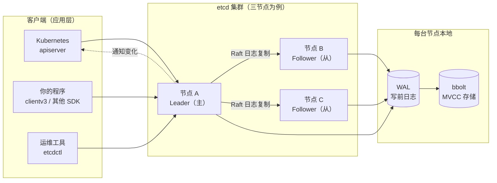

**先记住这条主线**：**客户端把写请求发给 leader → leader 记日志并复制给多数派 → 多数派确认后写入 → 所有节点状态一致 → 客户端收到成功**。读可以直接读本地（快，但可能不是最新），也可以走 leader 做线性一致读（慢一点，但保证最新）。

几个词先用白话过一遍：

| 词 | 白话解释 |
| --- | --- |
| KV（键值存储） | 只能存 `key → value`，像一本只有"编号 → 内容"的字典 |
| 强一致 | 写成功后，任何节点立刻能读到这个新值，不会读到旧的 |
| Raft | 让多台机器"投票选主、复制日志"的一致性算法 |
| Leader / Follower | 主节点（接写请求）/ 从节点（只同步和提供读） |
| quorum（法定人数） | 超过半数，写操作必须拿到这么多节点的同意 |
| revision | 全局递增版本号，每次修改 +1，可用来"读历史" |
| Watch | 盯着某个 key，它一变就主动告诉你 |
| Lease（租约） | 给 key 设一个"有效期"，到期自动删除——常用于服务心跳 |

**本文路线**

| 章节 | 回答的问题 |
| --- | --- |
| 〇 | 一句话、全景图、术语速览 |
| 一 | 没有 etcd，分布式系统会痛在哪？ |
| 二 | etcd 是什么？它和 MySQL / Redis 有什么不同？ |
| 三 | 架构：集群视图、单机内部视图、数据模型视图 |
| 四 | 时序：一次写入、一次选主、一次 Watch 推送 |
| 五 | 数据流：写路径与读路径 |
| 六 | 核心机制：Raft、revision、租约、事务、压缩 |
| 七 | 需要配合什么软件 |
| 八 | 实战：单节点、常用命令、三节点集群、Go 客户端 |
| 九 | 使用场景与决策图 |
| 十 | 常见坑与排错 |
| 附录 | 术语中英对照表 |

## 一、没有 etcd，分布式系统会痛在哪？

假设你有 5 台服务，需要共享一个开关配置"是否开启新功能"。

### 1.1 方案 A：每台机器各存一份文件

改配置要挨个登录 5 台机器改。**改到一半时，3 台是新值、2 台是旧值**——系统处于不一致状态，而且没有任何机制帮你发现这件事。

### 1.2 方案 B：放 MySQL 里

能集中管理，但**数据库是单点**：数据库挂了，所有服务都读不到配置。而且每次读都要查库，K8s 那种"每秒几千次状态查询"的场景会把数据库压垮。

### 1.3 方案 C：放 Redis 里

读写快，但默认**不保证强一致**（主从复制是异步的，主挂了可能丢一小段写入）。对于"哪个 Pod 在运行"这种状态数据，丢一秒都可能调度出错。

### 1.4 etcd 的答案

| 需求 | etcd 怎么做 |
| --- | --- |
| 集中存放 | 一个逻辑上的全局 KV 表 |
| 不丢数据 | 写入必须先落到多数派的日志里 |
| 高可用 | 挂掉少数节点仍能继续服务 |
| 强一致 | 写成功后所有节点看到相同结果 |
| 变化通知 | Watch 主动推送，不用轮询 |
| 自动过期 | Lease 到期自动删除 key（服务心跳） |

**代价也要说清楚**：

- **写性能不如 Redis**：因为每次写都要走一遍"投票 + 复制"，跨机房延迟会更明显。
- **不能存大对象**：官方建议单 value 通常 **不超过 1.5 MB**，它设计来存的是"状态和配置"，不是文件。
- **节点数必须是奇数且不要太多**：3 或 5 最常见，7 已经很少见。**偶数节点并不能提高容错能力，反而浪费**。

## 二、etcd 是什么？

**etcd** 是一个**分布式强一致键值存储**（distributed reliable key-value store）。名字来源于 Linux 的 `/etc` 目录（放配置的地方）加分布式后缀 "d"。它由 CoreOS 团队创建，现在是 CNCF 毕业项目。

### 2.1 它和其他存储的区别

| 维度 | etcd | Redis | MySQL / PostgreSQL | ZooKeeper |
| --- | --- | --- | --- | --- |
| 数据模型 | 有序 KV | KV + 丰富数据结构 | 关系表 + SQL | 树形 znode |
| 一致性 | **强一致（Raft）** | 通常最终一致 | 事务强一致 | 强一致（Zab） |
| 主要用途 | **配置 / 元数据存储** | 缓存 / 高速读写 | 业务数据 | 分布式协调 |
| 变化通知 | Watch（从 revision 续） | Pub/Sub（不持久） | 无原生 | Watch |
| 过期机制 | Lease | TTL | 无原生 | 临时节点 |
| 典型用户 | **Kubernetes** | 各种业务 | 各种业务 | Hadoop / Kafka 老版本 |

**一句话选择**：**存业务数据用数据库，做缓存用 Redis，存"集群状态和配置"用 etcd。**

### 2.2 端口：记住两个数字

| 端口 | 用途 | 谁在连 |
| --- | --- | --- |
| **2379** | **客户端端口**（client URL） | SDK、etcdctl、apiserver |
| **2380** | **节点间端口**（peer URL） | 其他 etcd 节点（Raft 复制、选举） |

**排障时先分清是哪个端口不通**：客户端连不上查 2379；节点之间无法组成集群查 2380。

## 三、架构：三个视角

### 3.1 集群视角：Raft 与多数派

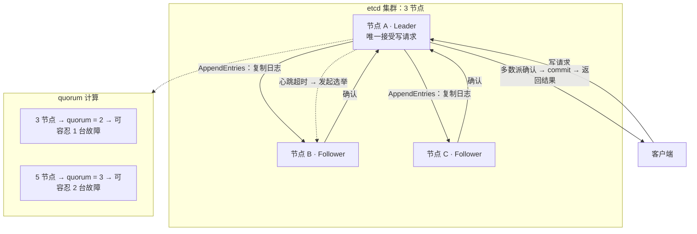

**quorum（法定人数）= 节点数/2 取整 + 1**。3 台需要 2 台同意，5 台需要 3 台同意。

**为什么挂掉少数还能用，挂掉多数就写不了？** 因为 Raft 要求"写入必须复制到多数派才算成功"。3 台挂了 2 台，剩下 1 台达不到 2 票，只能**拒绝写入**——这是故意的：**宁可停止服务，也不让数据出现不一致**。这叫 **CAP 定理中的 CP**（Consistency + Partition tolerance，一致性 + 分区容错），牺牲可用性换取一致性。

### 3.2 单机内部视角：请求进去以后经过什么

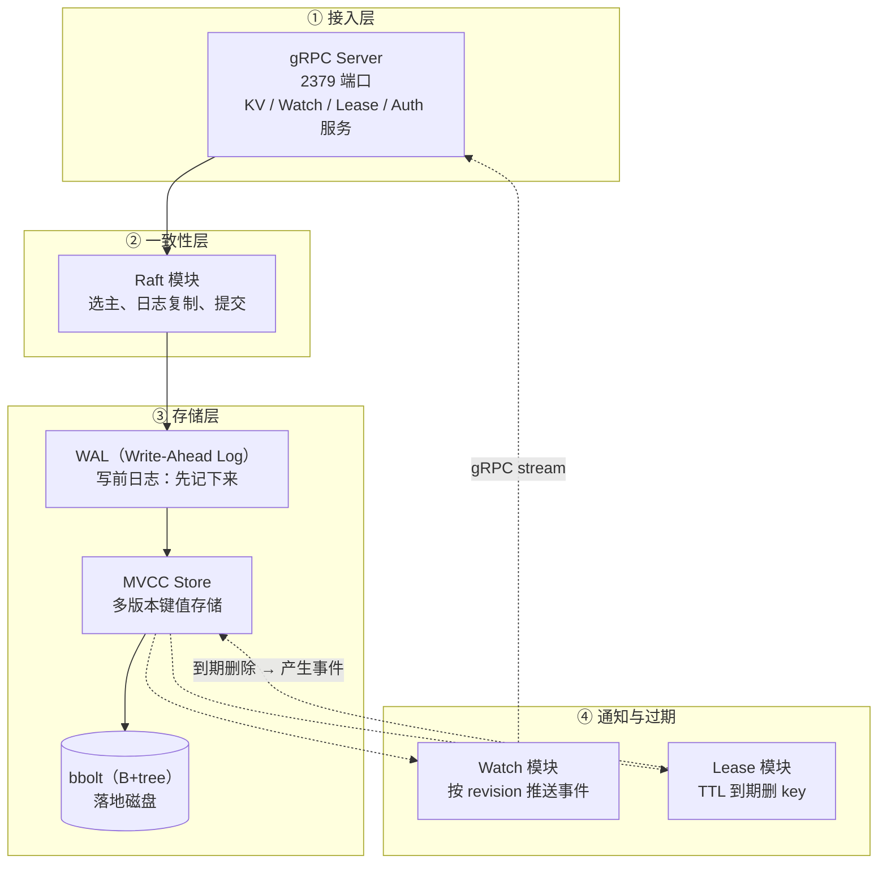

四层各干什么：

- **接入层**：etcd v3 的 API **全部是 gRPC 调用**（KV、Watch、Lease、Auth、Cluster、Maintenance 六类服务）。所以你想用 Go/Java/Python 调它，需要对应语言的 gRPC 客户端库。
- **一致性层**：Raft 模块。所有**写操作**必须先变成 Raft 日志、被多数派确认，才会往下走。
- **存储层**：**先写 WAL（Write-Ahead Log，写前日志），再更新内存里的 MVCC 树，后台做快照存进 bbolt**。这样即使突然断电，也能从 WAL 重放恢复。
- **通知与过期层**：Watch 基于 revision 推送变化；Lease 到期时自动删除关联的 key，并产生删除事件。

### 3.3 数据模型视角：key 不是只有"当前值"

这是 etcd 最容易被忽略、也最有价值的一点：**它记住了每个 key 的每一次修改**。

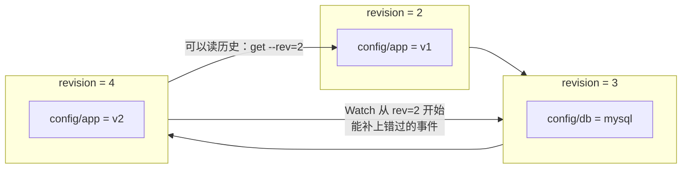

一个 key 的完整信息包括：

| 字段 | 含义 |
| --- | --- |
| `key` / `value` | 键和值（都是字节串） |
| `create_revision` | 这个 key 第一次创建时的全局版本号 |
| `mod_revision` | 最后一次修改时的全局版本号 |
| `version` | 这个 key 自己被改了几次 |
| `lease` | 绑定的租约 ID（0 表示没有） |

**全局 revision 是整个集群的逻辑时钟**：每改一次 key 就 +1。这带来两个杀手级能力：

1. **时光查询**：`get --rev=2` 能读到历史上那个时刻的值（前提是历史没被压缩掉）。
2. **可靠 Watch**：客户端断线重连时，从上次看到的 revision 继续看，**中间错过的事件能补回来**——这比 Redis Pub/Sub"断了就没了"强得多。

## 四、时序图：三个关键过程

### 4.1 一次写入怎么被确认

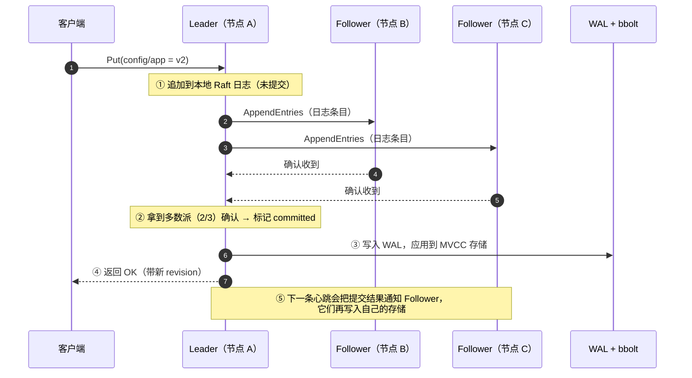

**关键点**：客户端收到的 `OK` 意味着**数据已经在多数派节点的日志里**，即使 leader 此刻立刻挂掉，新 leader 也能从日志里恢复这条数据。这就是"强一致"的具体含义。

### 4.2 Leader 选举

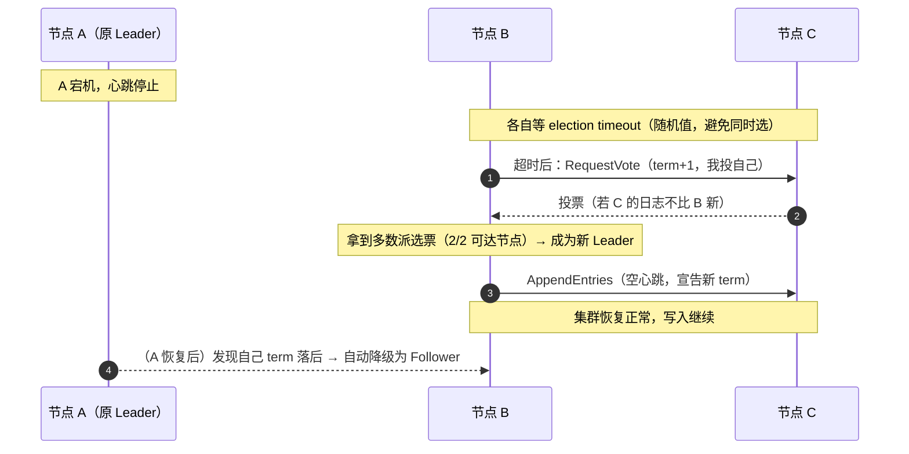

**两个要点**：

- **随机超时时间**是为了避免"两个节点同时参选、永远平票"的死循环。
- **日志完整性检查**（"候选者的日志不能比自己旧"）保证选出来的 leader 拥有最新数据，**不会丢已提交的写入**。

### 4.3 Watch 推送与断线续传

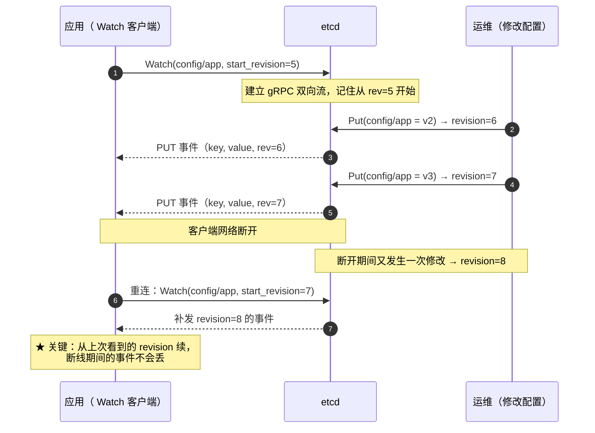

**这就是 Watch 比轮询和 Pub/Sub 强的地方**：**事件带 revision，且历史事件会保留一段时间**，客户端能"补作业"。

## 五、数据流：写路径与读路径

### 5.1 写路径

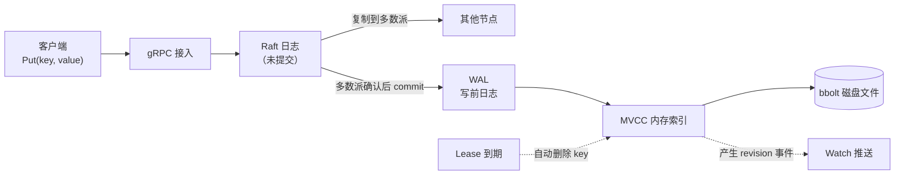

**顺序不能变**：**先 Raft 复制、再写 WAL、再更新存储、最后回客户端**。如果顺序反了（先回客户端再复制），leader 一挂数据就丢了。

### 5.2 读路径：两种一致性

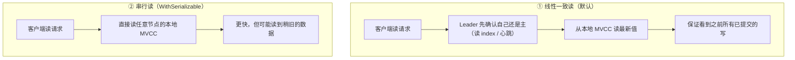

**什么时候用哪种**：

| 场景 | 用哪种 |
| --- | --- |
| 读配置、缓存重建（能接受毫秒级陈旧） | 串行读，快 |
| 读"锁状态"、做决策（必须最新） | 线性一致读（默认），安全 |
| Watch 建立的起始 revision | 用线性一致读拿到的 revision 才可靠 |

## 六、核心机制深入

### 6.1 quorum：为什么必须是奇数

| 集群规模 | quorum | 可容忍故障节点数 |
| --- | --- | --- |
| 1 | 1 | 0（只能测试用） |
| 3 | 2 | 1 |
| 5 | 3 | 2 |
| 7 | 4 | 3 |
| 4（偶数，不推荐） | 3 | **仍然只有 1**，和 3 台一样，但多花一台机器 |

**结论**：生产用 **3 或 5 台**，跨可用区部署时把节点分散到不同 AZ。

### 6.2 revision、压缩与"时光查询"

每次修改都会产生新 revision，历史版本默认保留一段时间（通常几小时）。**历史不会无限增长**——etcd 会做 **compaction（压缩）**，删掉老版本释放空间。

```bash
# 查看当前 revision（读一个不存在的 key 也能拿到 header）
etcdctl get nonexistent-key -w=json

# 读历史版本（前提是该 revision 还没被压缩）
etcdctl get --prefix config --rev=2

# 手动压缩到某个 revision
etcdctl compact 5

# 压缩后再读 rev=4 会报错：required revision has been compacted
```

**什么时候要手动压缩**：当你看到 etcd 的 **DB Size 持续增长**（`etcdctl endpoint status`）并且磁盘告警时。压缩之后建议再做 `etcdctl defrag` 回收磁盘空间。

### 6.3 Lease：服务发现与心跳的地基

Lease 是"带 TTL 的租约"，key 绑上租约后，**租约过期 → 所有绑定的 key 自动删除**。

```bash
# 申请一个 60 秒的租约，拿到 ID
etcdctl lease grant 60
# 实测输出：lease 32695410dcc0ca06 granted with TTL(60s)

# 把 key 绑定到租约
etcdctl put --lease=32695410dcc0ca06 /services/api-1 "10.0.0.1:8080"

# 服务持续调用 keepalive 续约；进程挂了就不再续约 → key 自动消失
etcdctl lease keep-alive 32695410dcc0ca06

# 主动撤销租约（key 立即被删）
etcdctl lease revoke 32695410dcc0ca06
```

**这就是服务注册发现的原理**：服务启动时注册一个带租约的 key，后台 goroutine 定期续约；服务崩溃 → 租约到期 → key 自动删除 → 客户端 Watch 到删除事件 → 从服务列表里摘除。**不需要中心化的健康检查器。**

### 6.4 Txn：Compare-and-Swap 实现分布式锁

etcd 的事务是**原子条件写**：先比较，条件成立才执行，整个过程在一个 revision 里完成。

```
compare:  value("lock/key") = "0"
then:     put lock/key "owner-A"
else:     get lock/key
```

Go 客户端里就是：

```go
resp, err := cli.Txn(ctx).
    If(clientv3.Compare(clientv3.Value("lock/key"), "=", "0")).
    Then(clientv3.OpPut("lock/key", "owner-A")).
    Else(clientv3.OpGet("lock/key")).
    Commit()
// resp.Succeeded == true 表示抢到锁
```

**这就是分布式锁的地基**：多个客户端同时抢，只有一个能看到旧值并写入成功。真实场景还要配合 Lease——**持锁者挂了，锁自动释放**，避免死锁。

## 七、需要配合什么软件

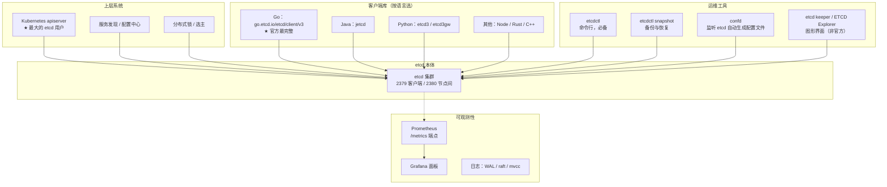

**各组件一句话说明**：

| 组件 | 什么时候需要 |
| --- | --- |
| **etcdctl** | 所有运维操作：读写、备份、查状态、压缩。**装 etcd 就自带** |
| **client/v3（Go）** | Go 程序的官方客户端，本文示例用它 |
| **jetcd / etcd3** | Java / Python 程序要访问 etcd 时 |
| **confd** | 希望"etcd 里的配置一变，自动重写 nginx.conf 并 reload" |
| **snapshot save/restore** | 做备份和灾难恢复 |
| **Prometheus + Grafana** | 监控写入延迟、DB size、leader 切换、raft 状态 |
| **TLS 证书** | 跨网络访问时必须开，etcd 本身不加密传输 |
| **kubeadm / kubespray** | 部署 K8s 时自动帮你把 etcd 集群搭好 |

## 八、实战：从单节点到集群

### 8.1 启动单节点（本地学习用）

**下面这条命令我在 etcd v3.7.4 Windows 版上实际跑通过**，Linux 上参数完全一致，只是可执行文件名不带 `.exe`。

```bash
# 从 GitHub Releases 下载对应系统的二进制（这里是 Windows 版）
# Linux: etcd-v3.7.4-linux-amd64.tar.gz
# macOS: etcd-v3.7.4-darwin-amd64.zip

etcd \
  --name infra1 \
  --data-dir ./data \
  --listen-client-urls http://127.0.0.1:2379 \
  --advertise-client-urls http://127.0.0.1:2379 \
  --listen-peer-urls http://127.0.0.1:2380 \
  --initial-advertise-peer-urls http://127.0.0.1:2380 \
  --initial-cluster infra1=http://127.0.0.1:2380
```

逐项解释：

| 参数 | 作用 |
| --- | --- |
| `--name` | 这个节点在集群里的名字 |
| `--data-dir` | 数据存哪（WAL + bbolt 文件） |
| `--listen-client-urls` | 监听哪个地址接收客户端请求（2379） |
| `--advertise-client-urls` | 告诉别人"客户端该连我哪个地址" |
| `--listen-peer-urls` | 监听哪个地址做节点间通信（2380） |
| `--initial-advertise-peer-urls` | 告诉其他节点"找我请连这个地址" |
| `--initial-cluster` | 初始集群成员列表，格式是 `名字=peer地址` |

**最常见的配置错误**：`advertise-client-urls` 写成 `localhost` 但客户端在别的机器上——客户端照着这个地址连，连到的是自己的 localhost。**一定要写客户端真能访问到的地址。**

### 8.2 etcdctl 常用命令（全部实测）

```bash
# ① 健康检查（会做一次真实的提交，比 ping 更靠谱）
etcdctl endpoint health
# 实测输出：
# 127.0.0.1:2379 is healthy: successfully committed proposal: took = 4.2238ms

# ② 写和读
etcdctl put config/app "hello-etcd"     # 输出 OK
etcdctl get config/app                  # 输出两行：key 和 value
etcdctl get config/app --print-value-only   # 只输出 value

# ③ 前缀查询（按字典序返回）
etcdctl put config/db "mysql"
etcdctl get --prefix config/
# 实测输出：
# config/app
# hello-etcd
# config/db
# mysql

# ④ 删 key（--prev-kv 会显示被删前的值）
etcdctl del --prev-kv config/db

# ⑤ 租约
etcdctl lease grant 120
# 实测：lease 6a6ca21fdbf54311 granted with TTL(120s)
etcdctl put --lease=6a6ca21fdbf54311 temp/key with-lease
etcdctl lease revoke 6a6ca21fdbf54311
etcdctl get temp/key            # 撤销后什么都读不到

# ⑥ 看集群状态：revision、raft term、leader、DB 大小
etcdctl endpoint status --write-out=fields
# 实测输出：
# "Revision" : 6
# "RaftTerm" : 2
# "Leader" : 13195394291058371180

# ⑦ 监听变化（在终端 A 执行，然后终端 B 执行 put）
etcdctl watch config/app
# 终端 A 实测输出：
# PUT
# config/app
# watch-test-1
# PUT
# config/app
# watch-test-2
```

**两个实测踩到的细节**：

1. **v3.7 不需要 `export ETCDCTL_API=3`**。老教程里都有这一步，但 v3.7 里设了反而打印 `unrecognized environment variable` 警告。v2 API 已经退出历史舞台。
2. **Git Bash / MSYS 环境里**，以 `/` 开头的 key（如 `/config/app`）会被 shell 自动转换成 Windows 路径，导致你以为存的是 `/config/app`、实际存成了 `D:/.../config/app`。**在 Windows Git Bash 里用不带前导斜杠的 key**，或者写 `//config/app`。Linux 下没有这个问题。

### 8.3 三节点集群（生产最小形态）

三台机器（`10.0.1.10/11/12`）上分别执行，只有 `--name`、IP、`--initial-cluster` 里的本机部分不同：

```bash
# 节点 1（其它节点把 10 换成 11/12，把 infra0 换成 infra1/infra2）
etcd --name infra0 \
  --data-dir /var/lib/etcd \
  --listen-client-urls http://10.0.1.10:2379,http://127.0.0.1:2379 \
  --advertise-client-urls http://10.0.1.10:2379 \
  --listen-peer-urls http://10.0.1.10:2380 \
  --initial-advertise-peer-urls http://10.0.1.10:2380 \
  --initial-cluster infra0=http://10.0.1.10:2380,infra1=http://10.0.1.11:2380,infra2=http://10.0.1.12:2380 \
  --initial-cluster-state new

# 三台都起来后，任意一台上检查成员
etcdctl member list
etcdctl endpoint health --cluster
```

**注意**：`--initial-cluster` 只在新集群**第一次启动**时需要。之后重启节点**不要改这个值**，否则会被当成新成员，可能破坏集群。生产建议用 systemd 或 K8s Operator 管理。

### 8.4 Go 客户端：完整程序

**这段代码用 `go.etcd.io/etcd/client/v3 v3.7.4` 编译通过并实际运行过**。

```bash
# 建模块并拉依赖
go mod init etcdlab
go get go.etcd.io/etcd/client/v3@v3.7.4
```

```go
// main.go：演示 Put / Get / Txn / Lease / Watch 五个核心能力
package main

import (
	"context" // 每个网络操作都要有超时，避免永久卡住
	"fmt"     // 打印结果
	"log"     // 错误处理
	"time"    // 超时时长

	clientv3 "go.etcd.io/etcd/client/v3" // 官方 Go 客户端
)

func main() {
	// 创建客户端：Endpoints 写集群里任意几个节点的 2379 地址
	cli, err := clientv3.New(clientv3.Config{
		Endpoints:   []string{"127.0.0.1:2379"},
		DialTimeout: 2 * time.Second, // 建连超时
	})
	if err != nil {
		log.Fatal(err)
	}
	defer cli.Close() // 退出前释放连接

	// ① Put：写KV。用 2 秒超时包住，防止服务端卡住
	ctx, cancel := context.WithTimeout(context.Background(), 2*time.Second)
	_, err = cli.Put(ctx, "config/app", "hello-etcd")
	cancel() // Put 完成后立刻释放 context
	if err != nil {
		log.Fatal(err)
	}

	// ② Get：前缀查询，返回所有 config/ 开头的 key
	ctx, cancel = context.WithTimeout(context.Background(), 2*time.Second)
	resp, err := cli.Get(ctx, "config/", clientv3.WithPrefix())
	cancel()
	if err != nil {
		log.Fatal(err)
	}
	for _, kv := range resp.Kvs { // 遍历结果
		// ModRevision 是最后一次修改这个 key 时的全局版本号
		fmt.Printf("key=%s value=%s revision=%d\n", kv.Key, kv.Value, kv.ModRevision)
	}

	// ③ Txn：条件写。只有当前值等于 hello-etcd 时才改
	txnResp, err := cli.Txn(context.Background()).
		If(clientv3.Compare(clientv3.Value("config/app"), "=", "hello-etcd")).
		Then(clientv3.OpPut("config/app", "changed-by-txn")).
		Else(clientv3.OpPut("config/app", "should-not-happen")).
		Commit()
	if err != nil {
		log.Fatal(err)
	}
	fmt.Println("txn succeeded:", txnResp.Succeeded)

	// ④ Lease：申请 10 秒租约，绑定 key，然后立刻撤销（key 会被删）
	lease, err := cli.Grant(context.Background(), 10)
	if err != nil {
		log.Fatal(err)
	}
	_, err = cli.Put(context.Background(), "temp/key", "with-lease", clientv3.WithLease(lease.ID))
	if err != nil {
		log.Fatal(err)
	}
	_, err = cli.Revoke(context.Background(), lease.ID)
	if err != nil {
		log.Fatal(err)
	}

	// ⑤ Watch：监听 3 秒。另起一个 goroutine 在 0.5 秒后改值
	watchCtx, watchCancel := context.WithTimeout(context.Background(), 3*time.Second)
	defer watchCancel() // 3 秒后自动结束监听
	events := cli.Watch(watchCtx, "config/app")
	go func() {
		time.Sleep(500 * time.Millisecond) // 等 Watch 建立好
		cli.Put(context.Background(), "config/app", "watch-event")
	}()
	for wr := range events { // 事件流，直到 watchCtx 超时
		for _, ev := range wr.Events {
			fmt.Printf("watch event: %s key=%s value=%s\n", ev.Type, ev.Kv.Key, ev.Kv.Value)
		}
	}
}
```

```bash
# 编译运行（先按 8.1 把 etcd 跑起来）
go build -o etcdlab .
./etcdlab
```

**实测输出**：

```
key=config/app value=hello-etcd revision=2
txn succeeded: true
watch event: PUT key=config/app value=watch-event
```

## 九、使用场景

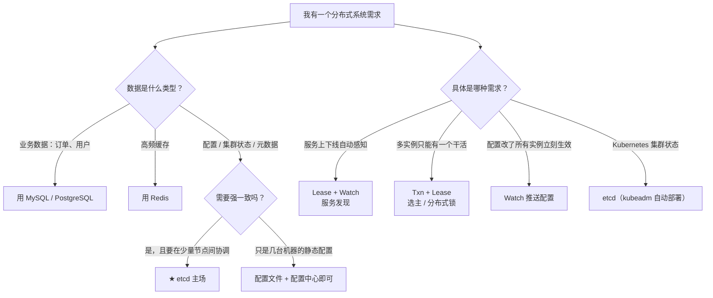

### 9.1 五个典型场景

**① Kubernetes 的元数据存储（最大用户）。**
所有 API 对象（Pod、Service、ConfigMap、Secret……）都序列化后存在 etcd 里。`kubectl` 的一次写，最终就是 etcd 的一次事务。**K8s 官方对 etcd 的磁盘、CPU、网络延迟都有明确要求，就是因为它是整个集群的心脏。**

**② 配置中心 + 动态生效。**
配置写进 etcd，所有服务 Watch 配置 key。改一次配置，几百个实例在毫秒级同时收到通知并热更新——**不需要重启，也没有轮询延迟**。

**③ 服务注册与发现。**
服务启动时用 Lease 注册自己的地址，后台定期续约；进程挂了租约到期，key 自动消失；客户端 Watch 到删除事件，自动摘除节点。**这是"无中心健康检查"的经典设计。**

**④ 分布式锁与选主。**
用 Txn 实现"只有一个客户端能写入成功"，用 Lease 保证"持锁者挂了锁自动释放"。K8s 的 leader election、很多分布式调度器都这么干。

**⑤ 灰度开关 / Feature Flag。**
一个 key 表示"新功能是否开启"，Watch 推送到所有实例。比配置文件分发快得多，而且有 revision 可追溯"谁在什么时候改了开关"。

### 9.2 什么场景不该用

| 场景 | 为什么 | 用什么 |
| --- | --- | --- |
| 存图片、视频、大 JSON（>1.5MB） | etcd 只适合小数据，大 value 会拖慢整个集群 | 对象存储（MinIO/S3） |
| 高频读写的业务数据 | 每次写要走 Raft 多数派，吞吐量远不如数据库 | MySQL / Redis |
| 单机单机的小工具 | 没有"分布式"需求，杀鸡用牛刀 | 本地文件或 SQLite |
| 强依赖最终一致和高吞吐的缓存 | etcd 优先一致性，不是缓存 | Redis |
| 节点数很多（>7） | 多数派写入延迟随节点增加，运维复杂 | 重新设计分片或分层 |

## 十、常见坑与排错

**坑 1：用偶数节点。**
4 台的 quorum 是 3，容错能力还是 1 台，和 3 台一样，但多一台机器和多一份复制开销。**用 3 或 5。**

**坑 2：单节点跑生产。**
只能学习/开发用。单节点挂了就彻底不可用，而且无法演示多数派容错。

**坑 3：`advertise-client-urls` 写成 localhost。**
别的机器按这个地址来连，连到的是它们自己的 localhost。→ 写真实 IP 或域名。

**坑 4：`initial-cluster` 重启时改了。**
这个参数只在首次建集群用。改了会被当成新成员，可能破坏集群。→ 建好之后保持不变。

**坑 5：不设 `ETCDCTL_API=3`。**
老教程都让你设。**v3.7 里不需要，设了反而警告**。→ 直接 `etcdctl put/get`。

**坑 6：Windows Git Bash 里 key 以 `/` 开头。**
会被 MSYS 转成 Windows 路径（我实测踩到）。→ 用不带前导斜杠的 key。

**坑 7：Watch 不断线续传。**
从"当前 revision"开始看，断线期间的事件会丢。→ 记住上次事件的 revision，重连时 `start_revision` 从那里开始。

**坑 8：从不压缩，磁盘一直涨。**
MVCC 历史默认保留几小时，但写入密集时会累积。→ 定期 `etcdctl compact` + `etcdctl defrag`，并监控 DB size。

**坑 9：把 2379 暴露公网。**
etcd 默认没有认证，任何人都能读写——**等于把整个 K8s 集群状态公开**。→ 内网访问 + TLS + 开启 auth。

**坑 10：备份只拷数据目录。**
直接在运行中的节点上 `cp -r data` 可能拷到不一致的快照。→ 用 `etcdctl snapshot save`，恢复用 `snapshot restore`。

### 快速排错表

| 现象 | 最可能原因 | 查什么 |
| --- | --- | --- |
| 客户端连不上 | 2379 没监听 / advertise 地址错 / 防火墙 | `curl http://ip:2379/health` |
| 节点无法组成集群 | 2380 不通 / `initial-cluster` 不一致 | `etcdctl member list`、看 peer 日志 |
| 写入报 `no leader` | 达不到 quorum | 检查活着的节点数是否 ≥ quorum |
| 读到的值很旧 | 用了串行读 | 用默认线性一致读 |
| Watch 漏事件 | 重连没带 revision | 记录并传入 `start_revision` |
| DB size 暴涨 | 没压缩历史版本 | `endpoint status` 看 DB size，`compact` + `defrag` |

## 十一、总结

三句话记住 etcd：

1. **它是一群机器共同维护的记事本**：每次写入要过半数同意（Raft + quorum），所以挂掉少数机器还能用，挂掉多数就拒绝写入——**宁可停服，也不让数据不一致**。
2. **它不只是 KV**：全局 revision 让它能读历史、让 Watch 能断点续传；Lease 让 key 能"自动过期"，这是服务发现和分布式锁的地基。
3. **它小而不是大**：存的是配置和状态，不是业务数据。集群用 3 或 5 台，把 2379 关进内网，定期备份快照。

下一篇如果你要看它最大的用户怎么用它，可以看本站的 Kubernetes 相关文章；想看它和 gRPC 的关系，可以看[《gRPC 是什么、解决什么问题、怎么用》]()——**etcd 的所有 API 都是 gRPC 调用**。

## 附录：术语中英对照表

| 缩写 / 术语 | 英文全称 | 中文 | 一句话解释 |
| --- | --- | --- | --- |
| etcd | etcd | 分布式键值存储 | 强一致的配置与元数据存储，K8s 的状态库 |
| KV | Key-Value | 键值存储 | `key → value` 形式的数据模型 |
| Raft | Raft | Raft 一致性算法 | 通过选主和日志复制让多机保持一致 |
| Leader | Leader | 主节点 | 唯一接受写请求、负责复制日志的节点 |
| Follower | Follower | 从节点 | 同步日志、可提供读服务的节点 |
| Candidate | Candidate | 候选者 | 选举中争取成为 leader 的节点 |
| quorum | Quorum | 法定人数 | 超过半数节点同意，写入才算成功 |
| term | Raft Term | 任期 | 每轮选举的编号，用来识别新旧 leader |
| WAL | Write-Ahead Log | 写前日志 | 先记日志再改数据，崩溃后能重放恢复 |
| MVCC | Multi-Version Concurrency Control | 多版本并发控制 | 保留 key 的历史版本，支持读旧值和断点续传 |
| bbolt | bbolt | BoltDB 的维护分支 | etcd 用来落盘的嵌入式 B+tree 存储引擎 |
| revision | Revision | 全局版本号 | 每次修改 +1 的集群逻辑时钟 |
| Watch | Watch | 变更监听 | 基于 revision 的长期 gRPC 流，主动推送变化 |
| Lease | Lease | 租约 | 带 TTL 的凭证，到期自动删除绑定的 key |
| keepalive | Keep-Alive | 续约 | 定期刷新租约 TTL，证明客户端还活着 |
| Txn | Transaction | 事务 | 条件成立才执行的原子操作（Compare-and-Swap） |
| CAS | Compare-And-Swap | 比较并交换 | "如果当前值是 X，就改成 Y"，分布式锁的基础 |
| compaction | Compaction | 压缩 | 删除过期的 MVCC 历史版本，释放磁盘 |
| defrag | Defragmentation | 碎片整理 | 回收磁盘空间，压缩后通常需要执行 |
| linearizable | Linearizable Read | 线性一致读 | 保证读到所有已提交的写，默认读模式 |
| serializable | Serializable Read | 串行读 | 直接读本地，快但可能稍旧 |
| gRPC | gRPC Remote Procedure Call | 高性能远程调用 | etcd v3 全部 API 的承载协议 |
| etcdctl | etcd Control | etcd 命令行工具 | 读写、备份、查状态的运维入口 |
| snapshot | Snapshot | 快照 | 某一时刻的完整数据备份 |
| CNCF | Cloud Native Computing Foundation | 云原生计算基金会 | etcd 的托管组织，2020 年毕业 |
| apiserver | API Server | API 服务器 | Kubernetes 中直接读写 etcd 的组件 |
| service discovery | Service Discovery | 服务发现 | 自动感知服务实例上下线的机制 |
| leader election | Leader Election | 选主 | 多个实例中选出唯一一个干活的 |
| distributed lock | Distributed Lock | 分布式锁 | 跨进程互斥访问共享资源的机制 |
| AZ | Availability Zone | 可用区 | 云厂商的故障隔离单元，etcd 节点应跨 AZ 部署 |
