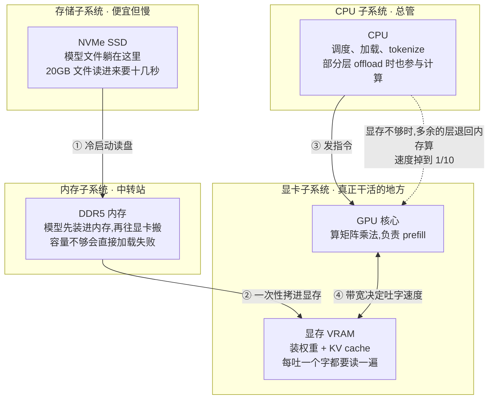
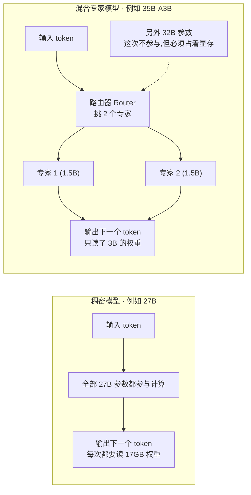
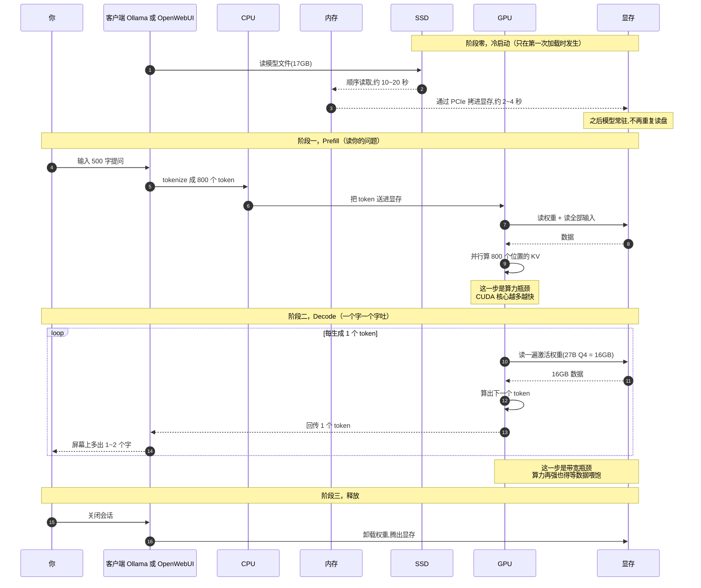

一句话：**2026 年 11 月装机，是最近五年里最难算账的一个月。** 显卡溢价还没退,内存价格是一年前的 3~4 倍,固态硬盘翻了一倍多,只有 CPU 便宜得像清仓。

所以这篇文章不给你一句"买 XX 就对了",而是把四类硬件的指标、当月真实报价、以及"这钱花下去能跑什么模型"三件事摊开算清楚。看完你自己就能判断,而不是抄别人的配置单。

> **价格说明**:以下为 2026 年 11 月下旬的京东自营、淘宝/拼多多渠道与华强北批发参考价,单位人民币,含税不含运费。**存储和显卡这两块一天一变**,尤其显卡存在"建议零售价"和"实际成交价"严重脱节的情况(5080 建议价 8299,电商挂 1.4~1.6 万),下单前务必自己比一遍价。文中所有"性能指数"是把多家公开评测折算成的相对值(以某型号 = 100 为基准),只用于横向比较,不是跑分原始数据。

---

## 〇、先看一张图:钱应该花在哪

一台电脑跑大模型,数据是这样流动的:



看懂这张图,就知道一个反直觉的结论:**跑大模型,CPU 是最不重要的那一环,显存容量和带宽才是命门。**

这也是本月装机最魔幻的地方——**最该省钱的 CPU 正好在降价,最该多花钱的显存正好在暴涨**。所以预算要反过来分配:CPU 缩到够用,钱全砸在显存上。

---

## 一、CPU:核心数不是唯一指标,但至少得够用

### 1.1 六个指标,人话版

| 指标 | 是什么 | 通俗理解 | 影响什么 |
| --- | --- | --- | --- |
| 核心 / 线程 | 物理运算单元 / 逻辑队列 | 核心是"工人",线程是"工人手上的活" | 多开、渲染、编译、跑多个模型实例 |
| 基础 / 加速频率 | 常态主频 / 冲刺主频 | 工人的日常手速 / 冲刺手速 | 游戏、单线程响应 |
| L3 缓存 | CPU 内部的大抽屉 | 手边放工具的柜子,越大越少跑腿 | 游戏帧数(尤其 X3D 系列) |
| TDP / PPT | 设计功耗 / 实际功耗上限 | 能吃几碗饭 | 散热、电源、噪音、电费 |
| 制程 | 晶体管尺寸(nm) | 同样面积塞多少零件 | 能效比、发热 |
| 内存支持 | DDR4 / DDR5、通道数 | 能接哪种内存、几条 | **直接决定你内存要花多少钱** |

关于 **IPC**(每时钟指令数):可以理解成"工人一个动作能完成多少活"。制程进步主要就是在提 IPC。所以你不能只看 GHz——5.5GHz 的新架构可能比 6.0GHz 的老架构还快。

关于 **X3D**:AMD 把一块大缓存垂直堆叠在 CPU 上方,3A 游戏帧数能暴涨 20~30%,代价是频率略低、价格贵、部分生产力软件没感觉。**它是"游戏专用加速器",不是全能加速器。**

### 1.2 当月排行与报价

先看游戏(单核敏感)与生产力(多核敏感)两条线。指数为相对值,**游戏以 9800X3D = 100 为基准,多核以 Ultra 9 285K = 100 为基准**:

| 型号 | 核心/线程 | 频率(基/加速) | L3 | 功耗 | 游戏指数 | 多核指数 | 参考价 |
| --- | --- | --- | --- | --- | --- | --- | --- |
| R9 9950X3D2 | 16C/32T | 4.3 / 5.6 GHz | 192 MB | 200 W | **104** | **126** | ¥6,300–6,700 |
| R9 9950X3D | 16C/32T | 4.3 / 5.7 GHz | 128 MB | 170 W | 102 | 124 | ¥5,200–5,800 |
| R9 9950X | 16C/32T | 4.3 / 5.7 GHz | 64 MB | 170 W | 99 | 123 | ¥3,800–4,200 |
| R9 9850X3D | 8C/16T | 4.7 / 5.6 GHz | 96 MB | 120 W | **106** | 84 | ¥2,850–3,000 |
| R7 9800X3D | 8C/16T | 4.7 / 5.2 GHz | 96 MB | 120 W | **100** | 80 | ¥2,100–2,300 |
| R9 9900X | 12C/24T | 4.4 / 5.6 GHz | 64 MB | 120 W | 96 | 100 | ¥2,300–2,500 |
| R7 9700X | 8C/16T | 3.8 / 5.5 GHz | 32 MB | 65 W | 95 | 78 | **¥1,300–1,400** |
| R5 9600X | 6C/12T | 3.9 / 5.4 GHz | 32 MB | 65 W | 88 | 62 | **¥1,100–1,200** |
| Ultra 9 285K | 24C/24T | 3.7 / 5.7 GHz | 36 MB | 250 W | 90 | 100 | ¥4,100–4,400 |
| Ultra 7 270K Plus | 20C/20T | 3.9 / 5.5 GHz | 36 MB | 250 W | 91 | 95 | ¥2,700–2,900 |
| Ultra 7 265K | 20C/20T | 3.9 / 5.5 GHz | 30 MB | 250 W | 88 | 92 | ¥2,300–2,500 |
| Ultra 5 245K | 14C/14T | 4.2 / 5.2 GHz | 24 MB | 159 W | 85 | 75 | ¥1,600–1,800 |
| i5-14600KF | 14C/20T | 3.5 / 5.3 GHz | 24 MB | 181 W | 84 | 72 | ¥1,250–1,350 |
| i5-12490F | 6C/12T | 3.0 / 4.6 GHz | 20 MB | 65 W | 72 | 48 | ¥700–800 |

**三个值得记住的判断:**

1. **9600X 是本月最超值的一颗 U。** 散片 1100 出头,6 核 12 线程,65W 功耗,单核和 9700X 只差 7%。如果你的主力活是"跑模型",CPU 只负责加载和调度,这 200 块的差价完全可以省给显卡。
2. **9800X3D 从 3000 多跌到 2100,是这一轮最舒服的降价。** 如果你是"游戏 + 偶尔跑模型",它比任何 Intel 都值。但**别指望它对模型推理有帮助**——大模型吃的是显存带宽,不是 CPU 缓存。
3. **别为了"多核多"上 9950X。** 16 核 32 线程跑 llama.cpp 确实能多开几个实例,但如果你只跑一个模型,8 核完全够,多出来的钱换 8GB 显存更划算。

**平台选择还有个隐藏账:** AMD AM5 从 2022 年活到现在,2027 年还有新 U 能上;B860/Z890(LGA1851)已经是这代的最后一站。**买 AM5 等于买了个"以后还能换 CPU"的期权。**

---

## 二、显卡:唯一真正决定"能跑什么模型"的硬件

### 2.1 指标怎么读

| 指标 | 是什么 | 为什么重要 |
| --- | --- | --- |
| **显存容量** | 卡上独立的 GDDR 颗粒总量 | **决定模型装不装得下**,硬门槛,不能超 |
| **显存带宽** | 每秒能从显存读出多少 GB | **决定吐字快不快**,本地推理的核心瓶颈 |
| 位宽 × 等效频率 | 带宽 = 位宽 ÷ 8 × 等效频率 | 看带宽别只看位宽,GDDR7 和 GDDR6 差很多 |
| CUDA / 流处理器 | 并行计算单元数量 | 决定 prefill(读长文档)速度、训练速度 |
| Tensor Core / NPU | 专用矩阵运算单元 | 决定 FP8/FP4 算力,影响 prefill 和训练 |
| 显存类型 | GDDR6 / GDDR6X / GDDR7 | 同容量下 GDDR7 带宽几乎翻倍 |
| 功耗 / 供电 | TGP、8pin/16pin | 决定电源和机箱散热 |
| 接口 | PCIe 5.0 x16 | 对推理影响很小,别为它加钱 |

一条极易搞错的换算:

```text
带宽(GB/s) = 位宽(bit) ÷ 8 × 等效频率(Gbps)

例:RTX 5090 = 512 ÷ 8 × 28 Gbps = 1792 GB/s
    RTX 5060 Ti = 128 ÷ 8 × 28 Gbps = 448 GB/s
```

同样的 GDDR7,位宽砍一半,带宽就砍一半。**这就是 5060 Ti 和 5090 差 4 倍带宽的原因,也是它们跑同一个模型差 4 倍速度的原因。**

### 2.2 排行:游戏一张榜,AI 另一张榜

3DMark Time Spy 是游戏/光栅性能的常用标尺,但**它和 AI 推理速度几乎不相关**。所以下面这张表给了两个数:

| 型号 | 显存 | 位宽 | 带宽 | 3DMark TS | 显存性价比 | 参考价 |
| --- | --- | --- | --- | --- | --- | --- |
| RTX 5090 | 32 GB GDDR7 | 512 bit | **1792 GB/s** | 43,800 | ¥900/GB | ¥28,000–30,000 |
| RTX 5080 | 16 GB GDDR7 | 256 bit | 960 GB/s | 32,500 | ¥900/GB | ¥14,000–16,000 |
| RX 9070 XT | 16 GB GDDR6 | 256 bit | 640 GB/s | **30,000** | ¥330/GB | ¥5,200–5,600 |
| RTX 5070 Ti | 16 GB GDDR7 | 256 bit | 896 GB/s | 27,900 | ¥590/GB | ¥9,000–10,500 |
| RX 9070 | 16 GB GDDR6 | 256 bit | 640 GB/s | 26,900 | ¥310/GB | ¥4,800–5,200 |
| RTX 5070 | 12 GB GDDR7 | 192 bit | 672 GB/s | 21,300 | ¥590/GB | ¥6,800–7,600 |
| RTX 3090(二手) | **24 GB** GDDR6X | 384 bit | 936 GB/s | 20,000 | **¥350/GB** | ¥8,000–8,800 |
| RX 9060 XT 16G | 16 GB GDDR6 | 128 bit | 320 GB/s | 16,400 | ¥190/GB | ¥2,900–3,300 |
| RTX 5060 Ti 16G | 16 GB GDDR7 | 128 bit | 448 GB/s | 16,000 | ¥280/GB | ¥4,400–4,800 |
| RTX 5060 8G | 8 GB GDDR7 | 128 bit | 448 GB/s | 13,600 | ¥330/GB | ¥2,500–2,800 |

**这张表里最反常识的两行:**

- **RX 9070 XT 游戏性能比 5070 Ti 还高,价格只有一半。** 但它是 AMD 卡,跑 AI 要用 ROCm/LM Studio 的 Vulkan 后端,**生态折腾成本高、部分框架不支持**。省钱和少踩坑,你得选一个。
- **二手 3090 仍然是最划算的 AI 卡。** 24GB 显存、936GB/s 带宽、8000 出头,跑 27B 模型能到 55 tok/s,比 5080 慢不了多少但便宜一半。它唯一的缺点是功耗 350W、没保修、矿卡风险。

### 2.3 关于溢价,必须说清楚

本月显卡的真实情况是"官方指导价没有意义":

| 型号 | 建议零售价 | 实际成交价 | 溢价 |
| --- | --- | --- | --- |
| RTX 5080 16G | ¥8,299 | ¥14,000–16,000 | **+70%~90%** |
| RTX 5090 32G | ¥16,499 | ¥28,000–30,000 | +70% |
| RTX 5070 Ti | ¥6,299 | ¥9,000–10,500 | +43%~67% |
| RTX 5060 Ti 16G | ¥3,499 | ¥4,400–4,800 | +26%~37% |

根子是 **GDDR7 显存短缺**:原厂把先进产能优先给了 AI 服务器,桌面卡排到后面。华强北批发端 11 月 10 日已经从 1.8 万回落到 1.4 万出头,说明**溢价在松动,但还没到位**。

策略建议:
- **不急就等**。12 月中到 1 月是传统淡季,加上渠道清库存,大概率还有 5~10% 的下探空间。
- **急用就买中端**。5060 Ti 16G 溢价只有 30%,是这轮里"被少宰"的一档。
- **别碰 5070 12G**。12GB 显存跑不了 27B(Q4 要 19GB),游戏又打不过 9070 XT,是本月最尴尬的一张卡。

---

## 三、内存:本月最贵的一环,也是最没得选的一环

### 3.1 指标

| 指标 | 说明 |
| --- | --- |
| 容量 | 16 / 32 / 64 / 96 GB。**跑模型建议 64GB 起**,因为模型要先加载进内存 |
| 频率 | DDR5-5600 / 6000 / 6400,AMD 上 6000 是甜点(分频比 1:1) |
| 时序(CL) | C28 / C30 / C36 / C40,同频率下越低越好,但差距只有个位数百分比 |
| 通道 | 双通道是底线,4 条插满会降频,AMD 尤其明显 |
| 颗粒 | 海力士 A-die / M-die 最能超;长鑫、三星、美光次之 |
| ECC | 服务器/工作站用,桌面消费级基本没有 |

### 3.2 价格:一年涨了三倍多

| 档位 | 代表型号 | 32GB(2×16)套条 | 元/GB |
| --- | --- | --- | --- |
| 白牌 | 玖合 / 威士奇 | ¥1,400–1,900 | 44–59 |
| 三线国产 | 金百达银爵 C36 | **¥1,459–1,699** | 46–53 |
| 三线国产(C28) | 金百达银爵 RGB | ¥1,729 | 54 |
| 二线 | 金士顿 FURY C30 | ¥1,989 | 62 |
| 二线 | 海盗船复仇者 | ¥3,699 | 116 |
| 一线原厂 | 三星/海力士/美光原厂条 | ¥2,700–3,100 | 84–97 |

**对比一年前**:同一条 32GB DDR5-6000 套条,2025 年 11 月约 ¥600,现在 ¥1,500–3,700。**涨幅 250%~500%,比黄金猛。**

原因不是"内存不够用",而是**产能被 AI 抢走了**:三星、SK 海力士、美光把 70% 的新增产能投给 HBM 和 AI 服务器 DRAM,2027 年产能已被提前售罄。消费级市场只能吃剩下的。

**这直接改变了装机策略:**

- **优先 32GB,别上 64GB。** 除非你明确要跑 70B 以上模型(那需要 64GB 内存做中转),否则 64GB 多花的 1500~3000 块不如加到显卡上。
- **能上 DDR4 老平台就上。** i5-12490F + B760M DDR4 + 32GB DDR4 二手,整套比 AM5 + DDR5 便宜近 2000 块——代价是没有升级空间。**这是本月唯一"反向性价比"的选择。**
- **别囤。** 高盛预测 2028 年 DRAM 每 GB 价格会从 2.23 美元跌到 1.05 美元(跌 52%),但 2027 年还会更紧。**刚需买够用,别赌时点。**

---

## 四、硬盘:翻了一倍,但该买还得买

### 4.1 指标

| 指标 | 说明 | 实际影响 |
| --- | --- | --- |
| 接口/协议 | PCIe 4.0 / 5.0,M.2 2280 | 4.0 和 5.0 日常用差几秒 |
| 顺序读写 | 厂商标称 7000 MB/s 等 | 只在**拷贝大文件**时达得到 |
| 4K 随机读写 | 通常几十 MB/s | **开机、开软件、加载模型真正靠这个** |
| 缓存 | SLC 缓存 / 独立 DRAM 缓存 | 缓存写满会掉到 300~800 MB/s |
| 颗粒 | TLC / QLC | QLC 便宜但写入寿命和持续性能差 |
| TBW | 总写入寿命 | 1TB TLC 通常 600TBW,正常用五年写不完 |

**最重要的一句:标称 7000MB/s 是 SLC 缓存区里的峰值,不是持续速度。** 加载一个 20GB 的模型文件,前几 GB 很快,后面会掉速,实际感受是"十几秒",不是"三秒"。

### 4.2 价格:涨得比显卡狠

| 容量 | 参考价 | 元/TB | 备注 |
| --- | --- | --- | --- |
| 512 GB | ¥550–700 | — | 只适合当系统盘 |
| 1 TB PCIe 4.0 | **¥900–1,200** | 900–1200 | 去年是 ¥400–500 |
| 2 TB PCIe 4.0 | ¥1,700–2,600 | 850–1300 | **本月甜点** |
| 4 TB PCIe 4.0 | ¥3,600–4,200 | 900–1050 | 放大模型库最划算 |
| 1 TB PCIe 5.0 | ¥1,200–1,400 | 1200–1400 | 溢价不值 |
| 4 TB 机械盘 | ¥1,300 | 325 | 冷备/NAS 用 |

**建议:直接上 2TB。** 理由很简单——一个 27B 的 Q4 模型 17GB,35B 的 22GB,70B 的 42GB,再加几个微调版本和 ComfyUI 的模型,1TB 两三个月就满了。而 1TB 的"每 TB 单价"是这几档里最贵的,**买 1TB 反而更亏**。

机械盘别想了,跑模型用不上——模型加载是随机读,机械盘的 100MB/s 顺序速度会让你等到怀疑人生。

---

## 五、容易被忽略的四件:主板、电源、散热、机箱

| 部件 | 本月参考价 | 选购要点 |
| --- | --- | --- |
| B650M(AM5 入门) | ¥700–900 | 8 相供电够带 9600X/9700X,注意 BIOS 要支持新 U |
| B850M(AM5 主流) | ¥1,000–1,300 | PCIe 5.0 显卡槽 + 2 个 M.2,甜点 |
| X870E(AM5 高端) | ¥2,500–3,500 | 只有多卡/多 M.2 才需要 |
| B860M(LGA1851) | ¥900–1,200 | Ultra 5/7 够用 |
| Z890(LGA1851) | ¥1,800–2,500 | 要超频/多 M.2 才上 |
| 650W 金牌 | ¥350–450 | 5060 Ti / 9060 XT 够 |
| 850W 金牌 ATX 3.1 | ¥550–700 | 5070 Ti / 9070 XT 建议 |
| 1000W 金牌 ATX 3.1 | ¥800–1,000 | 5080 / 5090 必须 |
| 风冷(单塔) | ¥150–250 | 9600X/9700X 足够,65W 不热 |
| 360 水冷 | ¥400–600 | 9950X / 285K / 5090 才需要 |
| 中塔机箱 | ¥200–400 | 重点看**显卡限长**和风道 |

**电源的一个硬规则:12VHPWR(16pin)接口的卡,一定要买 ATX 3.1 认证的电源。** 老电源用转接线,烧接口的案例不少。另外 5090 瞬时功耗能冲到 900W,1000W 是底线,别省这 200 块。

---

## 六、三套推荐组合:从"能跑"到"跑得爽"

以下价格均为 11 月下旬参考价,**显卡按"能买到的实际价"算,不按建议价**。

### 方案 A:一万以内入门机 —— 跑 8B~14B,够用不将就

| 配件 | 型号 | 参考价 |
| --- | --- | --- |
| CPU | R5 9600X 散片 | ¥1,150 |
| 主板 | B650M(8 相供电) | ¥750 |
| 内存 | 金百达银爵 32GB(2×16)DDR5-6000 C36 | ¥1,500 |
| 显卡 | **RTX 5060 Ti 16G** | ¥4,500 |
| 硬盘 | 1TB PCIe 4.0 TLC | ¥950 |
| 电源 | 650W 金牌 | ¥380 |
| 散热 | 单塔风冷 | ¥180 |
| 机箱 | 中塔 | ¥250 |
| **合计** | | **≈¥9,660** |

很多人一提"入门机"想的是七千五,但这张单子算下来近一万——**这就是 2026 年 11 月的真实情况:一万块只能装出"两年前五千块"的机器。** 内存和固态吃掉了 2450,显卡溢价吃掉了 1000。

如果非要压到 7500,只有两条路:
- 换成 **RX 9060 XT 16G**(省 1500),代价是 AI 生态要折腾;
- 换成 **二手 RTX 3060 12G**(省 2500),代价是显存掉到 12G,只能跑 14B。

**我的建议:别压。** 16GB 显存是从"玩具"跨到"能用"的门槛,为省 1500 掉回 12GB 不划算。

**这套能跑什么:**
- Qwen3.5 9B(Q4,6.6GB)——飞快,60+ tok/s,日常问答、写文案
- Gemma 4 26B-A4B(Q4,16.5GB)——刚好塞满,MoE 结构速度快
- Qwen3.6 27B(Q3_K_M,约 14GB)——能跑,但显存几乎占满,上下文只能开 4K,质量也打折
- 图像生成:SDXL / FLUX.1-dev(Q4)——20 秒一张

### 方案 B:¥16,000 甜点机 —— 跑 27B~35B,本月的正确答案

| 配件 | 型号 | 参考价 |
| --- | --- | --- |
| CPU | R7 9700X 散片 | ¥1,350 |
| 主板 | B850M | ¥1,150 |
| 内存 | 金百达银爵 32GB DDR5-6000 | ¥1,500 |
| 显卡 | **RTX 3090 24G(二手)** | ¥8,400 |
| 硬盘 | 2TB PCIe 4.0 TLC | ¥1,900 |
| 电源 | 850W 金牌 ATX 3.1 | ¥620 |
| 散热 | 双塔风冷 / 240 水冷 | ¥300 |
| 机箱 | 中塔(显卡限长 33cm+) | ¥300 |
| **合计** | | **≈¥15,520** |

**为什么是二手 3090 而不是新的 5070 Ti?** 算笔账:

| 方案 | 显存 | 带宽 | 跑 27B Q4 | 价格 |
| --- | --- | --- | --- | --- |
| RTX 5070 Ti 16G | 16 GB | 896 GB/s | **装不下** | ¥9,500 |
| RTX 3090 24G 二手 | 24 GB | 936 GB/s | **≈55 tok/s** | ¥8,400 |
| RTX 5080 16G | 16 GB | 960 GB/s | **装不下** | ¥15,000 |

花更少的钱,买到能装下 27B 的卡,速度还更快。**在"跑模型"这个目标下,24GB 显存的 3090 打败了所有 16GB 的新卡。** 这就是 2026 年最反直觉、也最真实的一条结论。

**这套能跑什么(全部 Q4,8K 上下文):**
- **Qwen3.8 27B(17.9GB)** —— 当月 24G 卡上的最强通用模型,约 55 tok/s
- **Qwen3.6 35B-A3B(22GB)** —— MoE,激活只 3B,约 100~120 tok/s,体感像在用 API
- **Gemma 4 31B IT(20GB)** —— 推理深度更好,30~50 tok/s
- **DeepSeek V4-Flash(284B)** —— 装不下,但可以跑 Q2 的降级版(质量损失明显,不推荐)
- 图像:FLUX.1-dev FP8,视频:Wan 2.2 短片段

### 方案 C:¥3 万–4 万高阶机 —— 摸到 70B 的门槛

| 配件 | 型号 | 参考价 |
| --- | --- | --- |
| CPU | R7 9800X3D 散片 | ¥2,200 |
| 主板 | B850M / X870 | ¥1,500 |
| 内存 | 64GB(2×32)DDR5-6000 | ¥3,200 |
| 显卡 | **RTX 5090 32G** 或 **2× 3090 48G** | ¥29,000 / ¥16,800 |
| 硬盘 | 4TB PCIe 4.0 | ¥4,000 |
| 电源 | 1200W 金牌 ATX 3.1 | ¥1,200 |
| 散热 | 360 水冷 | ¥550 |
| 机箱 | 全塔 | ¥600 |
| **合计** | | **≈¥42,000(单 5090)/ ¥30,000(双 3090)** |

**这里有个真实的分岔:**

- **单张 5090**:32GB,能跑 32B 长上下文、能跑 35B 的 Q6。**省事、安静、单卡**,但装不下 70B(42GB)。
- **两张 3090**:48GB,能跑 70B Q4。但**要主板支持双 x8 拆分、要 1200W 电源、要机箱塞得下两张 350W 的卡、噪音像吹风机**,而且张量并行会损失 10~20% 速度。

**如果你的目标是"跑 70B",双 3090 是唯一的经济解。如果目标是"跑得快、用得舒服",单 5090 更好。** 大部分人其实是后者。

### 一句话版本

- **预算 8 千–1 万**:5060 Ti 16G,跑 9B~26B,能玩能用;
- **预算 1.5 万**:二手 3090 24G,跑 27B~35B,这是 2026 年 11 月的**最优点**;
- **预算 3 万**:单 5090(舒服)或双 3090(容量);
- **预算 5 万以上**:先问自己一句"我是要跑模型,还是要学运维"。

---

## 七、4B、27B、35B-A3B 到底是什么意思

这是最多人问、也最容易搞混的地方。

### 7.1 B = Billion,十亿参数

**B 是"参数量"的单位,1B = 10 亿个参数。** 参数就是模型里那些"旋钮",训练的过程就是把几十亿个旋钮拧到合适的位置。

一个粗略的换算(仅用于建立直觉):

| 参数量 | 文件大小(Q4 量化) | 最低显存 | 能力大致相当于 |
| --- | --- | --- | --- |
| 0.5B–1B | 0.3–0.6 GB | 1–2 GB | 手机端助手、简单分类 |
| 3B–4B | 2–2.5 GB | 3–4 GB | 顺畅聊天、简单翻译 |
| 7B–9B | 4–6 GB | 6–8 GB | 日常问答、写邮件、改代码 |
| 14B | 8–10 GB | 10–12 GB | 中英互译、结构化输出 |
| 27B–32B | 16–21 GB | 19–24 GB | **接近可用的通用助手** |
| 70B | 42 GB | 48 GB | 通用质量天花板(这个尺寸) |
| 120B+ | 70 GB+ | 80 GB+ | 接近闭源中档 API |

**关键认知:参数量不是"智力"的唯一决定因素。** 一个 2026 年的 27B,能力超过 2023 年的 70B——因为训练数据质量、后训练方法、架构都进步了。所以**别迷信"越大越好",要看"哪一年的多大"**。

### 7.2 稠密(Dense)vs 混合专家(MoE)



**MoE 的核心矛盾:显存按"总参数"算,速度按"激活参数"算。**

- `35B-A3B` 读作"总参数 35B,激活参数 3B"。
- 它需要 **22GB 显存**(因为 35B 权重都得装进去),但每次生成只读 3B,所以**速度像 3B 模型一样快**。
- 这就是为什么 3090 跑 Qwen3.6 35B-A3B 能到 120 tok/s,跑 27B 稠密只有 55 tok/s——**质量接近,速度翻倍**。

**这是 2026 年最划算的一类模型,也是 24GB 显卡的救命稻草。** 记住一句话:**买卡看总参数,体验看激活参数。**

### 7.3 量化:Q4 是什么意思

量化就是"用更少的位存每个参数"。

| 档位 | 每 10 亿参数占多大 | 27B 实际大小 | 质量损失 |
| --- | --- | --- | --- |
| FP16(原始) | 2.0 GB | 54 GB | 无 |
| Q8_0 | 1.06 GB | 29 GB | 几乎无感 |
| Q6_K | 0.82 GB | 22 GB | 很难察觉 |
| **Q4_K_M** | **0.6 GB** | **17 GB** | **默认选择,轻微** |
| Q3_K_M | 0.48 GB | 13 GB | 能感觉到 |
| Q2_K | 0.35 GB | 9.5 GB | 明显变笨,不推荐 |

**Q4_K_M 是 99% 场景的正确答案。** 它把显存需求压到 FP16 的 30%,质量损失在多数任务上测不出来。

### 7.4 上下文长度:另一个吃显存的家伙

模型要记住你说过的话,靠的是 **KV cache**(键值缓存),它随对话长度**线性增长**:

```text
KV cache ≈ 2 × 层数 × KV头数 × 头维度 × 上下文长度 × 每元素字节
```

27B 模型在 8K 上下文下约 1.3~2GB(具体看层数和 KV 头数),开到 128K 就是 20~32GB——**比权重还大**。所以"支持 1M 上下文"这句话,在没有足够显存时是没有意义的。

---

## 八、每个模型具体能干什么

以下是 2026 年 11 月在本地真正跑得动、并且值得跑的一批:

| 模型 | 参数(激活) | Q4 显存 | 需要什么卡 | 它擅长什么 |
| --- | --- | --- | --- | --- |
| **Qwen3.5 9B** | 9B | 6.6 GB | 8G 卡 / 核显 | 中文问答、写文案、简单代码、视觉理解,速度极快 |
| Ministral 14B | 14B | 9 GB | 12G 卡 | 多语言、结构化输出、函数调用 |
| gpt-oss 20B | 21B(3.6B) | 14 GB | 16G 卡 | **推理 + 工具调用**,16G 卡里体验最好 |
| Gemma 4 26B-A4B | 25.2B(4B) | 16.5 GB | 16G 卡 | 多模态、长文档,Google 生态,速度快 |
| Qwen3.8 27B | 27B | 17.9 GB | **24G 卡** | **当月最强通用模型**:代码、Agent、数学、视觉 |
| Qwen3.6 35B-A3B | 35B(3B) | 22 GB | 24G 卡 | 质量接近 27B,速度翻倍,长上下文 |
| Gemma 4 31B IT | 31B | 20 GB | 24G 卡 | 推理深度、科学问答、教学解释 |
| Nemotron 3 Nano | 30B(3B) | 19 GB | 24G 卡 | Agent、RAG、企业文档问答 |
| Qwen3-Coder 30B | 30B(3B) | 19 GB | 24G 卡 | 写代码、改 bug、代码库理解 |
| Llama 3.3 70B | 70B | 42 GB | 48G(双卡) | 通用质量,英文更强 |
| gpt-oss 120B | 117B(5.1B) | 63 GB | 80G | 开源里最强的一档,MoE 所以不慢 |
| DeepSeek V4-Flash | 284B(13B) | 160 GB | 4×3090 / 服务器 | 1M 上下文、Agent、代码 |
| GLM-5.2 / Kimi K3 | 754B / 1T 级 | 400 GB+ | 8 卡服务器 | 前沿能力,**家用别想,用 API** |

### 按用途反查

| 你想干的事 | 首选模型 | 最低配置 |
| --- | --- | --- |
| 日常问答、写文章、翻译 | Qwen3.5 9B / Qwen3.8 27B | 16G 卡 |
| 写代码、读代码库 | Qwen3.8 27B / Qwen3-Coder 30B | 24G 卡 |
| 看截图、读 PDF、识图 | Qwen3.8 27B(带视觉)/ Gemma 4 | 24G 卡 |
| 本地 Agent(自动调工具) | gpt-oss 20B / Nemotron 3 Nano | 16G 卡 |
| 深度推理、数学题 | Gemma 4 31B / Qwen3.8 27B | 24G 卡 |
| 长文档摘要(100 页+) | Qwen3.6 35B-A3B(262K) | 24G 卡,开 KV 量化 |
| 画图 | FLUX.1-dev / SDXL | 16G 卡 |
| 生成短视频 | Wan 2.2 | 24G 卡起 |
| 语音转文字 | Whisper large-v3 | 8G 卡 |

---

## 九、自己算一遍:显存和速度的公式

别信"XX 卡能跑 XX 模型"这种一刀切说法,自己算十秒钟就有答案。

### 9.1 显存估算脚本

```python
#!/usr/bin/env python3
# -*- coding: utf-8 -*-
"""vram_plan.py —— 估算一个模型需要多少显存、能跑多快、你的卡能不能装下。
用法:
    python vram_plan.py --params 27 --quant q4 --ctx 8192 --vram 24 --bw 936
"""

import argparse  # 解析命令行参数,这样不用改代码就能试不同组合

# 量化档位 -> 每 10 亿参数占多少 GB(含权重的对齐/元数据开销)
QUANT_GB_PER_B = {
    "fp16": 2.00,   # 原始精度,基本只有训练才用
    "q8":   1.06,   # 8 bit,质量几乎无损
    "q6":   0.82,   # 6 bit,接近无损
    "q4":   0.60,   # 4 bit(实际约 4.8 bit),默认选择
    "q3":   0.48,   # 3 bit,质量开始有感觉
    "q2":   0.35,   # 2 bit,明显变笨,只在显存实在不够时用
}

# 每 10 亿参数的 KV cache 近似系数(GB / 千 token / 10亿参数)
# 取自主流架构的统计平均:8B 级约 1.0GB、27B 级约 1.3GB、70B 级约 3.4GB(均为 8K 上下文、FP16 缓存)
KV_GB_PER_B_PER_KTOKEN = 0.006


def estimate(params_b, quant, ctx_tokens, kv_quant=True):
    """返回 (权重GB, KV GB, 总需求GB)。params_b 是总参数量(不是激活量)。"""

    # 1) 权重:总参数量 x 每参字节数
    weight_gb = params_b * QUANT_GB_PER_B[quant]

    # 2) KV cache:与参数量、上下文长度都成正比
    kv_gb = params_b * KV_GB_PER_B_PER_KTOKEN * (ctx_tokens / 1000.0)

    # 3) KV cache 量化成 q8 能省一半,这是长上下文必开的开关
    if kv_quant:
        kv_gb *= 0.5

    # 4) 固定开销:CUDA 上下文、计算缓冲、碎片,给 1.5 GB
    overhead_gb = 1.5

    total_gb = weight_gb + kv_gb + overhead_gb
    return weight_gb, kv_gb, total_gb


def speed(params_b, quant, active_b, bw_gbs, efficiency=0.7):
    """估算生成速度(tok/s)。

    bw_gbs      : 显存带宽 GB/s
    active_b    : 每个 token 实际激活的参数量;稠密模型 = params_b
    efficiency  : 实测通常只能达到理论值的 60%~80%,取 0.7
    """

    if active_b < params_b:
        # MoE:除了被激活的专家,attention 层、router、共享专家每步也都要读一遍
        # 这部分一般占总参数的 10%~20%,取 15%,否则会把 MoE 速度估得离谱地高
        effective_b = active_b + params_b * 0.15
    else:
        effective_b = params_b

    # 每生成一个 token,要把"这一轮用到的权重"完整读一遍
    bytes_per_token_gb = effective_b * QUANT_GB_PER_B[quant]

    # 理论值 = 带宽 / 每 token 字节数;再打个效率折扣
    return bw_gbs / bytes_per_token_gb * efficiency


def ctx_that_fits(vram_gb, params_b, quant):
    """反推:给定显存,还剩多少空间给 KV cache,换算成能吃多长的上下文。"""
    weight_gb = params_b * QUANT_GB_PER_B[quant]
    left = vram_gb - weight_gb - 1.5          # 扣掉权重和框架开销
    per_k_token = params_b * KV_GB_PER_B_PER_KTOKEN * 0.5  # KV 按 q8 量化后的一半
    if left <= 0 or per_k_token <= 0:
        return 0                               # 权重都装不下,上下文无从谈起
    return int(left / per_k_token * 1000)      # 换算回 token 数


def main():
    p = argparse.ArgumentParser(description="本地大模型显存与速度估算")
    p.add_argument("--params", type=float, required=True, help="总参数量,单位 B,例如 27")
    p.add_argument("--active", type=float, default=None, help="激活参数量(仅 MoE),不填视为稠密")
    p.add_argument("--quant", default="q4", choices=QUANT_GB_PER_B.keys(), help="量化档位")
    p.add_argument("--ctx", type=int, default=8192, help="上下文长度(token)")
    p.add_argument("--vram", type=float, default=0, help="你的显卡显存 GB,填了会判断能否装下")
    p.add_argument("--bw", type=float, default=0, help="你的显卡带宽 GB/s,填了会算速度")
    args = p.parse_args()

    # MoE 模型不填 active 时,按总参数当稠密算(会偏保守)
    active = args.active if args.active else args.params

    w, kv, total = estimate(args.params, args.quant, args.ctx)

    print(f"\n模型: {args.params}B 总参 / {active}B 激活   量化: {args.quant}   上下文: {args.ctx}")
    print("-" * 52)
    print(f"权重占用      : {w:8.2f} GB")
    print(f"KV cache      : {kv:8.2f} GB")
    print(f"框架开销      : {1.5:8.2f} GB")
    print(f"合计需要      : {total:8.2f} GB")

    if args.vram > 0:
        if args.vram >= total:
            spare = args.vram - total
            print(f"\n[OK] 你的 {args.vram}GB 显存可以装下,还余 {spare:.1f}GB")
        elif args.vram >= w + 1.5:
            fit = ctx_that_fits(args.vram, args.params, args.quant)
            print(f"\n[勉强] 权重装得下,但当前 {args.ctx} token 的 KV cache 放不进;")
            print(f"       必须把 --ctx 降到 {fit} token 以内,或者接受部分层 offload 到 CPU")
        else:
            need = total - args.vram
            print(f"\n[不行] 还差约 {need:.1f}GB。选一个:")
            print("       1) 降量化档位(质量有损)")
            print("       2) 减小上下文")
            print("       3) 换更大显存的卡,或用 CPU offload(速度掉到 1/10)")

    if args.bw > 0:
        tps = speed(args.params, args.quant, active, args.bw)
        print(f"\n预估生成速度  : {tps:6.1f} tok/s (带宽 {args.bw} GB/s,效率按 70% 算)")
        print(f"换算成中文    : 约 {tps * 1.5:5.0f} 字/秒(中文 1 token ≈ 1.5 字)")
    print()


if __name__ == "__main__":
    main()
```

**跑几个例子看看:**

```bash
# 例 1:24GB 3090 跑 Qwen3.8 27B 稠密模型,8K 上下文
python vram_plan.py --params 27 --quant q4 --ctx 8192 --vram 24 --bw 936
# 输出:权重 16.2 + KV 0.66 + 开销 1.5 = 18.4GB,余 5.6GB,约 40 tok/s
# (脚本效率按 70% 算偏保守;实测这台机器能跑到 55 tok/s)

# 例 2:同一张卡跑 35B-A3B 的 MoE,总参数 35B 但只激活 3B
python vram_plan.py --params 35 --active 3 --quant q4 --ctx 8192 --vram 24 --bw 936
# 输出:合计 23.4GB,余 0.6GB —— 显存更紧,速度却翻到 132 tok/s

# 例 3:16GB 5060 Ti 硬上 27B,看它报什么
python vram_plan.py --params 27 --quant q4 --ctx 8192 --vram 16 --bw 448
# 输出:[不行] 还差约 3.3GB
```

**例 2 就是"MoE 为什么香"的量化证明:显存多花 5GB,速度拿到 3 倍。** 而例 3 是很多人踩的坑——看着"27B 才 17GB,我 16GB 卡应该能跑",结果一加载就 OOM,因为还有 KV 和开销。

### 9.2 装好之后:Ollama 完整跑起来

```bash
#!/usr/bin/env bash
# run-local-llm.sh —— 从零到能对话,每一步都可重复执行
# 环境:Ubuntu 22.04+ / Windows(WSL2),NVIDIA 驱动 550+

set -e  # 任何一步失败就停下,不要带着半成品继续

# 1) 装 Ollama(如果已装过,这条命令是幂等的,不会重复装)
if ! command -v ollama >/dev/null 2>&1; then
  curl -fsSL https://ollama.com/install.sh | sh
fi

# 2) 确认 Ollama 服务在跑;没跑就后台起一个
if ! curl -s http://127.0.0.1:11434/api/tags >/dev/null 2>&1; then
  ollama serve >/tmp/ollama.log 2>&1 &
  sleep 3   # 给服务 3 秒启动时间
fi

# 3) 确认显卡被识别。如果这里显示的是 CPU,后面速度会慢 10 倍
ollama ps          # 显示当前已加载的模型
nvidia-smi         # 显示显存占用;看不到这里说明驱动没装好

# 4) 拉模型。27B 的 q4 约 17GB,视网速 5~20 分钟
ollama pull qwen3.8:27b

# 5) 关键一步:强制把模型全部放进显存,不要 offload 到 CPU
#    OLLAMA_NUM_GPU=999 表示"能用多少层就用多少层"
OLLAMA_NUM_GPU=999 ollama run qwen3.8:27b

# 6) 想调上下文长度?用自定义 Modelfile,把 num_ctx 从默认 4096 提到 32768
cat >/tmp/Modelfile <<'EOF'
FROM qwen3.8:27b
PARAMETER num_ctx 32768
PARAMETER num_gpu 999
PARAMETER temperature 0.7
EOF
ollama create qwen38-32k -f /tmp/Modelfile   # 基于原模型派生一个 32K 上下文的版本
ollama run qwen38-32k
```

**两个必看的调优点:**

- `num_gpu 999`:默认 Ollama 有时会保守地只放一部分层到显存,导致"明明有 24GB 却只用 16GB"。设成 999 强制全放。
- `num_ctx 32768`:默认 4096 太小,长文档会截断。但**上下文开大 = KV cache 变大**,24GB 卡上 27B 模型建议不超过 32K。

### 9.3 用 Python 调它(OpenAI 兼容接口)

```python
#!/usr/bin/env python3
# -*- coding: utf-8 -*-
"""chat.py —— 用 OpenAI 官方 SDK 调本地 Ollama,代码零改动可切回云端。"""

from openai import OpenAI  # pip install openai

# Ollama 自带 OpenAI 兼容端点,base_url 指向本地,api_key 随便填
client = OpenAI(
    base_url="http://127.0.0.1:11434/v1",
    api_key="ollama",  # 本地不需要真 key,但不能为空
)

resp = client.chat.completions.create(
    model="qwen3.8:27b",          # 必须是 ollama list 里存在的名字
    messages=[
        # system 定角色和行为边界
        {"role": "system", "content": "你是一个严谨的技术助手,回答要给出依据。"},
        # user 是这次的问题
        {"role": "user", "content": "用三句话解释什么是 MoE 模型。"},
    ],
    temperature=0.7,   # 0 = 最确定,1 = 最发散;写代码建议 0.2
    max_tokens=512,    # 单次回复上限,防止它停不下来
)

# choices[0].message.content 就是模型输出的文本
print(resp.choices[0].message.content)

# usage 里能看到 token 数,用来判断是否触发了上下文截断
print(f"\n输入 {resp.usage.prompt_tokens} token,输出 {resp.usage.completion_tokens} token")
```

**这段代码的价值在于:换成云端只要改 `base_url` 和 `model` 两个参数。** 本地跑通了,以后想上更大的模型,代码不用动。

---

## 十、一次提问,硬件之间怎么配合



**这张图解释了两件事:**

1. **为什么"第一次回复慢,后面快"**——第一次要读盘加载,后面模型常驻显存。
2. **为什么"显卡算力翻倍,吐字速度没翻倍"**——decode 阶段卡在带宽,不在算力。5090 的算力是 3090 的 3 倍,但跑 27B 只快 20%,因为两者带宽只差 2 倍,而 27B 在 5090 上根本吃不满带宽。

---

## 十一、避坑清单(每一条都有人踩过)

**硬件层面**

1. **别买 8GB 显存的卡跑模型。** 8GB 只能跑 9B 的 Q4,开了长上下文就爆。宁可买二手 12GB。
2. **别为"支持 PCIe 5.0"加钱。** 显卡槽 4.0 x16 对推理毫无影响,差别在 0.1% 以内。
3. **别插 4 条内存。** AMD 平台上 4 条 DDR5 通常只能跑 4800~5200,还不如两条 6000。**要 64GB 就买 2×32,不要 4×16。**
4. **别省电源。** 12VHPWR 接口的卡配非 ATX 3.1 电源,烧接口不是都市传说。
5. **别忽略机箱限长。** 3090 和 5090 都是 30~36cm 的巨物,买之前量一下。

**软件层面**

6. **`nvidia-smi` 看不到卡,先查驱动,别急着重装系统。** 90% 是驱动版本太老,不支持新内核。
7. **Ollama 默认可能只用一半显存。** 显式设 `num_gpu 999`,或者看 `ollama ps` 里 PROCESSOR 那列是不是 100% GPU。
8. **上下文别一上来就开 128K。** KV cache 会把显存吃光,先 8K,不够再往上加。
9. **MoE 模型不要按激活参数估显存。** 35B-A3B 要 22GB,不是 3×0.6=1.8GB。
10. **量化不是越低越好。** Q4 是性价比拐点,Q3 以下质量断崖式下降,尤其数学和代码。

**采购层面**

11. **别在溢价 70% 的时候买 5080。** 华强北已经在跌,等两三周可能省两千。
12. **二手 3090 要验三件事**:显存测试(memtest)、跑分对比、拆开看有没有换过硅脂/水洗痕迹。
13. **SSD 别买"白片"。** 便宜到不合常理的盘,坏块率不是一个量级。
14. **内存别囤。** 现在 32GB 一千五,一年前六百,但 2028 年预测会跌一半——**你需要就用,不需要别买**。

---

## 十二、总结:三句话

**第一句:2026 年 11 月,预算的重心从 CPU 移到了显存。**

CPU 便宜得像清仓(9600X 一千一),内存固态显卡贵得像抢劫。所以正确的姿势是:CPU 缩到够用,钱全砸在显存容量上。

**第二句:跑模型只看两个数——显存容量决定"能不能装下",显存带宽决定"每秒吐几个字"。**

核心数、Tensor 算力、PCIe 版本,在这个场景里都是次要的。这也是二手 3090 能打败全新 5080 的唯一原因。

**第三句:24GB 是分水岭。**

24GB 能跑 27B 稠密和 35B-A3B 的 MoE,这是"接近可用"的门槛;16GB 只能到 14B~26B-MoE,是"能玩";48GB 才够 70B。**你的预算应该围绕这条线来定,而不是围绕某个型号。**

至于 4B、27B、35B-A3B——B 是十亿参数,`A3B` 是"总参数 35B、每次只激活 3B"。记住这句就够了:**买卡看总参数,体验看激活参数。**

---

*本文价格采集于 2026 年 11 月下旬,一切以实际下单时为准。存储与显卡正处于剧烈波动期,建议下单前用比价工具核对一次,尤其是显卡——建议零售价和实际成交价之间可能差着 70%。*
